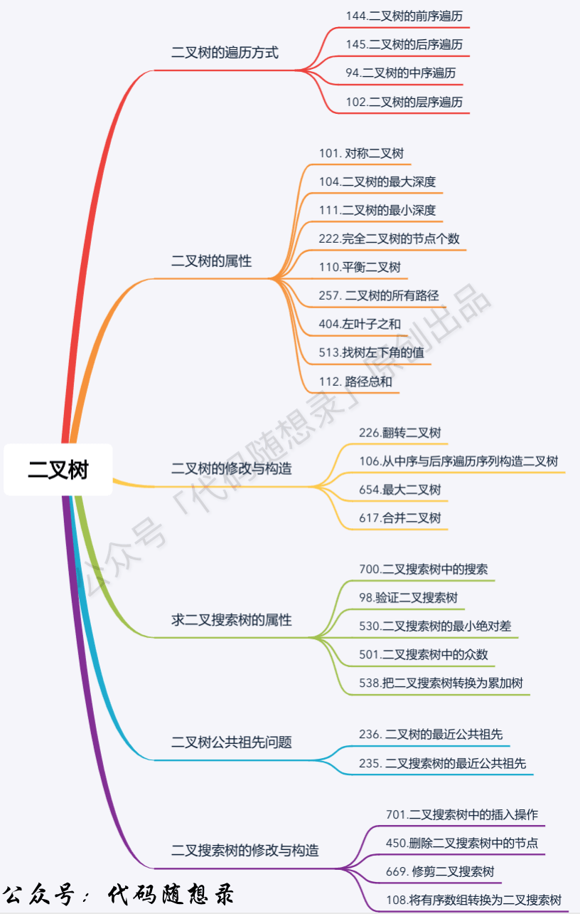
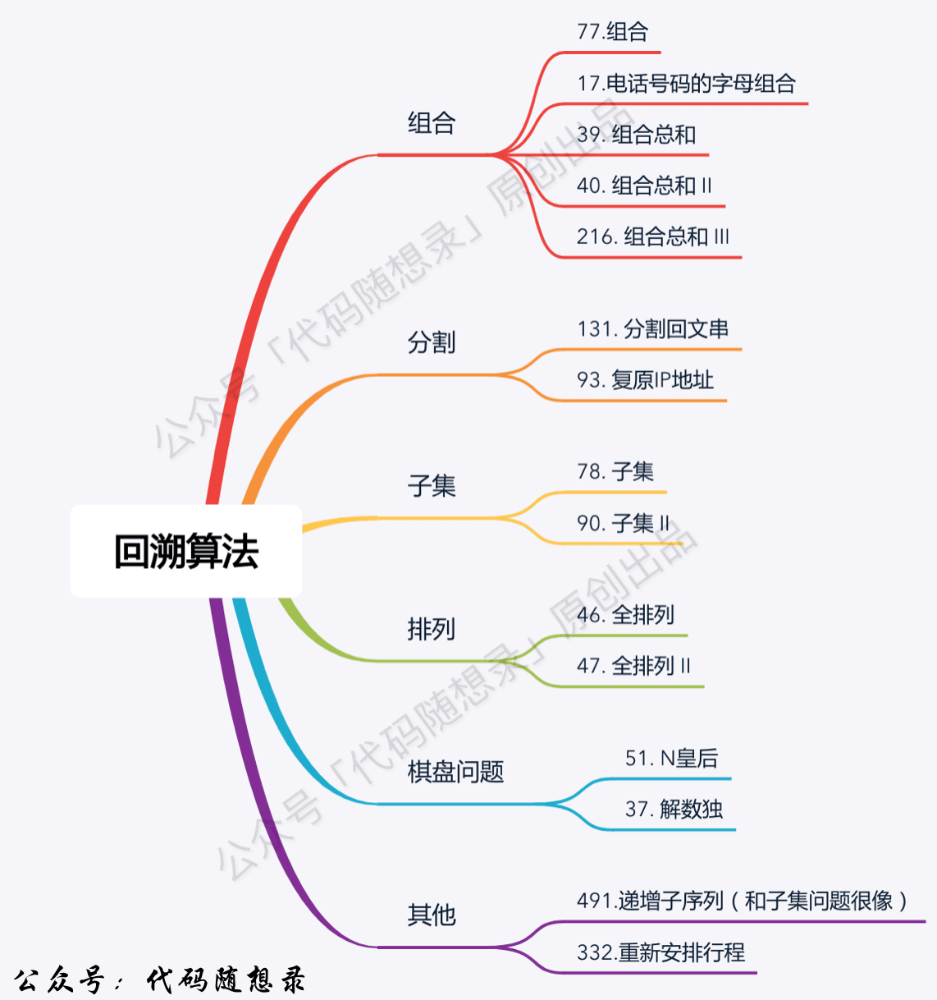
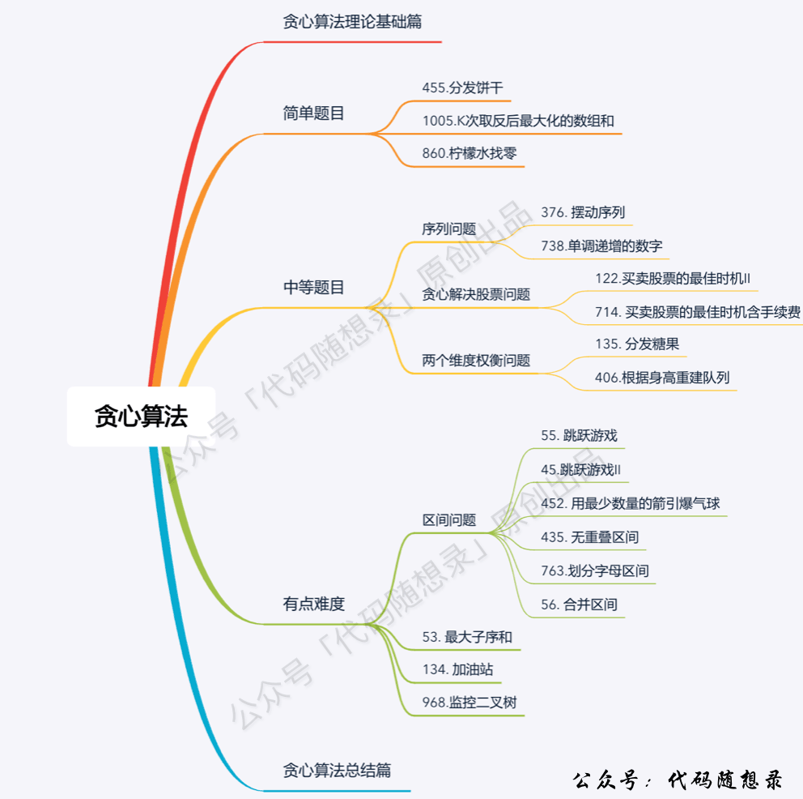
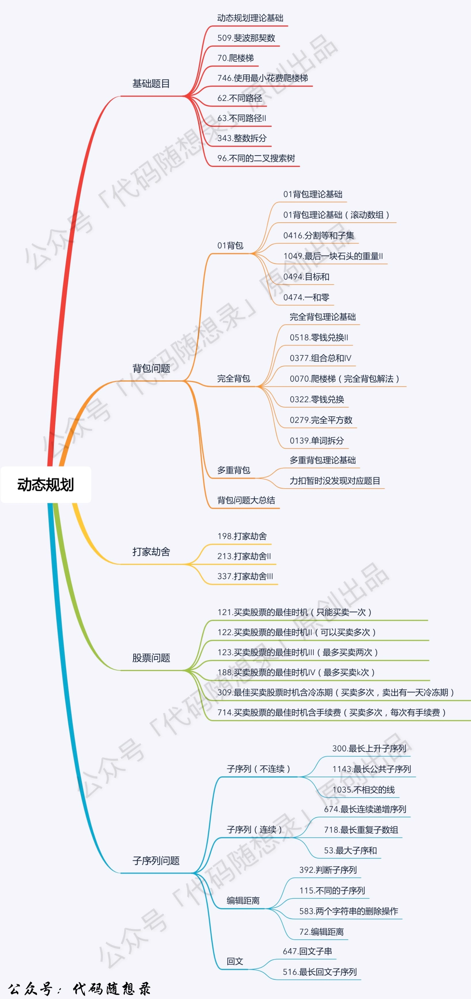
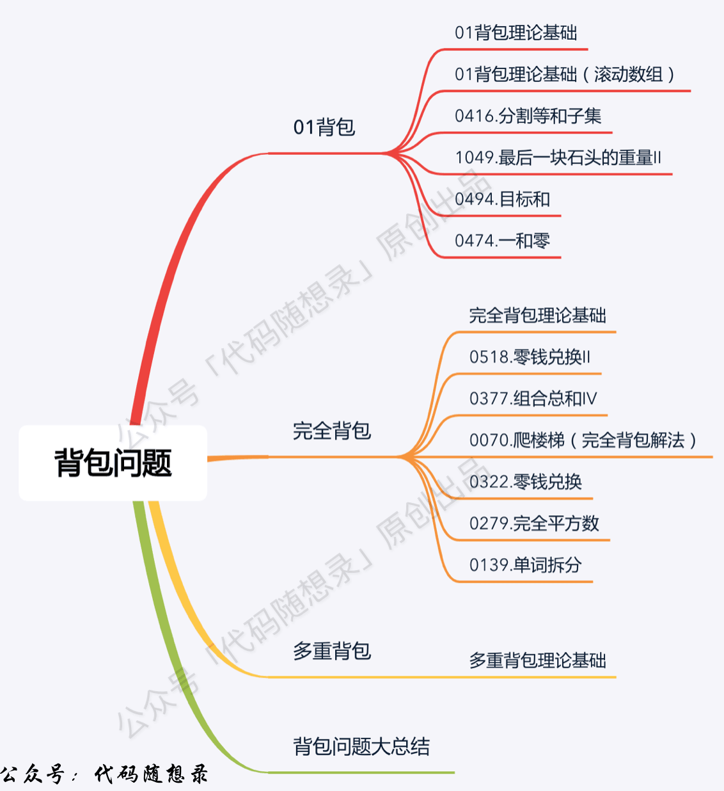
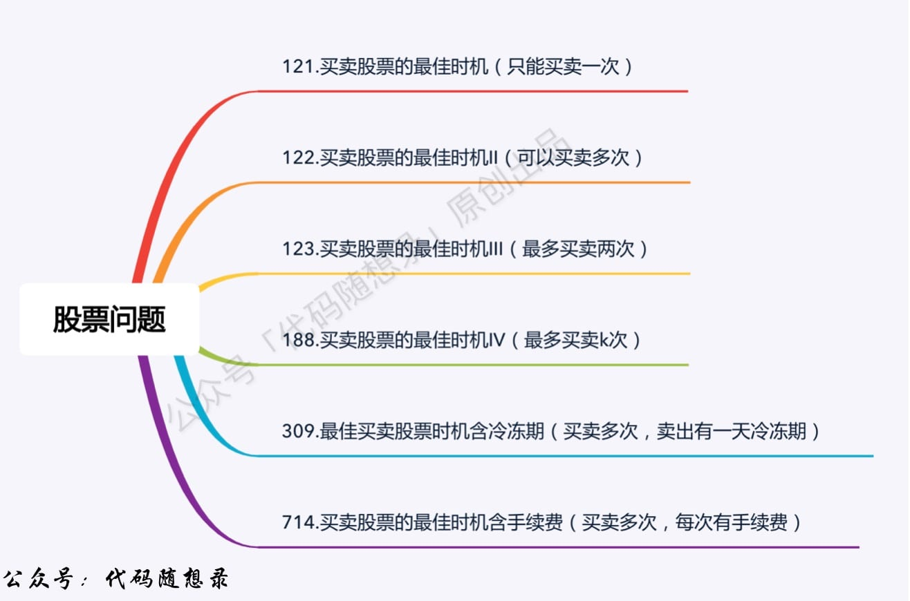
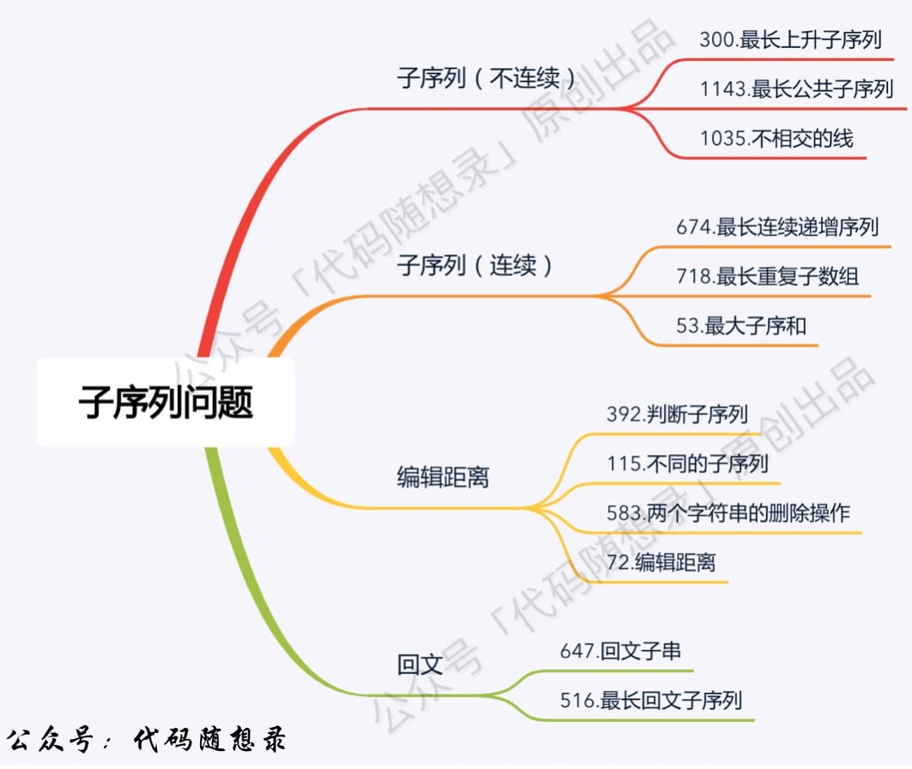

# 程式碼隨想錄 · 全網最強資料結構演算法學習路線

  <a href="https://keetcoder.com/">🌍 海外英文版</a> ·
  <a href="https://github.com/youngyangyang04/keetcoder">🌍🇸 英文儲存庫（repository）</a> ·
  <a href="https://programmercarl.com/">🇨🇳 中國大陸線上閱讀</a> ·
  <a href="https://gitee.com/programmercarl/leetcode-master">🇨  Gitee 同步</a>

  
  
  
  

> 一套 **循序漸進**、**少走彎路** 的刷題計畫。
> 題目已按知識脈絡與難度 **排好順序**，每題附 **圖文題解 + 影片解說**。
> 適合從零到進階、系統化掌握資料結構與演算法。

---

## 🔗 快速入口

- 📘 **出版書籍**：[《程式碼隨想錄》](https://union-click.jd.com/jdc?e=618%7Cpc%7C&p=JF8BASMJK1olXwABU1pUCU0SCl8IGV8WVAICU24ZVxNJXF9RXh5UHw0cSgYYXBcIWDoXSQVJQwYAUF1UDEsQHDZNRwYlVEBGPAIccE51dQ1cfjpVCnsHUjYbTkcbM244GFIXWQYAUV5VOHsXBF9adYOj696n5UKJosTCi_g4GmsVWwILVFhZCUIXBWgMK1wVVDZfHAIVXwAnM18LK1wVVBIEJh8PHE1lM18IK1glXQcCVVpYDU8RB2YUG18QXA4BSF5bDEIXBWsJHlgVXAEyVl9cDEInM7GFqyYQWHkHVBY1TUxoBmZtXT7L0LYTKClfCkMWEl8BGCMVCkFGBg01Dg5zSgcJUCxeD2AKNRwzChFKfGx3HQtCDnN3XV0aDB1KM2o4G10VXzY)
- 🧾 **PDF 精講**：[演算法精講 PDF](https://programmercarl.com/qita/algo_pdf.html)
- 🎬 **演算法公開課**：[170 期硬核影片](https://www.bilibili.com/video/BV1fA4y1o715)
- 🧠 **卡碼筆記**：[最強面試必考題（八股文）](https://notes.kamacoder.com/)
- 👥 **學習社群**：專案 / 面試經驗 / 學習方法 / 面試技巧 → 加入 [「程式碼隨想錄」知識星球](https://programmercarl.com/other/kstar.html)
- 🤝 **參與貢獻**：本儲存庫講解以 C++ 為主，含 Java / Python / Go / JS 多語言實作。想點亮頭像 👉 [如何提交程式碼](https://www.programmercarl.com/qita/join.html) · [致謝貢獻者](https://github.com/youngyangyang04/leetcode-master/graphs/contributors)
- 📢 **轉載須知**：全部為原創，引用請標註來源；惡意搬運將依法維權。

---

## 📚 為什麼選這套刷題路線？

- **不再海選題目**：README 就是刷題路線，**按順序刷**即可。
- **全鏈路學習體驗**：每個專題含「理論基礎 → 實戰題目 → 總結檢討」。
- **經典高頻必會**：題目均為**高頻面試題**與**典型考點**。
- **多語言涵蓋**：除 C++ 主線，還有社群貢獻的多語言實作。

---

## 🚀 如何使用本攻略

1. **從頭開始**：按模組順序「陣列（array） → 鏈接串列（linked list） → 雜湊表（hash table） → … → 圖論（graph theory）」。
2. **帶著問題學**：每個模組先看「理論基礎」，再刷對應題單。
3. **及時檢討回顧**：刷完一個模組，閱讀「總結篇」，形成**完整知識閉環**。
4. **語言不設限**：題解以 C++ 講解為主，附多語言程式碼，解題思路通用。

> **建議**：新手先刷「陣列/鏈接串列/雜湊/字串（string）」，再進階到「二元樹（binary tree）/回溯（backtracking）/貪心法（greedy）/動態規劃（dynamic programming, DP）/圖論」。

---

## 🧭 刷題總目錄（可折疊）

> 已根據學習曲線最佳化排序；下方僅展示每章前若干題目，完整清單請展開查看。

<b>前序</b>

* AI 工具
    * [中國大陸支付寶、微信給 ChatGPT、Claude 儲值](https://github.com/youngyangyang04/gpt-daichong) 
    * [中國大陸如何使用 Claude Code](https://github.com/youngyangyang04/claude-code-usage)
    * [Claude Code OpAPI 接入](https://github.com/youngyangyang04/chatgpt-claude-api)

* 演算法效能分析
    * [關於時間複雜度（time complexity），你不知道的都在這裡！](./problems/前序/時間複雜度.md)
    * [O(n) 的演算法居然逾時了，此時的 n 究竟是多大？](./problems/前序/演算法逾時.md)
    * [透過一道面試題目，講一講遞迴（recursion）演算法的時間複雜度！](./problems/前序/遞迴演算法的時間複雜度.md)
    * [關於空間複雜度（space complexity），可能有幾個疑問？](./problems/前序/空間複雜度.md)
    * [遞迴演算法的時間與空間複雜度分析！](./problems/前序/遞迴演算法的時間與空間複雜度分析.md)
    * [刷了這麼多題，你了解自己程式碼的記憶體（memory）消耗嗎？](./problems/前序/記憶體消耗.md)

<b>陣列</b>

1. [陣列過於簡單，但你該了解這些！](./problems/陣列理論基礎.md)
2. [陣列：704. 二元搜尋（binary search）](./problems/0704.二分查找.md)
3. [陣列：27. 移除元素（element）](./problems/0027.移除元素.md)
4. [陣列：977. 有序陣列（ordered array）的平方](./problems/0977.有序陣列的平方.md)
5. [陣列：209. 長度最小的子陣列（subarray）](./problems/0209.長度最小的子陣列.md)
6. [陣列：區間（interval）和](./problems/kamacoder/0058.區間和.md)
7. [陣列：開發商購買土地](./problems/kamacoder/0044.開發商購買土地.md)
8. [陣列：59. 螺旋（spiral）矩陣（matrix）II](./problems/0059.螺旋矩陣II.md)
9. [陣列：總結篇](./problems/陣列總結篇.md)

<b>鏈接串列</b>

1. [關於鏈接串列，你該了解這些！](./problems/鏈接串列理論基礎.md)
2. [鏈接串列：203. 移除鏈接串列元素](./problems/0203.移除鏈接串列元素.md)
3. [鏈接串列：707. 設計鏈接串列](./problems/0707.設計鏈接串列.md)
4. [鏈接串列：206. 翻轉鏈接串列](./problems/0206.反轉鏈接串列.md)
5. [鏈接串列：24. 兩兩交換鏈接串列中的節點（node）](./problems/0024.兩兩交換鏈接串列中的節點.md)
6. [鏈接串列：19. 刪除鏈接串列的倒數第 N 個節點](./problems/0019.刪除鏈接串列的倒數第N個節點.md)
7. [鏈接串列：鏈接串列相交](./problems/面試題02.07.鏈接串列相交.md)
8. [鏈接串列：142. 環形鏈接串列](./problems/0142.環形鏈接串列II.md)
9. [鏈接串列：總結篇！](./problems/鏈接串列總結篇.md)

<b>雜湊表</b>

1. [關於雜湊表，你該了解這些！](./problems/雜湊表理論基礎.md)
2. [雜湊表：242. 有效的迴文（anagram）](./problems/0242.有效的字母異位詞.md)
3. [雜湊表：1002. 尋找常用字元（character）](./problems/1002.查找常用字符.md)
4. [雜湊表：349. 兩個陣列的交集（intersection）](./problems/0349.兩個陣列的交集.md)
5. [雜湊表：202. 快樂數](./problems/0202.快樂數.md)
6. [雜湊表：1. 兩數之和](./problems/0001.兩數之和.md)
7. [雜湊表：454. 四數相加 II](./problems/0454.四數相加II.md)
8. [雜湊表：383. 贖金信](./problems/0383.贖金信.md)
9. [雜湊表：15. 三數之和](./problems/0015.三數之和.md)
10. [two pointers：18. 四數之和](./problems/0018.四數之和.md)
11. [雜湊表：總結篇！](./problems/雜湊表總結.md)

<b>字串</b>

1. [字串：344. 反轉字串](./problems/0344.反轉字串.md)
2. [字串：541. 反轉字串 II](./problems/0541.反轉字串II.md)
3. [字串：替換數字](./problems/kamacoder/0054.替換數字.md)
4. [字串：151. 翻轉字串裡的單字](./problems/0151.反轉字串裡的單詞.md)
5. [字串：右旋字串](./problems/kamacoder/0055.右旋字串.md)
6. [幫你把 KMP 演算法學個通透](./problems/0028.實作strStr.md)
8. [字串：459. 重複的子字串（substring）](./problems/0459.重複的子字串.md)
9. [字串：總結篇！](./problems/字串總結.md)

<b>雙指標（two pointers）</b>

雙指標 基本都是應用在陣列、字串與鏈接串列的題目上

1. [陣列：27. 移除元素](./problems/0027.移除元素.md)
2. [字串：344. 反轉字串](./problems/0344.反轉字串.md)
3. [字串：替換數字](./problems/kamacoder/0054.替換數字.md)
4. [字串：151. 翻轉字串裡的單字](./problems/0151.反轉字串裡的單詞.md)
5. [鏈接串列：206. 翻轉鏈接串列](./problems/0206.反轉鏈接串列.md)
6. [鏈接串列：19. 刪除鏈接串列的倒數第 N 個節點](./problems/0019.刪除鏈接串列的倒數第N個節點.md)
7. [鏈接串列：鏈接串列相交](./problems/面試題02.07.鏈接串列相交.md)
8. [鏈接串列：142. 環形鏈接串列](./problems/0142.環形鏈接串列II.md)
9. [two pointers：15. 三數之和](./problems/0015.三數之和.md)
10. [two pointers：18. 四數之和](./problems/0018.四數之和.md)
11. [two pointers：總結篇！](./problems/雙指標總結.md)

<b>堆疊與佇列</b>

1. [堆疊（stack）與佇列（queue）：理論基礎](./problems/堆疊與佇列理論基礎.md)
2. [堆疊與佇列：232. 用堆疊實作佇列](./problems/0232.用堆疊實作佇列.md)
3. [堆疊與佇列：225. 用佇列實作堆疊](./problems/0225.用佇列實作堆疊.md)
4. [堆疊與佇列：20. 有效的括號](./problems/0020.有效的括號.md)
5. [堆疊與佇列：1047. 刪除字串中的所有相鄰重複項](./problems/1047.刪除字串中的所有相鄰重複項.md)
6. [堆疊與佇列：150. 反波蘭記法（reverse Polish notation）求值](./problems/0150.逆波蘭表式求值.md)
7. [堆疊與佇列：239. 滑動視窗（sliding windows）最大值](./problems/0239.滑動視窗最大值.md)
8. [堆疊與佇列：347. 前 K 個高頻元素](./problems/0347.前K個高頻元素.md)
9. [堆疊與佇列：總結篇！](./problems/堆疊與佇列總結.md)

<b>二元樹</b>

題目分類大綱如下：
 </img>

1. [關於二元樹，你該了解這些！](./problems/二叉樹理論基礎.md)
2. [二元樹：二元樹的遞迴遍歷（traversal）](./problems/二叉樹的遞迴遍歷.md)
3. [二元樹：二元樹的疊代（iteration）遍歷](./problems/二叉樹的疊代遍歷.md)
4. [二元樹：二元樹的統一疊代法](./problems/二叉樹的統一疊代法.md)
5. [二元樹：二元樹的層次序走訪（level order traversal）](./problems/0102.二元樹的層次序走訪.md)
6. [二元樹：226. 翻轉二元樹](./problems/0226.反轉二叉樹.md)
7. [本週小結！（二元樹）](./problems/週總結/20200927二叉樹週末總結.md)
8. [二元樹：101. 對稱（symmetric）二元樹](./problems/0101.對稱二叉樹.md)
9. [二元樹：104. 二元樹的最大深度（depth）](./problems/0104.二叉樹的最大深度.md)
10. [二元樹：111. 二元樹的最小深度](./problems/0111.二叉樹的最小深度.md)
11. [二元樹：222. 完全二元樹（complete binary tree）的節點個數](./problems/0222.完全二叉樹的節點個數.md)
12. [二元樹：110. 平衡二元樹（balanced binary tree）](./problems/0110.平衡二叉樹.md)
13. [二元樹：257. 二元樹的所有路徑](./problems/0257.二叉樹的所有路徑.md)
14. [本週小結！（二元樹）](./problems/週總結/20201003二叉樹週末總結.md)
16. [二元樹：404. 左葉之和](./problems/0404.左葉子之和.md)
17. [二元樹：513. 找樹左下角的值](./problems/0513.找樹左下角的值.md)
18. [二元樹：112. 路徑總和](./problems/0112.路徑總和.md)
19. [二元樹：106. 構造二元樹](./problems/0106.從中序與後序遍歷序列構造二叉樹.md)
20. [二元樹：654. 最大二元樹](./problems/0654.最大二叉樹.md)
21. [本週小結！（二元樹）](./problems/週總結/20201010二叉樹週末總結.md)
22. [二元樹：617. 合併兩個二元樹](./problems/0617.合併二叉樹.md)
23. [二元樹：700. 二元搜尋樹（binary search tree, BST）登場！](./problems/0700.二叉搜索樹中的搜索.md)
24. [二元樹：98. 驗證二元搜尋樹](./problems/0098.驗證二叉搜索樹.md)
25. [二元樹：530. 搜尋樹的最小絕對差](./problems/0530.二叉搜索樹的最小絕對差.md)
26. [二元樹：501. 二元搜尋樹中的眾數](./problems/0501.二叉搜索樹中的眾數.md)
27. [二元樹：236. 共用祖先問題](./problems/0236.二叉樹的最近公共祖先.md)
28. [本週小結！（二元樹）](./problems/週總結/20201017二叉樹週末總結.md)
29. [二元樹：235. 搜尋樹的最低共用源始（lowest common ancestor）](./problems/0235.二叉搜索樹的最近公共祖先.md)
30. [二元樹：701. 搜尋樹中的插入操作](./problems/0701.二叉搜索樹中的插入操作.md)
31. [二元樹：450. 搜尋樹中的刪除操作](./problems/0450.刪除二叉搜索樹中的節點.md)
32. [二元樹：669. 修剪二元搜尋樹](./problems/0669.修剪二叉搜索樹.md)
33. [二元樹：108. 將有序陣列轉換為二元搜尋樹](./problems/0108.將有序陣列轉換為二叉搜索樹.md)
34. [二元樹：538. 把二元搜尋樹轉換為累加樹](./problems/0538.把二叉搜索樹轉換為累加樹.md)
35. [二元樹：總結篇！（需要掌握的二元樹技能都在這裡了）](./problems/二叉樹總結篇.md)

<b>回溯演算法</b>

 </img>

1. [關於回溯演算法，你該了解這些！](./problems/回溯演算法理論基礎.md)
2. [回溯演算法：77. 組合（combination）](./problems/0077.組合.md)
3. [回溯演算法：77. 組合最佳化](./problems/0077.組合優化.md)
4. [回溯演算法：216. 組合總和 III](./problems/0216.組合總和III.md)
5. [回溯演算法：17. 電話號碼的字母組合](./problems/0017.電話號碼的字母組合.md)
6. [本週小結！（回溯演算法系列一）](./problems/週總結/20201030回溯週末總結.md)
7. [回溯演算法：39. 組合總和](./problems/0039.組合總和.md)
8. [回溯演算法：40. 組合總和 II](./problems/0040.組合總和II.md)
9. [回溯演算法：131. 分割回文（palindrome）字串](./problems/0131.分割回文串.md)
10. [回溯演算法：93. 復原 IP 位址（address）](./problems/0093.復原IP位址.md)
11. [回溯演算法：78. 子集（subset）](./problems/0078.子集.md)
12. [本週小結！（回溯演算法系列二）](./problems/週總結/20201107回溯週末總結.md)
13. [回溯演算法：90. 子集 II](./problems/0090.子集II.md)
14. [回溯演算法：491. 遞增次序列（subsequence）](./problems/0491.遞增次序列.md)
15. [回溯演算法：46. 全排列（permutation）](./problems/0046.全排列.md)
16. [回溯演算法：47. 全排列 II](./problems/0047.全排列II.md)
17. [本週小結！（回溯演算法系列三）](./problems/週總結/20201112回溯週末總結.md)
18. [回溯演算法去重問題的另一種寫法](./problems/回溯演算法去重問題的另一種寫法.md)
19. [回溯演算法：332. 重新安排行程](./problems/0332.重新安排行程.md)
20. [回溯演算法：51. n 皇后問題（n queens）](./problems/0051.N皇後.md)
21. [回溯演算法：37. 解 Sudoku](./problems/0037.解數獨.md)
22. [回溯演算法總結篇](./problems/回溯總結.md)

<b>貪心演算法</b>

 </img>

1. [關於貪心演算法，你該了解這些！](./problems/貪心演算法理論基礎.md)
2. [貪心演算法：455. 分發餅乾](./problems/0455.分發餅乾.md)
3. [貪心演算法：376. 擺動序列（sequence）](./problems/0376.擺動序列.md)
4. [貪心演算法：53. 最大子序和](./problems/0053.最大子序和.md)
5. [本週小結！（貪心演算法系列一）](./problems/週總結/20201126貪心週末總結.md)
6. [貪心演算法：122. 買賣股票的最佳時機 II](./problems/0122.買賣股票的最佳時機II.md)
7. [貪心演算法：55. 跳躍遊戲](./problems/0055.跳躍遊戲.md)
8. [貪心演算法：45. 跳躍遊戲 II](./problems/0045.跳躍遊戲II.md)
9. [貪心演算法：1005. K 次取反後最大化的陣列和](./problems/1005.K次取反後最大化的陣列和.md)
10. [本週小結！（貪心演算法系列二）](./problems/週總結/20201203貪心週末總結.md)
11. [貪心演算法：134. 加油站](./problems/0134.加油站.md)
12. [貪心演算法：135. 分發糖果](./problems/0135.分發糖果.md)
13. [貪心演算法：860. 檸檬水找零](./problems/0860.檸檬水找零.md)
14. [貪心演算法：406. 根據身高重建佇列](./problems/0406.根據身高重建隊列.md)
15. [本週小結！（貪心演算法系列三）](./problems/週總結/20201217貪心週末總結.md)
16. [貪心演算法：406. 根據身高重建佇列（續集）](./problems/根據身高重建隊列（vector原理講解）.md)
17. [貪心演算法：452. 用最少數量的箭引爆氣球](./problems/0452.用最少數量的箭引爆氣球.md)
18. [貪心演算法：435. 無重疊區間](./problems/0435.無重叠區間.md)
19. [貪心演算法：763. 劃分字母區間](./problems/0763.劃分字母區間.md)
20. [貪心演算法：56. 合併區間](./problems/0056.合併區間.md)
21. [本週小結！（貪心演算法系列四）](./problems/週總結/20201224貪心週末總結.md)
22. [貪心演算法：738. 單調遞增的數字](./problems/0738.單調遞增的數字.md)
23. [貪心演算法：968. 監控二元樹](./problems/0968.監控二叉樹.md)
24. [貪心演算法：總結篇！（每逢總結必經典）](./problems/貪心演算法總結篇.md)

<b>動態規劃</b>

動態規劃專題已經開始啦，來不及解釋了，夥伴們上車別掉隊！

 </img>

1. [關於動態規劃，你該了解這些！](./problems/動態規劃理論基礎.md)
2. [動態規劃：509. 斐波那契數（Fibonacci number）](./problems/0509.斐波那契數.md)
3. [動態規劃：70. 爬樓梯](./problems/0070.爬楼梯.md)
4. [動態規劃：746. 使用最小花費爬樓梯](./problems/0746.使用最小花費爬楼梯.md)
5. [本週小結！（動態規劃系列一）](./problems/週總結/20210107動規週末總結.md)
6. [動態規劃：62. 不同路徑](./problems/0062.不同路徑.md)
7. [動態規劃：63. 不同路徑 II](./problems/0063.不同路徑II.md)
8. [動態規劃：343. 整數（integer）拆分](./problems/0343.整數拆分.md)
9. [動態規劃：96. 不同的二元搜尋樹](./problems/0096.不同的二叉搜索樹.md)
10. [本週小結！（動態規劃系列二）](./problems/週總結/20210114動規週末總結.md)

背包問題（knapsack problem）系列：

 </img>

11. [動態規劃：0/1 背包問題（0/1 knapsack problem）理論基礎（二維（2D）dp 陣列）](./problems/背包理論基礎01背包-1.md)
12. [動態規劃：0/1 背包問題理論基礎（一維 dp 陣列）](./problems/背包理論基礎01背包-2.md)
13. [動態規劃：416. 分割等和子集](./problems/0416.分割等和子集.md)
14. [動態規劃：1049. 最後一塊石頭的重量 II](./problems/1049.最後一塊石頭的重量II.md)
15. [本週小結！（動態規劃系列三）](./problems/週總結/20210121動規週末總結.md)
16. [動態規劃：494. 目標和](./problems/0494.目標和.md)
17. [動態規劃：474. 一和零](./problems/0474.一和零.md)
18. [動態規劃：無界背包問題（unbounded knapsack problem）理論基礎（二維 dp 陣列）](./problems/背包問題理論基礎完全背包.md)
19. [動態規劃：無界背包問題理論基礎（一維 dp 陣列）](./problems/背包問題完全背包一維.md)
20. [動態規劃：518. 零錢兌換 II](./problems/0518.零錢兌換II.md)
21. [本週小結！（動態規劃系列四）](./problems/週總結/20210128動規週末總結.md)
22. [動態規劃：377. 組合總和 Ⅳ](./problems/0377.組合總和Ⅳ.md)
23. [動態規劃：70. 爬樓梯（無界背包問題版本）](./problems/0070.爬楼梯完全背包版本.md)
24. [動態規劃：322. 零錢兌換](./problems/0322.零錢兌換.md)
25. [動態規劃：279. 完全平方（perfect square）數](./problems/0279.完全平方數.md)
26. [本週小結！（動態規劃系列五）](./problems/週總結/20210204動規週末總結.md)
27. [動態規劃：139. 單字拆分](./problems/0139.單詞拆分.md)
28. [動態規劃：bounded knapsack 理論基礎](./problems/背包問題理論基礎多重背包.md)
29. [背包問題總結篇](./problems/背包總結篇.md)

打家劫舍系列：

29. [動態規劃：198. 打家劫舍](./problems/0198.打家劫捨.md)
30. [動態規劃：213. 打家劫舍 II](./problems/0213.打家劫捨II.md)
31. [動態規劃：337. 打家劫舍 III](./problems/0337.打家劫捨III.md)

股票系列：

 </img>

32. [動態規劃：121. 買賣股票的最佳時機](./problems/0121.買賣股票的最佳時機.md)
33. [動態規劃：本週小結（系列六）](./problems/週總結/20210225動規週末總結.md)
34. [動態規劃：122. 買賣股票的最佳時機 II](./problems/0122.買賣股票的最佳時機II（動態規劃）.md)
35. [動態規劃：123. 買賣股票的最佳時機 III](./problems/0123.買賣股票的最佳時機III.md)
36. [動態規劃：188. 買賣股票的最佳時機 IV](./problems/0188.買賣股票的最佳時機IV.md)
37. [動態規劃：309. 最佳買賣股票時機含冷凍期](./problems/0309.最佳買賣股票時機含冷凍期.md)
38. [動態規劃：本週小結（系列七）](./problems/週總結/20210304動規週末總結.md)
39. [動態規劃：714. 買賣股票的最佳時機含手續費](./problems/0714.買賣股票的最佳時機含手續費（動態規劃）.md)
40. [動態規劃：股票系列總結篇](./problems/動態規劃-股票問題總結篇.md)

次序列系列：

 </img>

41. [動態規劃：300. longest increasing subsequence](./problems/0300.最長上升次序列.md)
42. [動態規劃：674. 最長連續遞增序列](./problems/0674.最長連續遞增序列.md)
43. [動態規劃：718. 最長重複子陣列](./problems/0718.最長重複子陣列.md)
44. [動態規劃：1143. 最長公用次序列（longest common subsequence）](./problems/1143.最長公共次序列.md)
45. [動態規劃：1035. 不相交的線](./problems/1035.不相交的线.md)
46. [動態規劃：53. 最大子序和](./problems/0053.最大子序和（動態規劃）.md)
47. [動態規劃：392. 判斷次序列](./problems/0392.判斷次序列.md)
48. [動態規劃：115. 不同的次序列](./problems/0115.不同的次序列.md)
49. [動態規劃：583. 兩個字串的刪除操作](./problems/0583.兩個字串的刪除操作.md)
50. [動態規劃：72. edit distance](./problems/0072.編輯距離.md)
51. [edit distance 總結篇](./problems/為了絕殺編輯距離，卡爾做了三步鋪墊.md)
52. [動態規劃：647. 回文子字串](./problems/0647.回文子字串.md)
53. [動態規劃：516. 最長回文次序列](./problems/0516.最長回文次序列.md)
54. [動態規劃總結篇](./problems/動態規劃總結篇.md)

<b>單調堆疊（monotonic stack）</b>

1. [monotonic stack：739. 每日溫度](./problems/0739.每日溫度.md)
2. [monotonic stack：496. 下一個更大元素 I](./problems/0496.下一個更大元素I.md)
3. [monotonic stack：503. 下一個更大元素 II](./problems/0503.下一個更大元素II.md)
4. [monotonic stack：42. 接雨水](./problems/0042.接雨水.md)
5. [monotonic stack：84. 直方圖（histogram）中最大的矩形](./problems/0084.柱狀圖中最大的矩形.md)

<b>圖論</b>

**[圖論正式發布](./problems/qita/tulunfabu.md)**

1. [圖論：理論基礎](./problems/kamacoder/圖論理論基礎.md)
2. [圖論：深度優先搜尋（depth-first search, DFS）理論基礎](./problems/kamacoder/圖論深搜理論基礎.md)
3. [圖論：所有可達路徑](./problems/kamacoder/0098.所有可達路徑.md)
4. [圖論：廣度優先搜尋（breadth-first search, BFS）理論基礎](./problems/kamacoder/圖論廣搜理論基礎.md)
5. [圖論：島嶼數量. 深搜版](./problems/kamacoder/0099.島嶼的數量深搜.md)
6. [圖論：島嶼數量. 廣搜版](./problems/kamacoder/0099.島嶼的數量廣搜.md)
7. [圖論：島嶼的最大面積](./problems/kamacoder/0100.島嶼的最大面積.md)
8. [圖論：孤島的總面積](./problems/kamacoder/0101.孤島的總面積.md)
9. [圖論：沉沒孤島](./problems/kamacoder/0102.沉沒孤島.md)
10. [圖論：水流問題](./problems/kamacoder/0103.水流問題.md)
11. [圖論：建造最大島嶼](./problems/kamacoder/0104.建造最大島嶼.md)
12. [圖論：島嶼的周長](./problems/kamacoder/0106.島嶼的周長.md)
13. [圖論：字串接龍](./problems/kamacoder/0110.字串接龍.md)
14. [圖論：有向圖（directed graph）的完全可達性](./problems/kamacoder/0105.有向圖的完全可達性.md)
15. [圖論：互斥集（disjoint set）理論基礎](./problems/kamacoder/圖論並查集理論基礎.md)
16. [圖論：尋找存在的路徑](./problems/kamacoder/0107.尋找存在的路徑.md)
17. [圖論：冗餘（redundant）連接](./problems/kamacoder/0108.冗餘連接.md)
18. [圖論：冗餘連接 II](./problems/kamacoder/0109.冗餘連接II.md)
19. [圖論：最小生成樹（minimum spanning tree, MST）之 prim](./problems/kamacoder/0053.尋寶-prim.md)
20. [圖論：最小生成樹之 kruskal](./problems/kamacoder/0053.尋寶-Kruskal.md)
21. [圖論：拓蹼排序（topological sort）](./problems/kamacoder/0117.軟體建置.md)
22. [圖論：dijkstra（樸素版）](./problems/kamacoder/0047.參會dijkstra樸素.md)
23. [圖論：dijkstra（堆積（heap）最佳化版）](./problems/kamacoder/0047.參會dijkstra堆積.md)
24. [圖論：Bellman_ford 演算法](./problems/kamacoder/0094.城市間貨物運輸I.md)
25. [圖論：Bellman_ford 佇列最佳化演算法（又名 SPFA）](./problems/kamacoder/0094.城市間貨物運輸I-SPFA.md)
26. [圖論：Bellman_ford 之判斷 negative weight cycle](./problems/kamacoder/0095.城市間貨物運輸II.md)
27. [圖論：Bellman_ford 之單源有限最短路徑（shortest path）](./problems/kamacoder/0096.城市間貨物運輸III.md)
28. [圖論：Floyd 演算法](./problems/kamacoder/0097.小明逛公園.md)
29. [圖論：A * 演算法](./problems/kamacoder/0126.騎士的攻擊astar.md)
30. [圖論：最短路徑演算法總結篇](./problems/kamacoder/最短路問題總結篇.md)
31. [圖論：圖論總結篇](./problems/kamacoder/圖論總結篇.md)

---

## 🧩 演算法模板（template）

- [各類基礎演算法模板（持續更新）](https://github.com/youngyangyang04/leetcode/blob/master/problems/算法模板.md)

---

## 🙌 參與貢獻

- 歡迎提交 **題解修訂 / 多語言實作 / 文件勘誤 / 新增練習**
- 請先閱讀：[如何提交與協作](https://www.programmercarl.com/qita/join.html)
- 致謝所有貢獻者 → [Contributors](https://github.com/youngyangyang04/leetcode-master/graphs/contributors)

---

## ⭐ Star 趨勢

---

## 👨‍💻 關於作者

大家好，我是 **程式設計師 Carl**，哈工大學長，先後在騰訊、百度從事後端（back end）與底層技術研發，著有《程式碼隨想錄》。

---

## 📥 PDF 下載與學習群

加入下方企業微信，自動取得 **PDF 精講**，並可選擇加入刷題群：
> 備註格式
> - **在職**：姓名-城市-職位
> - **學生**：姓名-學校-年級（**無備註不通過**）

  

---

## 📜 版權說明

- 本儲存庫所有內容均為原創，引用需 **註明出處與連結**。
- 嚴禁惡意搬運與洗稿，侵權必究。

---

