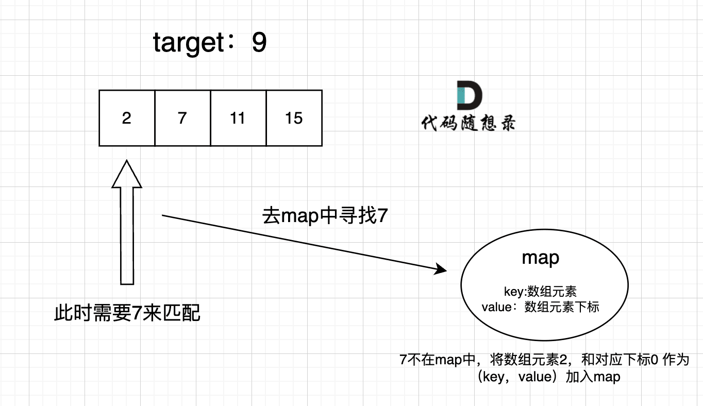
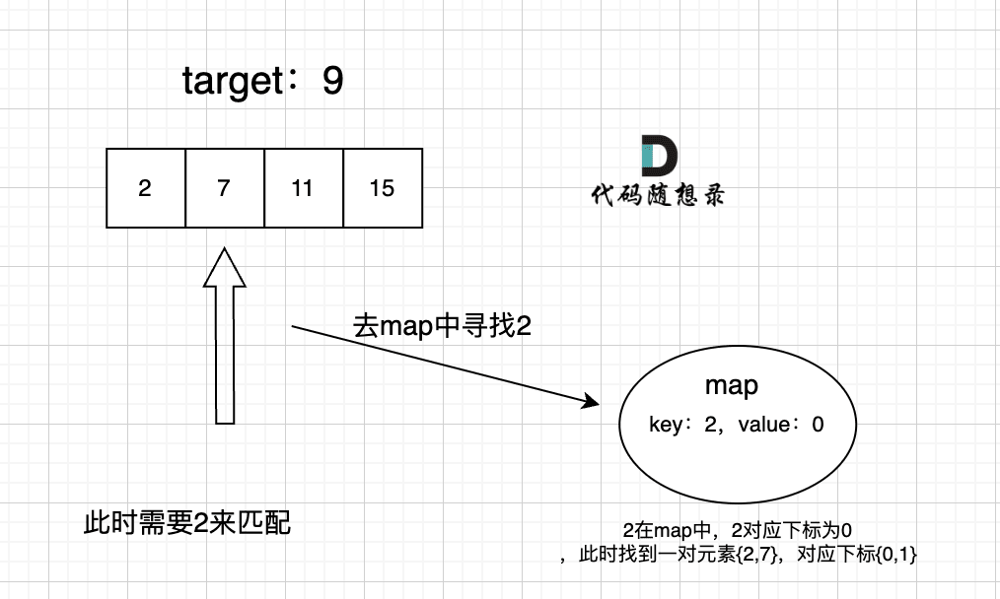

* [做專案（多個 C++、Java、Go、測試開發、前端（front end）專案）](https://www.programmercarl.com/other/kstar.html)
* [刷演算法（兩個月高強度學演算法）](https://www.programmercarl.com/xunlian/xunlianying.html)
* [背八股（40 天挑戰高頻面試題）](https://www.programmercarl.com/xunlian/bagu.html)


# 1. 兩數之和

[LeetCode 題目連結](https://leetcode.cn/problems/two-sum/)

給定一個整數（integer）陣列（array） nums 和一個目標值 target，請你在該陣列中找出和為目標值的那 兩個 整數，並回傳它們的陣列下標（subscript）。

你可以假設每種輸入只會對應一個答案。但是，陣列中同一個元素（element）不能使用兩遍。

**範例：**

給定 nums = [2, 7, 11, 15], target = 9

因為 nums[0] + nums[1] = 2 + 7 = 9

所以回傳 [0, 1]

## 演算法公開課

**[《程式碼隨想錄》演算法影片公開課](https://programmercarl.com/other/gongkaike.html)：[夢開始的地方，Leetcode：1. 兩數之和](https://www.bilibili.com/video/BV1aT41177mK)，相信結合影片再看本篇題解，更有助於大家對本題的理解**。


## 解題思路

很明顯蠻力法（brute force）的解法是兩層 for 迴圈（for-loop）搜尋，時間複雜度（time complexity）是 O(n^2)。

建議大家做這道題目之前，先做一下這兩道
* [242. 有效的迴文（anagram）](https://www.programmercarl.com/0242.有效的字母异位词.html)
* [349. 兩個陣列的交集（intersection）](https://www.programmercarl.com/0349.两个数组的交集.html)

[242. 有效的迴文](https://www.programmercarl.com/0242.有效的字母异位词.html) 這道題目是用陣列作為雜湊表（hash table）來解決雜湊（hash）問題，[349. 兩個陣列的交集](https://www.programmercarl.com/0349.两个数组的交集.html)這道題目是透過 set 作為雜湊表來解決雜湊問題。


首先我再強調一下 **什麼時候使用雜湊法**，當我們需要查詢一個元素是否出現過，或者一個元素是否在集合（set）裡的時候，就要第一時間想到雜湊法。 

本題呢，我就需要一個集合來存放我們遍歷（traversal）過的元素，然後在遍歷陣列的時候去詢問這個集合，某元素是否遍歷過，也就是是否出現在這個集合。

那麼我們就應該想到使用雜湊法了。

因為本題，我們不僅要知道元素有沒有遍歷過，還要知道這個元素對應的下標，**需要使用 key value 結構來存放，key 來存元素，value 來存下標，那麼使用 map 正合適**。 

再來看一下使用陣列和 set 來做雜湊法的侷限。

* 陣列的大小是受限制的，而且如果元素很少，而雜湊值太大會造成記憶體（memory）空間的浪費。
* set 是一個集合，裡面放的元素只能是一個 key，而兩數之和這道題目，不僅要判斷 y 是否存在而且還要記錄 y 的下標位置，因為要回傳 x 和 y 的下標。所以 set 也不能用。

此時就要選擇另一種資料結構：map ，map 是一種 key value 的儲存結構，可以用 key 保存數值，用 value 再保存數值所在的下標。

C++ 中 map，有三種類型：

|映射（map） |底層實作 | 是否有序（ordered） |數值是否可以重複 | 能否更改數值|查詢效率 |增刪效率|
|---|---| --- |---| --- | --- | ---|
|std::map |紅-黑樹（red-black tree） |key 有序 |key 不可重複 |key 不可修改 | O(log n)|O(log n) |
|std::multimap | 紅-黑樹|key 有序 | key 可重複 | key 不可修改|O(log n) |O(log n) |
|std::unordered_map |雜湊表 | key 無序 |key 不可重複 |key 不可修改 |O(1) | O(1)|

std::unordered_map 底層實作為雜湊表，std::map 和 std::multimap 的底層實作是紅-黑樹。

同理，std::map 和 std::multimap 的 key 也是有序的（這個問題也經常作為面試題，考察對語言容器（container）底層的理解）。 更多雜湊表的理論知識請看[關於雜湊表，你該了解這些！](https://www.programmercarl.com/哈希表理论基础.html)。

**這道題目中並不需要 key 有序，選擇 std::unordered_map 效率更高！** 使用其他語言的錄友注意了解一下自己所用語言的資料結構就行。

接下來需要明確兩點： 

* **map 用來做什麼**
* **map 中 key 和 value 分別表示什麼**

map 目的用來存放我們存取過的元素，因為遍歷陣列的時候，需要記錄我們之前遍歷過哪些元素和對應的下標，這樣才能找到與目前元素相匹配的（也就是相加等於 target）

接下來是 map 中 key 和 value 分別表示什麼。 

這道題我們需要給出一個元素，判斷這個元素是否出現過，如果出現過，回傳這個元素的下標。 

那麼判斷元素是否出現，這個元素就要作為 key，所以陣列中的元素作為 key，有 key 對應的就是 value，value 用來存下標。 

所以 map 中的儲存結構為 {key：資料元素，value：陣列元素對應的下標}。 

在遍歷陣列的時候，只需要向 map 去查詢是否有和目前遍歷元素匹配的數值，如果有，就找到匹配對，如果沒有，就把目前遍歷的元素放進 map 中，因為 map 存放的就是我們存取過的元素。

過程如下：

 




C++ 程式碼：

```CPP
class Solution {
public:
    vector<int> twoSum(vector<int>& nums, int target) {
        std::unordered_map <int,int> map;
        for(int i = 0; i < nums.size(); i++) {
            // 遍歷目前元素，並在 map 中尋找是否有匹配的 key
            auto iter = map.find(target - nums[i]); 
            if(iter != map.end()) {
                return {iter->second, i};
            }
            // 如果沒找到匹配對，就把存取過的元素和下標加入到 map 中
            map.insert(pair<int, int>(nums[i], i)); 
        }
        return {};
    }
};
```

* 時間複雜度: O(n)
* 空間複雜度（space complexity）: O(n)

## 總結 

本題其實有四個重點： 

* 為什麼會想到用雜湊表 
* 雜湊表為什麼用 map 
* 本題 map 是用來存什麼的 
* map 中的 key 和 value 用來存什麼的 

把這四點想清楚了，本題才算是理解透徹了。

很多錄友把這道題目通過了，但都沒想清楚 map 是用來做什麼的，以至於對程式碼的理解其實是一知半解的。 


## 其他語言版本

### Java：

```java
//使用雜湊表
public int[] twoSum(int[] nums, int target) {
    int[] res = new int[2];
    if(nums == null || nums.length == 0){
        return res;
    }
    Map<Integer, Integer> map = new HashMap<>();
    for(int i = 0; i < nums.length; i++){
        int temp = target - nums[i];   // 遍歷目前元素，並在 map 中尋找是否有匹配的 key
        if(map.containsKey(temp)){
            res[1] = i;
            res[0] = map.get(temp);
            break;
        }
        map.put(nums[i], i);    // 如果沒找到匹配對，就把存取過的元素和下標加入到 map 中
    }
    return res;
}
```

```java
//使用雜湊表方法2
public int[] twoSum(int[] nums, int target) {
    Map<Integer, Integer> indexMap = new HashMap<>();
    
    for(int i = 0; i < nums.length; i++){
        int balance = target - nums[i];  // 記錄目前目標值的餘數
        if(indexMap.containsKey(balance)){  // 搜尋目前的 map 中是否有滿足要求的值
            return new int []{i, indexMap.get(balance)}; //  如果有，回傳目標值
        } else{
            indexMap.put(nums[i], i); //  如果沒有，把存取過的元素和下標加入 map 中
        }
    }
    return null;
}
```

```java
//使用 two pointers
public int[] twoSum(int[] nums, int target) {
    int m=0,n=0,k,board=0;
    int[] res=new int[2];
    int[] tmp1=new int[nums.length];
    //備份原本下標的 nums 陣列
    System.arraycopy(nums,0,tmp1,0,nums.length);
    //將 nums 排序
    Arrays.sort(nums);
    //two pointers
    for(int i=0,j=nums.length-1;i<j;){
        if(nums[i]+nums[j]<target)
            i++;
        else if(nums[i]+nums[j]>target)
            j--;
        else if(nums[i]+nums[j]==target){
            m=i;
            n=j;
            break;
        }
    }
    //找到 nums[m] 在 tmp1 陣列中的下標
    for(k=0;k<nums.length;k++){
        if(tmp1[k]==nums[m]){
            res[0]=k;
            break;
        }
    }
    //找到 nums[n] 在 tmp1 陣列中的下標
    for(int i=0;i<nums.length;i++){
        if(tmp1[i]==nums[n]&&i!=k)
            res[1]=i;
    }
    return res;
}
```

### Python：
（版本一） 使用字典（dictionary）

```python
class Solution:
    def twoSum(self, nums: List[int], target: int) -> List[int]:
        records = dict()

        for index, value in enumerate(nums):  
            if target - value in records:   # 遍歷目前元素，並在 map 中尋找是否有匹配的 key
                return [records[target- value], index]
            records[value] = index    # 如果沒找到匹配對，就把存取過的元素和下標加入到 map 中
        return []
```
（版本二）使用集合
```python
class Solution:
    def twoSum(self, nums: List[int], target: int) -> List[int]:
        #建立一個集合來儲存我們目前看到的數字
        seen = set()             
        for i, num in enumerate(nums):
            complement = target - num
            if complement in seen:
                return [nums.index(complement), i]
            seen.add(num)
```
（版本三）使用 雙指標（two pointers）
```python
class Solution:
    def twoSum(self, nums: List[int], target: int) -> List[int]:
        # 對輸入串列進行排序
        nums_sorted = sorted(nums)
        
        # 使用 two pointers
        left = 0
        right = len(nums_sorted) - 1
        while left < right:
            current_sum = nums_sorted[left] + nums_sorted[right]
            if current_sum == target:
                # 如果和等於目標數，則回傳兩個數的下標
                left_index = nums.index(nums_sorted[left])
                right_index = nums.index(nums_sorted[right])
                if left_index == right_index:
                    right_index = nums[left_index+1:].index(nums_sorted[right]) + left_index + 1
                return [left_index, right_index]
            elif current_sum < target:
                # 如果總和小於目標，則將左側指標向右移動
                left += 1
            else:
                # 如果總和大於目標值，則將右指標向左移動
                right -= 1
```
（版本四）蠻力法
```python
class Solution:
    def twoSum(self, nums: List[int], target: int) -> List[int]:
        for i in range(len(nums)):
            for j in range(i+1, len(nums)):
                if nums[i] + nums[j] == target:
                    return [i,j]
```

### Go：

```go
// 蠻力法
func twoSum(nums []int, target int) []int {
    for k1, _ := range nums {
        for k2 := k1 + 1; k2 < len(nums); k2++ {
            if target == nums[k1] + nums[k2] {
                return []int{k1, k2}
            }
        }
    }
    return []int{}
}
```

```go
func twoSum(nums []int, target int) []int {
    m := make(map[int]int)
    for i, num := range nums {
        complement := target - num
        if index, found := m[complement]; found {
            return []int{index, i}
        }
        m[num] = i
    }
    return nil  // 回傳空陣列 nil 代替空切片
}
```

### Rust:

```rust
use std::collections::HashMap;

impl Solution {
    pub fn two_sum(nums: Vec<i32>, target: i32) -> Vec<i32> {
        let mut map = HashMap::with_capacity(nums.len());

        for i in 0..nums.len() {
            if let Some(k) = map.get(&(target - nums[i])) {
                if *k != i {
                    return vec![*k as i32,  i as i32];
                }
            }
            map.insert(nums[i], i);
        }
        panic!("not found")
    }
}
```
```rust
use std::collections::HashMap;
 
impl Solution {
    pub fn two_sum(nums: Vec<i32>, target: i32) -> Vec<i32> {
        let mut hm: HashMap<i32, i32> = HashMap::new();
        for i in 0..nums.len() {
            let j = target - nums[i];
            if hm.contains_key(&j) {
                return vec![*hm.get(&j).unwrap(), i as i32]
            } else {
                hm.insert(nums[i], i as i32);
            }
        }
        vec![-1, -1]
    }
}
```

### JavaScript:

```javascript
var twoSum = function (nums, target) {
  let hash = {};
  for (let i = 0; i < nums.length; i++) {  // 遍歷目前元素，並在 map 中尋找是否有匹配的 key
    if (hash[target - nums[i]] !== undefined) {
      return [i, hash[target - nums[i]]];
    }
    hash[nums[i]] = i;   // 如果沒找到匹配對，就把存取過的元素和下標加入到 map 中
  }
  return [];
};
```

### TypeScript：

```typescript
function twoSum(nums: number[], target: number): number[] {
    let helperMap: Map<number, number> = new Map();
    let index: number | undefined;
    let resArr: number[] = [];
    for (let i = 0, length = nums.length; i < length; i++) {
        index = helperMap.get(target - nums[i]);
        if (index !== undefined) {
            resArr = [i, index];
            break;
        }
        helperMap.set(nums[i], i);
    }
    return resArr;
};
```

### PhP:

```php
function twoSum(array $nums, int $target): array
{
    $map = [];
    foreach($nums as $i => $num) {
        if (isset($map[$target - $num])) {
            return [
                $i,
                $map[$target - $num]
            ];
        } else {
            $map[$num] = $i;
        }
    }
    return [];
}
```

### Swift：

```swift
func twoSum(_ nums: [Int], _ target: Int) -> [Int] {
    // 值: 下標
    var map = [Int: Int]()
    for (i, e) in nums.enumerated() {
        if let v = map[target - e] {
            return [v, i]
        } else {
            map[e] = i
        }
    }
    return []
}
```

### Scala:

```scala
object Solution {
  // 匯入套件
  import scala.collection.mutable
  def twoSum(nums: Array[Int], target: Int): Array[Int] = {
    // key 儲存值，value 儲存下標
    val map = new mutable.HashMap[Int, Int]()
    for (i <- nums.indices) {
      val tmp = target - nums(i) // 計算差值
      // 如果這個差值存在於 map，則說明找到了結果
      if (map.contains(tmp)) {
        return Array(map.get(tmp).get, i)
      }
      // 如果不包含把目前值與其下標放到 map
      map.put(nums(i), i)
    }
    // 如果沒有找到直接回傳一個空的陣列，return 關鍵字可以省略
    new Array[Int](2)
  }
}
```

### C#:

```csharp
public class Solution {
    public int[] TwoSum(int[] nums, int target) {
        Dictionary<int ,int> dic= new Dictionary<int,int>();
        for(int i=0;i<nums.Length;i++){
            int imp= target-nums[i];
            if(dic.ContainsKey(imp)&&dic[imp]!=i){
               return new int[]{i, dic[imp]};
            }
            if(!dic.ContainsKey(nums[i])){
                dic.Add(nums[i],i);
            }
        }
        return new int[]{0, 0};
    }
}
```

### Dart:

```dart
import 'dart:collection';

List<int> twoSum(List<int> nums, int target) {
  HashMap<int, int> hashMap = HashMap();
  for (int i = 0; i < nums.length; i++) {
    int rest = target - nums[i];
    if (hashMap.containsKey(rest)) {
      return [hashMap[rest]!, i];
    }
    hashMap.addEntries({nums[i]: i}.entries);
  }
  return [];
}
```

### C:

```c


/**
 * Note: The returned array must be malloced, assume caller calls free().
 */

// leetcode 支援 ut_hash 函式庫

 typedef struct {
     int key;
     int value;
     UT_hash_handle hh; // make this structure hashable
 } map;

map* hashMap = NULL;

 void hashMapAdd(int key, int value){
     map* s;
     // key already in the hash?
     HASH_FIND_INT(hashMap, &key, s);
     if(s == NULL){
         s = (map*)malloc(sizeof(map));
         s -> key = key;
         HASH_ADD_INT(hashMap, key, s);
     }
     s -> value = value;
 }

map* hashMapFind(int key){
     map* s;
     // *s: output pointer
     HASH_FIND_INT(hashMap, &key, s);   
     return s;
 }

 void hashMapCleanup(){
     map* cur, *tmp;
     HASH_ITER(hh, hashMap, cur, tmp){
         HASH_DEL(hashMap, cur);
         free(cur);
     }
 }

 void hashPrint(){
     map* s;
     for(s = hashMap; s != NULL; s=(map*)(s -> hh.next)){
         printf("key %d, value %d\n", s -> key, s -> value);
     }
 }

 
int* twoSum(int* nums, int numsSize, int target, int* returnSize){
    int i, *ans;
    // hash find result
    map* hashMapRes; 
    hashMap = NULL;
    ans = malloc(sizeof(int) * 2);

    for(i = 0; i < numsSize; i++){
        // key 代表 nums[i] 的值，value 代表所在 index;
        hashMapAdd(nums[i], i);
    }

    hashPrint();

    for(i = 0; i < numsSize; i++){
        hashMapRes = hashMapFind(target - nums[i]);
        if(hashMapRes && hashMapRes -> value != i){
            ans[0] = i;
            ans[1] = hashMapRes -> value ;
            *returnSize = 2;
            return ans;
        }
    }
    
    hashMapCleanup();
    return NULL;
}
```

