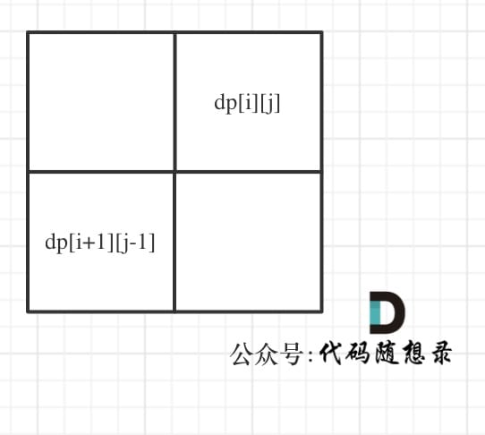
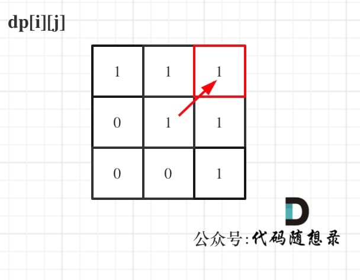

* [做專案（多個 C++、Java、Go、測試開發、前端（front end）專案）](https://www.programmercarl.com/other/kstar.html)
* [刷演算法（兩個月高強度學演算法）](https://www.programmercarl.com/xunlian/xunlianying.html)
* [背八股（40 天挑戰高頻面試題）](https://www.programmercarl.com/xunlian/bagu.html)


# 5. 最長回文（palindrome）子字串（substring）

[LeetCode 題目連結](https://leetcode.com/problems/longest-palindromic-substring/)

給你一個字串（string） s，找到 s 中最長的回文子字串。

範例 1：
* 輸入：s = "babad"
* 輸出："bab"
* 解釋："aba" 同樣是符合題意的答案。

範例 2：
* 輸入：s = "cbbd"
* 輸出："bb"

範例 3：
* 輸入：s = "a"
* 輸出："a"

範例 4：
* 輸入：s = "ac"
* 輸出："a"


## 解題思路

本題和[647. 回文子字串](./0647.回文子字串.md) 差不多是一樣的，但 647. 回文子字串更基礎一點，建議可以先做 647. 回文子字串。

### 蠻力法（brute force）

兩層 for 迴圈（for-loop），遍歷（traversal）區間（interval）起始位置和終止位置，然後判斷這個區間是不是回文。

時間複雜度（time complexity）：O(n^3)

### 動態規劃（dynamic programming, DP）

動態規劃（dynamic programming, DP）五部曲：

1. 確定 dp 陣列（array）（dp table）以及下標（subscript）的含義

布林（Boolean）類型的 dp[i][j]：表示區間範圍 [i,j] （注意是左閉右閉）的子字串是否是回文子字串，如果是 dp[i][j] 為 true，否則為 false。


2. 確定遞推公式

在確定遞推公式時，就要分析如下幾種情況。

整體上是兩種，就是 s[i] 與 s[j] 相等，s[i] 與 s[j] 不相等這兩種。

當 s[i] 與 s[j] 不相等，那沒什麼好說的了，dp[i][j] 一定是 false。

當 s[i] 與 s[j] 相等時，這就複雜一些了，有如下三種情況

* 情況一：下標 i 與 j 相同，同一個字元（character）例如 a，當然是回文子字串
* 情況二：下標 i 與 j 相差為 1，例如 aa，也是回文子字串
* 情況三：下標 i 與 j 相差大於 1 的時候，例如 cabac，此時 s[i] 與 s[j] 已經相同了，我們看 i 到 j 區間是不是回文子字串就看 aba 是不是回文就可以了，那麼 aba 的區間就是 i+1 與 j-1 區間，這個區間是不是回文就看 dp[i + 1][j - 1] 是否為 true。

以上三種情況分析完了，那麼遞推公式如下：

```CPP
if (s[i] == s[j]) {
    if (j - i <= 1) { // 情況一 和 情況二
        dp[i][j] = true;
    } else if (dp[i + 1][j - 1]) { // 情況三
        dp[i][j] = true;
    }
}
```

注意這裡我沒有列出當 s[i] 與 s[j] 不相等的時候，因為在下面 dp[i][j] 初始化的時候，就初始為 false。

在得到 [i,j] 區間是否是回文子字串的時候，直接保存最長回文子字串的左邊界（boundary）和右邊界，程式碼如下：

```CPP
if (s[i] == s[j]) {
    if (j - i <= 1) { // 情況一 和 情況二
        dp[i][j] = true;
    } else if (dp[i + 1][j - 1]) { // 情況三
        dp[i][j] = true;
    }
}
if (dp[i][j] && j - i + 1 > maxlenth) {
    maxlenth = j - i + 1;
    left = i;
    right = j;
}
```

3. dp 陣列如何初始化

dp[i][j] 可以初始化為 true 嗎？當然不行，怎麼能剛開始就全都匹配上了。

所以 dp[i][j] 初始化為 false。

4. 確定遍歷順序

遍歷順序可有點講究了。

首先從遞推公式中可以看出，情況三是根據 dp[i + 1][j - 1] 是否為 true，再對 dp[i][j] 進行賦值 true 的。

dp[i + 1][j - 1] 在 dp[i][j] 的左下角，如圖：



如果這矩陣（matrix）是從上到下、從左到右遍歷，那麼會用到沒有計算過的 dp[i + 1][j - 1]，也就是根據不確定是不是回文的區間 [i+1,j-1]，來判斷了 [i,j] 是不是回文，那結果一定是不對的。

**所以一定要從下到上、從左到右遍歷，這樣保證 dp[i + 1][j - 1] 都是經過計算的**。

有的程式碼實作是優先遍歷行（col），然後遍歷列（row），其實也是一個道理，都是為了保證 dp[i + 1][j - 1] 都是經過計算的。

程式碼如下：

```CPP
for (int i = s.size() - 1; i >= 0; i--) { // 注意遍歷順序
    for (int j = i; j < s.size(); j++) {
        if (s[i] == s[j]) {
            if (j - i <= 1) { // 情況一 和 情況二
                dp[i][j] = true;
            } else if (dp[i + 1][j - 1]) { // 情況三
                dp[i][j] = true;
            }
        }
        if (dp[i][j] && j - i + 1 > maxlenth) {
            maxlenth = j - i + 1;
            left = i;
            right = j;
        }
    }

}
```

5. 舉例推導 dp 陣列

舉例，輸入："aaa"，dp[i][j] 狀態如下：



**注意因為 dp[i][j] 的定義，所以 j 一定是大於等於 i 的，那麼在填充 dp[i][j] 的時候一定是只填充右上半部分**。

以上分析完畢，C++ 程式碼如下：

```CPP
class Solution {
public:
    string longestPalindrome(string s) {
        vector<vector<int>> dp(s.size(), vector<int>(s.size(), 0));
        int maxlenth = 0;
        int left = 0;
        int right = 0;
        for (int i = s.size() - 1; i >= 0; i--) {
            for (int j = i; j < s.size(); j++) {
                if (s[i] == s[j]) {
                    if (j - i <= 1) { // 情況一 和 情況二
                        dp[i][j] = true;
                    } else if (dp[i + 1][j - 1]) { // 情況三
                        dp[i][j] = true;
                    }
                }
                if (dp[i][j] && j - i + 1 > maxlenth) {
                    maxlenth = j - i + 1;
                    left = i;
                    right = j;
                }
            }

        }
        return s.substr(left, right - left + 1);
    }
};
```
以上程式碼是為了凸顯情況一二三，當然是可以簡潔一下的，如下：

```CPP
class Solution {
public:
    string longestPalindrome(string s) {
        vector<vector<int>> dp(s.size(), vector<int>(s.size(), 0));
        int maxlenth = 0;
        int left = 0;
        int right = 0;
        for (int i = s.size() - 1; i >= 0; i--) {
            for (int j = i; j < s.size(); j++) {
                if (s[i] == s[j] && (j - i <= 1 || dp[i + 1][j - 1])) {
                    dp[i][j] = true;
                }
                if (dp[i][j] && j - i + 1 > maxlenth) {
                    maxlenth = j - i + 1;
                    left = i;
                    right = j;
                }
            }
        }
        return s.substr(left, maxlenth);
    }
};

```

* 時間複雜度：O(n^2)
* 空間複雜度（space complexity）：O(n^2)

### 雙指標（two pointers）

DP的空間複雜度是偏高的，我們再看一下雙指標。

首先確定回文串，就是找中心然後向兩邊擴散看是不是對稱的（symmetric）就可以了。

**在遍歷中心點的時候，要注意中心點有兩種情況**。

一個元素（element）可以作為中心點，兩個元素也可以作為中心點。

那麼有的同學問了，三個元素還可以做中心點呢。其實三個元素就可以由一個元素左右添加元素得到，四個元素則可以由兩個元素左右添加元素得到。

所以我們在計算的時候，要注意以一個元素為中心點和以兩個元素為中心點的情況。

**這兩種情況可以放在一起計算，但分別計算思路更清晰，我傾向於分別計算**，程式碼如下：

```CPP
class Solution {
public:
    int left = 0;
    int right = 0;
    int maxLength = 0;
    string longestPalindrome(string s) {
        int result = 0;
        for (int i = 0; i < s.size(); i++) {
            extend(s, i, i, s.size()); // 以 i 為中心
            extend(s, i, i + 1, s.size()); // 以 i 和 i+1 為中心
        }
        return s.substr(left, maxLength);
    }
    void extend(const string& s, int i, int j, int n) {
        while (i >= 0 && j < n && s[i] == s[j]) {
            if (j - i + 1 > maxLength) {
                left = i;
                right = j;
                maxLength = j - i + 1;
            }
            i--;
            j++;
        }
    }
};

```

* 時間複雜度：O(n^2)
* 空間複雜度：O(1)

### Manacher 演算法

Manacher 演算法的關鍵在於高效利用回文的對稱性（symmetry），透過插入分隔符（separator）和維護中心、邊界等資訊，在線性時間內找到最長回文子字串。這種方法避免了重複計算，是處理回文問題的最佳解。

```c++
//Manacher 演算法
class Solution {
public:
    string longestPalindrome(string s) {
        // 預處理字串，在每個字元之間插入 '#'
        string t = "#";
        for (char c : s) {
            t += c; // 加入字元
            t += '#';// 加入分隔符
        }
        int n = t.size();// 新字串的長度
        vector<int> p(n, 0);// p[i] 表示以 t[i] 為中心的回文半徑
        int center = 0, right = 0;// 目前回文的中心和右邊界
        

        // 遍歷預處理後的字串
        for (int i = 0; i < n; i++) {
             // 如果目前索引在右邊界內，利用對稱性初始化 p[i]
            if (i < right) {
                p[i] = min(right - i, p[2 * center - i]);
            }
             // 嘗試擴展回文
            while (i - p[i] - 1 >= 0 && i + p[i] + 1 < n && t[i - p[i] - 1] == t[i + p[i] + 1]) {
                p[i]++;// 增加回文半徑
            }
            // 如果目前回文擴展超出右邊界，更新中心和右邊界
            if (i + p[i] > right) {
                center = i;// 更新中心
                right = i + p[i];// 更新右邊界
            }
        }
       // 找到最大回文半徑和對應的中心
        int maxLen = 0, centerIndex = 0;
        for (int i = 0; i < n; i++) {
            if (p[i] > maxLen) {
                maxLen = p[i];// 更新最大回文長度
                centerIndex = i;// 更新中心索引
            }
        }
        // 計算原字串中回文子字串的起始位置並回傳
        return s.substr((centerIndex - maxLen) / 2, maxLen);
    }
};
```


* 時間複雜度：O(n)
* 空間複雜度：O(n)

## 其他語言版本

### Java：

```java
// two pointers 動態規劃
class Solution {
    public String longestPalindrome(String s) {
        if (s.length() == 0 || s.length() == 1) return s;
        int length = 1;
        int index = 0;
        boolean[][] palindrome = new boolean[s.length()][s.length()];
        for (int i = 0; i < s.length(); i++) {
            palindrome[i][i] = true;
        }

        for (int L = 2; L <= s.length(); L++) {
            for (int i = 0; i < s.length(); i++) {
                int j = i + L - 1;
                if (j >= s.length()) break;
                if (s.charAt(i) != s.charAt(j)) {
                    palindrome[i][j] = false;
                } else {
                    if (j - i < 3) {
                        palindrome[i][j] = true;
                    } else {
                        palindrome[i][j] = palindrome[i + 1][j - 1];
                    }
                }
                if (palindrome[i][j] && j - i + 1 > length) {
                    length = j - i + 1;
                    index = i;
                }
            }
        }
        return s.substring(index, index + length);
    }
}
```

```java
// two pointers 中心擴散法
class Solution {
    public String longestPalindrome(String s) {
        String s1 = "";
        String s2 = "";
        String res = "";
        for (int i = 0; i < s.length(); i++) {
            // 分兩種情況：即一個元素作為中心點，兩個元素作為中心點
            s1 = extend(s, i, i);  // 情況1
            res = s1.length() > res.length() ? s1 : res;
            s2 = extend(s, i, i + 1);  // 情況2
            res = s2.length() > res.length() ? s2 : res;
        }
        return res;  // 回傳最長的
    }
    public String extend(String s, int start, int end){
        String tmp = "";
        while (start >= 0 && end < s.length() && s.charAt(start) == s.charAt(end)){
            tmp = s.substring(start, end + 1);  // Java 中 substring 是左閉右開的，所以要 +1
            // 向兩邊擴散
            start--;
            end++;
        }
        return tmp;
    }
}
```

### Python：

```python
class Solution:
    def longestPalindrome(self, s: str) -> str:
        dp = [[False] * len(s) for _ in range(len(s))]
        maxlenth = 0
        left = 0
        right = 0
        for i in range(len(s) - 1, -1, -1):
            for j in range(i, len(s)):
                if s[j] == s[i]:
                    if j - i <= 1 or dp[i + 1][j - 1]:
                        dp[i][j] = True
                if dp[i][j] and j - i + 1 > maxlenth:
                    maxlenth = j - i + 1
                    left = i
                    right = j
        return s[left:right + 1]

```
雙指標：

```python
class Solution:
    def longestPalindrome(self, s: str) -> str:

        def find_point(i, j, s):
            while i >= 0 and j < len(s) and s[i] == s[j]:
                i -= 1
                j += 1
            return i + 1, j

        def compare(start, end, left, right):
            if right - left > end - start:
                return left, right
            else:
                return start, end

        start = 0
        end = 0
        for i in range(len(s)):
            left, right = find_point(i, i, s)
            start, end = compare(start, end, left, right)

            left, right = find_point(i, i + 1, s)
            start, end = compare(start, end, left, right)
        return s[start:end]

```
### Go：

```go
func longestPalindrome(s string) string {
    maxLen := 0
    left := 0
    length := 0
    dp := make([][]bool, len(s))
    for i := 0; i < len(s); i++ {
        dp[i] = make([]bool,len(s))
    }
    for i := len(s)-1; i >= 0; i-- {
        for j := i; j < len(s); j++ {
            if s[i] == s[j]{
                if j-i <= 1{ // 情況一和情況二
                    length = j-i
                    dp[i][j]=true
                }else if dp[i+1][j-1]{ // 情況三
                    length = j-i
                    dp[i][j] = true
                }
            }
        }
        if length > maxLen {
            maxLen = length
            left = i
        }
    }
    return s[left: left+maxLen+1]
}


```

### JavaScript：

```js
//動態規劃解法
var longestPalindrome = function(s) {
    const len = s.length;
    // 布林類型的 dp[i][j]：表示區間範圍 [i,j] （注意是左閉右閉）的子字串是否是回文子字串，如果是 dp[i][j] 為 true，否則為 false
    let dp = new Array(len).fill(false).map(() => new Array(len).fill(false));
    // left 起始位置  maxlenth 回文串長度
    let left = 0, maxlenth = 0;
    for(let i = len - 1; i >= 0; i--){
        for(let j = i; j < len; j++){
            // 情況一：下標 i 與 j 相同，同一個字元例如 a，當然是回文子字串 j - i == 0
            // 情況二：下標 i 與 j 相差為 1，例如 aa，也是回文子字串 j - i == 1
            // 情況一和情況二 可以合併為 j - i <= 1
            // 情況三：下標：i 與 j 相差大於 1 的時候，例如 cabac，此時 s[i] 與 s[j] 已經相同了，我們看 i 到 j 區間是不是回文子字串就看 aba 是不是回文就可以了，那麼 aba 的區間就是 i+1 與 j-1 區間，這個區間是不是回文就看 dp[i + 1][j - 1]===true
            if(s[i] === s[j] && (j - i <= 1 || dp[i + 1][j - 1])){
                dp[i][j] = true;
            }
            // 只要 dp[i][j] == true 成立，就表示子字串 s[i..j] 是回文，此時記錄回文長度和起始位置
            if(dp[i][j] && j - i + 1 > maxlenth) {
                maxlenth = j - i + 1; // 回文串長度
                left = i; // 起始位置
            }
        }
    }
    return s.substr(left, maxlenth); // 找到子字串
};

//two pointers
var longestPalindrome = function(s) {
    let left = 0, right = 0, maxLength = 0;
    const extend = (s, i, j, n) => {// s 為字串 i,j 為 two pointers n 為字串長度
        while(i >= 0 && j < n && s[i] === s[j]){
            if(j - i + 1 > maxLength){
                left = i; // 更新開始位置
                right = j; // 更新結尾位置
                maxLength = j - i + 1; // 更新子字串最大長度
            }
            // 指標移動
            i--;
            j++;
        }
    }
    for(let i = 0; i < s.length; i++){
        extend(s, i, i, s.length); // 以 i 為中心
        extend(s, i, i + 1, s.length); // 以 i 和 i+1 為中心
    }
    return s.substr(left, maxLength);
};

//Manacher 演算法
var longestPalindrome = function(s) {
    const len = s.length;
    if(len < 2) return s;
    let maxLength = 1, index = 0;
    //Manacher 演算法,利用回文對稱的性質，根據 i 在上一個回文中心的臂長裡的位置去判斷 i 的回文性
    //需要知道上一個回文中心，以及其臂長
    let center = 0;
    //注意這裡使用了 maxRight 而不是真實的臂長 length,因為之後需要判斷 i 在臂長的什麼位置
    //如果這裡臂長用了 length,之後還要計算 i - center 去和 length 比較，太繁瑣
    let maxRight = 0;
    //考慮到回文串的長度是偶數的情況,所以這裡預處理一下字串,每個字元間插入特殊字元,把可能性都化為奇數
    //這個處理把回文串長度的可能性都化為了奇數
    //#c#b#b#a#
    //#c#b#a#b#d#
    let ss = "";
    for(let i = 0; i < s.length; i++){
        ss += "#"+s[i];
    }
    ss += "#";
    //需要維護一個每個位置臂長的資訊陣列 positionLength
    const pl = new Array(ss.length).fill(0);
    //這裡需要注意參考的是 i 關於 center 對稱的點 i' 的回文性
    //i' = 2*center - i;
    //所以列出情況:
    //1.i>maxRight,找不到 i',無法參考，自己算自己的
    //2.i<=maxRight:
    //2.1 i<maxRight-pl[i'],pl[i'] 的臂長沒有超過 center 的臂長,根據對稱性,pl[i] = pl[i']
    //2.2 i=maxRight-pl[i'],pl[i'] 的臂長剛好等於 center 的臂長,根據對稱性,pl[i] >= pl[i'],大多少需要嘗試擴散
    //2.3 i>maxRight-pl[i'],pl[i'] 的臂長超過了 center 的臂長,根據對稱性,i 中心擴散到 MaxRight 處,
    // s[2*i-maxRight] !== s[MaxRight] 必不相等，所以 pl[i] = maxRight-i;
    //總結就是 pl[i] = Math.min(maxRight-i,pl[i']);提示 i<maxRight-pl[i'] 也可寫成 pl[i']<maxRight-i
    //0沒有意義,從1開始計算
    for(let i = 1; i < ss.length; i++){
        if(i <= maxRight){//可以參考之前的
            pl[i] = Math.min(maxRight - i, pl[2 * center - i]);
            //嘗試中心擴散
        }
        //注意到 i<maxRight 時都要嘗試中心擴散,所以寫 else 完全無意義,把中心擴散的程式碼寫在下面
        // else{//i 不在之前回文中心的臂長範圍裡,之前的資訊就完全無法參考,只能從 i 中心擴散吧，然後去維護 maxRight 和 center 的定義
        //嘗試中心擴散
        //這裡不要動 center 和 maxRight
        // center = i;
        // maxRight = pl[i] + i + 1;
        let right = pl[i] + i + 1;
        let left = i - pl[i] - 1;
        while (left >= 0 && right<ss.length && ss[left] === ss[right]) {
            right++;
            left--;
            pl[i]++;
        }
        // }
        if(pl[i] + i > maxRight){
            center = i;
            maxRight = pl[i] + i;
        }
        if (pl[i] * 2 + 1 > maxLength){
            maxLength = pl[i]*2+1;
            index = i - pl[i];
        }
    }
    return ss.substr(index, maxLength).replace(/#/g,"");
};
```

### C：

DP：
```c
//初始化 dp 陣列，全部初始為 false
bool **initDP(int strLen) {
    bool **dp = (bool **)malloc(sizeof(bool *) * strLen);
    int i, j;
    for(i = 0; i < strLen; ++i) {
        dp[i] = (bool *)malloc(sizeof(bool) * strLen);
        for(j = 0; j < strLen; ++j)
            dp[i][j] = false;
    }
    return dp;
}

char * longestPalindrome(char * s){
    //求出字串長度
    int strLen = strlen(s);
    //初始化 dp 陣列，元素初始化為 false
    bool **dp = initDP(strLen);
    int maxLength = 0, left = 0, right = 0;

    //從下到上，從左到右遍歷
    int i, j;
    for(i = strLen - 1; i >= 0; --i) {
        for(j = i; j < strLen; ++j) {
            //若目前 i 與 j 所指字元一樣
            if(s[i] == s[j]) {
                //若 i、j 指向相鄰字元或同一字元，則為回文字串
                if(j - i <= 1)
                    dp[i][j] = true;
                //若 i+1 與 j-1 所指字串為回文字串，則 i、j 所指字串為回文字串
                else if(dp[i + 1][j - 1])
                    dp[i][j] = true;
            }
            //若新的字串的長度大於之前的最大長度，進行更新
            if(dp[i][j] && j - i + 1 > maxLength) {
                maxLength = j - i + 1;
                left = i;
                right = j;
            }
        }
    }
    //複製回文字串，並回傳
    char *ret = (char*)malloc(sizeof(char) * (maxLength + 1));
    memcpy(ret, s + left, maxLength);
    ret[maxLength] = 0;
    return ret;
}
```

雙指標：
```c
int left, maxLength;
void extend(char *str, int i, int j, int size) {
    while(i >= 0 && j < size && str[i] == str[j]) {
        //若目前子字串長度大於最長的字串長度，進行更新
        if(j - i + 1 > maxLength) {
            maxLength = j - i + 1;
            left = i;
        }
        //左指標左移，右指標右移。擴大搜尋範圍
        ++j, --i;
    }
}

char * longestPalindrome(char * s){
    left = right = maxLength = 0;
    int size = strlen(s);

    int i;
    for(i = 0; i < size; ++i) {
        //長度為單數的子字串
        extend(s, i, i, size);
        //長度為雙數的子字串
        extend(s, i, i + 1, size);
    }

    //複製子字串
    char *subStr = (char *)malloc(sizeof(char) * (maxLength + 1));
    memcpy(subStr, s + left, maxLength);
    subStr[maxLength] = 0;

    return subStr;
}
```

### C#：

DP：
```csharp
public class Solution {
    
    public string LongestPalindrome(string s) {
        bool[,] dp = new bool[s.Length, s.Length];
        int maxlenth = 0;
        int left = 0;
        int right = 0;
        for(int i = s.Length-1 ; i>=0; i--){
            for(int j = i; j <s.Length;j++){
                if(s[i] == s[j]){
                    if(j - i <= 1){ // 情況一和情況二
                        dp[i, j] = true;
                    }else if( dp[i+1, j-1] ){ // 情況三
                        dp[i, j] = true;
                    }
                }
                if(dp[i, j] && j-i+1 > maxlenth){
                    maxlenth = j-i+1;
                    left = i;
                    right = j;
                }
            }
        }
        return s.Substring(left, maxlenth);
    }
}
```

雙指標：
```csharp
public class Solution {
    int maxlenth = 0;
    int left = 0;
    int right = 0;
    
    public string LongestPalindrome(string s) {
         int result = 0;
        for (int i = 0; i < s.Length; i++) {
            extend(s, i, i, s.Length); // 以 i 為中心
            extend(s, i, i + 1, s.Length); // 以 i 和 i+1 為中心
        }
        return s.Substring(left, maxlenth);
    }
    
    private void extend(string s, int i, int j, int n) {
        while (i >= 0 && j < n && s[i] == s[j]) {
            if (j - i + 1 > maxlenth) {
                left = i;
                right = j;
                maxlenth = j - i + 1;
            }
            i--;
            j++;
        }
    }
}
```


