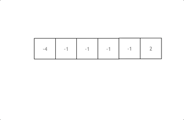

* [做專案（多個 C++、Java、Go、測試開發、前端專案）](https://www.programmercarl.com/other/kstar.html)
* [刷演算法（兩個月高強度學演算法）](https://www.programmercarl.com/xunlian/xunlianying.html)
* [準備面試必考題（八股文）（40天挑戰高頻面試題）](https://www.programmercarl.com/xunlian/bagu.html)


# 第15題. 三數之和

[LeetCode 題目連結](https://leetcode.cn/problems/3sum/)

給你一個包含 n 個整數（integer）的陣列（array）nums，判斷 nums 中是否存在三個元素（element）a、b、c，使得 a + b + c = 0？請你找出所有滿足條件且不重複的三元組（triple）。

**注意：** 答案中不可以包含重複的三元組。

範例：

給定陣列 nums = [-1, 0, 1, 2, -1, -4]，

滿足要求的三元組集合（set）為：
[
  [-1, 0, 1],
  [-1, -1, 2]
]

## 演算法公開課

**[《代碼隨想錄》演算法影片公開課](https://programmercarl.com/other/gongkaike.html)：[夢破碎的地方！| LeetCode：15.三數之和](https://www.bilibili.com/video/BV1GW4y127qo)，相信結合影片再看本篇題解，更有助於大家對本題的理解**。

**注意 [0, 0, 0, 0] 這組資料（data）**

## 解題思路

### 雜湊（hash）解法

兩層 for 迴圈（for-loop）就可以確定兩個數值（value），可以使用雜湊法來確定第三個數 0 - (a + b) 或者 0 - (a + c) 是否在陣列裡出現過。其實這個想法是正確的，但是我們有一個非常棘手的問題，就是題目中說的不可以包含重複的三元組。

把符合條件的三元組放進 vector 中，然後再去除重複，這樣是非常耗時的，很容易逾時，也是這道題目通過率如此之低的根源所在。

去除重複的過程不好處理，有很多小細節，如果在面試中很難想得周全。

時間複雜度（time complexity）可以做到 O(n^2)，但還是比較耗時的，因為不好做修剪法（pruning）操作。

大家可以嘗試使用雜湊法寫一寫，就知道其困難的程度了。

雜湊法 C++ 程式碼：
```CPP
class Solution {
public:
    // 在一個陣列中找到 3 個數形成的三元組，它們的和為 0，不能重複使用（三數下標互不相同），且三元組不能重複。
    // b（儲存）== 0-(a+c)（檢索）
    vector<vector<int>> threeSum(vector<int>& nums) {
        vector<vector<int>> result;
        sort(nums.begin(), nums.end());
        
        for (int i = 0; i < nums.size(); i++) {
            // 如果 a 是正數，a<b<c，不可能形成和為 0 的三元組
            if (nums[i] > 0)
                break;
            
            // [a, a, ...] 如果本輪 a 和上輪 a 相同，那麼找到的 b、c 也是相同的，所以去除重複的 a
            if (i > 0 && nums[i] == nums[i - 1])
                continue;
            
            // 這個 set 的作用是儲存 b
            unordered_set<int> set;
            
            for (int k = i + 1; k < nums.size(); k++) {
                // 去除 b=c 時的 b 和 c
                if (k > i + 2 && nums[k] == nums[k - 1] && nums[k - 1] == nums[k - 2])
                    continue;
                
                // a+b+c=0 <=> b=0-(a+c)
                int target = 0 - (nums[i] + nums[k]);
                if (set.find(target) != set.end()) {
                    result.push_back({nums[i], target, nums[k]});   // nums[k] 成為 c
                    set.erase(target);
                }
                else {
                    set.insert(nums[k]);                            // nums[k] 成為 b
                }
            }
        }

        return result;
    }
};
```

* 時間複雜度：O(n^2)
* 空間複雜度（space complexity）：O(n)，額外的 set 開銷


### 雙指標（two pointers）

**其實這道題目使用雜湊法並不十分合適**，因為在去除重複的操作中有很多細節需要注意，在面試中很難直接寫出沒有錯誤（bug）的程式碼。

而且使用雜湊法在使用兩層 for 迴圈的時候，能做的修剪法操作很有限，雖然時間複雜度是 O(n^2)，也是可以在 LeetCode 上通過，但是程式（program）的執行時間依然比較長。

接下來我來介紹另一個解法：雙指標法，**這道題目使用雙指標法要比雜湊法高效一些**，那麼來講解一下具體實作的解題思路。

動畫效果如下：



拿這個 nums 陣列來舉例，首先將陣列排序（sort），然後有一層 for 迴圈，i 從下標（subscript）0 的地方開始，同時定義一個下標 left 在 i+1 的位置上，定義下標 right 在陣列結尾的位置上。

依然還是在陣列中找到 a、b、c 使得 a + b + c = 0，我們這裡相當於 a = nums[i]，b = nums[left]，c = nums[right]。

接下來如何移動 left 和 right 呢？如果 nums[i] + nums[left] + nums[right] > 0，就說明此時三數之和大了，因為陣列是排序後的，所以 right 下標就應該向左移動，這樣才能讓三數之和小一些。

如果 nums[i] + nums[left] + nums[right] < 0，說明此時三數之和小了，left 就向右移動，才能讓三數之和大一些，直到 left 與 right 相遇為止。

時間複雜度：O(n^2)。

C++ 程式碼如下：

```CPP
class Solution {
public:
    vector<vector<int>> threeSum(vector<int>& nums) {
        vector<vector<int>> result;
        sort(nums.begin(), nums.end());
        // 找出 a + b + c = 0
        // a = nums[i], b = nums[left], c = nums[right]
        for (int i = 0; i < nums.size(); i++) {
            // 排序之後如果第一個元素已經大於零，那麼無論如何組合都不可能湊成三元組，直接回傳結果就可以了
            if (nums[i] > 0) {
                return result;
            }
            // 錯誤的 a 去重複方法，將會漏掉 -1, -1, 2 這種情況
            /*
            if (nums[i] == nums[i + 1]) {
                continue;
            }
            */
            // 正確的 a 去重複方法
            if (i > 0 && nums[i] == nums[i - 1]) {
                continue;
            }
            int left = i + 1;
            int right = nums.size() - 1;
            while (right > left) {
                // 去重複邏輯如果放在這裡，0, 0, 0 的情況，可能直接導致 right<=left 了，從而漏掉了 0,0,0 這種三元組
                /*
                while (right > left && nums[right] == nums[right - 1]) right--;
                while (right > left && nums[left] == nums[left + 1]) left++;
                */
                if (nums[i] + nums[left] + nums[right] > 0) right--;
                else if (nums[i] + nums[left] + nums[right] < 0) left++;
                else {
                    result.push_back(vector<int>{nums[i], nums[left], nums[right]});
                    // 去重複邏輯應該放在找到一個三元組之後，對 b 和 c 去重複
                    while (right > left && nums[right] == nums[right - 1]) right--;
                    while (right > left && nums[left] == nums[left + 1]) left++;

                    // 找到答案時，雙指標 同時收縮
                    right--;
                    left++;
                }
            }

        }
        return result;
    }
};
```

* 時間複雜度：O(n^2)
* 空間複雜度：O(1)


### 去重複邏輯的思考

#### a 的去重複

說到去重複，其實主要考慮三個數的去重複。a、b、c 對應的就是 nums[i]、nums[left]、nums[right]。

a 如果重複了怎麼辦？a 是 nums 裡遍歷（traversal）的元素，那麼應該直接跳過去。

但這裡有一個問題，是判斷 nums[i] 與 nums[i + 1] 是否相同，還是判斷 nums[i] 與 nums[i-1] 是否相同。

有同學可能想，這不都一樣嗎？

其實不一樣！

都是和 nums[i] 進行比較，是比較它的前一個，還是比較它的後一個。

如果我們的寫法是這樣：

```C++
if (nums[i] == nums[i + 1]) { // 去重複操作
    continue;
}
```

那我們就把三元組中出現重複元素的情況直接略過了。例如 {-1, -1, 2} 這組資料，當遍歷到第一個 -1 的時候，判斷下一個也是 -1，那這組資料就略過了。

**我們要做的是不能有重複的三元組，但三元組內的元素是可以重複的！**

所以這裡是有兩個重複的維度。

那麼應該這麼寫：

```C++
if (i > 0 && nums[i] == nums[i - 1]) {
    continue;
}
```

這麼寫就是當前使用 nums[i]，我們判斷前一位是不是一樣的元素，再看 {-1, -1, 2} 這組資料，當遍歷到第一個 -1 的時候，只要前一位沒有 -1，那麼 {-1, -1, 2} 這組資料一樣可以收錄到結果集裡。

這是一個非常細節的思考過程。

#### b 與 c 的去重複

很多同學寫本題的時候，去重複的邏輯多加了對 right 和 left 的去重複：（程式碼中註解（comment）部分）

```C++
while (right > left) {
    if (nums[i] + nums[left] + nums[right] > 0) {
        right--;
        // 對 right 去重複
        while (left < right && nums[right] == nums[right + 1]) right--;
    } else if (nums[i] + nums[left] + nums[right] < 0) {
        left++;
        // 對 left 去重複
        while (left < right && nums[left] == nums[left - 1]) left++;
    } else {
    }
}
```

但細想一下，這種去重複其實對提升程式執行效率是沒有幫助的。

拿 right 去重複為例，即使不加這個去重複邏輯，依然根據 `while (right > left)` 和 `if (nums[i] + nums[left] + nums[right] > 0)` 去完成 right-- 的操作。

多加了 `while (left < right && nums[right] == nums[right + 1]) right--;` 這一行程式碼，其實就是把需要執行的邏輯提前執行了，但並沒有減少判斷的邏輯。

最直白的思考過程，就是 right 還是一個數一個數地減下去的，所以在哪裡減都是一樣的。

所以這種去重複是可以不加的，僅僅是把去重複的邏輯提前了而已。


## 思考題


既然三數之和可以使用雙指標法，我們之前講過的 [1.兩數之和](https://programmercarl.com/0001.两数之和.html)，可不可以使用雙指標法呢？

如果不能，題意如何更改就可以使用雙指標法呢？**大家留言說出自己的想法吧！**

兩數之和就不能使用雙指標法，因為 [1.兩數之和](https://programmercarl.com/0001.两数之和.html) 要求回傳的是索引（index）下標，而雙指標法一定要排序，一旦排序之後原陣列的索引就被改變了。

如果 [1.兩數之和](https://programmercarl.com/0001.两数之和.html) 要求回傳的是數值的話，就可以使用雙指標法了。


## 其他語言版本

### Java：
（版本一）雙指標
```Java
class Solution {
    public List<List<Integer>> threeSum(int[] nums) {
        List<List<Integer>> result = new ArrayList<>();
        Arrays.sort(nums);
	// 找出 a + b + c = 0
        // a = nums[i], b = nums[left], c = nums[right]
        for (int i = 0; i < nums.length; i++) {
	    // 排序之後如果第一個元素已經大於零，那麼無論如何組合都不可能湊成三元組，直接回傳結果就可以了
            if (nums[i] > 0) { 
                return result;
            }

            if (i > 0 && nums[i] == nums[i - 1]) {  // 對 a 去重複
                continue;
            }

            int left = i + 1;
            int right = nums.length - 1;
            while (right > left) {
                int sum = nums[i] + nums[left] + nums[right];
                if (sum > 0) {
                    right--;
                } else if (sum < 0) {
                    left++;
                } else {
                    result.add(Arrays.asList(nums[i], nums[left], nums[right]));
		    // 去重複邏輯應該放在找到一個三元組之後，對 b 和 c 去重複
                    while (right > left && nums[right] == nums[right - 1]) right--;
                    while (right > left && nums[left] == nums[left + 1]) left++;
                    
                    right--; 
                    left++;
                }
            }
        }
        return result;
    }
}
```
（版本二）使用雜湊集合（hash set）
```Java
class Solution {
    public List<List<Integer>> threeSum(int[] nums) {
	List<List<Integer>> result = new ArrayList<>();
	Arrays.sort(nums);

	for (int i = 0; i < nums.length; i++) {
		// 如果第一個元素大於零，不可能湊成三元組
		if (nums[i] > 0) {
			return result;
		}
		// 三元組元素 a 去重複
		if (i > 0 && nums[i] == nums[i - 1]) {
			continue;
		}

		HashSet<Integer> set = new HashSet<>();
		for (int j = i + 1; j < nums.length; j++) {
			// 三元組元素 b 去重複
			if (j > i + 2 && nums[j] == nums[j - 1] && nums[j - 1] == nums[j - 2]) {
				continue;
			}

			int c = -nums[i] - nums[j];
			if (set.contains(c)) {
				result.add(Arrays.asList(nums[i], nums[j], c));
				set.remove(c); // 三元組元素 c 去重複
			} else {
				set.add(nums[j]);
			}
		}
	}
	return result;
    }
}
```
### Python：
（版本一）雙指標

```Python
class Solution:
    def threeSum(self, nums: List[int]) -> List[List[int]]:
        result = []
        nums.sort()
        
        for i in range(len(nums)):
            # 如果第一個元素已經大於 0，不需要進一步檢查
            if nums[i] > 0:
                return result
            
            # 跳過相同的元素以避免重複
            if i > 0 and nums[i] == nums[i - 1]:
                continue
                
            left = i + 1
            right = len(nums) - 1
            
            while right > left:
                sum_ = nums[i] + nums[left] + nums[right]
                
                if sum_ < 0:
                    left += 1
                elif sum_ > 0:
                    right -= 1
                else:
                    result.append([nums[i], nums[left], nums[right]])
                    
                    # 跳過相同的元素以避免重複
                    while right > left and nums[right] == nums[right - 1]:
                        right -= 1
                    while right > left and nums[left] == nums[left + 1]:
                        left += 1
                        
                    right -= 1
                    left += 1
                    
        return result
```
（版本二）使用字典（dictionary）

```python
class Solution:
    def threeSum(self, nums: List[int]) -> List[List[int]]:
        result = []
        nums.sort()
        # 找出 a + b + c = 0
        # a = nums[i], b = nums[j], c = -(a + b)
        for i in range(len(nums)):
            # 排序之後如果第一個元素已經大於零，那麼不可能湊成三元組
            if nums[i] > 0:
                break
            if i > 0 and nums[i] == nums[i - 1]: # 三元組元素 a 去重複
                continue
            d = {}
            for j in range(i + 1, len(nums)):
                if j > i + 2 and nums[j] == nums[j-1] == nums[j-2]: # 三元組元素 b 去重複
                    continue
                c = 0 - (nums[i] + nums[j])
                if c in d:
                    result.append([nums[i], nums[j], c])
                    d.pop(c) # 三元組元素 c 去重複
                else:
                    d[nums[j]] = j
        return result
```

### Go：
（版本一）雙指標

```Go
func threeSum(nums []int) [][]int {
	sort.Ints(nums)
	res := [][]int{}
	// 找出 a + b + c = 0
	// a = nums[i], b = nums[left], c = nums[right]
	for i := 0; i < len(nums)-2; i++ {
		// 排序之後如果第一個元素已經大於零，那麼無論如何組合都不可能湊成三元組，直接回傳結果就可以了
		n1 := nums[i]
		if n1 > 0 {
			break
		}
		// 對 a 去重複
		if i > 0 && n1 == nums[i-1] {
			continue
		}
		l, r := i+1, len(nums)-1
		for l < r {
			n2, n3 := nums[l], nums[r]
			if n1+n2+n3 == 0 {
				res = append(res, []int{n1, n2, n3})
				// 去重複邏輯應該放在找到一個三元組之後，對 b 和 c 去重複
				for l < r && nums[l] == n2 {
					l++
				}
				for l < r && nums[r] == n3 {
					r--
				}
			} else if n1+n2+n3 < 0 {
				l++
			} else {
				r--
			}
		}
	}
	return res
}
```
（版本二）雜湊解法

```Go
func threeSum(nums []int) [][]int {
    res := make([][]int, 0)
    sort.Ints(nums)
    // 找出 a + b + c = 0
    // a = nums[i], b = nums[j], c = -(a + b)
    for i := 0; i < len(nums); i++ {
        // 排序之後如果第一個元素已經大於零，那麼不可能湊成三元組
        if nums[i] > 0 {
            break
        }
        // 三元組元素 a 去重複
        if i > 0 && nums[i] == nums[i-1] {
            continue
        }
        set := make(map[int]struct{})
        for j := i + 1; j < len(nums); j++ {
            // 三元組元素 b 去重複
            if j > i + 2 && nums[j] == nums[j-1] && nums[j-1] == nums[j-2] {
                continue
            }
            c := -nums[i] - nums[j]
            if _, ok := set[c]; ok {
                res = append(res, []int{nums[i], nums[j], c})
                // 三元組元素 c 去重複
                delete(set, c)
            } else {
                set[nums[j]] = struct{}{}
            }
        }
    }
    return res
}
```

### JavaScript: 

```js
var threeSum = function(nums) {
    const res = [], len = nums.length
    // 將陣列排序
    nums.sort((a, b) => a - b)
    for (let i = 0; i < len; i++) {
        let l = i + 1, r = len - 1, iNum = nums[i]
        // 陣列排過序，如果第一個數大於 0 直接回傳 res
        if (iNum > 0) return res
        // 去重複
        if (iNum == nums[i - 1]) continue
        while(l < r) {
            let lNum = nums[l], rNum = nums[r], threeSum = iNum + lNum + rNum
            // 三數之和小於 0，則左指標向右移動
            if (threeSum < 0) l++ 
            else if (threeSum > 0) r--
            else {
                res.push([iNum, lNum, rNum])
                // 去重複
                while(l < r && nums[l] == nums[l + 1]){
                    l++
                }
                while(l < r && nums[r] == nums[r - 1]) {
                    r--
                }
                l++
                r--
            }
        }
    }
    return res
};
```

解法二：nSum 通用解法。遞迴（recursion）

```js
/**
 *  nsum 通用解法，支援 2sum、3sum、4sum...等等
 *  時間複雜度分析：
 *  1. n = 2 時，時間複雜度 O(NlogN)，為排序所消耗的時間。
 *  2. n > 2 時，時間複雜度為 O(N^n-1)，即 N 的 n-1 次方，至少是 2 次方，此時可省略排序所消耗的時間。舉例：3sum 為 O(n^2)，4sum 為 O(n^3)
 * @param {number[]} nums
 * @return {number[][]}
 */
var threeSum = function (nums) {
    // nsum 通用解法核心方法
    function nSumTarget(nums, n, start, target) {
        // 前提：nums 要先排序好
        let res = [];
        if (n === 2) {
            res = towSumTarget(nums, start, target);
        } else {
            for (let i = start; i < nums.length; i++) {
                // 遞迴求 (n - 1)sum
                let subRes = nSumTarget(
                    nums,
                    n - 1,
                    i + 1,
                    target - nums[i]
                );
                for (let j = 0; j < subRes.length; j++) {
                    res.push([nums[i], ...subRes[j]]);
                }
                // 跳過相同元素
                while (nums[i] === nums[i + 1]) i++;
            }
        }
        return res;
    }

    function towSumTarget(nums, start, target) {
        // 前提：nums 要先排序好
        let res = [];
        let len = nums.length;
        let left = start;
        let right = len - 1;
        while (left < right) {
            let sum = nums[left] + nums[right];
            if (sum < target) {
                while (nums[left] === nums[left + 1]) left++;
                left++;
            } else if (sum > target) {
                while (nums[right] === nums[right - 1]) right--;
                right--;
            } else {
                // 相等
                res.push([nums[left], nums[right]]);
                // 跳過相同元素
                while (nums[left] === nums[left + 1]) left++;
                while (nums[right] === nums[right - 1]) right--;
                left++;
                right--;
            }
        }
        return res;
    }
    nums.sort((a, b) => a - b);
    // n = 3，此時求 3sum 之和
    return nSumTarget(nums, 3, 0, 0);
};
```

### TypeScript:

```typescript
function threeSum(nums: number[]): number[][] {
    nums.sort((a, b) => a - b);
    let length = nums.length;
    let left: number = 0,
        right: number = length - 1;
    let resArr: number[][] = [];
    for (let i = 0; i < length; i++) {
    	if (nums[i]>0) {
            return resArr; // nums 經過排序後，只要 nums[i]>0，此後的 nums[i] + nums[left] + nums[right] 均大於 0，可以提前終止迴圈。	
	}
        if (i > 0 && nums[i] === nums[i - 1]) {
            continue;
        }
        left = i + 1;
        right = length - 1;
        while (left < right) {
            let total: number = nums[i] + nums[left] + nums[right];
            if (total === 0) {
                resArr.push([nums[i], nums[left], nums[right]]);
                left++;
                right--;
                while (nums[right] === nums[right + 1]) {
                    right--;
                }
                while (nums[left] === nums[left - 1]) {
                    left++;
                }
            } else if (total < 0) {
                left++;
            } else {
                right--;
            }
        }
    }
    return resArr;
};
```

### Ruby:

```ruby
def is_valid(strs)
    symbol_map = {')' => '(', '}' => '{', ']' => '['}
    stack = []
    strs.size.times {|i|
        c = strs[i]
        if symbol_map.has_key?(c)
            top_e = stack.shift
            return false if symbol_map[c] != top_e
        else
            stack.unshift(c)
        end
    }
    stack.empty?
end
```

### PHP:

```php
class Solution {
    /**
     * @param Integer[] $nums
     * @return Integer[][]
     */
    function threeSum($nums) {
        $res = [];
        sort($nums);
        for ($i = 0; $i < count($nums); $i++) {
            if ($nums[$i] > 0) {
                return $res;
            }
            if ($i > 0 && $nums[$i] == $nums[$i - 1]) {
                continue;
            }
            $left = $i + 1;
            $right = count($nums) - 1;
            while ($left < $right) {
                $sum = $nums[$i] + $nums[$left] + $nums[$right];
                if ($sum < 0) {
                    $left++;
                }
                else if ($sum > 0) {
                    $right--;
                }
                else {
                    $res[] = [$nums[$i], $nums[$left], $nums[$right]];
                    while ($left < $right && $nums[$left] == $nums[$left + 1]) $left++;
                    while ($left < $right && $nums[$right] == $nums[$right - 1]) $right--;
                    $left++;
                    $right--;
                }
            }
        }
        return $res;
    }
}
```

### Swift:

```swift
// two pointers 法
func threeSum(_ nums: [Int]) -> [[Int]] {
    var res = [[Int]]()
    var sorted = nums
    sorted.sort()
    for i in 0 ..< sorted.count {
        if sorted[i] > 0 {
            return res
        }
        if i > 0 && sorted[i] == sorted[i - 1] {
            continue
        }
        var left = i + 1
        var right = sorted.count - 1
        while left < right {
            let sum = sorted[i] + sorted[left] + sorted[right]
            if sum < 0 {
                left += 1
            } else if sum > 0 {
                right -= 1
            } else {
                res.append([sorted[i], sorted[left], sorted[right]])
                
                while left < right && sorted[left] == sorted[left + 1] {
                    left += 1
                }
                while left < right && sorted[right] == sorted[right - 1] {
                    right -= 1
                }
                
                left += 1
                right -= 1
            }
        }
    }
    return res
}
```

### Rust:

```Rust
// 雜湊解法
use std::collections::HashSet;
impl Solution {
    pub fn three_sum(nums: Vec<i32>) -> Vec<Vec<i32>> {
        let mut result: Vec<Vec<i32>> = Vec::new();
        let mut nums = nums;
        nums.sort();
        let len = nums.len();
        for i in 0..len {
            if nums[i] > 0 { break; }
            if i > 0 && nums[i] == nums[i - 1] { continue; }
            let mut set = HashSet::new();
            for j in (i + 1)..len {
                if j > i + 2 && nums[j] == nums[j - 1] && nums[j] == nums[j - 2] { continue; }
                let c = 0 - (nums[i] + nums[j]);
                if set.contains(&c) {
                    result.push(vec![nums[i], nums[j], c]);
                    set.remove(&c);
                } else { set.insert(nums[j]); }
            }
        }
        result
    }
}
```

```Rust
// two pointers 法
use std::cmp::Ordering;
impl Solution {
    pub fn three_sum(nums: Vec<i32>) -> Vec<Vec<i32>> {
        let mut result: Vec<Vec<i32>> = Vec::new();
        let mut nums = nums;
        nums.sort();
        let len = nums.len();
        for i in 0..len {
            if nums[i] > 0 { return result; }
            if i > 0 && nums[i] == nums[i - 1] { continue; }
            let (mut left, mut right) = (i + 1, len - 1);
            while left < right {
                match (nums[i] + nums[left] + nums[right]).cmp(&0){
		    Ordering::Equal =>{
		        result.push(vec![nums[i], nums[left], nums[right]]);
			left +=1;
			right -=1;
			while left < right && nums[left] == nums[left - 1]{
			    left += 1;
			}
			while left < right && nums[right] == nums[right+1]{
			    right -= 1;
			}
		    }
		    Ordering::Greater => right -= 1,
		    Ordering::Less => left += 1,
		}
            }
        }
        result
    }
}
```

### C:

```C
// qsort 輔助 cmp 函數
int cmp(const void* ptr1, const void* ptr2) {
    return *((int*)ptr1) > *((int*)ptr2);
}

int** threeSum(int* nums, int numsSize, int* returnSize, int** returnColumnSizes) {
    // 配置 ans 陣列空間
    int **ans = (int**)malloc(sizeof(int*) * 18000);
    int ansTop = 0;
    // 若傳入 nums 陣列大小小於 3，則需要回傳陣列大小為 0
    if(numsSize < 3) {
        *returnSize = 0;
        return ans;
    }
    // 對 nums 陣列進行排序
    qsort(nums, numsSize, sizeof(int), cmp);
    

    int i;
    // 用 for 迴圈遍歷陣列，結束條件為 i < numsSize - 2（因為要預留左右指標的位置）
    for(i = 0; i < numsSize - 2; i++) {
        // 若當前 i 指向元素 > 0，則代表 left 和 right 以及 i 的和大於 0。直接 break
        if(nums[i] > 0)
            break;
        // 去重複：i > 0 && nums[i] == nums[i-1]
        if(i > 0 && nums[i] == nums[i-1])
            continue;
        // 定義左指標和右指標
        int left = i + 1;
        int right = numsSize - 1;
        // 當右指標比左指標大時進行迴圈
        while(right > left) {
            // 求出三數之和
            int sum = nums[right] + nums[left] + nums[i];
            // 若和小於 0，則左指標 +1（因為左指標右邊的數比當前所指元素大）
            if(sum < 0)
                left++;
            // 若和大於 0，則將右指標 -1
            else if(sum > 0)
                right--;
            // 若和等於 0
            else {
                // 配置一個大小為 3 的陣列空間，存入 nums[i]、nums[left] 和 nums[right]
                int* arr = (int*)malloc(sizeof(int) * 3);
                arr[0] = nums[i];
                arr[1] = nums[left];
                arr[2] = nums[right];
                // 將配置的陣列存入 ans 中
                ans[ansTop++] = arr;
                // 去重複
                while(right > left && nums[right] == nums[right - 1])
                    right--;
                while(left < right && nums[left] == nums[left + 1])
                    left++;
                // 更新左右指標
                left++;
                right--;
            }
        }
    }

    // 設定回傳的陣列大小
    *returnSize = ansTop;
    *returnColumnSizes = (int*)malloc(sizeof(int) * ansTop);
    int z;
    for(z = 0; z < ansTop; z++) {
        (*returnColumnSizes)[z] = 3;
    }
    return ans;
}
```

### C#:

```csharp
public class Solution
{
    public IList<IList<int>> ThreeSum(int[] nums)
    {
        var result = new List<IList<int>>();

        Array.Sort(nums);

        for (int i = 0; i < nums.Length - 2; i++)
        {
            int n1 = nums[i];

            if (n1 > 0)
                break;

            if (i > 0 && n1 == nums[i - 1])
                continue;

            int left = i + 1;
            int right = nums.Length - 1;

            while (left < right)
            {
                int n2 = nums[left];
                int n3 = nums[right];
                int sum = n1 + n2 + n3;

                if (sum > 0)
                {
                    right--;
                }
                else if (sum < 0)
                {
                    left++;
                }
                else
                {
                    result.Add(new List<int> { n1, n2, n3 });

                    while (left < right && nums[left] == n2)
                    {
                        left++;
                    }

                    while (left < right && nums[right] == n3)
                    {
                        right--;
                    }
                }
            }
        }

        return result;
    }
}
```
### Scala:

```scala
object Solution {
  // 匯入套件
  import scala.collection.mutable.ListBuffer
  import scala.util.control.Breaks.{break, breakable}

  def threeSum(nums: Array[Int]): List[List[Int]] = {
    // 定義結果集，最後需要轉換為 List
    val res = ListBuffer[List[Int]]()
    val nums_tmp = nums.sorted // 對 nums 進行排序
    for (i <- nums_tmp.indices) {
      // 如果要排的第一個數字大於 0，直接回傳結果
      if (nums_tmp(i) > 0) {
        return res.toList
      }
      // 如果 i 大於 0 並且和前一個數字重複，則跳過本次迴圈，相當於 continue
      breakable {
        if (i > 0 && nums_tmp(i) == nums_tmp(i - 1)) {
          break
        } else {
          var left = i + 1
          var right = nums_tmp.length - 1
          while (left < right) {
            var sum = nums_tmp(i) + nums_tmp(left) + nums_tmp(right) // 求三數之和
            if (sum < 0) left += 1
            else if (sum > 0) right -= 1
            else {
              res += List(nums_tmp(i), nums_tmp(left), nums_tmp(right)) // 如果等於 0 加入結果集
              // 為了避免重複，對 left 和 right 進行移動
              while (left < right && nums_tmp(left) == nums_tmp(left + 1)) left += 1
              while (left < right && nums_tmp(right) == nums_tmp(right - 1)) right -= 1
              left += 1
              right -= 1
            }
          }
        }
      }
    }
    // 最後回傳需要轉換為 List，return 關鍵字可以省略
    res.toList
  }
}
```

