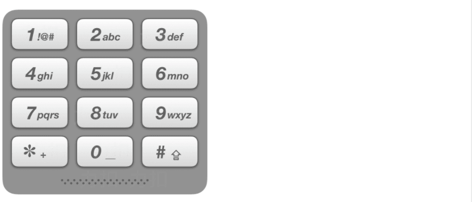
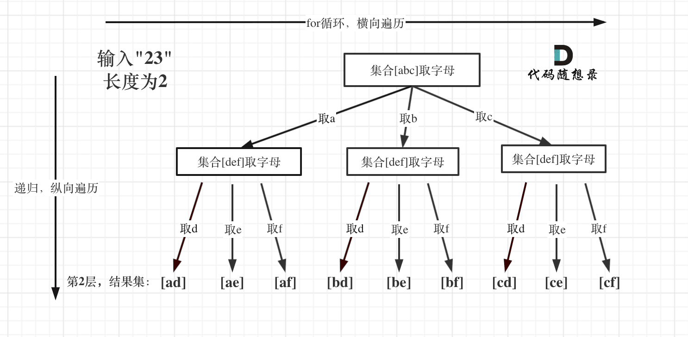

* [做專案（多個 C++、Java、Go、測試開發、前端專案）](https://www.programmercarl.com/other/kstar.html)
* [刷演算法（兩個月高強度學演算法）](https://www.programmercarl.com/xunlian/xunlianying.html)
* [準備面試必考題（八股文）（40天挑戰高頻面試題）](https://www.programmercarl.com/xunlian/bagu.html)


# 17.電話號碼的字母組合

[LeetCode 題目連結](https://leetcode.cn/problems/letter-combinations-of-a-phone-number/)

給定一個僅包含數字 2-9 的字串（string），回傳所有它能表示的字母組合（combination）。

給出數字到字母的映射（mapping）如下（與電話按鍵相同）。注意 1 不對應任何字母。



範例：
* 輸入："23"
* 輸出：["ad", "ae", "af", "bd", "be", "bf", "cd", "ce", "cf"].

說明：儘管上面的答案是按詞典編纂次序（lexicographical order）排列的，但是你可以任意選擇答案輸出的順序。

## 演算法公開課

**[《代碼隨想錄》演算法影片公開課](https://programmercarl.com/other/gongkaike.html)：[還得用回溯演算法（backtracking algorithm）！| LeetCode：17.電話號碼的字母組合](https://www.bilibili.com/video/BV1yV4y1V7Ug)，相信結合影片再看本篇題解，更有助於大家對本題的理解**。


## 解題思路

從範例上來說，輸入 "23"，最直接的想法就是兩層 for 迴圈（for-loop）遍歷（traversal）了吧，正好把組合的情況都輸出了。

如果輸入 "233" 呢？那麼就三層 for 迴圈，如果 "2333" 呢？就四層 for 迴圈.......

大家應該感覺出和 [77.組合](https://programmercarl.com/0077.组合.html) 遇到的一樣的問題，就是這 for 迴圈的層數該怎麼寫出來，此時又是回溯法登場的時候了。

理解本題後，要解決如下三個問題：

1. 數字和字母如何映射
2. 兩個字母就兩個 for 迴圈，三個字元（character）我就三個 for 迴圈，以此類推，然後發現程式碼根本寫不出來
3. 輸入 1 * # 按鍵等等異常情況

### 數字和字母如何映射

可以使用 map 或者定義一個二維（2D）陣列（array），例如：`string letterMap[10]`，來做映射，我這裡定義一個二維陣列，程式碼如下：

```cpp
const string letterMap[10] = {
    "", // 0
    "", // 1
    "abc", // 2
    "def", // 3
    "ghi", // 4
    "jkl", // 5
    "mno", // 6
    "pqrs", // 7
    "tuv", // 8
    "wxyz", // 9
};
```

### 回溯法來解決 n 個 for 迴圈的問題

對於回溯法還不了解的同學看這篇：[關於回溯演算法，你該了解這些！](https://programmercarl.com/回溯算法理论基础.html)


例如：輸入："23"，抽象為樹狀結構，如圖所示：



圖中可以看出遍歷的深度，就是輸入 "23" 的長度，而葉節點（leaf node）就是我們要收集的結果，輸出 ["ad", "ae", "af", "bd", "be", "bf", "cd", "ce", "cf"]。

回溯三部曲：

* 確定回溯函式（function）參數（parameter）

首先需要一個字串 s 來收集葉節點的結果，然後用一個字串陣列 result 保存起來，這兩個變數（variable）我依然定義為總體變數（global variable）。

再來看參數，參數必定是有題目中給的 `string digits`，然後還要有一個參數就是 int 型別的 index。

注意這個 index 可不是 [77.組合](https://programmercarl.com/0077.组合.html) 和 [216.組合總和III](https://programmercarl.com/0216.组合总和III.html) 中的 startIndex 了。

這個 index 是記錄遍歷第幾個數字了，就是用來遍歷 digits 的（題目中給出數字字串），同時 index 也表示樹的深度。

程式碼如下：

```cpp
vector<string> result;
string s;
void backtracking(const string& digits, int index)
```

* 確定終止條件

例如輸入測資 "23"，兩個數字，那麼根節點（root node）往下遞迴（recursion）兩層就可以了，葉節點就是要收集的結果集。

那麼終止條件就是如果 index 等於輸入的數字個數（digits.size）了（本來 index 就是用來遍歷 digits 的）。

然後收集結果，結束本層遞迴。

程式碼如下：

```cpp
if (index == digits.size()) {
    result.push_back(s);
    return;
}
```

* 確定單層遍歷邏輯

首先要取 index 指向的數字，並找到對應的字元集（character set）（手機鍵盤的字元集）。

然後 for 迴圈來處理這個字元集，程式碼如下：

```CPP
int digit = digits[index] - '0';        // 將 index 指向的數字轉為 int
string letters = letterMap[digit];      // 取數字對應的字元集
for (int i = 0; i < letters.size(); i++) {
    s.push_back(letters[i]);            // 處理
    backtracking(digits, index + 1);    // 遞迴，注意 index+1，下一層要處理下一個數字了
    s.pop_back();                       // 回溯
}
```

**注意這裡 for 迴圈，可不像是在 [回溯演算法：求組合問題！](https://programmercarl.com/0077.组合.html) 和 [回溯演算法：求組合總和！](https://programmercarl.com/0216.组合总和III.html) 中從 startIndex 開始遍歷的**。

**因為本題每一個數字代表的是不同集合（set），也就是求不同集合之間的組合，而 [77. 組合](https://programmercarl.com/0077.组合.html) 和 [216.組合總和III](https://programmercarl.com/0216.组合总和III.html) 都是求同一個集合中的組合！**


注意：輸入 1 * # 按鍵等等異常情況

程式碼中最好考慮這些異常情況，但題目的測試資料（data）中應該沒有異常情況的資料，所以我就沒有加了。

**但是要知道會有這些異常，如果是現場面試中，一定要考慮到！**

關鍵地方都講完了，按照 [關於回溯演算法，你該了解這些！](https://programmercarl.com/回溯算法理论基础.html) 中的回溯法模板（template），不難寫出如下 C++ 程式碼：


```CPP
// 版本一
class Solution {
private:
    const string letterMap[10] = {
        "", // 0
        "", // 1
        "abc", // 2
        "def", // 3
        "ghi", // 4
        "jkl", // 5
        "mno", // 6
        "pqrs", // 7
        "tuv", // 8
        "wxyz", // 9
    };
public:
    vector<string> result;
    string s;
    void backtracking(const string& digits, int index) {
        if (index == digits.size()) {
            result.push_back(s);
            return;
        }
        int digit = digits[index] - '0';        // 將 index 指向的數字轉為 int
        string letters = letterMap[digit];      // 取數字對應的字元集
        for (int i = 0; i < letters.size(); i++) {
            s.push_back(letters[i]);            // 處理
            backtracking(digits, index + 1);    // 遞迴，注意 index+1，下一層要處理下一個數字了
            s.pop_back();                       // 回溯
        }
    }
    vector<string> letterCombinations(string digits) {
        s.clear();
        result.clear();
        if (digits.size() == 0) {
            return result;
        }
        backtracking(digits, 0);
        return result;
    }
};
```
* 時間複雜性（time complexity）：O(3^m * 4^n)，其中 m 是對應三個字母的數字個數，n 是對應四個字母的數字個數
* 空間複雜度（space complexity）：O(3^m * 4^n)

一些寫法，是把回溯的過程放在遞迴函式裡了，例如如下程式碼，我可以寫成這樣：（注意註解（comment）中不一樣的地方）

```CPP
// 版本二
class Solution {
private:
        const string letterMap[10] = {
            "", // 0
            "", // 1
            "abc", // 2
            "def", // 3
            "ghi", // 4
            "jkl", // 5
            "mno", // 6
            "pqrs", // 7
            "tuv", // 8
            "wxyz", // 9
        };
public:
    vector<string> result;
    void getCombinations(const string& digits, int index, const string& s) { // 注意參數的不同
        if (index == digits.size()) {
            result.push_back(s);
            return;
        }
        int digit = digits[index] - '0';
        string letters = letterMap[digit];
        for (int i = 0; i < letters.size(); i++) {
            getCombinations(digits, index + 1, s + letters[i]);  // 注意這裡的不同
        }
    }
    vector<string> letterCombinations(string digits) {
        result.clear();
        if (digits.size() == 0) {
            return result;
        }
        getCombinations(digits, 0, "");
        return result;

    }
};
```

我不建議把回溯藏在遞迴的參數裡這種寫法，很不直觀，我在 [二元樹（binary tree）：以為使用了遞迴，其實還隱藏著回溯](https://programmercarl.com/二叉树中递归带着回溯.html) 這篇文章中也深度分析了，回溯隱藏在了哪裡。

所以大家可以按照版本一來寫就可以了。

## 總結

本篇將題目的三個要點一一列出，並重點強調了和前面講解過的 [77. 組合](https://programmercarl.com/0077.组合.html) 和 [216.組合總和III](https://programmercarl.com/0216.组合总和III.html) 的區別，本題是多個集合求組合，所以在回溯的搜尋過程中，都有一些細節需要注意的。

其實本題不算難，但也處處是細節，大家還要自己親自動手寫一寫。


## 其他語言版本


### Java 
```Java
class Solution {

    // 設定總體列表儲存最後的結果
    List<String> list = new ArrayList<>();

    public List<String> letterCombinations(String digits) {
        if (digits == null || digits.length() == 0) {
            return list;
        }
        // 初始對應所有的數字，為了直接對應 2-9，新增了兩個無效的字串 ""
        String[] numString = {"", "", "abc", "def", "ghi", "jkl", "mno", "pqrs", "tuv", "wxyz"};
        // 疊代處理
        backTracking(digits, numString, 0);
        return list;

    }

    // 每次疊代取得一個字串，所以會涉及大量的字串拼接，因此這裡選擇更為高效的 StringBuilder
    StringBuilder temp = new StringBuilder();

    // 比如 digits 如果為 "23"，num 為 0，則 str 表示 2 對應的 abc
    public void backTracking(String digits, String[] numString, int num) {
        // 遍歷全部，依序記錄每次得到的字串
        if (num == digits.length()) {
            list.add(temp.toString());
            return;
        }
        // str 表示當前 num 對應的字串
        String str = numString[digits.charAt(num) - '0'];
        for (int i = 0; i < str.length(); i++) {
            temp.append(str.charAt(i));
            // 遞迴，處理下一層
            backTracking(digits, numString, num + 1);
            // 剔除末尾的字元以繼續嘗試
            temp.deleteCharAt(temp.length() - 1);
        }
    }
}
```

### Python 
回溯
```python
class Solution:
    def __init__(self):
        self.letterMap = [
            "",     # 0
            "",     # 1
            "abc",  # 2
            "def",  # 3
            "ghi",  # 4
            "jkl",  # 5
            "mno",  # 6
            "pqrs", # 7
            "tuv",  # 8
            "wxyz"  # 9
        ]
        self.result = []
        self.s = ""
    
    def backtracking(self, digits, index):
        if index == len(digits):
            self.result.append(self.s)
            return
        digit = int(digits[index])    # 將索引處的數字轉換為整數
        letters = self.letterMap[digit]    # 取得對應的字元集
        for i in range(len(letters)):
            self.s += letters[i]    # 處理字元
            self.backtracking(digits, index + 1)    # 遞迴呼叫，注意索引加 1，處理下一個數字
            self.s = self.s[:-1]    # 回溯，刪除最後加入的字元
    
    def letterCombinations(self, digits):
        if len(digits) == 0:
            return self.result
        self.backtracking(digits, 0)
        return self.result

```
回溯精簡（版本一）
```python
class Solution:
    def __init__(self):
        self.letterMap = [
            "",     # 0
            "",     # 1
            "abc",  # 2
            "def",  # 3
            "ghi",  # 4
            "jkl",  # 5
            "mno",  # 6
            "pqrs", # 7
            "tuv",  # 8
            "wxyz"  # 9
        ]
        self.result = []
    
    def getCombinations(self, digits, index, s):
        if index == len(digits):
            self.result.append(s)
            return
        digit = int(digits[index])
        letters = self.letterMap[digit]
        for letter in letters:
            self.getCombinations(digits, index + 1, s + letter)
    
    def letterCombinations(self, digits):
        if len(digits) == 0:
            return self.result
        self.getCombinations(digits, 0, "")
        return self.result

```
回溯精簡（版本二）
```python
class Solution:
    def __init__(self):
        self.letterMap = [
            "",     # 0
            "",     # 1
            "abc",  # 2
            "def",  # 3
            "ghi",  # 4
            "jkl",  # 5
            "mno",  # 6
            "pqrs", # 7
            "tuv",  # 8
            "wxyz"  # 9
        ]
    
    def getCombinations(self, digits, index, s, result):
        if index == len(digits):
            result.append(s)
            return
        digit = int(digits[index])
        letters = self.letterMap[digit]
        for letter in letters:
            self.getCombinations(digits, index + 1, s + letter, result)
    
    def letterCombinations(self, digits):
        result = []
        if len(digits) == 0:
            return result
        self.getCombinations(digits, 0, "", result)
        return result


```

回溯最佳化使用列表（list）
```python
class Solution:
    def __init__(self):
        self.letterMap = [
            "",     # 0
            "",     # 1
            "abc",  # 2
            "def",  # 3
            "ghi",  # 4
            "jkl",  # 5
            "mno",  # 6
            "pqrs", # 7
            "tuv",  # 8
            "wxyz"  # 9
        ]
    
    def getCombinations(self, digits, index, path, result):
        if index == len(digits):
            result.append(''.join(path))
            return
        digit = int(digits[index])
        letters = self.letterMap[digit]
        for letter in letters:
            path.append(letter)
            self.getCombinations(digits, index + 1, path, result)
            path.pop()
    
    def letterCombinations(self, digits):
        result = []
        if len(digits) == 0:
            return result
        self.getCombinations(digits, 0, [], result)
        return result


```


### Go 

主要在於遞迴中傳遞下一個數字

```go
var (
    m []string
    path []byte
    res []string
)
func letterCombinations(digits string) []string {
    m = []string{"abc", "def", "ghi", "jkl", "mno", "pqrs", "tuv", "wxyz"}
    path, res = make([]byte, 0), make([]string, 0)
    if digits == "" {
        return res
    }
    dfs(digits, 0)
    return res
}
func dfs(digits string, start int) {
    if len(path) == len(digits) {  // 終止條件，字串長度等於 digits 的長度
        tmp := string(path)
        res = append(res, tmp)
        return
    }
    digit := int(digits[start] - '0')  // 將 index 指向的數字轉為 int（確定下一個數字）
    str := m[digit-2]   // 取得數字對應的字元集（注意和 map 中的對應）
    for j := 0; j < len(str); j++ {
        path = append(path, str[j])
        dfs(digits, start+1)
        path = path[:len(path)-1]
    }
}
```

### JavaScript 

```js
var letterCombinations = function(digits) {
    const k = digits.length;
    const map = ["","","abc","def","ghi","jkl","mno","pqrs","tuv","wxyz"];
    if(!k) return [];
    if(k === 1) return map[digits].split("");

    const res = [], path = [];
    backtracking(digits, k, 0);
    return res;

    function backtracking(n, k, a) {
        if(path.length === k) {
            res.push(path.join(""));
            return;
        }
        for(const v of map[n[a]]) {
            path.push(v);
            backtracking(n, k, a + 1);
            path.pop();
        }
    }
};
```

### TypeScript

```typescript
function letterCombinations(digits: string): string[] {
    if (digits === '') return [];
    const strMap: { [index: string]: string[] } = {
        1: [],
        2: ['a', 'b', 'c'],
        3: ['d', 'e', 'f'],
        4: ['g', 'h', 'i'],
        5: ['j', 'k', 'l'],
        6: ['m', 'n', 'o'],
        7: ['p', 'q', 'r', 's'],
        8: ['t', 'u', 'v'],
        9: ['w', 'x', 'y', 'z'],
    }
    const resArr: string[] = [];
    function backTracking(digits: string, curIndex: number, route: string[]): void {
        if (curIndex === digits.length) {
            resArr.push(route.join(''));
            return;
        }
        let tempArr: string[] = strMap[digits[curIndex]];
        for (let i = 0, length = tempArr.length; i < length; i++) {
            route.push(tempArr[i]);
            backTracking(digits, curIndex + 1, route);
            route.pop();
        }
    }
    backTracking(digits, 0, []);
    return resArr;
};
```

### Rust

```Rust
const map: [&str; 10] = [
    "", "", "abc", "def", "ghi", "jkl", "mno", "pqrs", "tuv", "wxyz",
];
impl Solution {
    fn back_trace(result: &mut Vec<String>, s: &mut String, digits: &String, index: usize) {
        let len = digits.len();
        if len == index {
            result.push(s.to_string());
            return;
        }
        let digit = (digits.as_bytes()[index] - b'0') as usize;
        for i in map[digit].chars() {
            s.push(i);
            Self::back_trace(result, s, digits, index + 1);
            s.pop();
        }
    }
    pub fn letter_combinations(digits: String) -> Vec<String> {
        if digits.is_empty() {
            return vec![];
        }
        let mut res = vec![];
        let mut s = String::new();
        Self::back_trace(&mut res, &mut s, &digits, 0);
        res
    }
}
```

### C

```c
char* path;
int pathTop;
char** result;
int resultTop;
char* letterMap[10] = {"", //0
        "", //1
        "abc", //2
        "def", //3
        "ghi", //4
        "jkl", //5
        "mno", //6
        "pqrs", //7
        "tuv", //8
        "wxyz", //9
};
void backTracking(char* digits, int index) {
    // 若當前下標等於 digits 陣列長度
    if(index == strlen(digits)) {
        // 複製 digits 陣列，因為最後要多儲存一個 0，所以陣列長度要 +1
        char* tempString = (char*)malloc(sizeof(char) * strlen(digits) + 1);
        int j;
        for(j = 0; j < strlen(digits); j++) {
            tempString[j] = path[j];
        }
        // char 陣列最後要以 0 結尾
        tempString[strlen(digits)] = 0;
        result[resultTop++] = tempString;
        return ;
    }
    // 將字元數字轉換為真正的數字
    int digit = digits[index] - '0';
    // 找到 letterMap 中對應的字串
    char* letters = letterMap[digit];
    int i;
    for(i = 0; i < strlen(letters); i++) {
        path[pathTop++] = letters[i];
        // 遞迴，處理下一層數字
        backTracking(digits, index+1);
        pathTop--;
    }
}

char ** letterCombinations(char * digits, int* returnSize){
    // 初始化 path 和 result
    path = (char*)malloc(sizeof(char) * strlen(digits));
    result = (char**)malloc(sizeof(char*) * 300);

    *returnSize = 0;
    // 若 digits 陣列中元素個數為 0，回傳空集合
    if(strlen(digits) == 0) 
        return result;
    pathTop = resultTop = 0;
    backTracking(digits, 0);
    *returnSize = resultTop;

    return result;
}
```

### Swift

```swift
func letterCombinations(_ digits: String) -> [String] {
    // 按鍵與字母串映射
    let letterMap = [
        "",
        "", "abc", "def",
        "ghi", "jkl", "mno",
        "pqrs", "tuv", "wxyz"
    ]
    // 把輸入的按鍵字串轉成 Int 陣列
    let baseCode = ("0" as Character).asciiValue!
    let digits = digits.map { c in
        guard let code = c.asciiValue else { return -1 }
        return Int(code - baseCode)
    }.filter { $0 >= 0 && $0 <= 9 }
    guard !digits.isEmpty else { return [] }

    var result = [String]()
    var s = ""
    func backtracking(index: Int) {
        // 結束條件：收集結果
        if index == digits.count {
            result.append(s)
            return
        }

        // 遍歷當前按鍵對應的字母串
        let letters = letterMap[digits[index]]
        for letter in letters {
            s.append(letter) // 處理
            backtracking(index: index + 1) // 遞迴，記得 +1
            s.removeLast() // 回溯
        }
    }
    backtracking(index: 0)
    return result
}
```

### Scala

```scala
object Solution {
  import scala.collection.mutable
  def letterCombinations(digits: String): List[String] = {
    var result = mutable.ListBuffer[String]()
    if(digits == "") return result.toList // 如果參數為空，回傳空結果集的 List 形式
    var path = mutable.ListBuffer[Char]()
    // 數字和字元的映射關係
    val map = Array[String]("", "", "abc", "def", "ghi", "jkl", "mno", "pqrs", "tuv", "wxyz")

    def backtracking(index: Int): Unit = {
      if (index == digits.size) {
        result.append(path.mkString)  // mkString 語法：將陣列類型直接轉換為字串
        return
      }
      var digit = digits(index) - '0' // 這裡使用 toInt 會報錯！必須 -'0'
      for (i <- 0 until map(digit).size) {
        path.append(map(digit)(i))
        backtracking(index + 1)
        path = path.take(path.size - 1)
      }
    }
    
    backtracking(0)
    result.toList
  }
}
```

### Ruby
```ruby
def letter_combinations(digits)
  letter_map = {
    2 => ['a','b','c'],
    3 => ['d','e','f'],
    4 => ['g','h','i'],
    5 => ['j','k','l'],
    6 => ['m','n','o'],
    7 => ['p','q','r','s'],
    8 => ['t','u','v'],
    9 => ['w','x','y','z']
  }
  
  result = []
  path = []

  return result if digits.size == 0

  backtracking(result, letter_map, digits.split(''), path, 0)
  result
end

def backtracking(result, letter_map, digits, path, index) 
  if path.size == digits.size
    result << path.join('')
    return
  end

  hash[digits[index].to_i].each do |chr|
    path << chr
    # index + 1 代表處理下一個數字
    backtracking(result, letter_map, digits, path, index + 1)
    # 回溯，撤銷處理過的數字
    path.pop
  end
end
```
### C#
```csharp
public class Solution
{
    public IList<string> res = new List<string>();
    public string s;
    public string[] letterMap = new string[10] { "", "", "abc", "def", "ghi", "jkl", "mno", "pqrs", "tuv", "wxyz" };
    public IList<string> LetterCombinations(string digits)
    {
        if (digits.Length == 0)
            return res;
        BackTracking(digits, 0);
        return res;
    }
    public void BackTracking(string digits, int index)
    {
        if (index == digits.Length)
        {
            res.Add(s);
            return;
        }
        int digit = digits[index] - '0';
        string letters = letterMap[digit];
        for (int i = 0; i < letters.Length; i++)
        {
            s += letters[i];
            BackTracking(digits, index + 1);
            s = s.Substring(0, s.Length - 1);
        }
    }
}
```


