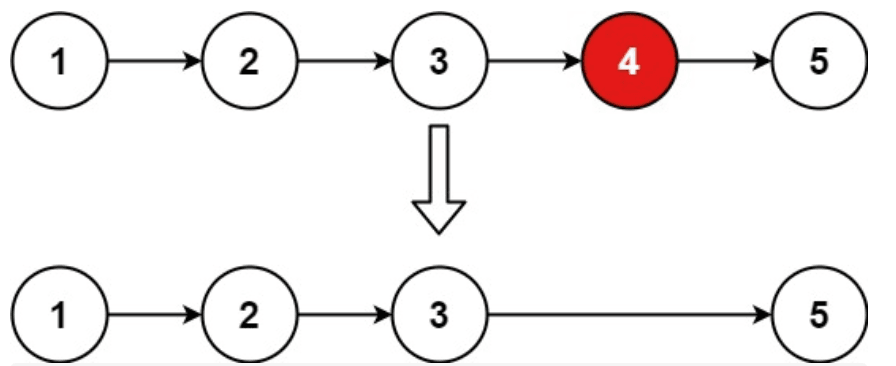
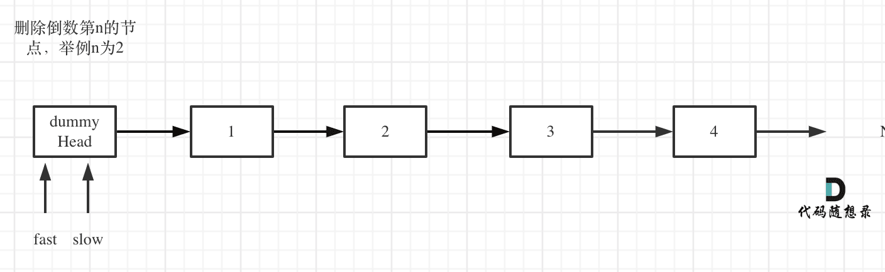
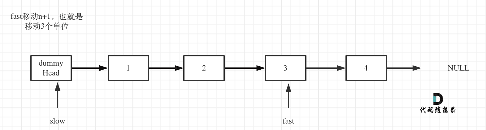
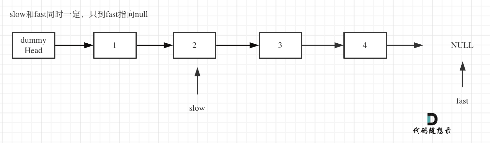
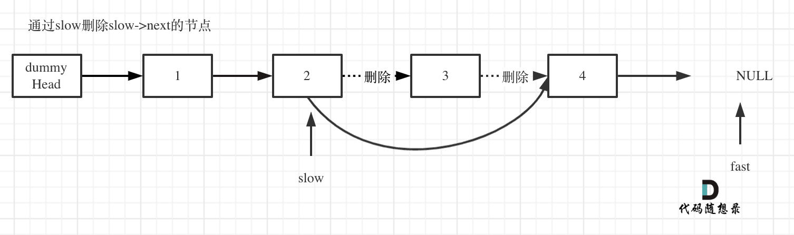

* [做專案（多個 C++、Java、Go、測試開發、前端專案）](https://www.programmercarl.com/other/kstar.html)
* [刷演算法（兩個月高強度學演算法）](https://www.programmercarl.com/xunlian/xunlianying.html)
* [準備面試必考題（八股文）（40天挑戰高頻面試題）](https://www.programmercarl.com/xunlian/bagu.html)


# 19.刪除鏈接串列（linked list）的倒數第N個節點（node）

[LeetCode 題目連結](https://leetcode.com/problems/remove-nth-node-from-end-of-list/)

給你一個鏈接串列，刪除鏈接串列的倒數第 n 個節點，並且回傳鏈接串列的頭節點（head node）。

進階：你能嘗試使用一趟掃描實作嗎？

範例 1：




輸入：head = [1,2,3,4,5], n = 2
輸出：[1,2,3,5]

範例 2：

輸入：head = [1], n = 1
輸出：[]

範例 3：

輸入：head = [1,2], n = 1
輸出：[1]

## 演算法公開課

**[《程式碼隨想錄》演算法影片公開課](https://programmercarl.com/other/gongkaike.html)：[鏈接串列遍歷（traversal）學清楚！| LeetCode：19.刪除鏈接串列倒數第N個節點](https://www.bilibili.com/video/BV1vW4y1U7Gf)，相信結合影片再看本篇題解，更有助於大家對鏈接串列的理解。**


## 解題思路


雙指標（two pointers）的經典應用，如果要刪除倒數第 n 個節點，讓 fast 移動 n 步，然後讓 fast 和 slow 同時移動，直到 fast 指向鏈接串列末尾。刪掉 slow 所指向的節點就可以了。

想法是這樣的，但要注意一些細節。

分為如下幾步：

* 首先這裡我推薦大家使用虛擬頭節點（dummy head），這樣方便處理刪除實際頭節點的邏輯，如果對虛擬頭節點不清楚，可以看這篇：[鏈接串列：聽說用 dummy head 會方便很多？](./0203.移除鏈接串列元素.md)

* 定義 fast 指標（pointer）和 slow 指標，初始值為虛擬頭節點，如圖：

 </img></div>

* fast 首先走 n + 1 步，為什麼是 n+1 呢？因為只有這樣同時移動的時候 slow 才能指向刪除節點的上一個節點（方便做刪除操作），如圖：
 </img></div>

* fast 和 slow 同時移動，直到 fast 指向末尾，如圖：
 </img></div>
// 圖片中有錯別字：應該將「只到」改為「直到」
* 刪除 slow 指向的下一個節點，如圖：
 </img></div>

此時不難寫出如下 C++ 程式碼：

```CPP
class Solution {
public:
    ListNode* removeNthFromEnd(ListNode* head, int n) {
        ListNode* dummyHead = new ListNode(0);
        dummyHead->next = head;
        ListNode* slow = dummyHead;
        ListNode* fast = dummyHead;
        while(n-- && fast != NULL) {
            fast = fast->next;
        }
        fast = fast->next; // fast 再提前走一步，因為需要讓 slow 指向刪除節點的上一個節點
        while (fast != NULL) {
            fast = fast->next;
            slow = slow->next;
        }
        slow->next = slow->next->next; 
        
        // ListNode *tmp = slow->next;  C++ 釋放記憶體的邏輯
        // slow->next = tmp->next;
        // delete tmp;
        
        return dummyHead->next;
    }
};
```

* 時間複雜度（time complexity）：O(n)
* 空間複雜度（space complexity）：O(1)


## 其他語言版本

### Java:

```java
class Solution {
    public ListNode removeNthFromEnd(ListNode head, int n) {
        // 新建一個 dummy head 指向 head
        ListNode dummyNode = new ListNode(0);
        dummyNode.next = head;
        // fast and slow pointers 指向 dummy head
        ListNode fastIndex = dummyNode;
        ListNode slowIndex = dummyNode;

        // 只要 fast and slow pointers 相差 n 個節點即可
        for (int i = 0; i <= n; i++) {
            fastIndex = fastIndex.next;
        }
        while (fastIndex != null) {
            fastIndex = fastIndex.next;
            slowIndex = slowIndex.next;
        }

        // 此時 slowIndex 的位置就是待刪除元素的前一個位置。
        // 具體情況可自己畫一個鏈接串列長度為 3 的圖來模擬程式碼以理解
        // 檢查 slowIndex.next 是否為 null，以避免空指標異常
        if (slowIndex.next != null) {
            slowIndex.next = slowIndex.next.next;
        }
        return dummyNode.next;
    }
}
```


```java
class Solution {
    public ListNode removeNthFromEnd(ListNode head, int n) {
        // 建立一個新的虛擬節點，指向原鏈接串列頭  
        ListNode s = new ListNode(-1, head);
        // 遞迴呼叫 remove 方法，從虛擬節點開始進行刪除操作  
        remove(s, n);
        // 回傳新鏈接串列的頭（去掉可能的虛擬節點）  
        return s.next;
    }
    
    public int remove(ListNode p, int n) {
        // 遞迴結束條件：如果當前節點為空，回傳 0  
        if (p == null) {
            return 0;
        }
        // 遞迴深入到下一個節點  
        int net = remove(p.next, n);
        // 如果當前節點是倒數第 n 個節點，進行刪除操作  
        if (net == n) {
            p.next = p.next.next;  
        }
        // 回傳當前節點的總深度  
        return net + 1;
    }
}
```


### Python:

```python
# Definition for singly-linked list.
# class ListNode:
#     def __init__(self, val=0, next=None):
#         self.val = val
#         self.next = next

class Solution:
    def removeNthFromEnd(self, head: ListNode, n: int) -> ListNode:
        # 建立一個虛擬節點，並將其下一個指標設定為鏈接串列的頭部
        dummy_head = ListNode(0, head)
        
        # 建立兩個指標，慢指標與快指標，並將它們初始化為虛擬節點
        slow = fast = dummy_head
        
        # 快指標比慢指標快 n+1 步
        for i in range(n+1):
            fast = fast.next
        
        # 移動兩個指標，直到快指標到達鏈接串列的末尾
        while fast:
            slow = slow.next
            fast = fast.next
        
        # 透過更新第 (n-1) 個節點的 next 指標刪除第 n 個節點
        slow.next = slow.next.next
        
        return dummy_head.next

```
### Go:

```Go
/**
 * Definition for singly-linked list.
 * type ListNode struct {
 *     Val int
 *     Next *ListNode
 * }
 */
func removeNthFromEnd(head *ListNode, n int) *ListNode {
	dummyNode := &ListNode{0, head}
	fast, slow := dummyNode, dummyNode
	for i := 0; i <= n; i++ { // 注意 <=，否則快指標為空時，慢指標正好在倒數第 n 個上面
		fast = fast.Next
	}
	for fast != nil {
		fast = fast.Next
		slow = slow.Next
	}
	slow.Next = slow.Next.Next
	return dummyNode.Next
}
```

### JavaScript:

```js
/**
 * @param {ListNode} head
 * @param {number} n
 * @return {ListNode}
 */
var removeNthFromEnd = function (head, n) {
  // 建立哨符節點，簡化解題邏輯
  let dummyHead = new ListNode(0, head);
  let fast = dummyHead;
  let slow = dummyHead;
  while (n--) fast = fast.next;
  while (fast.next !== null) {
    slow = slow.next;
    fast = fast.next;
  }
  slow.next = slow.next.next;
  return dummyHead.next;
};
```
### TypeScript:

版本一（fast and slow pointers 法）：

```typescript
function removeNthFromEnd(head: ListNode | null, n: number): ListNode | null {
    let newHead: ListNode | null = new ListNode(0, head);
    // 根據 LeetCode 題目的定義可推斷這裡 fast and slow pointers 均不需要定義為 ListNode | null。
    let slowNode: ListNode = newHead;
    let fastNode: ListNode = newHead;

    while(n--) {
        fastNode = fastNode.next!; // 由 dummy head 前進 n 個節點時，fastNode.next 可推斷不為 null。
    }
    while(fastNode.next) {  // 遍歷直至 fastNode.next = null，即尾部節點。此時 slowNode 指向倒數第 n 個節點。
        fastNode = fastNode.next;
        slowNode = slowNode.next!;
    }
    slowNode.next = slowNode.next!.next; // 倒數第 n 個節點可推斷其 next 節點不為空。 
    return newHead.next; 
}
```

版本二（計算節點總數法）：

```typescript
function removeNthFromEnd(head: ListNode | null, n: number): ListNode | null {
    let curNode: ListNode | null = head;
    let listSize: number = 0;
    while (curNode) {
        curNode = curNode.next;
        listSize++;
    }
    if (listSize === n) {
        head = head.next;
    } else {
        curNode = head;
        for (let i = 0; i < listSize - n - 1; i++) {
            curNode = curNode.next;
        }
        curNode.next = curNode.next.next;
    }
    return head;
};
```

版本三（遞迴（recursion）倒退 n 法）：

```typescript
function removeNthFromEnd(head: ListNode | null, n: number): ListNode | null {
    let newHead: ListNode | null = new ListNode(0, head);
    let cnt = 0;
    function recur(node) {
        if (node === null) return;
        recur(node.next);
        cnt++;
        if (cnt === n + 1) {
            node.next = node.next.next;
        }
    }
    recur(newHead);
    return newHead.next;
};
```

### Kotlin:

```Kotlin
fun removeNthFromEnd(head: ListNode?, n: Int): ListNode? {
    val pre = ListNode(0).apply {
        this.next = head
    }
    var fastNode: ListNode? = pre
    var slowNode: ListNode? = pre
    for (i in 0..n) {
        fastNode = fastNode?.next
    }
    while (fastNode != null) {
        slowNode = slowNode?.next
        fastNode = fastNode.next
    }
    slowNode?.next = slowNode?.next?.next
    return pre.next
}
```

### Swift：

```swift
func removeNthFromEnd(_ head: ListNode?, _ n: Int) -> ListNode? {
    if head == nil {
        return nil
    }
    if n == 0 {
        return head
    }
    let dummyHead = ListNode(-1, head)
    var fast: ListNode? = dummyHead
    var slow: ListNode? = dummyHead
    // fast 前移 n
    for _ in 0 ..< n {
        fast = fast?.next
    }
    while fast?.next != nil {
        fast = fast?.next
        slow = slow?.next
    }
    slow?.next = slow?.next?.next
    return dummyHead.next
}
```

### PHP:

```php
function removeNthFromEnd($head, $n) {
    // 設定 dummy head
    $dummyHead = new ListNode();
    $dummyHead->next = $head;

    $slow = $fast = $dummyHead;
    while($n-- && $fast != null){
        $fast = $fast->next;
    }
    // fast 再走一步，讓 slow 指向刪除節點的上一個節點
    $fast = $fast->next; 
    while ($fast != NULL) {
        $fast = $fast->next;
        $slow = $slow->next;
    }
    $slow->next = $slow->next->next;
    return $dummyHead->next;
    }
```

### Scala:

```scala
object Solution {
  def removeNthFromEnd(head: ListNode, n: Int): ListNode = {
    val dummy = new ListNode(-1, head) // 定義 dummy head
    var fast = head // 快指標從頭開始走
    var slow = dummy // 慢指標從 dummy head 開始
    // 因為參數 n 是不可變數，所以不能使用 while(n>0){n-=1} 的方式
    for (i <- 0 until n) {
      fast = fast.next
    }
    // 快指標和慢指標一起走，直到 fast 走到 null
    while (fast != null) {
      slow = slow.next
      fast = fast.next
    }
    // 刪除 slow 的下一個節點 
    slow.next = slow.next.next
    // 回傳 dummy head 的下一個節點
    dummy.next
  }
}
```

### Rust:

```rust
impl Solution {
    pub fn remove_nth_from_end(head: Option<Box<ListNode>>, mut n: i32) -> Option<Box<ListNode>> {
        let mut dummy_head = Box::new(ListNode::new(0));
        dummy_head.next = head;
        let mut fast = &dummy_head.clone();
        let mut slow = &mut dummy_head;
        while n > 0 {
            fast = fast.next.as_ref().unwrap();
            n -= 1;
        }
        while fast.next.is_some() {
            fast = fast.next.as_ref().unwrap();
            slow = slow.next.as_mut().unwrap();
        }
        slow.next = slow.next.as_mut().unwrap().next.take();
        dummy_head.next
    }
}
```
### C：

```c
/**C 語言單向鏈接串列的定義
 * Definition for singly-linked list.
 * struct ListNode {
 *     int val;
 *     struct ListNode *next;
 * };
 */
struct ListNode* removeNthFromEnd(struct ListNode* head, int n) {
    // 定義 dummy head 變數 dummy 並初始化使其指向 head
    struct ListNode* dummy = malloc(sizeof(struct ListNode));
    dummy->val = 0;
    dummy->next = head;
    // 定義 fast slow two pointers
    struct ListNode* fast = head;
    struct ListNode* slow = dummy;

    for (int i = 0; i < n; ++i) {
        fast = fast->next;
    }
    while (fast) {
        fast = fast->next;
        slow = slow->next;
    }
    slow->next = slow->next->next;// 刪除倒數第 n 個節點
    head = dummy->next;
    free(dummy);// 刪除虛擬節點 dummy
    return head;
}


```

### C#：

```csharp
public class Solution {
    public ListNode RemoveNthFromEnd(ListNode head, int n) {
        ListNode dummpHead = new ListNode(0);
        dummpHead.next = head;
        var fastNode = dummpHead;
        var slowNode = dummpHead;
        while(n-- != 0 && fastNode != null)
        {
            fastNode = fastNode.next;
        }
        while(fastNode.next != null)
        {
            fastNode = fastNode.next;
            slowNode = slowNode.next;
        }
        slowNode.next = slowNode.next.next;
        return dummpHead.next;
    }
}
```
