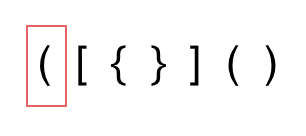
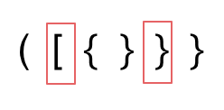
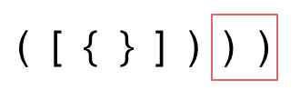
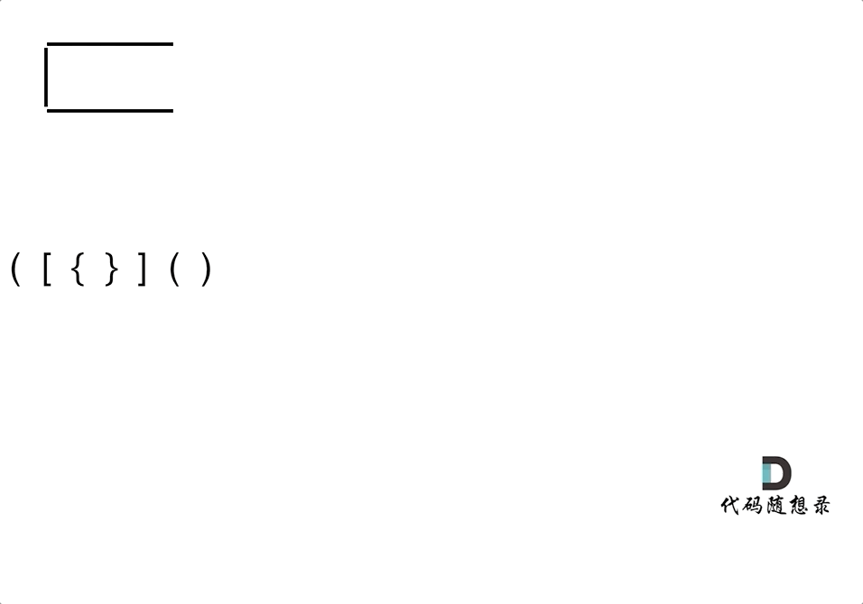

* [做專案（多個 C++、Java、Go、測試開發、前端專案）](https://www.programmercarl.com/other/kstar.html)
* [刷演算法（兩個月高強度學演算法）](https://www.programmercarl.com/xunlian/xunlianying.html)
* [準備面試必考題（八股文）（40天挑戰高頻面試題）](https://www.programmercarl.com/xunlian/bagu.html)


> 資料結構與演算法應用往往隱藏在我們看不到的地方

# 20. 有效的括號（parentheses）

[LeetCode 題目連結](https://leetcode.com/problems/valid-parentheses/)

給定一個只包括 '('，')'，'{'，'}'，'['，']' 的字串（string），判斷字串是否有效。

有效字串需滿足：
* 左括號必須用相同類型的右括號閉合。
* 左括號必須以正確的順序閉合。
* 注意空字串可被認為是有效字串。

範例 1：
* 輸入："()"  
* 輸出：true     

範例 2：
* 輸入："()[]{}"    
* 輸出：true     

範例 3：
* 輸入："(]"   
* 輸出：false    

範例 4：
* 輸入："([)]"   
* 輸出：false 

範例 5：
* 輸入："{[]}"
* 輸出：true

## 演算法公開課

**[《程式碼隨想錄》演算法影片公開課](https://programmercarl.com/other/gongkaike.html)：[堆疊（stack）的拿手好戲！| LeetCode：20. 有效的括號](https://www.bilibili.com/video/BV1AF411w78g)，相信結合影片再看本篇題解，更有助於大家對本題的理解**。

## 解題思路

### 題外話

**括號匹配是使用堆疊解決的經典問題。**

題意其實就像我們在寫程式碼的過程中，要求括號的順序是一樣的，有左括號，相應的位置必須要有右括號。

如果還記得編譯原理的話，編譯器（compiler）在詞法分析（lexical analysis）的過程中處理括號、大括號（brace）等這個符號的邏輯，也是使用了堆疊這種資料結構。

再舉個例子，Linux作業系統中，cd 這個進入目錄（directory）的命令我們應該再熟悉不過了。

```
cd a/b/c/../../
```

這個命令最後進入 a 目錄，系統是如何知道進入了 a 目錄呢？這就是堆疊的應用（其實可以出一道相應的面試題了）

所以堆疊在電腦領域中應用是非常廣泛的。

有的同學經常會想，學的這些資料結構有什麼用，也開發不了什麼軟體，大多數同學說的軟體應該都是視覺化的軟體例如 App、網站之類的，那都是非常上層的應用了，底層很多功能的實作都是基礎的資料結構和演算法。

**所以資料結構與演算法的應用往往隱藏在我們看不到的地方！**

這裡我就不過多展開了，先來看題。

### 進入正題

由於堆疊結構的特殊性，非常適合做對稱性（symmetry）匹配類的題目。

首先要弄清楚，字串裡的括號不匹配有幾種情況。

**一些同學，在面試中看到這種題目上來就開始寫程式碼，然後就越寫越亂。**

建議在寫程式碼之前要分析好有哪幾種不匹配的情況，如果不在動手之前分析好，寫出的程式碼也會有很多問題。

先來分析一下，這裡有三種不匹配的情況：


1. 第一種情況，字串裡左方向的括號多餘了，所以不匹配。


2. 第二種情況，括號沒有多餘，但是括號的類型沒有匹配上。


3. 第三種情況，字串裡右方向的括號多餘了，所以不匹配。



我們的程式碼只要覆蓋了這三種不匹配的情況，就不會出問題，可以看出動手之前分析好題目的重要性。

動畫如下：




第一種情況：已經遍歷（traversal）完了字串，但是堆疊不為空，說明有相應的左括號沒有右括號來匹配，所以 return false

第二種情況：遍歷字串匹配的過程中，發現堆疊裡沒有要匹配的字元（character）。所以 return false

第三種情況：遍歷字串匹配的過程中，堆疊已經為空了，沒有匹配的字元了，說明右括號沒有找到對應的左括號 return false

那麼什麼時候說明左括號和右括號全都匹配了呢？就是字串遍歷完之後，堆疊是空的，就說明全都匹配了。

分析完之後，程式碼其實就比較好寫了，

但還有一些技巧，在匹配左括號的時候，右括號先推入堆疊，就只需要比較當前元素（element）和堆疊頂（top of stack）相不相等就可以了，比左括號先推入堆疊程式碼實作要簡單得多！

實作 C++ 程式碼如下：


```CPP
class Solution {
public:
    bool isValid(string s) {
        if (s.size() % 2 != 0) return false; // 如果 s 的長度為奇數，一定不符合要求
        stack<char> st;
        for (int i = 0; i < s.size(); i++) {
            if (s[i] == '(') st.push(')');
            else if (s[i] == '{') st.push('}');
            else if (s[i] == '[') st.push(']');
            // 第三種情況：遍歷字串匹配的過程中，堆疊已經為空了，沒有匹配的字元了，說明右括號沒有找到對應的左括號 return false
            // 第二種情況：遍歷字串匹配的過程中，發現堆疊裡沒有我們要匹配的字元。所以 return false
            else if (st.empty() || st.top() != s[i]) return false;
            else st.pop(); // st.top() 與 s[i] 相等，堆疊爆出元素
        }
        // 第一種情況：此時我們已經遍歷完了字串，但是堆疊不為空，說明有相應的左括號沒有右括號來匹配，所以 return false，否則就 return true
        return st.empty();
    }
};

```
* 時間複雜度（time complexity）：O(n)
* 空間複雜度（space complexity）：O(n)

技巧性的東西沒有固定的學習方法，還是要多看多練，自己靈活運用了。


## 其他語言版本

### Java：

```Java
class Solution {
    public boolean isValid(String s) {
        Deque<Character> deque = new LinkedList<>();
        char ch;
        for (int i = 0; i < s.length(); i++) {
            ch = s.charAt(i);
            // 碰到左括號，就把相應的右括號推入堆疊
            if (ch == '(') {
                deque.push(')');
            }else if (ch == '{') {
                deque.push('}');
            }else if (ch == '[') {
                deque.push(']');
            } else if (deque.isEmpty() || deque.peek() != ch) {
                return false;
            }else {// 如果是右括號，判斷是否和堆疊頂元素匹配
                deque.pop();
            }
        }
        // 遍歷結束，如果堆疊為空，則括號全部匹配
        return deque.isEmpty();
    }
}
```

```java
// 解法二
// 對應的另一半一定在堆疊頂
class Solution {
    public boolean isValid(String s) {
        Stack<Character> stack = new Stack<>();
        for(char c : s.toCharArray()){
            // 有對應的另一半就直接配對消除
            if(c == ')' && !stack.isEmpty() && stack.peek() == '(')
                stack.pop();
            else if(c == '}' && !stack.isEmpty() && stack.peek() == '{')
                stack.pop();
            else if(c == ']' && !stack.isEmpty() && stack.peek() == '[')
                stack.pop();
            else
                stack.push(c);// 沒有匹配的就放進去
        }

        return stack.isEmpty();
    }
}
```

### Python：

```python
# 方法一，僅使用堆疊，更省空間
class Solution:
    def isValid(self, s: str) -> bool:
        stack = []
        
        for item in s:
            if item == '(':
                stack.append(')')
            elif item == '[':
                stack.append(']')
            elif item == '{':
                stack.append('}')
            elif not stack or stack[-1] != item:
                return False
            else:
                stack.pop()
        
        return True if not stack else False
```

```python
# 方法二，使用字典
class Solution:
    def isValid(self, s: str) -> bool:
        stack = []
        mapping = {
            '(': ')',
            '[': ']',
            '{': '}'
        }
        for item in s:
            if item in mapping.keys():
                stack.append(mapping[item])
            elif not stack or stack[-1] != item: 
                return False
            else: 
                stack.pop()
        return True if not stack else False
```

### Go：

```Go
// 思路：使用堆疊來進行括號的匹配
// 時間複雜度 O(n)
// 空間複雜度 O(n)
func isValid(s string) bool {
	// 使用切片模擬堆疊的行為
	stack := make([]rune, 0)

	// m 用於記錄某個右括號對應的左括號
	m := make(map[rune]rune)
	m[')'] = '('
	m[']'] = '['
	m['}'] = '{'

	// 遍歷字串中的 rune
	for _, c := range s {
		// 左括號直接推入堆疊
		if c == '(' || c == '[' || c == '{' {
			stack = append(stack, c)
		} else {
			// 如果是右括號，先判斷堆疊內是否還有元素
			if len(stack) == 0 {
				return false
			}
			// 再判斷堆疊頂元素是否能夠匹配
			peek := stack[len(stack)-1]
			if peek != m[c] {
				return false
			}
			// 模擬堆疊頂爆出
			stack = stack[:len(stack)-1]
		}
	}

	// 若堆疊中不再包含元素，則能完全匹配
	return len(stack) == 0
}
```

### Ruby:

```ruby
def is_valid(strs)
    symbol_map = {')' => '(', '}' => '{', ']' => '['}
    stack = []
    strs.size.times {|i|
        c = strs[i]
        if symbol_map.has_key?(c)
            top_e = stack.shift
            return false if symbol_map[c] != top_e
        else
            stack.unshift(c)
        end
    }
    stack.empty?
end
```

### JavaScript:

```javascript
var isValid = function (s) {
  const stack = [];
  for (let i = 0; i < s.length; i++) {
    let c = s[i];
    switch (c) {
      case '(':
        stack.push(')');
        break;
      case '[':
        stack.push(']');
        break;
      case '{':
        stack.push('}');
        break;
      default:
        if (c !== stack.pop()) {
          return false;
        }
    }
  }
  return stack.length === 0;
};
// 簡化版本
var isValid = function(s) {
    const stack = [], 
        map = {
            "(":")",
            "{":"}",
            "[":"]"
        };
    for(const x of s) {
        if(x in map) {
            stack.push(x);
            continue;
        };
        if(map[stack.pop()] !== x) return false;
    }
    return !stack.length;
};
```

### TypeScript:

版本一：普通版

```typescript
function isValid(s: string): boolean {
    let helperStack: string[] = [];
    for (let i = 0, length = s.length; i < length; i++) {
        let x: string = s[i];
        switch (x) {
            case '(':
                helperStack.push(')');
                break;
            case '[':
                helperStack.push(']');
                break;
            case '{':
                helperStack.push('}');
                break;
            default:
                if (helperStack.pop() !== x) return false;
                break;
        }
    }
    return helperStack.length === 0;
};
```

版本二：最佳化版

```typescript
function isValid(s: string): boolean {
    type BracketMap = {
        [index: string]: string;
    }
    let helperStack: string[] = [];
    let bracketMap: BracketMap = {
        '(': ')',
        '[': ']',
        '{': '}'
    }
    for (let i of s) {
        if (bracketMap.hasOwnProperty(i)) {
            helperStack.push(bracketMap[i]);
        } else if (i !== helperStack.pop()) {
            return false;
        }
    }
    return helperStack.length === 0;
};
```

### Swift:

```swift
func isValid(_ s: String) -> Bool {
    var stack = [String.Element]()
    for ch in s {
        if ch == "(" {
            stack.append(")")
        } else if ch == "{" {
            stack.append("}")
        } else if ch == "[" {
            stack.append("]")
        } else {
            let top = stack.last
            if ch == top {
                stack.removeLast()
            } else {
                return false
            }
        }
    }
    return stack.isEmpty
}
```

### C:

```C
// 輔助函數：判斷堆疊頂元素與輸入的括號是否為一對。若不是，則回傳 False
int notMatch(char par, char* stack, int stackTop) {
    switch(par) {
        case ']':
            return stack[stackTop - 1] != '[';
        case ')':
            return stack[stackTop - 1] != '(';
        case '}':
            return stack[stackTop - 1] != '{';
    }
    return 0;
}

bool isValid(char * s){
    int strLen = strlen(s);
    // 配置堆疊空間
    char stack[5000];
    int stackTop = 0;

    // 遍歷字串
    int i;
    for(i = 0; i < strLen; i++) {
        // 取出當前下標所對應字元
        char tempChar = s[i];
        // 若當前字元為左括號，則推入堆疊
        if(tempChar == '(' || tempChar == '[' || tempChar == '{')
            stack[stackTop++] = tempChar;
        // 若當前字元為右括號，且堆疊中無元素或右括號與堆疊頂元素不符，回傳 False
        else if(stackTop == 0 || notMatch(tempChar, stack, stackTop))
            return 0;
        // 當前字元與堆疊頂元素為一對括號，將堆疊頂元素爆出堆疊
        else
            stackTop--;
    }
    // 若堆疊中有元素，回傳 False。若沒有元素（stackTop 為 0），回傳 True
    return !stackTop;
}
```

### C#:

```csharp
public class Solution {
    public bool IsValid(string s) {
        var len = s.Length;
        if(len % 2 == 1) return false; // 字串長度為奇數，直接回傳 false
        // 初始化堆疊
        var stack = new Stack<char>();
        // 遍歷字串
        for(int i = 0; i < len; i++){
            // 當字串為左括號時，推入對應的右括號進堆疊
            if(s[i] == '('){
                stack.Push(')');
            }else if(s[i] == '['){
                stack.Push(']');
            }else if(s[i] == '{'){
                stack.Push('}');
            }
            // 當字串為右括號時，當堆疊為空（無左括號）或者爆出的字元不是當前的字元
            else if(stack.Count == 0 || stack.Pop() != s[i])
                return false;
        }
        // 如果堆疊不為空，例如「((()」，右括號少於左括號，回傳 false
        if (stack.Count > 0)
            return false;
        // 上面的驗證都滿足，則回傳 true
        else
            return true;
    }
}
```

### PHP:

```php
// https://www.php.net/manual/zh/class.splstack.php
class Solution
{
    function isValid($s){
        $stack = new SplStack();
        for ($i = 0; $i < strlen($s); $i++) {
            if ($s[$i] == "(") {
                $stack->push(')');
            } else if ($s[$i] == "{") {
                $stack->push('}');
            } else if ($s[$i] == "[") {
                $stack->push(']');
            // 2. 遍歷匹配過程中，發現堆疊內沒有要匹配的字元 return false
            // 3. 遍歷匹配過程中，堆疊已為空，沒有匹配的字元了，說明右括號沒有找到對應的左括號 return false
            } else if ($stack->isEmpty() || $stack->top() != $s[$i]) {
                return false;
            } else {//$stack->top() == $s[$i]
                $stack->pop();
            }
        }
        // 1. 遍歷完，但是堆疊不為空，說明有相應的括號沒有被匹配，return false
        return $stack->isEmpty();
    }
}
```

### Scala:

```scala
object Solution {
  import scala.collection.mutable
  def isValid(s: String): Boolean = {
    if(s.length % 2 != 0) return false    // 如果字串長度是奇數直接回傳 false
    val stack = mutable.Stack[Char]()
    // 迴圈遍歷字串
    for (i <- s.indices) {
      val c = s(i)
      if (c == '(' || c == '[' || c == '{') stack.push(c)
      else if(stack.isEmpty) return false   // 如果沒有 (、[、{ 則直接回傳 false
      // 以下三種情況，不滿足則直接回傳 false        
      else if(c==')' && stack.pop() != '(') return false 
      else if(c==']' && stack.pop() != '[') return false 
      else if(c=='}' && stack.pop() != '{') return false 
    }
    // 如果為空則正確匹配，否則還有剩餘元素就不匹配
    stack.isEmpty
  }
}
```

### Rust:

```rust
impl Solution {
    pub fn is_valid(s: String) -> bool {
        if s.len() % 2 == 1 {
            return false;
        }
        let mut stack = vec![];
        let mut chars: Vec<char> = s.chars().collect();
        while let Some(s) = chars.pop() {
            match s {
                ')' => stack.push('('),
                ']' => stack.push('['),
                '}' => stack.push('{'),
                _ => {
                    if stack.is_empty() || stack.pop().unwrap() != s {
                        return false;
                    }
                }
            }
        }
        stack.is_empty()
    }
}
```


