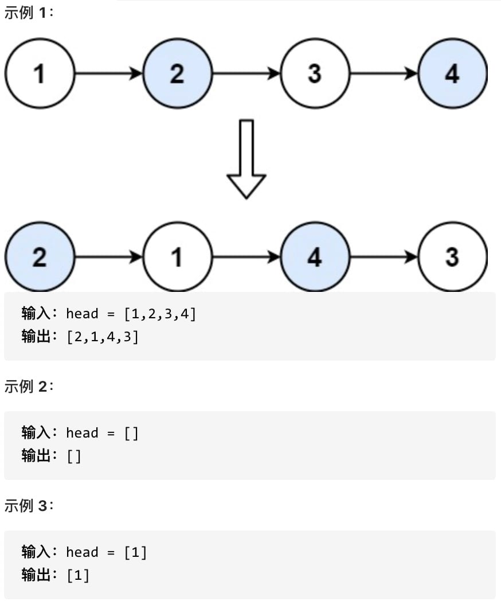
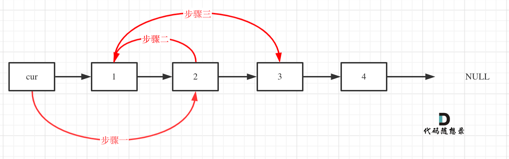
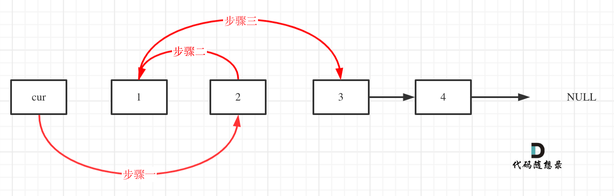
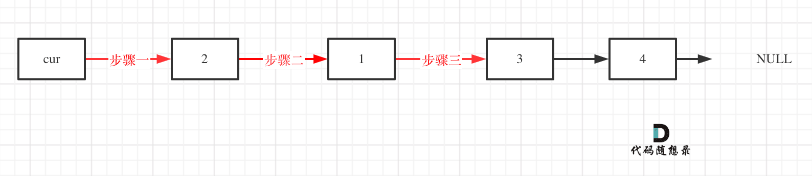

* [做專案（多個 C++、Java、Go、測試開發、前端專案）](https://www.programmercarl.com/other/kstar.html)
* [刷演算法（兩個月高強度學演算法）](https://www.programmercarl.com/xunlian/xunlianying.html)
* [背八股（40 天挑戰高頻面試題）](https://www.programmercarl.com/xunlian/bagu.html)


# 24. 兩兩交換（swap）鏈接串列（linked list）中的節點（node）

[LeetCode 題目連結](https://leetcode.com/problems/swap-nodes-in-pairs/)

給定一個鏈接串列，兩兩交換其中相鄰的節點，並回傳交換後的鏈接串列。

你不能只是單純地改變節點內部的值，而是需要實際進行節點交換。


 </img></div>

## 演算法公開課

**[《代碼隨想錄》演算法影片公開課](https://programmercarl.com/other/gongkaike.html)：[幫你把鏈接串列細節學清楚！ | LeetCode：24. 兩兩交換鏈接串列中的節點](https://www.bilibili.com/video/BV1YT411g7br)，相信結合影片再看本篇題解，更有助於大家對本題的理解**。

## 解題思路


這道題目正常模擬（simulation）就可以了。

建議使用虛擬頭節點（dummy head），這樣會方便很多，不然每次針對頭節點（head node）（沒有前一個指標（pointer）指向頭節點），還要單獨處理。

對虛擬頭節點的操作還不熟悉的話，可以看這篇[鏈接串列：聽說用 dummy head 會方便很多？](./0203.移除鏈接串列元素.md)。

接下來就是交換相鄰兩個元素（element）了，**此時一定要畫圖，不畫圖，操作多個指標很容易亂，而且要注意操作的先後順序**

初始時，cur 指向虛擬頭節點，然後進行如下三步：



操作之後，鏈接串列如下：



看這個可能就更直觀一些了：




對應的 C++ 程式碼實作如下：（註解中詳細與上圖中的三步做對應）

```CPP
class Solution {
public:
    ListNode* swapPairs(ListNode* head) {
        ListNode* dummyHead = new ListNode(0); // 設定一個 dummy head
        dummyHead->next = head; // 將 dummy head 指向 head，這樣方便後面做刪除操作
        ListNode* cur = dummyHead;
        while(cur->next != nullptr && cur->next->next != nullptr) {
            ListNode* tmp = cur->next; // 記錄暫存節點
            ListNode* tmp1 = cur->next->next->next; // 記錄暫存節點

            cur->next = cur->next->next;    // 步驟一
            cur->next->next = tmp;          // 步驟二
            cur->next->next->next = tmp1;   // 步驟三

            cur = cur->next->next; // cur 移動兩位，準備下一輪交換
        }
        ListNode* result = dummyHead->next;
        delete dummyHead;
        return result;
    }
};
```

* 時間複雜度（time complexity）：O(n)
* 空間複雜度（space complexity）：O(1)

## 延伸說明

**這裡還是說一下，大家不必太在意 LeetCode 上的執行時間，打敗多少使用者，這個統計是不準確的。**

做題的時候自己能分析出來時間複雜度就可以了，至於 LeetCode 上的執行時間，大概看一下就行。

上面的程式碼我第一次提交執行時間為 8ms，打敗 6.5% 的使用者，差點嚇到我了。

心想應該沒有更好的方法了吧，也就 $O(n)$ 的時間複雜度，重複提交幾次，就變成這樣了：


LeetCode 上的統計如果兩份程式碼是 100ms 和 300ms 的耗時，其實是需要注意的。

如果一個是 4ms 一個是 12ms，看上去好像是一個打敗了 80%，一個打敗了 20%，其實是沒有差別的。只不過是 LeetCode 上統計的誤差而已。


## 其他語言版本

### C:

```c
/**
 * Definition for singly-linked list.
 * struct ListNode {
 *     int val;
 *     struct ListNode *next;
 * };
 */
//遞迴版本
struct ListNode* swapPairs(struct ListNode* head){
    //遞迴結束條件：頭節點不存在或頭節點的下一個節點不存在。此時不需要交換，直接回傳 head
    if(!head || !head->next)
        return head;
    //建立一個節點指標型別儲存頭節點的下一個節點
    struct ListNode *newHead = head->next;
    //更改頭節點+2位節點後的值，並將頭節點的 next 指標指向這個更改過的 list
    head->next = swapPairs(newHead->next);
    //將新的頭節點的 next 指標指向舊的頭節點
    newHead->next = head;
    return newHead;
}
```

```c
//疊代版本
struct ListNode* swapPairs(struct ListNode* head){
    //使用 two pointers 避免使用中間變數
    typedef struct ListNode ListNode;
    ListNode *fakehead = (ListNode *)malloc(sizeof(ListNode));
    fakehead->next = head;
    ListNode* right = fakehead->next;
    ListNode* left = fakehead;
    while(left && right && right->next ){
        left->next = right->next;
        right->next = left->next->next;
        left->next->next = right;
        left = right;
        right = left->next;
    }
    return fakehead->next;
}
```

### Java：

```Java
// 遞迴版本
class Solution {
    public ListNode swapPairs(ListNode head) {
        // base case 退出條件
        if(head == null || head.next == null) return head;
        // 取得目前節點的下一個節點
        ListNode next = head.next;
        // 進行遞迴
        ListNode newNode = swapPairs(next.next);
        // 這裡進行交換
        next.next = head;
        head.next = newNode;

        return next;
    }
} 
```

```java
class Solution {
  public ListNode swapPairs(ListNode head) {
        ListNode dumyhead = new ListNode(-1); // 設定一個 dummy head
        dumyhead.next = head; // 將 dummy head 指向 head，這樣方便後面做刪除操作
        ListNode cur = dumyhead;
        ListNode temp; // 暫存節點，儲存兩個節點後面的節點
        ListNode firstnode; // 暫存節點，儲存兩個節點之中的第一個節點
        ListNode secondnode; // 暫存節點，儲存兩個節點之中的第二個節點
        while (cur.next != null && cur.next.next != null) {
            temp = cur.next.next.next;
            firstnode = cur.next;
            secondnode = cur.next.next;
            cur.next = secondnode;       // 步驟一
            secondnode.next = firstnode; // 步驟二
            firstnode.next = temp;      // 步驟三
            cur = firstnode; // cur 移動，準備下一輪交換
        }
        return dumyhead.next;  
    }
}
```

```java
// 將步驟 2,3 交換順序，這樣不用定義 temp 節點
public ListNode swapPairs(ListNode head) {
    ListNode dummy = new ListNode(0, head);
    ListNode cur = dummy;
    while (cur.next != null && cur.next.next != null) {
        ListNode node1 = cur.next;// 第 1 個節點
        ListNode node2 = cur.next.next;// 第 2 個節點
        cur.next = node2; // 步驟 1
        node1.next = node2.next;// 步驟 3
        node2.next = node1;// 步驟 2
        cur = cur.next.next;
    }
    return dummy.next;
}
```

### Python：

```python
# 遞迴版本
# Definition for singly-linked list.
# class ListNode:
#     def __init__(self, val=0, next=None):
#         self.val = val
#         self.next = next

class Solution:
    def swapPairs(self, head: Optional[ListNode]) -> Optional[ListNode]:
        if head is None or head.next is None:
            return head

        # 待反轉的兩個 node 分別是 pre 和 cur
        pre = head
        cur = head.next
        next = head.next.next
        
        cur.next = pre  # 交換
        pre.next = self.swapPairs(next) # 將以 next 為 head 的後續鏈接串列兩兩交換
         
        return cur
```

```python
# Definition for singly-linked list.
# class ListNode:
#     def __init__(self, val=0, next=None):
#         self.val = val
#         self.next = next

class Solution:
    def swapPairs(self, head: ListNode) -> ListNode:
        dummy_head = ListNode(next=head)
        current = dummy_head
        
        # 必須有 cur 的下一個和下下個才能交換，否則說明已經交換結束了
        while current.next and current.next.next:
            temp = current.next # 防止節點修改
            temp1 = current.next.next.next
            
            current.next = current.next.next
            current.next.next = temp
            temp.next = temp1
            current = current.next.next
        return dummy_head.next

```

### Go：

```go
func swapPairs(head *ListNode) *ListNode {
    dummy := &ListNode{
        Next: head,
    }
    //head=list[i]
    //pre=list[i-1]
    pre := dummy 
    for head != nil && head.Next != nil {
        pre.Next = head.Next
        next := head.Next.Next
        head.Next.Next = head
        head.Next = next
        //pre=list[(i+2)-1]
        pre = head 
        //head=list[(i+2)]
        head = next
    }
    return dummy.Next
}
```

```go
// 遞迴版本
func swapPairs(head *ListNode) *ListNode {
    if head == nil || head.Next == nil {
        return head
    }
    next := head.Next
    head.Next = swapPairs(next.Next)
    next.Next = head
    return next
}
```

### JavaScript:

```javascript
var swapPairs = function (head) {
  let ret = new ListNode(0, head), temp = ret;
  while (temp.next && temp.next.next) {
    let cur = temp.next.next, pre = temp.next;
    pre.next = cur.next;
    cur.next = pre;
    temp.next = cur;
    temp = pre;
  }
  return ret.next;
};
```

```javascript
// 遞迴版本
var swapPairs = function (head) {
  if (head == null || head.next == null) {
    return head;
  }

  let after = head.next;
  head.next = swapPairs(after.next);
  after.next = head;

  return after;
};
```

### TypeScript：

```typescript
function swapPairs(head: ListNode | null): ListNode | null {
    const dummyNode: ListNode = new ListNode(0, head);
    let curNode: ListNode | null = dummyNode;
    while (curNode && curNode.next && curNode.next.next) {
        let firstNode: ListNode = curNode.next,
            secNode: ListNode = curNode.next.next,
            thirdNode: ListNode | null = curNode.next.next.next;
        curNode.next = secNode;
        secNode.next = firstNode;
        firstNode.next = thirdNode;
        curNode = firstNode;
    }
    return dummyNode.next;
};
```

### Kotlin:

```kotlin
fun swapPairs(head: ListNode?): ListNode? {
    val dummyNode = ListNode(0).apply { 
        this.next = head
    }
    var cur: ListNode? = dummyNode
    while (cur?.next != null && cur.next?.next != null) {
        val temp = cur.next
        val temp2 = cur.next?.next?.next
        cur.next = cur.next?.next
        cur.next?.next = temp
        cur.next?.next?.next = temp2
        cur = cur.next?.next
    }
    return dummyNode.next
}
```

### Swift:

```swift
func swapPairs(_ head: ListNode?) -> ListNode? {
    if head == nil || head?.next == nil {
        return head
    }
    let dummyHead: ListNode = ListNode(-1, head)
    var current: ListNode? = dummyHead
    while current?.next != nil && current?.next?.next != nil {
        let temp1 = current?.next
        let temp2 = current?.next?.next?.next
        
        current?.next = current?.next?.next
        current?.next?.next = temp1
        current?.next?.next?.next = temp2
        
        current = current?.next?.next
    }
    return dummyHead.next
}
```
### Scala:

```scala
// dummy head
object Solution {
  def swapPairs(head: ListNode): ListNode = {
    var dummy = new ListNode(0, head) // dummy head
    var pre = dummy
    var cur = head
    // 當 pre 的下一個和下下個都不為空，才進行兩兩轉換
    while (pre.next != null && pre.next.next != null) {
      var tmp: ListNode = cur.next.next // 快取下一次要進行轉換的第一個節點
      pre.next = cur.next // 步驟一
      cur.next.next = cur // 步驟二
      cur.next = tmp // 步驟三
      // 下面是準備下一輪的交換
      pre = cur
      cur = tmp
    }
    // 最終回傳 dummy 這個 dummy head 的下一個，return 可以省略
    dummy.next
  }
}
```

### PHP:

```php
//dummy head
function swapPairs($head) {
    if ($head == null || $head->next == null) {
        return $head;
    }

    $dummyNode = new ListNode(0, $head);
    $preNode = $dummyNode; //dummy head
    $curNode = $head;
    $nextNode = $head->next;
    while($curNode && $nextNode) {
        $nextNextNode = $nextNode->next; //存下一個節點
        $nextNode->next = $curNode; //交換 curHead 和 nextHead
        $curNode->next = $nextNextNode;
        $preNode->next = $nextNode; //上一個節點的下一個指向 nextHead

        //更新目前的幾個指標
        $preNode = $preNode->next->next;
        $curNode = $nextNextNode;
        $nextNode = $nextNextNode->next;
    }

    return $dummyNode->next;
}

//遞迴版本
function swapPairs($head)
{
    // 終止條件
    if ($head === null || $head->next === null) {
        return $head;
    }

    //結果要回傳的頭節點
    $next = $head->next;
    $head->next = $this->swapPairs($next->next); //目前頭節點->next 指向更新
    $next->next = $head;  //目前第二個節點的->next 指向更新
    return $next;  //回傳反轉後的頭節點
}
```

### Rust:

```rust
// dummy head
impl Solution {
    pub fn swap_pairs(head: Option<Box<ListNode>>) -> Option<Box<ListNode>> {
        let mut dummy_head = Box::new(ListNode::new(0));
        dummy_head.next = head;
        let mut cur = dummy_head.as_mut();
        while let Some(mut node) = cur.next.take() {
            if let Some(mut next) = node.next.take() {
                node.next = next.next.take();
                next.next = Some(node);
                cur.next = Some(next);
                cur = cur.next.as_mut().unwrap().next.as_mut().unwrap();
            } else {
                cur.next = Some(node);
                cur = cur.next.as_mut().unwrap();
            }
        }
        dummy_head.next
    }
}
```

```rust
// 遞迴
impl Solution {
    pub fn swap_pairs(head: Option<Box<ListNode>>) -> Option<Box<ListNode>> {
        if head.is_none() || head.as_ref().unwrap().next.is_none() {
            return head;
        }

        let mut node = head.unwrap();

        if let Some(mut next) = node.next.take() {
            node.next = Solution::swap_pairs(next.next);
            next.next = Some(node);
            Some(next)
        } else {
            Some(node)
        }
    }
}
```

### C#
```csharp
// dummy head
public ListNode SwapPairs(ListNode head)
{
    var dummyHead = new ListNode();
    dummyHead.next = head;
    ListNode cur = dummyHead;
    while (cur.next != null && cur.next.next != null)
    {
        ListNode tmp1 = cur.next;
        ListNode tmp2 = cur.next.next.next;

        cur.next = cur.next.next;
        cur.next.next = tmp1;
        cur.next.next.next = tmp2;

        cur = cur.next.next;
    }
    return dummyHead.next;
}
```
``` C#
// 遞迴
public ListNode SwapPairs(ListNode head)
{
    if (head == null || head.next == null) return head;
    var cur = head.next;
    head.next = SwapPairs(head.next.next);
    cur.next = head;
    return cur;
}
```

