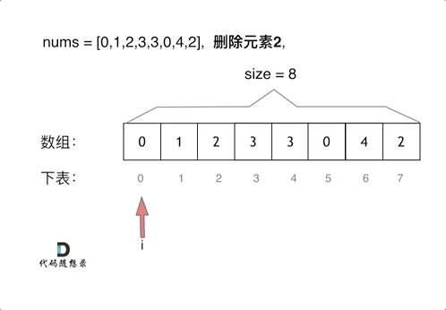
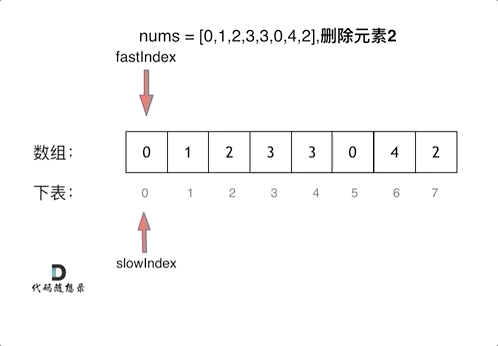

* [做專案（多個 C++、Java、Go、測試開發、前端專案）](https://www.programmercarl.com/other/kstar.html)
* [刷演算法（兩個月高強度學演算法）](https://www.programmercarl.com/xunlian/xunlianying.html)
* [背八股（40 天挑戰高頻面試題）](https://www.programmercarl.com/xunlian/bagu.html)


# 27. 移除元素（element）

[LeetCode 題目連結](https://leetcode.com/problems/remove-element/)

給你一個陣列（array） nums 和一個值 val，你需要原地（in-place）移除所有數值等於 val 的元素，並回傳移除後陣列的新長度。

不要使用額外的陣列空間，你必須僅使用 O(1) 額外空間並 **原地** 修改輸入陣列。

元素的順序可以改變。你不需要考慮陣列中超出新長度後面的元素。

範例 1:
給定 nums = [3,2,2,3], val = 3,
函數（function）應該回傳新的長度 2, 並且 nums 中的前兩個元素均為 2。
你不需要考慮陣列中超出新長度後面的元素。

範例 2:
給定 nums = [0,1,2,2,3,0,4,2], val = 2,
函數應該回傳新的長度 5, 並且 nums 中的前五個元素為 0, 1, 3, 0, 4。

**你不需要考慮陣列中超出新長度後面的元素。**


## 演算法公開課

**[《程式碼隨想錄》演算法影片公開課](https://programmercarl.com/other/gongkaike.html)：[陣列中移除元素並不容易！LeetCode：27. 移除元素](https://www.bilibili.com/video/BV12A4y1Z7LP)，相信結合影片再看本篇題解，更有助於大家對本題的理解**。

## 解題思路

有的同學可能說了，多餘的元素，刪除（delete）不就得了。

**要知道陣列的元素在記憶體（memory）位址（address）中是連續的，不能單獨刪除陣列中的某個元素，只能覆蓋。**

陣列的基礎知識可以看這裡[程式設計師演算法面試中，必須掌握的陣列理論知識](./陣列理論基礎.md)。

### 蠻力法（brute force）

這個題目蠻力的解法就是兩層 for 迴圈（for-loop），一個 for 迴圈遍歷陣列元素，第二個 for 迴圈更新陣列。

刪除過程如下：



很明顯蠻力法的時間複雜度（time complexity）是 O(n^2)，這道題目蠻力法在 LeetCode 上是可以通過的。

程式碼如下：

```CPP
// 時間複雜度：O(n^2)
// 空間複雜度：O(1)
class Solution {
public:
    int removeElement(vector<int>& nums, int val) {
        int size = nums.size();
        for (int i = 0; i < size; i++) {
            if (nums[i] == val) { // 發現需要移除的元素，就將陣列集體向前移動一位
                for (int j = i + 1; j < size; j++) {
                    nums[j - 1] = nums[j];
                }
                i--; // 因為下標 i 以後的數值都向前移動了一位，所以 i 也向前移動一位
                size--; // 此時陣列的大小-1
            }
        }
        return size;

    }
};
```

* 時間複雜度：O(n^2)
* 空間複雜度（space complexity）：O(1)

### 雙指標（two pointers）

雙指標（fast and slow pointers）： **透過一個快指標（pointer）和慢指標在一個 for 迴圈下完成兩個 for 迴圈的工作。**

定義快慢指標

* 快指標：尋找新陣列的元素，新陣列就是不含有目標元素的陣列
* 慢指標：指向更新新陣列下標（subscript）的位置

很多同學這道題目寫得很懵，就是不理解快慢指標究竟都是什麼含義，所以一定要明確含義，後面的想法就更容易理解了。

刪除過程如下：



很多同學不了解


**雙指標（fast and slow pointers）在陣列和鏈接串列（linked list）的操作中是非常常見的，很多考察陣列、鏈接串列、字串（string）等操作的面試題，都使用雙指標。**

後續都會一一介紹到，本題程式碼如下：

```CPP
// 時間複雜度：O(n)
// 空間複雜度：O(1)
class Solution {
public:
    int removeElement(vector<int>& nums, int val) {
        int slowIndex = 0;
        for (int fastIndex = 0; fastIndex < nums.size(); fastIndex++) {
            if (val != nums[fastIndex]) {
                nums[slowIndex++] = nums[fastIndex];
            }
        }
        return slowIndex;
    }
};
```
注意這些實作方法並沒有改變元素的相對位置！

* 時間複雜度：O(n)
* 空間複雜度：O(1)


## 相關題目推薦

* [26.刪除排序（sorting）陣列中的重複項](https://leetcode.com/problems/remove-duplicates-from-sorted-array/)
* [283.移動零](https://leetcode.com/problems/move-zeroes/)
* [844.比較（comparison）含退格（backspace）的字串](https://leetcode.com/problems/backspace-string-compare/)
* [977.有序陣列（ordered array）的平方](https://leetcode.com/problems/squares-of-a-sorted-array/)

## 其他語言版本

### Java：
```java
class Solution {
    public int removeElement(int[] nums, int val) {
	// 蠻力法
        int n = nums.length;
        for (int i = 0; i < n; i++) {
            if (nums[i] == val) {
                for (int j = i + 1; j < n; j++) {
                    nums[j - 1] = nums[j];
                }
                i--;
                n--;
            }
        }
        return n;
    }
}
```
```java
class Solution {
    public int removeElement(int[] nums, int val) {
        // fast and slow pointers
        int slowIndex = 0;
        for (int fastIndex = 0; fastIndex < nums.length; fastIndex++) {
            if (nums[fastIndex] != val) {
                nums[slowIndex] = nums[fastIndex];
                slowIndex++;
            }
        }
        return slowIndex;
    }
}
```
```java
//相向 two pointers
class Solution {
    public int removeElement(int[] nums, int val) {
        int left = 0;
        int right = nums.length - 1;
        while(right >= 0 && nums[right] == val) right--; //將 right 移到從右數第一個值不為 val 的位置
        while(left <= right) {
            if(nums[left] == val) { //left 位置的元素需要移除
                //將 right 位置的元素移到 left（覆蓋），right 位置移除
                nums[left] = nums[right];
                right--;
            }
            left++;
            while(right >= 0 && nums[right] == val) right--;
        }
        return left;
    }
}
```

```java
// 相向 two pointers（版本二）
class Solution {
    public int removeElement(int[] nums, int val) {
        int left = 0;
        int right = nums.length - 1;
        while(left <= right){
            if(nums[left] == val){
                nums[left] = nums[right];
                right--;
            }else {
                // 這裡相容了 right 指標指向的值與 val 相等的情況
                left++;
            }
        }
        return left;
    }
}
```

### Python：


``` python 3
（版本一）fast and slow pointers
class Solution:
    def removeElement(self, nums: List[int], val: int) -> int:
        # fast and slow pointers
        fast = 0  # 快指標
        slow = 0  # 慢指標
        size = len(nums)
        while fast < size:  # 不加等於的原因是，a = size 時，nums[a] 會超出邊界
            # slow 用來收集不等於 val 的值，如果 fast 對應值不等於 val，則把它與 slow 替換
            if nums[fast] != val:
                nums[slow] = nums[fast]
                slow += 1
            fast += 1
        return slow
```

``` python 3
（版本二）蠻力法
class Solution:
    def removeElement(self, nums: List[int], val: int) -> int:
        i, l = 0, len(nums)
        while i < l:
            if nums[i] == val: # 找到等於目標值的節點
                for j in range(i+1, l): # 移除該元素，並將後面元素向前平移
                    nums[j - 1] = nums[j]
                l -= 1
                i -= 1
            i += 1
        return l
                
```

``` python 3
# 相向 two pointers
# 時間複雜度 O(n)
# 空間複雜度 O(1)
class Solution:
    def removeElement(self, nums: List[int], val: int) -> int:
        n = len(nums)
        left, right  = 0, n - 1
        while left <= right:
            while left <= right and nums[left] != val:
                left += 1
            while left <= right and nums[right] == val:
                right -= 1
            if left < right:
                nums[left] = nums[right]
                left += 1
                right -= 1
        return left
                
```

### Go：

```go
// 蠻力法
// 時間複雜度 O(n^2)
// 空間複雜度 O(1)
func removeElement(nums []int, val int) int {
    size := len(nums)
    for i := 0; i < size; i ++ {
        if nums[i] == val {
            for j := i + 1; j < size; j ++ {
                nums[j - 1] = nums[j]
            }
            i --
            size --
        }
    }
    return size
}
```
```go
// fast and slow pointers
// 時間複雜度 O(n)
// 空間複雜度 O(1)
func removeElement(nums []int, val int) int {
	// 初始化慢指標 slow
	slow := 0
	// 透過 for 迴圈移動快指標 fast
	// 當 fast 指向的元素等於 val 時，跳過
	// 否則，將該元素寫入 slow 指向的位置，並將 slow 後移一位
	for fast := 0; fast < len(nums); fast++ {
		if nums[fast] == val {
			continue
		}
		nums[slow] = nums[fast]
		slow++
	}

	return slow
}
```
```go
//相向 two pointers
func removeElement(nums []int, val int) int {
    // 有點像二元搜尋的左閉右閉區間 所以下面是<=
	left := 0
	right := len(nums) - 1
	for left <= right {
		// 不斷尋找左側的 val 和右側的非 val 找到時交換位置 目的是將 val 全覆蓋掉
		for left <= right && nums[left] != val {
			left++
		}
		for left <= right && nums[right] == val {
			right--
		}
		//各自找到後開始覆蓋 覆蓋後繼續尋找
		if left < right {
			nums[left] = nums[right]
			left++
			right--
		}
	}
	return left
}
```

### JavaScript:

```javascript
//時間複雜度：O(n)
//空間複雜度：O(1)
var removeElement = (nums, val) => {
    let k = 0;
    for(let i = 0;i < nums.length;i++){
        if(nums[i] != val){
            nums[k++] = nums[i]
        }
    }
    return k;
};
```

### TypeScript：

```typescript
function removeElement(nums: number[], val: number): number {
    let slowIndex: number = 0, fastIndex: number = 0;
    while (fastIndex < nums.length) {
        if (nums[fastIndex] !== val) {
            nums[slowIndex++] = nums[fastIndex];
        }
        fastIndex++;
    }
    return slowIndex;
};
```

### Ruby:

```ruby
def remove_element(nums, val)
    i = 0
    nums.each_index do |j|
        if nums[j] != val
            nums[i] = nums[j]
            i+=1
        end
    end
    i
end
```
### Rust:

```rust
impl Solution {
    pub fn remove_element(nums: &mut Vec<i32>, val: i32) -> i32 {
        let mut slowIdx = 0;
        for pos in (0..nums.len()) {
            if nums[pos]!=val {
                nums[slowIdx] = nums[pos];
                slowIdx += 1;
            }
        }
        return (slowIdx) as i32;
    }
}
```

### Swift:

```swift
func removeElement(_ nums: inout [Int], _ val: Int) -> Int {
    var slowIndex = 0

    for fastIndex in 0..<nums.count {
        if val != nums[fastIndex] {
                nums[slowIndex] = nums[fastIndex]
                slowIndex += 1
        }
    }
    return slowIndex
}
```

### PHP:

```php
class Solution {
    /**
     * @param Integer[] $nums
     * @param Integer $val
     * @return Integer
     */
    function removeElement(&$nums, $val) {
        if (count($nums) == 0) {
            return 0;
        }
        // fast and slow pointers
        $slow = 0;
        for ($fast = 0; $fast < count($nums); $fast++) {
            if ($nums[$fast] != $val) {
                $nums[$slow] = $nums[$fast];
                $slow++;
            }
        }
        return $slow;
    }
```

### C:

```c
int removeElement(int* nums, int numsSize, int val){
    int slow = 0;
    for(int fast = 0; fast < numsSize; fast++) {
        //若快指標位置的元素不等於要刪除的元素
        if(nums[fast] != val) {
            //將其挪到慢指標指向的位置，慢指標+1
            nums[slow++] = nums[fast];
        }
    }
    //最後慢指標的大小就是新的陣列的大小
    return slow;
}
```

### Kotlin:

```kotlin
fun removeElement(nums: IntArray, `val`: Int): Int {
        var slowIndex = 0 // 初始化慢指標
        for (fastIndex in nums.indices) {
            if (nums[fastIndex] != `val`) nums[slowIndex++] = nums[fastIndex] // 在慢指標所在位置儲存未被刪除的元素
        }
        return slowIndex
    }
```

### Scala:

```scala
object Solution {
  def removeElement(nums: Array[Int], `val`: Int): Int = {
    var slow = 0
    for (fast <- 0 until nums.length) {
      if (`val` != nums(fast)) {
        nums(slow) = nums(fast)
        slow += 1
      }
    }
    slow
  }
}
```

### C#:

```csharp
public class Solution {
    public int RemoveElement(int[] nums, int val) {
        int slow = 0;
        for (int fast = 0; fast < nums.Length; fast++) {
            if (val != nums[fast]) {
                nums[slow++] = nums[fast];
            }
        }
        return slow;
    }
}
```

###Dart:
```dart
int removeElement(List<int> nums, int val) {
    //相向 two pointers
    var left = 0;
    var right = nums.length - 1;
    while (left <= right) {
	//尋找左側的 val，將其被右側非 val 覆蓋
        if (nums[left] == val) {
            while (nums[right] == val&&left<=right) {
                right--;
            if (right < 0) {
                return 0;
        }
      }
      nums[left] = nums[right--];
    } else {
      left++;
    }
  }
  //覆蓋後可以將 0 至 left 部分視為所需部分
  return left;
}

```

