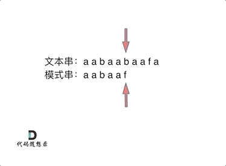
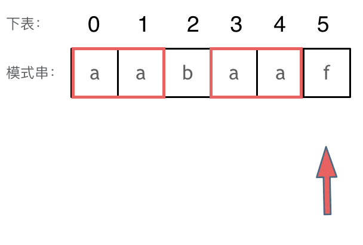
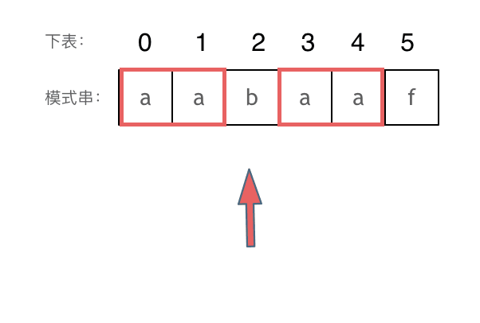
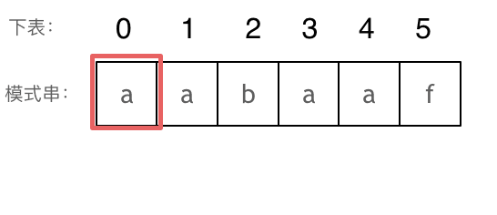
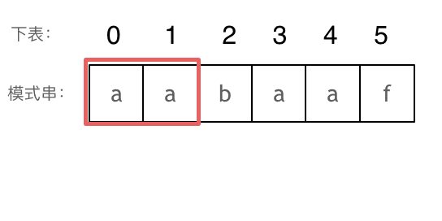
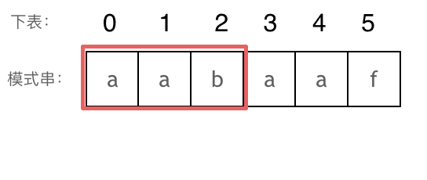
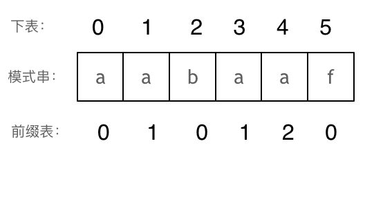
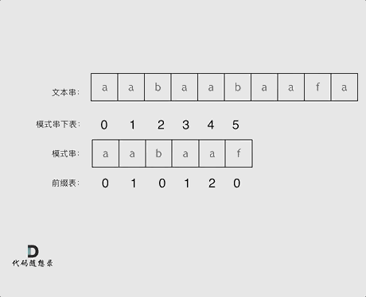
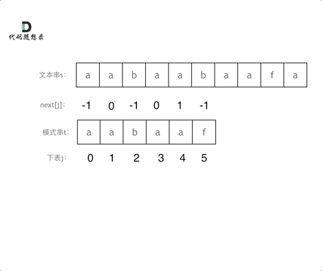
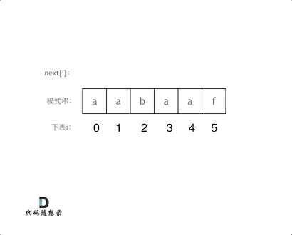

* [做專案（多個 C++、Java、Go、測試開發、前端專案）](https://www.programmercarl.com/other/kstar.html)
* [刷演算法（兩個月高強度學演算法）](https://www.programmercarl.com/xunlian/xunlianying.html)
* [背八股（40 天挑戰高頻面試題）](https://www.programmercarl.com/xunlian/bagu.html)


> 在一個字串（string）中尋找是否出現過另一個字串，這是 KMP 的看家本領。

# 28. 實作 strStr()

[LeetCode 題目連結](https://leetcode.com/problems/find-the-index-of-the-first-occurrence-in-a-string/)

實作 strStr() 函數（function）。

給定一個 haystack 字串和一個 needle 字串，在 haystack 字串中找出 needle 字串出現的第一個位置 (從 0 開始)。如果不存在，則回傳  -1。

範例 1:
輸入: haystack = "hello", needle = "ll"
輸出: 2

範例 2:
輸入: haystack = "aaaaa", needle = "bba"
輸出: -1

說明:
當 needle 是空字串（empty string）時，我們應當回傳什麼值呢？這是一個在面試中很好的問題。
對於本題而言，當 needle 是空字串時我們應當回傳 0 。這與 C 語言的 strstr() 以及 Java 的 indexOf() 定義相符。

## 演算法公開課

本題是 KMP 經典題目。以下文字如果看不進去，可以看[《程式碼隨想錄》演算法影片公開課](https://programmercarl.com/other/gongkaike.html)，相信結合影片再看本篇題解，更有助於大家對本題的理解。

* [幫你把 KMP 演算法（KMP algorithm）學個通透！B 站（理論篇）](https://www.bilibili.com/video/BV1PD4y1o7nd/)
* [幫你把 KMP 演算法學個通透！（求 next 陣列（array）程式碼篇）](https://www.bilibili.com/video/BV1M5411j7Xx)


## 解題思路

KMP 的經典思想就是：**當出現字串不匹配時，可以記錄一部分之前已經匹配的文字（text）內容，利用這些資訊避免從頭再去做匹配。**

本篇將以如下順序來講解 KMP，


* 什麼是 KMP
* KMP 有什麼用
* 什麼是前綴表（prefix table）
* 為什麼一定要用前綴表
* 如何計算前綴表
* 前綴表與 next 陣列
* 使用 next 陣列來匹配
* 時間複雜度（time complexity）分析
* 建構 next 陣列
* 使用 next 陣列來做匹配
* 前綴表統一減一 C++ 程式碼實作
* 前綴表（不減一）C++ 實作
* 總結


讀完本篇可以順便把 LeetCode 上 28.實作 strStr() 題目做了。


### 什麼是 KMP

說到 KMP，先說一下 KMP 這個名字是怎麼來的，為什麼叫做 KMP 呢。

因為是由這三位學者發明的：Knuth，Morris 和 Pratt，所以取了三位學者名字的首字母。所以叫做 KMP

### KMP 有什麼用

KMP 主要應用在字串匹配上。

KMP 的主要思想是**當出現字串不匹配時，可以知道一部分之前已經匹配的文字內容，可以利用這些資訊避免從頭再去做匹配了。**

所以如何記錄已經匹配的文字內容，是 KMP 的重點，也是 next 陣列肩負的重任。

其實 KMP 的程式碼不好理解，一些同學甚至直接把 KMP 程式碼的模板（template）背下來。

沒有徹底搞懂，懵懵懂懂就把程式碼背下來太容易忘了。

不僅面試的時候可能寫不出來，如果面試官問：**next 陣列裡的數字表示的是什麼，為什麼這麼表示？**

估計大多數應徵者都是一頭霧水的。

下面 Carl 就帶大家把 KMP 的精髓，next 陣列弄清楚。

### 什麼是前綴表

寫過 KMP 的同學，一定都寫過 next 陣列，那麼這個 next 陣列究竟是個啥呢？

next 陣列就是一個前綴表。

前綴表有什麼作用呢？

**前綴表是用來回退的，它記錄了型樣字串（pattern string）與主串（文字串（text string））不匹配的時候，型樣字串應該從哪裡開始重新匹配。**

為了清楚地了解前綴表的來歷，我們來舉一個例子：

要在文字串：aabaabaafa 中尋找是否出現過一個型樣字串：aabaaf。

請記住文字串和型樣字串的作用，對於理解下文很重要，不然容易看懵。所以說三遍：

要在文字串：aabaabaafa 中尋找是否出現過一個型樣字串：aabaaf。

要在文字串：aabaabaafa 中尋找是否出現過一個型樣字串：aabaaf。

要在文字串：aabaabaafa 中尋找是否出現過一個型樣字串：aabaaf。

如動畫所示：



動畫裡，我特意把 子字串（substring）`aa` 標記上了，這是有原因的，大家先注意一下，後面還會說到。

可以看出，文字串中第六個字元（character） b 和 型樣字串的第六個字元 f 不匹配了。如果蠻力（brute force）匹配，發現不匹配，此時就要從頭匹配了。

但如果使用前綴表，就不會從頭匹配，而是從上次已經匹配的內容開始匹配，找到了型樣字串中第三個字元 b 繼續開始匹配。

此時就要問了**前綴表是如何記錄的呢？**

首先要知道前綴表的任務是目前位置匹配失敗，找到之前已經匹配上的位置，再重新匹配，此也意味著在某個字元失配時，前綴表會告訴你下一步匹配中，型樣字串應該跳到哪個位置。

那麼什麼是前綴表：**記錄下標（subscript） i 之前（包括 i）的字串中，有多大長度的相同前綴（prefix）尾綴（suffix）。**

### 最長公共前後綴

文章中字串的**前綴是指不包含最後一個字元的所有以第一個字元開頭的連續子字串**。

**尾綴是指不包含第一個字元的所有以最後一個字元結尾的連續子字串**。

**正確理解什麼是前綴什麼是尾綴很重要**!

那麼網上清一色都說 「kmp 最長公共前後綴」又是什麼回事呢？

我查了一遍《演算法導論》和《演算法（第四版）》裡 KMP 的章節，都沒有提到「最長公共前後綴」這個詞，也不知道從哪裡來了，我理解是用「最長相等前後綴」更準確一些。

**因為前綴表要求的就是相同前後綴的長度。**

而最長公共前後綴裡面的「公共」，更像是說前綴和尾綴公共的長度。這其實並不是前綴表所需要的。

所以字串 a 的最長相等前後綴為 0。
字串 aa 的最長相等前後綴為 1。
字串 aaa 的最長相等前後綴為 2。
等等.....。


### 為什麼一定要用前綴表

這就是前綴表，那為啥就能告訴我們 上次匹配的位置，並跳過去呢？

回顧一下，剛剛匹配的過程在下標 5 的地方遇到不匹配，型樣字串是指向 f，如圖：
 </img></div>


然後就找到了下標 2，指向 b，繼續匹配：如圖：
 </img></div>

以下這句話，對於理解為什麼使用前綴表可以告訴我們匹配失敗之後跳到哪裡重新匹配 非常重要！

**下標 5 之前這部分的字串（也就是字串 aabaa）的最長相等的前綴 和 尾綴字串是 子字串 aa ，因為找到了最長相等的前綴和尾綴，匹配失敗的位置是尾綴子字串的後面，那麼我們找到與其相同的前綴的後面重新匹配就可以了。**

所以前綴表具有告訴我們目前位置匹配失敗，跳到之前已經匹配過的地方的能力。

**很多介紹 KMP 的文章或者影片並沒有把為什麼要用前綴表這個問題說清楚，而是直接預設使用前綴表。**

### 如何計算前綴表

接下來就要說一說怎麼計算前綴表。

如圖：

 </img></div>

長度為前 1 個字元的子字串`a`，最長相同前後綴的長度為 0。（注意字串的**前綴是指不包含最後一個字元的所有以第一個字元開頭的連續子字串**；**尾綴是指不包含第一個字元的所有以最後一個字元結尾的連續子字串**。）

 </img></div>

長度為前 2 個字元的子字串`aa`，最長相同前後綴的長度為 1。

 </img></div>

長度為前 3 個字元的子字串`aab`，最長相同前後綴的長度為 0。

以此類推：
長度為前 4 個字元的子字串`aaba`，最長相同前後綴的長度為 1。
長度為前 5 個字元的子字串`aabaa`，最長相同前後綴的長度為 2。
長度為前 6 個字元的子字串`aabaaf`，最長相同前後綴的長度為 0。

那麼把求得的最長相同前後綴的長度就是對應前綴表的元素（element），如圖：
 </img></div>

可以看出型樣字串與前綴表對應位置的數字表示的就是：**下標 i 之前（包括 i）的字串中，有多大長度的相同前綴尾綴。**

再來看一下如何利用 前綴表找到 當字元不匹配的時候指標（pointer）應該移動的位置。如動畫所示：



找到的不匹配的位置，那麼此時我們要看它的前一個字元的前綴表的數值是多少。

為什麼要前一個字元的前綴表的數值呢，因為要找前面字串的最長相同的前綴和尾綴。

所以要看前一位的 前綴表的數值。

前一個字元的前綴表的數值是 2，所以把下標移動到下標 2 的位置繼續比對。可以再反覆看一下上面的動畫。

最後就在文字串中找到了和型樣字串匹配的子字串了。

### 前綴表與 next 陣列

很多 KMP 演算法的實作都是使用 next 陣列來做回退操作，那麼 next 陣列與前綴表有什麼關係呢？

next 陣列就可以是前綴表，但是很多實作都是把前綴表統一減一（右移一位，初始位置為 -1）之後作為 next 陣列。

為什麼這麼做呢，其實也是很多文章影片沒有解釋清楚的地方。

其實**這並不涉及到 KMP 的原理，而是具體實作，next 陣列既可以就是前綴表，也可以是前綴表統一減一（右移一位，初始位置為 -1）。**

後面我會提供兩種不同的實作程式碼，大家就明白了。

### 使用 next 陣列來匹配

**以下我們以前綴表統一減一之後的 next 陣列來做演示**。

有了 next 陣列，就可以根據 next 陣列來 匹配文字串 s，和型樣字串 t 了。

注意 next 陣列是新前綴表（舊前綴表統一減一了）。

匹配過程動畫如下：



### 時間複雜度分析

其中 n 為文字串長度，m 為型樣字串長度，因為在匹配的過程中，根據前綴表不斷調整匹配的位置，可以看出匹配的過程是 O(n)，之前還要單獨產生 next 陣列，時間複雜度是 O(m)。所以整個 KMP 演算法的時間複雜度是 O(n+m) 的。

蠻力的解法顯而易見是 O(n × m)，所以 **KMP 在字串匹配中極大地提高了搜尋的效率。**

為了和 LeetCode 題目 28.實作 strStr 保持一致，方便大家理解，以下文章統稱 haystack 為文字串, needle 為型樣字串。

都知道使用 KMP 演算法，一定要建構 next 陣列。

### 建構 next 陣列

我們定義一個函數 getNext 來建構 next 陣列，函數參數（parameter）為指向 next 陣列的指標，和一個字串。程式碼如下：

```
void getNext(int* next, const string& s)
```

**建構 next 陣列其實就是計算型樣字串 s，前綴表的過程。** 主要有如下三步：

1. 初始化
2. 處理前後綴不相同的情況
3. 處理前後綴相同的情況

接下來我們詳解一下。

1. 初始化：

定義兩個指標 i 和 j，j 指向前綴末尾位置，i 指向尾綴末尾位置。

然後還要對 next 陣列進行初始化賦值，如下：

```cpp
int j = -1;
next[0] = j;
```

j 為什麼要初始化為 -1 呢，因為之前說過 前綴表要統一減一的操作僅僅是其中的一種實作，我們這裡選擇 j 初始化為 -1，下文我還會給出 j 不初始化為 -1 的實作程式碼。

next[i] 表示 i（包括 i）之前最長相等的前後綴長度（其實就是 j）

所以初始化 next[0] = j 。


2. 處理前後綴不相同的情況


因為 j 初始化為 -1，那麼 i 就從 1 開始，進行 s[i] 與 s[j+1] 的比較（comparison）。

所以遍歷型樣字串 s 的迴圈（loop）下標 i 要從 1 開始，程式碼如下：

```cpp
for (int i = 1; i < s.size(); i++) {
```

如果 s[i] 與 s[j+1] 不相同，也就是遇到 前後綴末尾不相同的情況，就要向前回退。

怎麼回退呢？

next[j] 就是記錄著 j（包括 j）之前的子字串的相同前後綴的長度。

那麼 s[i] 與 s[j+1] 不相同，就要找 j+1 前一個元素在 next 陣列裡的值（就是 next[j]）。

所以，處理前後綴不相同的情況程式碼如下：

```cpp
while (j >= 0 && s[i] != s[j + 1]) { // 前後綴不相同了
    j = next[j]; // 向前回退
}
```

3. 處理前後綴相同的情況

如果 s[i] 與 s[j + 1] 相同，那麼就同時向後移動 i 和 j 說明找到了相同的前後綴，同時還要將 j（前綴的長度）指派給 next[i], 因為 next[i] 要記錄相同前後綴的長度。

程式碼如下：

```
if (s[i] == s[j + 1]) { // 找到相同的前後綴
    j++;
}
next[i] = j;
```

最後整體建構 next 陣列的函數程式碼如下：

```CPP
void getNext(int* next, const string& s){
    int j = -1;
    next[0] = j;
    for(int i = 1; i < s.size(); i++) { // 注意 i 從 1 開始
        while (j >= 0 && s[i] != s[j + 1]) { // 前後綴不相同了
            j = next[j]; // 向前回退
        }
        if (s[i] == s[j + 1]) { // 找到相同的前後綴
            j++;
        }
        next[i] = j; // 將 j（前綴的長度）指派給 next[i]
    }
}
```


程式碼建構 next 陣列的邏輯流程動畫如下：



得到了 next 陣列之後，就要用這個來做匹配了。

### 使用 next 陣列來做匹配

在文字串 s 裡 尋找是否出現過型樣字串 t。

定義兩個下標 j 指向型樣字串起始位置，i 指向文字串起始位置。

那麼 j 初始值依然為 -1，為什麼呢？ **依然因為 next 陣列裡記錄的起始位置為 -1。**

i 就從 0 開始，遍歷文字串，程式碼如下：

```cpp
for (int i = 0; i < s.size(); i++) 
```

接下來就是 s[i] 與 t[j + 1] （因為 j 從 -1 開始的）進行比較。

如果 s[i] 與 t[j + 1] 不相同，j 就要從 next 陣列裡尋找下一個匹配的位置。

程式碼如下：

```cpp
while(j >= 0 && s[i] != t[j + 1]) {
    j = next[j];
}
```

如果 s[i] 與 t[j + 1] 相同，那麼 i 和 j 同時向後移動，程式碼如下：

```cpp
if (s[i] == t[j + 1]) {
    j++; // i 的增加在 for 迴圈裡
}
```

如何判斷在文字串 s 裡出現了型樣字串 t 呢，如果 j 指向了型樣字串 t 的末尾，那麼就說明型樣字串 t 完全匹配文字串 s 裡的某個子字串了。

本題要在文字串中找出型樣字串出現的第一個位置 (從 0 開始)，所以回傳目前在文字串匹配型樣字串的位置 i 減去 型樣字串的長度，就是文字串中出現型樣字串的第一個位置。

程式碼如下：

```cpp
if (j == (t.size() - 1) ) {
    return (i - t.size() + 1);
}
```

那麼使用 next 陣列，用型樣字串匹配文字串的整體程式碼如下：

```CPP
int j = -1; // 因為 next 陣列裡記錄的起始位置為 -1
for (int i = 0; i < s.size(); i++) { // 注意 i 就從 0 開始
    while(j >= 0 && s[i] != t[j + 1]) { // 不匹配
        j = next[j]; // j 尋找之前匹配的位置
    }
    if (s[i] == t[j + 1]) { // 匹配，j 和 i 同時向後移動
        j++; // i 的增加在 for 迴圈裡
    }
    if (j == (t.size() - 1) ) { // 文字串 s 裡出現了型樣字串 t
        return (i - t.size() + 1);
    }
}
```

此時所有邏輯的程式碼都已經寫出來了，LeetCode 28.實作 strStr 題目的整體程式碼如下：

### 前綴表統一減一 C++ 程式碼實作

```CPP
class Solution {
public:
    void getNext(int* next, const string& s) {
        int j = -1;
        next[0] = j;
        for(int i = 1; i < s.size(); i++) { // 注意 i 從 1 開始
            while (j >= 0 && s[i] != s[j + 1]) { // 前後綴不相同了
                j = next[j]; // 向前回退
            }
            if (s[i] == s[j + 1]) { // 找到相同的前後綴
                j++;
            }
            next[i] = j; // 將 j（前綴的長度）指派給 next[i]
        }
    }
    int strStr(string haystack, string needle) {
        if (needle.size() == 0) {
            return 0;
        }
		vector<int> next(needle.size());
		getNext(&next[0], needle);
        int j = -1; // // 因為 next 陣列裡記錄的起始位置為 -1
        for (int i = 0; i < haystack.size(); i++) { // 注意 i 就從 0 開始
            while(j >= 0 && haystack[i] != needle[j + 1]) { // 不匹配
                j = next[j]; // j 尋找之前匹配的位置
            }
            if (haystack[i] == needle[j + 1]) { // 匹配，j 和 i 同時向後移動
                j++; // i 的增加在 for 迴圈裡
            }
            if (j == (needle.size() - 1) ) { // 文字串 s 裡出現了型樣字串 t
                return (i - needle.size() + 1);
            }
        }
        return -1;
    }
};

```
* 時間複雜度: O(n + m)
* 空間複雜度（space complexity）: O(m), 只需要儲存字串 needle 的前綴表  

### 前綴表（不減一）C++ 實作

那麼前綴表就不減一了，也不右移的，到底行不行呢？

**行！**

我之前說過，這僅僅是 KMP 演算法實作上的問題，如果就直接使用前綴表可以換一種回退方式，找 j=next[j-1] 來進行回退。

主要就是 j=next[x] 這一步最為關鍵！

我給出的 getNext 的實作為：（前綴表統一減一）

```CPP
void getNext(int* next, const string& s) {
    int j = -1;
    next[0] = j;
    for(int i = 1; i < s.size(); i++) { // 注意 i 從 1 開始
        while (j >= 0 && s[i] != s[j + 1]) { // 前後綴不相同了
            j = next[j]; // 向前回退
        }
        if (s[i] == s[j + 1]) { // 找到相同的前後綴
            j++;
        }
        next[i] = j; // 將 j（前綴的長度）指派給 next[i]
    }
}

```
此時如果輸入的型樣字串為 aabaaf，對應的 next 為 -1 0 -1 0 1 -1。

這裡 j 和 next[0] 初始化為 -1，整個 next 陣列是以 前綴表減一之後的效果來建構的。

那麼前綴表不減一來建構 next 陣列，程式碼如下：

```CPP
    void getNext(int* next, const string& s) {
        int j = 0;
        next[0] = 0;
        for(int i = 1; i < s.size(); i++) {
            while (j > 0 && s[i] != s[j]) { // j 要保證大於 0，因為下面有取 j-1 作為陣列下標的操作
                j = next[j - 1]; // 注意這裡，是要找前一位的對應的回退位置了
            }
            if (s[i] == s[j]) {
                j++;
            }
            next[i] = j;
        }
    }

```

此時如果輸入的型樣字串為 aabaaf，對應的 next 為 0 1 0 1 2 0，（其實這就是前綴表的數值了）。

那麼用這樣的 next 陣列也可以用來做匹配，程式碼要有所改動。

實作程式碼如下：

```CPP
class Solution {
public:
    void getNext(int* next, const string& s) {
        int j = 0;
        next[0] = 0;
        for(int i = 1; i < s.size(); i++) {
            while (j > 0 && s[i] != s[j]) {
                j = next[j - 1];
            }
            if (s[i] == s[j]) {
                j++;
            }
            next[i] = j;
        }
    }
    int strStr(string haystack, string needle) {
        if (needle.size() == 0) {
            return 0;
        }
        vector<int> next(needle.size());
        getNext(&next[0], needle);
        int j = 0;
        for (int i = 0; i < haystack.size(); i++) {
            while(j > 0 && haystack[i] != needle[j]) {
                j = next[j - 1];
            }
            if (haystack[i] == needle[j]) {
                j++;
            }
            if (j == needle.size() ) {
                return (i - needle.size() + 1);
            }
        }
        return -1;
    }
};
```
* 時間複雜度: O(n + m)
* 空間複雜度: O(m)


## 總結

我們介紹了什麼是 KMP，KMP 可以解決什麼問題，然後分析 KMP 演算法裡的 next 陣列，知道了 next 陣列就是前綴表，再分析為什麼要是前綴表而不是什麼其他表。

接著從給出的型樣字串中，我們一步一步地推導出了前綴表，得出前綴表無論是統一減一還是不減一得到的 next 陣列僅僅是 KMP 的實作方式的不同。

其中還分析了 KMP 演算法的時間複雜度，並且和蠻力法做了對比。

然後先用前綴表統一減一得到的 next 陣列，求得文字串 s 裡是否出現過型樣字串 t，並給出了具體分析程式碼。

又給出了直接用前綴表作為 next 陣列，來做匹配的實作程式碼。

可以說把 KMP 的每一個細微的細節都拆解了出來，毫無遮掩地展示給大家了！


## 其他語言版本

### Java：
```Java
class Solution {
    /**
	犧牲空間，換取最直白的蠻力法
        時間複雜度 O(n * m)
        空間 O(n + m)
     */
    public int strStr(String haystack, String needle) {
        // 取得 haystack 和 needle 的長度
        int n = haystack.length(), m = needle.length();
        // 將字串轉換為字元陣列，方便索引操作
        char[] s = haystack.toCharArray(), p = needle.toCharArray();

        // 遍歷 haystack 字串
        for (int i = 0; i < n - m + 1; i++) {
            // 初始化匹配的指標
            int a = i, b = 0;
            // 迴圈檢查 needle 是否在目前位置開始匹配
            while (b < m && s[a] == p[b]) {
                // 如果目前字元匹配，則移動指標
                a++;
                b++;
            }
            // 如果 b 等於 m，說明 needle 已經完全匹配，回傳目前位置 i
            if (b == m) return i;
        }

        // 如果遍歷完畢仍未找到匹配的子字串，則回傳 -1
        return -1;
    }
}
```

```Java
class Solution {
    /**
     * 基於滑動視窗的演算法
     * <p>
     * 時間複雜度：O(m*n)
     * 空間複雜度：O(1)
     * 註：n 為 haystack 的長度，m 為 needle 的長度
     */
    public int strStr(String haystack, String needle) {
        int m = needle.length();
        // 當 needle 是空字串時我們應當回傳 0
        if (m == 0) {
            return 0;
        }
        int n = haystack.length();
        if (n < m) {
            return -1;
        }
        int i = 0;
        int j = 0;
        while (i < n - m + 1) {
            // 找到首字母相等
            while (i < n && haystack.charAt(i) != needle.charAt(j)) {
                i++;
            }
            if (i == n) {// 沒有首字母相等的
                return -1;
            }
            // 遍歷後續字元，判斷是否相等
            i++;
            j++;
            while (i < n && j < m && haystack.charAt(i) == needle.charAt(j)) {
                i++;
                j++;
            }
            if (j == m) {// 找到
                return i - j;
            } else {// 未找到
                i -= j - 1;
                j = 0;
            }
        }
        return -1;
    }
}
```

```java
// 方法一
class Solution {
    public void getNext(int[] next, String s){
        int j = -1;
        next[0] = j;
        for (int i = 1; i < s.length(); i++){
            while(j >= 0 && s.charAt(i) != s.charAt(j+1)){
                j=next[j];
            }

            if(s.charAt(i) == s.charAt(j+1)){
                j++;
            }
            next[i] = j;
        }
    }
    public int strStr(String haystack, String needle) {
        if(needle.length()==0){
            return 0;
        }

        int[] next = new int[needle.length()];
        getNext(next, needle);
        int j = -1;
        for(int i = 0; i < haystack.length(); i++){
            while(j>=0 && haystack.charAt(i) != needle.charAt(j+1)){
                j = next[j];
            }
            if(haystack.charAt(i) == needle.charAt(j+1)){
                j++;
            }
            if(j == needle.length()-1){
                return (i-needle.length()+1);
            }
        }

        return -1;
    }
}
```

```Java
class Solution {
    //前綴表（不減一）Java 實作
    public int strStr(String haystack, String needle) {
        if (needle.length() == 0) return 0;
        int[] next = new int[needle.length()];
        getNext(next, needle);

        int j = 0;
        for (int i = 0; i < haystack.length(); i++) {
            while (j > 0 && needle.charAt(j) != haystack.charAt(i)) 
                j = next[j - 1];
            if (needle.charAt(j) == haystack.charAt(i)) 
                j++;
            if (j == needle.length()) 
                return i - needle.length() + 1;
        }
        return -1;

    }
    
    private void getNext(int[] next, String s) {
        int j = 0;
        next[0] = 0;
        for (int i = 1; i < s.length(); i++) {
            while (j > 0 && s.charAt(j) != s.charAt(i)) 
                j = next[j - 1];
            if (s.charAt(j) == s.charAt(i)) 
                j++;
            next[i] = j; 
        }
    }
}
```

### Python3：
（版本一）前綴表（減一）

```python
class Solution:
    def getNext(self, next, s):
        j = -1
        next[0] = j
        for i in range(1, len(s)):
            while j >= 0 and s[i] != s[j+1]:
                j = next[j]
            if s[i] == s[j+1]:
                j += 1
            next[i] = j
    
    def strStr(self, haystack: str, needle: str) -> int:
        if not needle:
            return 0
        next = [0] * len(needle)
        self.getNext(next, needle)
        j = -1
        for i in range(len(haystack)):
            while j >= 0 and haystack[i] != needle[j+1]:
                j = next[j]
            if haystack[i] == needle[j+1]:
                j += 1
            if j == len(needle) - 1:
                return i - len(needle) + 1
        return -1
```
（版本二）前綴表（不減一）

```python
class Solution:
    def getNext(self, next: List[int], s: str) -> None:
        j = 0
        next[0] = 0
        for i in range(1, len(s)):
            while j > 0 and s[i] != s[j]:
                j = next[j - 1]
            if s[i] == s[j]:
                j += 1
            next[i] = j
    
    def strStr(self, haystack: str, needle: str) -> int:
        if len(needle) == 0:
            return 0
        next = [0] * len(needle)
        self.getNext(next, needle)
        j = 0
        for i in range(len(haystack)):
            while j > 0 and haystack[i] != needle[j]:
                j = next[j - 1]
            if haystack[i] == needle[j]:
                j += 1
            if j == len(needle):
                return i - len(needle) + 1
        return -1
```


（版本三）蠻力法
```python
class Solution(object):
    def strStr(self, haystack, needle):
        """
        :type haystack: str
        :type needle: str
        :rtype: int
        """
        m, n = len(haystack), len(needle)
        for i in range(m):
            if haystack[i:i+n] == needle:
                return i
        return -1    
```
（版本四）使用 index
```python
class Solution:
    def strStr(self, haystack: str, needle: str) -> int:
        try:
            return haystack.index(needle)
        except ValueError:
            return -1
```
（版本五）使用 find
```python
class Solution:
    def strStr(self, haystack: str, needle: str) -> int:
        return haystack.find(needle)
	
```

### Go：

```go
// 方法一:前綴表使用減 1 實作

// getNext 建構前綴表 next
// params:
//		  next 前綴表陣列
//		  s 型樣字串
func getNext(next []int, s string) {
	j := -1         // j 表示 最長相等前後綴長度
	next[0] = j

	for i := 1; i < len(s); i++ {
		for j >= 0 && s[i] != s[j+1] {
			j = next[j]   // 回退前一位
		}
		if s[i] == s[j+1] {
			j++
		}
		next[i] = j    // next[i] 是 i（包括 i）之前的最長相等前後綴長度
	}
}
func strStr(haystack string, needle string) int {
	if len(needle) == 0 {
		return 0
	}
	next := make([]int, len(needle))
	getNext(next, needle)
	j := -1            // 型樣字串的起始位置 next 為 -1 因此也為 -1
	for i := 0; i < len(haystack); i++ {
		for j >= 0 && haystack[i] != needle[j+1] {
			j = next[j]     // 尋找下一個匹配點
		}
		if haystack[i] == needle[j+1] {
			j++
		}
		if j == len(needle)-1 {      // j 指向了型樣字串的末尾
			return i - len(needle) + 1
		}
	}
	return -1
}
```

```go
// 方法二: 前綴表無減一或者右移

// getNext 建構前綴表 next
// params:
//		  next 前綴表陣列
//		  s 型樣字串
func getNext(next []int, s string) {
	j := 0
	next[0] = j
	for i := 1; i < len(s); i++ {
		for j > 0 && s[i] != s[j] {
			j = next[j-1]
		}
		if s[i] == s[j] {
			j++
		}
		next[i] = j
	}
}
func strStr(haystack string, needle string) int {
	n := len(needle)
	if n == 0 {
		return 0
	}
	j := 0
	next := make([]int, n)
	getNext(next, needle)
	for i := 0; i < len(haystack); i++ {
		for j > 0 && haystack[i] != needle[j] {
			j = next[j-1]      // 回退到 j 的前一位
		}
		if haystack[i] == needle[j] {
			j++
		}
		if j == n {
			return i - n + 1
		}
	}
	return -1
}
```

### JavaScript:

> 前綴表統一減一

```javascript
/**
 * @param {string} haystack
 * @param {string} needle
 * @return {number}
 */
var strStr = function (haystack, needle) {
    if (needle.length === 0)
        return 0;

    const getNext = (needle) => {
        let next = [];
        let j = -1;
        next.push(j);

        for (let i = 1; i < needle.length; ++i) {
            while (j >= 0 && needle[i] !== needle[j + 1])
                j = next[j];
            if (needle[i] === needle[j + 1])
                j++;
            next.push(j);
        }

        return next;
    }

    let next = getNext(needle);
    let j = -1;
    for (let i = 0; i < haystack.length; ++i) {
        while (j >= 0 && haystack[i] !== needle[j + 1])
            j = next[j];
        if (haystack[i] === needle[j + 1])
            j++;
        if (j === needle.length - 1)
            return (i - needle.length + 1);
    }

    return -1;
};
```

> 前綴表統一不減一

```javascript
/**
 * @param {string} haystack
 * @param {string} needle
 * @return {number}
 */
var strStr = function (haystack, needle) {
    if (needle.length === 0)
        return 0;

    const getNext = (needle) => {
        let next = [];
        let j = 0;
        next.push(j);

        for (let i = 1; i < needle.length; ++i) {
            while (j > 0 && needle[i] !== needle[j])
                j = next[j - 1];
            if (needle[i] === needle[j])
                j++;
            next.push(j);
        }

        return next;
    }

    let next = getNext(needle);
    let j = 0;
    for (let i = 0; i < haystack.length; ++i) {
        while (j > 0 && haystack[i] !== needle[j])
            j = next[j - 1];
        if (haystack[i] === needle[j])
            j++;
        if (j === needle.length)
            return (i - needle.length + 1);
    }

    return -1;
};
```

### TypeScript:

> 前綴表統一減一

```typescript
function strStr(haystack: string, needle: string): number {
    function getNext(str: string): number[] {
        let next: number[] = [];
        let j: number = -1;
        next[0] = j;
        for (let i = 1, length = str.length; i < length; i++) {
            while (j >= 0 && str[i] !== str[j + 1]) {
                j = next[j];
            }
            if (str[i] === str[j + 1]) {
                j++;
            }
            next[i] = j;
        }
        return next;
    }
    if (needle.length === 0) return 0;
    let next: number[] = getNext(needle);
    let j: number = -1;
    for (let i = 0, length = haystack.length; i < length; i++) {
        while (j >= 0 && haystack[i] !== needle[j + 1]) {
            j = next[j];
        }
        if (haystack[i] === needle[j + 1]) {
            if (j === needle.length - 2) {
                return i - j - 1;
            }
            j++;
        }
    }
    return -1;
};
```

> 前綴表不減一

```typescript
// 不減一版本
function strStr(haystack: string, needle: string): number {
    function getNext(str: string): number[] {
        let next: number[] = [];
        let j: number = 0;
        next[0] = j;
        for (let i = 1, length = str.length; i < length; i++) {
            while (j > 0 && str[i] !== str[j]) {
                j = next[j - 1];
            }
            if (str[i] === str[j]) {
                j++;
            }
            next[i] = j;
        }
        return next;
    }
    if (needle.length === 0) return 0;
    let next: number[] = getNext(needle);
    let j: number = 0;
    for (let i = 0, length = haystack.length; i < length; i++) {
        while (j > 0 && haystack[i] !== needle[j]) {
            j = next[j - 1];
        }
        if (haystack[i] === needle[j]) {
            if (j === needle.length - 1) {
                return i - j;
            }
            j++;
        }
    }
    return -1;
}
```

### Swift:

> 前綴表統一減一

```swift
func strStr(_ haystack: String, _ needle: String) -> Int {
    
    let s = Array(haystack), p = Array(needle)
    guard p.count != 0 else { return 0 }
    
    // 2 pointer
    var j = -1
    var next = [Int](repeating: -1, count: needle.count)
    // KMP
    getNext(&next, needle: p)
    for i in 0 ..< s.count {
        while j >= 0 && s[i] != p[j + 1] {
            //不匹配之後尋找之前匹配的位置
            j = next[j]
        }
        if s[i] == p[j + 1] {
            //匹配，two pointers 同時後移
            j += 1
        }
        if j == (p.count - 1) {
            //出現匹配字串
            return i - p.count + 1
        }
    }
    return -1
}

//前綴表統一減一
func getNext(_ next: inout [Int], needle: [Character]) {
    
    var j: Int = -1
    next[0] = j
    
    // i 從 1 開始
    for i in 1 ..< needle.count {
        while j >= 0 && needle[i] != needle[j + 1] {
            j = next[j]
        }
        if needle[i] == needle[j + 1] {
            j += 1;
        }
        next[i] = j
    }
    print(next)
}

```

> 前綴表右移

```swift
func strStr(_ haystack: String, _ needle: String) -> Int {
        
        let s = Array(haystack), p = Array(needle)
        guard p.count != 0 else { return 0 }
        
        var j = 0
        var next = [Int].init(repeating: 0, count: p.count)
        getNext(&next, p)
         
        for i in 0 ..< s.count {
            
            while j > 0 && s[i] != p[j] {
                j = next[j]
            }
            
            if s[i] == p[j] {
                j += 1
            }
            
            if j == p.count {
                return i - p.count + 1
            }
        }
        
        return -1
    }
    
    // 前綴表後移一位，首位用 -1 填充
    func getNext(_ next: inout [Int], _ needle: [Character]) {
        
        guard needle.count > 1 else { return }

        var j = 0
        next[0] = j
        
        for i in 1 ..< needle.count-1 {
           
            while j > 0 && needle[i] != needle[j] {
                j = next[j-1]
            }
            
            if needle[i] == needle[j] {
                j += 1
            }
            
            next[i] = j
        }
        next.removeLast()
        next.insert(-1, at: 0)
    }
```

> 前綴表統一不減一
```swift

func strStr(_ haystack: String, _ needle: String) -> Int {
        
        let s = Array(haystack), p = Array(needle)
        guard p.count != 0 else { return 0 }
    
        var j = 0
        var next = [Int](repeating: 0, count: needle.count)
        // KMP
        getNext(&next, needle: p)
        
        for i in 0 ..< s.count {
            while j > 0 && s[i] != p[j] {
                j = next[j-1]
            }

            if s[i] == p[j] {
                j += 1
            }

            if j == p.count {
                return i - p.count + 1
            }
        }
        return -1
    }

    //前綴表
    func getNext(_ next: inout [Int], needle: [Character]) {
       
        var j = 0
        next[0] = j
        
        for i in 1 ..< needle.count {
            
            while j>0 && needle[i] != needle[j] {
                j = next[j-1]
            }
            
            if needle[i] == needle[j] {
                j += 1
            }
            
            next[i] = j
            
        }
    }

```

### PHP：

> 前綴表統一減一
```php
function strStr($haystack, $needle) {
    if (strlen($needle) == 0) return 0;
    $next= [];
    $this->getNext($next,$needle);

    $j = -1;
    for ($i = 0;$i < strlen($haystack); $i++) { // 注意 i 就從 0 開始
        while($j >= 0 && $haystack[$i] != $needle[$j + 1]) {
            $j = $next[$j];
        }
        if ($haystack[$i] == $needle[$j + 1]) {
            $j++;
        }
        if ($j == (strlen($needle) - 1) ) {
            return ($i - strlen($needle) + 1);
        }
    }
    return -1;
}

function getNext(&$next, $s){
    $j = -1;
    $next[0] = $j;
    for($i = 1; $i < strlen($s); $i++) { // 注意 i 從 1 開始
        while ($j >= 0 && $s[$i] != $s[$j + 1]) {
            $j = $next[$j];
        }
        if ($s[$i] == $s[$j + 1]) {
            $j++;
        }
        $next[$i] = $j;
    }
}
```

> 前綴表統一不減一
```php
function strStr($haystack, $needle) {
    if (strlen($needle) == 0) return 0;
    $next= [];
    $this->getNext($next,$needle);

    $j = 0;
    for ($i = 0;$i < strlen($haystack); $i++) { // 注意 i 就從 0 開始
        while($j > 0 && $haystack[$i] != $needle[$j]) {
            $j = $next[$j-1];
        }
        if ($haystack[$i] == $needle[$j]) {
            $j++;
        }
        if ($j == strlen($needle)) {
            return ($i - strlen($needle) + 1);
        }
    }
    return -1;
}

function getNext(&$next, $s){
    $j = 0;
    $next[0] = $j;
    for($i = 1; $i < strlen($s); $i++) { // 注意 i 從 1 開始
        while ($j > 0 && $s[$i] != $s[$j]) {
            $j = $next[$j-1];
        }
        if ($s[$i] == $s[$j]) {
            $j++;
        }
        $next[$i] = $j;
    }
}
```

### Rust:

> 前綴表統一不減一
```Rust
impl Solution {
    pub fn get_next(next: &mut Vec<usize>, s: &Vec<char>) {
        let len = s.len();
        let mut j = 0;
        for i in 1..len {
            while j > 0 && s[i] != s[j] {
                j = next[j - 1];
            }
            if s[i] == s[j] {
                j += 1;
            }
            next[i] = j;
        }
    }

    pub fn str_str(haystack: String, needle: String) -> i32 {
        let (haystack_len, needle_len) = (haystack.len(), needle.len());
        if haystack_len < needle_len { return -1;}
        let (haystack, needle) = (haystack.chars().collect::<Vec<char>>(), needle.chars().collect::<Vec<char>>());
        let mut next: Vec<usize> = vec![0; haystack_len];
        Self::get_next(&mut next, &needle);
        let mut j = 0;
        for i in 0..haystack_len {
            while j > 0 && haystack[i] != needle[j] {
                j = next[j - 1];
            }
            if haystack[i] == needle[j] {
                j += 1;
            }
            if j == needle_len {
                return (i - needle_len + 1) as i32;
            }
        }
        return -1;
    }
}
```

> 前綴表統一減一

```rust
impl Solution {
    pub fn get_next(next_len: usize, s: &Vec<char>) -> Vec<i32> {
        let mut next = vec![-1; next_len];
        let mut j = -1;
        for i in 1..s.len() {
            while j >= 0 && s[(j + 1) as usize] != s[i] {
                j = next[j as usize];
            }
            if s[i] == s[(j + 1) as usize] {
                j += 1;
            }
            next[i] = j;
        }
        next
    }
    pub fn str_str(haystack: String, needle: String) -> i32 {
        if haystack.len() < needle.len() {
            return -1;
        }
        let (haystack_chars, needle_chars) = (
            haystack.chars().collect::<Vec<char>>(),
            needle.chars().collect::<Vec<char>>(),
        );
        let mut j = -1;
        let next = Self::get_next(needle.len(), &needle_chars);
        for (i, v) in haystack_chars.into_iter().enumerate() {
            while j >= 0 && v != needle_chars[(j + 1) as usize] {
                j = next[j as usize];
            }
            if v == needle_chars[(j + 1) as usize] {
                j += 1;
            }
            if j == needle_chars.len() as i32 - 1 {
                return (i - needle_chars.len() + 1) as i32;
            }
        }
        -1
    }
}
```

>前綴表統一不減一
```csharp
public int StrStr(string haystack, string needle)
{
    if (string.IsNullOrEmpty(needle))
        return 0;

    if (needle.Length > haystack.Length || string.IsNullOrEmpty(haystack))
        return -1;

    return KMP(haystack, needle);
}

public int KMP(string haystack, string needle)
{
    int[] next = GetNext(needle);
    int i = 0, j = 0;
    while (i < haystack.Length)
    {
        if (haystack[i] == needle[j])
        {
            i++;
            j++;
        }
        if (j == needle.Length)
            return i-j;
        else if (i < haystack.Length && haystack[i] != needle[j])
            if (j != 0)
            {
                j = next[j - 1];
            }
            else
            {
                i++;
            }
    }
    return -1;
}

public int[] GetNext(string needle)
{
    int[] next = new int[needle.Length];
    next[0] = 0;
    int i = 1, j = 0;
    while (i < needle.Length)
    {
        if (needle[i] == needle[j])
        {
            next[i++] = ++j;
        }
        else
        {
            if (j == 0)
            {
                next[i++] = 0;
            }
            else
            {
                j = next[j - 1];
            }
        }
    }
    return next;
}
```

### C:

> 前綴表統一右移和減一

```c

int *build_next(char* needle, int len) {

    int *next = (int *)malloc(len * sizeof(int));
    assert(next); // 確保分配成功

    // 初始化 next 陣列
    next[0] = -1; // next[0] 設定為 -1，表示沒有有效前綴匹配
    if (len <= 1) { // 如果型樣字串長度小於等於 1，直接回傳
        return next;
    }
    next[1] = 0; // next[1] 設定為 0，表示第一個字元沒有共同前後綴

    // 建構 next 陣列， i 從型樣字串的第三個字元開始， j 指向目前匹配的最長前綴長度
    int i = 2, j = 0;
    while (i < len) {
        if (needle[i - 1] == needle[j]) {
            j++;
            next[i] = j;
            i++;
        } else if (j > 0) {
            // 如果不匹配且 j > 0， 回退到次長匹配前綴的長度
            j = next[j];
        } else {
            next[i] = 0;
            i++;
        }
    }
    return next;
}

int strStr(char* haystack, char* needle) {

    int needle_len = strlen(needle);
    int haystack_len = strlen(haystack);

    int *next = build_next(needle, needle_len);

    int i = 0, j = 0; // i 指向主串的目前起始位置, j 指向型樣字串的目前匹配位置
    while (i <= haystack_len - needle_len) {
        if (haystack[i + j] == needle[j]) {
            j++;
            if (j == needle_len) {
                free(next);
                next = NULL
                return i;
            }
        } else {
            i += j - next[j]; // 調整主串的起始位置
            j = j > 0 ? next[j] : 0;
        }
    }

    free(next);
    next = NULL;
    return -1;
}
```

