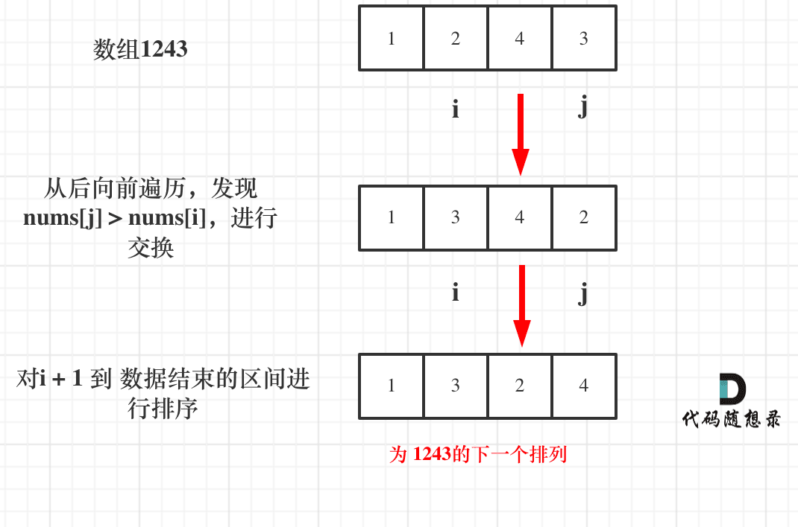

* [做專案（多個 C++、Java、Go、測試開發、前端專案）](https://www.programmercarl.com/other/kstar.html)
* [刷演算法（兩個月高強度學演算法）](https://www.programmercarl.com/xunlian/xunlianying.html)
* [背八股（40 天挑戰高頻面試題）](https://www.programmercarl.com/xunlian/bagu.html)


# 31.下一個排列（permutation）

[LeetCode 題目連結](https://leetcode.com/problems/next-permutation/)

實作取得 下一個排列 的函數（function），演算法需要將給定數字序列重新排列成詞典編纂次序（lexicographical order）中下一個更大的排列。

如果不存在下一個更大的排列，則將數字重新排列成最小的排列（即升序（ascending）排列）。

必須原地（in-place）修改，只允許使用額外常數空間。

範例 1：
* 輸入：nums = [1,2,3]
* 輸出：[1,3,2]

範例 2：
* 輸入：nums = [3,2,1]
* 輸出：[1,2,3]

範例 3：
* 輸入：nums = [1,1,5]
* 輸出：[1,5,1]

範例 4：
* 輸入：nums = [1]
* 輸出：[1]


## 解題思路

一些同學可能手動寫排列的順序，都沒有寫對，那麼寫程式的話想法一定是有問題的了，我這裡以 1234 為例子，把全排列都列出來。可以參考一下規律所在：

```
1 2 3 4
1 2 4 3
1 3 2 4
1 3 4 2
1 4 2 3
1 4 3 2
2 1 3 4
2 1 4 3
2 3 1 4
2 3 4 1
2 4 1 3
2 4 3 1
3 1 2 4
3 1 4 2
3 2 1 4
3 2 4 1
3 4 1 2
3 4 2 1
4 1 2 3
4 1 3 2
4 2 1 3
4 2 3 1
4 3 1 2
4 3 2 1
```

如圖：

以求 1243 為例，流程如圖：

 </img></div>

對應的 C++ 程式碼如下：

```CPP
class Solution {
public:
    void nextPermutation(vector<int>& nums) {
        for (int i = nums.size() - 1; i >= 0; i--) {
            for (int j = nums.size() - 1; j > i; j--) {
                if (nums[j] > nums[i]) {
                    swap(nums[j], nums[i]);
                    reverse(nums.begin() + i + 1, nums.end());
                    return;
                }
            }
        }
        // 到這裡了說明整個陣列都是倒序了，反轉一下便可
        reverse(nums.begin(), nums.end());
    }
};
```

## 其他語言版本

### Java

```java
class Solution {
    public void nextPermutation(int[] nums) {
        for (int i = nums.length - 1; i >= 0; i--) {
            for (int j = nums.length - 1; j > i; j--) {
                if (nums[j] > nums[i]) {
                    // 交換
                    int temp = nums[i];
                    nums[i] = nums[j];
                    nums[j] = temp;
                    // [i + 1, nums.length) 內元素升序排序
                    Arrays.sort(nums, i + 1, nums.length);
                    return;
                }
            }
        }
        Arrays.sort(nums); // 不存在下一個更大的排列，則將數字重新排列成最小的排列（即升序排列）。
    }
}
```
> 最佳化時間複雜度（time complexity）為 O(N)，空間複雜度（space complexity）為 O(1)
```Java
class Solution {
    public void nextPermutation(int[] nums) {
        // 1.從後向前取得逆序區域的前一位
        int index = findIndex(nums);
        // 判斷陣列是否處於最小組合狀態
        if(index != 0){
            // 2.交換逆序區域剛好大於它的最小數字
            exchange(nums,index);
        }
        // 3.把原來的逆序區轉為順序
        reverse(nums,index);
    }
    
    public static int findIndex(int [] nums){
        for(int i = nums.length-1;i>0;i--){
            if(nums[i]>nums[i-1]){
                return i;
            }
        }
        return 0;
    }
    public static void exchange(int [] nums, int index){
        int head = nums[index-1];
        for(int i = nums.length-1;i>0;i--){
            if(head < nums[i]){
                nums[index-1] = nums[i];
                nums[i] = head;
                break;
            }
        }
    }
    public static void reverse(int [] nums, int index){
        for(int i = index,j = nums.length-1;i<j;i++,j--){
            int temp = nums[i];
            nums[i] = nums[j];
            nums[j] = temp;
        }
    }   
}
```

### Python
>直接使用 sorted() 會開闢新的空間並回傳一個新的 list，故補充一個原地反轉（reverse）函數
```python
class Solution:
    def nextPermutation(self, nums: List[int]) -> None:
        """
        Do not return anything, modify nums in-place instead.
        """
        length = len(nums)
        for i in range(length - 2, -1, -1): # 從倒數第二個開始
            if nums[i]>=nums[i+1]: continue # 修剪法去除重複
            for j in range(length - 1, i, -1):
                if nums[j] > nums[i]:
                    nums[j], nums[i] = nums[i], nums[j]
                    self.reverse(nums, i + 1, length - 1)
                    return  
        self.reverse(nums, 0, length - 1)
    
    def reverse(self, nums: List[int], left: int, right: int) -> None:
        while left < right:
            nums[left], nums[right] = nums[right], nums[left]
            left += 1
            right -= 1
            
"""
265 / 265 個通過測試案例
狀態：通過
執行時間: 36 ms
記憶體消耗: 14.9 MB
"""
```

### Go

```go
//卡爾的解法
func nextPermutation(nums []int)  {
    for i:=len(nums)-1;i>=0;i--{
        for j:=len(nums)-1;j>i;j--{
            if nums[j]>nums[i]{
                //交換
                nums[j],nums[i]=nums[i],nums[j]
                reverse(nums,0+i+1,len(nums)-1)
                return 
            }
        }
    }
    reverse(nums,0,len(nums)-1)
}
//對目標切片指定區間的反轉方法
func reverse(a []int,begin,end int){
    for i,j:=begin,end;i<j;i,j=i+1,j-1{
        a[i],a[j]=a[j],a[i]
    }
}
```

### JavaScript

```js
//卡爾的解法(小抱怨一下 JavaScript 的 sort 和其他語言的不太一樣，只想到複製陣列去排序再替換原陣列來實作 nums 的 [i + 1, nums.length) 升序排序)
var nextPermutation = function(nums) {
    for(let i = nums.length - 1; i >= 0; i--){
        for(let j = nums.length - 1; j > i; j--){
            if(nums[j] > nums[i]){
                [nums[j],nums[i]] = [nums[i],nums[j]]; // 交換
                // 深複製[i + 1, nums.length)部分到新陣列 arr
                let arr = nums.slice(i+1);
                // arr 升序排序
                arr.sort((a,b) => a - b);
                // arr 替換 nums 的 [i + 1, nums.length) 部分
                nums.splice(i+1,nums.length - i, ...arr);
                return;
            }
        }
    }
    nums.sort((a,b) => a - b); // 不存在下一個更大的排列，則將數字重新排列成最小的排列（即升序排列）。
};

//另一種
var nextPermutation = function(nums) {
    let i = nums.length - 2;
    // 從右往左遍歷拿到第一個左邊小於右邊的 i,此時 i 右邊的陣列是從右往左遞增的
    while (i >= 0 && nums[i] >= nums[i+1]){
        i--;
    }
    if (i >= 0){
        let j = nums.length - 1;
        // 從右往左遍歷拿到第一個大於 nums[i] 的數,因為之前 nums[i] 是第一個小於他右邊的數，所以他的右邊一定有大於他的數
        while (j >= 0 && nums[j] <= nums[i]){
            j--;
        }
        // 交換兩個數
        [nums[j], nums[i]] = [nums[i], nums[j]];
   }
    // 對 i 右邊的數進行交換
    // 因為 i 右邊的數原來是從右往左遞增的，把一個較小的值交換過來之後，仍然維持單調增加特性
    // 此時頭尾交換並向中間逼近就能獲得 i 右邊序列的最小值
    let l = i + 1;
    let r = nums.length - 1;
    while (l < r){
        [nums[l], nums[r]] = [nums[r], nums[l]];
        l++;
        r--;
    }
};
```


