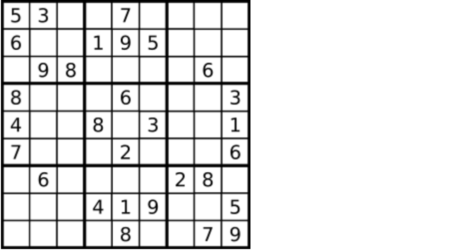
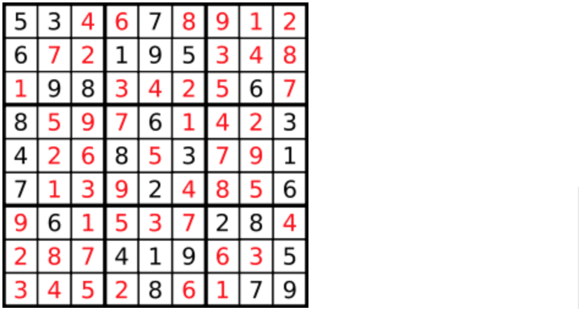
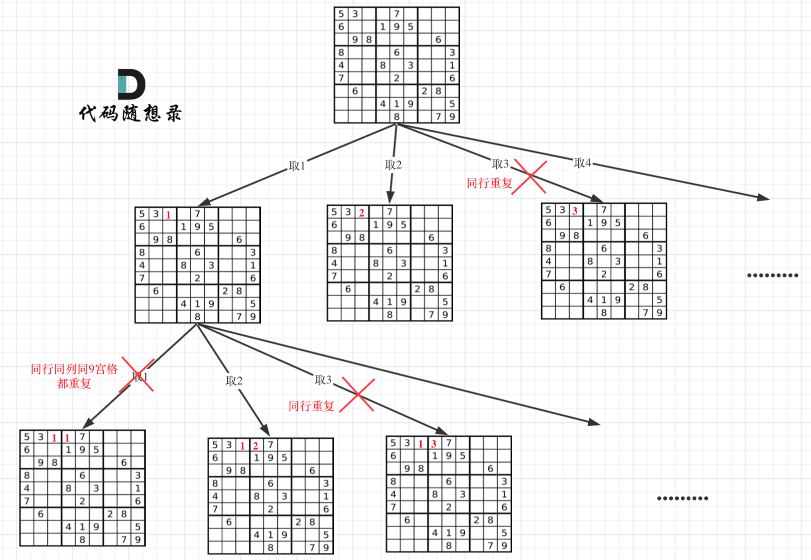

* [做專案（多個 C++、Java、Go、測試開發、前端專案）](https://www.programmercarl.com/other/kstar.html)
* [刷演算法（兩個月高強度學演算法）](https://www.programmercarl.com/xunlian/xunlianying.html)
* [背面試必考題（八股文）（40 天挑戰高頻面試題）](https://www.programmercarl.com/xunlian/bagu.html)


> 如果對回溯（backtracking）法理論還不清楚的同學，可以先看這個影片 [影片來了！！帶你學透回溯演算法（backtracking algorithm）（理論篇）](https://mp.weixin.qq.com/s/wDd5azGIYWjbU0fdua_qBg)

# 37. 解 Sudoku

[LeetCode 題目連結](https://leetcode.cn/problems/sudoku-solver/)

編寫一個程式，透過填充空白格來解決 Sudoku 問題。

一個 Sudoku 的解法需遵循如下規則：
數字 1-9 在每一行只能出現一次。
數字 1-9 在每一列只能出現一次。
數字 1-9 在每一個以粗實線分隔的 3x3 宮內只能出現一次。
空白格用 '.' 表示。



一個 Sudoku。



答案被標成紅色。

提示：

* 給定的 Sudoku 序列（sequence）只包含數字 1-9 和字元（character） '.' 。
* 你可以假設給定的 Sudoku 只有唯一解。
* 給定 Sudoku 永遠是 9x9 形式的。

## 演算法公開課

**[《程式碼隨想錄》演算法影片公開課](https://programmercarl.com/other/gongkaike.html)：[回溯演算法二維（two-dimensional）遞迴（recursion）？解 Sudoku 不過如此！| LeetCode：37. 解 Sudoku](https://www.bilibili.com/video/BV1TW4y1471V/)，相信結合影片再看本篇題解，更有助於大家對本題的理解**。

## 解題思路

棋盤搜尋問題可以使用回溯法蠻力搜尋（brute force），只不過這次我們要做的是**二維遞迴**。

怎麼做二維遞迴呢？

大家已經跟著「程式碼隨想錄」刷過了如下回溯法題目，例如：[77.組合（組合（combination）問題）](https://programmercarl.com/0077.组合.html)，[131.分割回文（palindrome）串（分割問題）](https://programmercarl.com/0131.分割回文串.html)，[78.子集（子集（subset）問題）](https://programmercarl.com/0078.子集.html)，[46.全排列（排列（permutation）問題）](https://programmercarl.com/0046.全排列.html)，以及[51.n 皇后（n 皇后問題（n queens））](https://programmercarl.com/0051.N皇后.html)，其實這些題目都是一維（one-dimensional）遞迴。

**如果以上這幾道題目沒有做過的話，不建議一上來就做這道題哈！**

[n 皇后問題](https://programmercarl.com/0051.N皇后.html)是因為每一行每一列只放一個皇后，只需要一層 for 迴圈（for-loop）遍歷（traversal）一行，遞迴來遍歷列，然後一行一列確定皇后的唯一位置。

本題就不一樣了，**本題中棋盤的每一個位置都要放一個數字（而 n 皇后是一行只放一個皇后），並檢查數字是否合法，解 Sudoku 的樹狀結構（tree structure）要比 n 皇后更寬更深**。

因為這個樹狀結構太大了，我抽取一部分，如圖所示：


### 回溯三部曲

* 遞迴函式（function）以及參數（parameter）

**遞迴函式的轉回值（return value）需要是布林（Boolean）類型（type），為什麼呢？**

因為解 Sudoku 找到一個符合的條件（condition）（就在樹（tree）的葉節點（leaf node）上）立刻就回傳，相當於找從根節點（root node）到葉節點的一條唯一路徑，所以需要使用布林轉回值。

程式碼如下：

```cpp
bool backtracking(vector<vector<char>>& board)
```

* 遞迴終止條件

本題遞迴不用終止條件，解 Sudoku 是要遍歷整個樹狀結構，找到可能的葉節點就立刻回傳。

**不用終止條件會不會無限迴路（infinite loop）？**

遞迴的下一層的棋盤一定比上一層的棋盤多一個數，等數填滿了棋盤自然就終止（填滿當然好了，說明找到結果了），所以不需要終止條件！

**那麼有沒有永遠填不滿的情況呢？**

這個問題我在遞迴單層搜尋邏輯裡再來講！

* 遞迴單層搜尋邏輯



在樹形圖中可以看出我們需要的是一個二維的遞迴 （一行一列）

**一個 for 迴圈遍歷棋盤的行，一個 for 迴圈遍歷棋盤的列，一行一列確定下來之後，遞迴遍歷這個位置放 9 個數字的可能性！**


程式碼如下：（**詳細看註解**）

```CPP
bool backtracking(vector<vector<char>>& board) {
    for (int i = 0; i < board.size(); i++) {        // 遍歷行
        for (int j = 0; j < board[0].size(); j++) { // 遍歷列
            if (board[i][j] != '.') continue;
            for (char k = '1'; k <= '9'; k++) {     // (i, j) 這個位置放 k 是否合適
                if (isValid(i, j, k, board)) {
                    board[i][j] = k;                // 放置 k
                    if (backtracking(board)) return true; // 如果找到合適一組立刻回傳
                    board[i][j] = '.';              // 回溯，撤銷 k
                }
            }
            return false;                           // 9 個數都試完了，都不行，那麼就回傳 false
        }
    }
    return true; // 遍歷完沒有回傳 false，說明找到了合適棋盤位置了
}
```

**注意這裡 return false 的地方，這裡放 return false 是有講究的**。

因為如果一行一列確定下來了，這裡嘗試了 9 個數都不行，說明這個棋盤找不到解決 Sudoku 問題的解！

那麼會直接回傳，**這也就是為什麼沒有終止條件也不會永遠填不滿棋盤而無限遞迴（infinite recursion）下去！**

### 判斷棋盤是否合法

判斷棋盤是否合法有如下三個維度（dimension）：

* 同行是否重複
* 同列是否重複
* 9 宮格裡是否重複

程式碼如下：

```CPP
bool isValid(int row, int col, char val, vector<vector<char>>& board) {
    for (int i = 0; i < 9; i++) { // 判斷行裡是否重複
        if (board[row][i] == val) {
            return false;
        }
    }
    for (int j = 0; j < 9; j++) { // 判斷列裡是否重複
        if (board[j][col] == val) {
            return false;
        }
    }
    int startRow = (row / 3) * 3;
    int startCol = (col / 3) * 3;
    for (int i = startRow; i < startRow + 3; i++) { // 判斷 9 方格裡是否重複
        for (int j = startCol; j < startCol + 3; j++) {
            if (board[i][j] == val ) {
                return false;
            }
        }
    }
    return true;
}
```

最後整體 C++ 程式碼如下：


```CPP
class Solution {
private:
bool backtracking(vector<vector<char>>& board) {
    for (int i = 0; i < board.size(); i++) {        // 遍歷行
        for (int j = 0; j < board[0].size(); j++) { // 遍歷列
            if (board[i][j] == '.') {
                for (char k = '1'; k <= '9'; k++) {     // (i, j) 這個位置放 k 是否合適
                    if (isValid(i, j, k, board)) {
                        board[i][j] = k;                // 放置 k
                        if (backtracking(board)) return true; // 如果找到合適一組立刻回傳
                        board[i][j] = '.';              // 回溯，撤銷 k
                    }
                }
                return false;  // 9 個數都試完了，都不行，那麼就回傳 false
            }
        }
    }
    return true; // 遍歷完沒有回傳 false，說明找到了合適棋盤位置了
}
bool isValid(int row, int col, char val, vector<vector<char>>& board) {
    for (int i = 0; i < 9; i++) { // 判斷行裡是否重複
        if (board[row][i] == val) {
            return false;
        }
    }
    for (int j = 0; j < 9; j++) { // 判斷列裡是否重複
        if (board[j][col] == val) {
            return false;
        }
    }
    int startRow = (row / 3) * 3;
    int startCol = (col / 3) * 3;
    for (int i = startRow; i < startRow + 3; i++) { // 判斷 9 方格裡是否重複
        for (int j = startCol; j < startCol + 3; j++) {
            if (board[i][j] == val ) {
                return false;
            }
        }
    }
    return true;
}
public:
    void solveSudoku(vector<vector<char>>& board) {
        backtracking(board);
    }
};

```

## 總結

解 Sudoku 可以說是非常難的題目了，如果還一直停留在單層遞迴的邏輯中，這道題目可以讓大家瞬間崩潰。

所以我在開篇就提到了**二維遞迴**，這也是我自創詞彙，希望可以幫助大家理解解 Sudoku 的搜尋過程。

一波分析之後，再看程式碼會發現其實也不難，唯一難點就是理解**二維遞迴**的思維邏輯。

**這樣，解 Sudoku 這麼難的問題，也被我們攻克了**。

**恭喜一路上堅持打卡的讀者／錄友們，回溯演算法已經接近尾聲了，接下來就是要來一波總結了**。


## 其他語言版本


### Java
解法一:
```java
class Solution {
    public void solveSudoku(char[][] board) {
        solveSudokuHelper(board);
    }

    private boolean solveSudokuHelper(char[][] board){
        //「一個 for 迴圈遍歷棋盤的行，一個 for 迴圈遍歷棋盤的列，
        // 一行一列確定下來之後，遞迴遍歷這個位置放 9 個數字的可能性！」
        for (int i = 0; i < 9; i++){ // 遍歷行
            for (int j = 0; j < 9; j++){ // 遍歷列
                if (board[i][j] != '.'){ // 跳過原始數字
                    continue;
                }
                for (char k = '1'; k <= '9'; k++){ // (i, j) 這個位置放 k 是否合適
                    if (isValidSudoku(i, j, k, board)){
                        board[i][j] = k;
                        if (solveSudokuHelper(board)){ // 如果找到合適一組立刻回傳
                            return true;
                        }
                        board[i][j] = '.';
                    }
                }
                // 9 個數都試完了，都不行，那麼就回傳 false
                return false;
                // 因為如果一行一列確定下來了，這裡嘗試了 9 個數都不行，說明這個棋盤找不到解決 Sudoku 問題的解！
                // 那麼會直接回傳， 「這也就是為什麼沒有終止條件也不會永遠填不滿棋盤而無限遞迴下去！」
            }
        }
        // 遍歷完沒有回傳 false，說明找到了合適棋盤位置了
        return true;
    }

    /**
     * 判斷棋盤是否合法有如下三個維度:
     *     同行是否重複
     *     同列是否重複
     *     9 宮格裡是否重複
     */
    private boolean isValidSudoku(int row, int col, char val, char[][] board){
        // 同行是否重複
        for (int i = 0; i < 9; i++){
            if (board[row][i] == val){
                return false;
            }
        }
        // 同列是否重複
        for (int j = 0; j < 9; j++){
            if (board[j][col] == val){
                return false;
            }
        }
        // 9 宮格裡是否重複
        int startRow = (row / 3) * 3;
        int startCol = (col / 3) * 3;
        for (int i = startRow; i < startRow + 3; i++){
            for (int j = startCol; j < startCol + 3; j++){
                if (board[i][j] == val){
                    return false;
                }
            }
        }
        return true;
    }
}
```
解法二(位元映像（bitmap）標記)
```
class Solution{
    int[] rowBit = new int[9];
    int[] colBit = new int[9];
    int[] square9Bit = new int[9];

    public void solveSudoku(char[][] board) {
        // 1 10 11
        for (int y = 0; y < board.length; y++) {
            for (int x = 0; x < board[y].length; x++) {
                int numBit = 1 << (board[y][x] - '1');
                rowBit[y] ^= numBit;
                colBit[x] ^= numBit;
                square9Bit[(y / 3) * 3 + x / 3] ^= numBit;
            }
        }
        backtrack(board, 0);
    }

    public boolean backtrack(char[][] board, int n) {
        if (n >= 81) {
            return true;
        }

        // 快速算出行列編號 n/9 n%9
        int row = n / 9;
        int col = n % 9;

        if (board[row][col] != '.') {
            return backtrack(board, n + 1);
        }

        for (char c = '1'; c <= '9'; c++) {
            int numBit = 1 << (c - '1');
            if (!isValid(numBit, row, col)) continue;
            {
                board[row][col] = c;    // 當前的數字放入到陣列之中，
                rowBit[row] ^= numBit; // 第一行 rowBit[0]，第一個元素 eg: 1 , 0^1=1，第一個元素:4，100^1=101,...
                colBit[col] ^= numBit;
                square9Bit[(row / 3) * 3 + col / 3] ^= numBit;
            }
            if (backtrack(board, n + 1)) return true;
            {
                board[row][col] = '.';    // 不滿足條件，回退成 '.'
                rowBit[row] &= ~numBit; // 第一行 rowBit[0]，第一個元素 eg: 1 , 101&=~1==>101&111111110==>100
                colBit[col] &= ~numBit;
                square9Bit[(row / 3) * 3 + col / 3] &= ~numBit;
            }
        }
        return false;
    }


    boolean isValid(int numBit, int row, int col) {
        // 左右
        if ((rowBit[row] & numBit) > 0) return false;
        // 上下
        if ((colBit[col] & numBit) > 0) return false;
        // 9 宮格: 快速算出第 n 個九宮格，編號 [0,8] , 編號=(row / 3) * 3 + col / 3
        if ((square9Bit[(row / 3) * 3 + col / 3] & numBit) > 0) return false;
        return true;
    }

}

```
### Python

```python
class Solution:
    def solveSudoku(self, board: List[List[str]]) -> None:
        """
        Do not return anything, modify board in-place instead.
        """
        row_used = [set() for _ in range(9)]
        col_used = [set() for _ in range(9)]
        box_used = [set() for _ in range(9)]
        for row in range(9):
            for col in range(9):
                num = board[row][col]
                if num == ".":
                    continue
                row_used[row].add(num)
                col_used[col].add(num)
                box_used[(row // 3) * 3 + col // 3].add(num)
        self.backtracking(0, 0, board, row_used, col_used, box_used)

    def backtracking(
        self,
        row: int,
        col: int,
        board: List[List[str]],
        row_used: List[List[int]],
        col_used: List[List[int]],
        box_used: List[List[int]],
    ) -> bool:
        if row == 9:
            return True

        next_row, next_col = (row, col + 1) if col < 8 else (row + 1, 0)
        if board[row][col] != ".":
            return self.backtracking(
                next_row, next_col, board, row_used, col_used, box_used
            )

        for num in map(str, range(1, 10)):
            if (
                num not in row_used[row]
                and num not in col_used[col]
                and num not in box_used[(row // 3) * 3 + col // 3]
            ):
                board[row][col] = num
                row_used[row].add(num)
                col_used[col].add(num)
                box_used[(row // 3) * 3 + col // 3].add(num)
                if self.backtracking(
                    next_row, next_col, board, row_used, col_used, box_used
                ):
                    return True
                board[row][col] = "."
                row_used[row].remove(num)
                col_used[col].remove(num)
                box_used[(row // 3) * 3 + col // 3].remove(num)
        return False
```

### Go

```go
func solveSudoku(board [][]byte) {
	var backtracking func(board [][]byte) bool
	backtracking = func(board [][]byte) bool {
		for i := 0; i < 9; i++ {
			for j := 0; j < 9; j++ {
				//判斷此位置是否適合填數字
				if board[i][j] != '.' {
					continue
				}
				//嘗試填 1-9
				for k := '1'; k <= '9'; k++ {
					if isvalid(i, j, byte(k), board) == true { //如果滿足要求就填
						board[i][j] = byte(k)
						if backtracking(board) == true {
							return true
						}
						board[i][j] = '.'
					}
				}
				return false
			}
		}
		return true
	}
	backtracking(board)
}

//判斷填入數字是否滿足要求
func isvalid(row, col int, k byte, board [][]byte) bool {
	for i := 0; i < 9; i++ { //行
		if board[row][i] == k {
			return false
		}
	}
	for i := 0; i < 9; i++ { //列
		if board[i][col] == k {
			return false
		}
	}
	//方格
	startrow := (row / 3) * 3
	startcol := (col / 3) * 3
	for i := startrow; i < startrow+3; i++ {
		for j := startcol; j < startcol+3; j++ {
			if board[i][j] == k {
				return false
			}
		}
	}
	return true
}
```


### JavaScript

```Javascript
var solveSudoku = function(board) {
    function isValid(row, col, val, board) {
        let len = board.length
        // 行不能重複
        for(let i = 0; i < len; i++) {
            if(board[row][i] === val) {
                return false
            }
        }
        // 列不能重複
        for(let i = 0; i < len; i++) {
            if(board[i][col] === val) {
                return false
            }
        }
        let startRow = Math.floor(row / 3) * 3
        let startCol = Math.floor(col / 3) * 3

        for(let i = startRow; i < startRow + 3; i++) {
            for(let j = startCol; j < startCol + 3; j++) {
                if(board[i][j] === val) {
                    return false
                }
            }
        }

        return true
    }

    function backTracking() {
        for(let i = 0; i < board.length; i++) {
            for(let j = 0; j < board[0].length; j++) {
                if(board[i][j] !== '.') continue
                for(let val = 1; val <= 9; val++) {
                    if(isValid(i, j, `${val}`, board)) {
                        board[i][j] = `${val}`
                        if (backTracking()) {
                            return true
                        }

                        board[i][j] = `.`
                    }
                }
                return false
            }
        }
        return true
    }
    backTracking(board)
    return board

};
```

### TypeScript

```typescript
/**
 Do not return anything, modify board in-place instead.
 */
function isValid(col: number, row: number, val: string, board: string[][]): boolean {
    let n: number = board.length;
    // 列向檢查
    for (let rowIndex = 0; rowIndex < n; rowIndex++) {
        if (board[rowIndex][col] === val) return false;
    }
    // 橫向檢查
    for (let colIndex = 0; colIndex < n; colIndex++) {
        if (board[row][colIndex] === val) return false;
    }
    // 九宮格檢查
    const startX = Math.floor(col / 3) * 3;
    const startY = Math.floor(row / 3) * 3;
    for (let rowIndex = startY; rowIndex < startY + 3; rowIndex++) {
        for (let colIndex = startX; colIndex < startX + 3; colIndex++) {
            if (board[rowIndex][colIndex] === val) return false;
        }
    }
    return true;
}
function solveSudoku(board: string[][]): void {
    let n: number = 9;
    backTracking(n, board);
    function backTracking(n: number, board: string[][]): boolean {
        for (let row = 0; row < n; row++) {
            for (let col = 0; col < n; col++) {
                if (board[row][col] === '.') {
                    for (let i = 1; i <= n; i++) {
                        if (isValid(col, row, String(i), board)) {
                            board[row][col] = String(i);
                            if (backTracking(n, board) === true) return true;
                            board[row][col] = '.';
                        }
                    }
                    return false;
                }
            }
        }
        return true;
    }
};
```

### Rust

```Rust
impl Solution {
    fn is_valid(row: usize, col: usize, val: char, board: &mut Vec<Vec<char>>) -> bool{
        for i in 0..9 {
            if board[row][i] == val { return false; }
        }
        for j in 0..9 {
            if board[j][col] == val {
                return false;
            }
        }
        let  start_row = (row / 3) * 3;
        let  start_col = (col / 3) * 3;
        for i in start_row..(start_row + 3) {
            for j in start_col..(start_col + 3) {
                if board[i][j] == val { return false; }
            }
        }
        return true;
    }

    fn backtracking(board: &mut Vec<Vec<char>>) -> bool{
        for i in 0..board.len() {
            for j in 0..board[0].len() {
                if board[i][j] != '.' { continue; }
                for k in '1'..='9' {
                    if Self::is_valid(i, j, k, board) {
                        board[i][j] = k;
                        if Self::backtracking(board) { return true; }
                        board[i][j] = '.';
                    }
                }
                return false;
            }
        }
        return true;
    }

    pub fn solve_sudoku(board: &mut Vec<Vec<char>>) {
        Self::backtracking(board);
    }
}
```

### C

```C
bool isValid(char** board, int row, int col, int k) {
    /* 判斷當前行是否有重複元素 */
    for (int i = 0; i < 9; i++) {
        if (board[i][col] == k) {
            return false;
        }
    }
    /* 判斷當前列是否有重複元素 */
    for (int j = 0; j < 9; j++) {
        if (board[row][j] == k) {
            return false;
        }
    }
    /* 計算當前 9 宮格左上角的位置 */
    int startRow = (row / 3) * 3;
    int startCol = (col / 3) * 3;
    /* 判斷當前元素所在九宮格是否有重複元素 */
    for (int i = startRow; i < startRow + 3; i++) {
        for (int j = startCol; j < startCol + 3; j++) {
            if (board[i][j] == k) {
                return false;
            }
        }
    }
    /* 滿足條件，回傳 true */
    return true;
}

bool backtracking(char** board, int boardSize, int* boardColSize) {
    /* 從上到下、從左到右依序遍歷輸入陣列 */
    for (int i = 0; i < boardSize; i++) {
        for (int j = 0; j < *boardColSize; j++) {
            /* 遇到數字跳過 */
            if (board[i][j] != '.') {
                continue;
            }
            /* 依序將陣列 1 到 9 填入當前位置 */
            for (int k = '1'; k <= '9'; k++) {
                /* 判斷當前位置是否滿足條件，是則進入下一層 */
                if (isValid(board, i, j, k)) {
                    board[i][j] = k;
                    /* 判斷下一層遞迴之後是否找到一種解法，是則回傳 true */
                    if (backtracking(board, boardSize, boardColSize)) {
                        return true;
                    }
                    /* 回溯，將當前位置清零 */
                    board[i][j] = '.';
                }
            }
            /* 若填入的 9 個數均不滿足條件，回傳 false，說明此解法無效 */
            return false;
        }
    }
    /* 遍歷完所有的棋盤，沒有回傳 false，說明找到了解法，回傳 true */
    return true;
}

void solveSudoku(char** board, int boardSize, int* boardColSize) {
    bool res = backtracking(board, boardSize, boardColSize);
}
```

### Swift

```swift
func solveSudoku(_ board: inout [[Character]]) {
    // 判斷對應格子的值是否合法
    func isValid(row: Int, col: Int, val: Character) -> Bool {
        // 行中是否重複
        for i in 0 ..< 9 {
            if board[row][i] == val { return false }
        }

        // 列中是否重複
        for j in 0 ..< 9 {
            if board[j][col] == val { return false }
        }

        // 9 方格內是否重複
        let startRow = row / 3 * 3
        let startCol = col / 3 * 3
        for i in startRow ..< startRow + 3 {
            for j in startCol ..< startCol + 3 {
                if board[i][j] == val { return false }
            }
        }
        return true
    }

    @discardableResult
    func backtracking() -> Bool {
        for i in 0 ..< board.count { // i：行座標
            for j in 0 ..< board[0].count { // j：列座標
                guard board[i][j] == "." else { continue } // 跳過已填寫格子
                // 填寫格子
                for val in 1 ... 9 {
                    let charVal = Character("\(val)")
                    guard isValid(row: i, col: j, val: charVal) else { continue } // 跳過不合法的
                    board[i][j] = charVal // 填寫
                    if backtracking() { return true }
                    board[i][j] = "." // 回溯：擦除
                }
                return false // 遍歷完數字都不行
            }
        }
        return true // 沒有不合法的，填寫正確
    }
    backtracking()
}
```

### Scala

詳細寫法：

```scala
object Solution {

  def solveSudoku(board: Array[Array[Char]]): Unit = {
    backtracking(board)
  }

  def backtracking(board: Array[Array[Char]]): Boolean = {
    for (i <- 0 until 9) {
      for (j <- 0 until 9) {
        if (board(i)(j) == '.') { // 必須是為 . 的數字才放數字
          for (k <- '1' to '9') { // 這個位置放 k 是否合適
            if (isVaild(i, j, k, board)) {
              board(i)(j) = k
              if (backtracking(board)) return true // 找到了立刻回傳
              board(i)(j) = '.' // 回溯
            }
          }
          return false // 9 個數都試完了，都不行就回傳 false
        }
      }
    }
    true // 遍歷完所有的都沒回傳 false，說明找到了
  }

  def isVaild(x: Int, y: Int, value: Char, board: Array[Array[Char]]): Boolean = {
    // 行
    for (i <- 0 until 9 ) {
      if (board(i)(y) == value) {
        return false
      }
    }

    // 列
    for (j <- 0 until 9) {
      if (board(x)(j) == value) {
        return false
      }
    }

    // 宮
    var row = (x / 3) * 3
    var col = (y / 3) * 3
    for (i <- row until row + 3) {
      for (j <- col until col + 3) {
        if (board(i)(j) == value) {
          return false
        }
      }
    }

    true
  }
}
```

遵循 Scala 至簡原則寫法：

```scala
object Solution {

  def solveSudoku(board: Array[Array[Char]]): Unit = {
    backtracking(board)
  }

  def backtracking(board: Array[Array[Char]]): Boolean = {
    // 雙重 for 迴圈 + 迴圈守衛
    for (i <- 0 until 9; j <- 0 until 9 if board(i)(j) == '.') {
      // 必須是為 . 的數字才放數字，使用迴圈守衛判斷該位置是否可以放置當前迴圈的數字
      for (k <- '1' to '9' if isVaild(i, j, k, board)) { // 這個位置放 k 是否合適
        board(i)(j) = k
        if (backtracking(board)) return true // 找到了立刻回傳
        board(i)(j) = '.' // 回溯
      }
      return false // 9 個數都試完了，都不行就回傳 false
    }
    true // 遍歷完所有的都沒回傳 false，說明找到了
  }

  def isVaild(x: Int, y: Int, value: Char, board: Array[Array[Char]]): Boolean = {
    // 行，迴圈守衛進行判斷
    for (i <- 0 until 9 if board(i)(y) == value) return false
    // 列，迴圈守衛進行判斷
    for (j <- 0 until 9 if board(x)(j) == value) return false
    // 宮，迴圈守衛進行判斷
    var row = (x / 3) * 3
    var col = (y / 3) * 3
    for (i <- row until row + 3; j <- col until col + 3 if board(i)(j) == value) return false
    true // 最終沒有回傳 false，就說明該位置可以填寫 true
  }
}
```
### C#
```csharp
public class Solution
{
    public void SolveSudoku(char[][] board)
    {
        BackTracking(board);
    }
    public bool BackTracking(char[][] board)
    {
        for (int i = 0; i < board.Length; i++)
        {
            for (int j = 0; j < board[0].Length; j++)
            {
                if (board[i][j] != '.') continue;
                for (char k = '1'; k <= '9'; k++)
                {
                    if (IsValid(board, i, j, k))
                    {
                        board[i][j] = k;
                        if (BackTracking(board)) return true;
                        board[i][j] = '.';
                    }
                }
                return false;
            }

        }
        return true;
    }
    public bool IsValid(char[][] board, int row, int col, char val)
    {
        for (int i = 0; i < 9; i++)
        {
            if (board[i][col] == val) return false;
        }
        for (int i = 0; i < 9; i++)
        {
            if (board[row][i] == val) return false;
        }
        int startRow = (row / 3) * 3;
        int startCol = (col / 3) * 3;
        for (int i = startRow; i < startRow + 3; i++)
        {
            for (int j = startCol; j < startCol + 3; j++)
            {
                if (board[i][j] == val) return false;
            }
        }
        return true;
    }
}
```


