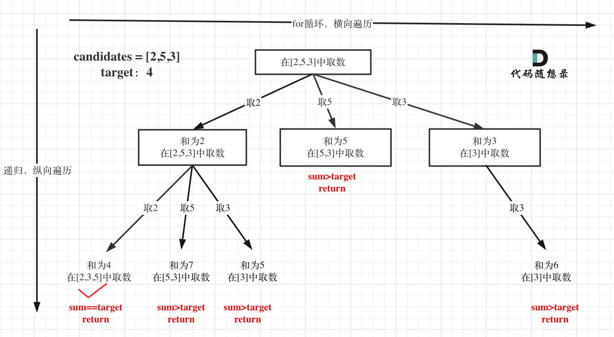
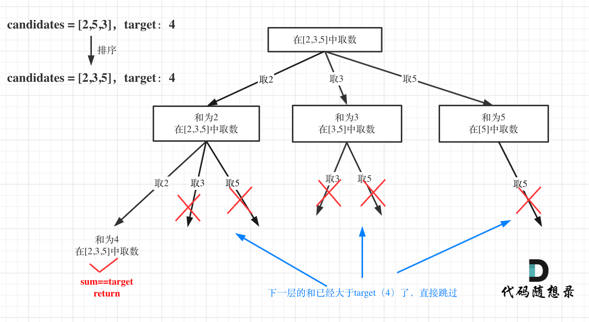

* [做專案（多個 C++、Java、Go、測試開發、前端專案）](https://www.programmercarl.com/other/kstar.html)
* [刷演算法（兩個月高強度學演算法）](https://www.programmercarl.com/xunlian/xunlianying.html)
* [背面試必考題（八股文）（40 天挑戰高頻面試題）](https://www.programmercarl.com/xunlian/bagu.html)


# 39. 組合（combination）總和

[LeetCode 題目連結](https://leetcode.cn/problems/combination-sum/)

給定一個無重複元素（element）的陣列（array） candidates 和一個目標數 target ，找出 candidates 中所有可以使數字和為 target 的組合。

candidates 中的數字可以無限制重複被選取。

說明：

* 所有數字（包括 target）都是正整數（positive integer）。
* solution set 不能包含重複的組合。

範例 1：

* 輸入：candidates = [2,3,6,7], target = 7,
* 所求 solution set 為：
  [
  [7],
  [2,2,3]
  ]

範例 2：

* 輸入：candidates = [2,3,5], target = 8,
* 所求 solution set 為：
  [
  [2,2,2,2],
  [2,3,3],
  [3,5]
  ]

## 演算法公開課

**[《程式碼隨想錄》演算法影片公開課](https://programmercarl.com/other/gongkaike.html)：[Leetcode:39. 組合總和講解](https://www.bilibili.com/video/BV1KT4y1M7HJ)，相信結合影片再看本篇題解，更有助於大家對本題的理解**。

## 解題思路


題目中的**無限制重複被選取，嚇得我趕緊想想出現 0 該怎麼辦**，然後看到下面提示：1 <= candidates[i] <= 200，我就放心了。

本題和 [77.組合](https://programmercarl.com/0077.组合.html)，[216.組合總和 III](https://programmercarl.com/0216.组合总和III.html) 的區別是：本題沒有數量要求，可以無限重複，但是有總和的限制，所以間接的也是有個數的限制。

本題搜尋的過程抽象成樹狀結構（tree structure）如下：


注意圖中葉節點（leaf node）的回傳條件（condition），因為本題沒有組合數量要求，僅僅是總和的限制，所以遞迴（recursion）沒有層數的限制，只要選取的元素總和超過 target，就回傳！

而在 [77.組合](https://programmercarl.com/0077.组合.html) 和 [216.組合總和 III](https://programmercarl.com/0216.组合总和III.html) 中都可以知道要遞迴 K 層，因為要取 k 個元素的組合。

### 回溯（backtracking）三部曲

* 遞迴函式（function）參數（parameter）

這裡依然是定義兩個全域變數（global variable），二維（two-dimensional）陣列 result 存放結果集（result set），陣列 path 存放符合條件的結果。（這兩個變數（variable）可以作為函式參數傳入）

首先是題目中給出的參數，集合 candidates，和目標值 target。

此外我還定義了 int 型的 sum 變數來統計單一結果 path 裡的總和，其實這個 sum 也可以不用，用 target 做相應的減法就可以了，最後如果 target==0 就說明找到符合的結果了，但為了程式碼邏輯清晰，我依然用了 sum。

**本題還需要 startIndex 來控制 for 迴圈（for-loop）的起始位置，對於組合問題，什麼時候需要 startIndex 呢？**

我舉過例子，如果是一個集合來求組合的話，就需要 startIndex，例如：[77.組合](https://programmercarl.com/0077.组合.html)，[216.組合總和 III](https://programmercarl.com/0216.组合总和III.html)。

如果是多個集合取組合，各個集合之間相互不影響，那麼就不用 startIndex，例如：[17.電話號碼的字母組合](https://programmercarl.com/0017.电话号码的字母组合.html)

**注意以上我只是說求組合的情況，如果是排列（permutation）問題，又是另一套分析的固定做法，後面我在講解排列的時候會重點介紹**。

程式碼如下：

```CPP
vector<vector<int>> result;
vector<int> path;
void backtracking(vector<int>& candidates, int target, int sum, int startIndex)
```

* 遞迴終止條件

在如下樹狀結構中：


從葉節點可以清晰看到，終止只有兩種情況，sum 大於 target 和 sum 等於 target。

sum 等於 target 的時候，需要收集結果，程式碼如下：

```CPP
if (sum > target) {
    return;
}
if (sum == target) {
    result.push_back(path);
    return;
}
```

* 單層搜尋的邏輯

單層 for 迴圈依然是從 startIndex 開始，搜尋 candidates 集合。

**注意本題和 [77.組合](https://programmercarl.com/0077.组合.html)、[216.組合總和 III](https://programmercarl.com/0216.组合总和III.html) 的一個區別是：本題元素為可重複選取的**。

如何重複選取呢，看程式碼，註解部分：

```CPP
for (int i = startIndex; i < candidates.size(); i++) {
    sum += candidates[i];
    path.push_back(candidates[i]);
    backtracking(candidates, target, sum, i); // 關鍵點: 不用 i+1 了，表示可以重複讀取當前的數
    sum -= candidates[i];   // 回溯
    path.pop_back();        // 回溯
}
```

按照[關於回溯演算法（backtracking algorithm），你該了解這些！](https://programmercarl.com/回溯算法理论基础.html)中給出的模板（template），不難寫出如下 C++ 完整程式碼：

```CPP
// 版本一
class Solution {
private:
    vector<vector<int>> result;
    vector<int> path;
    void backtracking(vector<int>& candidates, int target, int sum, int startIndex) {
        if (sum > target) {
            return;
        }
        if (sum == target) {
            result.push_back(path);
            return;
        }

        for (int i = startIndex; i < candidates.size(); i++) {
            sum += candidates[i];
            path.push_back(candidates[i]);
            backtracking(candidates, target, sum, i); // 不用 i+1 了，表示可以重複讀取當前的數
            sum -= candidates[i];
            path.pop_back();
        }
    }
public:
    vector<vector<int>> combinationSum(vector<int>& candidates, int target) {
        result.clear();
        path.clear();
        backtracking(candidates, target, 0, 0);
        return result;
    }
};
```

### 修剪法（pruning）最佳化

在這個樹狀結構中：



以及上面的版本一的程式碼大家可以看到，對於 sum 已經大於 target 的情況，其實是依然進入了下一層遞迴，只是下一層遞迴結束判斷的時候，會判斷 sum > target 的話就回傳。

其實如果已經知道下一層的 sum 會大於 target，就沒有必要進入下一層遞迴了。

那麼可以在 for 迴圈的搜尋範圍上做做文章了。

**對總集合排序之後，如果下一層的 sum（就是本層的 sum + candidates[i]）已經大於 target，就可以結束本輪 for 迴圈的遍歷（traversal）**。

如圖：




for 迴圈修剪法程式碼如下：

```
for (int i = startIndex; i < candidates.size() && sum + candidates[i] <= target; i++)
```

整體程式碼如下：（注意註解的部分）

```CPP
class Solution {
private:
    vector<vector<int>> result;
    vector<int> path;
    void backtracking(vector<int>& candidates, int target, int sum, int startIndex) {
        if (sum == target) {
            result.push_back(path);
            return;
        }

        // 如果 sum + candidates[i] > target 就終止遍歷
        for (int i = startIndex; i < candidates.size() && sum + candidates[i] <= target; i++) {
            sum += candidates[i];
            path.push_back(candidates[i]);
            backtracking(candidates, target, sum, i);
            sum -= candidates[i];
            path.pop_back();

        }
    }
public:
    vector<vector<int>> combinationSum(vector<int>& candidates, int target) {
        result.clear();
        path.clear();
        sort(candidates.begin(), candidates.end()); // 需要排序
        backtracking(candidates, target, 0, 0);
        return result;
    }
};
```
* 時間複雜性（time complexity）: O(n * 2^n)，注意這只是複雜度的上界（upper bound），因為修剪法的存在，真實的時間複雜性遠小於此
* 空間複雜度（space complexity）: O(target)

## 總結

本題和我們之前講過的 [77.組合](https://programmercarl.com/0077.组合.html)、[216.組合總和 III](https://programmercarl.com/0216.组合总和III.html) 有兩點不同：

* 組合沒有數量要求
* 元素可無限重複選取

針對這兩個問題，我都做了詳細的分析。

並且給出了對於組合問題，什麼時候用 startIndex，什麼時候不用，並用 [17.電話號碼的字母組合](https://programmercarl.com/0017.电话号码的字母组合.html) 做了對比。

最後還給出了本題的修剪法最佳化，這個最佳化如果是初學者的話並不容易想到。

**在求和問題中，排序之後加修剪法是常見的固定做法！**

可以看出我寫的文章都會大量引用之前的文章，就是要不斷作對比，分析其差異，然後給出程式碼解決的方法，這樣才能徹底理解題目的本質與難點。


## 其他語言版本


### Java

```Java
// 修剪法最佳化
class Solution {
    public List<List<Integer>> combinationSum(int[] candidates, int target) {
        List<List<Integer>> res = new ArrayList<>();
        Arrays.sort(candidates); // 先進行排序
        backtracking(res, new ArrayList<>(), candidates, target, 0, 0);
        return res;
    }

    public void backtracking(List<List<Integer>> res, List<Integer> path, int[] candidates, int target, int sum, int idx) {
        // 找到了數字和為 target 的組合
        if (sum == target) {
            res.add(new ArrayList<>(path));
            return;
        }

        for (int i = idx; i < candidates.length; i++) {
            // 如果 sum + candidates[i] > target 就終止遍歷
            if (sum + candidates[i] > target) break;
            path.add(candidates[i]);
            backtracking(res, path, candidates, target, sum + candidates[i], i);
            path.remove(path.size() - 1); // 回溯，移除路徑 path 最後一個元素
        }
    }
}
```

### Python

回溯（版本一）

```python
class Solution:

    def backtracking(self, candidates, target, total, startIndex, path, result):
        if total > target:
            return
        if total == target:
            result.append(path[:])
            return

        for i in range(startIndex, len(candidates)):
            total += candidates[i]
            path.append(candidates[i])
            self.backtracking(candidates, target, total, i, path, result)  # 不用 i+1 了，表示可以重複讀取當前的數
            total -= candidates[i]
            path.pop()

    def combinationSum(self, candidates, target):
        result = []
        self.backtracking(candidates, target, 0, 0, [], result)
        return result

```

回溯修剪法（版本一）

```python
class Solution:

    def backtracking(self, candidates, target, total, startIndex, path, result):
        if total == target:
            result.append(path[:])
            return

        for i in range(startIndex, len(candidates)):
            if total + candidates[i] > target:
                break
            total += candidates[i]
            path.append(candidates[i])
            self.backtracking(candidates, target, total, i, path, result)
            total -= candidates[i]
            path.pop()

    def combinationSum(self, candidates, target):
        result = []
        candidates.sort()  # 需要排序
        self.backtracking(candidates, target, 0, 0, [], result)
        return result

```

回溯（版本二）

```python
class Solution:
    def combinationSum(self, candidates: List[int], target: int) -> List[List[int]]:
        result =[]
        self.backtracking(candidates, target, 0, [], result)
        return result
    def backtracking(self, candidates, target, startIndex, path, result):
        if target == 0:
            result.append(path[:])
            return
        if target < 0:
            return
        for i in range(startIndex, len(candidates)):
            path.append(candidates[i])
            self.backtracking(candidates, target - candidates[i], i, path, result)
            path.pop()

```

回溯修剪法（版本二）

```python
class Solution:
    def combinationSum(self, candidates: List[int], target: int) -> List[List[int]]:
        result =[]
        candidates.sort()
        self.backtracking(candidates, target, 0, [], result)
        return result
    def backtracking(self, candidates, target, startIndex, path, result):
        if target == 0:
            result.append(path[:])
            return

        for i in range(startIndex, len(candidates)):
            if target - candidates[i]  < 0:
                break
            path.append(candidates[i])
            self.backtracking(candidates, target - candidates[i], i, path, result)
            path.pop()

```

### Go

主要在於遞迴中傳遞下一個數字

```go
var (
    res [][]int
    path  []int
)
func combinationSum(candidates []int, target int) [][]int {
    res, path = make([][]int, 0), make([]int, 0, len(candidates))
    sort.Ints(candidates)   // 排序，為修剪法做準備
    dfs(candidates, 0, target)
    return res
}

func dfs(candidates []int, start int, target int) {
    if target == 0 {   // target 不斷減小，如果為 0 說明達到了目標值
        tmp := make([]int, len(path))
        copy(tmp, path)
        res = append(res, tmp)
        return
    }
    for i := start; i < len(candidates); i++ {
        if candidates[i] > target {  // 修剪法，提前回傳
            break
        }
        path = append(path, candidates[i])
        dfs(candidates, i, target - candidates[i])
        path = path[:len(path) - 1]
    }
}
```

### JavaScript

```js
var combinationSum = function(candidates, target) {
    const res = [], path = [];
    candidates.sort((a,b)=>a-b); // 排序
    backtracking(0, 0);
    return res;
    function backtracking(j, sum) {
        if (sum === target) {
            res.push(Array.from(path));
            return;
        }
        for(let i = j; i < candidates.length; i++ ) {
            const n = candidates[i];
            if(n > target - sum) break;
            path.push(n);
            sum += n;
            backtracking(i, sum);
            path.pop();
            sum -= n;
        }
    }
};
```

### TypeScript

```typescript
function combinationSum(candidates: number[], target: number): number[][] {
    const resArr: number[][] = [];
    function backTracking(
        candidates: number[], target: number,
        startIndex: number, route: number[], curSum: number
    ): void {
        if (curSum > target) return;
        if (curSum === target) {
            resArr.push(route.slice());
            return
        }
        for (let i = startIndex, length = candidates.length; i < length; i++) {
            let tempVal: number = candidates[i];
            route.push(tempVal);
            backTracking(candidates, target, i, route, curSum + tempVal);
            route.pop();
        }
    }
    backTracking(candidates, target, 0, [], 0);
    return resArr;
};
```

### Rust

```Rust
impl Solution {
    pub fn backtracking(result: &mut Vec<Vec<i32>>, path: &mut Vec<i32>, candidates: &Vec<i32>, target: i32, mut sum: i32, start_index: usize) {
        if sum == target {
            result.push(path.to_vec());
            return;
        }
        for i in start_index..candidates.len() {
            if sum + candidates[i] <= target {
                sum += candidates[i];
                path.push(candidates[i]);
                Self::backtracking(result, path, candidates, target, sum, i);
                sum -= candidates[i];
                path.pop();
            }
        }
    }

    pub fn combination_sum(candidates: Vec<i32>, target: i32) -> Vec<Vec<i32>> {
        let mut result: Vec<Vec<i32>> = Vec::new();
        let mut path: Vec<i32> = Vec::new();
        Self::backtracking(&mut result, &mut path, &candidates, target, 0, 0);
        result
    }
}
```

### C

```c
int* path;
int pathTop;
int** ans;
int ansTop;
//記錄每一個和等於 target 的 path 陣列長度
int* length;

void backTracking(int target, int index, int* candidates, int candidatesSize, int sum) {
    //若 sum>=target 就應該終止遍歷
    if(sum >= target) {
        //若 sum 等於 target，將當前的組合放入 ans 陣列中
        if(sum == target) {
            int* tempPath = (int*)malloc(sizeof(int) * pathTop);
            int j;
            for(j = 0; j < pathTop; j++) {
                tempPath[j] = path[j];
            }
            ans[ansTop] = tempPath;
            length[ansTop++] = pathTop;
        }
        return ;
    }

    int i;
    for(i = index; i < candidatesSize; i++) {
        //將當前數字大小加入 sum
        sum+=candidates[i];
        path[pathTop++] = candidates[i];
        backTracking(target, i, candidates, candidatesSize, sum);
        sum-=candidates[i];
        pathTop--;
    }
}

int** combinationSum(int* candidates, int candidatesSize, int target, int* returnSize, int** returnColumnSizes){
    //初始化變數
    path = (int*)malloc(sizeof(int) * 50);
    ans = (int**)malloc(sizeof(int*) * 200);
    length = (int*)malloc(sizeof(int) * 200);
    ansTop = pathTop = 0;
    backTracking(target, 0, candidates, candidatesSize, 0);

    //設定回傳的陣列大小
    *returnSize = ansTop;
    *returnColumnSizes = (int*)malloc(sizeof(int) * ansTop);
    int i;
    for(i = 0; i < ansTop; i++) {
        (*returnColumnSizes)[i] = length[i];
    }
    return ans;
}
```

### Swift

```swift
func combinationSum(_ candidates: [Int], _ target: Int) -> [[Int]] {
    var result = [[Int]]()
    var path = [Int]()
    func backtracking(sum: Int, startIndex: Int) {
        // 終止條件
        if sum == target {
            result.append(path)
            return
        }

        let end = candidates.count
        guard startIndex < end else { return }
        for i in startIndex ..< end {
            let sum = sum + candidates[i] // 使用局部變數隱藏回溯
            if sum > target { continue } // 修剪法

            path.append(candidates[i]) // 處理
            backtracking(sum: sum, startIndex: i) // i 不用 +1 以重複存取
            path.removeLast() // 回溯
        }
    }
    backtracking(sum: 0, startIndex: 0)
    return result
}
```

### Scala

```scala
object Solution {
  import scala.collection.mutable
  def combinationSum(candidates: Array[Int], target: Int): List[List[Int]] = {
    var result = mutable.ListBuffer[List[Int]]()
    var path = mutable.ListBuffer[Int]()

    def backtracking(sum: Int, index: Int): Unit = {
      if (sum == target) {
        result.append(path.toList) // 如果正好等於 target，就加到結果集
        return
      }
      // 應該是從當前索引開始的，而不是從 0
      // 修剪法最佳化：新增迴圈守衛，當 sum + c(i) <= target 的時候才迴圈，才可以進入下一次遞迴
      for (i <- index until candidates.size if sum + candidates(i) <= target) {
        path.append(candidates(i))
        backtracking(sum + candidates(i), i)
        path = path.take(path.size - 1)
      }
    }

    backtracking(0, 0)
    result.toList
  }
}
```
### C#
```csharp
public class Solution
{
    public IList<IList<int>> res = new List<IList<int>>();
    public IList<int> path = new List<int>();
    public IList<IList<int>> CombinationSum(int[] candidates, int target)
    {
        BackTracking(candidates, target, 0, 0);
        return res;
    }
    public void BackTracking(int[] candidates, int target, int start, int sum)
    {
        if (sum > target) return;
        if (sum == target)
        {
            res.Add(new List<int>(path));
            return;
        }
        for (int i = start; i < candidates.Length; i++)
        {
            sum += candidates[i];
            path.Add(candidates[i]);
            BackTracking(candidates, target, i, sum);
            sum -= candidates[i];
            path.RemoveAt(path.Count - 1);
        }
    }
}

// 修剪法最佳化
public class Solution
{
    public IList<IList<int>> res = new List<IList<int>>();
    public IList<int> path = new List<int>();
    public IList<IList<int>> CombinationSum(int[] candidates, int target)
    {
        Array.Sort(candidates);
        BackTracking(candidates, target, 0, 0);
        return res;
    }
    public void BackTracking(int[] candidates, int target, int start, int sum)
    {
        if (sum > target) return;
        if (sum == target)
        {
            res.Add(new List<int>(path));
            return;
        }
        for (int i = start; i < candidates.Length && sum + candidates[i] <= target; i++)
        {
            sum += candidates[i];
            path.Add(candidates[i]);
            BackTracking(candidates, target, i, sum);
            sum -= candidates[i];
            path.RemoveAt(path.Count - 1);
        }
    }
}
```


