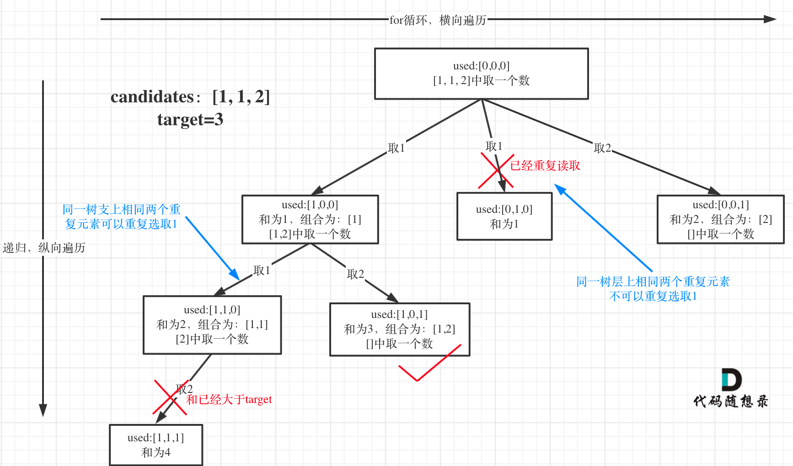
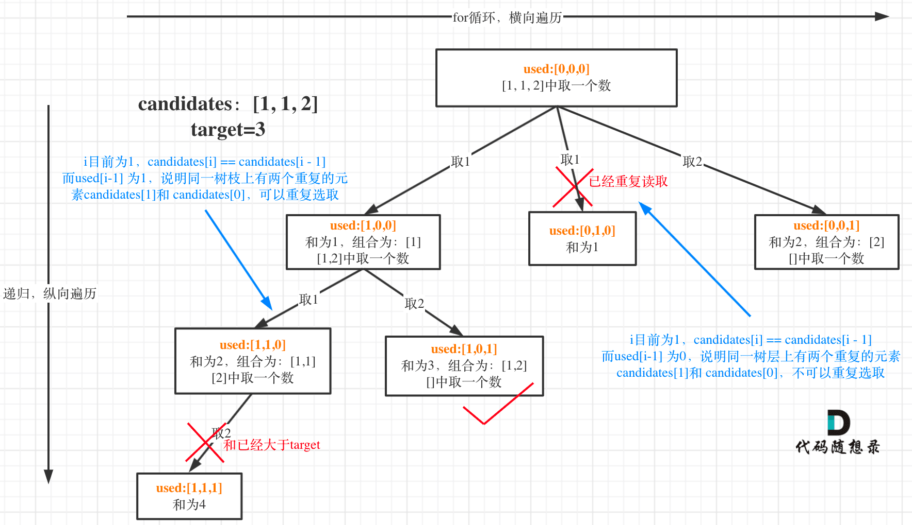
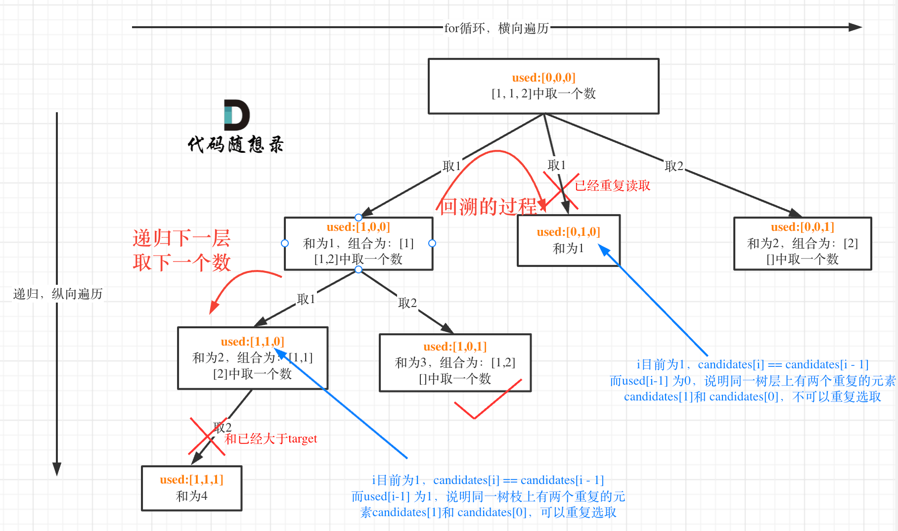

* [做專案（多個 C++、Java、Go、測試開發、前端（front end）專案）](https://www.programmercarl.com/other/kstar.html)
* [刷演算法（algorithm）（兩個月高強度學演算法）](https://www.programmercarl.com/xunlian/xunlianying.html)
* [背面試必考題（八股文）（40 天挑戰高頻面試題）](https://www.programmercarl.com/xunlian/bagu.html)


# 40. 組合（combination）總和 II

[LeetCode 題目連結](https://leetcode.cn/problems/combination-sum-ii/)

給定一個陣列（array） candidates 和一個目標數 target，找出 candidates 中所有可以使數字總和為 target 的組合。

candidates 中的每個數字在每個組合中只能使用一次。

說明：
所有數字（包括目標數）都是正整數（positive integer）。解集合不能包含重複的組合。

* 範例 1：
* 輸入：candidates = [10,1,2,7,6,1,5], target = 8,
* 所求解集合為：
```
[
  [1, 7],
  [1, 2, 5],
  [2, 6],
  [1, 1, 6]
]
```

* 範例 2：
* 輸入：candidates = [2,5,2,1,2], target = 5,
* 所求解集合為：

```
[
  [1,2,2],
  [5]
]
```

## 演算法公開課

**[《程式碼隨想錄》演算法影片公開課](https://programmercarl.com/other/gongkaike.html)：[回溯演算法（backtracking algorithm）中的去重，樹層去重與樹枝去重，你弄清楚了嗎？| LeetCode:40. 組合總和 II](https://www.bilibili.com/video/BV12V4y1V73A)，相信結合影片再看本篇題解，更有助於大家對本題的理解**。

## 解題思路


這道題目與 [39. 組合總和](https://programmercarl.com/0039.组合总和.html) 有以下區別：

1. 本題 candidates 中的每個數字在每個組合中只能使用一次。
2. 本題陣列 candidates 的元素（element）是有重複的，而 [39. 組合總和](https://programmercarl.com/0039.组合总和.html) 是無重複元素的陣列 candidates。

最後本題與 [39. 組合總和](https://programmercarl.com/0039.组合总和.html) 要求一樣，解集合不能包含重複的組合。

**本題的難點在於區別 2 中：集合（set）（陣列 candidates）有重複元素，但還不能有重複的組合**。

有些同學可能會想：我把所有組合求出來，再用 set 或 map 去重，這麼做很容易逾時！

所以要在搜尋的過程中就去掉重複組合。

很多同學在去重的問題上想不明白，其實很多題解也沒有講清楚，反正程式碼是能通過的，感覺好像是那麼回事，稀里糊塗地先把題目通過了。

這個去重為什麼很難理解呢？**所謂去重，其實就是使用過的元素不能重複選取。**這麼一說好像很簡單！

大家都知道組合問題可以抽象為樹狀結構（tree structure），那麼「使用過」在這個樹狀結構上有兩個維度：一個維度是同一樹枝上使用過，另一個維度是同一樹層上使用過。**沒有理解這兩個層面上的「使用過」，是造成大家沒有徹底理解去重的根本原因。**

那麼問題來了，我們是要判斷同一樹層上使用過，還是同一樹枝上使用過呢？

回頭看一下題目，元素在同一個組合內是可以重複的，怎麼重複都沒關係，但兩個組合不能相同。


**所以我們要去重的是同一樹層上的「使用過」，同一樹枝上的都是一個組合裡的元素，不用去重**。

為了理解去重，我們來舉一個例子：candidates = [1, 1, 2], target = 3（方便起見，candidates 已經排序（sorting）了）。

**強調一下，樹層去重的話，需要對陣列排序！**

選擇過程的樹狀結構如圖所示：



可以看到圖中，每個節點（node）相對於 [39. 組合總和](https://mp.weixin.qq.com/s/FLg8G6EjVcxBjwCbzpACPw) 我多加了 used 陣列，這個 used 陣列下面會重點介紹。

### 回溯（backtracking）三部曲

* **遞迴（recursion）函式（function）參數（parameter）**

與 [39. 組合總和](https://programmercarl.com/0039.组合总和.html) 做法相同，此題還需要加一個布林（Boolean）型別陣列 used，用來記錄同一樹枝上的元素是否使用過。

這個集合去重的重任就是由 used 來完成的。

程式碼如下：

```CPP
vector<vector<int>> result; // 存放組合集合
vector<int> path;           // 符合條件的組合
void backtracking(vector<int>& candidates, int target, int sum, int startIndex, vector<bool>& used) {
```

* **遞迴終止條件（condition）**

與 [39. 組合總和](https://programmercarl.com/0039.组合总和.html) 相同，終止條件為 `sum > target` 和 `sum == target`。

程式碼如下：

```CPP
if (sum > target) { // 這個條件其實可以省略
    return;
}
if (sum == target) {
    result.push_back(path);
    return;
}
```

`sum > target` 這個條件其實可以省略，因為在遞迴單層遍歷（traversal）的時候，會有修剪法（pruning）的操作，下面會介紹到。

* **單層搜尋的邏輯**

這裡與 [39. 組合總和](https://programmercarl.com/0039.组合总和.html) 最大的不同就是要去重了。

前面我們提到：要去重的是「同一樹層上的使用過」，如何判斷同一樹層上的元素（相同的元素）是否使用過了呢？

**如果 `candidates[i] == candidates[i - 1]` 並且 `used[i - 1] == false`，就說明：前一個樹枝使用了 candidates[i - 1]，也就是說同一樹層使用過 candidates[i - 1]**。

此時 for 迴圈（for-loop）裡就應該執行 continue 的操作。

這部分比較抽象，如圖：



我在圖中將 used 的變化用橘黃色標註出來，可以看出在 candidates[i] == candidates[i - 1] 相同的情況下：

* used[i - 1] == true，說明同一樹枝 candidates[i - 1] 使用過
* used[i - 1] == false，說明同一樹層 candidates[i - 1] 使用過

可能有的讀者／錄友會想，為什麼 used[i - 1] == false 就是同一樹層呢？因為在同一樹層中，used[i - 1] == false 才能表示，目前取的 candidates[i] 是從 candidates[i - 1] 回溯而來的。

而 used[i - 1] == true，說明是進入下一層遞迴，去取下一個數，所以是在樹枝上，如圖所示：




**這段去重的邏輯很抽象，網路上搜到的題解基本上沒有能講清楚的，如果大家之前思考過這個問題或刷過這道題目，看到這裡一定會感覺通透了很多！**


那麼單層搜尋的邏輯程式碼如下：

```CPP
for (int i = startIndex; i < candidates.size() && sum + candidates[i] <= target; i++) {
    // used[i - 1] == true，說明同一樹枝 candidates[i - 1] 使用過
    // used[i - 1] == false，說明同一樹層 candidates[i - 1] 使用過
    // 要對同一樹層使用過的元素進行跳過
    if (i > 0 && candidates[i] == candidates[i - 1] && used[i - 1] == false) {
        continue;
    }
    sum += candidates[i];
    path.push_back(candidates[i]);
    used[i] = true;
    backtracking(candidates, target, sum, i + 1, used); // 和 39.組合總和 的區別 1：這裡是 i+1，每個數字在每個組合中只能使用一次
    used[i] = false;
    sum -= candidates[i];
    path.pop_back();
}
```

**注意 sum + candidates[i] <= target 為修剪法操作，在 [39. 組合總和](https://mp.weixin.qq.com/s/FLg8G6EjVcxBjwCbzpACPw) 有講解過！**


回溯三部曲分析完了，整體 C++ 程式碼如下：

```CPP
class Solution {
private:
    vector<vector<int>> result;
    vector<int> path;
    void backtracking(vector<int>& candidates, int target, int sum, int startIndex, vector<bool>& used) {
        if (sum == target) {
            result.push_back(path);
            return;
        }
        for (int i = startIndex; i < candidates.size() && sum + candidates[i] <= target; i++) {
            // used[i - 1] == true，說明同一樹枝 candidates[i - 1] 使用過
            // used[i - 1] == false，說明同一樹層 candidates[i - 1] 使用過
            // 要對同一樹層使用過的元素進行跳過
            if (i > 0 && candidates[i] == candidates[i - 1] && used[i - 1] == false) {
                continue;
            }
            sum += candidates[i];
            path.push_back(candidates[i]);
            used[i] = true;
            backtracking(candidates, target, sum, i + 1, used); // 和 39.組合總和 的區別 1，這裡是 i+1，每個數字在每個組合中只能使用一次
            used[i] = false;
            sum -= candidates[i];
            path.pop_back();
        }
    }

public:
    vector<vector<int>> combinationSum2(vector<int>& candidates, int target) {
        vector<bool> used(candidates.size(), false);
        path.clear();
        result.clear();
        // 首先把 candidates 排序，讓相同的元素都相鄰在一起。
        sort(candidates.begin(), candidates.end());
        backtracking(candidates, target, 0, 0, used);
        return result;
    }
};

```
* 時間複雜性（time complexity）：O(n * 2^n)
* 空間複雜度（space complexity）：O(n)

### 補充

這裡直接用 startIndex 來去重也是可以的，就不用 used 陣列了。

```CPP
class Solution {
private:
    vector<vector<int>> result;
    vector<int> path;
    void backtracking(vector<int>& candidates, int target, int sum, int startIndex) {
        if (sum == target) {
            result.push_back(path);
            return;
        }
        for (int i = startIndex; i < candidates.size() && sum + candidates[i] <= target; i++) {
            // 要對同一樹層使用過的元素進行跳過
            if (i > startIndex && candidates[i] == candidates[i - 1]) {
                continue;
            }
            sum += candidates[i];
            path.push_back(candidates[i]);
            backtracking(candidates, target, sum, i + 1); // 和 39.組合總和 的區別 1，這裡是 i+1，每個數字在每個組合中只能使用一次
            sum -= candidates[i];
            path.pop_back();
        }
    }

public:
    vector<vector<int>> combinationSum2(vector<int>& candidates, int target) {
        path.clear();
        result.clear();
        // 首先把 candidates 排序，讓相同的元素都相鄰在一起。
        sort(candidates.begin(), candidates.end());
        backtracking(candidates, target, 0, 0);
        return result;
    }
};

```

## 總結

本題同樣是求組合總和，但就是因為其陣列 candidates 有重複元素，而要求不能有重複的組合，所以相對於 [39. 組合總和](https://programmercarl.com/0039.组合总和.html) 難度提升了不少。

**關鍵是去重的邏輯，程式碼很簡單，網路上一搜一大把，但幾乎沒有能把這段程式碼含義講明白的，基本上都是給出程式碼，然後說這就是去重了，究竟怎麼個去重法也是模稜兩可**。

所以 Carl 有必要把去重的這部分徹徹底底地給大家講清楚，**就連「樹層去重」和「樹枝去重」都是我自創的詞彙，希望對大家理解有幫助！**

## 其他語言版本


### Java
**使用標記陣列**
```Java
class Solution {
  LinkedList<Integer> path = new LinkedList<>();
  List<List<Integer>> ans = new ArrayList<>();
  boolean[] used;
  int sum = 0;

  public List<List<Integer>> combinationSum2(int[] candidates, int target) {
    used = new boolean[candidates.length];
    // 加標記陣列，用來輔助判斷同層節點是否已經遍歷
    Arrays.fill(used, false);
    // 為了將重複的數字都放到一起，所以先進行排序
    Arrays.sort(candidates);
    backTracking(candidates, target, 0);
    return ans;
  }

  private void backTracking(int[] candidates, int target, int startIndex) {
    if (sum == target) {
      ans.add(new ArrayList(path));
    }
    for (int i = startIndex; i < candidates.length; i++) {
      if (sum + candidates[i] > target) {
        break;
      }
      // 出現重複節點，同層的第一個節點已經被造訪過，所以直接跳過
      if (i > 0 && candidates[i] == candidates[i - 1] && !used[i - 1]) {
        continue;
      }
      used[i] = true;
      sum += candidates[i];
      path.add(candidates[i]);
      // 每個節點僅能選擇一次，所以從下一位開始
      backTracking(candidates, target, i + 1);
      used[i] = false;
      sum -= candidates[i];
      path.removeLast();
    }
  }
}

```
**不使用標記陣列**
```Java
class Solution {
  List<List<Integer>> res = new ArrayList<>();
  LinkedList<Integer> path = new LinkedList<>();
  int sum = 0;
  
  public List<List<Integer>> combinationSum2( int[] candidates, int target ) {
    // 為了將重複的數字都放到一起，所以先進行排序
    Arrays.sort( candidates );
    backTracking( candidates, target, 0 );
    return res;
  }
  
  private void backTracking( int[] candidates, int target, int start ) {
    if ( sum == target ) {
      res.add( new ArrayList<>( path ) );
      return;
    }
    for ( int i = start; i < candidates.length && sum + candidates[i] <= target; i++ ) {
      // 正確剔除重複解的方法
      // 跳過同一樹層使用過的元素
      if ( i > start && candidates[i] == candidates[i - 1] ) {
        continue;
      }

      sum += candidates[i];
      path.add( candidates[i] );
      // i+1 代表目前組內元素只選取一次
      backTracking( candidates, target, i + 1 );

      int temp = path.getLast();
      sum -= temp;
      path.removeLast();
    }
  }
}
```

### Python
回溯
```python
class Solution:


    def backtracking(self, candidates, target, total, startIndex, path, result):
        if total == target:
            result.append(path[:])
            return

        for i in range(startIndex, len(candidates)):
            if i > startIndex and candidates[i] == candidates[i - 1]:
                continue

            if total + candidates[i] > target:
                break

            total += candidates[i]
            path.append(candidates[i])
            self.backtracking(candidates, target, total, i + 1, path, result)
            total -= candidates[i]
            path.pop()

    def combinationSum2(self, candidates, target):
        result = []
        candidates.sort()
        self.backtracking(candidates, target, 0, 0, [], result)
        return result

```
回溯 使用 used
```python
class Solution:


    def backtracking(self, candidates, target, total, startIndex, used, path, result):
        if total == target:
            result.append(path[:])
            return

        for i in range(startIndex, len(candidates)):
            # 對於相同的數字，只選擇第一個未被使用的數字，跳過其他相同數字
            if i > startIndex and candidates[i] == candidates[i - 1] and not used[i - 1]:
                continue

            if total + candidates[i] > target:
                break

            total += candidates[i]
            path.append(candidates[i])
            used[i] = True
            self.backtracking(candidates, target, total, i + 1, used, path, result)
            used[i] = False
            total -= candidates[i]
            path.pop()

    def combinationSum2(self, candidates, target):
        used = [False] * len(candidates)
        result = []
        candidates.sort()
        self.backtracking(candidates, target, 0, 0, used, [], result)
        return result

```
回溯最佳化
```python
class Solution:
    def combinationSum2(self, candidates: List[int], target: int) -> List[List[int]]:
        candidates.sort()
        results = []
        self.combinationSumHelper(candidates, target, 0, [], results)
        return results

    def combinationSumHelper(self, candidates, target, index, path, results):
        if target == 0:
            results.append(path[:])
            return
        for i in range(index, len(candidates)):
            if i > index and candidates[i] == candidates[i - 1]:
                continue  
            if candidates[i] > target:
                break  
            path.append(candidates[i])
            self.combinationSumHelper(candidates, target - candidates[i], i + 1, path, results)
            path.pop()
```
### Go
主要在於如何在回溯中去重

**使用 used 陣列**
```go
var (
    res [][]int
    path  []int
    used  []bool
)
func combinationSum2(candidates []int, target int) [][]int {
    res, path = make([][]int, 0), make([]int, 0, len(candidates))
    used = make([]bool, len(candidates))
    sort.Ints(candidates)   // 排序，為修剪法做準備
    dfs(candidates, 0, target)
    return res
}

func dfs(candidates []int, start int, target int) {
    if target == 0 {   // target 不斷減小，如果為 0 說明達到了目標值
        tmp := make([]int, len(path))
        copy(tmp, path)
        res = append(res, tmp)
        return
    }
    for i := start; i < len(candidates); i++ {
        if candidates[i] > target {  // 修剪法，提前回傳
            break
        }
        // used[i - 1] == true，說明同一樹枝 candidates[i - 1] 使用過
        // used[i - 1] == false，說明同一樹層 candidates[i - 1] 使用過
        if i > 0 && candidates[i] == candidates[i-1]  && used[i-1] == false { 
            continue
        }
        path = append(path, candidates[i])
        used[i] = true
        dfs(candidates, i+1, target - candidates[i])
        used[i] = false
        path = path[:len(path) - 1]
    }
}
```
**不使用 used 陣列**
```go
var (
    res [][]int
    path  []int
)
func combinationSum2(candidates []int, target int) [][]int {
    res, path = make([][]int, 0), make([]int, 0, len(candidates))
    sort.Ints(candidates)   // 排序，為修剪法做準備
    dfs(candidates, 0, target)
    return res
}

func dfs(candidates []int, start int, target int) {
    if target == 0 {   // target 不斷減小，如果為 0 說明達到了目標值
        tmp := make([]int, len(path))
        copy(tmp, path)
        res = append(res, tmp)
        return
    }
    for i := start; i < len(candidates); i++ {
        if candidates[i] > target {  // 修剪法，提前回傳
            break
        }
        // i != start 限制了這不對深度遍歷到達的此值去重
        if i != start && candidates[i] == candidates[i-1] { // 去重
            continue
        }
        path = append(path, candidates[i])
        dfs(candidates, i+1, target - candidates[i])
        path = path[:len(path) - 1]
    }
}
```
### JavaScript

```js
/**
 * @param {number[]} candidates
 * @param {number} target
 * @return {number[][]}
 */
var combinationSum2 = function(candidates, target) {
    const res = []; path = [], len = candidates.length;
    candidates.sort((a,b)=>a-b);
    backtracking(0, 0);
    return res;
    function backtracking(sum, i) {
        if (sum === target) {
            res.push(Array.from(path));
            return;
        }
        for(let j = i; j < len; j++) {
            const n = candidates[j];
            if(j > i && candidates[j] === candidates[j-1]){
              // 若目前元素和前一個元素相等
              // 則本次迴圈結束，防止出現重複組合
              continue;
            }
            // 如果目前元素值大於目標值 - 總和的值
            // 由於陣列已排序，那麼該元素之後的元素必定不滿足條件
            // 直接終止目前層的遞迴
            if(n > target - sum) break;
            path.push(n);
            sum += n;
            backtracking(sum, j + 1);
            path.pop();
            sum -= n;
        }
    }
};
```
**使用 used 去重**

```js
var combinationSum2 = function(candidates, target) {
    let res = [];
    let path = [];
    let total = 0;
    const len = candidates.length;
    candidates.sort((a, b) => a - b);
    let used = new Array(len).fill(false);
    const backtracking = (startIndex) => {
        if (total === target) {
            res.push([...path]);
            return;
        }
        for(let i = startIndex; i < len && total < target; i++) {
            const cur = candidates[i];
            if (cur > target - total || (i > 0 && cur === candidates[i - 1] && !used[i - 1])) continue;
            path.push(cur);
            total += cur;
            used[i] = true;
            backtracking(i + 1);
            path.pop();
            total -= cur;
            used[i] = false;
        }
    }
    backtracking(0);
    return res;
};
```

### TypeScript

```typescript
function combinationSum2(candidates: number[], target: number): number[][] {
    candidates.sort((a, b) => a - b);
    const resArr: number[][] = [];
    function backTracking(
        candidates: number[], target: number,
        curSum: number, startIndex: number, route: number[]
    ) {
        if (curSum > target) return;
        if (curSum === target) {
            resArr.push(route.slice());
            return;
        }
        for (let i = startIndex, length = candidates.length; i < length; i++) {
            if (i > startIndex && candidates[i] === candidates[i - 1]) {
                continue;
            }
            let tempVal: number = candidates[i];
            route.push(tempVal);
            backTracking(candidates, target, curSum + tempVal, i + 1, route);
            route.pop();

        }
    }
    backTracking(candidates, target, 0, 0, []);
    return resArr;
};
```

### Rust

```Rust
impl Solution {
    pub fn backtracking(result: &mut Vec<Vec<i32>>, path: &mut Vec<i32>, candidates: &Vec<i32>, target: i32, mut sum: i32, start_index: usize, used: &mut Vec<bool>) {
        if sum == target {
            result.push(path.to_vec());
            return;
        }
        for i in start_index..candidates.len() {
            if sum + candidates[i] <= target {
                if i > 0 && candidates[i] == candidates[i - 1] && used[i - 1] == false { continue; }
                sum += candidates[i];
                path.push(candidates[i]);
                used[i] = true;
                Self::backtracking(result, path, candidates, target, sum, i + 1, used);
                used[i] = false;
                sum -= candidates[i];
                path.pop();
            }
        }
    }

    pub fn combination_sum2(candidates: Vec<i32>, target: i32) -> Vec<Vec<i32>> {
        let mut result: Vec<Vec<i32>> = Vec::new();
        let mut path: Vec<i32> = Vec::new();
        let mut used: Vec<bool> = vec![false; candidates.len()];
        let mut candidates = candidates;
        candidates.sort();
        Self::backtracking(&mut result, &mut path, &candidates, target, 0, 0, &mut used);
        result
    }
}
```

### C

```c
int* path;
int pathTop;
int** ans;
int ansTop;
// 記錄 ans 中每一個一維陣列的大小
int* length;
int cmp(const void* a1, const void* a2) {
    return *((int*)a1) - *((int*)a2);
}

void backTracking(int* candidates, int candidatesSize,  int target, int sum, int startIndex) {
    if(sum >= target) {
        // 若 sum 等於 target，複製目前 path 進入
        if(sum == target) {
            int* tempPath = (int*)malloc(sizeof(int) * pathTop);
            int j;
            for(j = 0; j < pathTop; j++) {
                tempPath[j] = path[j];
            }
            length[ansTop] = pathTop;
            ans[ansTop++] = tempPath;
        }
        return ;
    }

    int i;
    for(i = startIndex; i < candidatesSize; i++) {
        // 對同一層樹中使用過的元素跳過
        if(i > startIndex && candidates[i] == candidates[i-1])
            continue;
        path[pathTop++] = candidates[i];
        sum += candidates[i];
        backTracking(candidates, candidatesSize, target, sum, i + 1);
        // 回溯
        sum -= candidates[i];
        pathTop--;
    }
}

int** combinationSum2(int* candidates, int candidatesSize, int target, int* returnSize, int** returnColumnSizes){
    path = (int*)malloc(sizeof(int) * 50);
    ans = (int**)malloc(sizeof(int*) * 100);
    length = (int*)malloc(sizeof(int) * 100);
    pathTop = ansTop = 0;
    // 快速排序 candidates，讓相同元素相鄰在一起
    qsort(candidates, candidatesSize, sizeof(int), cmp);

    backTracking(candidates, candidatesSize, target, 0, 0);

    *returnSize = ansTop;
    *returnColumnSizes = (int*)malloc(sizeof(int) * ansTop);
    int i;
    for(i = 0; i < ansTop; i++) {
        (*returnColumnSizes)[i] = length[i];
    }
    return ans;
}
```

### Swift

```swift
func combinationSum2(_ candidates: [Int], _ target: Int) -> [[Int]] {
    // 為了方便去除重複，先對集合排序
    let candidates = candidates.sorted()
    var result = [[Int]]()
    var path = [Int]()
    func backtracking(sum: Int, startIndex: Int) {
        // 終止條件
        if sum == target {
            result.append(path)
            return
        }

        let end = candidates.count
        guard startIndex < end else { return }
        for i in startIndex ..< end {
            if i > startIndex, candidates[i] == candidates[i - 1] { continue } // 去除重複
            let sum = sum + candidates[i] // 使用局部變數隱藏回溯
            if sum > target { continue } // 修剪法

            path.append(candidates[i]) // 處理
            backtracking(sum: sum, startIndex: i + 1) // i+1 避免重複造訪
            path.removeLast() // 回溯
        }
    }
    backtracking(sum: 0, startIndex: 0)
    return result
}
```


### Scala

```scala
object Solution {
  import scala.collection.mutable    
  def combinationSum2(candidates: Array[Int], target: Int): List[List[Int]] = {
    var res = mutable.ListBuffer[List[Int]]()
    var path = mutable.ListBuffer[Int]()
    var candidate = candidates.sorted

    def backtracking(sum: Int, startIndex: Int): Unit = {
      if (sum == target) {
        res.append(path.toList)
        return
      }

      for (i <- startIndex until candidate.size if sum + candidate(i) <= target) {
        if (!(i > startIndex && candidate(i) == candidate(i - 1))) {
          path.append(candidate(i))
          backtracking(sum + candidate(i), i + 1)
          path = path.take(path.size - 1)
        }
      }
    }

    backtracking(0, 0)
    res.toList
  }
}
```
### C#
```csharp
public class Solution
{
    public List<IList<int>> res = new List<IList<int>>();
    public List<int> path = new List<int>();
    public IList<IList<int>> CombinationSum2(int[] candidates, int target)
    {

        Array.Sort(candidates);
        BackTracking(candidates, target, 0, 0);
        return res;
    }
    public void BackTracking(int[] candidates, int target, int start, int sum)
    {
        if (sum > target) return;
        if (sum == target)
        {
            res.Add(new List<int>(path));
            return;
        }
        for (int i = start; i < candidates.Length && sum + candidates[i] <= target; i++)
        {
            if (i > start && candidates[i] == candidates[i - 1]) continue;
            sum += candidates[i];
            path.Add(candidates[i]);
            BackTracking(candidates, target, i + 1, sum);
            sum -= candidates[i];
            path.RemoveAt(path.Count - 1);
        }
    }
}
```

