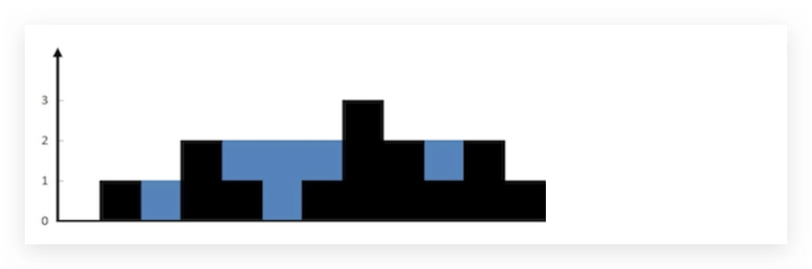
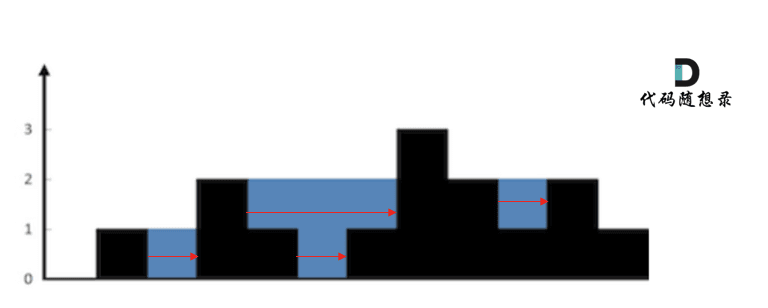
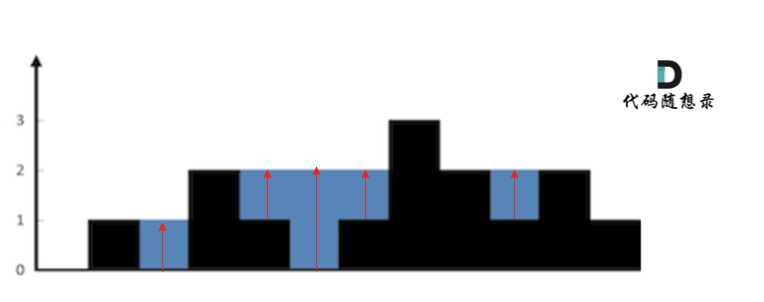
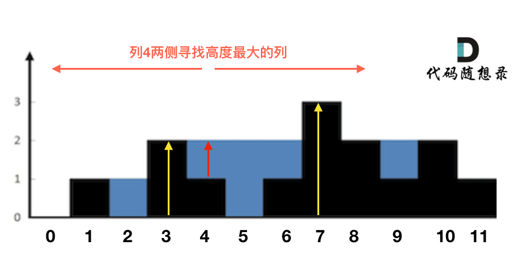
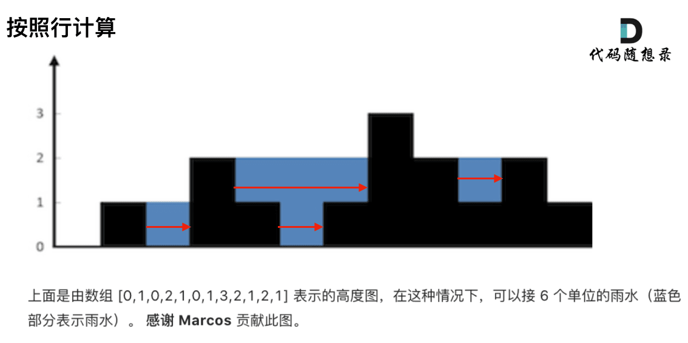
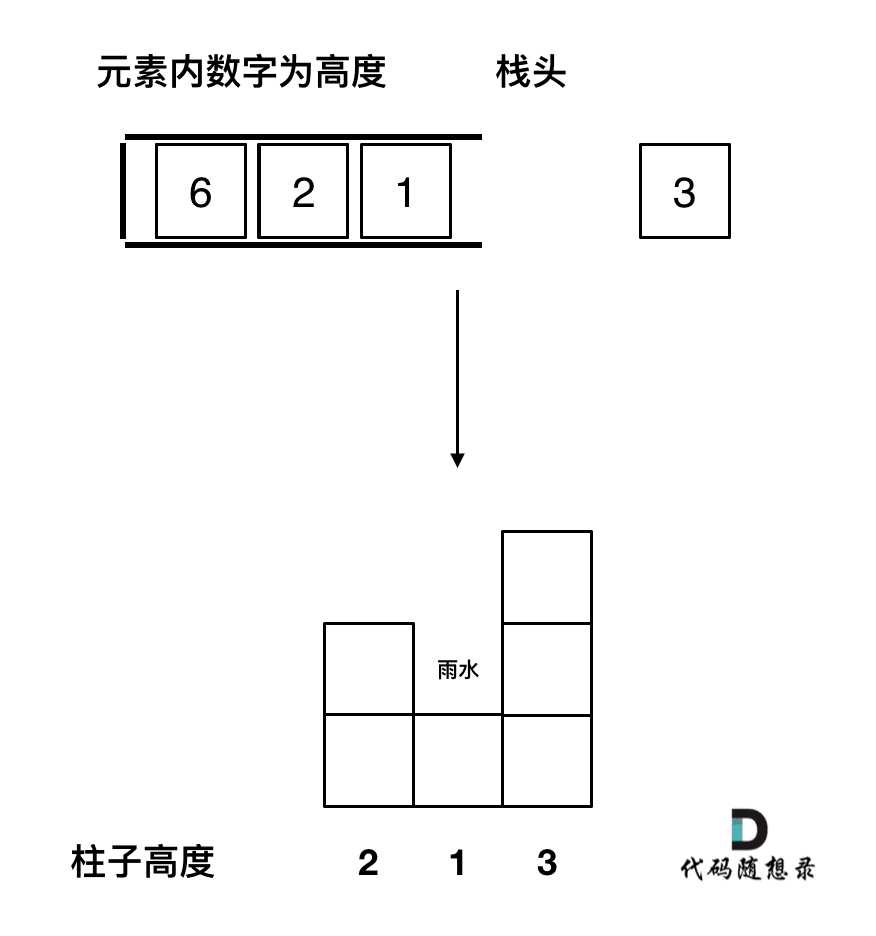
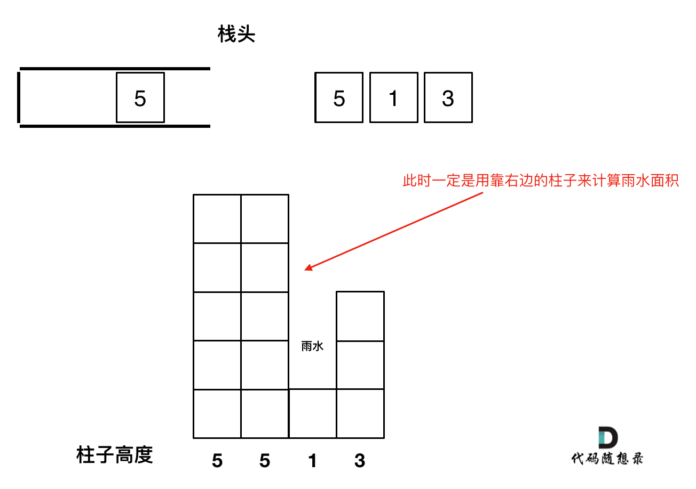

* [做專案（多個 C++、Java、Go、測試開發、前端（front end）專案）](https://www.programmercarl.com/other/kstar.html)
* [刷演算法（兩個月高強度學演算法）](https://www.programmercarl.com/xunlian/xunlianying.html)
* [準備面試必考題（八股文）（40 天挑戰高頻面試題）](https://www.programmercarl.com/xunlian/bagu.html)


# 42. 接雨水

[LeetCode 題目連結](https://leetcode.cn/problems/trapping-rain-water/)

給定 n 個非負整數（nonnegative integer）表示每個寬度為 1 的柱子的高度圖，計算按此排列的柱子，下雨之後能接多少雨水。

範例 1：

 
* 輸入：height = [0,1,0,2,1,0,1,3,2,1,2,1]
* 輸出：6
* 解釋：上面是由陣列（array） [0,1,0,2,1,0,1,3,2,1,2,1] 表示的高度圖，在這種情況下，可以接 6 個單位的雨水（藍色部分表示雨水）。

範例 2：

* 輸入：height = [4,2,0,3,2,5]
* 輸出：9

## 演算法公開課

**[《程式碼隨想錄》演算法影片公開課](https://programmercarl.com/other/gongkaike.html)：[monotonic stack，經典來襲！LeetCode:42.接雨水](https://www.bilibili.com/video/BV1uD4y1u75P/)，相信結合影片再看本篇題解，更有助於大家對本題的理解**。


## 解題思路

接雨水問題在面試中還是常見題目的，有必要好好講一講。

本文深入講解如下三種方法：

* 蠻力法（brute force）
* 雙指標（two pointers）最佳化
* 單調堆疊（monotonic stack）

### 蠻力法

本題蠻力法也是使用雙指標。

首先要明確，要按照列（row）來計算，還是按照欄（column）來計算。

按照列來計算如圖：


按照欄來計算如圖：


一些同學在實作的時候，很容易一會兒按照列來計算一會兒按照欄來計算，這樣就會越寫越亂。

我個人傾向於按照欄來計算，比較容易理解，接下來看一下按照欄如何計算。

首先，**如果按照欄來計算的話，寬度一定是 1 了，我們再把每一欄的雨水的高度求出來就可以了。**

可以看出每一欄雨水的高度，取決於該欄左側最高的柱子和右側最高的柱子中最矮的那個柱子的高度。

這句話可能有點繞，來舉一個例子理解，例如求欄 4 的雨水高度，如圖：



欄 4 左側最高的柱子是欄 3，高度為 2（以下用 lHeight 表示）。

欄 4 右側最高的柱子是欄 7，高度為 3（以下用 rHeight 表示）。

欄 4 柱子的高度為 1（以下用 height 表示）

那麼欄 4 的雨水高度為欄 3 和欄 7 的高度最小值減欄 4 高度，即： min(lHeight, rHeight) - height。

欄 4 的雨水高度求出來了，寬度為 1，相乘就是欄 4 的雨水體積了。

此時求出了欄 4 的雨水體積。

一樣的方法，只要從頭遍歷（traversal）一遍所有的欄，然後求出每一欄雨水的體積，相加之後就是總雨水的體積了。

首先從頭遍歷所有的欄，並且**要注意第一個柱子和最後一個柱子不接雨水**，程式碼如下：

```CPP
for (int i = 0; i < height.size(); i++) {
    // 第一個柱子和最後一個柱子不接雨水
    if (i == 0 || i == height.size() - 1) continue;
}
```

在 for 迴圈（for-loop）中求左右兩邊最高柱子，程式碼如下：

```CPP
int rHeight = height[i]; // 記錄右邊柱子的最高高度
int lHeight = height[i]; // 記錄左邊柱子的最高高度
for (int r = i + 1; r < height.size(); r++) {
    if (height[r] > rHeight) rHeight = height[r];
}
for (int l = i - 1; l >= 0; l--) {
    if (height[l] > lHeight) lHeight = height[l];
}
```

最後，計算該欄的雨水高度，程式碼如下：

```CPP
int h = min(lHeight, rHeight) - height[i];
if (h > 0) sum += h; // 注意只有 h 大於零的時候，才統計到總和中
```

整體程式碼如下：

```CPP
class Solution {
public:
    int trap(vector<int>& height) {
        int sum = 0;
        for (int i = 0; i < height.size(); i++) {
            // 第一個柱子和最後一個柱子不接雨水
            if (i == 0 || i == height.size() - 1) continue;

            int rHeight = height[i]; // 記錄右邊柱子的最高高度
            int lHeight = height[i]; // 記錄左邊柱子的最高高度
            for (int r = i + 1; r < height.size(); r++) {
                if (height[r] > rHeight) rHeight = height[r];
            }
            for (int l = i - 1; l >= 0; l--) {
                if (height[l] > lHeight) lHeight = height[l];
            }
            int h = min(lHeight, rHeight) - height[i];
            if (h > 0) sum += h;
        }
        return sum;
    }
};
```

因為每次遍歷欄的時候，還要向兩邊尋找最高的欄，所以時間複雜度（time complexity）為 O(n^2)，空間複雜度（space complexity）為 O(1)。

LeetCode 後面修改了後台測試資料，所以以上蠻力法逾時了。

### 雙指標最佳化


在蠻力法中，我們可以看到只要記錄左邊柱子的最高高度和右邊柱子的最高高度，就可以計算當前位置的雨水面積，這就是透過欄來計算。

當前欄雨水面積：min(左邊柱子的最高高度，記錄右邊柱子的最高高度) - 當前柱子高度。

為了得到兩邊的最高高度，使用了雙指標來遍歷，每到一個柱子都向兩邊遍歷一遍，這其實是有重複計算的。我們把每一個位置的左邊最高高度記錄在一個陣列上（maxLeft），右邊最高高度記錄在一個陣列上（maxRight），這樣就避免了重複計算。

當前位置，左邊的最高高度是前一個位置的左邊最高高度和本高度的最大值。

即從左向右遍歷：maxLeft[i] = max(height[i], maxLeft[i - 1]);

從右向左遍歷：maxRight[i] = max(height[i], maxRight[i + 1]);

程式碼如下：

```CPP
class Solution {
public:
    int trap(vector<int>& height) {
        if (height.size() <= 2) return 0;
        vector<int> maxLeft(height.size(), 0);
        vector<int> maxRight(height.size(), 0);
        int size = maxRight.size();

        // 記錄每個柱子左邊柱子最大高度
        maxLeft[0] = height[0];
        for (int i = 1; i < size; i++) {
            maxLeft[i] = max(height[i], maxLeft[i - 1]);
        }
        // 記錄每個柱子右邊柱子最大高度
        maxRight[size - 1] = height[size - 1];
        for (int i = size - 2; i >= 0; i--) {
            maxRight[i] = max(height[i], maxRight[i + 1]);
        }
        // 求和
        int sum = 0;
        for (int i = 0; i < size; i++) {
            int count = min(maxLeft[i], maxRight[i]) - height[i];
            if (count > 0) sum += count;
        }
        return sum;
    }
};
```

### 單調堆疊解法

關於單調堆疊的理論基礎，單調堆疊適合解決什麼問題，單調堆疊的工作過程，大家可以先看這題講解 [739. 每日溫度](https://programmercarl.com/0739.每日温度.html)。

單調堆疊就是保持堆疊（stack）內元素有序（ordered）。和[堆疊與佇列（queue）：monotonic queue](https://programmercarl.com/0239.滑动窗口最大值.html)一樣，需要我們自己維持順序，沒有現成的容器（container）可以用。

通常是一維陣列，要尋找任一個元素的右邊或者左邊第一個比自己大或者小的元素的位置，此時我們就要想到可以用單調堆疊了。

而接雨水這道題目，我們正需要尋找一個元素，右邊最大元素以及左邊最大元素，來計算雨水面積。

#### 準備工作

那麼本題使用單調堆疊有如下幾個問題：

1. 首先單調堆疊是按照列方向來計算雨水，如圖：



知道這一點，後面的就可以理解了。

2. 使用單調堆疊內元素的順序

從大到小還是從小到大呢？

從堆疊頂端（元素從堆疊頂端彈出）到堆疊底端的順序應該是從小到大的順序。

因為一旦發現加入的柱子高度大於堆疊頂端元素了，此時就出現凹槽了，堆疊頂端元素就是凹槽底部的柱子，堆疊頂端第二個元素就是凹槽左邊的柱子，而加入的元素就是凹槽右邊的柱子。

如圖：



關於單調堆疊的順序給大家一個總結： [739. 每日溫度](https://programmercarl.com/0739.每日温度.html) 中求一個元素右邊第一個更大元素，單調堆疊就是遞增的，[84. 直方圖（histogram）中最大的矩形（rectangle）](https://programmercarl.com/0084.柱状图中最大的矩形.html)求一個元素右邊第一個更小元素，單調堆疊就是遞減的。

3. 遇到相同高度的柱子怎麼辦。

遇到相同的元素，更新堆疊內下標（subscript），就是將堆疊裡元素（舊下標）彈出，將新元素（新下標）加入堆疊中。

例如 5 5 1 3 這種情況。如果加入第二個 5 的時候就應該將第一個 5 的下標彈出，把第二個 5 加入到堆疊中。

**因為我們要求寬度的時候 如果遇到相同高度的柱子，需要使用最右邊的柱子來計算寬度**。

如圖所示：



4. 堆疊裡要保存什麼數值

使用單調堆疊，也是透過 長 * 寬 來計算雨水面積的。

長就是透過柱子的高度來計算，寬是透過柱子之間的下標來計算，

那麼堆疊裡有沒有必要存一個 pair<int, int> 類型的元素，保存柱子的高度和下標呢。

其實不用，堆疊裡就存放下標就行，想要知道對應的高度，透過 height[stack.top()] 就知道彈出的下標對應的高度了。

所以堆疊的定義如下：

```
stack<int> st; // 存著下標，計算的時候用下標對應的柱子高度
```

明確了如上幾點，我們再來看處理邏輯。

#### 單調堆疊處理邏輯

以下操作過程其實和 [739. 每日溫度](https://programmercarl.com/0739.每日温度.html) 也是一樣的，建議先做 [739. 每日溫度](https://programmercarl.com/0739.每日温度.html)。

以下邏輯主要就是三種情況

* 情況一：當前遍歷的元素（柱子）高度小於堆疊頂端元素的高度 height[i] < height[st.top()]
* 情況二：當前遍歷的元素（柱子）高度等於堆疊頂端元素的高度 height[i] == height[st.top()]
* 情況三：當前遍歷的元素（柱子）高度大於堆疊頂端元素的高度 height[i] > height[st.top()]

先將下標 0 的柱子加入到堆疊中，`st.push(0);`。  堆疊中存放我們遍歷過的元素，所以先將下標 0 加進來。

然後開始從下標 1 開始遍歷所有的柱子，`for (int i = 1; i < height.size(); i++)`。

如果當前遍歷的元素（柱子）高度小於堆疊頂端元素的高度，就把這個元素加入堆疊中，因為堆疊裡本來就要保持從小到大的順序（從堆疊頂端到堆疊底端）。

程式碼如下：

```
if (height[i] < height[st.top()])  st.push(i);
```

如果當前遍歷的元素（柱子）高度等於堆疊頂端元素的高度，要更新堆疊頂端元素，因為遇到相同高度的柱子，需要使用最右邊的柱子來計算寬度。

程式碼如下：

```
if (height[i] == height[st.top()]) { // 例如 5 5 1 7 這種情況
  st.pop();
  st.push(i);
}
```

如果當前遍歷的元素（柱子）高度大於堆疊頂端元素的高度，此時就出現凹槽了，如圖所示：


取堆疊頂端元素，將堆疊頂端元素彈出，這個就是凹槽的底部，也就是中間位置，下標記為 mid，對應的高度為 height[mid]（就是圖中的高度 1）。

此時的堆疊頂端元素 st.top()，就是凹槽的左邊位置，下標為 st.top()，對應的高度為 height[st.top()]（就是圖中的高度 2）。

當前遍歷的元素 i，就是凹槽右邊的位置，下標為 i，對應的高度為 height[i]（就是圖中的高度 3）。

此時大家應該可以發現其實就是**堆疊頂端和堆疊頂端的下一個元素以及要入堆疊的元素，三個元素來接水！**

那麼雨水高度是 min(凹槽左邊高度, 凹槽右邊高度) - 凹槽底部高度，程式碼為：`int h = min(height[st.top()], height[i]) - height[mid];`

雨水的寬度是 凹槽右邊的下標 - 凹槽左邊的下標 - 1（因為只求中間寬度），程式碼為：`int w = i - st.top() - 1 ;`

當前凹槽雨水的體積就是：`h * w`。

求當前凹槽雨水的體積程式碼如下：

```CPP
while (!st.empty() && height[i] > height[st.top()]) { // 注意這裡是 while，持續更新堆疊頂端元素
    int mid = st.top();
    st.pop();
    if (!st.empty()) {
        int h = min(height[st.top()], height[i]) - height[mid];
        int w = i - st.top() - 1; // 注意減一，只求中間寬度
        sum += h * w;
    }
}
```

關鍵部分講完了，整體程式碼如下：

```CPP
class Solution {
public:
    int trap(vector<int>& height) {
        if (height.size() <= 2) return 0; // 可以不加
        stack<int> st; // 存著下標，計算的時候用下標對應的柱子高度
        st.push(0);
        int sum = 0;
        for (int i = 1; i < height.size(); i++) {
            if (height[i] < height[st.top()]) {     // 情況一
                st.push(i);
            } if (height[i] == height[st.top()]) {  // 情況二
                st.pop(); // 其實這一句可以不加，效果是一樣的，但處理相同的情況的思路卻變了。
                st.push(i);
            } else {                                // 情況三
                while (!st.empty() && height[i] > height[st.top()]) { // 注意這裡是 while
                    int mid = st.top();
                    st.pop();
                    if (!st.empty()) {
                        int h = min(height[st.top()], height[i]) - height[mid];
                        int w = i - st.top() - 1; // 注意減一，只求中間寬度
                        sum += h * w;
                    }
                }
                st.push(i);
            }
        }
        return sum;
    }
};
```

以上程式碼冗餘了一些，但是思路是清晰的，下面我將程式碼精簡一下，如下：

```CPP
class Solution {
public:
    int trap(vector<int>& height) {
        stack<int> st;
        st.push(0);
        int sum = 0;
        for (int i = 1; i < height.size(); i++) {
            while (!st.empty() && height[i] > height[st.top()]) {
                int mid = st.top();
                st.pop();
                if (!st.empty()) {
                    int h = min(height[st.top()], height[i]) - height[mid];
                    int w = i - st.top() - 1;
                    sum += h * w;
                }
            }
            st.push(i);
        }
        return sum;
    }
};
```

精簡之後的程式碼，大家就看不出三種情況的處理了，貌似好像只處理了情況三，其實是把情況一和情況二融合了。 這樣的程式碼不太利於理解。


## 其他語言版本

### Java:

蠻力法：

```java
class Solution {
    public int trap(int[] height) {
        int sum = 0;
        for (int i = 0; i < height.length; i++) {
            // 第一個柱子和最後一個柱子不接雨水
            if (i==0 || i== height.length - 1) continue;

            int rHeight = height[i]; // 記錄右邊柱子的最高高度
            int lHeight = height[i]; // 記錄左邊柱子的最高高度
            for (int r = i+1; r < height.length; r++) {
                if (height[r] > rHeight) rHeight = height[r];
            }
            for (int l = i-1; l >= 0; l--) {
                if(height[l] > lHeight) lHeight = height[l];
            }
            int h = Math.min(lHeight, rHeight) - height[i];
            if (h > 0) sum += h;
        }
        return sum;

    }
}
```

雙指標：

```java
class Solution {
    public int trap(int[] height) {
        int length = height.length;
        if (length <= 2) return 0;
        int[] maxLeft = new int[length];
        int[] maxRight = new int[length];

        // 記錄每個柱子左邊柱子最大高度
        maxLeft[0] = height[0];
        for (int i = 1; i< length; i++) maxLeft[i] = Math.max(height[i], maxLeft[i-1]);

        // 記錄每個柱子右邊柱子最大高度
        maxRight[length - 1] = height[length - 1];
        for(int i = length - 2; i >= 0; i--) maxRight[i] = Math.max(height[i], maxRight[i+1]);

        // 求和
        int sum = 0;
        for (int i = 0; i < length; i++) {
            int count = Math.min(maxLeft[i], maxRight[i]) - height[i];
            if (count > 0) sum += count;
        }
        return sum;
    }
}
```

雙指標最佳化
```java
class Solution {
    public int trap(int[] height) {
        if (height.length <= 2) {
            return 0;
        }
        // 從兩邊向中間尋找最值
        int maxLeft = height[0], maxRight = height[height.length - 1];
        int l = 1, r = height.length - 2;
        int res = 0;
        while (l <= r) {
            // 不確定上一輪是左邊移動還是右邊移動，所以兩邊都需更新最值
            maxLeft = Math.max(maxLeft, height[l]);
            maxRight = Math.max(maxRight, height[r]);
            // 最值較小的一邊所能裝的水量已定，所以移動較小的一邊。
            if (maxLeft < maxRight) {
                res += maxLeft - height[l ++];
            } else {
                res += maxRight - height[r --];
            }
        }
        return res;
    }
}
```

單調堆疊法

```java
class Solution {
    public int trap(int[] height){
        int size = height.length;

        if (size <= 2) return 0;

        // in the stack, we push the index of array
        // using height[] to access the real height
        Stack<Integer> stack = new Stack<Integer>();
        stack.push(0);

        int sum = 0;
        for (int index = 1; index < size; index++){
            int stackTop = stack.peek();
            if (height[index] < height[stackTop]){
                stack.push(index);
            }else if (height[index] == height[stackTop]){
                // 因為相等的相鄰牆，左邊一個是不可能存放雨水的，所以 pop 左邊的 index，push 當前的 index
                stack.pop();
                stack.push(index);
            }else{
                //pop up all lower value
                int heightAtIdx = height[index];
                while (!stack.isEmpty() && (heightAtIdx > height[stackTop])){
                    int mid = stack.pop();

                    if (!stack.isEmpty()){
                        int left = stack.peek();

                        int h = Math.min(height[left], height[index]) - height[mid];
                        int w = index - left - 1;
                        int hold = h * w;
                        if (hold > 0) sum += hold;
                        stackTop = stack.peek();
                    }
                }
                stack.push(index);
            }
        }

        return sum;
    }
}
```

### Python:

蠻力法：

```Python
class Solution:
    def trap(self, height: List[int]) -> int:
        res = 0
        for i in range(len(height)):
            if i == 0 or i == len(height)-1: continue
            lHight = height[i-1]
            rHight = height[i+1]
            for j in range(i-1):
                if height[j] > lHight:
                    lHight = height[j]
            for k in range(i+2,len(height)):
                if height[k] > rHight:
                    rHight = height[k]
            res1 = min(lHight,rHight) - height[i]
            if res1 > 0:
                res += res1
        return res
```

雙指標：

```python
class Solution:
    def trap(self, height: List[int]) -> int:
        leftheight, rightheight = [0]*len(height), [0]*len(height)

        leftheight[0]=height[0]
        for i in range(1,len(height)):
            leftheight[i]=max(leftheight[i-1],height[i])
        rightheight[-1]=height[-1]
        for i in range(len(height)-2,-1,-1):
            rightheight[i]=max(rightheight[i+1],height[i])

        result = 0
        for i in range(0,len(height)):
            summ = min(leftheight[i],rightheight[i])-height[i]
            result += summ
        return result
```

單調堆疊

```Python
class Solution:
    def trap(self, height: List[int]) -> int:
        # monotonic stack
        '''
        monotonic stack 是按照 列 的方向來計算雨水
        從堆疊頂端到堆疊底端的順序：從小到大
        透過三個元素來接水：堆疊頂端，堆疊頂端的下一個元素，以及即將入堆疊的元素
        雨水高度是 min(凹槽左邊高度, 凹槽右邊高度) - 凹槽底部高度
        雨水的寬度是 凹槽右邊的下標 - 凹槽左邊的下標 - 1（因為只求中間寬度）
        '''
        # stack 儲存 index，用於計算對應的柱子高度
        stack = [0]
        result = 0
        for i in range(1, len(height)):
            # 情況一
            if height[i] < height[stack[-1]]:
                stack.append(i)

            # 情況二
            # 當當前柱子高度和堆疊頂端一致時，左邊的一個是不可能存放雨水的，所以保留右側新柱子
            # 需要使用最右邊的柱子來計算寬度
            elif height[i] == height[stack[-1]]:
                stack.pop()
                stack.append(i)

            # 情況三
            else:
                # 彈出所有較低的柱子
                while stack and height[i] > height[stack[-1]]:
                    # 堆疊頂端就是中間的柱子：儲水槽，就是凹槽的底部
                    mid_height = height[stack[-1]]
                    stack.pop()
                    if stack:
                        right_height = height[i]
                        left_height = height[stack[-1]]
                        # 兩側的較矮一方的高度 - 凹槽底部高度
                        h = min(right_height, left_height) - mid_height
                        # 凹槽右側下標 - 凹槽左側下標 - 1: 只求中間寬度
                        w = i - stack[-1] - 1
                        # 體積：高乘寬
                        result += h * w
                stack.append(i)
        return result

# monotonic stack 壓縮版
class Solution:
    def trap(self, height: List[int]) -> int:
        stack = [0]
        result = 0
        for i in range(1, len(height)):
            while stack and height[i] > height[stack[-1]]:
                mid_height = stack.pop()
                if stack:
                    # 雨水高度是 min(凹槽左側高度, 凹槽右側高度) - 凹槽底部高度
                    h = min(height[stack[-1]], height[i]) - height[mid_height]
                    # 雨水寬度是 凹槽右側的下標 - 凹槽左側的下標 - 1
                    w = i - stack[-1] - 1
                    # 累計總雨水體積
                    result += h * w
            stack.append(i)
        return result

```

### Go:

```go
func trap(height []int) int {
	var left, right, leftMax, rightMax, res int
	right = len(height) - 1
	for left < right {
		if height[left] < height[right] {
			if height[left] >= leftMax {
				leftMax = height[left]  // 設定左邊最高柱子
			} else {
				res += leftMax - height[left]  // //右邊必定有柱子擋水，所以遇到所有值小於等於 leftMax 的，全部加入水池中
			}
			left++
		} else {
			if height[right] > rightMax {
				rightMax = height[right]  // //設定右邊最高柱子
			} else {
				res += rightMax - height[right]  // //左邊必定有柱子擋水，所以，遇到所有值小於等於 rightMax 的，全部加入水池
			}
			right--
		}
	}
	return res
}
```

雙指標解法：

```go
func trap(height []int) int {
    sum:=0
    n:=len(height)
    lh:=make([]int,n)
    rh:=make([]int,n)
    lh[0]=height[0]
    rh[n-1]=height[n-1]
    for i:=1;i<n;i++{
        lh[i]=max(lh[i-1],height[i])
    }
    for i:=n-2;i>=0;i--{
        rh[i]=max(rh[i+1],height[i])
    }
    for i:=1;i<n-1;i++{
        h:=min(rh[i],lh[i])-height[i]
        if h>0{
            sum+=h
        }
    }
    return sum
}
func max(a,b int)int{
    if a>b{
        return a
    }
    return b
}
func min(a,b int)int{
    if a<b{
        return a
    }
    return b
}
```

單調堆疊解法

```go
func trap(height []int) int {
   if len(height) <= 2 {
      return 0
   }
   st := make([]int, 1, len(height)) // 切片模擬 monotonic stack，st 儲存的是高度陣列下標
   var res int
   for i := 1; i < len(height); i++ {
      if height[i] < height[st[len(st)-1]] {
         st = append(st, i)
      } else if height[i] == height[st[len(st)-1]] {
         st = st[:len(st)-1] // 比較的新元素和堆疊頂端的元素相等，去掉堆疊中的，入堆疊新元素下標
         st = append(st, i)
      } else {
         for len(st) != 0 && height[i] > height[st[len(st)-1]] {
            top := st[len(st)-1]
            st = st[:len(st)-1]
            if len(st) != 0 {
               tmp := (min(height[i], height[st[len(st)-1]]) - height[top]) * (i - st[len(st)-1] - 1)
               res += tmp
            }
         }
         st = append(st, i)
      }
   }
   return res
}


func min(x, y int) int {
   if x >= y {
      return y
   }
   return x
}
```

單調堆疊壓縮版：

```go
func trap(height []int) int {
    stack := make([]int, 0)
    res := 0

    // 無需事先將第一個柱子的座標入堆疊，因為它會在該 for 迴圈的最後入堆疊
    for i := 0; i < len(height); i ++ {
        // 滿足堆疊不為空並且當前柱子高度大於堆疊頂端對應的柱子高度的情況時
        for len(stack) > 0 && height[stack[len(stack) - 1]] < height[i] {
            // 獲得凹槽高度
            mid := height[stack[len(stack) - 1]]
            // 凹槽座標出堆疊
            stack = stack[: len(stack) - 1]

            // 如果堆疊不為空則此時堆疊頂端元素為左側柱子座標
            if len(stack) > 0 {
                // 求得雨水高度
                h := min(height[i], height[stack[len(stack) - 1]]) - mid
                // 求得雨水寬度
                w := i - stack[len(stack) - 1] - 1
                res += h * w
            }
        }
        // 如果堆疊為空或者當前柱子高度小於等於堆疊頂端對應的柱子高度時入堆疊
        stack = append(stack, i)
    }
    return res
}

func min(x, y int) int {
    if x < y {
        return x
    }
    return y
}
```

### JavaScript:

```javascript
//蠻力法
var trap = function(height) {
    const len = height.length;
    let sum = 0;
    for(let i = 0; i < len; i++){
        // 第一個柱子和最後一個柱子不接雨水
        if(i == 0 || i == len - 1) continue;
        let rHeight = height[i]; // 記錄右邊柱子的最高高度
        let lHeight = height[i]; // 記錄左邊柱子的最高高度
        for(let r = i + 1; r < len; r++){
            if(height[r] > rHeight) rHeight = height[r];
        }
        for(let l = i - 1; l >= 0; l--){
            if(height[l] > lHeight) lHeight = height[l];
        }
        let h = Math.min(lHeight, rHeight) - height[i];
        if(h > 0) sum += h;
    }
    return sum;
};

//two pointers
var trap = function(height) {
    const len = height.length;
    if(len <= 2) return 0;
    const maxLeft = new Array(len).fill(0);
    const maxRight = new Array(len).fill(0);
    // 記錄每個柱子左邊柱子最大高度
    maxLeft[0] = height[0];
    for(let i = 1; i < len; i++){
        maxLeft[i] = Math.max(height[i], maxLeft[i - 1]);
    }
    // 記錄每個柱子右邊柱子最大高度
    maxRight[len - 1] = height[len - 1];
    for(let i = len - 2; i >= 0; i--){
        maxRight[i] = Math.max(height[i], maxRight[i + 1]);
    }
    // 求和
    let sum = 0;
    for(let i = 0; i < len; i++){
        let count = Math.min(maxLeft[i], maxRight[i]) - height[i];
        if(count > 0) sum += count;
    }
    return sum;
};

//monotonic stack js 陣列作為堆疊
var trap = function(height) {
    const len = height.length;
    if(len <= 2) return 0; // 可以不加
    const st = [];// 存著下標，計算的時候用下標對應的柱子高度
    st.push(0);
    let sum = 0;
    for(let i = 1; i < len; i++){
        if(height[i] < height[st[st.length - 1]]){ // 情況一
            st.push(i);
        }
        if (height[i] == height[st[st.length - 1]]) {  // 情況二
            st.pop(); // 其實這一句可以不加，效果是一樣的，但處理相同的情況的思路卻變了。
            st.push(i);
        } else { // 情況三
            while (st.length !== 0 && height[i] > height[st[st.length - 1]]) { // 注意這裡是 while
                let mid = st[st.length - 1];
                st.pop();
                if (st.length !== 0) {
                    let h = Math.min(height[st[st.length - 1]], height[i]) - height[mid];
                    let w = i - st[st.length - 1] - 1; // 注意減一，只求中間寬度
                    sum += h * w;
                }
            }
            st.push(i);
        }
    }
    return sum;
};

//monotonic stack 簡潔版本 只處理情況三
var trap = function(height) {
    const len = height.length;
    if(len <= 2) return 0; // 可以不加
    const st = [];// 存著下標，計算的時候用下標對應的柱子高度
    st.push(0);
    let sum = 0;
    for(let i = 1; i < len; i++){ // 只處理了情況三，其實是把情況一和情況二融合了
        while (st.length !== 0 && height[i] > height[st[st.length - 1]]) { // 注意這裡是 while
            let mid = st[st.length - 1];
            st.pop();
            if (st.length !== 0) {
                let h = Math.min(height[st[st.length - 1]], height[i]) - height[mid];
                let w = i - st[st.length - 1] - 1; // 注意減一，只求中間寬度
                sum += h * w;
            }
        }
        st.push(i);
    }
    return sum;
};
```

### TypeScript:

蠻力法：

```typescript
function trap(height: number[]): number {
    const length: number = height.length;
    let resVal: number = 0;
    for (let i = 0; i < length; i++) {
        let leftMaxHeight: number = height[i],
            rightMaxHeight: number = height[i];
        let leftIndex: number = i - 1,
            rightIndex: number = i + 1;
        while (leftIndex >= 0) {
            if (height[leftIndex] > leftMaxHeight)
                leftMaxHeight = height[leftIndex];
            leftIndex--;
        }
        while (rightIndex < length) {
            if (height[rightIndex] > rightMaxHeight)
                rightMaxHeight = height[rightIndex];
            rightIndex++;
        }
        resVal += Math.min(leftMaxHeight, rightMaxHeight) - height[i];
    }
    return resVal;
};
```

雙指標：

```typescript
function trap(height: number[]): number {
    const length: number = height.length;
    const leftMaxHeightDp: number[] = [],
        rightMaxHeightDp: number[] = [];
    leftMaxHeightDp[0] = height[0];
    rightMaxHeightDp[length - 1] = height[length - 1];
    for (let i = 1; i < length; i++) {
        leftMaxHeightDp[i] = Math.max(height[i], leftMaxHeightDp[i - 1]);
    }
    for (let i = length - 2; i >= 0; i--) {
        rightMaxHeightDp[i] = Math.max(height[i], rightMaxHeightDp[i + 1]);
    }
    let resVal: number = 0;
    for (let i = 0; i < length; i++) {
        resVal += Math.min(leftMaxHeightDp[i], rightMaxHeightDp[i]) - height[i];
    }
    return resVal;
};
```

單調堆疊：

```typescript
function trap(height: number[]): number {
    const length: number = height.length;
    const stack: number[] = [];
    stack.push(0);
    let resVal: number = 0;
    for (let i = 1; i < length; i++) {
        let top = stack[stack.length - 1];
        if (height[top] > height[i]) {
            stack.push(i);
        } else if (height[top] === height[i]) {
            stack.pop();
            stack.push(i);
        } else {
            while (stack.length > 0 && height[top] < height[i]) {
                let mid = stack.pop();
                if (stack.length > 0) {
                    let left = stack[stack.length - 1];
                    let h = Math.min(height[left], height[i]) - height[mid];
                    let w = i - left - 1;
                    resVal += h * w;
                    top = stack[stack.length - 1];
                }
            }
            stack.push(i);
        }
    }
    return resVal;
};
```

### C:

一種更簡便的雙指標方法：

之前的雙指標方法的原理是固定「底」的位置，往兩邊找比它高的「壁」，迴圈若干次求和。

我們逆向思維，把「壁」用兩個初始位置在陣列首末位置的指標（pointer）表示，「壁」往中間推，同樣可以讓每個「底」都能找到最高的「壁」

本質上就是改變了運算方向，從而減少了重複運算

程式碼如下：

```C
int trap(int* height, int heightSize) {
    int ans = 0;
    int left = 0, right = heightSize - 1;               //初始化兩個指標到左右兩邊
    int leftMax = 0, rightMax = 0;                      //這兩個值用來記錄左右的「壁」的最高值
    while (left < right) {                              //兩個指標重合就結束
        leftMax = fmax(leftMax, height[left]);
        rightMax = fmax(rightMax, height[right]);
        if (leftMax < rightMax) {
            ans += leftMax - height[left];              //這裡考慮的是下標為 left 的「底」能裝多少水
            ++left;//指標的移動次序是這個方法的關鍵
        //這裡左指標右移是因為左「牆」較矮，左邊這一片實際情況下的盛水量是受制於這個矮的左「牆」的
        //而較高的右邊在實際情況下的限制條件可能不是當前的左「牆」，比如限制條件可能是右「牆」，就能裝更高的水，
        }
        else {
            ans += rightMax - height[right];            //同理，考慮下標為 right 的元素
            --right;
        }
    }
    return ans;
}
```

* 時間複雜度 O(n)
* 空間複雜度 O(1)

### Rust:

雙指標

```rust
impl Solution {
    pub fn trap(height: Vec<i32>) -> i32 {
        let n = height.len();
        let mut max_left = vec![0; height.len()];
        let mut max_right = vec![0; height.len()];
        max_left.iter_mut().zip(max_right.iter_mut().rev()).enumerate().fold((0, 0), |(lm, rm), (idx, (x, y))| {
            let lmax = lm.max(height[idx]);
            let rmax = rm.max(height[n - 1 - idx]);
            *x = lmax; *y = rmax;
            (lmax, rmax)
        });
        height.iter().enumerate().fold(0, |acc, (idx, x)| {
            let h = max_left[idx].min(max_right[idx]);
            if h > 0 { h - x + acc } else { acc }
        })
    }
}
```

單調堆疊

```rust
impl Solution {
    pub fn trap(height: Vec<i32>) -> i32 {
        let mut stack = vec![];
        let mut ans = 0;
        for (right_pos, &right_h) in height.iter().enumerate() {
            while !stack.is_empty() && height[*stack.last().unwrap()] <= right_h {
                let mid_pos = stack.pop().unwrap();
                if !stack.is_empty() {
                    let left_pos = *stack.last().unwrap();
                    let left_h = height[left_pos];
                    let top = std::cmp::min(left_h, right_h);
                    if top > height[mid_pos] {
                        ans += (top - height[mid_pos]) * (right_pos - left_pos - 1) as i32;
                    }
                }
            }
            stack.push(right_pos);
        }
        ans
    }
}
```

Rust

雙指標

```rust
impl Solution {
    pub fn trap(height: Vec<i32>) -> i32 {
        let n = height.len();
        let mut max_left = vec![0; height.len()];
        let mut max_right = vec![0; height.len()];
        max_left.iter_mut().zip(max_right.iter_mut().rev()).enumerate().fold((0, 0), |(lm, rm), (idx, (x, y))| {
            let lmax = lm.max(height[idx]);
            let rmax = rm.max(height[n - 1 - idx]);
            *x = lmax; *y = rmax;
            (lmax, rmax)
        });
        height.iter().enumerate().fold(0, |acc, (idx, x)| {
            let h = max_left[idx].min(max_right[idx]);
            if h > 0 { h - x + acc } else { acc }
        })
    }
}
```

單調堆疊

```rust
impl Solution {
    pub fn trap(height: Vec<i32>) -> i32 {
        let mut stack = vec![];
        let mut ans = 0;
        for (right_pos, &right_h) in height.iter().enumerate() {
            while !stack.is_empty() && height[*stack.last().unwrap()] <= right_h {
                let mid_pos = stack.pop().unwrap();
                if !stack.is_empty() {
                    let left_pos = *stack.last().unwrap();
                    let left_h = height[left_pos];
                    let top = std::cmp::min(left_h, right_h);
                    if top > height[mid_pos] {
                        ans += (top - height[mid_pos]) * (right_pos - left_pos - 1) as i32;
                    }
                }
            }
            stack.push(right_pos);
        }
        ans
    }
}
```
