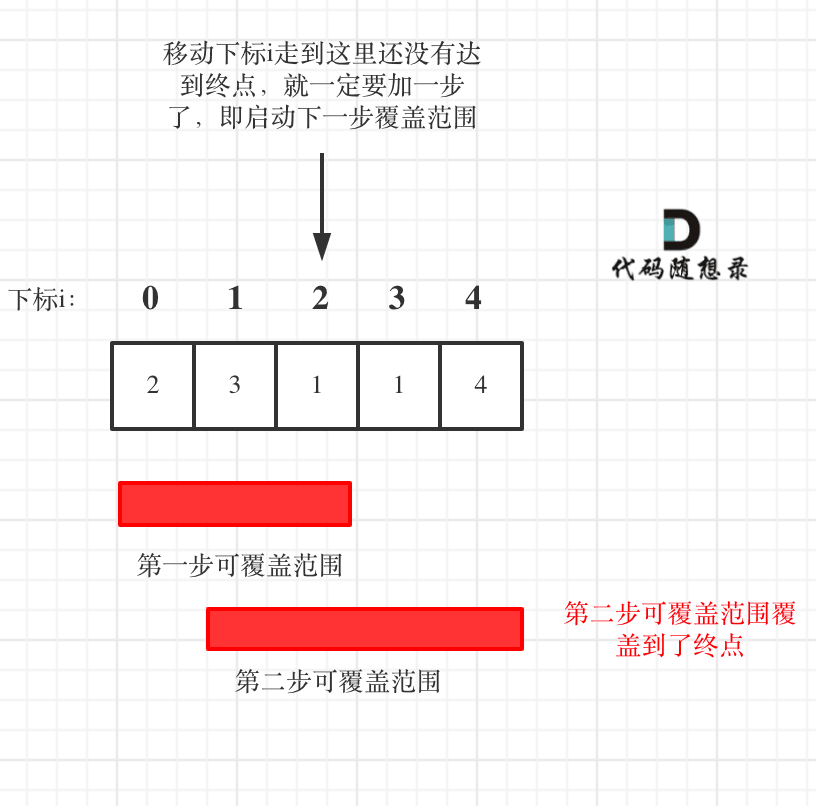
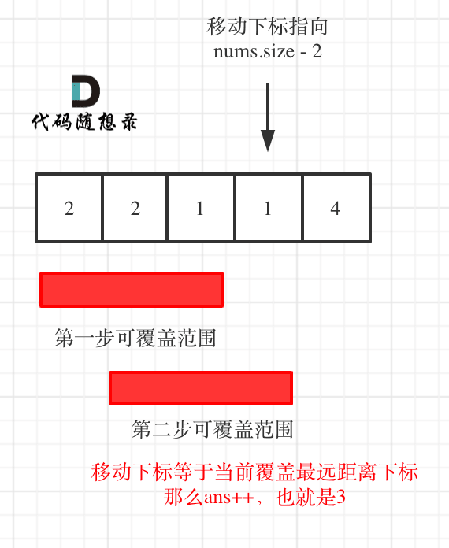
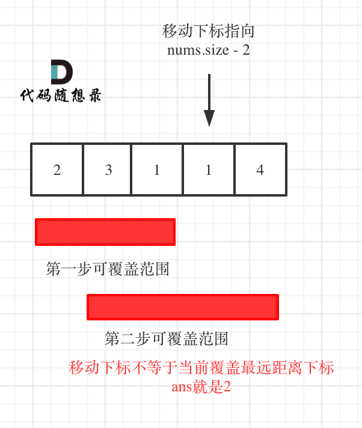

* [做專案（多個 C++、Java、Go、測試開發、前端（front end）專案）](https://www.programmercarl.com/other/kstar.html)
* [刷演算法（algorithm）（兩個月高強度學演算法）](https://www.programmercarl.com/xunlian/xunlianying.html)
* [準備面試必考題（八股文）（40 天挑戰高頻面試題）](https://www.programmercarl.com/xunlian/bagu.html)

> 相對於[貪心演算法（greedy algorithm）：跳躍遊戲](https://mp.weixin.qq.com/s/606_N9j8ACKCODoCbV1lSA)難了不少，做好心理準備！

# 45.跳躍遊戲 II

[LeetCode 題目連結](https://leetcode.cn/problems/jump-game-ii/)

給定一個非負整數（nonnegative integer）陣列（array），你最初位於陣列的第一個位置。

陣列中的每個元素代表你在該位置可以跳躍的最大長度。

你的目標是使用最少的跳躍次數到達陣列的最後一個位置。

範例:

- 輸入: [2,3,1,1,4]
- 輸出: 2
- 解釋: 跳到最後一個位置的最小跳躍數是 2。從下標（subscript）為 0 跳到下標為 1 的位置，跳  1  步，然後跳  3  步到達陣列的最後一個位置。

說明:
假設你總是可以到達陣列的最後一個位置。

## 演算法公開課

**[《程式碼隨想錄》演算法影片公開課](https://programmercarl.com/other/gongkaike.html)：[貪心演算法，最少跳幾步還得看覆蓋範圍 | LeetCode： 45.跳躍遊戲 II](https://www.bilibili.com/video/BV1Y24y1r7XZ)，相信結合影片再看本篇題解，更有助於大家對本題的理解**。

## 解題思路

本題相對於[55.跳躍遊戲](https://programmercarl.com/0055.跳跃游戏.html)還是難了不少。

但思路是相似的，還是要看最大覆蓋範圍。

本題要計算最少步數，那麼就要想清楚什麼時候步數才一定要加一呢？

貪心法（greedy）的思路，局部最佳：當前可移動距離盡可能多走，如果還沒到終點，步數再加一。整體最佳：一步盡可能多走，從而達到最少步數。

思路雖然是這樣，但在寫程式碼的時候還不能真的能跳多遠就跳多遠，那樣就不知道下一步最遠能跳到哪裡了。

**所以真正解題的時候，要從覆蓋範圍出發，不管怎麼跳，覆蓋範圍內一定是可以跳到的，以最小的步數增加覆蓋範圍，覆蓋範圍一旦覆蓋了終點，得到的就是最少步數！**

**這裡需要統計兩個覆蓋範圍，當前這一步的最大覆蓋和下一步最大覆蓋**。

如果移動下標達到了當前這一步的最大覆蓋最遠距離了，還沒有到終點的話，那麼就必須再走一步來增加覆蓋範圍，直到覆蓋範圍覆蓋了終點。

如圖：



**圖中覆蓋範圍的意義在於，只要紅色的區域，最多兩步一定可以到！（不用管具體怎麼跳，反正一定可以跳到）**

### 方法一

從圖中可以看出來，就是移動下標達到了當前覆蓋的最遠距離下標時，步數就要加一，來增加覆蓋距離。最後的步數就是最少步數。

這裡還是有個特殊情況需要考慮，當移動下標達到了當前覆蓋的最遠距離下標時

- 如果當前覆蓋最遠距離下標不是集合終點，步數就加一，還需要繼續走。
- 如果當前覆蓋最遠距離下標就是集合終點，步數不用加一，因為不能再往後走了。

C++ 程式碼如下：（詳細註釋）

```CPP
// 版本一
class Solution {
public:
    int jump(vector<int>& nums) {
        if (nums.size() == 1) return 0;
        int curDistance = 0;    // 當前覆蓋最遠距離下標
        int ans = 0;            // 記錄走的最大步數
        int nextDistance = 0;   // 下一步覆蓋最遠距離下標
        for (int i = 0; i < nums.size(); i++) {
            nextDistance = max(nums[i] + i, nextDistance);  // 更新下一步覆蓋最遠距離下標
            if (i == curDistance) {                         // 遇到當前覆蓋最遠距離下標
                ans++;                                  // 需要走下一步
                curDistance = nextDistance;             // 更新當前覆蓋最遠距離下標（相當於加油了）
                if (nextDistance >= nums.size() - 1) break;  // 當前覆蓋最遠距離到達集合終點，不用做 ans++ 操作了，直接結束
            }
        }
        return ans;
    }
};
```

* 時間複雜性（time complexity）: O(n)
* 空間複雜度（space complexity）: O(1)


### 方法二

依然是貪心，思路和方法一差不多，程式碼可以簡潔一些。

**針對方法一的特殊情況，可以統一處理**，即：移動下標只要遇到當前覆蓋最遠距離的下標，直接步數加一，不考慮是不是終點的情況。

想要達到這樣的效果，只要讓移動下標，最大只能移動到 nums.size - 2 的地方就可以了。

因為當移動下標指向 nums.size - 2 時：

- 如果移動下標等於當前覆蓋最大距離下標， 需要再走一步（即 ans++），因為最後一步一定是可以到達終點。（題目假設總是可以到達陣列的最後一個位置），如圖：
  

- 如果移動下標不等於當前覆蓋最大距離下標，說明當前覆蓋最遠距離就可以直接達到終點了，不需要再走一步。如圖：



程式碼如下：

```CPP
// 版本二
class Solution {
public:
    int jump(vector<int>& nums) {
        int curDistance = 0;    // 當前覆蓋的最遠距離下標
        int ans = 0;            // 記錄走的最大步數
        int nextDistance = 0;   // 下一步覆蓋的最遠距離下標
        for (int i = 0; i < nums.size() - 1; i++) { // 注意這裡是小於 nums.size() - 1，這是關鍵所在
            nextDistance = max(nums[i] + i, nextDistance); // 更新下一步覆蓋的最遠距離下標
            if (i == curDistance) {                 // 遇到當前覆蓋的最遠距離下標
                curDistance = nextDistance;         // 更新當前覆蓋的最遠距離下標
                ans++;
            }
        }
        return ans;
    }
};
```

* 時間複雜性: O(n)
* 空間複雜度: O(1)


可以看出版本二的程式碼相對於版本一簡化了不少！

**其精髓在於控制移動下標 i 只移動到 nums.size() - 2 的位置**，所以移動下標只要遇到當前覆蓋最遠距離的下標，直接步數加一，不用考慮別的了。

## 總結

相信大家可以發現，這道題目相較於[55.跳躍遊戲](https://programmercarl.com/0055.跳跃游戏.html)難了不止一點。

但程式碼又十分簡單，貪心就是這麼巧妙。

理解本題的關鍵在於：**以最小的步數增加最大的覆蓋範圍，直到覆蓋範圍覆蓋了終點**，這個範圍內最少步數一定可以跳到，不用管具體是怎麼跳的，不糾結於一步究竟跳一個單位還是兩個單位。

## 其他語言版本

### Java

```Java
// 版本一
class Solution {
    public int jump(int[] nums) {
        if (nums == null || nums.length == 0 || nums.length == 1) {
            return 0;
        }
        //記錄跳躍的次數
        int count=0;
        //當前的覆蓋最大區域
        int curDistance = 0;
        //最大的覆蓋區域
        int maxDistance = 0;
        for (int i = 0; i < nums.length; i++) {
            //在可覆蓋區域內更新最大的覆蓋區域
            maxDistance = Math.max(maxDistance,i+nums[i]);
            //說明當前一步，再跳一步就到達了末尾
            if (maxDistance>=nums.length-1){
                count++;
                break;
            }
            //走到當前覆蓋的最大區域時，更新下一步可達的最大區域
            if (i==curDistance){
                curDistance = maxDistance;
                count++;
            }
        }
        return count;
    }
}
```

```java
// 版本二
class Solution {
    public int jump(int[] nums) {
        int result = 0;
        // 當前覆蓋的最遠距離下標
        int end = 0;
        // 下一步覆蓋的最遠距離下標
        int temp = 0;
        for (int i = 0; i <= end && end < nums.length - 1; ++i) {
            temp = Math.max(temp, i + nums[i]);
            // 可達位置的改變次數就是跳躍次數
            if (i == end) {
                end = temp;
                result++;
            }
        }
        return result;
    }
}
```

### Python

貪心（版本一）
```python
class Solution:
    def jump(self, nums):
        if len(nums) == 1:
            return 0
        
        cur_distance = 0  # 當前覆蓋最遠距離下標
        ans = 0  # 記錄走的最大步數
        next_distance = 0  # 下一步覆蓋最遠距離下標
        
        for i in range(len(nums)):
            next_distance = max(nums[i] + i, next_distance)  # 更新下一步覆蓋最遠距離下標
            if i == cur_distance:  # 遇到當前覆蓋最遠距離下標
                ans += 1  # 需要走下一步
                cur_distance = next_distance  # 更新當前覆蓋最遠距離下標（相當於加油了）
                if next_distance >= len(nums) - 1:  # 當前覆蓋最遠距離達到陣列末尾，不用再做 ans++ 操作，直接結束
                    break
        
        return ans

```
貪心（版本二）

```python
class Solution:
    def jump(self, nums):
        cur_distance = 0  # 當前覆蓋的最遠距離下標
        ans = 0  # 記錄走的最大步數
        next_distance = 0  # 下一步覆蓋最遠距離下標
        
        for i in range(len(nums) - 1):  # 注意這裡是小於 len(nums) - 1，這是關鍵所在
            next_distance = max(nums[i] + i, next_distance)  # 更新下一步覆蓋最遠距離下標
            if i == cur_distance:  # 遇到當前覆蓋的最遠距離下標
                cur_distance = next_distance  # 更新當前覆蓋的最遠距離下標
                ans += 1
        
        return ans

```
貪心（版本三） 類似「55-跳躍遊戲」寫法

```python
class Solution:
    def jump(self, nums) -> int:
        if len(nums)==1:  # 如果陣列只有一個元素，不需要跳躍，步數為 0
            return 0
        
        i = 0  # 當前位置
        count = 0  # 步數計數器
        cover = 0  # 當前能夠覆蓋的最遠距離
        
        while i <= cover:  # 當前位置小於等於當前能夠覆蓋的最遠距離時迴圈
            for i in range(i, cover+1):  # 遍歷從當前位置到當前能夠覆蓋的最遠距離之間的所有位置
                cover = max(nums[i]+i, cover)  # 更新當前能夠覆蓋的最遠距離
                if cover >= len(nums)-1:  # 如果當前能夠覆蓋的最遠距離達到或超過陣列的最後一個位置，直接回傳步數+1
                    return count+1
            count += 1  # 每一輪遍歷結束後，步數+1

        
```
動態規劃（dynamic programming, DP）
```python
class Solution:
    def jump(self, nums: List[int]) -> int:
        result = [10**4+1] * len(nums)  # 初始化結果陣列，初始值為一個較大的數
        result[0] = 0  # 起始位置的步數為 0

        for i in range(len(nums)):  # 遍歷陣列
            for j in range(nums[i] + 1):  # 在當前位置能夠跳躍的範圍內遍歷
                if i + j < len(nums):  # 確保下一跳的位置不超過陣列範圍
                    result[i + j] = min(result[i + j], result[i] + 1)  # 更新到達下一跳位置的最少步數

        return result[-1]  # 回傳到達最後一個位置的最少步數


```

### Go


```go
/**
 * @date: 2024 Jan 06
 * @time: 13:44
 * @author: Chris
**/
// 貪心演算法最佳化版

// 記錄步驟規則：每超過上一次可達最大範圍，需要跳躍一次，次數+1
// 記錄位置：i == lastDistance + 1
func jump(nums []int) int {
	// 根據題目規則，初始位置為 nums[0]
	lastDistance := 0 // 上一次覆蓋範圍
	curDistance := 0  // 當前覆蓋範圍（可達最大範圍）
	minStep := 0      // 記錄最少跳躍次數

	for i := 0; i < len(nums); i++ {
		if i == lastDistance+1 { // 在上一次可達範圍+1 的位置，記錄步驟
			minStep++                  // 跳躍次數+1
			lastDistance = curDistance // 記錄時才可以更新
		}
		curDistance = max(nums[i]+i, curDistance) // 更新當前可達的最大範圍
	}
	return minStep
}
```

```go
// 貪心版本一
func jump(nums []int) int {
    n := len(nums)
    if n == 1 {
        return 0
    }
    cur, next := 0, 0
    step := 0
    for i := 0; i < n; i++ {
        next = max(nums[i]+i, next)
        if i == cur {
            if cur != n-1 {
                step++
                cur = next
                if cur >= n-1 {
                    return step
                }
            } else {
                return step
            }
        }
    }
    return step
}

func max(a, b int) int {
    if a > b {
        return a
    }
    return b
}
```

```go
// 貪心版本二
func jump(nums []int) int {
    n := len(nums)
    if n == 1 {
        return 0
    }
    cur, next := 0, 0
    step := 0
    for i := 0; i < n-1; i++ {
        next = max(nums[i]+i, next)
        if i == cur {
            cur = next
            step++
        }
    }
    return step
}

func max(a, b int) int {
    if a > b {
        return a
    }
    return b
}
```

### JavaScript

```Javascript
var jump = function(nums) {
    let curIndex = 0
    let nextIndex = 0
    let steps = 0
    for(let i = 0; i < nums.length - 1; i++) {
        nextIndex = Math.max(nums[i] + i, nextIndex)
        if(i === curIndex) {
            curIndex = nextIndex
            steps++
        }
    }

    return steps
};
```

### TypeScript

```typescript
function jump(nums: number[]): number {
  const length: number = nums.length;
  let curFarthestIndex: number = 0,
    nextFarthestIndex: number = 0;
  let curIndex: number = 0;
  let stepNum: number = 0;
  while (curIndex < length - 1) {
    nextFarthestIndex = Math.max(nextFarthestIndex, curIndex + nums[curIndex]);
    if (curIndex === curFarthestIndex) {
      curFarthestIndex = nextFarthestIndex;
      stepNum++;
    }
    curIndex++;
  }
  return stepNum;
}
```

### Scala

```scala
object Solution {
  def jump(nums: Array[Int]): Int = {
    if (nums.length == 0) return 0
    var result = 0 // 記錄走的最大步數
    var curDistance = 0 // 當前覆蓋最遠距離下標
    var nextDistance = 0 // 下一步覆蓋最遠距離下標
    for (i <- nums.indices) {
      nextDistance = math.max(nums(i) + i, nextDistance) // 更新下一步覆蓋最遠距離下標
      if (i == curDistance) {
        if (curDistance != nums.length - 1) {
          result += 1
          curDistance = nextDistance
          if (nextDistance >= nums.length - 1) return result
        } else {
          return result
        }
      }
    }
    result
  }
}
```

### Rust

```Rust
//版本一
impl Solution {
    pub fn jump(nums: Vec<i32>) -> i32 {
        if nums.len() == 1 {
            return 0;
        }
        let mut cur_distance = 0;
        let mut ans = 0;
        let mut next_distance = 0;
        for (i, &n) in nums.iter().enumerate().take(nums.len() - 1) {
            next_distance = (n as usize + i).max(next_distance);
            if i == cur_distance {
                if cur_distance < nums.len() - 1 {
                    ans += 1;
                    cur_distance = next_distance;
                    if next_distance >= nums.len() - 1 {
                        break;
                    };
                } else {
                    break;
                }
            }
        }
        ans
    }
}
```

```Rust
//版本二
impl Solution {
    pub fn jump(nums: Vec<i32>) -> i32 {
        if nums.len() == 1 {
            return 0;
        }
        let mut cur_distance = 0;
        let mut ans = 0;
        let mut next_distance = 0;
        for (i, &n) in nums.iter().enumerate().take(nums.len() - 1) {
            next_distance = (n as usize + i).max(next_distance);
            if i == cur_distance {
                cur_distance = next_distance;
                ans += 1;
            }
        }
        ans
    }
}
```
### C

```c
#define max(a, b) ((a) > (b) ? (a) : (b))

int jump(int* nums, int numsSize) {
    if(numsSize == 1){
        return 0;
    }
    int count = 0;
    // 記錄當前能走的最遠距離
    int curDistance = 0;
    // 記錄下一步能走的最遠距離
    int nextDistance = 0;
    for(int i = 0; i < numsSize; i++){
        nextDistance = max(i + nums[i], nextDistance);
        // 下標到了當前的最大距離
        if(i == nextDistance){
            count++;
            curDistance = nextDistance;
        }
    }
    return count;
}
```

### C#

```csharp
// 版本二
public class Solution
{
    public int Jump(int[] nums)
    {
        int cur = 0, next = 0, step = 0;
        for (int i = 0; i < nums.Length - 1; i++)
        {
            next = Math.Max(next, i + nums[i]);
            if (i == cur)
            {
                cur = next;
                step++;
            }
        }
        return step;
    }
}
```