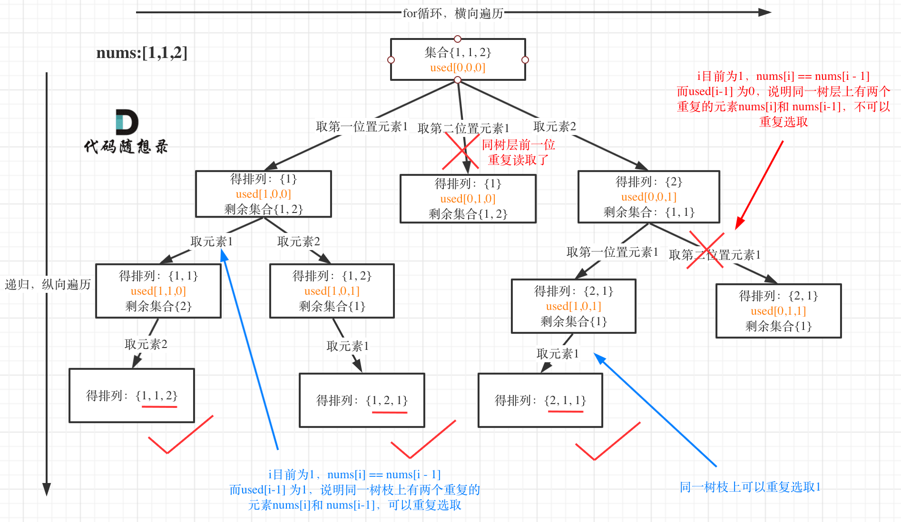
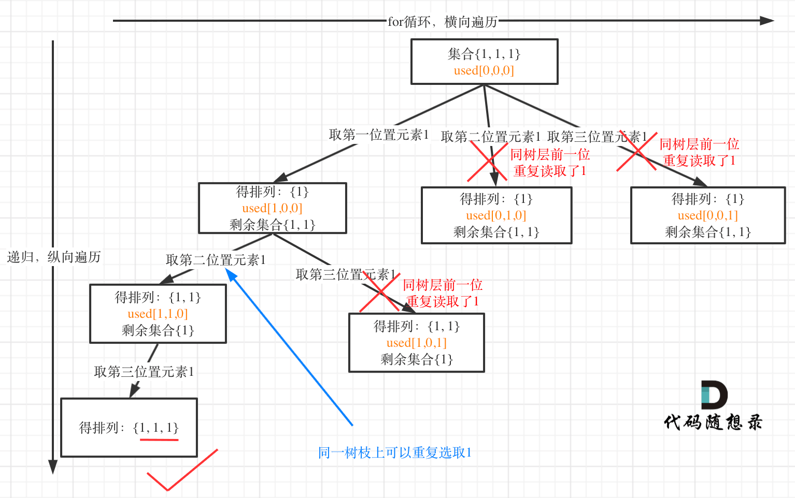
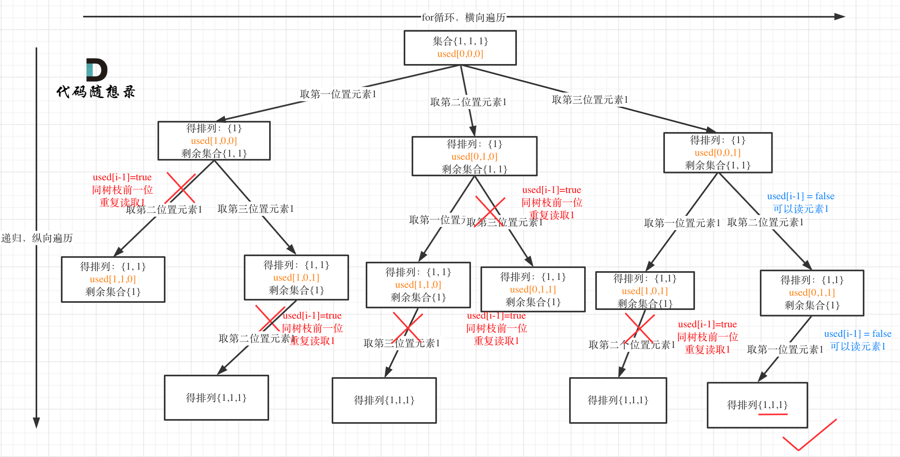

* [做專案（多個 C++、Java、Go、測試開發、前端專案）](https://www.programmercarl.com/other/kstar.html)
* [練習演算法（兩個月高強度學演算法）](https://www.programmercarl.com/xunlian/xunlianying.html)
* [背面試必考題（八股文）（40 天挑戰高頻面試題）](https://www.programmercarl.com/xunlian/bagu.html)


# 47.全排列 II

[LeetCode 題目連結](https://leetcode.com/problems/permutations-ii/)

給定一個可包含重複（duplicate）數字的序列（sequence） nums ，按任意順序回傳所有不重複的全排列（permutation）。

範例 1：

* 輸入：nums = [1,1,2]
* 輸出：
  [[1,1,2],
   [1,2,1],
   [2,1,1]]

範例 2：

* 輸入：nums = [1,2,3]
* 輸出：[[1,2,3],[1,3,2],[2,1,3],[2,3,1],[3,1,2],[3,2,1]]

提示：

* 1 <= nums.length <= 8
* -10 <= nums[i] <= 10

## 演算法公開課

**[《程式碼隨想錄》演算法影片公開課](https://programmercarl.com/other/gongkaike.html)：[回溯演算法（backtracking algorithm）求解全排列，如何去重？| LeetCode：47.全排列 II](https://www.bilibili.com/video/BV1R84y1i7Tm/)，相信結合影片再看本篇題解，更有助於大家對本題的理解**。


## 解題思路

這道題目和[46.全排列](./0046.全排列.md)的區別在於**給定一個可包含重複數字的序列**，要回傳**所有不重複的全排列**。

這裡又涉及到去重了。

在[40.組合總和II](./0040.組合總和II.md) 、[90.子集II](./0090.子集II.md)我們分別詳細講解了組合（combination）問題和子集（subset）問題如何去重。

那麼排列問題其實也是一樣的解法模式。

**還要強調的是去重一定要對元素（element）進行排序（sorting），這樣我們才方便透過相鄰的節點（node）來判斷是否重複使用了**。

我以範例中的 [1,1,2] 為例（為了方便舉例，已經排序）抽象為一棵樹（tree），去重過程如圖：



圖中我們對同一樹層，前一位（也就是 nums[i-1]）如果使用過，那麼就進行去重。

**一般來說：組合問題和排列問題是在樹狀結構（tree structure）的葉節點（leaf node）上收集結果，而子集問題就是取樹上所有節點的結果**。

在[46.全排列](./0046.全排列.md)中已經詳細講解了排列問題的寫法，在[40.組合總和II](./0040.組合總和II.md) 、[90.子集II](./0090.子集II.md)中詳細講解了去重的寫法，所以這次我就不用回溯三部曲分析了，直接給出程式碼，如下：


```CPP
class Solution {
private:
    vector<vector<int>> result;
    vector<int> path;
    void backtracking (vector<int>& nums, vector<bool>& used) {
        // 此時說明找到了一組
        if (path.size() == nums.size()) {
            result.push_back(path);
            return;
        }
        for (int i = 0; i < nums.size(); i++) {
            // used[i - 1] == true，說明同一樹枝 nums[i - 1] 使用過
            // used[i - 1] == false，說明同一樹層 nums[i - 1] 使用過
            // 如果同一樹層 nums[i - 1] 使用過則直接跳過
            if (i > 0 && nums[i] == nums[i - 1] && used[i - 1] == false) {
                continue;
            }
            if (used[i] == false) {
                used[i] = true;
                path.push_back(nums[i]);
                backtracking(nums, used);
                path.pop_back();
                used[i] = false;
            }
        }
    }
public:
    vector<vector<int>> permuteUnique(vector<int>& nums) {
        result.clear();
        path.clear();
        sort(nums.begin(), nums.end()); // 排序
        vector<bool> used(nums.size(), false);
        backtracking(nums, used);
        return result;
    }
};

// 時間複雜度：最差情況所有元素都是唯一的。複雜度和全排列 1 都是 O(n! * n)，對於 n 個元素一共有 n! 種排列方案。而對於每一個答案，我們需要 O(n) 去複製最終放到 result 陣列
// 空間複雜度：O(n) 回溯樹的深度取決於我們有多少個元素
```
* 時間複雜度（time complexity）: O(n! * n)
* 空間複雜度（space complexity）: O(n)

## 拓展

大家發現，去重最為關鍵的程式碼為：

```cpp
if (i > 0 && nums[i] == nums[i - 1] && used[i - 1] == false) {
    continue;
}
```

**如果改成 `used[i - 1] == true`，也是正確的!**，去重程式碼如下：

```cpp
if (i > 0 && nums[i] == nums[i - 1] && used[i - 1] == true) {
    continue;
}
```

這是為什麼呢，就是上面我剛說的，如果要對樹層中前一位去重，就用 `used[i - 1] == false`，如果要對樹枝前一位去重用 `used[i - 1] == true`。

**對於排列問題，樹層上去重和樹枝上去重，都是可以的，但是樹層上去重效率更高！**

這麼說是不是有點抽象？

來來來，我就用輸入: [1,1,1] 來舉一個例子。

樹層上去重(used[i - 1] == false)，的樹狀結構如下：



樹枝上去重（used[i - 1] == true）的樹狀結構如下：



大家應該很清晰的看到，樹層上對前一位去重非常徹底，效率很高，樹枝上對前一位去重雖然最後可以得到答案，但是做了很多無用搜尋。

## 總結

這道題其實還是用了我們之前講過的去重想法，但有意思的是，去重的程式碼中，這麼寫：

```cpp
if (i > 0 && nums[i] == nums[i - 1] && used[i - 1] == false) {
    continue;
}
```

和這麼寫：

```cpp
if (i > 0 && nums[i] == nums[i - 1] && used[i - 1] == true) {
    continue;
}
```

都是可以的，這也是很多同學做這道題目困惑的地方，知道 `used[i - 1] == false` 也行而 `used[i - 1] == true` 也行，但是就想不明白為啥。

所以我透過舉 [1,1,1] 的例子，把這兩個去重的邏輯分別抽象成樹狀結構，大家可以一目瞭然：為什麼兩種寫法都可以以及哪一種效率更高！

這裡可能大家又有疑惑，既然 `used[i - 1] == false` 也行而 `used[i - 1] == true` 也行，那為什麼還要寫這個條件（condition）呢？ 

直接這樣寫 不就完事了？ 

```cpp
if (i > 0 && nums[i] == nums[i - 1]) {
    continue;
}
```

其實並不行，一定要加上 `used[i - 1] == false` 或者 `used[i - 1] == true`，因為 used[i - 1] 要一直是 true 或者一直是 false 才可以，而不是一會是 true 一會又是 false。所以這個條件要寫上。


是不是豁然開朗了！！

## 其他語言版本

### Java

```java
class Solution {
    //存放結果
    List<List<Integer>> result = new ArrayList<>();
    //暫存結果
    List<Integer> path = new ArrayList<>();

    public List<List<Integer>> permuteUnique(int[] nums) {
        boolean[] used = new boolean[nums.length];
        Arrays.fill(used, false);
        Arrays.sort(nums);
        backTrack(nums, used);
        return result;
    }

    private void backTrack(int[] nums, boolean[] used) {
        if (path.size() == nums.length) {
            result.add(new ArrayList<>(path));
            return;
        }
        for (int i = 0; i < nums.length; i++) {
            // used[i - 1] == true，說明同一樹枝 nums[i - 1] 使用過
            // used[i - 1] == false，說明同一樹層 nums[i - 1] 使用過
            // 如果同一樹層 nums[i - 1] 使用過則直接跳過
            if (i > 0 && nums[i] == nums[i - 1] && used[i - 1] == false) {
                continue;
            }
            //如果同一樹枝 nums[i] 沒使用過開始處理
            if (used[i] == false) {
                used[i] = true;//標記同一樹枝 nums[i] 使用過，防止同一樹枝重複使用
                path.add(nums[i]);
                backTrack(nums, used);
                path.remove(path.size() - 1);//回溯，說明同一樹層 nums[i] 使用過，防止下一樹層重複
                used[i] = false;//回溯
            }
        }
    }
}
```

Python

```python
class Solution:
    def permuteUnique(self, nums):
        nums.sort()  # 排序
        result = []
        self.backtracking(nums, [], [False] * len(nums), result)
        return result

    def backtracking(self, nums, path, used, result):
        if len(path) == len(nums):
            result.append(path[:])
            return
        for i in range(len(nums)):
            if (i > 0 and nums[i] == nums[i - 1] and not used[i - 1]) or used[i]:
                continue
            used[i] = True
            path.append(nums[i])
            self.backtracking(nums, path, used, result)
            path.pop()
            used[i] = False

```

### Go

```go
var (
    res [][]int
    path  []int
    st    []bool   // state 的縮寫
)
func permuteUnique(nums []int) [][]int {
    res, path = make([][]int, 0), make([]int, 0, len(nums))
    st = make([]bool, len(nums))
    sort.Ints(nums)
    dfs(nums, 0)
    return res
}

func dfs(nums []int, cur int) {
    if cur == len(nums) {
        tmp := make([]int, len(path))
        copy(tmp, path)
        res = append(res, tmp)
    }
    for i := 0; i < len(nums); i++ {
        if i != 0 && nums[i] == nums[i-1] && !st[i-1] {  // 去重，用 st 來判別是深度還是廣度
            continue
        }
        if !st[i] {
            path = append(path, nums[i])
            st[i] = true
            dfs(nums, cur + 1)
            st[i] = false
            path = path[:len(path)-1]
        }
    }
}
```

### JavaScript

```javascript
var permuteUnique = function (nums) {
    nums.sort((a, b) => {
        return a - b
    })
    let result = []
    let path = []

    function backtracing( used) {
        if (path.length === nums.length) {
            result.push([...path])
            return
        }
        for (let i = 0; i < nums.length; i++) {
            if (i > 0 && nums[i] === nums[i - 1] && !used[i - 1]) {
                continue
            }
            if (!used[i]) {
                used[i] = true
                path.push(nums[i])
                backtracing(used)
                path.pop()
                used[i] = false
            }


        }
    }
    backtracing([])
    return result
};

```

### TypeScript

```typescript
function permuteUnique(nums: number[]): number[][] {
    nums.sort((a, b) => a - b);
    const resArr: number[][] = [];
    const usedArr: boolean[] = new Array(nums.length).fill(false);
    backTracking(nums, []);
    return resArr;
    function backTracking(nums: number[], route: number[]): void {
        if (route.length === nums.length) {
            resArr.push([...route]);
            return;
        }
        for (let i = 0, length = nums.length; i < length; i++) {
            if (i > 0 && nums[i] === nums[i - 1] && usedArr[i - 1] === false) continue;
            if (usedArr[i] === false) {
                route.push(nums[i]);
                usedArr[i] = true;
                backTracking(nums, route);
                usedArr[i] = false;
                route.pop();
            }
        }
    }
};
```

### Swift

```swift
func permuteUnique(_ nums: [Int]) -> [[Int]] {
    let nums = nums.sorted() // 先排序，以方便相鄰元素去重
    var result = [[Int]]()
    var path = [Int]()
    var used = [Bool](repeating: false, count: nums.count)
    func backtracking() {
        if path.count == nums.count {
            result.append(path)
            return
        }

        for i in 0 ..< nums.count {
            // !used[i - 1] 表示同一樹層 nums[i - 1] 使用過，直接跳過，這一步很關鍵！
            if i > 0, nums[i] == nums[i - 1], !used[i - 1] { continue }
            if used[i] { continue }
            used[i] = true
            path.append(nums[i])
            backtracking()
            // 回溯
            path.removeLast()
            used[i] = false
        }
    }
    backtracking()
    return result
}
```

### Rust

```Rust
impl Solution {
    fn backtracking(result: &mut Vec<Vec<i32>>, path: &mut Vec<i32>, nums: &Vec<i32>, used: &mut Vec<bool>) {
        let len = nums.len();
        if path.len() == len {
            result.push(path.clone());
            return;
        }
        for i in 0..len {
            if i > 0 && nums[i] == nums[i - 1] && used[i - 1] == false { continue; }
            if used[i] == false {
                used[i] = true;
                path.push(nums[i]);
                Self::backtracking(result, path, nums, used);
                path.pop();
                used[i] = false;
            }
        }
    }

    pub fn permute_unique(nums: Vec<i32>) -> Vec<Vec<i32>> {
        let mut result: Vec<Vec<i32>> = Vec::new();
        let mut path: Vec<i32> = Vec::new();
        let mut used = vec![false; nums.len()];
        let mut nums= nums;
        nums.sort();
        Self::backtracking(&mut result, &mut path, &nums, &mut used);
        result
    }
}
```

### C

```c
//暫存陣列
int *path;
//回傳陣列
int **ans;
int *used;
int pathTop, ansTop;

//複製 path 到 ans 中
void copyPath() {
    int *tempPath = (int*)malloc(sizeof(int) * pathTop);
    int i;
    for(i = 0; i < pathTop; ++i) {
        tempPath[i] = path[i];
    }
    ans[ansTop++] = tempPath;
}

void backTracking(int* used, int *nums, int numsSize) {
    //若 path 中元素個數等於 numsSize，將 path 複製入 ans 陣列中
    if(pathTop == numsSize)
        copyPath();
    int i;
    for(i = 0; i < numsSize; i++) {
        //若目前元素已被使用
        //或前一位元素與目前元素值相同但並未被使用
        //則跳過此分支
        if(used[i] || (i != 0 && nums[i] == nums[i-1] && used[i-1] == 0))
            continue;

        //將目前元素的使用情況設為 True
        used[i] = 1;
        path[pathTop++] = nums[i];
        backTracking(used, nums, numsSize);
        used[i] = 0;
        --pathTop;
    }
}

int cmp(void* elem1, void* elem2) {
    return *((int*)elem1) - *((int*)elem2);
}

int** permuteUnique(int* nums, int numsSize, int* returnSize, int** returnColumnSizes){
    //排序陣列
    qsort(nums, numsSize, sizeof(int), cmp);
    //初始化輔助變數
    pathTop = ansTop = 0;
    path = (int*)malloc(sizeof(int) * numsSize);
    ans = (int**)malloc(sizeof(int*) * 1000);
    //初始化 used 輔助陣列
    used = (int*)malloc(sizeof(int) * numsSize);
    int i;
    for(i = 0; i < numsSize; i++) {
        used[i] = 0;
    }

    backTracking(used, nums, numsSize);

    //設定回傳的陣列的長度
    *returnSize = ansTop;
    *returnColumnSizes = (int*)malloc(sizeof(int) * ansTop);
    int z;
    for(z = 0; z < ansTop; z++) {
        (*returnColumnSizes)[z] = numsSize;
    }
    return ans;
}
```

### Scala

```scala
object Solution {
  import scala.collection.mutable
  def permuteUnique(nums: Array[Int]): List[List[Int]] = {
    var result = mutable.ListBuffer[List[Int]]()
    var path = mutable.ListBuffer[Int]()
    var num = nums.sorted // 首先對資料進行排序

    def backtracking(used: Array[Boolean]): Unit = {
      if (path.size == num.size) {
        // 如果 path 的 size 等於 num 了，那麼可以加入到結果集
        result.append(path.toList)
        return
      }
      // 迴圈守衛，目前元素沒被使用過就進入迴圈體
      for (i <- num.indices if used(i) == false) {
        // 目前索引為 0，不存在和前一個數字相等可以進入回溯
        // 目前索引值和上一個索引不相等，可以回溯
        // 前一個索引對應的值沒有被選，可以回溯
        // 因為 Scala 沒有 continue，只能將邏輯反過來寫
        if (i == 0 || (i > 0 && num(i) != num(i - 1)) || used(i-1) == false) {
          used(i) = true
          path.append(num(i))
          backtracking(used)
          path.remove(path.size - 1)
          used(i) = false
        }
      }
    }

    backtracking(new Array[Boolean](nums.length))
    result.toList
  }
}
```
### C#
```csharp
public class Solution
{
    public List<IList<int>> res = new List<IList<int>>();
    public List<int> path = new List<int>();
    public IList<IList<int>> PermuteUnique(int[] nums)
    {
        Array.Sort(nums);
        BackTracking(nums, new bool[nums.Length]);
        return res;
    }
    public void BackTracking(int[] nums, bool[] used)
    {
        if (nums.Length == path.Count)
        {
            res.Add(new List<int>(path));
            return;
        }
        for (int i = 0; i < nums.Length; i++)
        {
            if (i > 0 && nums[i] == nums[i - 1] && used[i - 1] == false) continue;
            if (used[i]) continue;
            path.Add(nums[i]);
            used[i] = true;
            BackTracking(nums, used);
            path.RemoveAt(path.Count - 1);
            used[i] = false;
        }
    }
}
```


