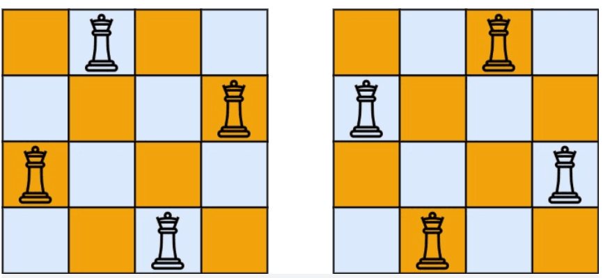
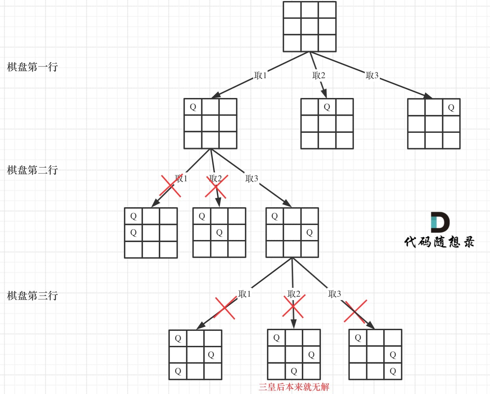

* [做專案（多個 C++、Java、Go、測試開發、前端專案）](https://www.programmercarl.com/other/kstar.html)
* [練習演算法（兩個月高強度學演算法）](https://www.programmercarl.com/xunlian/xunlianying.html)
* [背面試必考題（八股文）（40 天挑戰高頻面試題）](https://www.programmercarl.com/xunlian/bagu.html)


# 51. N皇后

[LeetCode 題目連結](https://leetcode.cn/problems/n-queens/)

n 皇后問題（n queens）研究的是如何將 n 個皇后放置在 n×n 的棋盤上，並且使皇后彼此之間不能相互攻擊。

給你一個整數（integer） n ，回傳所有不同的 n 皇后問題的解決方案。

每一種解法包含一個不同的 n 皇后問題的棋子放置方案，該方案中 'Q' 和 '.' 分別代表了皇后和空位。

範例 1：



* 輸入：n = 4
* 輸出：[[".Q..","...Q","Q...","..Q."],["..Q.","Q...","...Q",".Q.."]]
* 解釋：如上圖所示，4 皇后問題存在兩個不同的解法。

範例 2：

* 輸入：n = 1
* 輸出：[["Q"]]

## 演算法公開課

**[《代碼隨想錄》演算法影片公開課](https://programmercarl.com/other/gongkaike.html)：[這就是傳說中的 N 皇后？ 回溯演算法（backtracking algorithm）安排！| LeetCode：51.N皇后](https://www.bilibili.com/video/BV1Rd4y1c7Bq/)，相信結合影片再看本篇題解，更有助於大家對本題的理解**。


## 解題思路

都知道 n 皇后問題是回溯演算法解決的經典問題，但是用回溯（backtracking）解決多了組合（combination）、切割、子集（subset）、排列（permutation）問題之後，遇到這種二維（two-dimensional）矩陣（matrix）還會有點不知所措。

首先來看一下皇后們的約束條件（condition）：

1. 不能同列（row）
2. 不能同行（column）
3. 不能同斜線

確定完約束條件，來看看究竟要怎麼去搜尋皇后們的位置，其實搜尋皇后的位置，可以抽象為一棵樹（tree）。

下面我用一個 3 * 3 的棋盤，將搜尋過程抽象為一棵樹，如圖：


從圖中，可以看出，二維矩陣中矩陣的高就是這棵樹的高度（height），矩陣的寬就是樹狀結構（tree structure）中每一個節點（node）的寬度。

那麼我們用皇后們的約束條件，來回溯搜尋這棵樹，**只要搜尋到了樹的葉節點（leaf node），說明就找到了皇后們的合理位置了**。

### 回溯三部曲

按照我總結的如下回溯模板（template），我們來依序分析：

```
void backtracking(參數) {
    if (終止條件) {
        存放結果;
        return;
    }
    for (選擇：本層集合中元素（樹中節點孩子的數量就是集合的大小）) {
        處理節點;
        backtracking(路徑，選擇列表); // 遞迴
        回溯，撤銷處理結果
    }
}
```

* 遞迴函數（recursive function）參數（parameter）

我依然是定義全域變數（global variable）二維（2D）陣列（array） result 來記錄最終結果。

參數 n 是棋盤的大小，然後用 row 來記錄目前遍歷（traversal）到棋盤的第幾層了。

程式碼如下：

```cpp
vector<vector<string>> result;
void backtracking(int n, int row, vector<string>& chessboard) {
```

* 遞迴（recursion）終止條件（termination condition）

在如下樹狀結構中：



可以看出，當遞迴到棋盤最底層（也就是葉節點）的時候，就可以收集結果並回傳了。

程式碼如下：

```cpp
if (row == n) {
    result.push_back(chessboard);
    return;
}
```

* 單層搜尋的邏輯

遞迴深度（depth）就是 row 控制棋盤的列，每一層裡 for 迴圈（for-loop）的 col 控制棋盤的行，一列一行，確定了放置皇后的位置。

每次都是要從新的一列的起始位置開始搜，所以都是從 0 開始。

程式碼如下：

```cpp
for (int col = 0; col < n; col++) {
    if (isValid(row, col, chessboard, n)) { // 驗證合法就可以放
        chessboard[row][col] = 'Q'; // 放置皇后
        backtracking(n, row + 1, chessboard);
        chessboard[row][col] = '.'; // 回溯，撤銷皇后
    }
}
```

* 驗證棋盤是否合法

按照如下標準去重：

1. 不能同列
2. 不能同行
3. 不能同斜線 （45 度和 135 度角）

程式碼如下：

```CPP
bool isValid(int row, int col, vector<string>& chessboard, int n) {
    // 檢查行
    for (int i = 0; i < row; i++) { // 這是一個修剪法
        if (chessboard[i][col] == 'Q') {
            return false;
        }
    }
    // 檢查 45 度角是否有皇后
    for (int i = row - 1, j = col - 1; i >=0 && j >= 0; i--, j--) {
        if (chessboard[i][j] == 'Q') {
            return false;
        }
    }
    // 檢查 135 度角是否有皇后
    for(int i = row - 1, j = col + 1; i >= 0 && j < n; i--, j++) {
        if (chessboard[i][j] == 'Q') {
            return false;
        }
    }
    return true;
}
```

在這份程式碼中，細心的同學可以發現為什麼沒有在同列進行檢查呢？

因為在單層搜尋的過程中，每一層遞迴，只會選 for 迴圈（也就是同一列）裡的一個元素（element），所以不用去重了。

那麼按照這個模板不難寫出如下 C++ 程式碼：

```CPP
class Solution {
private:
vector<vector<string>> result;
// n 為輸入的棋盤大小
// row 是目前遞迴到棋盤的第幾列了
void backtracking(int n, int row, vector<string>& chessboard) {
    if (row == n) {
        result.push_back(chessboard);
        return;
    }
    for (int col = 0; col < n; col++) {
        if (isValid(row, col, chessboard, n)) { // 驗證合法就可以放
            chessboard[row][col] = 'Q'; // 放置皇后
            backtracking(n, row + 1, chessboard);
            chessboard[row][col] = '.'; // 回溯，撤銷皇后
        }
    }
}
bool isValid(int row, int col, vector<string>& chessboard, int n) {
    // 檢查行
    for (int i = 0; i < row; i++) { // 這是一個修剪法
        if (chessboard[i][col] == 'Q') {
            return false;
        }
    }
    // 檢查 45 度角是否有皇后
    for (int i = row - 1, j = col - 1; i >=0 && j >= 0; i--, j--) {
        if (chessboard[i][j] == 'Q') {
            return false;
        }
    }
    // 檢查 135 度角是否有皇后
    for(int i = row - 1, j = col + 1; i >= 0 && j < n; i--, j++) {
        if (chessboard[i][j] == 'Q') {
            return false;
        }
    }
    return true;
}
public:
    vector<vector<string>> solveNQueens(int n) {
        result.clear();
        std::vector<std::string> chessboard(n, std::string(n, '.'));
        backtracking(n, 0, chessboard);
        return result;
    }
};
```
* 時間複雜性（time complexity）: O(n!)
* 空間複雜度（space complexity）: O(n)


可以看出，除了驗證棋盤合法性的程式碼，剩下的部分就是按照回溯法模板來的。

## 總結

本題是我們解決棋盤問題的第一道題目。

如果從來沒有接觸過 N 皇后問題的同學看著這樣的題會感覺無從下手，可能知道要用回溯法，但也不知道該怎麼去搜。

**這裡我明確給出了棋盤的寬度就是 for 迴圈的長度，遞迴的深度就是棋盤的高度，這樣就可以套進回溯法的模板裡了**。

大家可以在仔細體會體會！


## 其他語言補充

### Java 

```java
class Solution {
    List<List<String>> res = new ArrayList<>();

    public List<List<String>> solveNQueens(int n) {
        char[][] chessboard = new char[n][n];
        for (char[] c : chessboard) {
            Arrays.fill(c, '.');
        }
        backTrack(n, 0, chessboard);
        return res;
    }


    public void backTrack(int n, int row, char[][] chessboard) {
        if (row == n) {
            res.add(Array2List(chessboard));
            return;
        }

        for (int col = 0;col < n; ++col) {
            if (isValid (row, col, n, chessboard)) {
                chessboard[row][col] = 'Q';
                backTrack(n, row+1, chessboard);
                chessboard[row][col] = '.';
            }
        }

    }


    public List Array2List(char[][] chessboard) {
        List<String> list = new ArrayList<>();

        for (char[] c : chessboard) {
            list.add(String.copyValueOf(c));
        }
        return list;
    }


    public boolean isValid(int row, int col, int n, char[][] chessboard) {
        // 檢查行
        for (int i=0; i<row; ++i) { // 相當於修剪法
            if (chessboard[i][col] == 'Q') {
                return false;
            }
        }

        // 檢查 45 度對角線
        for (int i=row-1, j=col-1; i>=0 && j>=0; i--, j--) {
            if (chessboard[i][j] == 'Q') {
                return false;
            }
        }

        // 檢查 135 度對角線
        for (int i=row-1, j=col+1; i>=0 && j<=n-1; i--, j++) {
            if (chessboard[i][j] == 'Q') {
                return false;
            }
        }
        return true;
    }
}
```

```java
// 方法 2：使用 boolean 陣列表示已經占用的直(斜)線
class Solution {
    List<List<String>> res = new ArrayList<>();
    boolean[] usedCol, usedDiag45, usedDiag135;    // boolean 陣列中的每個元素代表一條直(斜)線
    public List<List<String>> solveNQueens(int n) {
        usedCol = new boolean[n];                  // 行方向的直線條數為 n
        usedDiag45 = new boolean[2 * n - 1];       // 45° 方向的斜線條數為 2 * n - 1
        usedDiag135 = new boolean[2 * n - 1];      // 135° 方向的斜線條數為 2 * n - 1
		//用於收集結果, 元素的 index 表示棋盤的 row，元素的 value 代表棋盤的 column
        int[] board = new int[n];
        backTracking(board, n, 0);
        return res;
    }
    private void backTracking(int[] board, int n, int row) {
        if (row == n) {
            //收集結果
            List<String> temp = new ArrayList<>();
            for (int i : board) {
                char[] str = new char[n];
                Arrays.fill(str, '.');
                str[i] = 'Q';
                temp.add(new String(str));
            }
            res.add(temp);
            return;
        }

        for (int col = 0; col < n; col++) {
            if (usedCol[col] | usedDiag45[row + col] | usedDiag135[row - col + n - 1]) {
                continue;
            }
            board[row] = col;
			// 標記該行出現過
            usedCol[col] = true;
			// 同一 45° 斜線上元素的 row + col 為定值, 且各不相同
            usedDiag45[row + col] = true;
			// 同一 135° 斜線上元素 row - col 為定值, 且各不相同
			// row - col 值有正有負, 加 n - 1 是為了對齊零點
            usedDiag135[row - col + n - 1] = true;
            // 遞迴
            backTracking(board, n, row + 1);
            usedCol[col] = false;
            usedDiag45[row + col] = false;
            usedDiag135[row - col + n - 1] = false;
        }
    }
}
```

### Python 

```python
class Solution:
    def solveNQueens(self, n: int) -> List[List[str]]:
        result = []  # 儲存最終結果的二維字串陣列

        chessboard = ['.' * n for _ in range(n)]  # 初始化棋盤
        self.backtracking(n, 0, chessboard, result)  # 回溯求解
        return [[''.join(row) for row in solution] for solution in result]  # 回傳結果集

    def backtracking(self, n: int, row: int, chessboard: List[str], result: List[List[str]]) -> None:
        if row == n:
            result.append(chessboard[:])  # 棋盤填滿，將目前解加入結果集
            return

        for col in range(n):
            if self.isValid(row, col, chessboard):
                chessboard[row] = chessboard[row][:col] + 'Q' + chessboard[row][col+1:]  # 放置皇后
                self.backtracking(n, row + 1, chessboard, result)  # 遞迴到下一列
                chessboard[row] = chessboard[row][:col] + '.' + chessboard[row][col+1:]  # 回溯，撤銷目前位置的皇后

    def isValid(self, row: int, col: int, chessboard: List[str]) -> bool:
        # 檢查行
        for i in range(row):
            if chessboard[i][col] == 'Q':
                return False  # 目前行已經存在皇后，不合法

        # 檢查 45 度角是否有皇后
        i, j = row - 1, col - 1
        while i >= 0 and j >= 0:
            if chessboard[i][j] == 'Q':
                return False  # 左上方向已經存在皇后，不合法
            i -= 1
            j -= 1

        # 檢查 135 度角是否有皇后
        i, j = row - 1, col + 1
        while i >= 0 and j < len(chessboard):
            if chessboard[i][j] == 'Q':
                return False  # 右上方向已經存在皇后，不合法
            i -= 1
            j += 1

        return True  # 目前位置合法

```


### Go 
```Go
func solveNQueens(n int) [][]string {
    var res [][]string
	chessboard := make([][]string, n)
	for i := 0; i < n; i++ {
		chessboard[i] = make([]string, n)
	}
	for i := 0; i < n; i++ {
		for j := 0; j < n; j++ {
			chessboard[i][j] = "."
		}
	}
	var backtrack func(int)
	backtrack = func(row int) {
		if row == n {
			temp := make([]string, n)
			for i, rowStr := range chessboard {
				temp[i] = strings.Join(rowStr, "")
			}
			res = append(res, temp)
			return
		}
		for i := 0; i < n; i++ {
			if isValid(n, row, i, chessboard) {
				chessboard[row][i] = "Q"
				backtrack(row + 1)
				chessboard[row][i] = "."
			}
		}
	}
	backtrack(0)
	return res
}

func isValid(n, row, col int, chessboard [][]string) bool {
	for i := 0; i < row; i++ {
		if chessboard[i][col] == "Q" {
			return false
		}
	}
	for i, j := row-1, col-1; i >= 0 && j >= 0; i, j = i-1, j-1 {
		if chessboard[i][j] == "Q" {
			return false
		}
	}
	for i, j := row-1, col+1; i >= 0 && j < n; i, j = i-1, j+1 {
		if chessboard[i][j] == "Q" {
			return false
		}
	}
	return true
}
```


### JavaScript 
```Javascript
/**
 * @param {number} n
 * @return {string[][]}
 */
var solveNQueens = function (n) {
	const ans = [];
	const path = [];
	const matrix = new Array(n).fill(0).map(() => new Array(n).fill("."));
	// 判斷是否能相互攻擊
	const canAttack = (matrix, row, col) => {
		let i;
		let j;
		// 判斷正上方和正下方是否有皇后
		for (i = 0, j = col; i < n; i++) {
			if (matrix[i][j] === "Q") {
				return true;
			}
		}
		// 判斷正左邊和正右邊是否有皇后
		for (i = row, j = 0; j < n; j++) {
			if (matrix[i][j] === "Q") {
				return true;
			}
		}
		// 判斷左上方是否有皇后
		for (i = row - 1, j = col - 1; i >= 0 && j >= 0; i--, j--) {
			if (matrix[i][j] === "Q") {
				return true;
			}
		}
         // 判斷右上方是否有皇后
		for (i = row - 1, j = col + 1; i >= 0 && j < n; i--, j++) {
			if (matrix[i][j] === "Q") {
				return true;
			}
		}
		return false;
	};
	const backtrack = (matrix, row, col) => {
		if (path.length === matrix.length) {
			ans.push(path.slice());
			return;
		}
		for (let i = row; i < matrix.length; i++) {
			for (let j = col; j < matrix.length; j++) {
				// 目前位置會導致互相攻擊 繼續下一輪搜尋
				if (canAttack(matrix, i, j)) {
					continue;
				}
				matrix[i][j] = "Q";
				path.push(matrix[i].join(""));
				// 另起一列搜尋 同一列只能有一個皇后
				backtrack(matrix, i + 1, 0);
				matrix[i][j] = ".";
				path.pop();
			}
		}
	};
	backtrack(matrix, 0, 0);
	return ans;
};
```

### TypeScript

```typescript
function solveNQueens(n: number): string[][] {
    const board: string[][] = new Array(n).fill(0).map(_ => new Array(n).fill('.'));
    const resArr: string[][] = [];
    backTracking(n, 0, board);
    return resArr;
    function backTracking(n: number, rowNum: number, board: string[][]): void {
        if (rowNum === n) {
            resArr.push(transformBoard(board));
            return;
        }
        for (let i = 0; i < n; i++) {
            if (isValid(i, rowNum, board) === true) {
                board[rowNum][i] = 'Q';
                backTracking(n, rowNum + 1, board);
                board[rowNum][i] = '.';
            }
        }
    }
};
function isValid(col: number, row: number, board: string[][]): boolean {
    const n: number = board.length;
    if (col < 0 || col >= n || row < 0 || row >= n) return false;
    // 檢查行
    for (let row of board) {
        if (row[col] === 'Q') return false;
    }
    // 檢查 45 度方向
    let x: number = col,
        y: number = row;
    while (y >= 0 && x < n) {
        if (board[y--][x++] === 'Q') return false;
    }
    // 檢查 135 度方向
    x = col;
    y = row;
    while (x >= 0 && y >= 0) {
        if (board[y--][x--] === 'Q') return false;
    }
    return true;
}
function transformBoard(board: string[][]): string[] {
    const resArr = [];
    for (let row of board) {
        resArr.push(row.join(''));
    }
    return resArr;
}
```

### Swift

```swift
func solveNQueens(_ n: Int) -> [[String]] {
    var result = [[String]]()
    // 棋盤，使用 Character 的二維陣列，以便於更新元素
    var chessboard = [[Character]](repeating: [Character](repeating: ".", count: n), count: n)
    // 檢查棋盤是否符合 N 皇后
    func isVaild(row: Int, col: Int) -> Bool {
        // 檢查行
        for i in 0 ..< row {
            if chessboard[i][col] == "Q" { return false }
        }

        var i, j: Int
        // 檢查 45 度
        i = row - 1
        j = col - 1
        while i >= 0, j >= 0 {
            if chessboard[i][j] == "Q" { return false }
            i -= 1
            j -= 1
        }
        // 檢查 135 度
        i = row - 1
        j = col + 1
        while i >= 0, j < n {
            if chessboard[i][j] == "Q" { return false }
            i -= 1
            j += 1
        }

        return true
    }
    func backtracking(row: Int) {
        if row == n {
            result.append(chessboard.map { String($0) })
        }

        for col in 0 ..< n {
            guard isVaild(row: row, col: col) else { continue }
            chessboard[row][col] = "Q" // 放置皇后
            backtracking(row: row + 1)
            chessboard[row][col] = "." // 回溯
        }
    }
    backtracking(row: 0)
    return result
}
```

### Rust

```Rust
impl Solution {
    fn is_valid(row: usize, col: usize, chessboard: &mut Vec<Vec<char>>, n: usize) -> bool {
        let mut i = 0 as usize;
        while i < row { 
            if chessboard[i][col] == 'Q' { return false; }
            i += 1;
        }
        let (mut i, mut j) = (row as i32 - 1, col as i32 - 1);
        while i >= 0 && j >= 0 {
            if chessboard[i as usize][j as usize] == 'Q' { return false; }
            i -= 1;
            j -= 1;
        }
        let (mut i, mut j) = (row as i32 - 1, col as i32 + 1);
        while i >= 0 && j < n as i32 {
            if chessboard[i as usize][j as usize] == 'Q' { return false; }
            i -= 1;
            j += 1;
        }
        return true;
    }
    fn backtracking(result: &mut Vec<Vec<String>>, n: usize, row: usize, chessboard: &mut Vec<Vec<char>>) {
        if row == n {
            let mut chessboard_clone: Vec<String> = Vec::new();
            for i in chessboard {
                chessboard_clone.push(i.iter().collect::<String>());
            }
            result.push(chessboard_clone);
            return;
        }
        for col in 0..n {
            if Self::is_valid(row, col, chessboard, n) {
                chessboard[row][col] = 'Q';
                Self::backtracking(result, n, row + 1, chessboard);
                chessboard[row][col] = '.';
            }
        }
    }
    pub fn solve_n_queens(n: i32) -> Vec<Vec<String>> {
        let mut result: Vec<Vec<String>> = Vec::new();
        let mut chessboard: Vec<Vec<char>> = vec![vec!['.'; n as usize]; n as usize];
        Self::backtracking(&mut result, n as usize, 0, &mut chessboard);
        result
    }
}
```

### C
```c
char ***ans;
char **path;
int ansTop, pathTop;
//將 path 中元素複製到 ans 中
void copyPath(int n) {
    char **tempPath = (char**)malloc(sizeof(char*) * pathTop);
    int i;
    for(i = 0; i < pathTop; ++i) {
        tempPath[i] = (char*)malloc(sizeof(char) * n + 1);
        int j;
        for(j = 0; j < n; ++j)
            tempPath[i][j] = path[i][j];
        tempPath[i][j] = '\0';

    }
    ans[ansTop++] = tempPath;
}

//判斷目前位置是否有效（是否不被其他皇后影響）
int isValid(int x, int y, int n) {
    int i, j;
    //檢查同一列以及同一行是否有效
    for(i = 0; i < n; ++i) {
        if(path[y][i] == 'Q' || path[i][x] == 'Q')
            return 0;
    }
    //下面兩個 for 迴圈檢查斜角 45 度是否有效
    i = y - 1;
    j = x - 1;
    while(i >= 0 && j >= 0) {
        if(path[i][j] == 'Q')
            return 0;
        --i, --j;
    }

    i = y + 1;
    j = x + 1;
    while(i < n && j < n) {
        if(path[i][j] == 'Q')
            return 0;
        ++i, ++j;
    }

    //下面兩個 for 迴圈檢查 135 度是否有效
    i = y - 1;
    j = x + 1;
    while(i >= 0 && j < n) {
        if(path[i][j] == 'Q')
            return 0;
        --i, ++j;
    }

    i = y + 1;
    j = x -1;
    while(j >= 0 && i < n) {
        if(path[i][j] == 'Q')
            return 0;
        ++i, --j;
    }
    return 1;
}

void backTracking(int n, int depth) {
    //若 path 中有四個元素，將其複製到 ans 中。從目前層回傳
    if(pathTop == n) {
        copyPath(n);
        return;
    }

    //遍歷橫向棋盤
    int i;
    for(i = 0; i < n; ++i) {
        //若目前位置有效
        if(isValid(i, depth, n)) {
            //在目前位置放置皇后
            path[depth][i] = 'Q';
            //path 中元素數量 +1
            ++pathTop;

            backTracking(n, depth + 1);
            //進行回溯
            path[depth][i] = '.';
            //path 中元素數量 -1
            --pathTop;
        }
    }
}

//初始化儲存 char* 陣列 path，將 path 中所有元素設為 '.'
void initPath(int n) {
    int i, j;
    for(i = 0; i < n; i++) {
        //為 path 中每個 char* 配置空間
        path[i] = (char*)malloc(sizeof(char) * n + 1);
        //將 path 中所有字元設為 '.'
        for(j = 0; j < n; j++)
            path[i][j] = '.';
        //在每個字串結尾加入 '\0'
        path[i][j] = '\0';
    }
}

char *** solveNQueens(int n, int* returnSize, int** returnColumnSizes){
    //初始化輔助變數
    ans = (char***)malloc(sizeof(char**) * 400);
    path = (char**)malloc(sizeof(char*) * n);
    ansTop = pathTop = 0;

    //初始化 path 陣列
    initPath(n);
    backTracking(n, 0);

    //設定回傳陣列大小
    *returnSize = ansTop;
    int i; 
    *returnColumnSizes = (int*)malloc(sizeof(int) * ansTop);
    for(i = 0; i < ansTop; ++i) {
        (*returnColumnSizes)[i] = n;
    }
    return ans;
}
```

### Scala

```scala
object Solution {
  import scala.collection.mutable
  def solveNQueens(n: Int): List[List[String]] = {
    var result = mutable.ListBuffer[List[String]]()

    def judge(x: Int, y: Int, maze: Array[Array[Boolean]]): Boolean = {
      // 正上方
      var xx = x
      while (xx >= 0) {
        if (maze(xx)(y)) return false
        xx -= 1
      }
      // 左邊
      var yy = y
      while (yy >= 0) {
        if (maze(x)(yy)) return false
        yy -= 1
      }
      // 左上方
      xx = x
      yy = y
      while (xx >= 0 && yy >= 0) {
        if (maze(xx)(yy)) return false
        xx -= 1
        yy -= 1
      }
      xx = x
      yy = y
      // 右上方
      while (xx >= 0 && yy < n) {
        if (maze(xx)(yy)) return false
        xx -= 1
        yy += 1
      }
      true
    }

    def backtracking(row: Int, maze: Array[Array[Boolean]]): Unit = {
      if (row == n) {
        // 將結果轉換為題目所需要的形式
        var path = mutable.ListBuffer[String]()
        for (x <- maze) {
          var tmp = mutable.ListBuffer[String]()
          for (y <- x) {
            if (y == true) tmp.append("Q")
            else tmp.append(".")
          }
          path.append(tmp.mkString)
        }
        result.append(path.toList)
        return
      }

      for (j <- 0 until n) {
        // 判斷這個位置是否可以放置皇后
        if (judge(row, j, maze)) {
          maze(row)(j) = true
          backtracking(row + 1, maze)
          maze(row)(j) = false
        }
      }
    }

    backtracking(0, Array.ofDim[Boolean](n, n))
    result.toList
  }
}
```
### C#
```csharp
public class Solution
{
    public List<IList<string>> res = new();
    public IList<IList<string>> SolveNQueens(int n)
    {
        char[][] chessBoard = new char[n][];
        for (int i = 0; i < n; i++)
        {
            chessBoard[i] = new char[n];
            for (int j = 0; j < n; j++)
            {
                chessBoard[i][j] = '.';
            }
        }
        BackTracking(n, 0, chessBoard);
        return res;
    }
    public void BackTracking(int n, int row, char[][] chessBoard)
    {
        if (row == n)
        {
            res.Add(chessBoard.Select(x => new string(x)).ToList());
            return;
        }
        for (int col = 0; col < n; col++)
        {
            if (IsValid(row, col, chessBoard, n))
            {
                chessBoard[row][col] = 'Q';
                BackTracking(n, row + 1, chessBoard);
                chessBoard[row][col] = '.';
            }
        }
    }
    public bool IsValid(int row, int col, char[][] chessBoard, int n)
    {
        for (int i = 0; i < row; i++)
        {
            if (chessBoard[i][col] == 'Q') return false;
        }
        for (int i = row - 1, j = col - 1; i >= 0 && j >= 0; i--, j--)
        {
            if (chessBoard[i][j] == 'Q') return false;
        }
        for (int i = row - 1, j = col + 1; i >= 0 && j < n; i--, j++)
        {
            if (chessBoard[i][j] == 'Q') return false;
        }
        return true;
    }
}
```


