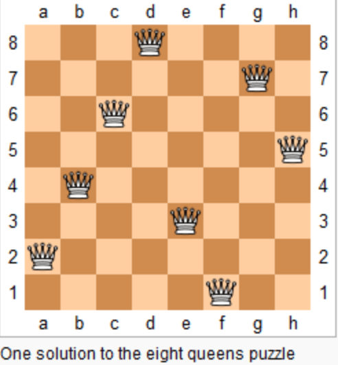

* [做專案（多個 C++、Java、Go、測試開發、前端專案）](https://www.programmercarl.com/other/kstar.html)
* [練習演算法（兩個月高強度學演算法）](https://www.programmercarl.com/xunlian/xunlianying.html)
* [背面試必考題（八股文）（40 天挑戰高頻面試題）](https://www.programmercarl.com/xunlian/bagu.html)


# 52. N皇后II

題目連結：[https://leetcode.cn/problems/n-queens-ii/](https://leetcode.cn/problems/n-queens-ii/)

n 皇后問題（n queens）研究的是如何將 n 個皇后放置在 n×n 的棋盤上，並且使皇后彼此之間不能相互攻擊。

上圖為 8 皇后問題的一種解法。




給定一個整數（integer） n，回傳 n 皇后不同的解決方案的數量。

範例:

輸入: 4

輸出: 2

解釋: 4 皇后問題存在如下兩個不同的解法。

解法 1

[
 [".Q..", 
  "...Q",
  "Q...",
  "..Q."],

解法 2

 ["..Q.", 
  "Q...",
  "...Q",
  ".Q.."]
]

## 解題思路


詳看：[51.N皇后](https://mp.weixin.qq.com/s/lU_QwCMj6g60nh8m98GAWg) ，基本沒有區別

```CPP
class Solution {
private:
int count = 0;
void backtracking(int n, int row, vector<string>& chessboard) {
    if (row == n) {
        count++;
        return;
    }
    for (int col = 0; col < n; col++) {
        if (isValid(row, col, chessboard, n)) {
            chessboard[row][col] = 'Q'; // 放置皇后
            backtracking(n, row + 1, chessboard);
            chessboard[row][col] = '.'; // 回溯
        }
    }
}
bool isValid(int row, int col, vector<string>& chessboard, int n) {
    int count = 0;
    // 檢查行
    for (int i = 0; i < row; i++) { // 這是一個修剪法
        if (chessboard[i][col] == 'Q') {
            return false;
        }
    }
    // 檢查 45 度角是否有皇后
    for (int i = row - 1, j = col - 1; i >=0 && j >= 0; i--, j--) {
        if (chessboard[i][j] == 'Q') {
            return false;
        }
    }
    // 檢查 135 度角是否有皇后
    for(int i = row - 1, j = col + 1; i >= 0 && j < n; i--, j++) {
        if (chessboard[i][j] == 'Q') {
            return false;
        }
    }
    return true;
}

public:
    int totalNQueens(int n) {
        std::vector<std::string> chessboard(n, std::string(n, '.'));
        backtracking(n, 0, chessboard);
        return count;

    }
};
```

## 其他語言補充
### JavaScript

```javascript
var totalNQueens = function(n) {
    let count = 0;
    const backtracking = (n, row, chessboard) => {
        if(row === n){
            count++;
            return;
        }
        for(let col = 0; col < n; col++){
            if(isValid(row, col, chessboard, n)) { // 驗證合法就可以放
                chessboard[row][col] = 'Q'; // 放置皇后
                backtracking(n, row + 1, chessboard);
                chessboard[row][col] = '.'; // 回溯
            }
        }
    }

    const isValid = (row, col, chessboard, n) => {
        // 檢查行
        for(let i = 0; i < row; i++){ // 這是一個修剪法
            if(chessboard[i][col] === 'Q'){
                return false;
            }
        }
        // 檢查 45 度角是否有皇后
        for(let i = row - 1, j = col - 1; i >= 0 && j >= 0; i--, j--){
            if(chessboard[i][j] === 'Q'){
                return false;
            }
        }
        // 檢查 135 度角是否有皇后
        for(let i = row - 1, j = col + 1; i >= 0 && j < n; i--, j++){
            if(chessboard[i][j] === 'Q'){
                return false;
            }
        }
        return true;
    }
    const chessboard = new Array(n).fill([]).map(() => new Array(n).fill('.'));
    backtracking(n, 0, chessboard);
    return count;
};
```

### TypeScript

```typescript
// 0-該格為空，1-該格有皇后
type GridStatus = 0 | 1;
function totalNQueens(n: number): number {
    let resCount: number = 0;
    const chess: GridStatus[][] = new Array(n).fill(0)
        .map(_ => new Array(n).fill(0));
    backTracking(chess, n, 0);
    return resCount;
    function backTracking(chess: GridStatus[][], n: number, startRowIndex: number): void {
        if (startRowIndex === n) {
            resCount++;
            return;
        }
        for (let j = 0; j < n; j++) {
            if (checkValid(chess, startRowIndex, j, n) === true) {
                chess[startRowIndex][j] = 1;
                backTracking(chess, n, startRowIndex + 1);
                chess[startRowIndex][j] = 0;
            }
        }
    }
};
function checkValid(chess: GridStatus[][], i: number, j: number, n: number): boolean {
    // 向上縱向檢查
    let tempI: number = i - 1,
        tempJ: number = j;
    while (tempI >= 0) {
        if (chess[tempI][tempJ] === 1) return false;
        tempI--;
    }
    // 斜向左上檢查
    tempI = i - 1;
    tempJ = j - 1;
    while (tempI >= 0 && tempJ >= 0) {
        if (chess[tempI][tempJ] === 1) return false;
        tempI--;
        tempJ--;
    }
    // 斜向右上檢查
    tempI = i - 1;
    tempJ = j + 1;
    while (tempI >= 0 && tempJ < n) {
        if (chess[tempI][tempJ] === 1) return false;
        tempI--;
        tempJ++;
    }
    return true;
}
```

### C

```c
//path[i] 為在 i 列，path[i] 行上存在皇后
int *path;
int pathTop;
int answer;
//檢查目前 level 列 index 行放置皇后是否合法
int isValid(int index, int level) {
    int i;
    //updater 為若斜角存在皇后，其所應在的行
    //用來檢查左上 45 度是否存在皇后
    int lCornerUpdater = index - level;
    //用來檢查右上 135 度是否存在皇后
    int rCornerUpdater = index + level;
    for(i = 0; i < pathTop; ++i) {
        //path[i] == index 檢查 index 行是否存在皇后
        //檢查斜角皇后：只要 path[i] == updater，就說明目前位置不可放置皇后。
        //path[i] == lCornerUpdater 檢查左上角 45 度是否有皇后
        //path[i] == rCornerUpdater 檢查右上角 135 度是否有皇后
        if(path[i] == index || path[i] == lCornerUpdater || path[i] == rCornerUpdater)
            return 0;
        //更新 updater 指向下一列對應的位置
        ++lCornerUpdater;
        --rCornerUpdater;
    }
    return 1;
}

//回溯演算法：level 為目前皇后列數
void backTracking(int n, int level) {
    //若 path 中元素個數已經為 n，則證明有一種解法。answer+1
    if(pathTop == n) {
        ++answer;
        return;
    }

    int i;
    for(i = 0; i < n; ++i) {
        //若目前 level 列，i 行是合法的放置位置。就將 i 放入 path 中
        if(isValid(i, level)) {
            path[pathTop++] = i;
            backTracking(n, level + 1);
            //回溯
            --pathTop;
        }
    }
}

int totalNQueens(int n){
    answer = 0;
    pathTop = 0;
    path = (int *)malloc(sizeof(int) * n);

    backTracking(n, 0);

    return answer;
}
```
### Java

```java
class Solution {
    int count = 0;
    public int totalNQueens(int n) {
        char[][] board = new char[n][n];
        for (char[] chars : board) {
            Arrays.fill(chars, '.');
        }
        backTrack(n, 0, board);
        return count;
    }
    private void backTrack(int n, int row, char[][] board) {
        if (row == n) {
            count++;
            return;
        }
        for (int col = 0; col < n; col++) {
            if (isValid(row, col, n, board)) {
                board[row][col] = 'Q';
                backTrack(n, row + 1, board);
                board[row][col] = '.';
            }
        }
    }
    private boolean isValid(int row, int col, int n, char[][] board) {
        // 檢查行
        for (int i = 0; i < row; ++i) {
            if (board[i][col] == 'Q') {
                return false;
            }
        }
        // 檢查 45 度對角線
        for (int i = row - 1, j = col - 1; i >= 0 && j >= 0; i--, j--) {
            if (board[i][j] == 'Q') {
                return false;
            }
        }
        // 檢查 135 度對角線
        for (int i = row - 1, j = col + 1; i >= 0 && j <= n - 1; i--, j++) {
            if (board[i][j] == 'Q') {
                return false;
            }
        }
        return true;
    }
}
```

