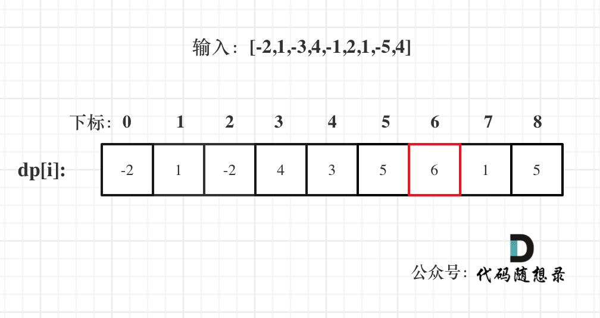

* [做專案（多個 C++、Java、Go、測試開發、前端專案）](https://www.programmercarl.com/other/kstar.html)
* [練習演算法（兩個月高強度學演算法）](https://www.programmercarl.com/xunlian/xunlianying.html)
* [背面試必考題（八股文）（40 天挑戰高頻面試題）](https://www.programmercarl.com/xunlian/bagu.html)

# 53. 最大子序和

[LeetCode 題目連結](https://leetcode.com/problems/maximum-subarray/)

給定一個整數（integer）陣列（array） nums ，找到一個具有最大和的連續子陣列（subarray）（子陣列最少包含一個元素（element）），回傳其最大和。

範例:
* 輸入: [-2,1,-3,4,-1,2,1,-5,4]
* 輸出: 6
* 解釋: 連續子陣列 [4,-1,2,1] 的和最大，為 6。

## 演算法公開課

**[《程式碼隨想錄》演算法影片公開課](https://programmercarl.com/other/gongkaike.html)：[看起來複雜，其實是簡單動態規劃（dynamic programming, DP） | LeetCode：53.最大子序和](https://www.bilibili.com/video/BV19V4y1F7b5)，相信結合影片再看本篇題解，更有助於大家對本題的理解**。


## 解題思路

這道題之前我們在講解貪心專題的時候用貪心演算法（greedy algorithm）解決過一次，[貪心演算法：最大子序和](./0053.最大子序和.md)。

這次我們用動態規劃（dynamic programming, DP）的想法再來分析一次。

動規五部曲如下：

1. 確定 dp 陣列（dp table）以及索引（index）的含義

**dp[i]：包括索引 i（以 nums[i] 為結尾）的最大連續次序列（subsequence）和為 dp[i]**。

2. 確定遞迴公式（recurrence formula）

dp[i] 只有兩個方向可以推出來：

* dp[i - 1] + nums[i]，即：nums[i] 加入目前連續次序列和
* nums[i]，即：從頭開始計算目前連續次序列和

一定是取最大的，所以 dp[i] = max(dp[i - 1] + nums[i], nums[i]);

3. dp 陣列如何初始化（initialization）

從遞迴公式可以看出來 dp[i] 是依賴於 dp[i - 1] 的狀態（state），dp[0] 就是遞迴公式的基礎。

dp[0] 應該是多少呢?

根據 dp[i] 的定義，很明顯 dp[0] 應為 nums[0] 即 dp[0] = nums[0]。

4. 確定遍歷（traversal）順序

遞迴公式中 dp[i] 依賴於 dp[i - 1] 的狀態，需要從前向後遍歷。

5. 舉例推導 dp 陣列

以範例一為例，輸入：nums = [-2,1,-3,4,-1,2,1,-5,4]，對應的 dp 狀態如下：


**注意最後的結果可不是 dp[nums.size() - 1]！** ，而是 dp[6]。

再回顧一下 dp[i] 的定義：包括索引 i 之前的最大連續次序列和為 dp[i]。

那麼我們要找最大的連續次序列，就應該找每一個 i 為終點的連續最大次序列。

所以在遞迴公式的時候，可以直接選出最大的 dp[i]。

以上動規五部曲分析完畢，完整程式碼如下：

```CPP
class Solution {
public:
    int maxSubArray(vector<int>& nums) {
        if (nums.size() == 0) return 0;
        vector<int> dp(nums.size());
        dp[0] = nums[0];
        int result = dp[0];
        for (int i = 1; i < nums.size(); i++) {
            dp[i] = max(dp[i - 1] + nums[i], nums[i]); // 狀態變遷方程式
            if (dp[i] > result) result = dp[i]; // result 保存 dp[i] 的最大值
        }
        return result;
    }
};
```

* 時間複雜度（time complexity）：O(n)
* 空間複雜度（space complexity）：O(n)


## 總結

這道題目用貪心也很巧妙，但有一點繞，需要仔細想一想，如果想回顧一下貪心就看這裡吧：[貪心演算法：最大子序和](./0053.最大子序和.md)

動規的解法還是很直接的。

## 其他語言版本

### Java:

```java
   /**
     * 1.dp[i] 代表目前索引對應的最大值
     * 2.遞迴公式 dp[i] = max (dp[i-1]+nums[i],nums[i]) res = max(res,dp[i])
     * 3.初始化 都為 0
     * 4.遍歷方向，從前往後
     * 5.舉例推導結果。。。
     *
     * @param nums
     * @return
     */
    public static int maxSubArray(int[] nums) {
        if (nums.length == 0) {
            return 0;
        }

        int res = nums[0];
        int[] dp = new int[nums.length];
        dp[0] = nums[0];
        for (int i = 1; i < nums.length; i++) {
            dp[i] = Math.max(dp[i - 1] + nums[i], nums[i]);
            res = res > dp[i] ? res : dp[i];
        }
        return res;
    }
```
```Java
//因為 dp[i] 的遞迴公式只與前一個值有關，所以可以用一個變數代替 dp 陣列，空間複雜度為 O(1)
class Solution {
    public int maxSubArray(int[] nums) {
        int res = nums[0];
        int pre = nums[0];
        for(int i = 1; i < nums.length; i++) {
            pre = Math.max(pre + nums[i], nums[i]);
            res = Math.max(res, pre);
        }
        return res;
    }
}
```

### Python：

```python
class Solution:
    def maxSubArray(self, nums: List[int]) -> int:
        dp = [0] * len(nums)
        dp[0] = nums[0]
        result = dp[0]
        for i in range(1, len(nums)):
            dp[i] = max(dp[i-1] + nums[i], nums[i]) #狀態變遷方程式
            result = max(result, dp[i]) #result 保存 dp[i] 的最大值
        return result
```

### Go：

```Go
// solution
// 1, dp
// 2, 貪心

func maxSubArray(nums []int) int {
    n := len(nums)
    // 這裡的 dp[i] 表示，最大的連續子陣列和，包含 num[i] 元素
    dp := make([]int,n)
    // 初始化，由於 dp 狀態變遷方程式依賴 dp[0]
    dp[0] = nums[0]
    // 初始化最大的和
    mx := nums[0]
    for i:=1;i<n;i++ {
        // 這裡的狀態變遷方程式就是：求最大和
        // 會面臨 2 種情況，一個是帶前面的和，一個是不帶前面的和
        dp[i] = max(dp[i-1]+nums[i],nums[i])
        mx = max(mx,dp[i])
    }
    return mx
}

func max(a,b int) int{
    if a>b {
        return a 
    }
    return b
}
```

### JavaScript：

```javascript
const maxSubArray = nums => {
    // 陣列長度，dp 初始化
    const len = nums.length;
    let dp = new Array(len).fill(0);
    dp[0] = nums[0];
    // 最大值初始化為 dp[0]
    let max = dp[0];
    for (let i = 1; i < len; i++) {
        dp[i] = Math.max(dp[i - 1] + nums[i], nums[i]);
        // 更新最大值
        max = Math.max(max, dp[i]);
    }
    return max;
};
```

### Scala:

```scala
object Solution {
  def maxSubArray(nums: Array[Int]): Int = {
    var dp = new Array[Int](nums.length)
    var result = nums(0)
    dp(0) = nums(0)
    for (i <- 1 until nums.length) {
      dp(i) = math.max(nums(i), dp(i - 1) + nums(i)) 
      result = math.max(result, dp(i))  // 更新最大值
    }
    result
  }
}
```

### TypeScript：

```typescript
function maxSubArray(nums: number[]): number {
    const len = nums.length
    if (len === 1) return nums[0]

    const dp: number[] = new Array(len)
    let resMax: number = dp[0] = nums[0]

    for (let i = 1; i < len; i++) {
        dp[i] = Math.max(dp[i - 1] + nums[i], nums[i])
        // 注意值為負數的情況
        if (dp[i] > resMax) resMax = dp[i]
    }

    return resMax
}
```


