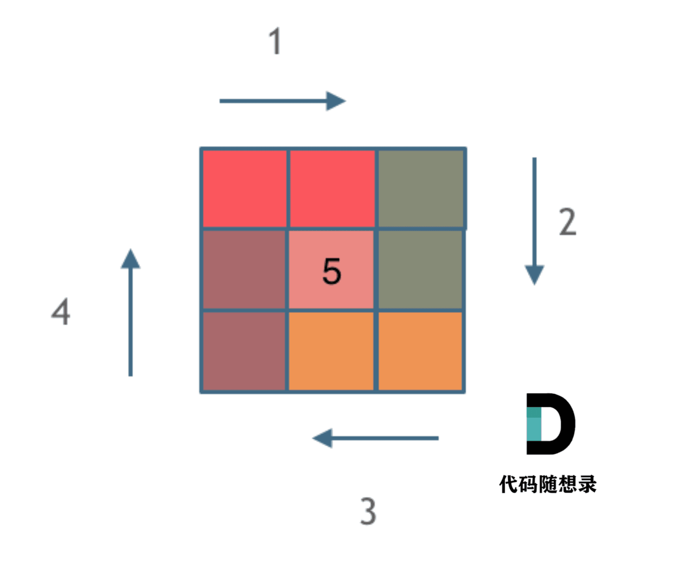

* [做專案（多個 C++、Java、Go、測試開發、前端專案）](https://www.programmercarl.com/other/kstar.html)
* [練習演算法（兩個月高強度學演算法）](https://www.programmercarl.com/xunlian/xunlianying.html)
* [背面試必考題（八股文）（40 天挑戰高頻面試題）](https://www.programmercarl.com/xunlian/bagu.html)


# 54.螺旋矩陣

[LeetCode 題目連結](https://leetcode.cn/problems/spiral-matrix/)

給你一個 m 列（row） n 行（column）的矩陣（matrix） matrix ，請按照順時針（clockwise）螺旋（spiral）順序，回傳矩陣中的所有元素（element）。

範例 1:

輸入: 
[
 [ 1, 2, 3 ],
 [ 4, 5, 6 ],
 [ 7, 8, 9 ]
]
輸出:[1,2,3,6,9,8,7,4,5]

## 解題思路

本題解題思路繼承自[59.螺旋矩陣II](https://www.programmercarl.com/0059.%E8%9E%BA%E6%97%8B%E7%9F%A9%E9%98%B5II.html)，建議看完 59.螺旋矩陣II 之後再看本題

與 59.螺旋矩陣II 相同的是：兩者都是模擬（simulation）矩形（rectangle）的順時針旋轉，所以核心依然是堅持 loop invariant，按照左閉右開的原則

模擬順時針畫矩陣的過程:

* 填充上列從左到右
* 填充右行從上到下
* 填充下列從右到左
* 填充左行從下到上

由外向內一圈一圈這麼畫下去，如下所示：




這裡每一種顏色，代表一條邊，我們遍歷（traversal）的長度，可以看出每一個拐角處的處理規則，拐角處讓給新的一條邊來繼續畫。

與 59.螺旋矩陣II 不同的是：前題中的螺旋矩陣是正方形，只有正方形的邊長 n 一個邊界條件（boundary condition），而本題中，需要考慮長方形的長和寬(m 列和 n 行)兩個邊界條件。自然，m 可以等於 n，即前題可視為本題在 m==n 的特殊情況。

我們從最一般的情況開始考慮，與 59.螺旋矩陣II 題解對比起來，m 和 n 的代入，主要引來兩方面的差異：

* loop 的計算：
    本題的 loop 計算與 59.螺旋矩陣II 演算法略微差異，因為存在 rows 和 columns 兩個維度，可自行分析，loop 只能取 min(rows, columns)，例如 rows = 5, columns = 7，那 loop = 5 / 2 = 2
* mid 的計算及填充：
    1、同樣的原理，本題的 mid 計算也存在上述差異；
    2、
      如果 min(rows, columns) 為偶數，則不需要在最後單獨考慮矩陣最中間位置的賦值
      如果 min(rows, columns) 為奇數，則矩陣最中間位置不只是 [mid][mid]，而是會留下來一個特殊的中間列或者中間行，具體是中間列還是中間行，要看 rows 和 columns 的大小，如果 rows > columns，則是中間行，相反，則是中間列

程式碼如下，已經詳細註解了每一步的目的，可以看出 while 迴圈（while loop）裡判斷的情況是很多的，程式碼裡處理的原則也是統一的左閉右開。

整體 C++ 程式碼如下：

```CPP
class Solution {
public:
    vector<int> spiralOrder(vector<vector<int>>& matrix) {
        if (matrix.size() == 0 || matrix[0].size() == 0)
            return {};
        int rows = matrix.size(), columns = matrix[0].size();
        int total = rows * columns;
        vector<int> res(total); // 使用 vector 定義一個一維陣列存放結果
        int startx = 0, starty = 0; // 定義每迴圈一個圈的起始位置
        int loop = min(rows, columns) / 2; 
        // 本題的 loop 計算與 59.螺旋矩陣II 演算法略微差異，因為存在 rows 和 columns 兩個維度，可自行分析，loop 只能取 min(rows, columns)，例如 rows = 5, columns = 7，那 loop = 5 / 7 = 2
        int mid = min(rows, columns) / 2; 
        // 1、同樣的原理，本題的 mid 計算也存在上述差異；
        // 2、
            //如果 min(rows, columns) 為偶數，則不需要在最後單獨考慮矩陣最中間位置的賦值
            //如果 min(rows, columns) 為奇數，則矩陣最中間位置不只是 [mid][mid]，而是會留下來一個特殊的中間列或者中間行，具體是中間列還是中間行，要看 rows 和 columns 的大小，如果 rows > columns，則是中間行，相反，則是中間列
        //相信這一點不好理解，建議自行畫圖理解
        int count = 0;// 用來給矩陣中每一個空格賦值
        int offset = 1;// 每一圈迴圈，需要控制每一條邊遍歷的長度
        int i,j;
        while (loop --) {
            i = startx;
            j = starty;

            // 下面開始的四個 for 就是模擬轉了一圈
            // 模擬填充上列從左到右(左閉右開)
            for (j = starty; j < starty + columns - offset; j++) {
                res[count++] = matrix[startx][j];
            }
            // 模擬填充右行從上到下(左閉右開)
            for (i = startx; i < startx + rows - offset; i++) {
                res[count++] = matrix[i][j];
            }
            // 模擬填充下列從右到左(左閉右開)
            for (; j > starty; j--) {
                res[count++] = matrix[i][j];
            }
            // 模擬填充左行從下到上(左閉右開)
            for (; i > startx; i--) {
                res[count++] = matrix[i][starty];
            }

            // 第二圈開始的時候，起始位置要各自加 1，例如：第一圈起始位置是 (0, 0)，第二圈起始位置是 (1, 1)
            startx++;
            starty++;

            // offset 控制每一圈裡每一條邊遍歷的長度
            offset += 2;
        }

        // 如果 min(rows, columns) 為奇數的話，需要單獨給矩陣最中間的位置賦值
        if (min(rows, columns) % 2) {
            if(rows > columns){
                for (int i = mid; i < mid + rows - columns + 1; ++i) {
                    res[count++] = matrix[i][mid];
                }

            } else {
                for (int i = mid; i < mid + columns - rows + 1; ++i) {
                    res[count++] = matrix[mid][i];
                }
            }
        }
        return res;
    }
};
```

## 類似題目

* [59.螺旋矩陣II](https://leetcode.cn/problems/spiral-matrix-ii/)
* [劍指Offer 29.順時針印出矩陣](https://leetcode.cn/problems/shun-shi-zhen-da-yin-ju-zhen-lcof/)

## 其他語言版本

### Java

```java
class Solution {
    public List<Integer> spiralOrder(int[][] matrix) {
        //存放陣列的數
        List<Integer> ans = new ArrayList<>();
        //行數
        int columns = matrix[0].length;
        //列數
        int rows = matrix.length;
        //遍歷起點
        int start = 0;
        //迴圈的次數 列數和行數中的最小值除以二
        int loop = Math.min(rows,columns) / 2;
        //未遍歷的中間行（列）的行（列）索引
        int mid = loop;
        //終止條件
        int offSet = 1;
        int i,j;
        while(loop-- > 0) {
            //初始化起點
            i = j = start;
            
            //從左往右
            for(; j < columns - offSet; j++)
                ans.add(matrix[i][j]);

            //從上往下
            for(; i < rows - offSet; i++)
                ans.add(matrix[i][j]);

            //從右往左
            for(; j > start; j--)
                ans.add(matrix[i][j]);
            
            //從下往上
            for(; i > start; i--)
                ans.add(matrix[i][j]);

            //每迴圈一次 改變起點位置
            start++;
            //終止條件改變
            offSet++;
        }

        //如果列和行中的最小值是奇數 則會產生中間列或者中間行沒有遍歷
        if(Math.min(rows,columns) % 2 != 0) {
            //列大於行則產生中間行
            if(rows > columns) {
                //中間行的列的最大索引的下一位的索引為 mid + rows - columns + 1
                for(int k = mid; k < mid + rows - columns + 1; k++) {
                    ans.add(matrix[k][mid]);
                }
            }else {//行大於等於列則產生中間列
                //中間列的行最大索引的下一位的索引為 mid + columns - rows + 1
                for(int k = mid; k < mid + columns - rows + 1; k++) {
                    ans.add(matrix[mid][k]);
                }
            }
        }
        return ans;
    }
}
```

```java
class Solution {
    public List<Integer> spiralOrder(int[][] matrix) {
        List<Integer> res = new ArrayList<>(); // 存放結果
        if (matrix.length == 0 || matrix[0].length == 0)
            return res;
        int rows = matrix.length, columns = matrix[0].length;
        int startx = 0, starty = 0;  // 定義每迴圈一個圈的起始位置
        int loop = 0; // 迴圈次數
        int offset = 1; // 每一圈迴圈，需要控制每一條邊遍歷的長度
        while (loop < Math.min(rows, columns) / 2) {
            int i = startx;
            int j = starty;
            // 模擬填充上列從左到右(左閉右開)
            for (; j < columns - offset; j++) {
                res.add(matrix[i][j]);
            }
            // 模擬填充右行從上到下(左閉右開)
            for (; i < rows - offset; i++) {
                res.add(matrix[i][j]);
            }
            // 模擬填充下列從右到左(左閉右開)
            for (; j > starty; j--) {
                res.add(matrix[i][j]);
            }
            // 模擬填充左行從下到上(左閉右開)
            for (; i > startx; i--) {
                res.add(matrix[i][j]);
            }

            // 起始位置加 1 迴圈次數加 1 並控制每條邊遍歷的長度
            startx++;
            starty++;
            offset++;
            loop++;
        }

        // 如果行或列中的最小值為奇數 則一定有未遍歷的部分
        // 可以自行畫圖理解
        if (Math.min(rows, columns) % 2 == 1) {
            // 當列大於行時 未遍歷的部分是行
            // (startx, starty) 即下一個要遍歷位置 從該位置出發 遍歷完未遍歷的行
            // 遍歷次數為 rows - columns + 1
            if (rows > columns) {
                for (int i = 0; i < rows - columns + 1; i++) {
                    res.add(matrix[startx++][starty]);
                }
            } else {
                // 此處與上面同理 遍歷完未遍歷的列
                for (int i = 0; i < columns - rows + 1; i++) {
                    res.add(matrix[startx][starty++]);
                }
            }
        }

        return res;
    }
}
```

### JavaScript
```
/**
 * @param {number[][]} matrix
 * @return {number[]}
 */
var spiralOrder = function(matrix) {
    let m = matrix.length
    let n = matrix[0].length

    let startX = startY = 0
    let i = 0
    let arr = new Array(m*n).fill(0)
    let offset = 1
    let loop = mid = Math.floor(Math.min(m,n) / 2)
    while (loop--) {
        let row = startX
        let col = startY
        // -->
        for (; col < n + startY - offset; col++) {
            arr[i++] = matrix[row][col]
        }
        // down
        for (; row < m + startX - offset; row++) {
            arr[i++] = matrix[row][col]
        }
        // <--
        for (; col > startY; col--) {
            arr[i++] = matrix[row][col]
        }
        for (; row > startX; row--) {
            arr[i++] = matrix[row][col]
        }
        startX++
        startY++
        offset += 2
    }
    if (Math.min(m, n) % 2 === 1) {
        if (n > m) {
            for (let j = mid; j < mid + n - m + 1; j++) {
                arr[i++] = matrix[mid][j]
            }
        } else {
            for (let j = mid; j < mid + m - n + 1; j++) {
                arr[i++] = matrix[j][mid]
            }
        }
    }
    return arr
};
```
### Python

```python
class Solution(object):
    def spiralOrder(self, matrix):
        """
        :type matrix: List[List[int]]
        :rtype: List[int]
        """
        if len(matrix) == 0 or len(matrix[0]) == 0 : # 判定 List 是否為空
            return []
        row, col = len(matrix), len(matrix[0]) # 列數，行數
        loop = min(row, col) // 2 # 迴圈輪數
        stx, sty = 0, 0 # 起始 x，y 坐標
        i, j =0, 0
        count = 0  # 計數
        offset = 1  # 每輪減少的格子數
        result = [0] * (row * col)
        while loop>0 :# 左閉右開
            i, j = stx, sty
            while j < col - offset :   # 從左到右
                result[count] = matrix[i][j]
                count += 1
                j += 1  
            while i < row - offset : # 從上到下
                result[count] = matrix[i][j]
                count += 1
                i += 1
            while j>sty :  # 從右到左
                result[count] = matrix[i][j]
                count += 1
                j -= 1
            while i>stx :  # 從下到上
                result[count] = matrix[i][j]
                count += 1
                i -= 1
            stx += 1
            sty += 1
            offset += 1
            loop -= 1
        if min(row, col) % 2 == 1 :  # 判定是否需要填充多出來的一列
            i = stx
            if row < col :
                while i < stx + col - row + 1 :
                    result[count] = matrix[stx][i]
                    count += 1
                    i += 1
            else :
                while i < stx + row - col + 1 :
                    result[count] = matrix[i][stx]
                    count += 1
                    i += 1
        return result
```

版本二：定義四個邊界（boundary）
```python
class Solution(object):
    def spiralOrder(self, matrix):
        """
        :type matrix: List[List[int]]
        :rtype: List[int]
            """
        if not matrix:
            return []

        rows = len(matrix)
        cols = len(matrix[0])
        top, bottom, left, right = 0, rows - 1, 0, cols - 1
        print_list = []

        while top <= bottom and left <= right:
            # 從左到右
            for i in range(left, right + 1):
                print_list.append(matrix[top][i])
            top += 1

            # 從上到下
            for i in range(top, bottom + 1):
                print_list.append(matrix[i][right])
            right -= 1

            # 從右到左
            if top <= bottom:
                for i in range(right, left - 1, -1):
                    print_list.append(matrix[bottom][i])
                bottom -= 1

            # 從下到上
            if left <= right:
                for i in range(bottom, top - 1, -1):
                    print_list.append(matrix[i][left])
                left += 1

        return print_list
```

### Go

```go
func spiralOrder(matrix [][]int) []int {
    rows := len(matrix)
    if rows == 0 {
        return []int{}
    }
    columns := len(matrix[0])
    if columns == 0 {
        return []int{}
    }
    res := make([]int, rows * columns)
    startx, starty := 0, 0 // 定義每迴圈一個圈的起始位置
    loop := min(rows, columns) / 2
    mid := min(rows, columns) / 2
    count := 0 // 用來給矩陣中每一個空格賦值
    offset := 1 // 每一圈迴圈，需要控制每一條邊遍歷的長度
    for loop > 0 {
        i, j := startx, starty
		
        // 模擬填充上列從左到右(左閉右開)
        for ; j < starty + columns - offset; j++ {
            res[count] = matrix[startx][j]
            count++
        }
        // 模擬填充右行從上到下(左閉右開)
        for ; i < startx + rows - offset; i++ {
            res[count] = matrix[i][j]
            count++
        }
        // 模擬填充下列從右到左(左閉右開)
        for ; j > starty; j-- {
            res[count] = matrix[i][j]
            count++
        }
        // 模擬填充左行從下到上(左閉右開)
        for ; i > startx; i-- {
            res[count] = matrix[i][starty]
            count++
        }
        
        // 第二圈開始的時候，起始位置要各自加 1，例如：第一圈起始位置是 (0, 0)，第二圈起始位置是 (1, 1)
        startx++
        starty++
        
        // offset 控制每一圈裡每一條邊遍歷的長度
        offset += 2
        loop--
    }
    
    // 如果 min(rows, columns) 為奇數的話，需要單獨給矩陣最中間的位置賦值
    if min(rows, columns) % 2 == 1 {
        if rows > columns {
            for i := mid; i < mid + rows - columns + 1; i++ {
                res[count] = matrix[i][mid]
                count++
            }
        } else {
            for i := mid; i < mid + columns - rows + 1; i++ {
                res[count] = matrix[mid][i]
                count++
            }
        }
    }
    return res
}

func min(x, y int) int {
    if x < y {
        return x
    }
    return y
}
```


