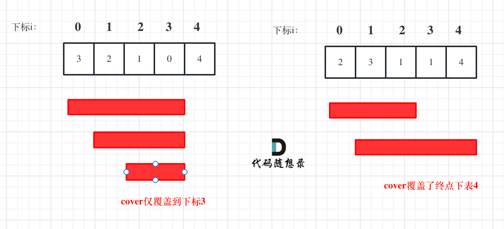

* [做專案（多個 C++、Java、Go、測試開發、前端專案）](https://www.programmercarl.com/other/kstar.html)
* [練習演算法（兩個月高強度學演算法）](https://www.programmercarl.com/xunlian/xunlianying.html)
* [背面試必考題（八股文）（40 天挑戰高頻面試題）](https://www.programmercarl.com/xunlian/bagu.html)

# 55. 跳躍遊戲

[LeetCode 題目連結](https://leetcode.com/problems/jump-game/)

給定一個非負整數（nonnegative integer）陣列（array），你最初位於陣列的第一個位置。

陣列中的每個元素（element）代表你在該位置可以跳躍的最大長度。

判斷你是否能夠到達最後一個位置。

範例  1:

- 輸入: [2,3,1,1,4]
- 輸出: true
- 解釋: 我們可以先跳 1 步，從位置 0 到達 位置 1, 然後再從位置 1 跳 3 步到達最後一個位置。

範例  2:

- 輸入: [3,2,1,0,4]
- 輸出: false
- 解釋: 無論怎樣，你總會到達索引（index）為 3 的位置。但該位置的最大跳躍長度是 0 ， 所以你永遠不可能到達最後一個位置。

## 演算法公開課

**[《程式碼隨想錄》演算法影片公開課](https://programmercarl.com/other/gongkaike.html)：[貪心演算法（greedy algorithm），怎麼跳躍不重要，關鍵在覆蓋範圍 | LeetCode：55.跳躍遊戲](https://www.bilibili.com/video/BV1VG4y1X7kB)，相信結合影片再看本篇題解，更有助於大家對本題的理解**。

## 解題思路

剛看到本題一開始可能想：目前位置元素如果是 3，我究竟是跳一步呢，還是兩步呢，還是三步呢，究竟跳幾步才是最佳呢？

其實跳幾步無所謂，關鍵在於可跳的覆蓋範圍！

不一定非要明確一次究竟跳幾步，每次取最大的跳躍步數，這個就是可以跳躍的覆蓋範圍。

這個範圍內，別管是怎麼跳的，反正一定可以跳過來。

**那麼這個問題就轉化為跳躍覆蓋範圍究竟可不可以覆蓋到終點！**

每次移動取最大跳躍步數（得到最大的覆蓋範圍），每移動一個單位，就更新最大覆蓋範圍。

**貪心演算法區域最佳（local optimum）解：每次取最大跳躍步數（取最大覆蓋範圍），總體最佳（global optimum）解：最後得到整體最大覆蓋範圍，看是否能到終點**。

區域最佳推出總體最佳，找不出反例，試試貪心！

如圖：




i 每次移動只能在 cover 的範圍內移動，每移動一個元素，cover 得到該元素數值（新的覆蓋範圍）的補充，讓 i 繼續移動下去。

而 cover 每次只取 max(該元素數值補充後的範圍, cover 本身範圍)。

如果 cover 大於等於了終點索引，直接 return true 就可以了。

C++ 程式碼如下：

```CPP
class Solution {
public:
    bool canJump(vector<int>& nums) {
        int cover = 0;
        if (nums.size() == 1) return true; // 只有一個元素，就是能達到
        for (int i = 0; i <= cover; i++) { // 注意這裡是小於等於 cover
            cover = max(i + nums[i], cover);
            if (cover >= nums.size() - 1) return true; // 說明可以覆蓋到終點了
        }
        return false;
    }
};
```

* 時間複雜度（time complexity）: O(n)
* 空間複雜度（space complexity）: O(1)


## 總結

這道題目關鍵點在於：不用拘泥於每次究竟跳幾步，而是看覆蓋範圍，覆蓋範圍內一定是可以跳過來的，不用管是怎麼跳的。

大家可以看出想法想出來了，程式碼還是非常簡單的。

一些同學可能感覺，我在講貪心系列的時候，題目和題目之間貌似沒有什麼聯繫？

**是真的就是沒什麼聯繫，因為貪心沒有固定做法**！沒有個整體的貪心框架（framework）解決一系列問題，只能是接觸各種類型的題目鍛鍊自己的貪心思維！

## 其他語言版本

### Java

```Java
class Solution {
    public boolean canJump(int[] nums) {
        if (nums.length == 1) {
            return true;
        }
        //覆蓋範圍, 初始覆蓋範圍應該是 0，因為下面的疊代是從索引 0 開始的
        int coverRange = 0;
        //在覆蓋範圍內更新最大的覆蓋範圍
        for (int i = 0; i <= coverRange; i++) {
            coverRange = Math.max(coverRange, i + nums[i]);
            if (coverRange >= nums.length - 1) {
                return true;
            }
        }
        return false;
    }
}
```

### Python

```python
class Solution:
    def canJump(self, nums: List[int]) -> bool:
        cover = 0
        if len(nums) == 1: return True
        i = 0
        # python 不支援動態修改 for 迴圈中變數，使用 while 迴圈代替
        while i <= cover:
            cover = max(i + nums[i], cover)
            if cover >= len(nums) - 1: return True
            i += 1
        return False
```

```python
## for 迴圈
class Solution:
    def canJump(self, nums: List[int]) -> bool:
        cover = 0
        if len(nums) == 1: return True
        for i in range(len(nums)):
            if i <= cover:
                cover = max(i + nums[i], cover)
                if cover >= len(nums) - 1: return True
        return False
```

```python
## 基於目前最遠可到達位置判斷
class Solution:
    def canJump(self, nums: List[int]) -> bool:
        far = nums[0]
        for i in range(len(nums)):
            # 要考慮兩個情況
            # 1. i <= far - 表示 目前位置 i 可以到達
            # 2. i > far - 表示 目前位置 i 無法到達
            if i > far:
                return False
            far = max(far, nums[i]+i)
        # 如果迴圈正常結束，表示最後一個位置也可以到達，否則會在中途直接退出
        # 關鍵點在於，要想明白其實列表中的每個位置都是需要驗證能否到達的
        return True
```

### Go

```go
// 貪心
func canJump(nums []int) bool {
    cover := 0
    n := len(nums)-1
    for i := 0; i <= cover; i++ { // 每次與覆蓋值比較
        cover = max(i+nums[i], cover) //每走一步都將 cover 更新為最大值
        if cover >= n {
            return true
        }
    }
    return false
}
func max(a, b int ) int {
    if a > b {
        return a
    }
    return b
}
```

### JavaScript

```Javascript
var canJump = function(nums) {
    if(nums.length === 1) return true
    let cover = 0
    for(let i = 0; i <= cover; i++) {
        cover = Math.max(cover, i + nums[i])
        if(cover >= nums.length - 1) {
            return true
        }
    }
    return false
};
```

### Rust

```Rust
impl Solution {
    pub fn can_jump(nums: Vec<i32>) -> bool {
        if nums.len() == 1 {
            return true;
        }
        let (mut i, mut cover) = (0, 0);
        while i <= cover {
            cover = (i + nums[i] as usize).max(cover);
            if cover >= nums.len() - 1 {
                return true;
            }
            i += 1;
        }
        false
    }
}
```

### C

```c
#define max(a, b) (((a) > (b)) ? (a) : (b))

bool canJump(int* nums, int numsSize){
    int cover = 0;

    int i;
    // 只可能獲取 cover 範圍中的步數，所以 i<=cover
    for(i = 0; i <= cover; ++i) {
        // 更新 cover 為從 i 出發能到達的最大值/cover 的值中較大值
        cover = max(i + nums[i], cover);

        // 若更新後 cover 可以到達最後的元素，回傳 true
        if(cover >= numsSize - 1)
            return true;
    }

    return false;
}
```

### TypeScript

```typescript
function canJump(nums: number[]): boolean {
  let farthestIndex: number = 0;
  let cur: number = 0;
  while (cur <= farthestIndex) {
    farthestIndex = Math.max(farthestIndex, cur + nums[cur]);
    if (farthestIndex >= nums.length - 1) return true;
    cur++;
  }
  return false;
}
```

### Scala

```scala
object Solution {
  def canJump(nums: Array[Int]): Boolean = {
    var cover = 0
    if (nums.length == 1) return true // 如果只有一個元素，那麼必定到達
    var i = 0
    while (i <= cover) { // i 表示索引，目前只能夠走 cover 步
      cover = math.max(i + nums(i), cover)
      if (cover >= nums.length - 1) return true // 說明可以覆蓋到終點，直接回傳
      i += 1
    }
    false // 如果上面沒有回傳就是跳不到
  }
}
```
### C#
```csharp
public class Solution
{
    public bool CanJump(int[] nums)
    {
        int cover = 0;
        if (nums.Length == 1) return true;
        for (int i = 0; i <= cover; i++)
        {
            cover = Math.Max(i + nums[i], cover);
            if (cover >= nums.Length - 1) return true;
        }
        return false;
    }
}
```

