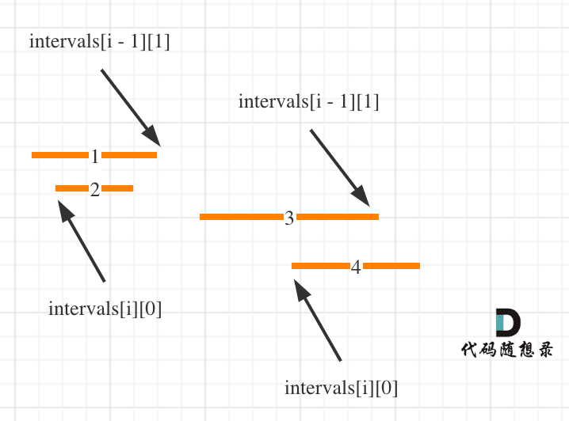

* [做專案（多個 C++、Java、Go、測試開發、前端專案）](https://www.programmercarl.com/other/kstar.html)
* [練習演算法（兩個月高強度學演算法）](https://www.programmercarl.com/xunlian/xunlianying.html)
* [背面試必考題（八股文）（40 天挑戰高頻面試題）](https://www.programmercarl.com/xunlian/bagu.html)


# 56. 合併區間

[LeetCode 題目連結](https://leetcode.com/problems/merge-intervals/)

給出一個區間（interval）的集合（set），請合併所有重疊的區間。

範例 1:
* 輸入: intervals = [[1,3],[2,6],[8,10],[15,18]]
* 輸出: [[1,6],[8,10],[15,18]]
* 解釋: 區間 [1,3] 和 [2,6] 重疊, 將它們合併為 [1,6].

範例 2:
* 輸入: intervals = [[1,4],[4,5]]
* 輸出: [[1,5]]
* 解釋: 區間 [1,4] 和 [4,5] 可被視為重疊區間。
* 注意：輸入類型已於 2019 年 4 月 15 日更改。 請重置預設（default）程式碼定義以獲取新方法（method）簽名。

## 演算法公開課

**[《代碼隨想錄》演算法影片公開課](https://programmercarl.com/other/gongkaike.html)：[貪心演算法（greedy algorithm），合併區間有細節！LeetCode：56.合併區間](https://www.bilibili.com/video/BV1wx4y157nD)，相信結合影片再看本篇題解，更有助於大家對本題的理解**。

## 解題思路

本題的本質其實還是判斷重疊區間問題。 

大家如果認真做題的話，會發現和我們剛剛講過的[452. 用最少數量的箭引爆氣球](./0452.用最少數量的箭引爆氣球.md) 和 [435. 無重疊區間](./0435.無重叠區間.md) 都是一個解法模式。 

這幾道題都是判斷區間重疊，區別就是判斷區間重疊後的邏輯，本題是判斷區間重疊後要進行區間合併。 

所以一樣的解法模式，先排序（sorting），讓所有的相鄰區間盡可能地重疊在一起，按左邊界（boundary），或者右邊界排序都可以，處理邏輯稍有不同。

按照左邊界從小到大排序之後，如果 `intervals[i][0] <= intervals[i - 1][1]` 即 intervals[i] 的左邊界 <= intervals[i - 1] 的右邊界，則一定有重疊。（本題相鄰區間也算重疊，所以是 <=）

這麼說有點抽象，看圖：（**注意圖中區間都是按照左邊界排序之後了**）



知道如何判斷重複之後，剩下的就是合併了，如何去模擬（simulation）合併區間呢？

其實就是用合併區間後左邊界和右邊界，作為一個新的區間，加入到 result 陣列（array）裡就可以了。如果沒有合併就把原區間加入到 result 陣列。

C++ 程式碼如下：

```CPP
class Solution {
public:
    vector<vector<int>> merge(vector<vector<int>>& intervals) {
        vector<vector<int>> result;
        if (intervals.size() == 0) return result; // 區間集合為空直接回傳
        // 排序的參數使用了 lambda 表示式
        sort(intervals.begin(), intervals.end(), [](const vector<int>& a, const vector<int>& b){return a[0] < b[0];});

        // 第一個區間就可以放進結果集裡，後面如果重疊，在 result 上直接合併
        result.push_back(intervals[0]); 

        for (int i = 1; i < intervals.size(); i++) {
            if (result.back()[1] >= intervals[i][0]) { // 發現重疊區間
                // 合併區間，只更新右邊界就好，因為 result.back() 的左邊界一定是最小值，因為我們按照左邊界排序的
                result.back()[1] = max(result.back()[1], intervals[i][1]); 
            } else {
                result.push_back(intervals[i]); // 區間不重疊 
            }
        }
        return result;
    }
};
```

* 時間複雜度（time complexity）: O(nlogn)
* 空間複雜度（space complexity）: O(logn)，排序需要的空間開銷


## 其他語言版本


### Java 
```java

/**
時間複雜度 ： O(NlogN) 排序需要 O(NlogN)
空間複雜度 ： O(logN)  java 的內建排序是快速排序 需要 O(logN) 空間

*/
class Solution {
    public int[][] merge(int[][] intervals) {
        List<int[]> res = new LinkedList<>();
        //按照左邊界排序
        Arrays.sort(intervals, (x, y) -> Integer.compare(x[0], y[0]));
        //initial start 是最小左邊界
        int start = intervals[0][0];
        int rightmostRightBound = intervals[0][1];
        for (int i = 1; i < intervals.length; i++) {
            //如果左邊界大於最大右邊界
            if (intervals[i][0] > rightmostRightBound) {
                //加入區間 並且更新 start
                res.add(new int[]{start, rightmostRightBound});
                start = intervals[i][0];
                rightmostRightBound = intervals[i][1];
            } else {
                //更新最大右邊界
                rightmostRightBound = Math.max(rightmostRightBound, intervals[i][1]);
            }
        }
        res.add(new int[]{start, rightmostRightBound});
        return res.toArray(new int[res.size()][]);
    }
}

```
```java
// 版本 2
class Solution {
    public int[][] merge(int[][] intervals) {
        LinkedList<int[]> res = new LinkedList<>();
        Arrays.sort(intervals, (o1, o2) -> Integer.compare(o1[0], o2[0]));
        res.add(intervals[0]);
        for (int i = 1; i < intervals.length; i++) {
            if (intervals[i][0] <= res.getLast()[1]) {
                int start = res.getLast()[0];
                int end = Math.max(intervals[i][1], res.getLast()[1]);
                res.removeLast();
                res.add(new int[]{start, end});
            }
            else {
                res.add(intervals[i]);
            }         
        }
        return res.toArray(new int[res.size()][]);
    }
}
```

### Python 
```python
class Solution:
    def merge(self, intervals):
        result = []
        if len(intervals) == 0:
            return result  # 區間集合為空直接回傳

        intervals.sort(key=lambda x: x[0])  # 按照區間的左邊界進行排序

        result.append(intervals[0])  # 第一個區間可以直接放入結果集中

        for i in range(1, len(intervals)):
            if result[-1][1] >= intervals[i][0]:  # 發現重疊區間
                # 合併區間，只需要更新結果集最後一個區間的右邊界，因為根據排序，左邊界已經是最小的
                result[-1][1] = max(result[-1][1], intervals[i][1])
            else:
                result.append(intervals[i])  # 區間不重疊

        return result

```

### Go 
```go
func merge(intervals [][]int) [][]int {
    sort.Slice(intervals, func(i, j int) bool {
        return intervals[i][0] < intervals[j][0]
    })
    res := make([][]int, 0, len(intervals))
    left, right := intervals[0][0], intervals[0][1]
    for i := 1; i < len(intervals); i++ {
        if right < intervals[i][0] {
            res = append(res, []int{left, right})
            left, right = intervals[i][0], intervals[i][1]
        } else {
            right = max(right, intervals[i][1])
        }
    }
    res = append(res, []int{left, right})  // 將最後一個區間放入
    return res
}
func max(a, b int) int {
    if a > b {
        return a
    }
    return b
}
```
```go
// 版本 2
func merge(intervals [][]int) [][]int {
    if len(intervals) == 1 {
        return intervals
    }
    sort.Slice(intervals, func(i, j int) bool {
        return intervals[i][0] < intervals[j][0]
    })
    res := make([][]int, 0)
    res = append(res, intervals[0])
    for i := 1; i < len(intervals); i++ {
        if intervals[i][0] <= res[len(res)-1][1]{
            res[len(res)-1][1] = max56(res[len(res)-1][1],intervals[i][1])
        } else {
            res = append(res, intervals[i])
        }
    }
    return res
}
func max56(a, b int) int {
    if a > b {
        return a
    }
    return b
}
```


### JavaScript 
```javascript
var merge = function (intervals) {
    intervals.sort((a, b) => a[0] - b[0]);
    let prev = intervals[0]
    let result = []
    for(let i =0; i<intervals.length; i++){
        let cur = intervals[i]
        if(cur[0] > prev[1]){
            result.push(prev)
            prev = cur
        }else{
            prev[1] = Math.max(cur[1],prev[1])
        }
    }
    result.push(prev)
    return result
};
```
版本二：左右區間
```javascript
/**
 * @param {number[][]} intervals
 * @return {number[][]}
 */
var merge = function(intervals) {
    let n = intervals.length;
    if ( n < 2) return intervals;
    intervals.sort((a, b) => a[0]- b[0]);
    let res = [],
        left = intervals[0][0],
        right = intervals[0][1];
    for (let i = 1; i < n; i++) {
        if (intervals[i][0] > right) {
            res.push([left, right]);
            left = intervals[i][0];
            right = intervals[i][1];
        } else {
            right = Math.max(intervals[i][1], right);
        }
    }
    res.push([left, right]);
    return res;
};
```

### TypeScript

```typescript
function merge(intervals: number[][]): number[][] {
    const resArr: number[][] = [];
    intervals.sort((a, b) => a[0] - b[0]);
    resArr[0] = [...intervals[0]];  // 避免修改原 intervals
    for (let i = 1, length = intervals.length; i < length; i++) {
        let interval: number[] = intervals[i];
        let last: number[] = resArr[resArr.length - 1];
        if (interval[0] <= last[1]) {
            last[1] = Math.max(interval[1], last[1]);
        } else {
            resArr.push([...intervals[i]]);
        }
    }
    return resArr;
};
```

### Scala

```scala
object Solution {
  import scala.collection.mutable
  def merge(intervals: Array[Array[Int]]): Array[Array[Int]] = {
    var res = mutable.ArrayBuffer[Array[Int]]()

    // 排序
    var interval = intervals.sortWith((a, b) => {
      a(0) < b(0)
    })

    var left = interval(0)(0)
    var right = interval(0)(1)

    for (i <- 1 until interval.length) {
      if (interval(i)(0) <= right) {
        left = math.min(left, interval(i)(0))
        right = math.max(right, interval(i)(1))
      } else {
        res.append(Array[Int](left, right))
        left = interval(i)(0)
        right = interval(i)(1)
      }
    }
    res.append(Array[Int](left, right))
    res.toArray // 回傳 res 的 Array 形式
  }
}
```

### Rust

```Rust
impl Solution {
    pub fn merge(mut intervals: Vec<Vec<i32>>) -> Vec<Vec<i32>> {
        let mut res = vec![];
        if intervals.is_empty() {
            return res;
        }
        intervals.sort_by_key(|a| a[0]);
        res.push(intervals[0].clone());
        for interval in intervals.into_iter().skip(1) {
            let res_last_ele = res.last_mut().unwrap();
            if res_last_ele[1] >= interval[0] {
                res_last_ele[1] = interval[1].max(res_last_ele[1]);
            } else {
                res.push(interval);
            }
        }
        res
    }
}
```
### C

```c
#define max(a, b) ((a) > (b) ? (a) : (b))

// 根據左邊界進行排序
int cmp(const void * var1, const void * var2){
    int *v1 = *(int **) var1;
    int *v2 = *(int **) var2;
    return v1[0] - v2[0];
}

int** merge(int** intervals, int intervalsSize, int* intervalsColSize, int* returnSize, int** returnColumnSizes) {
    int ** result = malloc(sizeof (int *) * intervalsSize);
    * returnColumnSizes = malloc(sizeof (int ) * intervalsSize);
    for(int i = 0; i < intervalsSize; i++){
        result[i] = malloc(sizeof (int ) * 2);
    }
    qsort(intervals, intervalsSize, sizeof (int *), cmp);
    int count = 0;
    for(int i = 0; i < intervalsSize; i++){
        // 記錄區間的左右邊界
        int L = intervals[i][0], R = intervals[i][1];
        // 如果 count 為 0 或者前一區間的右區間小於此時的左邊，加入結果中
        if (count == 0 || result[count - 1][1] < L) {
            returnColumnSizes[0][count] = 2;
            result[count][0] = L;
            result[count][1] = R;
            count++;
        } 
        else{ // 更新右邊界的值
            result[count - 1][1] = max(R, result[count - 1][1]);
        }
    }
    *returnSize = count;
    return result;
}
```


### C#

```csharp
public class Solution
{
    public int[][] Merge(int[][] intervals)
    {
        if (intervals.Length == 0)
            return intervals;
        Array.Sort(intervals, (a, b) => a[0] - b[0]);
        List<List<int>> res = new List<List<int>>();
        res.Add(intervals[0].ToList());
        for (int i = 1; i < intervals.Length; i++)
        {
            if (res[res.Count - 1][1] >= intervals[i][0])
            {
                res[res.Count - 1][1] = Math.Max(res[res.Count - 1][1], intervals[i][1]);
            }
            else
            {
                res.Add(intervals[i].ToList());
            }
        }
        return res.Select(x => x.ToArray()).ToArray();
    }
}
```

