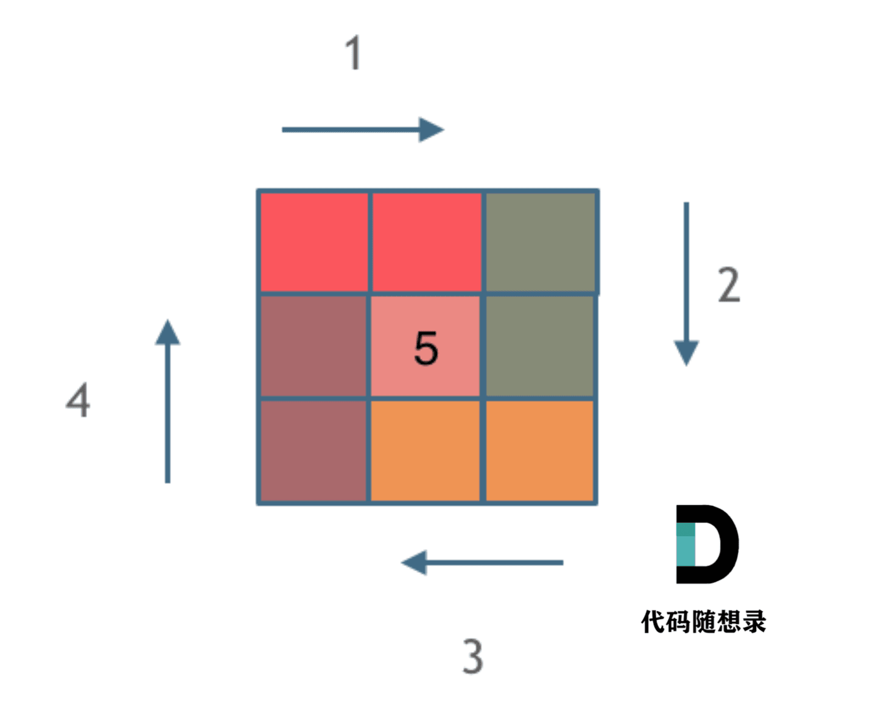

* [做專案（多個 C++、Java、Go、測試開發、前端專案）](https://www.programmercarl.com/other/kstar.html)
* [刷演算法（兩個月高強度學演算法）](https://www.programmercarl.com/xunlian/xunlianying.html)
* [背八股文（40 天挑戰高頻面試題）](https://www.programmercarl.com/xunlian/bagu.html)


# 59.螺旋（spiral）矩陣（matrix）II

[LeetCode 題目連結](https://leetcode.com/problems/spiral-matrix-ii/)

給定一個正整數（positive integer） n，產生一個包含 1 到 n^2 所有元素（element），且元素按順時針（clockwise）順序螺旋排列的正方形矩陣。

範例：

輸入：3
輸出：
[
 [ 1, 2, 3 ],
 [ 8, 9, 4 ],
 [ 7, 6, 5 ]
]


## 演算法公開課

**[《程式碼隨想錄》演算法影片公開課](https://programmercarl.com/other/gongkaike.html)：[拿下螺旋矩陣！LeetCode：59.螺旋矩陣II](https://www.bilibili.com/video/BV1SL4y1N7mV)，相信結合影片再看本篇題解，更有助於大家對本題的理解**。

## 解題思路

這道題目可以說是在面試中出現頻率較高的題目，**本題並不涉及什麼演算法，就是模擬（simulation）過程，卻十分考驗對程式碼的掌控能力。**

要如何畫出這個螺旋排列的正方形矩陣呢？

相信很多同學剛開始做這種題目的時候，一上來就是一陣猛如虎的條件判斷。

結果執行的時候出現各種問題，然後開始各種修修補補，最後發現改了這裡、那裡就有問題，改了那裡、這裡又跑不起來了。

大家還記得我們在這篇文章[陣列（array）：每次遇到對分法（bisection method），都是一看就會，一寫就廢](./0704.二分查找.md)中講解了對分法，提到如果要寫出正確的對分法，一定要堅持 **迴圈不變量（loop invariant）原則**。

而求解本題依然是要堅持迴圈不變量原則。

模擬順時針畫矩陣的過程：

* 填充上橫列從左到右
* 填充右直行從上到下
* 填充下橫列從右到左
* 填充左直行從下到上

由外向內一圈一圈這麼畫下去。

可以發現這裡的邊界條件（boundary condition）非常多，在一個迴圈（loop）中，如此多的邊界條件，如果不按照固定規則來遍歷（traversal），那就是**一進迴圈深似海，從此 offer 是路人**。

這裡一圈下來，我們要畫四條邊，這四條邊怎麼畫，每畫一條邊都要堅持一致的左閉右開，或者左開右閉的原則，這樣這一圈才能按照統一的規則畫下來。

那麼我按照左閉右開的原則，來畫一圈，大家看一下：



這裡每一種顏色，代表一條邊，我們遍歷的長度，可以看出每一個轉角處的處理規則，轉角處讓給新的一條邊來繼續畫。

這也是堅持了每條邊左閉右開的原則。

一些同學做這道題目之所以一直寫不好，程式碼越寫越亂。

就是因為在畫每一條邊的時候，一會兒左開右閉，一會兒左閉右閉，一會兒又來左閉右開，怎能不亂。

程式碼如下，已經詳細註解了每一步的目的，可以看出 while 迴圈（while loop）裡判斷的情況是很多的，程式碼裡處理的原則也是統一的左閉右開。

整體 C++ 程式碼如下：

```CPP
class Solution {
public:
    vector<vector<int>> generateMatrix(int n) {
        vector<vector<int>> res(n, vector<int>(n, 0)); // 使用 vector 定義一個二維陣列
        int startx = 0, starty = 0; // 定義每迴圈一圈的起始位置
        int loop = n / 2; // 總共要跑幾圈，例如 n 為奇數 3，那麼 loop = 1 只是迴圈一圈，矩陣中間的值需要單獨處理
        int mid = n / 2; // 矩陣中間的位置，例如：n 為 3，中間的位置就是 (1, 1)，n 為 5，中間位置為 (2, 2)
        int count = 1; // 用來給矩陣中每一個格子賦值
        int offset = 1; // 需要控制每一條邊遍歷的長度，每次迴圈右邊界收縮一位
        int i,j;
        while (loop --) {
            i = startx;
            j = starty;

            // 下面開始的四個 for 迴圈就是模擬轉了一圈
            // 模擬填充上橫列從左到右（左閉右開）
            for (j; j < n - offset; j++) {
                res[i][j] = count++;
            }
            // 模擬填充右直行從上到下（左閉右開）
            for (i; i < n - offset; i++) {
                res[i][j] = count++;
            }
            // 模擬填充下橫列從右到左（左閉右開）
            for (; j > starty; j--) {
                res[i][j] = count++;
            }
            // 模擬填充左直行從下到上（左閉右開）
            for (; i > startx; i--) {
                res[i][j] = count++;
            }

            // 第二圈開始的時候，起始位置要各自加 1，例如：第一圈起始位置是 (0, 0)，第二圈起始位置是 (1, 1)
            startx++;
            starty++;

            // offset 控制每一圈裡每一條邊遍歷的長度
            offset += 1;
        }

        // 如果 n 為奇數的話，需要單獨給矩陣最中間的位置賦值
        if (n % 2) {
            res[mid][mid] = count;
        }
        return res;
    }
};
```

* 時間複雜度（time complexity） O(n^2)：模擬遍歷二維（two-dimensional）矩陣的時間
* 空間複雜度（space complexity） O(1)

## 類似題目

* [54.螺旋矩陣](https://leetcode.com/problems/spiral-matrix/)
* [劍指 Offer 29.順時針印出矩陣](https://leetcode.com/problems/shun-shi-zhen-da-yin-ju-zhen-lcof/)


## 其他語言版本

### Java：

```Java
class Solution {
    public int[][] generateMatrix(int n) {
        int[][] nums = new int[n][n];
        int startX = 0, startY = 0;  // 每一圈的起始點
        int offset = 1;
        int count = 1;  // 矩陣中需要填寫的數字
        int loop = 1; // 記錄當前的圈數
        int i, j; // j 代表直行（column）, i 代表橫列（row）;

        while (loop <= n / 2) {

            // 頂部
            // 左閉右開，所以判斷迴圈結束時，j 不能等於 n - offset
            for (j = startY; j < n - offset; j++) {
                nums[startX][j] = count++;
            }

            // 右直行
            // 左閉右開，所以判斷迴圈結束時，i 不能等於 n - offset
            for (i = startX; i < n - offset; i++) {
                nums[i][j] = count++;
            }

            // 底部
            // 左閉右開，所以判斷迴圈結束時，j != startY
            for (; j > startY; j--) {
                nums[i][j] = count++;
            }

            // 左直行
            // 左閉右開，所以判斷迴圈結束時，i != startX
            for (; i > startX; i--) {
                nums[i][j] = count++;
            }
            startX++;
            startY++;
            offset++;
            loop++;
        }
        if (n % 2 == 1) { // n 為奇數時，單獨處理矩陣中心的值
            nums[startX][startY] = count;
        }
        return nums;
    }
}


```

### python3:

```python
class Solution:
    def generateMatrix(self, n: int) -> List[List[int]]:
        nums = [[0] * n for _ in range(n)]
        startx, starty = 0, 0               # 起始點
        loop, mid = n // 2, n // 2          # 疊代次數、n 為奇數時，矩陣的中心點
        count = 1                           # 計數

        for offset in range(1, loop + 1) :      # 每迴圈一層偏移量加 1，偏移量從 1 開始
            for i in range(starty, n - offset) :    # 從左至右，左閉右開
                nums[startx][i] = count
                count += 1
            for i in range(startx, n - offset) :    # 從上至下
                nums[i][n - offset] = count
                count += 1
            for i in range(n - offset, starty, -1) : # 從右至左
                nums[n - offset][i] = count
                count += 1
            for i in range(n - offset, startx, -1) : # 從下至上
                nums[i][starty] = count
                count += 1                
            startx += 1         # 更新起始點
            starty += 1

        if n % 2 != 0 :			# n 為奇數時，填充中心點
            nums[mid][mid] = count 
        return nums
```

版本二：定義四個邊界（boundary）
```python
class Solution(object):
    def generateMatrix(self, n):
        if n <= 0:
            return []
        
        # 初始化 n x n 矩陣
        matrix = [[0]*n for _ in range(n)]

        # 初始化邊界和起始值
        top, bottom, left, right = 0, n-1, 0, n-1
        num = 1

        while top <= bottom and left <= right:
            # 從左到右填充上邊界
            for i in range(left, right + 1):
                matrix[top][i] = num
                num += 1
            top += 1

            # 從上到下填充右邊界
            for i in range(top, bottom + 1):
                matrix[i][right] = num
                num += 1
            right -= 1

            # 從右到左填充下邊界

            for i in range(right, left - 1, -1):
                matrix[bottom][i] = num
                num += 1
            bottom -= 1

            # 從下到上填充左邊界

            for i in range(bottom, top - 1, -1):
                matrix[i][left] = num
                num += 1
            left += 1

        return matrix
```

### JavaScript:

```javascript

var generateMatrix = function(n) {
    let startX = startY = 0;   // 起始位置
    let loop = Math.floor(n/2);   // 旋轉圈數
    let mid = Math.floor(n/2);    // 中間位置
    let offset = 1;    // 控制每一層填充元素個數
    let count = 1;     // 更新填充數字
    let res = new Array(n).fill(0).map(() => new Array(n).fill(0));

    while (loop--) {
        let row = startX, col = startY;
        // 上橫列從左到右（左閉右開）
        for (; col < n - offset; col++) {
            res[row][col] = count++;
        }
        // 右直行從上到下（左閉右開）
        for (; row < n - offset; row++) {
            res[row][col] = count++;
        }
        // 下橫列從右到左（左閉右開）
        for (; col > startY; col--) {
            res[row][col] = count++;
        }
        // 左直行從下到上（左閉右開）
        for (; row > startX; row--) {
            res[row][col] = count++;
        }

        // 更新起始位置
        startX++;
        startY++;

        // 更新 offset
        offset += 1;
    }
    // 如果 n 為奇數的話，需要單獨給矩陣最中間的位置賦值
    if (n % 2 === 1) {
        res[mid][mid] = count;
    }
    return res;
};

  

```

### TypeScript:

```typescript
function generateMatrix(n: number): number[][] {
    let loopNum: number = Math.floor(n / 2);
    const resArr: number[][] = new Array(n).fill(1).map(i => new Array(n));
    let chunkNum: number = n - 1;
    let startX: number = 0;
    let startY: number = 0;
    let value: number = 1;
    let x: number, y: number;
    while (loopNum--) {
        x = startX;
        y = startY;
        while (x < startX + chunkNum) {
            resArr[y][x] = value;
            x++;
            value++;
        }
        while (y < startY + chunkNum) {
            resArr[y][x] = value;
            y++;
            value++;
        }
        while (x > startX) {
            resArr[y][x] = value;
            x--;
            value++;
        }
        while (y > startY) {
            resArr[y][x] = value;
            y--;
            value++;
        }
        startX++;
        startY++;
        chunkNum -= 2;
    }
    if (n % 2 === 1) {
        resArr[startX][startY] = value;
    }
    return resArr;
};
```

### Go:

```go
package main

import "fmt"

func main() {
	n := 3
	fmt.Println(generateMatrix(n))
}

func generateMatrix(n int) [][]int {
	startx, starty := 0, 0
	var loop int = n / 2
	var center int = n / 2
	count := 1
	offset := 1
	res := make([][]int, n)
	for i := 0; i < n; i++ {
		res[i] = make([]int, n)
	}
	for loop > 0 {
		i, j := startx, starty

		// 橫列數不變，直行數在變
		for j = starty; j < n-offset; j++ {
			res[startx][j] = count
			count++
		}
		// 直行數不變是 j，橫列數變
		for i = startx; i < n-offset; i++ {
			res[i][j] = count
			count++
		}
		// 橫列數不變 i，直行數變 j--
		for ; j > starty; j-- {
			res[i][j] = count
			count++
		}
		// 直行不變，橫列變
		for ; i > startx; i-- {
			res[i][j] = count
			count++
		}
		startx++
		starty++
		offset++
		loop--
	}
	if n%2 == 1 {
		res[center][center] = n * n
	}
	return res
}
```

```go
func generateMatrix(n int) [][]int {
    top, bottom := 0, n-1
    left, right := 0, n-1
    num := 1
    tar := n * n
    matrix := make([][]int, n)
    for i := 0; i < n; i++ {
        matrix[i] = make([]int, n)
    }
    for num <= tar {
        for i := left; i <= right; i++ {
            matrix[top][i] = num
            num++
        }
        top++
        for i := top; i <= bottom; i++ {
            matrix[i][right] = num
            num++
        }
        right--
        for i := right; i >= left; i-- {
            matrix[bottom][i] = num
            num++
        }
        bottom--
        for i := bottom; i >= top; i-- {
            matrix[i][left] = num
            num++
        }
        left++
    }
    return matrix
}
```

### Swift:

```swift
func generateMatrix(_ n: Int) -> [[Int]] {
    var result = [[Int]](repeating: [Int](repeating: 0, count: n), count: n)

    var startRow = 0
    var startColumn = 0
    var loopCount = n / 2
    let mid = n / 2
    var count = 1
    var offset = 1
    var row: Int
    var column: Int

    while loopCount > 0 {
        row = startRow
        column = startColumn

        for c in column ..< startColumn + n - offset {
            result[startRow][c] = count
            count += 1
            column += 1
        }

        for r in row ..< startRow + n - offset {
            result[r][column] = count
            count += 1
            row += 1
        }

        for _ in startColumn ..< column {
            result[row][column] = count
            count += 1
            column -= 1
        }

        for _ in startRow ..< row {
            result[row][column] = count
            count += 1
            row -= 1
        }

        startRow += 1
        startColumn += 1
        offset += 2
        loopCount -= 1
    }

    if (n % 2) != 0 {
        result[mid][mid] = count
    }
    return result
}
```

### Rust:

```rust
impl Solution {
    pub fn generate_matrix(n: i32) -> Vec<Vec<i32>> {
        let mut res = vec![vec![0; n as usize]; n as usize];
        let (mut startX, mut startY, mut offset): (usize, usize, usize) = (0, 0, 1);
        let mut loopIdx = n/2;
        let mid: usize = loopIdx as usize;
        let mut count = 1;
        let (mut i, mut j): (usize, usize) = (0, 0);
        while loopIdx > 0 {
            i = startX;
            j = startY;
            
            while j < (startY + (n as usize) - offset) {
                res[i][j] = count; 
                count += 1;
                j += 1;
            }
            
            while i < (startX + (n as usize) - offset) {
                res[i][j] = count; 
                count += 1;
                i += 1;
            }
            
            while j > startY {
                res[i][j] = count;
                count += 1;
                j -= 1;
            }
            
            while i > startX {
                res[i][j] = count;
                count += 1;
                i -= 1;
            }
            
            startX += 1;
            startY += 1;   
            offset += 2; 
            loopIdx -= 1;
        }
        
        if(n % 2 == 1) {
            res[mid][mid] = count;
        }
        res
    }
}
```

### PHP:

```php
class Solution {
    /**
     * @param Integer $n
     * @return Integer[][]
     */
    function generateMatrix($n) {
        // 初始化陣列
        $res = array_fill(0, $n, array_fill(0, $n, 0));
        $mid = $loop = floor($n / 2);
        $startX = $startY = 0;
        $offset = 1;
        $count = 1;
        while ($loop > 0) {
            $i = $startX;
            $j = $startY;
            for (; $j < $startY + $n - $offset; $j++) {
                $res[$i][$j] = $count++;
            }
            for (; $i < $startX + $n - $offset; $i++) {
                $res[$i][$j] = $count++;
            }
            for (; $j > $startY; $j--) {
                $res[$i][$j] = $count++;
            }
            for (; $i > $startX; $i--) {
                $res[$i][$j] = $count++;
            }
            $startX += 1;
            $startY += 1;
            $offset += 2;
            $loop--;
        }
        if ($n % 2 == 1) {
            $res[$mid][$mid] = $count;
        }
        return $res;
    }
}
```

### C:

```c
int** generateMatrix(int n, int* returnSize, int** returnColumnSizes){
    // 初始化回傳的結果陣列的大小
    *returnSize = n;
    *returnColumnSizes = (int*)malloc(sizeof(int) * n);
    // 初始化回傳結果陣列 ans
    int** ans = (int**)malloc(sizeof(int*) * n);
    int i;
    for(i = 0; i < n; i++) {
        ans[i] = (int*)malloc(sizeof(int) * n);
        (*returnColumnSizes)[i] = n;
    }

    // 設定每次迴圈的起始位置
    int startX = 0;
    int startY = 0;
    // 設定二維陣列的中間值，若 n 為奇數，需要最後在中間填入數字
    int mid = n / 2;
    // 迴圈圈數
    int loop = n / 2;
    // 偏移值
    int offset = 1;
    // 目前要新增的元素
    int count = 1;

    while(loop) {
        int i = startX;
        int j = startY;
        // 模擬上側從左到右
        for(; j < startY + n - offset; j++) {
            ans[startX][j] = count++;
        }
        // 模擬右側從上到下
        for(; i < startX + n - offset; i++) {
            ans[i][j] = count++;
        }
        // 模擬下側從右到左
        for(; j > startY; j--) {
            ans[i][j] = count++;
        }
        // 模擬左側從下到上
        for(; i > startX; i--) {
            ans[i][j] = count++;
        }
        // 偏移值每次加 2
        offset+=2;
        // 遍歷起始位置每次 +1
        startX++;
        startY++;
        loop--;
    }
    // 若 n 為奇數需要單獨給矩陣中間賦值
    if(n%2)
        ans[mid][mid] = count;

    return ans;
}
```
### Scala:

```scala
object Solution {
  def generateMatrix(n: Int): Array[Array[Int]] = {
    var res = Array.ofDim[Int](n, n) // 定義一個 n*n 的二維矩陣
    var num = 1 // 標示目前到了哪個數字
    var i = 0 // 橫坐標
    var j = 0 // 縱坐標

    while (num <= n * n) {
      // 向右：當 j 不越界，並且下一個要填的數字是空白時
      while (j < n && res(i)(j) == 0) {
        res(i)(j) = num // 目前坐標等於 num
        num += 1 // num++
        j += 1 // 縱坐標 +1
      }
      i += 1 // 下移一橫列
      j -= 1 // 左移一直行

      // 剩下的都同上

      // 向下
      while (i < n && res(i)(j) == 0) {
        res(i)(j) = num
        num += 1
        i += 1
      }
      i -= 1
      j -= 1

      // 向左
      while (j >= 0 && res(i)(j) == 0) {
        res(i)(j) = num
        num += 1
        j -= 1
      }
      i -= 1
      j += 1

      // 向上
      while (i >= 0 && res(i)(j) == 0) {
        res(i)(j) = num
        num += 1
        i -= 1
      }
      i += 1
      j += 1
    }
    res
  }
}
```
### C#：

```csharp
public int[][] GenerateMatrix(int n)
{
    // 參考 Carl 的程式碼隨想錄裡面 C++ 的思路
    // ./0059.螺旋矩陣II.md
    int startX = 0, startY = 0; // 定義每迴圈一圈的起始位置
    int loop = n / 2; // 總共要跑幾圈，例如 n 為奇數 3，那麼 loop = 1 只是迴圈一圈，矩陣中間的值需要單獨處理
    int count = 1; // 用來給矩陣每個格子賦值
    int mid = n / 2; // 矩陣中間的位置，例如：n 為 3，中間的位置就是 (1, 1)，n 為 5，中間位置為 (2, 2)
    int offset = 1;// 需要控制每一條邊遍歷的長度，每次迴圈右邊界收縮一位

    // 建構 result 二維陣列
    int[][] result = new int[n][];
    for (int k = 0; k < n; k++)
    {
        result[k] = new int[n];
    }

    int i = 0, j = 0; // [i,j]
    while (loop > 0)
    {
        i = startX;
        j = startY;
        // 四個 for 迴圈模擬轉一圈
        // 第一橫列，從左往右遍歷，不取最右側的值（左閉右開）
        for (; j < n - offset; j++)
        {
            result[i][j] = count++;
        }
        // 右側的第一直行，從上往下遍歷，不取最下面的值（左閉右開）
        for (; i < n - offset; i++)
        {
            result[i][j] = count++;
        }

        // 最下面的第一橫列，從右往左遍歷，不取最左側的值（左閉右開）
        for (; j > startY; j--)
        {
            result[i][j] = count++;
        }

        // 左側第一直行，從下往上遍歷，不取最左側的值（左閉右開）
        for (; i > startX; i--)
        {
            result[i][j] = count++;
        }
        // 第二圈開始的時候，起始位置要各自加 1，例如：第一圈起始位置是 (0, 0)，第二圈起始位置是 (1, 1)
        startX++;
        startY++;

        // offset 控制每一圈裡每一條邊遍歷的長度
        offset++;
        loop--;
    }
    if (n % 2 == 1)
    {
        // n 為奇數
        result[mid][mid] = count;
    }
    return result;
}
```

### Ruby:
```ruby
def generate_matrix(n)
  result = Array.new(n) { Array.new(n, 0) }
  # 迴圈次數
  loop_times = 0
  # 步長
  step = n - 1
  val = 1

 
  while loop_times < n / 2
    # 模擬從左向右
    for i in 0..step - 1
      # 橫列數不變，直行數變
      result[loop_times][i+loop_times] = val
      val += 1
    end
    
    # 模擬從上到下
    for i in 0..step - 1
      # 直行數不變，橫列數變
      result[i+loop_times][n-loop_times-1] = val
      val += 1
    end

    # 模擬從右到左
    for i in 0..step - 1
      # 橫列數不變，直行數變
      result[n-loop_times-1][n-loop_times-i-1] = val
      val += 1
    end

    # 模擬從下到上
    for i in 0..step - 1
      # 直行數不變，橫列數變
      result[n-loop_times-i-1][loop_times] = val
      val += 1
    end
    
    loop_times += 1
    step -= 2
  end
  
  # 如果是奇數，則填充最後一個元素
  result[n/2][n/2] = n**2 if n % 2
  
  return result
  
end
```

