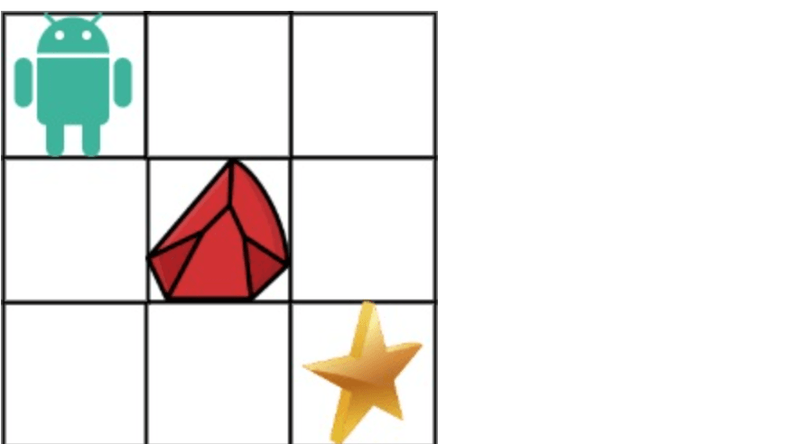
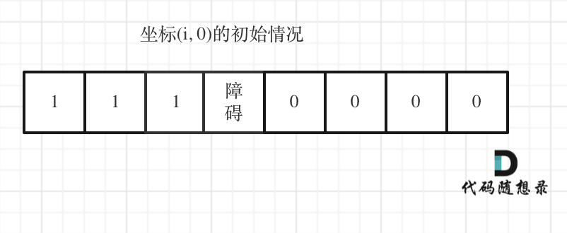
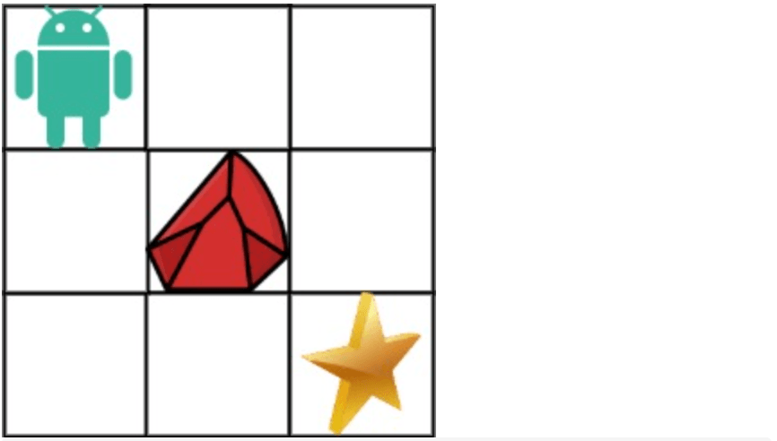
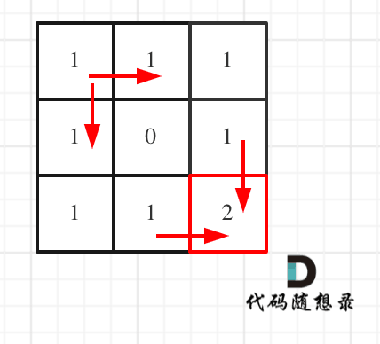

* [做專案（多個 C++、Java、Go、測試開發、前端專案）](https://www.programmercarl.com/other/kstar.html)
* [刷演算法（兩個月高強度學演算法）](https://www.programmercarl.com/xunlian/xunlianying.html)
* [背八股文（40 天挑戰高頻面試題）](https://www.programmercarl.com/xunlian/bagu.html)


# 63. 不同路徑 II

[LeetCode 題目連結](https://leetcode.cn/problems/unique-paths-ii/)

一個機器人位於一個 m x n 格子（grid）的左上角（起始點在下圖中標記為「Start」）。

機器人每次只能向下或者向右移動一步。機器人試圖到達格子的右下角（在下圖中標記為「Finish」）。

現在考慮格子中有障礙物。那麼從左上角到右下角將會有多少條不同的路徑？


格子中的障礙物和空位置分別用 1 和 0 來表示。

範例 1：



* 輸入：obstacleGrid = [[0,0,0],[0,1,0],[0,0,0]]
* 輸出：2
  解釋：
* 3x3 格子的正中間有一個障礙物。
* 從左上角到右下角一共有 2 條不同的路徑：
  1. 向右 -> 向右 -> 向下 -> 向下
  2. 向下 -> 向下 -> 向右 -> 向右

範例 2：


* 輸入：obstacleGrid = [[0,1],[0,0]]
* 輸出：1

提示：

* m == obstacleGrid.length
* n == obstacleGrid[i].length
* 1 <= m, n <= 100
* obstacleGrid[i][j] 為 0 或 1

## 演算法公開課

**[《程式碼隨想錄》演算法影片公開課](https://programmercarl.com/other/gongkaike.html)：[動態規劃（dynamic programming, DP），這次遇到障礙了 | LeetCode：63. 不同路徑 II](https://www.bilibili.com/video/BV1Ld4y1k7c6/)，相信結合影片再看本篇題解，更有助於大家對本題的理解**。


## 解題思路

這道題相對於[62.不同路徑](https://programmercarl.com/0062.不同路径.html)就是有了障礙。

第一次接觸這種題目的同學可能會有點懵，這有障礙了，應該怎麼算呢？

[62.不同路徑](https://programmercarl.com/0062.不同路径.html)中我們已經詳細分析了沒有障礙的情況，有障礙的話，其實就是標記對應的 dp table（dp 陣列（array））保持初始值（0）就可以了。

動態規劃五部曲：

1. 確定 dp 陣列（dp table）以及下標（subscript）的含義

dp[i][j] ：表示從（0 ，0）出發，到 (i, j) 有 dp[i][j] 條不同的路徑。

2. 確定遞迴公式（recurrence formula）

遞迴公式和 62.不同路徑一樣，dp[i][j] =  dp[i - 1][j] + dp[i][j - 1]。

但這裡需要注意一點，因為有了障礙，(i, j) 如果就是障礙的話應該就保持初始狀態（state）（初始狀態為 0）。

所以程式碼為：

```cpp
if (obstacleGrid[i][j] == 0) { // 當 (i, j) 沒有障礙的時候，再推導 dp[i][j]
    dp[i][j] = dp[i - 1][j] + dp[i][j - 1];
}
```

3. dp 陣列如何初始化

在[62.不同路徑](https://programmercarl.com/0062.不同路径.html)中我們給出如下的初始化：

```cpp
vector<vector<int>> dp(m, vector<int>(n, 0)); // 初始值為 0
for (int i = 0; i < m; i++) dp[i][0] = 1;
for (int j = 0; j < n; j++) dp[0][j] = 1;
```

因為從 (0, 0) 的位置到 (i, 0) 的路徑只有一條，所以 dp[i][0] 一定為 1，dp[0][j] 也同理。

但如果 (i, 0) 這條邊有了障礙之後，障礙之後（包括障礙）都是走不到的位置了，所以障礙之後的 dp[i][0] 應該還是初始值 0。

如圖：



下標 (0, j) 的初始化情況同理。

所以本題初始化程式碼為：

```CPP
vector<vector<int>> dp(m, vector<int>(n, 0));
for (int i = 0; i < m && obstacleGrid[i][0] == 0; i++) dp[i][0] = 1;
for (int j = 0; j < n && obstacleGrid[0][j] == 0; j++) dp[0][j] = 1;
```

**注意程式碼裡 for 迴圈（loop）的終止條件，一旦遇到 obstacleGrid[i][0] == 1 的情況就停止 dp[i][0] 賦值為 1 的操作，dp[0][j] 同理**

4. 確定遍歷（traversal）順序

從遞迴公式 dp[i][j] =  dp[i - 1][j] + dp[i][j - 1] 中可以看出，一定是從左到右一層一層遍歷，這樣保證推導 dp[i][j] 的時候，dp[i - 1][j] 和 dp[i][j - 1] 一定是有數值的。

程式碼如下：

```CPP
for (int i = 1; i < m; i++) {
    for (int j = 1; j < n; j++) {
        if (obstacleGrid[i][j] == 1) continue;
        dp[i][j] = dp[i - 1][j] + dp[i][j - 1];
    }
}
```


5. 舉例推導 dp 陣列

拿範例 1 來舉例如圖：



對應的 dp table 如圖：



如果這個圖看不懂，建議再理解一下遞迴公式，然後照著文章中說的遍歷順序，自己推導一下！

動態規劃五部曲分析完畢，對應 C++ 程式碼如下：

```CPP
class Solution {
public:
    int uniquePathsWithObstacles(vector<vector<int>>& obstacleGrid) {
        int m = obstacleGrid.size();
        int n = obstacleGrid[0].size();
        if (obstacleGrid[m - 1][n - 1] == 1 || obstacleGrid[0][0] == 1) // 如果在起點或終點出現了障礙，直接回傳 0
            return 0;
        vector<vector<int>> dp(m, vector<int>(n, 0));
        for (int i = 0; i < m && obstacleGrid[i][0] == 0; i++) dp[i][0] = 1;
        for (int j = 0; j < n && obstacleGrid[0][j] == 0; j++) dp[0][j] = 1;
        for (int i = 1; i < m; i++) {
            for (int j = 1; j < n; j++) {
                if (obstacleGrid[i][j] == 1) continue;
                dp[i][j] = dp[i - 1][j] + dp[i][j - 1];
            }
        }
        return dp[m - 1][n - 1];
    }
};
```

* 時間複雜性（time complexity）：O(n × m)，n、m 分別為 obstacleGrid 長度和寬度
* 空間複雜度（space complexity）：O(n × m)


同樣我們給出空間最佳化版本：

```CPP
class Solution {
public:
    int uniquePathsWithObstacles(vector<vector<int>>& obstacleGrid) {
        if (obstacleGrid[0][0] == 1)
            return 0;
        vector<int> dp(obstacleGrid[0].size());
        for (int j = 0; j < dp.size(); ++j)
            if (obstacleGrid[0][j] == 1)
                dp[j] = 0;
            else if (j == 0)
                dp[j] = 1;
            else
                dp[j] = dp[j-1];

        for (int i = 1; i < obstacleGrid.size(); ++i)
            for (int j = 0; j < dp.size(); ++j){
                if (obstacleGrid[i][j] == 1)
                    dp[j] = 0;
                else if (j != 0)
                    dp[j] = dp[j] + dp[j-1];
            }
        return dp.back();
    }
};
```

* 時間複雜性：O(n × m)，n、m 分別為 obstacleGrid 長度和寬度
* 空間複雜度：O(m)


## 總結

本題是[62.不同路徑](https://programmercarl.com/0062.不同路径.html)的障礙版，整體解題思路大致一致。

但就算是做過 62.不同路徑，在做本題時也會有感覺遇到障礙無從下手。

其實只要考慮到，遇到障礙時 dp[i][j] 保持 0 就可以了。

也有一些小細節，例如：初始化的部分，很容易忽略了障礙之後應該都是 0 的情況。


## 其他語言版本

### Java

```java
class Solution {
    public int uniquePathsWithObstacles(int[][] obstacleGrid) {
        int m = obstacleGrid.length;
        int n = obstacleGrid[0].length;
        int[][] dp = new int[m][n];

        // 如果在起點或終點出現了障礙，直接回傳 0
        if (obstacleGrid[m - 1][n - 1] == 1 || obstacleGrid[0][0] == 1) {
            return 0;
        }

        for (int i = 0; i < m && obstacleGrid[i][0] == 0; i++) {
            dp[i][0] = 1;
        }
        for (int j = 0; j < n && obstacleGrid[0][j] == 0; j++) {
            dp[0][j] = 1;
        }

        for (int i = 1; i < m; i++) {
            for (int j = 1; j < n; j++) {
                dp[i][j] = (obstacleGrid[i][j] == 0) ? dp[i - 1][j] + dp[i][j - 1] : 0;
            }
        }
        return dp[m - 1][n - 1];
    }
}
```

```java
// 空間最佳化版本
class Solution {
    public int uniquePathsWithObstacles(int[][] obstacleGrid) {
        int m = obstacleGrid.length;
        int n = obstacleGrid[0].length;
        int[] dp = new int[n];

        for (int j = 0; j < n && obstacleGrid[0][j] == 0; j++) {
            dp[j] = 1;
        }

        for (int i = 1; i < m; i++) {
            for (int j = 0; j < n; j++) {
                if (obstacleGrid[i][j] == 1) {
                    dp[j] = 0;
                } else if (j != 0) {
                    dp[j] += dp[j - 1];
                }
            }
        }
        return dp[n - 1];
    }
}
```


### Python
動態規劃（版本一）
```python
class Solution:
    def uniquePathsWithObstacles(self, obstacleGrid):
        m = len(obstacleGrid)
        n = len(obstacleGrid[0])
        if obstacleGrid[m - 1][n - 1] == 1 or obstacleGrid[0][0] == 1:
            return 0
        dp = [[0] * n for _ in range(m)]
        for i in range(m):
            if obstacleGrid[i][0] == 0:  # 遇到障礙物時，直接退出迴圈，後面預設都是 0
                dp[i][0] = 1
            else:
                break
        for j in range(n):
            if obstacleGrid[0][j] == 0:
                dp[0][j] = 1
            else:
                break
        for i in range(1, m):
            for j in range(1, n):
                if obstacleGrid[i][j] == 1:
                    continue
                dp[i][j] = dp[i - 1][j] + dp[i][j - 1]
        return dp[m - 1][n - 1]

```
動態規劃（版本二）
```python
class Solution:
    def uniquePathsWithObstacles(self, obstacleGrid):
        m = len(obstacleGrid)  # 格子的橫列數
        n = len(obstacleGrid[0])  # 格子的直行數
        
        if obstacleGrid[m - 1][n - 1] == 1 or obstacleGrid[0][0] == 1:
            # 如果起點或終點有障礙物，直接回傳 0
            return 0
        
        dp = [[0] * n for _ in range(m)]  # 建立一個二維串列用於儲存路徑數
        
        # 設定起點的路徑數為 1
        dp[0][0] = 1 if obstacleGrid[0][0] == 0 else 0
        
        # 計算第一直行的路徑數
        for i in range(1, m):
            if obstacleGrid[i][0] == 0:
                dp[i][0] = dp[i - 1][0]
        
        # 計算第一橫列的路徑數
        for j in range(1, n):
            if obstacleGrid[0][j] == 0:
                dp[0][j] = dp[0][j - 1]
        
        # 計算其他位置的路徑數
        for i in range(1, m):
            for j in range(1, n):
                if obstacleGrid[i][j] == 1:
                    continue
                dp[i][j] = dp[i - 1][j] + dp[i][j - 1]
        
        return dp[m - 1][n - 1]  # 回傳終點的路徑數


```
動態規劃（版本三）

```python
class Solution:
    def uniquePathsWithObstacles(self, obstacleGrid):
        if obstacleGrid[0][0] == 1:
            return 0
        
        dp = [0] * len(obstacleGrid[0])  # 建立一個一維串列用於儲存路徑數
        
        # 初始化第一橫列的路徑數
        for j in range(len(dp)):
            if obstacleGrid[0][j] == 1:
                dp[j] = 0
            elif j == 0:
                dp[j] = 1
            else:
                dp[j] = dp[j - 1]

        # 計算其他橫列的路徑數
        for i in range(1, len(obstacleGrid)):
            for j in range(len(dp)):
                if obstacleGrid[i][j] == 1:
                    dp[j] = 0
                elif j != 0:
                    dp[j] = dp[j] + dp[j - 1]
        
        return dp[-1]  # 回傳最後一個元素，即終點的路徑數

```
動態規劃（版本四）

```python
class Solution:
    def uniquePathsWithObstacles(self, obstacleGrid):
        if obstacleGrid[0][0] == 1:
            return 0
        
        m, n = len(obstacleGrid), len(obstacleGrid[0])
        
        dp = [0] * n  # 建立一個一維串列用於儲存路徑數
        
        # 初始化第一橫列的路徑數
        for j in range(n):
            if obstacleGrid[0][j] == 1:
                break
            dp[j] = 1

        # 計算其他橫列的路徑數
        for i in range(1, m):
            if obstacleGrid[i][0] == 1:
                dp[0] = 0
            for j in range(1, n):
                if obstacleGrid[i][j] == 1:
                    dp[j] = 0
                else:
                    dp[j] += dp[j - 1]
        
        return dp[-1]  # 回傳最後一個元素，即終點的路徑數

```

動態規劃（版本五）

```python
class Solution:
    def uniquePathsWithObstacles(self, obstacleGrid):
        if obstacleGrid[0][0] == 1:
            return 0
        
        m, n = len(obstacleGrid), len(obstacleGrid[0])
        
        dp = [0] * n  # 建立一個一維串列用於儲存路徑數
        
        # 初始化第一橫列的路徑數
        for j in range(n):
            if obstacleGrid[0][j] == 1:
                break
            dp[j] = 1

        # 計算其他橫列的路徑數
        for i in range(1, m):
            if obstacleGrid[i][0] == 1:
                dp[0] = 0
            for j in range(1, n):
                if obstacleGrid[i][j] == 1:
                    dp[j] = 0
                    continue
                
                dp[j] += dp[j - 1]
        
        return dp[-1]  # 回傳最後一個元素，即終點的路徑數


```
### Go

```go
func uniquePathsWithObstacles(obstacleGrid [][]int) int {
	m, n := len(obstacleGrid), len(obstacleGrid[0])
	// 如果在起點或終點出現了障礙，直接回傳 0
	if obstacleGrid[m-1][n-1] == 1 || obstacleGrid[0][0] == 1 {
		return 0
	}
	// 定義一個 dp 陣列
	dp := make([][]int, m)
	for i, _ := range dp {
		dp[i] = make([]int, n)
	}
	// 初始化, 如果是障礙物, 後面的就都是 0, 不用迴圈了
	for i := 0; i < m && obstacleGrid[i][0] == 0; i++ {
		dp[i][0] = 1
	}
	for i := 0; i < n && obstacleGrid[0][i] == 0; i++ {
		dp[0][i] = 1
	}
	// dp 陣列推導過程
	for i := 1; i < m; i++ {
		for j := 1; j < n; j++ {
			// 如果 obstacleGrid[i][j] 這個點是障礙物, 那麼 dp[i][j] 保持為 0
			if obstacleGrid[i][j] != 1 {
				// 否則我們需要計算目前點可以到達的路徑數
				dp[i][j] = dp[i-1][j] + dp[i][j-1]
			}
		}
	}
	return dp[m-1][n-1]
}
```

### JavaScript

```Javascript
var uniquePathsWithObstacles = function(obstacleGrid) {
    const m = obstacleGrid.length
    const n = obstacleGrid[0].length
    const dp = Array(m).fill().map(item => Array(n).fill(0))

    for (let i = 0; i < m && obstacleGrid[i][0] === 0; ++i) {
        dp[i][0] = 1
    }

    for (let i = 0; i < n && obstacleGrid[0][i] === 0; ++i) {
        dp[0][i] = 1
    }

    for (let i = 1; i < m; ++i) {
        for (let j = 1; j < n; ++j) {
            dp[i][j] = obstacleGrid[i][j] === 1 ? 0 : dp[i - 1][j] + dp[i][j - 1]
        }
    }

    return dp[m - 1][n - 1]
};

// 版本二：記憶體最佳化，直接以原陣列為 dp 陣列
var uniquePathsWithObstacles = function(obstacleGrid) {
    const m = obstacleGrid.length;
    const n = obstacleGrid[0].length;
    for (let i = 0; i < m; i++) {
        for (let j = 0; j < n; j++) {
            if (obstacleGrid[i][j] === 0) {
                // 不是障礙物
                if (i === 0) {
                    // 取左邊的值
                    obstacleGrid[i][j] = obstacleGrid[i][j - 1] ?? 1;
                } else if (j === 0) {
                    // 取上邊的值
                    obstacleGrid[i][j] = obstacleGrid[i - 1]?.[j] ?? 1;
                } else {
                    // 取左邊和上邊的和
                    obstacleGrid[i][j] = obstacleGrid[i - 1][j] + obstacleGrid[i][j - 1];
                }
            } else {
                // 如果是障礙物，則路徑為 0
                obstacleGrid[i][j] = 0;
            }
        }
    }
    return obstacleGrid[m - 1][n - 1];
};
```


### TypeScript

```typescript
function uniquePathsWithObstacles(obstacleGrid: number[][]): number {
    /**
        dp[i][j]: 到達 (i, j) 的路徑數
        dp[0][*]: 用 u 表示第一個障礙物下標，則 u 之前為 1，u 之後（含 u）為 0
        dp[*][0]: 同上
        ...
        dp[i][j]: obstacleGrid[i][j] === 1 ? 0 : dp[i-1][j] + dp[i][j-1];
     */
    const m: number = obstacleGrid.length;
    const n: number = obstacleGrid[0].length;
    const dp: number[][] = new Array(m).fill(0).map(_ => new Array(n).fill(0));
    for (let i = 0; i < m && obstacleGrid[i][0] === 0; i++) {
        dp[i][0] = 1;
    }
    for (let i = 0; i < n && obstacleGrid[0][i] === 0; i++) {
        dp[0][i] = 1;
    }
    for (let i = 1; i < m; i++) {
        for (let j = 1; j < n; j++) {
            if (obstacleGrid[i][j] === 1) continue;
            dp[i][j] = dp[i - 1][j] + dp[i][j - 1];
        }
    }
    return dp[m - 1][n - 1];
};
```

// 版本二：dp 改為使用一維陣列（one dimensional array），從終點開始遍歷
```typescript
function uniquePathsWithObstacles(obstacleGrid: number[][]): number {
  const m = obstacleGrid.length;
  const n = obstacleGrid[0].length;
  
  const dp: number[] = new Array(n).fill(0);
  dp[n - 1] = 1;

  // 由下而上，右而左進行遍歷
  for (let i = m - 1; i >= 0; i--) {
    for (let j = n - 1; j >= 0; j--) {
      if (obstacleGrid[i][j] === 1) dp[j] = 0;
      else dp[j] = dp[j] + (dp[j + 1] || 0); 
    }
  }

  return dp[0];
};
```

### Rust

```Rust
impl Solution {
    pub fn unique_paths_with_obstacles(obstacle_grid: Vec<Vec<i32>>) -> i32 {
        let m: usize = obstacle_grid.len();
        let n: usize = obstacle_grid[0].len();
        if obstacle_grid[0][0] == 1 || obstacle_grid[m-1][n-1] == 1 {
            return 0;
        }
        let mut dp = vec![vec![0; n]; m];
        for i in 0..m {
            if obstacle_grid[i][0] == 1 {
                break;
            }
            else { dp[i][0] = 1; }
        }
        for j in 0..n {
            if obstacle_grid[0][j] == 1 {
                break;
            }
            else { dp[0][j] = 1; }
        }
        for i in 1..m {
            for j in 1..n {
                if obstacle_grid[i][j] == 1 {
                    continue;
                }
                dp[i][j] = dp[i-1][j] + dp[i][j-1];
            }
        }
        dp[m-1][n-1]
    }
}
```

空間最佳化：

```rust
impl Solution {
    pub fn unique_paths_with_obstacles(obstacle_grid: Vec<Vec<i32>>) -> i32 {
        let mut dp = vec![0; obstacle_grid[0].len()];
        for (i, &v) in obstacle_grid[0].iter().enumerate() {
            if v == 0 {
                dp[i] = 1;
            } else {
                break;
            }
        }
        for rows in obstacle_grid.iter().skip(1) {
            for j in 0..rows.len() {
                if rows[j] == 1 {
                    dp[j] = 0;
                } else if j != 0 {
                    dp[j] += dp[j - 1];
                }
            }
        }
        dp.pop().unwrap()
    }
}
```

### C

```c
// 初始化 dp 陣列
int **initDP(int m, int n, int** obstacleGrid) {
    int **dp = (int**)malloc(sizeof(int*) * m);
    int i, j;
    // 初始化每一橫列陣列
    for(i = 0; i < m; ++i) {
        dp[i] = (int*)malloc(sizeof(int) * n);
    }

    // 先將第一橫列第一直行設為 0
    for(i = 0; i < m; ++i) {
        dp[i][0] = 0;
    }
    for(j = 0; j < n; ++j) {
        dp[0][j] = 0;
    }

    // 若碰到障礙，之後的都走不了。退出迴圈
    for(i = 0; i < m; ++i) {
        if(obstacleGrid[i][0]) {
            break;
        }
        dp[i][0] = 1;
    }
    for(j = 0; j < n; ++j) {
        if(obstacleGrid[0][j])
            break;
        dp[0][j] = 1;
    }
    return dp;
}

int uniquePathsWithObstacles(int** obstacleGrid, int obstacleGridSize, int* obstacleGridColSize){
    int m = obstacleGridSize, n = *obstacleGridColSize;
    // 初始化 dp 陣列
    int **dp = initDP(m, n, obstacleGrid);

    int i, j;
    for(i = 1; i < m; ++i) {
        for(j = 1; j < n; ++j) {
            // 若目前 i,j 位置有障礙
            if(obstacleGrid[i][j])
                // 路線不同
                dp[i][j] = 0;
            else
                dp[i][j] = dp[i-1][j] + dp[i][j-1];
        }
    }
    // 回傳最後終點的路徑個數
    return dp[m-1][n-1];
}
```

空間最佳化版本：

```c
int uniquePathsWithObstacles(int** obstacleGrid, int obstacleGridSize, int* obstacleGridColSize){
    int m = obstacleGridSize;
    int n = obstacleGridColSize[0];
    int *dp = (int*)malloc(sizeof(int) * n);
    int i, j;

    // 初始化 dp 為第一橫列起始狀態。
    for (j = 0; j < n; ++j) {
        if (obstacleGrid[0][j] == 1)
            dp[j] = 0;
        else if (j == 0)
            dp[j] = 1;
        else
            dp[j] = dp[j - 1];
    }

    for (i = 1; i < m; ++i) {
        for (j = 0; j < n; ++j) {
            if (obstacleGrid[i][j] == 1)
                dp[j] = 0;
            // 若 j 為 0，dp[j] 表示最左邊一直行，無需改動
            // 此處 dp[j],dp[j-1] 等同於二維 dp 中的 dp[i-1][j] 和 dp[i][j-1]
            else if (j != 0)
                dp[j] += dp[j - 1];
        }
    }

    return dp[n - 1];
}
```

### Scala

```scala
object Solution {
  import scala.util.control.Breaks._
  def uniquePathsWithObstacles(obstacleGrid: Array[Array[Int]]): Int = {
    var (m, n) = (obstacleGrid.length, obstacleGrid(0).length)
    var dp = Array.ofDim[Int](m, n)

    // 比如 break、continue 這些流程控制需要使用 breakable
    breakable(
      for (i <- 0 until m) {
        if (obstacleGrid(i)(0) != 1) dp(i)(0) = 1
        else break()
      }
    )
    breakable(
      for (j <- 0 until n) {
        if (obstacleGrid(0)(j) != 1) dp(0)(j) = 1
        else break()
      }
    )

    for (i <- 1 until m; j <- 1 until n; if obstacleGrid(i)(j) != 1) {
      dp(i)(j) = dp(i - 1)(j) + dp(i)(j - 1)
    }

    dp(m - 1)(n - 1)
  }
}
```
### C#
```csharp
public class Solution
{
    public int UniquePathsWithObstacles(int[][] obstacleGrid)
    {
        int m = obstacleGrid.Length;
        int n = obstacleGrid[0].Length;
        int[,] dp = new int[m, n];
        if (obstacleGrid[0][0] == 1 || obstacleGrid[m - 1][n - 1] == 1) return 0;
        for (int i = 0; i < m && obstacleGrid[i][0] == 0; i++) dp[i, 0] = 1;
        for (int j = 0; j < n && obstacleGrid[0][j] == 0; j++) dp[0, j] = 1;
        for (int i = 1; i < m; i++)
        {
            for (int j = 1; j < n; j++)
            {
                if (obstacleGrid[i][j] == 1) continue;
                dp[i, j] = dp[i - 1, j] + dp[i, j - 1];
            }
        }
        return dp[m - 1, n - 1];
    }
}
```


