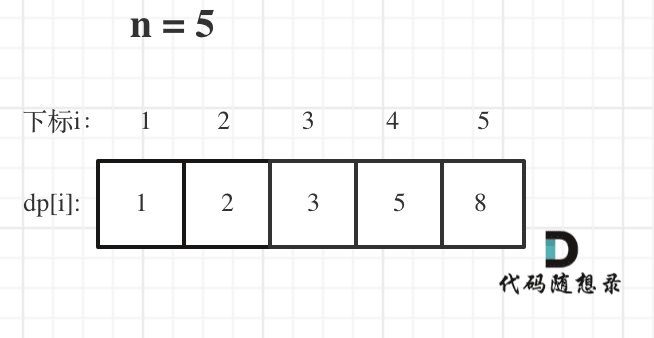

* [做專案（多個 C++、Java、Go、測試開發、前端專案）](https://www.programmercarl.com/other/kstar.html)
* [刷演算法（兩個月高強度學演算法）](https://www.programmercarl.com/xunlian/xunlianying.html)
* [背八股文（40 天挑戰高頻面試題）](https://www.programmercarl.com/xunlian/bagu.html)

# 70. 爬樓梯

[LeetCode 題目連結](https://leetcode.cn/problems/climbing-stairs/)

假設你正在爬樓梯。需要 n 階你才能到達樓頂。

每次你可以爬 1 或 2 個台階。你有多少種不同的方法可以爬到樓頂呢？

注意：給定 n 是一個正整數（positive integer）。

範例 1：
* 輸入： 2
* 輸出： 2
* 解釋： 有兩種方法可以爬到樓頂。
    * 1 階 + 1 階
    * 2 階

範例 2：
* 輸入： 3
* 輸出： 3
* 解釋： 有三種方法可以爬到樓頂。
    * 1 階 + 1 階 + 1 階
    * 1 階 + 2 階
    * 2 階 + 1 階

## 演算法公開課

**[《程式碼隨想錄》演算法影片公開課](https://programmercarl.com/other/gongkaike.html)：[帶你學透動態規劃（dynamic programming, DP）-爬樓梯 | LeetCode：70.爬樓梯](https://www.bilibili.com/video/BV17h411h7UH)，相信結合影片再看本篇題解，更有助於大家對本題的理解**。


## 解題思路

本題大家如果沒有接觸過的話，會感覺比較難，多舉幾個例子，就可以發現其規律。

爬到第一層樓梯有一種方法，爬到第二層樓梯有兩種方法。

那麼第一層樓梯再跨兩步就到第三層，第二層樓梯再跨一步就到第三層。

所以到第三層樓梯的狀態（state）可以由第二層樓梯和到第一層樓梯的狀態推導出來，那麼就可以想到動態規劃（dynamic programming, DP）了。

我們來分析一下，DP五部曲：

定義一個一維陣列（one dimensional array）來記錄不同樓層的狀態

1. 確定 dp 陣列以及下標（subscript）的含義

dp[i]：爬到第 i 層樓梯，有 dp[i] 種方法

2. 確定遞迴公式（recurrence formula）

如何可以推出 dp[i] 呢？

從 dp[i] 的定義可以看出，dp[i] 可以有兩個方向推出來。

首先是 dp[i - 1]，上 i-1 層樓梯，有 dp[i - 1] 種方法，那麼再一步跳一個台階不就是 dp[i] 了嗎。

還有就是 dp[i - 2]，上 i-2 層樓梯，有 dp[i - 2] 種方法，那麼再一步跳兩個台階不就是 dp[i] 了嗎。

那麼 dp[i] 就是 dp[i - 1] 與 dp[i - 2] 之和！

所以 dp[i] = dp[i - 1] + dp[i - 2] 。

在推導 dp[i] 的時候，一定要時刻想著 dp[i] 的定義，否則容易跑偏。

這體現出確定 dp 陣列以及下標含義的重要性！

3. dp 陣列如何初始化

再回顧一下 dp[i] 的定義：爬到第 i 層樓梯，有 dp[i] 種方法。

那麼 i 為 0，dp[i] 應該是多少呢，這個可以有很多解釋，但基本都是直接奔著答案去解釋的。

例如強行安慰自己爬到第 0 層，也有一種方法，什麼都不做也就是一種方法，即：dp[0] = 1，相當於直接站在樓頂。

但總有點牽強的成分。

那還可以這樣理解：我就認為爬到第 0 層，方法就是 0 啊，一步只能走一個台階或者兩個台階，然而樓層是 0，直接站在樓頂上了，就是不用方法，dp[0] 就應該是 0。

**其實這麼爭論下去沒有意義，大部分解釋說 dp[0] 應該為 1 的理由，其實是因為 dp[0] = 1 的話在遞推的過程中 i 從 2 開始遍歷（traversal）本題就能過，然後就往結果上靠去解釋 dp[0] = 1**。

從 dp 陣列定義的角度上來說，dp[0] = 0 也能說得通。

需要注意的是：題目中說了 n 是一個正整數，題目根本就沒說 n 有為 0 的情況。

所以本題其實就不應該討論 dp[0] 的初始化！

我相信 dp[1] = 1，dp[2] = 2，這個初始化大家應該都沒有爭議的。

所以我的原則是：不考慮 dp[0] 如何初始化，只初始化 dp[1] = 1，dp[2] = 2，然後從 i = 3 開始遞推，這樣才符合 dp[i] 的定義。

4. 確定遍歷順序

從遞迴公式 dp[i] = dp[i - 1] + dp[i - 2]; 中可以看出，遍歷順序一定是從前向後遍歷的

5. 舉例推導 dp 陣列

舉例當 n 為 5 的時候，dp table（dp 陣列）應該是這樣的




如果程式碼出問題了，就把 dp table 印出來，看看究竟是不是和自己推導的一樣。

**此時大家應該發現了，這不就是斐波那契序列（Fibonacci sequence）嗎！**

唯一的區別是，沒有討論 dp[0] 應該是什麼，因為 dp[0] 在本題沒有意義！

以上五部分分析完之後，C++ 程式碼如下：

```CPP
// 版本一
class Solution {
public:
    int climbStairs(int n) {
        if (n <= 1) return n; // 因為下面直接對 dp[2] 操作了，防止空指標
        vector<int> dp(n + 1);
        dp[1] = 1;
        dp[2] = 2;
        for (int i = 3; i <= n; i++) { // 注意 i 是從 3 開始的
            dp[i] = dp[i - 1] + dp[i - 2];
        }
        return dp[n];
    }
};
```

* 時間複雜度（time complexity）：O(n)
* 空間複雜度（space complexity）：O(n)

當然依然也可以最佳化一下空間複雜度，程式碼如下：

```CPP
// 版本二
class Solution {
public:
    int climbStairs(int n) {
        if (n <= 1) return n;
        int dp[3];
        dp[1] = 1;
        dp[2] = 2;
        for (int i = 3; i <= n; i++) {
            int sum = dp[1] + dp[2];
            dp[1] = dp[2];
            dp[2] = sum;
        }
        return dp[2];
    }
};
```

* 時間複雜度：O(n)
* 空間複雜度：O(1)

後面將講解的很多DP題目其實都是目前狀態依賴前兩個，或者前三個狀態，都可以做空間上的最佳化，**但我個人認為面試中能寫出版本一就夠了，清晰明瞭，如果面試官要求進一步最佳化空間的話，我們再去最佳化**。

因為版本一才能體現出DP的思想精髓，遞推的狀態變化。

## 拓展

這道題目還可以繼續深化，就是一步一個台階，兩個台階，三個台階，直到 m 個台階，有多少種方法爬到 n 階樓頂。

這又有難度了，這其實是一個無界背包問題（unbounded knapsack problem），但 LeetCode 上沒有這種題目，大家可以去 KamaCoder 做一下 [57. 爬樓梯](https://kamacoder.com/problempage.php?pid=1067)


所以後續我在講解背包問題（knapsack problem）的時候，今天這道題還會從背包問題的角度上再講一遍。如果想提前看一下，可以看這篇：[70.爬樓梯無界背包版本](https://programmercarl.com/0070.%E7%88%AC%E6%A5%BC%E6%A2%AF%E5%AE%8C%E5%85%A8%E8%83%8C%E5%8C%85%E7%89%88%E6%9C%AC.html)

這裡我先給出本題的程式碼：

```CPP
class Solution {
public:
    int climbStairs(int n) {
        vector<int> dp(n + 1, 0);
        dp[0] = 1;
        for (int i = 1; i <= n; i++) {
            for (int j = 1; j <= m; j++) { // 把 m 換成 2，就可以 AC 爬樓梯這道題
                if (i - j >= 0) dp[i] += dp[i - j];
            }
        }
        return dp[n];
    }
};
```

程式碼中 m 表示最多可以爬 m 個台階。

**以上程式碼不能執行喔，我主要是為了體現只要把 m 換成 2，貼過去，就可以 AC 爬樓梯這道題，不信你就貼過去試試**。


**此時我就發現一個絕佳的大廠面試題**，第一道題就是單純的爬樓梯，然後看候選人的程式碼實作，如果把 dp[0] 定義成 1 了，就可以追問了，為什麼 dp[0] 一定要初始化為 1，此時可能候選人就要強行給 dp[0] 應該是 1 找各種理由。那這就是一個考點了，對 dp[i] 的定義理解得不夠深入。

然後可以繼續追問，如果一步一個台階，兩個台階，三個台階，直到 m 個台階，有多少種方法爬到 n 階樓頂。這道題目 LeetCode 上並沒有原題，絕對是考驗候選人演算法能力的好題。

這一連串問下來，候選人演算法能力如何，面試官心裡就有數了。

**其實大廠面試最喜歡的問題就是這種簡單題，然後慢慢變化，在小細節上考驗候選人**。


## 總結

這道題目和[動態規劃：斐波那契數](https://programmercarl.com/0509.斐波那契数.html)題目基本是一樣的，但是會發現本題相比[動態規劃：斐波那契數](https://programmercarl.com/0509.斐波那契数.html)難多了，為什麼呢？

關鍵是 [動態規劃：斐波那契數](https://programmercarl.com/0509.斐波那契数.html) 題目描述就已經把DP五部曲裡的遞迴公式和如何初始化都給出來了，剩下幾部曲也自然而然地推出來了。

而本題，就需要逐個分析了，大家現在應該初步感受到[關於動態規劃，你該了解這些！](https://programmercarl.com/动态规划理论基础.html)裡給出的DP五部曲了。

簡單題是用來掌握方法論的，例如昨天斐波那契的題目夠簡單了吧，但昨天和今天可以使用一套方法分析出來的，這就是方法論！

所以不要輕視簡單題，那種憑感覺就刷過去的，其實和沒掌握區別不大，只有掌握方法論並說清一二三，才能觸類旁通，舉一反三！


## 其他語言版本


### Java

```java
// 常規方式
public int climbStairs(int n) {
    int[] dp = new int[n + 1];
    dp[0] = 1;
    dp[1] = 1;
    for (int i = 2; i <= n; i++) {
        dp[i] = dp[i - 1] + dp[i - 2];
    }
    return dp[n];
}
```

```Java
// 用變數記錄代替陣列
class Solution {
    public int climbStairs(int n) {
        if(n <= 2) return n;
        int a = 1, b = 2, sum = 0;

        for(int i = 3; i <= n; i++){
            sum = a + b;  // f(i - 1) + f(i - 2)
            a = b;        // 記錄 f(i - 1)，即下一輪的 f(i - 2)
            b = sum;      // 記錄 f(i)，即下一輪的 f(i - 1)
        }
        return b;
    }
}
```

### Python
DP
```python
# 空間複雜度為 O(n) 版本
class Solution:
    def climbStairs(self, n: int) -> int:
        if n <= 1:
            return n
        
        dp = [0] * (n + 1)
        dp[1] = 1
        dp[2] = 2
        
        for i in range(3, n + 1):
            dp[i] = dp[i - 1] + dp[i - 2]
        
        return dp[n]

```
DP
```python

# 空間複雜度為 O(3) 版本
class Solution:
    def climbStairs(self, n: int) -> int:
        if n <= 1:
            return n
        
        dp = [0] * 3
        dp[1] = 1
        dp[2] = 2
        
        for i in range(3, n + 1):
            total = dp[1] + dp[2]
            dp[1] = dp[2]
            dp[2] = total
        
        return dp[2]

```
DP
```python

# 空間複雜度為 O(1) 版本
class Solution:
    def climbStairs(self, n: int) -> int:
        if n <= 1:
            return n
        
        prev1 = 1
        prev2 = 2
        
        for i in range(3, n + 1):
            total = prev1 + prev2
            prev1 = prev2
            prev2 = total
        
        return prev2


```
### Go
```Go
func climbStairs(n int) int {
    if n == 1 {
        return 1
    }
    dp := make([]int, n+1)
    dp[1] = 1
    dp[2] = 2
    for i := 3; i <= n; i++ {
        dp[i] = dp[i-1] + dp[i-2]
    }
    return dp[n]
}
```
### JavaScript
```Javascript
var climbStairs = function(n) {
    // dp[i] 為第 i 階樓梯有多少種方法爬到樓頂
    // dp[i] = dp[i - 1] + dp[i - 2]
    let dp = [1 , 2]
    for(let i = 2; i < n; i++) {
        dp[i] = dp[i - 1] + dp[i - 2]
    }
    return dp[n - 1]
};
```

### TypeScript

> 爬 2 階

```typescript
function climbStairs(n: number): number {
    /**
        dp[i]: i 階樓梯的方法種數
        dp[1]: 1;
        dp[2]: 2;
        ...
        dp[i]: dp[i - 1] + dp[i - 2];
     */
    const dp: number[] = [];
    dp[1] = 1;
    dp[2] = 2;
    for (let i = 3; i <= n; i++) {
        dp[i] = dp[i - 1] + dp[i - 2];
    }
    return dp[n];
};
```

> 爬 m 階

```typescript
function climbStairs(n: number): number {
    /**
        一次可以爬 m 階
        dp[i]: i 階樓梯的方法種數
        dp[1]: 1;
        dp[2]: 2;
        dp[3]: dp[2] + dp[1];
        ...
        dp[i]: dp[i - 1] + dp[i - 2] + ... + dp[max(i - m, 1)]; 從 i-1 加到 max(i-m, 1)
     */
    const m: number = 2;    // 本題 m 為 2
    const dp: number[] = new Array(n + 1).fill(0);
    dp[1] = 1;
    dp[2] = 2;
    for (let i = 3; i <= n; i++) {
        const end: number = Math.max(i - m, 1);
        for (let j = i - 1; j >= end; j--) {
            dp[i] += dp[j];
        }
    }
    return dp[n];
};
```

### C

```c
int climbStairs(int n){
    // 若 n <= 2，回傳 n
    if(n <= 2)
        return n;
    // 初始化 dp 陣列，陣列大小為 n+1
    int *dp = (int *)malloc(sizeof(int) * (n + 1));
    dp[0] = 0, dp[1] = 1, dp[2] = 2;

    // 從前向後遍歷陣列，dp[i] = dp[i-1] + dp[i-2]
    int i;
    for(i = 3; i <= n; ++i) {
        dp[i] = dp[i - 1] + dp[i - 2];
    }
    // 回傳 dp[n]
    return dp[n];
}
```

最佳化空間複雜度：
```c
int climbStairs(int n){
    // 若 n <= 2，回傳 n
    if(n <= 2)
        return n;
    // 初始化 dp 陣列，陣列大小為 3
    int *dp = (int *)malloc(sizeof(int) * 3);
    dp[1] = 1, dp[2] = 2;

    // 只記錄前面兩個台階的狀態
    int i;
    for(i = 3; i <= n; ++i) {
        int sum = dp[1] + dp[2];
        dp[1] = dp[2];
        dp[2] = sum;
    }
    // 回傳 dp[2]
    return dp[2];
}
```

### Scala

```scala
object Solution {
  def climbStairs(n: Int): Int = {
    if (n <= 2) return n
    var dp = new Array[Int](n + 1)
    dp(1) = 1
    dp(2) = 2
    for (i <- 3 to n) {
      dp(i) = dp(i - 1) + dp(i - 2)
    }
    dp(n)
  }
}
```

最佳化空間複雜度：
```scala
object Solution {
  def climbStairs(n: Int): Int = {
    if (n <= 2) return n
    var (a, b) = (1, 2)
    for (i <- 3 to n) {
      var tmp = a + b
      a = b
      b = tmp
    }
    b // 最終回傳 b
  }
}
```

### C#

```csharp
public class Solution {
    public int ClimbStairs(int n) {
        if(n<=2) return n;
        int[] dp = new int[2] { 1, 2 };
        for (int i = 3; i <= n; i++)
        {
            int temp = dp[0] + dp[1];
            dp[0] = dp[1];
            dp[1] = temp;
        }
        return dp[1];
    }
}
```

### Rust

```rust
impl Solution {
    pub fn climb_stairs(n: i32) -> i32 {
        if n <= 1 {
            return n;
        }
        let (mut a, mut b, mut f) = (1, 1, 0);
        for _ in 2..=n {
            f = a + b;
            a = b;
            b = f;
        }
        f
}
```

dp 陣列

```rust
impl Solution {
    pub fn climb_stairs(n: i32) -> i32 {
        let n = n as usize;
        let mut dp = vec![0; n + 1];
        dp[0] = 1;
        dp[1] = 1;
        for i in 2..=n {
            dp[i] = dp[i - 1] + dp[i - 2];
        }
        dp[n]
    }
}
```


