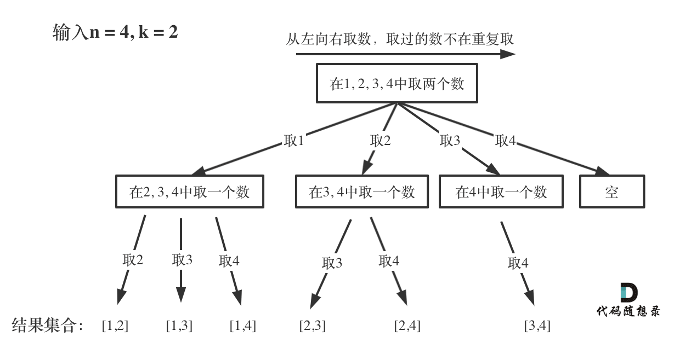
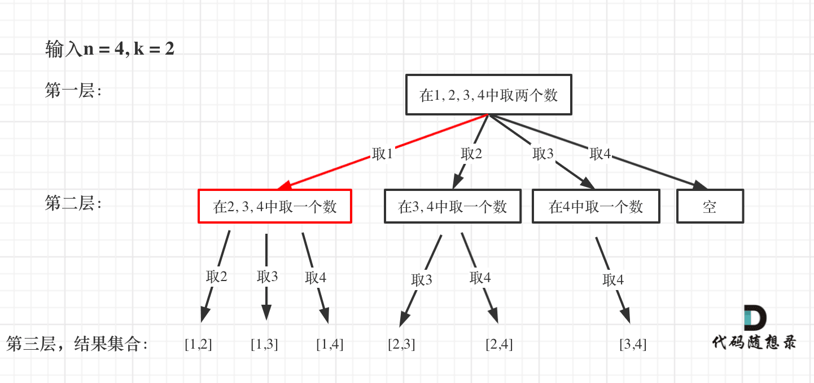
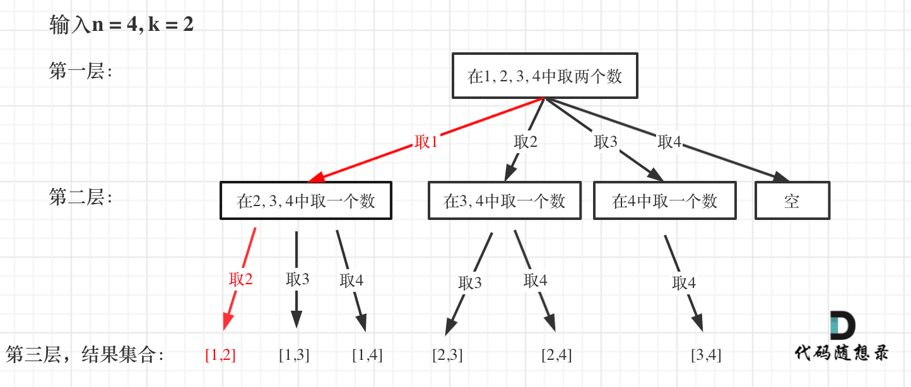
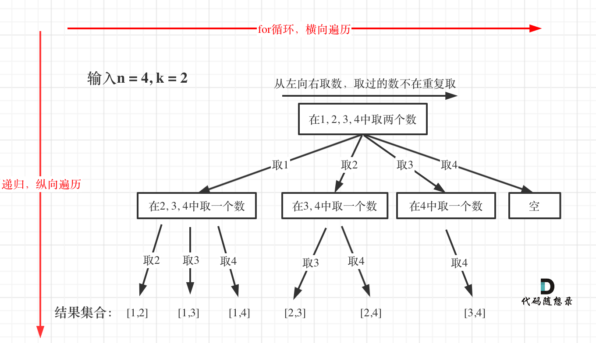
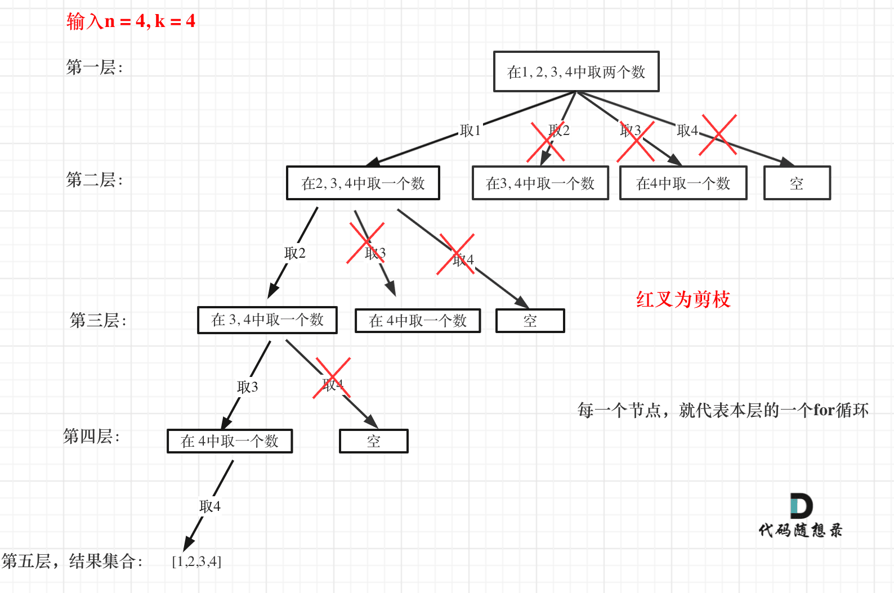

* [做專案（多個 C++、Java、Go、測試開發、前端（front end）專案）](https://www.programmercarl.com/other/kstar.html)
* [刷演算法（兩個月高強度學演算法）](https://www.programmercarl.com/xunlian/xunlianying.html)
* [準備面試必考題（40 天挑戰高頻面試題）](https://www.programmercarl.com/xunlian/bagu.html)


# 第 77 題. 組合（combination）

[LeetCode 題目連結](https://leetcode.com/problems/combinations/ )

給定兩個整數（integer） n 和 k，回傳 1 ... n 中所有可能的 k 個數的組合。

範例:
輸入: n = 4, k = 2
輸出:
[
  [2,4],
  [3,4],
  [2,3],
  [1,2],
  [1,3],
  [1,4],
]

## 演算法公開課

**[《程式碼隨想錄》演算法影片公開課](https://programmercarl.com/other/gongkaike.html)：[帶你學透回溯演算法（backtracking algorithm）-組合問題（對應 LeetCode 題目：77.組合）](https://www.bilibili.com/video/BV1ti4y1L7cv)，[組合問題的修剪法（pruning）操作](https://www.bilibili.com/video/BV1wi4y157er)，相信結合影片再看本篇題解，更有助於大家對本題的理解**。


## 解題思路


本題是回溯法（backtracking）的經典題目。

最直接的解法當然是使用 for 迴圈（for-loop），例如範例中 k 為 2，很容易想到用兩個 for 迴圈，這樣就可以輸出和範例中一樣的結果。

程式碼如下：

```CPP
int n = 4;
for (int i = 1; i <= n; i++) {
    for (int j = i + 1; j <= n; j++) {
        cout << i << " " << j << endl;
    }
}
```

輸入：n = 100, k = 3
那麼就三層 for 迴圈，程式碼如下：

```CPP
int n = 100;
for (int i = 1; i <= n; i++) {
    for (int j = i + 1; j <= n; j++) {
        for (int u = j + 1; u <= n; n++) {
            cout << i << " " << j << " " << u << endl;
        }
    }
}
```

**如果 n 為 100，k 為 50 呢，那就 50 層 for 迴圈，是不是開始覺得窒息了**。

**此時就會發現雖然想進行蠻力搜尋（brute force searching），但是用 for 迴圈嵌套連蠻力（brute force）都寫不出來！**

怎麼辦？

回溯搜尋法登場了，雖然回溯法也是蠻力解法，但至少寫得出來，不像 for 迴圈嵌套 k 層讓人絕望。

那麼回溯法怎麼進行蠻力搜尋呢？

上面我們說了**要解決 n 為 100、k 為 50 的情況，蠻力寫法需要嵌套 50 層 for 迴圈，而回溯法就用遞迴（recursion）來解決嵌套層數的問題**。

用遞迴來做層疊嵌套（可以理解為開 k 層 for 迴圈），**每一次的遞迴中嵌套一個 for 迴圈，那麼遞迴就可以用來解決多層嵌套迴圈的問題了**。

此時遞迴的層數大家應該知道了，例如：n 為 100、k 為 50 的情況下，就是遞迴 50 層。

有些同學本來對遞迴就一頭霧水，回溯法中遞迴還要嵌套 for 迴圈，可能就直接暈倒了！

如果憑空腦補模擬（simulation）回溯搜尋的過程，絕對會讓人窒息，所以需要抽象成圖形結構來進一步理解。

**我們在[關於回溯演算法，你該了解這些！](./回溯演算法理論基礎.md)中說到，回溯法解決的問題都可以抽象為樹狀結構（tree structure）（n 元樹（n-ary tree）），用樹狀結構來理解回溯就容易多了**。

那麼我把組合問題抽象為如下樹狀結構：



可以看出這棵樹，一開始集合（set）是 1，2，3，4，從左向右取數，取過的數不再重複取。

第一次取 1，集合變為 2，3，4，因為 k 為 2，我們只需要再取一個數就可以了，分別取 2，3，4，得到集合 [1,2]、[1,3]、[1,4]，依此類推。

**每次從集合中選取元素（element），可選擇的範圍隨著選擇的進行而收縮，以此調整可選擇的範圍**。

**圖中可以發現 n 相當於樹（tree）的寬度（width），k 相當於樹的深度（depth）**。

那麼如何在這棵樹上遍歷（traversal），然後收集到我們要的結果集呢？

**圖中每次搜尋到了葉節點（leaf node），我們就找到了一個結果**。

相當於只需要把到達葉節點的結果收集起來，就可以求得 n 個數中 k 個數的組合集合。

在[關於回溯演算法，你該了解這些！](./回溯演算法理論基礎.md)中我們提到了回溯法三部曲，那麼我們按照回溯法三部曲開始正式講解程式碼了。


### 回溯法三部曲

* 遞迴函數（recursive function）的回傳值（return value）以及參數（parameter）

在這裡要定義兩個全域變數（global variable），一個用來存放符合條件的單一結果，一個用來存放符合條件結果的集合。

程式碼如下：

```cpp
vector<vector<int>> result; // 存放符合條件結果的集合
vector<int> path; // 用來存放符合條件結果
```

其實不定義這兩個全域變數也是可以的，把這兩個變數（variable）放進遞迴函數的參數裡也行，但函數（function）裡參數太多會影響可讀性（readability），所以我定義了全域變數。

函數裡一定有兩個參數，既然是集合 n 裡面取 k 個數，那麼 n 和 k 是兩個 int 型別的參數。

然後還需要一個參數，為 int 型別變數 startIndex，這個參數用來記錄本層遞迴中，集合從哪裡開始遍歷（集合就是 [1,...,n]）。

為什麼要有這個 startIndex 呢？

**建議在[77.組合影片講解](https://www.bilibili.com/video/BV1ti4y1L7cv)中，07:36 的時候開始聽，startIndex 就是用來防止出現重複的組合**。

從下圖中紅線部分可以看出，在集合 [1,2,3,4] 取 1 之後，下一層遞迴就要在 [2,3,4] 中取數了，那麼下一層遞迴如何知道要從 [2,3,4] 中取數呢？靠的就是 startIndex。



所以需要 startIndex 來記錄下一層遞迴搜尋的起始位置。

那麼整體程式碼如下：

```cpp
vector<vector<int>> result; // 存放符合條件結果的集合
vector<int> path; // 用來存放符合條件單一結果
void backtracking(int n, int k, int startIndex)
```

* 回溯函數終止條件

什麼時候到達所謂的葉節點了呢？

path 這個陣列（array）的大小如果達到 k，說明我們找到了一個子集（subset）大小為 k 的組合了，在圖中 path 存的就是根節點（root node）到葉節點的路徑。

如圖紅色部分：



此時用 result 二維（2D）陣列，把 path 保存起來，並終止本層遞迴。

所以終止條件程式碼如下：

```cpp
if (path.size() == k) {
    result.push_back(path);
    return;
}
```

* 單層搜尋的過程

回溯法的搜尋過程就是一個樹狀結構的遍歷過程，在如下圖中，可以看出 for 迴圈用來橫向遍歷，遞迴的過程則是縱向遍歷。



如此我們才遍歷完圖中的這棵樹。

for 迴圈每次從 startIndex 開始遍歷，然後用 path 保存取到的節點（node） i。

程式碼如下：

```CPP
for (int i = startIndex; i <= n; i++) { // 控制樹的橫向遍歷
    path.push_back(i); // 處理節點
    backtracking(n, k, i + 1); // 遞迴：控制樹的縱向遍歷，注意下一層搜尋要從 i+1 開始
    path.pop_back(); // 回溯，撤銷處理的節點
}
```

可以看出 backtracking（遞迴函數）透過不斷呼叫自己一直往深處遍歷，總會遇到葉節點，遇到了葉節點就要回傳。

backtracking 的下面部分就是回溯的操作了，撤銷本次處理的結果。

關鍵地方都講完了，組合問題 C++ 完整程式碼如下：


```CPP
class Solution {
private:
    vector<vector<int>> result; // 存放符合條件結果的集合
    vector<int> path; // 用來存放符合條件結果
    void backtracking(int n, int k, int startIndex) {
        if (path.size() == k) {
            result.push_back(path);
            return;
        }
        for (int i = startIndex; i <= n; i++) {
            path.push_back(i); // 處理節點
            backtracking(n, k, i + 1); // 遞迴
            path.pop_back(); // 回溯，撤銷處理的節點
        }
    }
public:
    vector<vector<int>> combine(int n, int k) {
        result.clear(); // 可以不寫
        path.clear();   // 可以不寫
        backtracking(n, k, 1);
        return result;
    }
};
```
* 時間複雜度（time complexity）: O(n * 2^n)
* 空間複雜度（space complexity）: O(n)


還記得我們在[關於回溯演算法，你該了解這些！](./回溯演算法理論基礎.md)中給出的回溯法模板（template）嗎？

如下：

```
void backtracking(參數) {
    if (終止條件) {
        存放結果;
        return;
    }

    for (選擇：本層集合中元素（樹中節點子節點的數量就是集合的大小）) {
        處理節點;
        backtracking(路徑，選擇列表); // 遞迴
        回溯，撤銷處理結果
    }
}
```

**對比一下本題的程式碼，是不是發現有點像！** 所以有了這個模板，就有解題的大致方向，不至於毫無頭緒。

## 總結

組合問題是回溯法解決的經典問題，我們一開始給大家列舉了一個很形象的例子，就是 n 為 100、k 為 50 的話，最直接的想法就需要 50 層 for 迴圈。

從而引出了回溯法就是用來解決這種 k 層 for 迴圈嵌套的問題。

然後進一步把回溯法的搜尋過程抽象為樹狀結構，可以直觀地看出搜尋的過程。

接著用回溯法三部曲，逐步分析了函數參數、終止條件和單層搜尋的過程。

## 修剪最佳化

我們說過，回溯法雖然是蠻力搜尋，但有時候也可以稍微進行修剪法（pruning）來最佳化。

在遍歷的過程中有如下程式碼：

```cpp
for (int i = startIndex; i <= n; i++) {
    path.push_back(i);
    backtracking(n, k, i + 1);
    path.pop_back();
}
```

這個遍歷的範圍是可以進行修剪最佳化的，怎麼最佳化呢？

來舉一個例子，n = 4，k = 4 的話，那麼第一層 for 迴圈的時候，從元素 2 開始的遍歷都沒有意義了。在第二層 for 迴圈，從元素 3 開始的遍歷都沒有意義了。

這麼說有點抽象，如圖所示：



圖中每一個節點（圖中為矩形（rectangle）），就代表本層的一個 for 迴圈，那麼每一層的 for 迴圈從第二個數開始遍歷的話，都沒有意義，都是無效遍歷。

**所以，可以修剪的地方就在遞迴中每一層的 for 迴圈所選擇的起始位置**。

**如果 for 迴圈選擇的起始位置之後的元素個數已經不足我們需要的元素個數了，那麼就沒有必要搜尋了**。

注意程式碼中 i，就是 for 迴圈裡選擇的起始位置。

```
for (int i = startIndex; i <= n; i++) {
```

接下來看一下最佳化過程如下：

1. 已經選擇的元素個數：path.size();

2. 還需要的元素個數為: k - path.size();

3. 在集合 n 中至多要從該起始位置 : n - (k - path.size()) + 1，開始遍歷

為什麼有個 +1 呢，因為包括起始位置，我們需要的是一個左閉的集合。

舉個例子，n = 4，k = 3，目前已經選取的元素為 0（path.size 為 0），n - (k - 0) + 1 即 4 - ( 3 - 0) + 1 = 2。

從 2 開始搜尋都是合理的，可以是組合 [2, 3, 4]。

這裡大家想不懂的話，建議也舉一個例子，就知道是不是要 +1 了。

所以最佳化之後的 for 迴圈是：

```
for (int i = startIndex; i <= n - (k - path.size()) + 1; i++) // i 為本次搜尋的起始位置
```

最佳化後整體程式碼如下：

```CPP
class Solution {
private:
    vector<vector<int>> result;
    vector<int> path;
    void backtracking(int n, int k, int startIndex) {
        if (path.size() == k) {
            result.push_back(path);
            return;
        }
        for (int i = startIndex; i <= n - (k - path.size()) + 1; i++) { // 最佳化的地方
            path.push_back(i); // 處理節點
            backtracking(n, k, i + 1);
            path.pop_back(); // 回溯，撤銷處理的節點
        }
    }
public:

    vector<vector<int>> combine(int n, int k) {
        backtracking(n, k, 1);
        return result;
    }
};
```

## 修剪總結

本篇我們針對求組合問題的回溯法程式碼做了修剪最佳化，這個最佳化如果不畫圖的話，其實不好理解，也不好講清楚。

所以我依然是把整個回溯過程抽象為一棵樹狀結構，這樣就可以直觀地看出，修剪究竟是剪在哪裡。


## 其他語言版本


### Java：
未修剪最佳化
```java
class Solution {
    List<List<Integer>> result= new ArrayList<>();
    LinkedList<Integer> path = new LinkedList<>();
    public List<List<Integer>> combine(int n, int k) {
        backtracking(n,k,1);
        return result;
    }

    public void backtracking(int n,int k,int startIndex){
        if (path.size() == k){
            result.add(new ArrayList<>(path));
            return;
        }
        for (int i =startIndex;i<=n;i++){
            path.add(i);
            backtracking(n,k,i+1);
            path.removeLast();
        }
    }
}
```
修剪最佳化：
```java
class Solution {
    List<List<Integer>> result = new ArrayList<>();
    LinkedList<Integer> path = new LinkedList<>();
    public List<List<Integer>> combine(int n, int k) {
        combineHelper(n, k, 1);
        return result;
    }

    /**
     * 每次從集合中選取元素，可選擇的範圍隨著選擇的進行而收縮，調整可選擇的範圍，就是要靠 startIndex
     * @param startIndex 用來記錄本層遞迴中，集合從哪裡開始遍歷（集合就是 [1,...,n] ）。
     */
    private void combineHelper(int n, int k, int startIndex){
        //終止條件
        if (path.size() == k){
            result.add(new ArrayList<>(path));
            return;
        }
        for (int i = startIndex; i <= n - (k - path.size()) + 1; i++){
            path.add(i);
            combineHelper(n, k, i + 1);
            path.removeLast();
        }
    }
}
```

### Python
未修剪最佳化
```python
class Solution:
    def combine(self, n: int, k: int) -> List[List[int]]:
        result = []  # 存放結果集
        self.backtracking(n, k, 1, [], result)
        return result
    def backtracking(self, n, k, startIndex, path, result):
        if len(path) == k:
            result.append(path[:])
            return
        for i in range(startIndex, n + 1):  # 需要最佳化的地方
            path.append(i)  # 處理節點
            self.backtracking(n, k, i + 1, path, result)
            path.pop()  # 回溯，撤銷處理的節點

```


修剪最佳化：

```python
class Solution:
    def combine(self, n: int, k: int) -> List[List[int]]:
        result = []  # 存放結果集
        self.backtracking(n, k, 1, [], result)
        return result
    def backtracking(self, n, k, startIndex, path, result):
        if len(path) == k:
            result.append(path[:])
            return
        for i in range(startIndex, n - (k - len(path)) + 2):  # 最佳化的地方
            path.append(i)  # 處理節點
            self.backtracking(n, k, i + 1, path, result)
            path.pop()  # 回溯，撤銷處理的節點

```

### Go

```Go
var (
    path []int
    res  [][]int
)

func combine(n int, k int) [][]int {
    path, res = make([]int, 0, k), make([][]int, 0)
    dfs(n, k, 1)
    return res
}

func dfs(n int, k int, start int) {
    if len(path) == k {  // 說明已經滿足了 k 個數的要求
        tmp := make([]int, k)
        copy(tmp, path)
        res = append(res, tmp)
        return
    }
    for i := start; i <= n; i++ {  // 從 start 開始，不往回走，避免出現重複組合
        if n - i + 1 < k - len(path) {  // 修剪
            break
        }
        path = append(path, i)
        dfs(n, k, i+1)
        path = path[:len(path)-1]
    }
}
```

### JavaScript
未修剪：

```js
var combine = function (n, k) {
  // 回溯法
  let result = [],
    path = [];
  let backtracking = (_n, _k, startIndex) => {
    // 終止條件
    if (path.length === _k) {
      result.push(path.slice());
      return;
    }
    // 迴圈本層集合元素
    for (let i = startIndex; i <= _n; i++) {
      path.push(i);
      //   遞迴
      backtracking(_n, _k, i + 1);
      //   回溯操作
      path.pop();
    }
  };
  backtracking(n, k, 1);
  return result;
};
```

修剪：

```javascript
var combine = function (n, k) {
  // 回溯法
  let result = [],
    path = [];
  let backtracking = (_n, _k, startIndex) => {
    // 終止條件
    if (path.length === _k) {
      result.push(path.slice());
      return;
    }
    // 迴圈本層集合元素
    for (let i = startIndex; i <= _n - (_k - path.length) + 1; i++) {
      path.push(i);
      //   遞迴
      backtracking(_n, _k, i + 1);
      //   回溯操作
      path.pop();
    }
  };
  backtracking(n, k, 1);
  return result;
};
```

### TypeScript

```typescript
function combine(n: number, k: number): number[][] {
    let resArr: number[][] = [];
    function backTracking(n: number, k: number, startIndex: number, tempArr: number[]): void {
        if (tempArr.length === k) {
            resArr.push(tempArr.slice());
            return;
        }
        for (let i = startIndex; i <= n - k + 1 + tempArr.length; i++) {
            tempArr.push(i);
            backTracking(n, k, i + 1, tempArr);
            tempArr.pop();
        }
    }
    backTracking(n, k, 1, []);
    return resArr;
};
```

### Rust

```Rust
impl Solution {
    fn backtracking(result: &mut Vec<Vec<i32>>, path: &mut Vec<i32>, n: i32, k: i32, start_index: i32) {
        let len= path.len() as i32;
        if len == k{
            result.push(path.to_vec());
            return;
        }
        for i in start_index..= n {
            path.push(i);
            Self::backtracking(result, path, n, k, i+1);
            path.pop();
        }
    }
    pub fn combine(n: i32, k: i32) -> Vec<Vec<i32>> {
        let mut result = vec![];
        let mut path = vec![];
        Self::backtracking(&mut result, &mut path, n, k, 1);
        result
    }
}
```

修剪

```Rust
impl Solution {
    fn backtracking(result: &mut Vec<Vec<i32>>, path: &mut Vec<i32>, n: i32, k: i32, start_index: i32) {
        let len= path.len() as i32;
        if len == k{
            result.push(path.to_vec());
            return;
        }
	// 此處修剪
        for i in start_index..= n - (k - len) + 1 {
            path.push(i);
            Self::backtracking(result, path, n, k, i+1);
            path.pop();
        }
    }
    pub fn combine(n: i32, k: i32) -> Vec<Vec<i32>> {
        let mut result = vec![];
        let mut path = vec![];
        Self::backtracking(&mut result, &mut path, n, k, 1);
        result
    }
}
```

### C

```c
int* path;
int pathTop;
int** ans;
int ansTop;

void backtracking(int n, int k,int startIndex) {
    //當 path 中元素個數為 k 個時，我們需要將 path 陣列放入 ans 二維陣列中
    if(pathTop == k) {
        //path 陣列為我們動態配置，若直接將其位址放入二維陣列，path 陣列中的值會隨著我們回溯而逐漸變化
        //因此建立新的陣列儲存 path 中的值
        int* temp = (int*)malloc(sizeof(int) * k);
        int i;
        for(i = 0; i < k; i++) {
            temp[i] = path[i];
        }
        ans[ansTop++] = temp;
        return ;
    }

    int j;
    for(j = startIndex; j <=n ;j++) {
        //將目前節點放入 path 陣列
        path[pathTop++] = j;
        //進行遞迴
        backtracking(n, k, j + 1);
        //進行回溯，將陣列最上層節點彈出
        pathTop--;
    }
}

int** combine(int n, int k, int* returnSize, int** returnColumnSizes){
    //path 陣列儲存符合條件的結果
    path = (int*)malloc(sizeof(int) * k);
    //ans 二維陣列儲存符合條件的結果陣列的集合。（陣列足夠大，避免極端情況）
    ans = (int**)malloc(sizeof(int*) * 10000);
    pathTop = ansTop = 0;

    //回溯演算法
    backtracking(n, k, 1);
    //最後的回傳大小為 ans 陣列大小
    *returnSize = ansTop;
    //returnColumnSizes 陣列儲存 ans 二維陣列對應下標中一維陣列的長度（都為 k）
    *returnColumnSizes = (int*)malloc(sizeof(int) *(*returnSize));
    int i;
    for(i = 0; i < *returnSize; i++) {
        (*returnColumnSizes)[i] = k;
    }
    //回傳 ans 二維陣列
    return ans;
}
```

修剪：

```c
int* path;
int pathTop;
int** ans;
int ansTop;

void backtracking(int n, int k,int startIndex) {
    //當 path 中元素個數為 k 個時，我們需要將 path 陣列放入 ans 二維陣列中
    if(pathTop == k) {
        //path 陣列為我們動態配置，若直接將其位址放入二維陣列，path 陣列中的值會隨著我們回溯而逐漸變化
        //因此建立新的陣列儲存 path 中的值
        int* temp = (int*)malloc(sizeof(int) * k);
        int i;
        for(i = 0; i < k; i++) {
            temp[i] = path[i];
        }
        ans[ansTop++] = temp;
        return ;
    }

    int j;
    for(j = startIndex; j <= n- (k - pathTop) + 1;j++) {
        //將目前節點放入 path 陣列
        path[pathTop++] = j;
        //進行遞迴
        backtracking(n, k, j + 1);
        //進行回溯，將陣列最上層節點彈出
        pathTop--;
    }
}

int** combine(int n, int k, int* returnSize, int** returnColumnSizes){
    //path 陣列儲存符合條件的結果
    path = (int*)malloc(sizeof(int) * k);
    //ans 二維陣列儲存符合條件的結果陣列的集合。（陣列足夠大，避免極端情況）
    ans = (int**)malloc(sizeof(int*) * 10000);
    pathTop = ansTop = 0;

    //回溯演算法
    backtracking(n, k, 1);
    //最後的回傳大小為 ans 陣列大小
    *returnSize = ansTop;
    //returnColumnSizes 陣列儲存 ans 二維陣列對應下標中一維陣列的長度（都為 k）
    *returnColumnSizes = (int*)malloc(sizeof(int) *(*returnSize));
    int i;
    for(i = 0; i < *returnSize; i++) {
        (*returnColumnSizes)[i] = k;
    }
    //回傳 ans 二維陣列
    return ans;
}
```

### Swift

```swift
func combine(_ n: Int, _ k: Int) -> [[Int]] {
    var path = [Int]()
    var result = [[Int]]()
    func backtracking(start: Int) {
        // 結束條件，並收集結果
        if path.count == k {
            result.append(path)
            return
        }

        // 單層邏輯
        // let end = n
        // 修剪最佳化
        let end = n - (k - path.count) + 1
        guard start <= end else { return }
        for i in start ... end {
            path.append(i) // 處理節點
            backtracking(start: i + 1) // 遞迴
            path.removeLast() // 回溯
        }
    }

    backtracking(start: 1)
    return result
}
```

### Scala

蠻力:

```scala
object Solution {
  import scala.collection.mutable // 匯入套件
  def combine(n: Int, k: Int): List[List[Int]] = {
    var result = mutable.ListBuffer[List[Int]]() // 存放結果集
    var path = mutable.ListBuffer[Int]() //存放符合條件的結果

    def backtracking(n: Int, k: Int, startIndex: Int): Unit = {
      if (path.size == k) {
        // 如果 path 的 size == k 就達到題目要求，添加到結果集，並回傳
        result.append(path.toList)
        return
      }
      for (i <- startIndex to n) { // 遍歷從 startIndex 到 n
        path.append(i) // 先把數字添加進去
        backtracking(n, k, i + 1) // 進行下一步回溯
        path = path.take(path.size - 1) // 回溯完再刪除掉剛剛添加的數字
      }
    }

    backtracking(n, k, 1) // 執行回溯
    result.toList // 最終回傳 result 的 List 形式，return 關鍵字可以省略
  }
}
```

修剪:

```scala
object Solution {
  import scala.collection.mutable // 匯入套件
  def combine(n: Int, k: Int): List[List[Int]] = {
    var result = mutable.ListBuffer[List[Int]]() // 存放結果集
    var path = mutable.ListBuffer[Int]() //存放符合條件的結果

    def backtracking(n: Int, k: Int, startIndex: Int): Unit = {
      if (path.size == k) {
        // 如果 path 的 size == k 就達到題目要求，添加到結果集，並回傳
        result.append(path.toList)
        return
      }
      // 修剪最佳化
      for (i <- startIndex to (n - (k - path.size) + 1)) {
        path.append(i) // 先把數字添加進去
        backtracking(n, k, i + 1) // 進行下一步回溯
        path = path.take(path.size - 1) // 回溯完再刪除掉剛剛添加的數字
      }
    }

    backtracking(n, k, 1) // 執行回溯
    result.toList // 最終回傳 result 的 List 形式，return 關鍵字可以省略
  }
}
```

### Ruby

```ruby

def combine(n, k)
  result = []
  path = []
  backtracking(result, path, n, 1, k)
  return result
end

#修剪最佳化
def backtracking(result, path, n, j, k)
  if path.size == k
    result << path.map {|item| item}
    return
  end

  for i in j..(n-(k - path.size)) + 1
    #處理節點
    path << i
    backtracking(result, path, n, i + 1, k)
    #回溯，撤銷處理過的節點
    path.pop
  end
end

```
### C#
```csharp
// 蠻力
public class Solution
{
    public IList<IList<int>> res = new List<IList<int>>();
    public IList<int> path = new List<int>();
    public IList<IList<int>> Combine(int n, int k)
    {
        BackTracking(n, k, 1);
        return res;
    }
    public void BackTracking(int n, int k, int start)
    {
        if (path.Count == k)
        {
            res.Add(new List<int>(path));
            return;
        }
        for (int i = start; i <= n; i++)
        {
            path.Add(i);
            BackTracking(n, k, i + 1);
            path.RemoveAt(path.Count - 1);
        }
    }
}
// 修剪
public class Solution
{
    public IList<IList<int>> res = new List<IList<int>>();
    public IList<int> path = new List<int>();
    public IList<IList<int>> Combine(int n, int k)
    {
        BackTracking(n, k, 1);
        return res;
    }
    public void BackTracking(int n, int k, int start)
    {
        if (path.Count == k)
        {
            res.Add(new List<int>(path));
            return;
        }
        for (int i = start; i <= n - (k - path.Count) + 1; i++)
        {
            path.Add(i);
            BackTracking(n, k, i + 1);
            path.RemoveAt(path.Count - 1);
        }
    }
}
```

