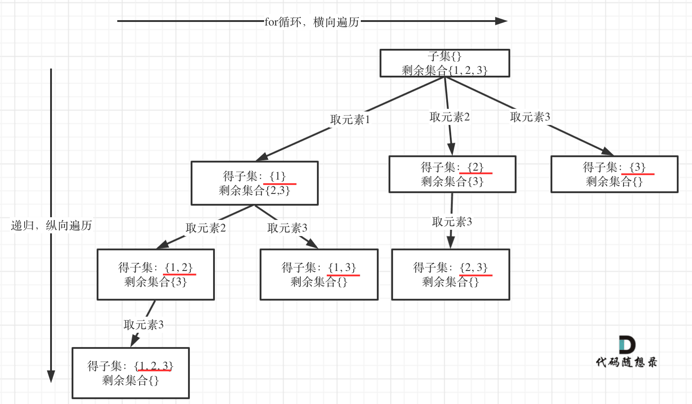

* [做專案（多個 C++、Java、Go、測試開發、前端（front end）專案）](https://www.programmercarl.com/other/kstar.html)
* [刷演算法（algorithm）（兩個月高強度學演算法）](https://www.programmercarl.com/xunlian/xunlianying.html)
* [準備面試必考題（40 天挑戰高頻面試題）](https://www.programmercarl.com/xunlian/bagu.html)


# 78.子集（subset）

[LeetCode 題目連結](https://leetcode.cn/problems/subsets/)

給定一組不含重複元素（element）的整數（integer）陣列（array） nums，回傳該陣列所有可能的子集（冪集（power set））。

說明：解集不能包含重複的子集。

範例:
輸入: nums = [1,2,3]
輸出:
[
  [3],
  [1],
  [2],
  [1,2,3],
  [1,3],
  [2,3],
  [1,2],
  []
]

## 演算法公開課

**[《程式碼隨想錄》演算法影片公開課](https://programmercarl.com/other/gongkaike.html)：[回溯演算法（backtracking algorithm）解決子集問題，樹上節點（node）都是目標集合！ | LeetCode：78.子集](https://www.bilibili.com/video/BV1U84y1q7Ci)，相信結合影片再看本篇題解，更有助於大家對本題的理解。**


## 解題思路

求子集問題和[77.組合（combination）](https://programmercarl.com/0077.组合.html)及[131.分割迴文串](https://programmercarl.com/0131.分割回文串.html)又不一樣了。

如果把子集問題、組合問題、分割問題都抽象為一棵樹（tree）的話，**那麼組合問題和分割問題都是收集樹的葉節點（leaf node），而子集問題是找樹的所有節點！**

其實子集也是一種組合問題，因為它的集合（set）是無序的（unordered），子集 {1,2} 和子集 {2,1} 是一樣的。

**那麼既然是無序的，取過的元素不會重複取，寫回溯演算法的時候，for 就要從 startIndex 開始，而不是從 0 開始！**

有同學問了，什麼時候 for 可以從 0 開始呢？

求排列（permutation）問題的時候，就要從 0 開始，因為集合是有序（ordered）的，{1, 2} 和 {2, 1} 是兩個集合，排列問題我們後續的文章就會講到的。

以範例中 nums = [1,2,3] 為例，把求子集抽象為樹狀結構（tree structure），如下：



從圖中紅線部分，可以看出**遍歷（traversal）這棵樹的時候，把所有節點都記錄下來，就是要求的子集集合**。

### 回溯（backtracking）三部曲

* 遞迴函數（recursive function）參數（parameter）

總體變數（global variable）陣列 path 為子集收集元素，二維（2D）陣列 result 存放子集組合。（也可以放到遞迴函數參數裡）

遞迴函數參數在上面講到了，需要 startIndex。

程式碼如下：

```cpp
vector<vector<int>> result;
vector<int> path;
void backtracking(vector<int>& nums, int startIndex) {
```

遞迴終止條件

從圖中可以看出：


剩餘集合為空的時候，就是葉節點。

那麼什麼時候剩餘集合為空呢？

就是 startIndex 已經大於陣列的長度了，就終止了，因為沒有元素可取了，程式碼如下:

```cpp
if (startIndex >= nums.size()) {
    return;
}
```

**其實可以不需要加終止條件，因為 startIndex >= nums.size() 時，本層 for 迴圈（for-loop）本來也結束了**。

* 單層搜尋邏輯

**求取子集問題，不需要任何修剪法（pruning）！因為子集就是要遍歷整棵樹**。

那麼單層遞迴（recursion）邏輯程式碼如下：

```
for (int i = startIndex; i < nums.size(); i++) {
    path.push_back(nums[i]);    // 子集收集元素
    backtracking(nums, i + 1);  // 注意從 i+1 開始，元素不重複取
    path.pop_back();            // 回溯
}
```

根據[關於回溯演算法，你該了解這些！](https://programmercarl.com/回溯算法理论基础.html)給出的回溯演算法模板（template）：

```
void backtracking(參數) {
    if (終止條件) {
        存放結果;
        return;
    }

    for (選擇：本層集合中元素（樹中節點子節點的數量就是集合的大小）) {
        處理節點;
        backtracking(路徑，選擇列表); // 遞迴
        回溯，撤銷處理結果
    }
}
```

可以寫出如下回溯演算法 C++ 程式碼：

```CPP
class Solution {
private:
    vector<vector<int>> result;
    vector<int> path;
    void backtracking(vector<int>& nums, int startIndex) {
        result.push_back(path); // 收集子集，要放在終止添加的上面，否則會漏掉自己
        if (startIndex >= nums.size()) { // 終止條件可以不加
            return;
        }
        for (int i = startIndex; i < nums.size(); i++) {
            path.push_back(nums[i]);
            backtracking(nums, i + 1);
            path.pop_back();
        }
    }
public:
    vector<vector<int>> subsets(vector<int>& nums) {
        result.clear();
        path.clear();
        backtracking(nums, 0);
        return result;
    }
};

```
* 時間複雜性（time complexity）: O(n * 2^n)
* 空間複雜度（space complexity）: O(n)

在註解中，可以發現可以不寫終止條件，因為本來我們就要遍歷整棵樹。

有的同學可能擔心不寫終止條件會不會無限遞迴（infinite recursion）？

並不會，因為每次遞迴的下一層就是從 i+1 開始的。

## 總結

相信大家經過了
* 組合問題：
    * [77.組合](https://programmercarl.com/0077.组合.html)
    * [回溯演算法：組合問題再剪剪枝](https://programmercarl.com/0077.组合优化.html)
    * [216.組合總和 III](https://programmercarl.com/0216.组合总和III.html)
    * [17.電話號碼的字母組合](https://programmercarl.com/0017.电话号码的字母组合.html)
    * [39.組合總和](https://programmercarl.com/0039.组合总和.html)
    * [40.組合總和 II](https://programmercarl.com/0040.组合总和II.html)
* 分割問題：
    * [131.分割迴文串](https://programmercarl.com/0131.分割回文串.html)
    * [93.復原 IP 位址](https://programmercarl.com/0093.复原IP地址.html)

的洗禮之後，發現子集問題還真的有點簡單了，其實這就是一道標準的模板題。

但是要清楚子集問題和組合問題、分割問題的區別，**子集是收集樹狀結構中樹的所有節點的結果**。

**而組合問題、分割問題是收集樹狀結構中葉節點的結果**。

## 其他語言版本


### Java 
```java
class Solution {
    List<List<Integer>> result = new ArrayList<>();// 存放符合條件結果的集合
    LinkedList<Integer> path = new LinkedList<>();// 用來存放符合條件結果
    public List<List<Integer>> subsets(int[] nums) {
        subsetsHelper(nums, 0);
        return result;
    }

    private void subsetsHelper(int[] nums, int startIndex){
        result.add(new ArrayList<>(path));//「遍歷這棵樹的時候，把所有節點都記錄下來，就是要求的子集集合」。
        if (startIndex >= nums.length){ //終止條件可不加
            return;
        }
        for (int i = startIndex; i < nums.length; i++){
            path.add(nums[i]);
            subsetsHelper(nums, i + 1);
            path.removeLast();
        }
    }
}
```

### Python 
```python
class Solution:
    def subsets(self, nums):
        result = []
        path = []
        self.backtracking(nums, 0, path, result)
        return result

    def backtracking(self, nums, startIndex, path, result):
        result.append(path[:])  # 收集子集，要放在終止添加的上面，否則會漏掉自己
        # if startIndex >= len(nums):  # 終止條件可以不加
        #     return
        for i in range(startIndex, len(nums)):
            path.append(nums[i])
            self.backtracking(nums, i + 1, path, result)
            path.pop()
```

### Go 
```Go
var (
    path   []int
    res  [][]int
)
func subsets(nums []int) [][]int {
    res, path = make([][]int, 0), make([]int, 0, len(nums))
    dfs(nums, 0)
    return res
}
func dfs(nums []int, start int) {
    tmp := make([]int, len(path))
    copy(tmp, path)
    res = append(res, tmp)

    for i := start; i < len(nums); i++ {
        path = append(path, nums[i])
        dfs(nums, i+1)
        path = path[:len(path)-1]
    }
}
```

### JavaScript

```Javascript
var subsets = function(nums) {
    let result = []
    let path = []
    function backtracking(startIndex) {
        result.push([...path])
        for(let i = startIndex; i < nums.length; i++) {
            path.push(nums[i])
            backtracking(i + 1)
            path.pop()
        }
    }
    backtracking(0)
    return result
};
```

### TypeScript

```typescript
function subsets(nums: number[]): number[][] {
    const resArr: number[][] = [];
    backTracking(nums, 0, []);
    return resArr;
    function backTracking(nums: number[], startIndex: number, route: number[]): void {
        resArr.push([...route]);
        let length = nums.length;
        if (startIndex === length) return;
        for (let i = startIndex; i < length; i++) {
            route.push(nums[i]);
            backTracking(nums, i + 1, route);
            route.pop();
        }
    }
};
```

### Rust

思路一：使用本題的標準解法，遞迴回溯。
```Rust
impl Solution {
    fn backtracking(result: &mut Vec<Vec<i32>>, path: &mut Vec<i32>, nums: &Vec<i32>, start_index: usize) {
        result.push(path.clone());
        let len = nums.len();
        // if start_index >= len { return; }
        for i in start_index..len {
            path.push(nums[i]);
            Self::backtracking(result, path, nums, i + 1);
            path.pop();
        }
    }

    pub fn subsets(nums: Vec<i32>) -> Vec<Vec<i32>> {
        let mut result: Vec<Vec<i32>> = Vec::new();
        let mut path: Vec<i32> = Vec::new();
        Self::backtracking(&mut result, &mut path, &nums, 0);
        result
    }
}
```
思路二：使用二進制（binary）列舉（enumeration），n 個元素的子集問題一共是 $2^n$ 種情況。如果我們使用一個二進制數字，每一位根據 0 和 1 來決定是選取該元素與否，那麼一共也是 $2^n$ 種情況，正好可以一一對應，所以我們可以不使用遞迴，直接利用迴圈（loop）列舉完成子集問題。
這種方法的優點在於效率高，不需要遞迴呼叫（recursive call），並且程式碼容易編寫。缺點則是過濾某些非法情況時會比遞迴方法難寫一點，不過在子集問題中不存在這個問題。
```Rust
impl Solution {
    pub fn subsets(nums: Vec<i32>) -> Vec<Vec<i32>> {
        let n = nums.len();
        // 預先配置 2^n 空間
        let mut result = Vec::with_capacity(1 << n);
        // 二進制列舉，2^n 種情況
        for i in 0..(1 << n) {
            let mut subset = Vec::new();
            for j in 0..n {
                // 列舉該二進制數字的每一位
                // 如果該位是 1，對應位置上的元素加入子集，否則跳過
                if i & (1 << j) != 0 {
                    subset.push(nums[j]);
                }
            }
            result.push(subset);
        }
        result
    }
}
```

### C

```c
int* path;
int pathTop;
int** ans;
int ansTop;
//記錄二維陣列中每個一維陣列的長度
int* length;
//將目前 path 陣列複製到 ans 中
void copy() {
    int* tempPath = (int*)malloc(sizeof(int) * pathTop);
    int i;
    for(i = 0; i < pathTop; i++) {
        tempPath[i] = path[i];
    }
    ans = (int**)realloc(ans, sizeof(int*) * (ansTop+1));
    length[ansTop] = pathTop;
    ans[ansTop++] = tempPath;
}

void backTracking(int* nums, int numsSize, int startIndex) {
    //收集子集，要放在終止添加的上面，否則會漏掉自己
    copy();
    //若 startIndex 大於陣列大小，回傳
    if(startIndex >= numsSize) {
        return;
    }
    int j;
    for(j = startIndex; j < numsSize; j++) {
        //將目前下標數字放入 path 中
        path[pathTop++] = nums[j];
        backTracking(nums, numsSize, j+1);
        //回溯
        pathTop--;
    }
}

int** subsets(int* nums, int numsSize, int* returnSize, int** returnColumnSizes){
    //初始化輔助變數
    path = (int*)malloc(sizeof(int) * numsSize);
    ans = (int**)malloc(0);
    length = (int*)malloc(sizeof(int) * 1500);
    ansTop = pathTop = 0;
    //進入回溯
    backTracking(nums, numsSize, 0);
    //設定二維陣列中元素個數
    *returnSize = ansTop;
    //設定二維陣列中每個一維陣列的長度
    *returnColumnSizes = (int*)malloc(sizeof(int) * ansTop);
    int i;
    for(i = 0; i < ansTop; i++) {
        (*returnColumnSizes)[i] = length[i];
    }
    return ans;
}
```

### Swift

```swift
func subsets(_ nums: [Int]) -> [[Int]] {
    var result = [[Int]]()
    var path = [Int]()
    func backtracking(startIndex: Int) {
        // 直接收集結果
        result.append(path)

        let end = nums.count
        guard startIndex < end else { return } // 終止條件
        for i in startIndex ..< end {
            path.append(nums[i]) // 處理：收集元素
            backtracking(startIndex: i + 1) // 元素不重複訪問
            path.removeLast() // 回溯
        }
    }
    backtracking(startIndex: 0)
    return result
}
```

### Scala

思路一: 使用本題解思路

```scala
object Solution {
  import scala.collection.mutable
  def subsets(nums: Array[Int]): List[List[Int]] = {
    var result = mutable.ListBuffer[List[Int]]()
    var path = mutable.ListBuffer[Int]()

    def backtracking(startIndex: Int): Unit = {
      result.append(path.toList) // 存放結果
      if (startIndex >= nums.size) {
        return
      }
      for (i <- startIndex until nums.size) {
        path.append(nums(i)) // 添加元素
        backtracking(i + 1)
        path.remove(path.size - 1) // 刪除
      }
    }

    backtracking(0)
    result.toList
  }
}
```

思路二: 將原問題轉換為二元樹（binary tree），針對每一個元素都有**選或不選**兩種選擇，直到遍歷到最後，所有的葉節點即為本題的答案：

```scala
object Solution {
  import scala.collection.mutable
  def subsets(nums: Array[Int]): List[List[Int]] = {
    var result = mutable.ListBuffer[List[Int]]()

    def backtracking(path: mutable.ListBuffer[Int], startIndex: Int): Unit = {
      if (startIndex == nums.length) {
        result.append(path.toList)
        return
      }
      path.append(nums(startIndex))
      backtracking(path, startIndex + 1)  // 選擇元素
      path.remove(path.size - 1)
      backtracking(path, startIndex + 1)  // 不選擇元素
    }

    backtracking(mutable.ListBuffer[Int](), 0)
    result.toList
  }
}
```
### C#
```csharp
public class Solution {
    public IList<IList<int>> res = new List<IList<int>>();
    public IList<int> path = new List<int>();
    public IList<IList<int>> Subsets(int[] nums) {
        BackTracking(nums, 0);
        return res;
    }
    public void BackTracking(int[] nums, int start){
        res.Add(new List<int>(path));
        if(start > nums.Length) return;
        for (int i = start; i < nums.Length; i++)
        {
            path.Add(nums[i]);
            BackTracking(nums, i + 1);
            path.RemoveAt(path.Count - 1);
        }
    }
}
```


