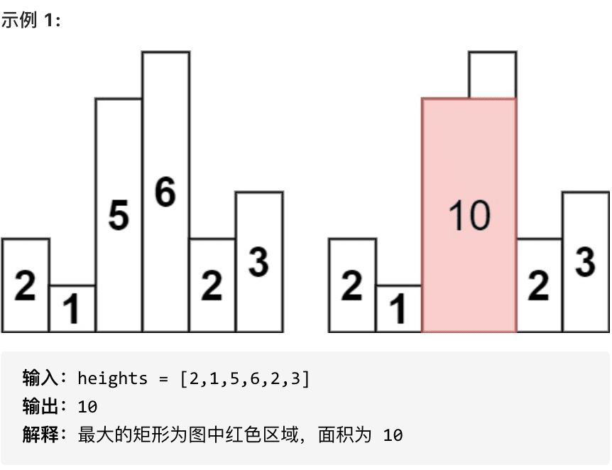
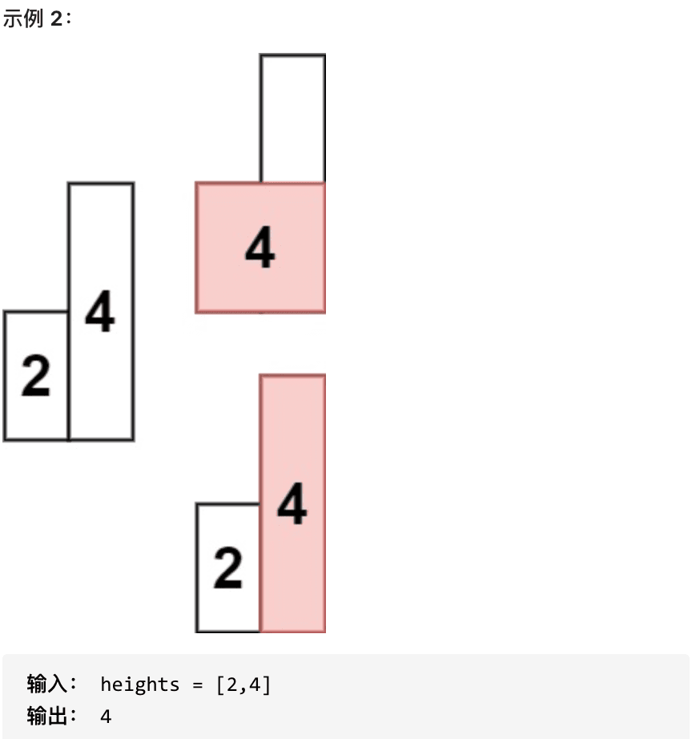
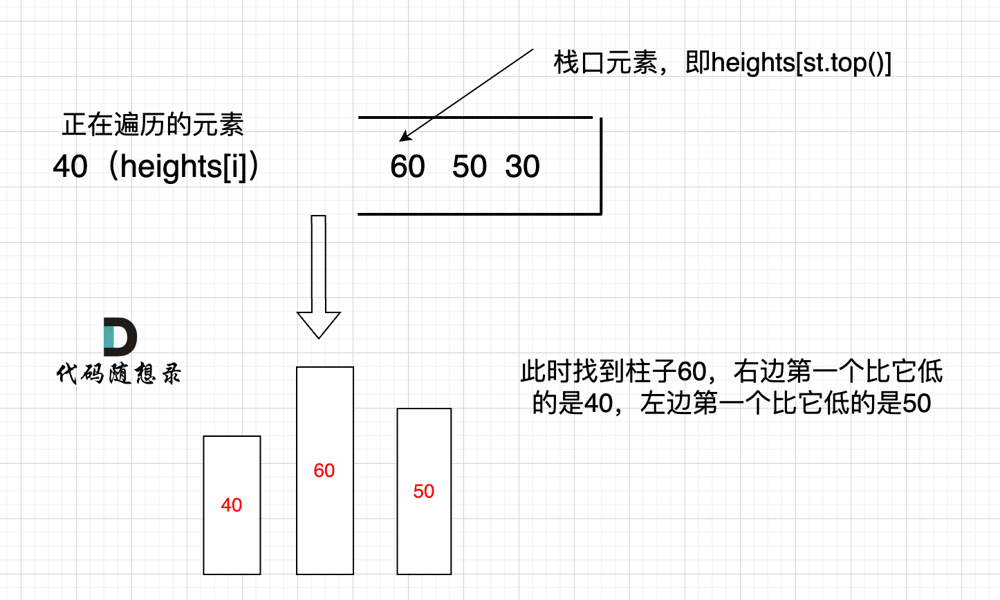
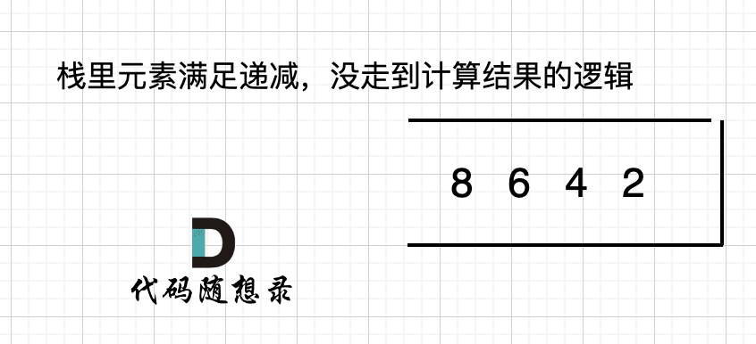
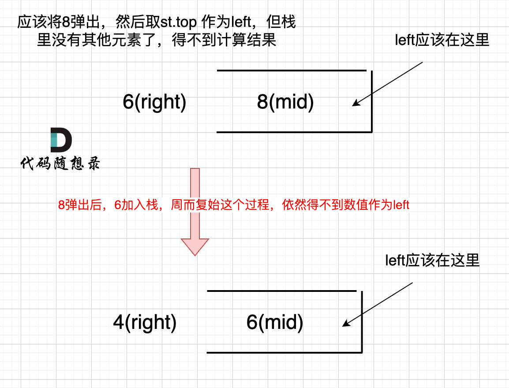

* [做專案（多個 C++、Java、Go、測試開發、前端（front end）專案）](https://www.programmercarl.com/other/kstar.html)
* [刷演算法（兩個月高強度學演算法）](https://www.programmercarl.com/xunlian/xunlianying.html)
* [準備面試必考題（40 天挑戰高頻面試題）](https://www.programmercarl.com/xunlian/bagu.html)


# 84.直方圖（histogram）中最大的矩形（rectangle） 

[LeetCode 題目連結](https://leetcode.com/problems/largest-rectangle-in-histogram/)

給定 n 個非負整數（nonnegative integer），用來表示直方圖中各個柱子的高度（height）。每個柱子彼此相鄰，且寬度（width）為 1 。

求在該直方圖中，能夠勾勒出來的矩形的最大面積。





* 1 <= heights.length <=10^5
* 0 <= heights[i] <= 10^4

## 演算法公開課

**[《程式碼隨想錄》演算法影片公開課](https://programmercarl.com/other/gongkaike.html)：[monotonic stack，又一次經典來襲！ LeetCode：84.直方圖中最大的矩形](https://www.bilibili.com/video/BV1Ns4y1o7uB/)，相信結合影片再看本篇題解，更有助於大家對本題的理解。**

## 解題思路

本題和[42. 接雨水](./0042.接雨水.md)，是遙相呼應的兩道題目，建議都要仔細做一做，原理上有很多相同的地方，但細節上又有差異，更可以加深對 monotonic stack 的理解！

其實這兩道題目先做哪一道都可以，但我先寫了 42.接雨水的題解，所以如果沒做過接雨水的話，建議先做一做接雨水，可以參考我的題解：[42. 接雨水](./0042.接雨水.md)

我們先來看一下蠻力法（brute force method）的解法：

### 蠻力法

```CPP
class Solution {
public:
    int largestRectangleArea(vector<int>& heights) {
        int sum = 0;
        for (int i = 0; i < heights.size(); i++) {
            int left = i;
            int right = i;
            for (; left >= 0; left--) {
                if (heights[left] < heights[i]) break;
            }
            for (; right < heights.size(); right++) {
                if (heights[right] < heights[i]) break;
            }
            int w = right - left - 1;
            int h = heights[i];
            sum = max(sum, w * h);
        }
        return sum;
    }
};
```

如上程式碼並不能通過 LeetCode，逾時了，因為時間複雜度（time complexity）是 $O(n^2)$。

### two pointers 解法

本題 two pointers 的寫法整體思路和[42. 接雨水](./0042.接雨水.md)是一致的，但要比[42. 接雨水](./0042.接雨水.md)難一些。

難就難在本題要記錄每個柱子左邊第一個小於該柱子的下標（subscript），而不是左邊第一個小於該柱子的高度。

所以需要迴圈（loop）查找，也就是下面在尋找的過程中使用了 while 迴圈（while loop），詳細請看下面註解，整理思路在題解：[42. 接雨水](./0042.接雨水.md)中已經介紹了。

```CPP
class Solution {
public:
    int largestRectangleArea(vector<int>& heights) {
        vector<int> minLeftIndex(heights.size());
        vector<int> minRightIndex(heights.size());
        int size = heights.size();

        // 記錄每個柱子 左邊第一個小於該柱子的下標
        minLeftIndex[0] = -1; // 注意這裡初始化，防止下面 while 無限迴路
        for (int i = 1; i < size; i++) {
            int t = i - 1;
            // 這裡不是用 if，而是不斷向左尋找的過程
            while (t >= 0 && heights[t] >= heights[i]) t = minLeftIndex[t];
            minLeftIndex[i] = t;
        }
        // 記錄每個柱子 右邊第一個小於該柱子的下標
        minRightIndex[size - 1] = size; // 注意這裡初始化，防止下面 while 無限迴路
        for (int i = size - 2; i >= 0; i--) {
            int t = i + 1;
            // 這裡不是用 if，而是不斷向右尋找的過程
            while (t < size && heights[t] >= heights[i]) t = minRightIndex[t];
            minRightIndex[i] = t;
        }
        // 求總和
        int result = 0;
        for (int i = 0; i < size; i++) {
            int sum = heights[i] * (minRightIndex[i] - minLeftIndex[i] - 1);
            result = max(sum, result);
        }
        return result;
    }
};
```

### monotonic stack

本題 monotonic stack 的解法和接雨水的題目是遙相呼應的。

為什麼這麼說呢，[42. 接雨水](./0042.接雨水.md)是找每個柱子左右兩邊第一個大於該柱子高度的柱子，而本題是找每個柱子左右兩邊第一個小於該柱子的柱子。

**這裡就涉及到了 monotonic stack 很重要的性質，就是 monotonic stack 裡的順序，是從小到大還是從大到小**。

在題解[42. 接雨水](./0042.接雨水.md)中我講解了接雨水的 monotonic stack 從堆疊頂（top of stack）（元素（element）從堆疊（stack）頂端彈出）到堆疊底端（stack bottom）的順序應該是從小到大的順序。

那麼因為本題是要找每個柱子左右兩邊第一個小於該柱子的柱子，所以從堆疊頂（元素從堆疊頂端彈出）到堆疊底端的順序應該是從大到小的順序！

我來舉一個例子，如圖：



只有堆疊裡從大到小的順序，才能保證堆疊頂元素找到左右兩邊第一個小於堆疊頂元素的柱子。

所以本題 monotonic stack 的順序正好與接雨水反過來。

此時大家應該可以發現其實就是**堆疊頂和堆疊頂的下一個元素以及要入堆疊的三個元素組成了我們要求最大面積的高度和寬度**

理解這一點，對 monotonic stack 就掌握得比較到位了。

除了堆疊內元素順序和接雨水不同，剩下的邏輯就都差不多了，在題解[42. 接雨水](./0042.接雨水.md)我已經對 monotonic stack 的各個方面做了詳細講解，這裡就不贅述了。

主要就是分析清楚如下三種情況：

* 情況一：目前遍歷（traversal）的元素 heights[i] 大於堆疊頂元素 heights[st.top()] 的情況
* 情況二：目前遍歷的元素 heights[i] 等於堆疊頂元素 heights[st.top()] 的情況
* 情況三：目前遍歷的元素 heights[i] 小於堆疊頂元素 heights[st.top()] 的情況

C++ 程式碼如下：

```CPP
// 版本一
class Solution {
public:
    int largestRectangleArea(vector<int>& heights) {
        int result = 0;
        stack<int> st;
        heights.insert(heights.begin(), 0); // 陣列頭部加入元素 0
        heights.push_back(0); // 陣列尾部加入元素 0
        st.push(0);

        // 第一個元素已經入堆疊，從下標 1 開始
        for (int i = 1; i < heights.size(); i++) {
            if (heights[i] > heights[st.top()]) { // 情況一
                st.push(i);
            } else if (heights[i] == heights[st.top()]) { // 情況二
                st.pop(); // 這個可以加，可以不加，效果一樣，思路不同
                st.push(i);
            } else { // 情況三
                while (!st.empty() && heights[i] < heights[st.top()]) { // 注意是 while
                    int mid = st.top();
                    st.pop();
                    if (!st.empty()) {
                        int left = st.top();
                        int right = i;
                        int w = right - left - 1;
                        int h = heights[mid];
                        result = max(result, w * h);
                    }
                }
                st.push(i);
            }
        }
        return result;
    }
};

```

細心的讀者會發現，我在 height 陣列（array）前後，都加了一個元素 0，為什麼這麼做呢？ 

首先來說末尾為什麼要加元素 0？ 

如果陣列本身就是升序（ascending order）的，例如 [2,4,6,8]，那麼入堆疊之後都是單調遞減，一直都沒有走到情況三計算結果的那一步，所以最後輸出的就是 0 了。如圖： 



那麼結尾加一個 0，就會讓堆疊裡的所有元素，走到情況三的邏輯。 


開頭為什麼要加元素 0？ 

如果陣列本身是遞降次序（descending order）的，例如 [8,6,4,2]，在 8 入堆疊後，6 開始與 8 進行比較，此時我們得到 mid（8），right（6），但是得不到 left。

（mid、left，right 都是對應版本一裡的邏輯）

因為將 8 彈出之後，堆疊裡沒有元素了，那麼為了避免空堆疊（empty stack）取值，直接跳過了計算結果的邏輯。 

之後又將 6 加入堆疊（此時 8 已經彈出了），然後就是 4 與堆疊頂元素 6 進行比較，周而復始，那麼計算的最後結果 result 就是 0。如圖所示： 



所以我們需要在 height 陣列前後各加一個元素 0。 


版本一程式碼精簡之後：

```CPP
// 版本二
class Solution {
public:
    int largestRectangleArea(vector<int>& heights) {
        stack<int> st;
        heights.insert(heights.begin(), 0); // 陣列頭部加入元素 0
        heights.push_back(0); // 陣列尾部加入元素 0
        st.push(0);
        int result = 0;
        for (int i = 1; i < heights.size(); i++) {
            while (heights[i] < heights[st.top()]) {
                int mid = st.top();
                st.pop();
                int w = i - st.top() - 1;
                int h = heights[mid];
                result = max(result, w * h);
            }
            st.push(i);
        }
        return result;
    }
};
```

這裡我依然建議大家按部就班把版本一寫出來，把情況一二三分析清楚，然後再精簡程式碼到版本二。直接看版本二容易忽略細節！

## 其他語言版本 

### Java: 

蠻力法：
```java
class Solution {
    public int largestRectangleArea(int[] heights) {
        int length = heights.length;
        int[] minLeftIndex = new int [length];
        int[] minRightIndex = new int [length];
        // 記錄左邊第一個小於該柱子的下標
        minLeftIndex[0] = -1 ;
        for (int i = 1; i < length; i++) {
            int t = i - 1;
            // 這裡不是用 if，而是不斷向右尋找的過程
            while (t >= 0 && heights[t] >= heights[i]) t = minLeftIndex[t];
            minLeftIndex[i] = t;
        }
        // 記錄每個柱子右邊第一個小於該柱子的下標
        minRightIndex[length - 1] = length;
        for (int i = length - 2; i >= 0; i--) {
            int t = i + 1;
            while(t < length && heights[t] >= heights[i]) t = minRightIndex[t];
            minRightIndex[i] = t;
        }
        // 求總和
        int result = 0;
        for (int i = 0; i < length; i++) {
            int sum = heights[i] * (minRightIndex[i] - minLeftIndex[i] - 1);
            result = Math.max(sum, result);
        }
        return result;
    }
}
```

monotonic stack:
```java
class Solution {
    int largestRectangleArea(int[] heights) {
        Stack<Integer> st = new Stack<Integer>();
        
        // 陣列擴容，在頭和尾各加入一個元素
        int [] newHeights = new int[heights.length + 2];
        newHeights[0] = 0;
        newHeights[newHeights.length - 1] = 0;
        for (int index = 0; index < heights.length; index++){
            newHeights[index + 1] = heights[index];
        }

        heights = newHeights;
        
        st.push(0);
        int result = 0;
        // 第一個元素已經入堆疊，從下標 1 開始
        for (int i = 1; i < heights.length; i++) {
            // 注意 heights[i] 是和 heights[st.top()] 比較 ，st.top() 是下標
            if (heights[i] > heights[st.peek()]) {
                st.push(i);
            } else if (heights[i] == heights[st.peek()]) {
                st.pop(); // 這個可以加，可以不加，效果一樣，思路不同
                st.push(i);
            } else {
                while (heights[i] < heights[st.peek()]) { // 注意是 while
                    int mid = st.peek();
                    st.pop();
                    int left = st.peek();
                    int right = i;
                    int w = right - left - 1;
                    int h = heights[mid];
                    result = Math.max(result, w * h);
                }
                st.push(i);
            }
        }
        return result;
    }
}
```
monotonic stack 精簡
```java
class Solution {
    public int largestRectangleArea(int[] heights) {
        int[] newHeight = new int[heights.length + 2];
        System.arraycopy(heights, 0, newHeight, 1, heights.length);
        newHeight[heights.length+1] = 0;
        newHeight[0] = 0;

        Stack<Integer> stack = new Stack<>();
        stack.push(0);

        int res = 0;
        for (int i = 1; i < newHeight.length; i++) {
            while (newHeight[i] < newHeight[stack.peek()]) {
                int mid = stack.pop();
                int w = i - stack.peek() - 1;
                int h = newHeight[mid];
                res = Math.max(res, w * h);
            }
            stack.push(i);

        }
        return res;
    }
}
```

### Python3:

```python

# 蠻力法（LeetCode 逾時）
class Solution:
    def largestRectangleArea(self, heights: List[int]) -> int:
        # 從左向右遍歷：以每一根柱子為核心柱子（目前輪次最高的參照物），疊代直到找到左側和右側各第一個矮一級的柱子
        res = 0

        for i in range(len(heights)):
            left = i
            right = i
            # 向左側遍歷：尋找第一個矮一級的柱子
            for _ in range(left, -1, -1):
                if heights[left] < heights[i]:
                    break
                left -= 1
            # 向右側遍歷：尋找第一個矮一級的柱子
            for _ in range(right, len(heights)):
                if heights[right] < heights[i]:
                    break
                right += 1
                
            width = right - left - 1
            height = heights[i]
            res = max(res, width * height)

        return res

# two pointers 
class Solution:
    def largestRectangleArea(self, heights: List[int]) -> int:
        size = len(heights)
        # 兩個 動態規劃（dynamic programming, DP） 數列儲存的均是下標 index
        min_left_index = [0] * size
        min_right_index = [0] * size
        result = 0

        # 記錄每個柱子的左側第一個矮一級的柱子的下標
        min_left_index[0] = -1  # 初始化防止 while 無限迴路
        for i in range(1, size):
            # 以目前柱子為核心柱子，向左疊代尋找次級柱子
            temp = i - 1
            while temp >= 0 and heights[temp] >= heights[i]:
                # 當左側的柱子持續較高時，嘗試這個高柱子自己的次級柱子（DP）
                temp = min_left_index[temp]
            # 當找到左側矮一級的目標柱子時
            min_left_index[i] = temp
        
        # 記錄每個柱子的右側第一個矮一級的柱子的下標
        min_right_index[size-1] = size  # 初始化防止 while 無限迴路
        for i in range(size-2, -1, -1):
            # 以目前柱子為核心柱子，向右疊代尋找次級柱子
            temp = i + 1
            while temp < size and heights[temp] >= heights[i]:
                # 當右側的柱子持續較高時，嘗試這個高柱子自己的次級柱子（DP）
                temp = min_right_index[temp]
            # 當找到右側矮一級的目標柱子時
            min_right_index[i] = temp
        
        for i in range(size):
            area = heights[i] * (min_right_index[i] - min_left_index[i] - 1)
            result = max(area, result)
        
        return result

# 單調堆疊（monotonic stack）
class Solution:
    def largestRectangleArea(self, heights: List[int]) -> int:
        # 單調堆疊
        '''
        找每個柱子左右側的第一個高度值小於該柱子的柱子
        單調堆疊：堆疊頂到堆疊底端：從大到小（每插入一個新的小數值時，都要彈出先前的大數值）
        堆疊頂，堆疊頂的下一個元素，即將入堆疊的元素：這三個元素組成了最大面積的高度和寬度
        情況一：目前遍歷的元素 heights[i] 大於堆疊頂元素的情況
        情況二：目前遍歷的元素 heights[i] 等於堆疊頂元素的情況
        情況三：目前遍歷的元素 heights[i] 小於堆疊頂元素的情況
        '''

        # 輸入陣列首尾各補上一個 0（與 42.接雨水不同的是，本題原首尾的兩個柱子可以作為核心柱進行最大面積嘗試）
        heights.insert(0, 0)
        heights.append(0)
        stack = [0]
        result = 0
        for i in range(1, len(heights)):
            # 情況一
            if heights[i] > heights[stack[-1]]:
                stack.append(i)
            # 情況二
            elif heights[i] == heights[stack[-1]]:
                stack.pop()
                stack.append(i)
            # 情況三
            else:
                # 拋出所有較高的柱子
                while stack and heights[i] < heights[stack[-1]]:
                    # 堆疊頂就是中間的柱子，核心柱子
                    mid_index = stack[-1]
                    stack.pop()
                    if stack:
                        left_index = stack[-1]
                        right_index = i
                        width = right_index - left_index - 1
                        height = heights[mid_index]
                        result = max(result, width * height)
                stack.append(i)
        return result

# monotonic stack 精簡
class Solution:
    def largestRectangleArea(self, heights: List[int]) -> int:
        heights.insert(0, 0)
        heights.append(0)
        stack = [0]
        result = 0
        for i in range(1, len(heights)):
            while stack and heights[i] < heights[stack[-1]]:
                mid_height = heights[stack[-1]]
                stack.pop()
                if stack:
                    # area = width * height
                    area = (i - stack[-1] - 1) * mid_height
                    result = max(area, result)
            stack.append(i)
        return result


```

### Go:

蠻力法

```go
func largestRectangleArea(heights []int) int {
    sum := 0
    for i := 0; i < len(heights); i++ {
        left, right := i, i
        for left >= 0 {
            if heights[left] < heights[i] {
                break
            }
            left--
        }
        for right < len(heights) {
            if heights[right] < heights[i] {
                break
            }
            right++
        }
        w := right - left - 1
        h := heights[i]
        sum = max(sum, w * h)
    }
    return sum
}

func max(x, y int) int {
    if x > y {
        return x
    }
    return y
}
```

two pointers 解法

```go
func largestRectangleArea(heights []int) int {
    size := len(heights)
    minLeftIndex := make([]int, size)
    minRightIndex := make([]int, size)
    
    // 記錄每個柱子 左邊第一個小於該柱子的下標
    minLeftIndex[0] = -1 // 注意這裡初始化，防止下面 while 無限迴路
    for i := 1; i < size; i++ {
        t := i - 1
        // 這裡不是用 if，而是不斷向左尋找的過程
        for t >= 0 && heights[t] >= heights[i] {
            t = minLeftIndex[t]
        }
        minLeftIndex[i] = t
    }
    // 記錄每個柱子 右邊第一個小於該柱子的下標
    minRightIndex[size - 1] = size; // 注意這裡初始化，防止下面 while 無限迴路
    for i := size - 2; i >= 0; i-- {
        t := i + 1
        // 這裡不是用 if，而是不斷向右尋找的過程
        for t < size && heights[t] >= heights[i] {
            t = minRightIndex[t]
        }
        minRightIndex[i] = t
    }
    // 求總和
    result := 0
    for i := 0; i < size; i++ {
        sum := heights[i] * (minRightIndex[i] - minLeftIndex[i] - 1)
        result = max(sum, result)
    }
    return result
}

func max(x, y int) int {
    if x > y {
        return x
    }
    return y
}
```

monotonic stack

```go
func largestRectangleArea(heights []int) int {
    result := 0
    heights = append([]int{0}, heights...) // 陣列頭部加入元素 0
    heights = append(heights, 0) // 陣列尾部加入元素 0
    st := []int{0}
    
    // 第一個元素已經入堆疊，從下標 1 開始
    for i := 1; i < len(heights); i++ {
        if heights[i] > heights[st[len(st)-1]] {
            st = append(st, i)
        } else if heights[i] == heights[st[len(st)-1]] {
            st = st[:len(st)-1]
            st = append(st, i)
        } else {
            for len(st) > 0 && heights[i] < heights[st[len(st)-1]] {
                mid := st[len(st)-1]
                st = st[:len(st)-1]
                if len(st) > 0 {
                    left := st[len(st)-1]
                    right := i
                    w := right - left - 1
                    h := heights[mid]
                    result = max(result, w * h)
                }
            }
            st = append(st, i)
        }
    }
    return result
}

func max(x, y int) int {
    if x > y {
        return x
    }
    return y
}
```

monotonic stack 精簡

```go
func largestRectangleArea(heights []int) int {
    max := 0
    // 使用切片實作堆疊
    stack := make([]int, 0)
    // 陣列頭部加入 0
    heights = append([]int{0}, heights...)
    // 陣列尾部加入 0
    heights = append(heights, 0)
    // 初始化堆疊，序號從 0 開始
    stack = append(stack, 0)
    for i := 1; i < len(heights); i ++ {
        // 結束迴圈條件為：當即將入堆疊元素 > top 元素，也就是形成非單調遞增的趨勢
        for heights[stack[len(stack) - 1]] > heights[i] {
            // mid 是 top
            mid := stack[len(stack) - 1]
            // 出堆疊
            stack = stack[0 : len(stack) - 1]
            // left 是 top 的下一位元素，i 是將要入堆疊的元素
            left := stack[len(stack) - 1]
            // 高度 x 寬度
            tmp := heights[mid] * (i - left - 1)
            if tmp > max {
                max = tmp
            }
        }
        stack = append(stack, i)
    }
    return max
}
```

### JavaScript:

```javascript
//雙指標（two pointers） js 中運行速度最快
var largestRectangleArea = function(heights) {
    const len = heights.length;
    const minLeftIndex = new Array(len);
    const maxRightIndex = new Array(len);
    // 記錄每個柱子 左邊第一個小於該柱子的下標
    minLeftIndex[0] = -1; // 注意這裡初始化，防止下面 while 無限迴路
    for(let i = 1; i < len; i++) {
        let t = i - 1;
        // 這裡不是用 if，而是不斷向左尋找的過程
        while (t >= 0 && heights[t] >= heights[i]) {
			t = minLeftIndex[t];
		}
        minLeftIndex[i] = t;
    }
    // 記錄每個柱子 右邊第一個小於該柱子的下標
    maxRightIndex[len - 1] = len; // 注意這裡初始化，防止下面 while 無限迴路
    for(let i = len - 2; i >= 0; i--){
        let t = i + 1;
        // 這裡不是用 if，而是不斷向右尋找的過程
        while (t <= n && heights[t] > heights[i]) {
			t = maxRightIndex[t];
		}
        maxRightIndex[i] = t;
    }
    // 求總和
    let maxArea = 0;
    for(let i = 0; i < len; i++){
        let sum = heights[i] * (maxRightIndex[i] - minLeftIndex[i] - 1);
        maxArea = Math.max(maxArea , sum);
    }
    return maxArea;
};

//monotonic stack
var largestRectangleArea = function(heights) {
	let maxArea = 0;
	const stack = [0];
	heights.push(0);
	const n = heights.length;

	for (let i = 1; i < n; i++) {
		let top = stack.at(-1);
        // 情況三
		if (heights[top] < heights[i]) {
			stack.push(i);
		}
        // 情況二
		if (heights[top] === heights[i]) {
			stack.pop(); // 這個可以加，可以不加，效果一樣，思路不同
			stack.push(i);
		}
        // 情況一
		if (heights[top] > heights[i]) {
			while (stack.length > 0 && heights[top] > heights[i]) {
                // 堆疊頂元素出堆疊，並保存堆疊頂 bar 的索引
				const h = heights[stack.pop()];
				const left = stack.at(-1) ?? -1;
				const w = i - left - 1;
                // 計算面積，並取最大面積
				maxArea = Math.max(maxArea, w * h);
				top = stack.at(-1);
			}
			stack.push(i);
		}
	}
	return maxArea;
};

//單調堆疊 簡潔
var largestRectangleArea = function(heights) {
    let maxArea = 0;
    const stack = [];
    heights = [0,...heights,0]; // 陣列頭部加入元素 0 陣列尾部加入元素 0
    for(let i = 0; i < heights.length; i++){ // 只用考慮情況一 目前遍歷的元素 heights[i] 小於堆疊頂元素 heights[stack[stack.length-1]]] 的情況
        while(heights[i] < heights[stack[stack.length-1]]){// 目前 bar 比堆疊頂 bar 矮
            const stackTopIndex = stack.pop();// 堆疊頂元素出堆疊，並保存堆疊頂 bar 的索引
            let w = i - stack[stack.length -1] - 1;
            let h = heights[stackTopIndex]
            // 計算面積，並取最大面積
            maxArea = Math.max(maxArea, w * h);
        }
        stack.push(i);// 目前 bar 比堆疊頂 bar 高了，入堆疊
    }
    return maxArea;
};
```
### TypeScript：

> 蠻力法（會逾時）：

```typescript
function largestRectangleArea(heights: number[]): number {
    let resMax: number = 0;
    for (let i = 0, length = heights.length; i < length; i++) {
        // 左開右開
        let left: number = i - 1,
            right: number = i + 1;
        while (left >= 0 && heights[left] >= heights[i]) {
            left--;
        }
        while (right < length && heights[right] >= heights[i]) {
            right++;
        }
        resMax = Math.max(resMax, heights[i] * (right - left - 1));
    }
    return resMax;
};
```

> 雙指標預處理（preprocessing）：

```typescript
function largestRectangleArea(heights: number[]): number {
    const length: number = heights.length;
    const leftHeightDp: number[] = [],
        rightHeightDp: number[] = [];
    leftHeightDp[0] = -1;
    rightHeightDp[length - 1] = length;
    for (let i = 1; i < length; i++) {
        let j = i - 1;
        while (j >= 0 && heights[i] <= heights[j]) {
            j = leftHeightDp[j];
        }
        leftHeightDp[i] = j;
    }
    for (let i = length - 2; i >= 0; i--) {
        let j = i + 1;
        while (j < length && heights[i] <= heights[j]) {
            j = rightHeightDp[j];
        }
        rightHeightDp[i] = j;
    }
    let resMax: number = 0;
    for (let i = 0; i < length; i++) {
        let area = heights[i] * (rightHeightDp[i] - leftHeightDp[i] - 1);
        resMax = Math.max(resMax, area);
    }
    return resMax;
};
```

> 單調堆疊：

```typescript
function largestRectangleArea(heights: number[]): number {
    heights.push(0);
    const length: number = heights.length;
    // 堆疊底端->堆疊頂：嚴格單調遞增
    const stack: number[] = [];
    stack.push(0);
    let resMax: number = 0;
    for (let i = 1; i < length; i++) {
        let top = stack[stack.length - 1];
        if (heights[top] < heights[i]) {
            stack.push(i);
        } else if (heights[top] === heights[i]) {
            stack.pop();
            stack.push(i);
        } else {
            while (stack.length > 0 && heights[top] > heights[i]) {
                let mid = stack.pop();
                let left = stack.length > 0 ? stack[stack.length - 1] : -1;
                let w = i - left - 1;
                let h = heights[mid];
                resMax = Math.max(resMax, w * h);
                top = stack[stack.length - 1];
            }
            stack.push(i);
        }
    }
    return resMax;
};
```

### Rust:

雙指標預處理
```rust

impl Solution {
    pub fn largest_rectangle_area(v: Vec<i32>) -> i32 {
        let n = v.len();
        let mut left_smaller_idx = vec![-1; n];
        let mut right_smaller_idx = vec![n as i32; n];
        for i in 1..n {
            let mut mid = i as i32 - 1;
            while mid >= 0 && v[mid as usize] >= v[i] {
                mid = left_smaller_idx[mid as usize];
            }
            left_smaller_idx[i] = mid;
        }
        for i in (0..n-1).rev() {
            let mut mid = i + 1;
            while mid < n && v[mid] >= v[i] {
                mid = right_smaller_idx[mid] as usize;
            }
            right_smaller_idx[i] = mid as i32;
        }
        let mut res = 0;
        for (idx, &e) in v.iter().enumerate() {
            res = res.max((right_smaller_idx[idx] - left_smaller_idx[idx] - 1) * e);
        }
        dbg!(res)
    }
}
```

單調堆疊
```rust
impl Solution {
    pub fn largest_rectangle_area1(mut v: Vec<i32>) -> i32 {
        v.insert(0, 0);  // 便於使第一個元素能夠有左側 <= 它的值
        v.push(0);                      // 便於在結束處理最後一個元素後清空殘留在堆疊中的值
        let mut res = 0;
        let mut stack = vec![]; // 遞增的堆疊
        for (idx, &e) in v.iter().enumerate() {
            while !stack.is_empty() && v[*stack.last().unwrap()] > e {
                let pos = stack.pop().unwrap();
                let prev_pos = *stack.last().unwrap();
                let s = (idx - prev_pos - 1) as i32 * v[pos];
                res = res.max(s);
            }
            stack.push(idx);
        }
        res
    }  
}
```


