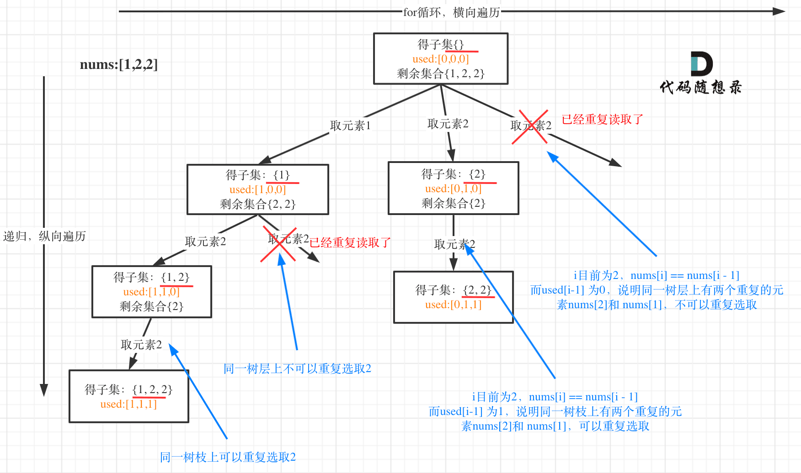

* [做專案（多個 C++、Java、Go、測試開發、前端（front end）專案）](https://www.programmercarl.com/other/kstar.html)
* [刷演算法（兩個月高強度學演算法）](https://www.programmercarl.com/xunlian/xunlianying.html)
* [準備面試必考題（40 天挑戰高頻面試題）](https://www.programmercarl.com/xunlian/bagu.html)

# 90.子集（subset）II

[LeetCode 題目連結](https://leetcode.com/problems/subsets-ii/)

給定一個可能包含重複元素（element）的整數（integer）陣列（array） nums，回傳該陣列所有可能的子集（冪集（power set））。

說明：解集不能包含重複的子集。

範例:
* 輸入: [1,2,2]
* 輸出:
[
  [2],
  [1],
  [1,2,2],
  [2,2],
  [1,2],
  []
]

## 演算法公開課

**[《程式碼隨想錄》演算法影片公開課](https://programmercarl.com/other/gongkaike.html)：[回溯演算法（backtracking algorithm）解決子集問題，如何去除重複？| LeetCode：90.子集II](https://www.bilibili.com/video/BV1vm4y1F71J/)，相信結合影片再看本篇題解，更有助於大家對本題的理解。**


## 解題思路

做本題之前一定要先做[78.子集](./0078.子集.md)。

這道題目和[78.子集](./0078.子集.md)的區別就是集合（set）裡有重複元素了，而且求取的子集要去除重複。

那麼關於回溯演算法中的去除重複問題，**在[40.組合總和II](./0040.組合總和II.md)中已經詳細講解過了，和本題是相同的解法模式**。

**劇透一下，後期要講解的排列（permutation）問題裡去除重複也是這個解法模式，所以理解「樹層去除重複」和「樹枝去除重複」非常重要**。

用範例中的 [1, 2, 2] 來舉例，如圖所示：（**注意去除重複需要先對集合排序（sorting）**）



從圖中可以看出，同一樹層上重複取 2 就要過濾掉，同一樹枝上就可以重複取 2，因為同一樹枝上元素的集合才是唯一子集！

本題其實就是在[回溯演算法：求子集問題！](./0078.子集.md)的基礎上加上了去除重複，去除重複我們在[回溯演算法：求組合總和（三）](./0040.組合總和II.md)也講過了，所以我就直接給出程式碼了：

C++ 程式碼如下：

```CPP
class Solution {
private:
    vector<vector<int>> result;
    vector<int> path;
    void backtracking(vector<int>& nums, int startIndex, vector<bool>& used) {
        result.push_back(path);
        for (int i = startIndex; i < nums.size(); i++) {
            // used[i - 1] == true，說明同一樹枝 candidates[i - 1] 使用過
            // used[i - 1] == false，說明同一樹層 candidates[i - 1] 使用過
            // 而我們要對同一樹層使用過的元素進行跳過
            if (i > 0 && nums[i] == nums[i - 1] && used[i - 1] == false) {
                continue;
            }
            path.push_back(nums[i]);
            used[i] = true;
            backtracking(nums, i + 1, used);
            used[i] = false;
            path.pop_back();
        }
    }

public:
    vector<vector<int>> subsetsWithDup(vector<int>& nums) {
        result.clear();
        path.clear();
        vector<bool> used(nums.size(), false);
        sort(nums.begin(), nums.end()); // 去除重複需要排序
        backtracking(nums, 0, used);
        return result;
    }
};
```
* 時間複雜度（time complexity）: O(n * 2^n)
* 空間複雜度（space complexity）: O(n)


使用 set 去除重複的版本。
```CPP
class Solution {
private:
    vector<vector<int>> result;
    vector<int> path;
    void backtracking(vector<int>& nums, int startIndex) {
        result.push_back(path);
        unordered_set<int> uset;
        for (int i = startIndex; i < nums.size(); i++) {
            if (uset.find(nums[i]) != uset.end()) {
                continue;
            }
            uset.insert(nums[i]);
            path.push_back(nums[i]);
            backtracking(nums, i + 1);
            path.pop_back();
        }
    }

public:
    vector<vector<int>> subsetsWithDup(vector<int>& nums) {
        result.clear();
        path.clear();
        sort(nums.begin(), nums.end()); // 去除重複需要排序
        backtracking(nums, 0);
        return result;
    }
};
```

## 補充

本題也可以不使用 used 陣列來去除重複，因為遞迴（recursion）的時候下一個 startIndex 是 i+1 而不是 0。

如果要是全排列的話，每次要從 0 開始遍歷（traversal），為了跳過已入堆疊（stack）的元素，需要使用 used。

程式碼如下：

```CPP
class Solution {
private:
    vector<vector<int>> result;
    vector<int> path;
    void backtracking(vector<int>& nums, int startIndex) {
        result.push_back(path);
        for (int i = startIndex; i < nums.size(); i++) {
            // 而我們要對同一樹層使用過的元素進行跳過
            if (i > startIndex && nums[i] == nums[i - 1] ) { // 注意這裡使用 i > startIndex
                continue;
            }
            path.push_back(nums[i]);
            backtracking(nums, i + 1);
            path.pop_back();
        }
    }

public:
    vector<vector<int>> subsetsWithDup(vector<int>& nums) {
        result.clear();
        path.clear();
        sort(nums.begin(), nums.end()); // 去除重複需要排序
        backtracking(nums, 0);
        return result;
    }
};
```

## 總結

其實這道題目的知識點，我們之前都講過了，如果之前講過的子集問題和去除重複問題都掌握得好，這道題目應該很快就能 AC。


## 其他語言版本


### Java  
使用 used 陣列
```java
class Solution {
   List<List<Integer>> result = new ArrayList<>();// 存放符合條件結果的集合
   LinkedList<Integer> path = new LinkedList<>();// 用來存放符合條件結果
   boolean[] used;
    public List<List<Integer>> subsetsWithDup(int[] nums) {
        if (nums.length == 0){
            result.add(path);
            return result;
        }
        Arrays.sort(nums);
        used = new boolean[nums.length];
        subsetsWithDupHelper(nums, 0);
        return result;
    }
    
    private void subsetsWithDupHelper(int[] nums, int startIndex){
        result.add(new ArrayList<>(path));
        if (startIndex >= nums.length){
            return;
        }
        for (int i = startIndex; i < nums.length; i++){
            if (i > 0 && nums[i] == nums[i - 1] && !used[i - 1]){
                continue;
            }
            path.add(nums[i]);
            used[i] = true;
            subsetsWithDupHelper(nums, i + 1);
            path.removeLast();
            used[i] = false;
        }
    }
}
```

不使用 used 陣列
```java
class Solution {

  List<List<Integer>> res = new ArrayList<>();
  LinkedList<Integer> path = new LinkedList<>();
  
  public List<List<Integer>> subsetsWithDup( int[] nums ) {
    Arrays.sort( nums );
    subsetsWithDupHelper( nums, 0 );
    return res;
  }


  private void subsetsWithDupHelper( int[] nums, int start ) {
    res.add( new ArrayList<>( path ) );

    for ( int i = start; i < nums.length; i++ ) {
        // 跳過目前樹層使用過的、相同的元素
      if ( i > start && nums[i - 1] == nums[i] ) {
        continue;
      }
      path.add( nums[i] );
      subsetsWithDupHelper( nums, i + 1 );
      path.removeLast();
    }
  }

}
```


### Python3

回溯（backtracking）利用 used 陣列去除重複
```python
class Solution:
    def subsetsWithDup(self, nums):
        result = []
        path = []
        used = [False] * len(nums)
        nums.sort()  # 去除重複需要排序
        self.backtracking(nums, 0, used, path, result)
        return result

    def backtracking(self, nums, startIndex, used, path, result):
        result.append(path[:])  # 收集子集
        for i in range(startIndex, len(nums)):
            # used[i - 1] == True，說明同一樹枝 nums[i - 1] 使用過
            # used[i - 1] == False，說明同一樹層 nums[i - 1] 使用過
            # 而我們要對同一樹層使用過的元素進行跳過
            if i > 0 and nums[i] == nums[i - 1] and not used[i - 1]:
                continue
            path.append(nums[i])
            used[i] = True
            self.backtracking(nums, i + 1, used, path, result)
            used[i] = False
            path.pop()

```

回溯 利用集合去除重複

```python
class Solution:
    def subsetsWithDup(self, nums):
        result = []
        path = []
        nums.sort()  # 去除重複需要排序
        self.backtracking(nums, 0, path, result)
        return result

    def backtracking(self, nums, startIndex, path, result):
        result.append(path[:])  # 收集子集
        uset = set()
        for i in range(startIndex, len(nums)):
            if nums[i] in uset:
                continue
            uset.add(nums[i])
            path.append(nums[i])
            self.backtracking(nums, i + 1, path, result)
            path.pop()

```

回溯 利用遞迴的時候下一個 startIndex 是 i+1 而不是 0 來去除重複

```python
class Solution:
    def subsetsWithDup(self, nums):
        result = []
        path = []
        nums.sort()  # 去除重複需要排序
        self.backtracking(nums, 0, path, result)
        return result

    def backtracking(self, nums, startIndex, path, result):
        result.append(path[:])  # 收集子集
        for i in range(startIndex, len(nums)):
            # 而我們要對同一樹層使用過的元素進行跳過
            if i > startIndex and nums[i] == nums[i - 1]:
                continue
            path.append(nums[i])
            self.backtracking(nums, i + 1, path, result)
            path.pop()


```
### Go 

使用 used 陣列
```Go
var (
    result [][]int
    path []int
)

func subsetsWithDup(nums []int) [][]int {
    result = make([][]int, 0)
    path = make([]int, 0)
    used := make([]bool, len(nums))
    sort.Ints(nums) // 去除重複需要排序
    backtracing(nums, 0, used)
    return result
}

func backtracing(nums []int, startIndex int, used []bool) {
    tmp := make([]int, len(path))
    copy(tmp, path)
    result = append(result, tmp)
    for i := startIndex; i < len(nums); i++ {
        // used[i - 1] == true，說明同一樹枝 candidates[i - 1] 使用過
        // used[i - 1] == false，說明同一樹層 candidates[i - 1] 使用過
        // 而我們要對同一樹層使用過的元素進行跳過
        if i > 0 && nums[i] == nums[i-1] && used[i-1] == false {
            continue
        }
        path = append(path, nums[i])
        used[i] = true
        backtracing(nums, i + 1, used)
        path = path[:len(path)-1]
        used[i] = false
    }
}
```

不使用 used 陣列
```Go
var (
    path   []int
    res  [][]int
)
func subsetsWithDup(nums []int) [][]int {
    path, res = make([]int, 0, len(nums)), make([][]int, 0)
    sort.Ints(nums)
    dfs(nums, 0)
    return res
}

func dfs(nums []int, start int) {
    tmp := make([]int, len(path))
    copy(tmp, path)
    res = append(res, tmp)

    for i := start; i < len(nums); i++ {
        if i != start && nums[i] == nums[i-1] {
            continue
        }
        path = append(path, nums[i])
        dfs(nums, i+1)
        path = path[:len(path)-1]
    }
}
```


### JavaScript 

```Javascript

var subsetsWithDup = function(nums) {
    let result = []
    let path = []
    let sortNums = nums.sort((a, b) => {
        return a - b
    })
    function backtracing(startIndex, sortNums) {
        result.push([...path])
        if(startIndex > nums.length - 1) {
            return
        }
        for(let i = startIndex; i < nums.length; i++) {
            if(i > startIndex && nums[i] === nums[i - 1]) {
                continue
            }
            path.push(nums[i])
            backtracing(i + 1, sortNums)
            path.pop()
        }
    }
    backtracing(0, sortNums)
    return result
};

```

### TypeScript

```typescript
function subsetsWithDup(nums: number[]): number[][] {
    nums.sort((a, b) => a - b);
    const resArr: number[][] = [];
    backTraking(nums, 0, []);
    return resArr;
    function backTraking(nums: number[], startIndex: number, route: number[]): void {
        resArr.push([...route]);
        let length: number = nums.length;
        if (startIndex === length) return;
        for (let i = startIndex; i < length; i++) {
            if (i > startIndex && nums[i] === nums[i - 1]) continue;
            route.push(nums[i]);
            backTraking(nums, i + 1, route);
            route.pop();
        }
    }
};
```

set 去除重複版本:
```typescript
// 使用 set 去除重複版本
function subsetsWithDup(nums: number[]): number[][] {
    const result: number[][] = [];
    const path: number[] = [];
    // 去除重複之前先排序
    nums.sort((a, b) => a - b);
    function backTracking(startIndex: number) {
        // 收集結果
        result.push([...path])
        // 此處不回傳也可以，因為每次遞迴都會使 startIndex + 1，當這個數大到 nums.length 的時候就不會進入遞迴了。
        if (startIndex === nums.length) {
            return
        }
        // 定義每一個樹層的 set 集合
        const set: Set<number> = new Set()
        for (let i = startIndex; i < nums.length; i++) {
            // 去除重複
            if (set.has(nums[i])) {
                continue
            }
            set.add(nums[i])
            path.push(nums[i])
            backTracking(i + 1)
            // 回溯
            path.pop()
        }
    }
    backTracking(0)
    return result
};
```
### Rust

```Rust
impl Solution {
    fn backtracking(result: &mut Vec<Vec<i32>>, path: &mut Vec<i32>, nums: &Vec<i32>, start_index: usize, used: &mut Vec<bool>) {
        result.push(path.clone());
        let len = nums.len();
        // if start_index >= len { return; }
        for i in start_index..len {
            if i > 0 && nums[i] == nums[i - 1] && !used[i - 1] { continue; }
            path.push(nums[i]);
            used[i] = true;
            Self::backtracking(result, path, nums, i + 1, used);
            used[i] = false;
            path.pop();
        }
    }

    pub fn subsets_with_dup(mut nums: Vec<i32>) -> Vec<Vec<i32>> {
        let mut result: Vec<Vec<i32>> = Vec::new();
        let mut path: Vec<i32> = Vec::new();
        let mut used = vec![false; nums.len()];
        nums.sort();
        Self::backtracking(&mut result, &mut path, &nums, 0, &mut used);
        result
    }
}
```

set 去除重複版本

```rust
use std::collections::HashSet;
impl Solution {
    pub fn subsets_with_dup(mut nums: Vec<i32>) -> Vec<Vec<i32>> {
        let mut res = HashSet::new();
        let mut path = vec![];
        nums.sort();
        Self::backtracking(&nums, &mut path, &mut res, 0);
        res.into_iter().collect()
    }

    pub fn backtracking(
        nums: &Vec<i32>,
        path: &mut Vec<i32>,
        res: &mut HashSet<Vec<i32>>,
        start_index: usize,
    ) {
        res.insert(path.clone());
        for i in start_index..nums.len() {
            path.push(nums[i]);
            Self::backtracking(nums, path, res, i + 1);
            path.pop();
        }
    }
}
```

### C 

```c
int* path;
int pathTop;
int** ans;
int ansTop;
//負責存放二維陣列中每個陣列的長度
int* lengths;
//快排 cmp 函數
int cmp(const void* a, const void* b) {
    return *((int*)a) - *((int*)b);
}

//複製函數，將目前 path 中的元素複製到 ans 中。同時記錄 path 長度
void copy() {
    int* tempPath = (int*)malloc(sizeof(int) * pathTop);
    int i;
    for(i = 0; i < pathTop; i++) {
        tempPath[i] = path[i];
    }
    ans = (int**)realloc(ans, sizeof(int*) * (ansTop + 1));
    lengths[ansTop] = pathTop;
    ans[ansTop++] = tempPath;
}

void backTracking(int* nums, int numsSize, int startIndex, int* used) {
    //首先將目前 path 複製
    copy();
    //若 startIndex 大於陣列最後一位元素的位置，回傳
    if(startIndex >= numsSize)
        return ;
    
    int i;
    for(i = startIndex; i < numsSize; i++) {
        //對同一樹層使用過的元素進行跳過
        if(i > 0 && nums[i] ==  nums[i-1] && used[i-1] == false) 
            continue;
        path[pathTop++] = nums[i];
        used[i] = true;
        backTracking(nums, numsSize, i + 1, used);
        used[i] = false;
        pathTop--;
    }
}

int** subsetsWithDup(int* nums, int numsSize, int* returnSize, int** returnColumnSizes){
    //宣告輔助變數
    path = (int*)malloc(sizeof(int) * numsSize);
    ans = (int**)malloc(0);
    lengths = (int*)malloc(sizeof(int) * 1500);
    int* used = (int*)malloc(sizeof(int) * numsSize);
    pathTop = ansTop = 0;

    //排序後檢查重複才能生效
    qsort(nums, numsSize, sizeof(int), cmp);
    backTracking(nums, numsSize, 0, used);

    //設定一維陣列和二維陣列的回傳大小
    *returnSize = ansTop;
    *returnColumnSizes = (int*)malloc(sizeof(int) * ansTop);
    int i;
    for(i = 0; i < ansTop; i++) {
        (*returnColumnSizes)[i] = lengths[i];
    }
    return ans;
}
```

### Swift

```swift
func subsetsWithDup(_ nums: [Int]) -> [[Int]] {
    let nums = nums.sorted()
    var result = [[Int]]()
    var path = [Int]()
    func backtracking(startIndex: Int) {
        // 直接收集結果
        result.append(path)

        let end = nums.count
        guard startIndex < end else { return } // 終止條件
        for i in startIndex ..< end {
            if i > startIndex, nums[i] == nums[i - 1] { continue } // 跳過重複元素
            path.append(nums[i]) // 處理：收集元素
            backtracking(startIndex: i + 1) // 元素不重複訪問
            path.removeLast() // 回溯
        }
    }
    backtracking(startIndex: 0)
    return result
}
```

### Scala

不使用 used 陣列:

```scala
object Solution {
  import scala.collection.mutable
  def subsetsWithDup(nums: Array[Int]): List[List[Int]] = {
    var result = mutable.ListBuffer[List[Int]]()
    var path = mutable.ListBuffer[Int]()
    var num = nums.sorted // 排序

    def backtracking(startIndex: Int): Unit = {
      result.append(path.toList)
      if (startIndex >= num.size){
        return
      }
      for (i <- startIndex until num.size) {
        // 同一樹層重複的元素不進入回溯
        if (!(i > startIndex && num(i) == num(i - 1))) {
          path.append(num(i))
          backtracking(i + 1)
          path.remove(path.size - 1)
        }
      }
    }

    backtracking(0)
    result.toList
  }
}
```

使用 Set 去除重複:
```scala
object Solution {
  import scala.collection.mutable
  def subsetsWithDup(nums: Array[Int]): List[List[Int]] = {
    var result = mutable.Set[List[Int]]()
    var num = nums.sorted
    def backtracking(path: mutable.ListBuffer[Int], startIndex: Int): Unit = {
      if (startIndex == num.length) {
        result.add(path.toList)
        return
      }
      path.append(num(startIndex))
      backtracking(path, startIndex + 1)  // 選擇
      path.remove(path.size - 1)
      backtracking(path, startIndex + 1)  // 不選擇
    }

    backtracking(mutable.ListBuffer[Int](), 0)

    result.toList
  }
}
```
### C#
```csharp
public class Solution
{
    public IList<IList<int>> res = new List<IList<int>>();
    public IList<int> path = new List<int>();
    public IList<IList<int>> SubsetsWithDup(int[] nums)
    {
        Array.Sort(nums);
        BackTracking(nums, 0);
        return res;
    }
    public void BackTracking(int[] nums, int start)
    {
        res.Add(new List<int>(path));
        for (int i = start; i < nums.Length; i++)
        {
            if (i > start && nums[i] == nums[i - 1]) continue;
            path.Add(nums[i]);
            BackTracking(nums, i + 1);
            path.RemoveAt(path.Count - 1);
        }
    }
}
```


