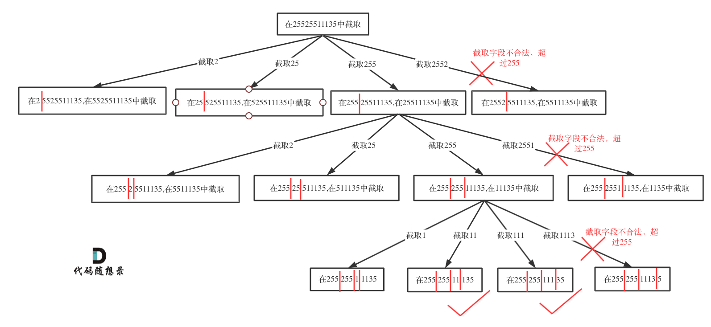

* [做專案（多個 C++、Java、Go、測試開發、前端專案）](https://www.programmercarl.com/other/kstar.html)
* [刷演算法（algorithm）（兩個月高強度學演算法）](https://www.programmercarl.com/xunlian/xunlianying.html)
* [背八股（40 天挑戰高頻面試題）](https://www.programmercarl.com/xunlian/bagu.html)


# 93.復原 IP 位址（IP address）

[LeetCode 題目連結](https://leetcode.cn/problems/restore-ip-addresses/)

給定一個只包含數字的字串（string），復原它並回傳所有可能的 IP 位址格式。

有效的 IP 位址正好由四個整數（integer）（每個整數位於 0 到 255 之間組成，且不能含有前導零（leading zero）），整數之間用 '.' 分隔。

例如："0.1.2.201" 和 "192.168.1.1" 是有效的 IP 位址，但是 "0.011.255.245"、"192.168.1.312" 和 "192.168@1.1" 是無效的 IP 位址。

範例 1：
* 輸入：s = "25525511135"
* 輸出：["255.255.11.135","255.255.111.35"]

範例 2：
* 輸入：s = "0000"
* 輸出：["0.0.0.0"]

範例 3：
* 輸入：s = "1111"
* 輸出：["1.1.1.1"]

範例 4：
* 輸入：s = "010010"
* 輸出：["0.10.0.10","0.100.1.0"]

範例 5：
* 輸入：s = "101023"
* 輸出：["1.0.10.23","1.0.102.3","10.1.0.23","10.10.2.3","101.0.2.3"]

提示：
* 0 <= s.length <= 3000
* s 僅由數字組成

## 演算法公開課

**[《程式碼隨想錄》演算法影片公開課](https://programmercarl.com/other/gongkaike.html)：[回溯（backtracking）演算法如何分割字串並判斷是否為合法 IP？| LeetCode：93.復原 IP 位址](https://www.bilibili.com/video/BV1XP4y1U73i/)，相信結合影片再看本篇題解，會更有助於大家對本題的理解**。


## 解題思路

做這道題目之前，最好先把[131.分割回文（palindrome）串](https://programmercarl.com/0131.分割回文串.html)這題做了。

這道題目相信大家剛看的時候，應該會一頭霧水。

其實只要意識到這是切割問題，**切割問題就可以使用回溯搜尋法把所有可能性搜尋出來**，和剛做過的[131.分割回文串](https://programmercarl.com/0131.分割回文串.html)就十分類似了。

切割問題可以抽象為樹狀結構（tree structure），如圖：


### 回溯三部曲

* 遞迴（recursion）參數（parameter）

在[131.分割回文串](https://programmercarl.com/0131.分割回文串.html)中我們就提到切割問題類似組合（combination）問題。

startIndex 一定是需要的，因為不能重複分割，用來記錄下一層遞迴分割的起始位置。

本題我們還需要一個變數（variable）pointNum，記錄新增點號的數量。

所以程式碼如下：

```cpp
vector<string> result;// 記錄結果
// startIndex: 搜尋的起始位置，pointNum: 新增點號的數量
void backtracking(string& s, int startIndex, int pointNum) {
```

* 遞迴終止條件

終止條件和[131.分割回文串](https://programmercarl.com/0131.分割回文串.html)的情況就不同了，本題明確要求只會分成 4 段，所以不能用切割線切到最後作為終止條件，而是以分割的段數作為終止條件。

pointNum 表示點號數量，pointNum 為 3 說明字串已經分成了 4 段。

然後驗證一下第四段是否合法，如果合法就加入到結果集（result set）裡

程式碼如下：

```cpp
if (pointNum == 3) { // 點號數量為 3 時，分隔結束
    // 判斷第四段子字串是否合法，如果合法就放進 result 中
    if (isValid(s, startIndex, s.size() - 1)) {
        result.push_back(s);
    }
    return;
}
```

* 單層搜尋的邏輯（logic）

在[131.分割回文串](https://programmercarl.com/0131.分割回文串.html)中已經講過在迴圈（loop）遍歷（traversal）中如何擷取子字串（substring）。

在`for (int i = startIndex; i < s.size(); i++)`迴圈中 [startIndex, i] 這個區間就是擷取的子字串，需要判斷這個子字串是否合法。

如果合法就在字串後面加上符號`.`表示已經分割。

如果不合法就結束本層迴圈，如圖中剪掉的分支（branch）：




然後就是遞迴和回溯的過程：

遞迴呼叫（recursive call）時，下一層遞迴的 startIndex 要從 i+2 開始（因為在字串中加入了分隔符（separator）`.`），同時記錄分隔符數量的 pointNum 要 +1。

回溯的時候，就將剛剛加入的分隔符`.`刪掉就可以了，pointNum 也要 -1。

程式碼如下：

```CPP
for (int i = startIndex; i < s.size(); i++) {
    if (isValid(s, startIndex, i)) { // 判斷 [startIndex,i] 這個區間的子字串是否合法
        s.insert(s.begin() + i + 1 , '.');  // 在 i 的後面插入一個點號
        pointNum++;
        backtracking(s, i + 2, pointNum);   // 插入點號之後下一個子字串的起始位置為 i+2
        pointNum--;                         // 回溯
        s.erase(s.begin() + i + 1);         // 回溯刪掉點號
    } else break; // 不合法，直接結束本層迴圈
}
```

### 判斷子字串是否合法

最後就是再寫一個判斷區段是否為有效區段的邏輯了。

主要考慮到如下三點：

* 區段以 0 為開頭的數字不合法
* 區段裡有非正整數（positive integer）字元（character）不合法
* 區段如果大於 255 就不合法

程式碼如下：

```CPP
// 判斷字串 s 在左閉右閉區間 [start, end] 所組成的數字是否合法
bool isValid(const string& s, int start, int end) {
    if (start > end) {
        return false;
    }
    if (s[start] == '0' && start != end) { // 0 開頭的數字不合法
            return false;
    }
    int num = 0;
    for (int i = start; i <= end; i++) {
        if (s[i] > '9' || s[i] < '0') { // 遇到非數字字元不合法
            return false;
        }
        num = num * 10 + (s[i] - '0');
        if (num > 255) { // 如果大於 255 就不合法
            return false;
        }
    }
    return true;
}
```


根據[關於回溯演算法，你該了解這些！](https://programmercarl.com/回溯算法理论基础.html)給出的回溯演算法模板（template）：

```
void backtracking(參數) {
    if (終止條件) {
        存放結果;
        return;
    }

    for (選擇：本層集合中元素（樹中節點子節點的數量就是集合的大小）) {
        處理節點;
        backtracking(路徑，選擇清單); // 遞迴
        回溯，撤銷處理結果
    }
}
```

可以寫出如下回溯演算法 C++ 程式碼：

```CPP
class Solution {
private:
    vector<string> result;// 記錄結果
    // startIndex: 搜尋的起始位置，pointNum: 新增點號的數量
    void backtracking(string& s, int startIndex, int pointNum) {
        if (pointNum == 3) { // 點號數量為 3 時，分隔結束
            // 判斷第四段子字串是否合法，如果合法就放進 result 中
            if (isValid(s, startIndex, s.size() - 1)) {
                result.push_back(s);
            }
            return;
        }
        for (int i = startIndex; i < s.size(); i++) {
            if (isValid(s, startIndex, i)) { // 判斷 [startIndex,i] 這個區間的子字串是否合法
                s.insert(s.begin() + i + 1 , '.');  // 在 i 的後面插入一個點號
                pointNum++;
                backtracking(s, i + 2, pointNum);   // 插入點號之後下一個子字串的起始位置為 i+2
                pointNum--;                         // 回溯
                s.erase(s.begin() + i + 1);         // 回溯刪掉點號
            } else break; // 不合法，直接結束本層迴圈
        }
    }
    // 判斷字串 s 在左閉右閉區間 [start, end] 所組成的數字是否合法
    bool isValid(const string& s, int start, int end) {
        if (start > end) {
            return false;
        }
        if (s[start] == '0' && start != end) { // 0 開頭的數字不合法
                return false;
        }
        int num = 0;
        for (int i = start; i <= end; i++) {
            if (s[i] > '9' || s[i] < '0') { // 遇到非數字字元不合法
                return false;
            }
            num = num * 10 + (s[i] - '0');
            if (num > 255) { // 如果大於 255 就不合法
                return false;
            }
        }
        return true;
    }
public:
    vector<string> restoreIpAddresses(string s) {
        result.clear();
        if (s.size() < 4 || s.size() > 12) return result; // 算是剪枝了
        backtracking(s, 0, 0);
        return result;
    }
};

```
* 時間複雜性（time complexity）: O(3^4)，IP 位址最多包含 4 個數字，每個數字最多有 3 種可能的分割方式，則搜尋樹（search tree）的最大深度（depth）為 4，每個節點（node）最多有 3 個子節點（child node）。
* 空間複雜度（space complexity）: O(n)

## 總結

在[131.分割回文串](https://programmercarl.com/0131.分割回文串.html)中我列舉的分割字串的難點，本題都涵蓋了。

而且本題還需要操作字串加入點號作為分隔符，並驗證區間的合法性。

可以說是[131.分割回文串](https://programmercarl.com/0131.分割回文串.html)的進階版。

在本文的樹狀結構圖中，我已經把詳細的分析思路都畫了出來，相信大家看了之後思路一定會清晰不少！


## 其他語言版本

### Java

```java
class Solution {
    List<String> result = new ArrayList<>();

    public List<String> restoreIpAddresses(String s) {
        if (s.length() > 12) return result; // 算是剪枝了
        backTrack(s, 0, 0);
        return result;
    }

    // startIndex: 搜尋的起始位置，pointNum: 新增點號的數量
    private void backTrack(String s, int startIndex, int pointNum) {
        if (pointNum == 3) {// 點號數量為 3 時，分隔結束
            // 判斷第四段子字串是否合法，如果合法就放進 result 中
            if (isValid(s,startIndex,s.length()-1)) {
                result.add(s);
            }
            return;
        }
        for (int i = startIndex; i < s.length(); i++) {
            if (isValid(s, startIndex, i)) {
                s = s.substring(0, i + 1) + "." + s.substring(i + 1);    // 在 str 的後面插入一個點號
                pointNum++;
                backTrack(s, i + 2, pointNum);// 插入點號之後下一個子字串的起始位置為 i+2
                pointNum--;// 回溯
                s = s.substring(0, i + 1) + s.substring(i + 2);// 回溯刪掉點號
            } else {
                break;
            }
        }
    }

    // 判斷字串 s 在左閉右閉區間 [start, end] 所組成的數字是否合法
    private Boolean isValid(String s, int start, int end) {
        if (start > end) {
            return false;
        }
        if (s.charAt(start) == '0' && start != end) { // 0 開頭的數字不合法
            return false;
        }
        int num = 0;
        for (int i = start; i <= end; i++) {
            if (s.charAt(i) > '9' || s.charAt(i) < '0') { // 遇到非數字字元不合法
                return false;
            }
            num = num * 10 + (s.charAt(i) - '0');
            if (num > 255) { // 如果大於 255 就不合法
                return false;
            }
        }
        return true;
    }
}
// 方法一：使用 StringBuilder，故最佳化時間、空間複雜度，因為向字串插入字元時無需複製整個字串，從而減少了操作的時間複雜性，也不用開新空間存 subString，從而減少了空間複雜度。
class Solution {
    List<String> result = new ArrayList<>();
    public List<String> restoreIpAddresses(String s) {
        StringBuilder sb = new StringBuilder(s);
        backTracking(sb, 0, 0);
        return result;
    }
    private void backTracking(StringBuilder s, int startIndex, int dotCount){
        if(dotCount == 3){
            if(isValid(s, startIndex, s.length() - 1)){
                result.add(s.toString());
            }
            return;
        }
        for(int i = startIndex; i < s.length(); i++){
            if(isValid(s, startIndex, i)){
                s.insert(i + 1, '.');
                backTracking(s, i + 2, dotCount + 1);
                s.deleteCharAt(i + 1);
            }else{
                break;
            }
        }
    }
    //[start, end]
    private boolean isValid(StringBuilder s, int start, int end){
        if(start > end)
            return false;
        if(s.charAt(start) == '0' && start != end)
            return false;
        int num = 0;
        for(int i = start; i <= end; i++){
            int digit = s.charAt(i) - '0';
            num = num * 10 + digit;
            if(num > 255)
                return false;
        }
        return true;
    }
}

// 方法二：比上面的方法時間複雜性低，更好地剪枝，最佳化時間複雜性
class Solution {
    List<String> result = new ArrayList<String>();
	StringBuilder stringBuilder = new StringBuilder();

	public List<String> restoreIpAddresses(String s) {
		restoreIpAddressesHandler(s, 0, 0);
		return result;
	}

	// number 表示 stringbuilder 中 ip 段的數量
	public void restoreIpAddressesHandler(String s, int start, int number) {
		// 如果 start 等於 s 的長度並且 ip 段的數量是 4，則加入結果集，並回傳
		if (start == s.length() && number == 4) {
			result.add(stringBuilder.toString());
			return;
		}
		// 如果 start 等於 s 的長度但是 ip 段的數量不為 4，或者 ip 段的數量為 4 但是 start 小於 s 的長度，則直接回傳
		if (start == s.length() || number == 4) {
			return;
		}
		// 剪枝：ip 段的長度最大是 3，並且 ip 段處於 [0,255]
		for (int i = start; i < s.length() && i - start < 3 && Integer.parseInt(s.substring(start, i + 1)) >= 0
				&& Integer.parseInt(s.substring(start, i + 1)) <= 255; i++) {
			if (i + 1 - start > 1 && s.charAt(start) - '0' == 0) {
				break;
			}
			stringBuilder.append(s.substring(start, i + 1));
			// 當 stringBuilder 裡的網段數量小於 3 時，才會加點；如果等於 3，說明已經有 3 段了，最後一段不需要再加點
			if (number < 3) {
				stringBuilder.append(".");
			}
			number++;
			restoreIpAddressesHandler(s, i + 1, number);
			number--;
			// 刪除當前 stringBuilder 最後一個網段，注意考慮點的數量的問題
			stringBuilder.delete(start + number, i + number + 2);
		}
	}
}
```


### Python

回溯（版本一）
```python
class Solution:
    def restoreIpAddresses(self, s: str) -> List[str]:
        result = []
        self.backtracking(s, 0, 0, "", result)
        return result

    def backtracking(self, s, start_index, point_num, current, result):
        if point_num == 3:  # 點號數量為 3 時，分隔結束
            if self.is_valid(s, start_index, len(s) - 1):  # 判斷第四段子字串是否合法
                current += s[start_index:]  # 加入最後一段子字串
                result.append(current)
            return

        for i in range(start_index, len(s)):
            if self.is_valid(s, start_index, i):  # 判斷 [start_index, i] 這個區間的子字串是否合法
                sub = s[start_index:i + 1]
                self.backtracking(s, i + 1, point_num + 1, current + sub + '.', result)
            else:
                break

    def is_valid(self, s, start, end):
        if start > end:
            return False
        if s[start] == '0' and start != end:  # 0 開頭的數字不合法
            return False
        num = 0
        for i in range(start, end + 1):
            if not s[i].isdigit():  # 遇到非數字字元不合法
                return False
            num = num * 10 + int(s[i])
            if num > 255:  # 如果大於 255 就不合法
                return False
        return True

```
回溯（版本二）

```python
class Solution:
    def restoreIpAddresses(self, s: str) -> List[str]:
        results = []
        self.backtracking(s, 0, [], results)
        return results

    def backtracking(self, s, index, path, results):
        if index == len(s) and len(path) == 4:
            results.append('.'.join(path))
            return

        if len(path) > 4:  # 剪枝
            return

        for i in range(index, min(index + 3, len(s))):
            if self.is_valid(s, index, i):
                sub = s[index:i+1]
                path.append(sub)
                self.backtracking(s, i+1, path, results)
                path.pop()

    def is_valid(self, s, start, end):
        if start > end:
            return False
        if s[start] == '0' and start != end:  # 0 開頭的數字不合法
            return False
        num = int(s[start:end+1])
        return 0 <= num <= 255
```
回溯（版本三）

```python
class Solution:
    def restoreIpAddresses(self, s: str) -> List[str]:
        result = []
        self.backtracking(s, 0, [], result)
        return result
    
    def backtracking(self, s, startIndex, path, result):
        if startIndex == len(s):
            result.append('.'.join(path[:]))
            return
        
        for i in range(startIndex, min(startIndex+3, len(s))):
            # 如果 i 往後遍歷了，並且當前位址的第一個元素是 0，就直接退出
            if i > startIndex and s[startIndex] == '0':
                break
            # 比如 s 長度為 5，當前遍歷到 i = 3 這個元素
            # 因為還沒有執行任何操作，所以此時剩下的元素數量就是 5 - 3 = 2，即包括當前的 i 本身
            # path 裡面是當前包含的子字串，所以有幾個元素就表示儲存了幾個位址
            # 所以 (4 - len(path)) * 3 表示當前路徑至多能存放的元素個數
            # 4 - len(path) 表示至少要存放的元素個數
            if (4 - len(path)) * 3 < len(s) - i or 4 - len(path) > len(s) - i:
                break
            if i - startIndex == 2:
                if not int(s[startIndex:i+1]) <= 255:
                    break
            path.append(s[startIndex:i+1])
            self.backtracking(s, i+1, path, result)
            path.pop()
```

### Go 

```go
var (
    path []string
    res  []string
)
func restoreIpAddresses(s string) []string {
    path, res = make([]string, 0, len(s)), make([]string, 0)
    dfs(s, 0)
    return res
}
func dfs(s string, start int) {  
    if len(path) == 4 {    // 夠四段後就不再繼續往下遞迴
        if start == len(s) {      
            str := strings.Join(path, ".")
            res = append(res, str)
        }
        return 
    }
    for i := start; i < len(s); i++ {
        if i != start && s[start] == '0' { // 含有前導 0，無效
            break
        }
        str := s[start : i+1]
        num, _ := strconv.Atoi(str)
        if num >= 0 && num <= 255 {
            path = append(path, str)  // 符合條件的就進入下一層
            dfs(s, i+1)
            path = path[:len(path) - 1]
        } else {   // 如果不滿足條件，再往後也不可能滿足條件，直接退出
            break
        }
    }
}
```

### JavaScript

```js
/**
 * @param {string} s
 * @return {string[]}
 */
var restoreIpAddresses = function(s) {
    const res = [], path = [];
    backtracking(0, 0)
    return res;
    function backtracking(i) {
        const len = path.length;
        if(len > 4) return;
        if(len === 4 && i === s.length) {
            res.push(path.join("."));
            return;
        }
        for(let j = i; j < s.length; j++) {
            const str = s.slice(i, j + 1);
            if(str.length > 3 || +str > 255) break;
            if(str.length > 1 && str[0] === "0") break;
            path.push(str);
            backtracking(j + 1);
            path.pop()
        }
    }
};
```

### TypeScript

```typescript
function isValidIpSegment(str: string): boolean {
    let resBool: boolean = true;
    let tempVal: number = Number(str);
    if (
        str.length === 0 || isNaN(tempVal) ||
        tempVal > 255 || tempVal < 0 ||
        (str.length > 1 && str[0] === '0')
    ) {
        resBool = false;
    }
    return resBool;
}
function restoreIpAddresses(s: string): string[] {
    const resArr: string[] = [];
    backTracking(s, 0, []);
    return resArr;
    function backTracking(s: string, startIndex: number, route: string[]): void {
        let length: number = s.length;
        if (route.length === 4 && startIndex >= length) {
            resArr.push(route.join('.'));
            return;
        }
        if (route.length === 4 || startIndex >= length) return;
        let tempStr: string = '';
        for (let i = startIndex + 1; i <= Math.min(length, startIndex + 3); i++) {
            tempStr = s.slice(startIndex, i);
            if (isValidIpSegment(tempStr)) {
                route.push(s.slice(startIndex, i));
                backTracking(s, i, route);
                route.pop();
            }
        }
    }
};
```

### Rust

```Rust
impl Solution {
    fn is_valid(s: &[char], start: usize, end: usize) -> bool {
        if start > end {
            return false;
        }
        if s[start] == '0' && start != end {
            return false;
        }
        let mut num = 0;
        for &c in s.iter().take(end + 1).skip(start) {
            if !('0'..='9').contains(&c) {
                return false;
            }
            if let Some(digit) = c.to_digit(10) {
                num = num * 10 + digit;
            }
            if num > 255 {
                return false;
            }
        }
        true
    }

    fn backtracking(result: &mut Vec<String>, s: &mut Vec<char>, start_index: usize, mut point_num: usize) {
        let len = s.len();
        if point_num == 3 {
            if Self::is_valid(s, start_index, len - 1) {
                result.push(s.iter().collect::<String>());
            }
            return;
        }
        for i in start_index..len {
            if Self::is_valid(s, start_index, i) {
                point_num += 1;
                s.insert(i + 1, '.');
                Self::backtracking(result, s, i + 2, point_num);
                point_num -= 1;
                s.remove(i + 1);
            }   else { break; }
        }
    }

    pub fn restore_ip_addresses(s: String) -> Vec<String> {
        let mut result: Vec<String> = Vec::new();
        let len = s.len();
        if len < 4 || len > 12 { return result; }
        let mut s = s.chars().collect::<Vec<char>>();
        Self::backtracking(&mut result, &mut s, 0, 0);
        result
    }

}
```

### C 
```c
// 記錄結果
char** result;
int resultTop;
// 記錄應該加入 '.' 的位置
int segments[3];
int isValid(char* s, int start, int end) {
    if(start > end)
        return 0;
    if (s[start] == '0' && start != end) { // 0 開頭的數字不合法
                return false;
    }
    int num = 0;
    for (int i = start; i <= end; i++) {
        if (s[i] > '9' || s[i] < '0') { // 遇到非數字字元不合法
            return false;
        }
        num = num * 10 + (s[i] - '0');
        if (num > 255) { // 如果大於 255 就不合法
            return false;
        }
    }
    return true;
}

// startIndex 為起始搜尋位置，pointNum 為 '.' 物件
void backTracking(char* s, int startIndex, int pointNum) {
    // 若 '.' 數量為 3，分隔結束
    if(pointNum == 3) {
        // 若最後一段字串符合要求，將當前的字串放入 result 中
        if(isValid(s, startIndex, strlen(s) - 1)) {
            char* tempString = (char*)malloc(sizeof(char) * strlen(s) + 4);
            int j;
            // 記錄加入字元時 tempString 的下標
            int count = 0;
            // 記錄加入字元時 '.' 的使用數量
            int count1 = 0;
            for(j = 0; j < strlen(s); j++) {
                tempString[count++] = s[j];
                // 若 '.' 的使用數量小於 3 且當前下標等於 '.' 下標，加入 '.' 到陣列
                if(count1 < 3 && j == segments[count1]) {
                    tempString[count++] = '.';
                    count1++;
                }
            }
            tempString[count] = 0;
            // 擴容 result 陣列
            result = (char**)realloc(result, sizeof(char*) * (resultTop + 1));
            result[resultTop++] = tempString;
        }
        return ;
    }

    int i;
    for(i = startIndex; i < strlen(s); i++) {
        if(isValid(s, startIndex, i)) {
            // 記錄應該加入 '.' 的位置
            segments[pointNum] = i;
            backTracking(s, i + 1, pointNum + 1);
        }
        else {
            break;
        }
    }
}

char ** restoreIpAddresses(char * s, int* returnSize){
    result = (char**)malloc(0);
    resultTop = 0;
    backTracking(s, 0, 0);
    *returnSize = resultTop;
    return result;
}
```

### Swift

```swift
// 判斷區間段是否合法
func isValid(s: [Character], start: Int, end: Int) -> Bool {
    guard start <= end, start >= 0, end < s.count else { return false } // 索引不合法
    if start != end, s[start] == "0" { return false } // 以 0 開頭的多位數字不合法
    var num = 0
    for i in start ... end {
        let c = s[i]
        guard c >= "0", c <= "9" else { return false } // 非數字不合法
        let value = c.asciiValue! - ("0" as Character).asciiValue!
        num = num * 10 + Int(value)
        guard num <= 255 else { return false } // 大於 255 不合法
    }
    return true
}
func restoreIpAddresses(_ s: String) -> [String] {
    var s = Array(s) // 轉換成字元陣列以便於比較
    var result = [String]() // 結果
    func backtracking(startIndex: Int, pointCount: Int) {
        guard startIndex < s.count else { return } // 索引不合法
        // 結束條件
        if pointCount == 3 {
            // 最後一段也合法，則收集結果
            if isValid(s: s, start: startIndex, end: s.count - 1) {
                result.append(String(s))
            }
            return
        }

        for i in startIndex ..< s.count {
            // 判斷 [starIndex, i] 子字串是否合法，合法則插入「.」，否則結束本層迴圈
            if isValid(s: s, start: startIndex, end: i) {
                s.insert(".", at: i + 1) // 子字串後面插入「.」
                backtracking(startIndex: i + 2, pointCount: pointCount + 1) // 注意這裡是跳 2 位，且透過 pointCount + 1 區域變數隱藏了 pointCount 的回溯
                s.remove(at: i + 1) // 回溯
            } else {
                break
            }
        }
    }
    backtracking(startIndex: 0, pointCount: 0)
    return result
}
```

### Scala

```scala
object Solution {
  import scala.collection.mutable
  def restoreIpAddresses(s: String): List[String] = {
    var result = mutable.ListBuffer[String]()
    if (s.size < 4 || s.length > 12) return result.toList
    var path = mutable.ListBuffer[String]()

    // 判斷 IP 中的一個欄位是否為正確的
    def isIP(sub: String): Boolean = {
      if (sub.size > 1 && sub(0) == '0') return false
      if (sub.toInt > 255) return false
      true
    }

    def backtracking(startIndex: Int): Unit = {
      if (startIndex >= s.size) {
        if (path.size == 4) {
          result.append(path.mkString(".")) // mkString 方法可以把集合裡的資料以指定字串拼接
          return
        }
        return
      }
      // subString
      for (i <- startIndex until startIndex + 3 if i < s.size) {
        var subString = s.substring(startIndex, i + 1)
        if (isIP(subString)) { // 如果合法則進行下一輪
          path.append(subString)
          backtracking(i + 1)
          path = path.take(path.size - 1)
        }
      }
    }

    backtracking(0)
    result.toList
  }
}
```
### C#
```csharp
public class Solution
{
    public IList<string> res = new List<string>();
    public IList<string> RestoreIpAddresses(string s)
    {
        if (s.Length < 4 || s.Length > 12) return res;
        BackTracking(s, 0, 0);
        return res;
    }
    public void BackTracking(string s, int start, int pointSum)
    {
        if (pointSum == 3)
        {
            if (IsValid(s, start, s.Length - 1))
            {
                res.Add(s);
            }
            return;
        }
        for (int i = start; i < s.Length; i++)
        {
            if (IsValid(s, start, i))
            {
                s = s.Insert(i + 1, ".");
                BackTracking(s, i + 2, pointSum + 1);
                s = s.Remove(i + 1, 1);
            }
            else break;
        }
    }
    public bool IsValid(string s, int start, int end)
    {
        if (start > end) return false;
        if (s[start] == '0' && start != end) return false;
        int num = 0;
        for (int i = start; i <= end; i++)
        {
            if (s[i] > '9' || s[i] < '0') return false;
            num = num * 10 + s[i] - '0';
            if (num > 255) return false;
        }
        return true;
    }
}
```


