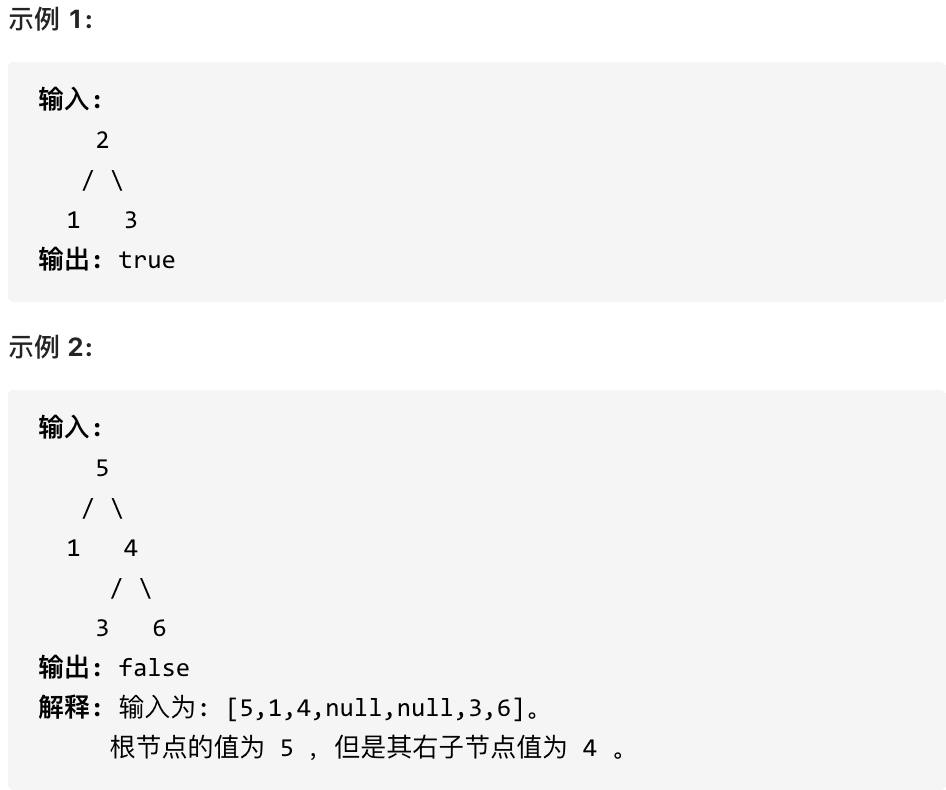
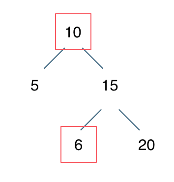

* [做專案（多個 C++、Java、Go、測試開發、前端專案）](https://www.programmercarl.com/other/kstar.html)
* [刷演算法（兩個月高強度學演算法）](https://www.programmercarl.com/xunlian/xunlianying.html)
* [準備面試必考題（40 天挑戰高頻面試題）](https://www.programmercarl.com/xunlian/bagu.html)


# 98. 驗證二元搜尋樹（binary search tree, BST）

[LeetCode 題目連結](https://leetcode.cn/problems/validate-binary-search-tree/)


給定一個二元樹（binary tree），判斷其是否是一個有效的二元搜尋樹（binary search tree, BST）。

假設一個BST具有如下特徵：

* 節點（node）的左子樹（left subtree）只包含小於當前節點的數。
* 節點的右子樹（right subtree）只包含大於當前節點的數。
* 所有左子樹和右子樹自身必須也是BST。



## 演算法公開課

**[《代碼隨想錄》演算法影片公開課](https://programmercarl.com/other/gongkaike.html)：[你對二元搜尋樹了解得還不夠！ | LeetCode：98. 驗證二元搜尋樹](https://www.bilibili.com/video/BV18P411n7Q4)，相信結合影片再看本篇題解，更有助於大家對本題的理解**。


## 解題思路

要知道中序橫過（inorder traversal）下，輸出的BST節點的數值是有序（ordered）序列（sequence）。

有了這個特性，**驗證BST，就相當於變成了判斷一個序列是不是遞增的了。**

### 遞迴（recursion）法

可以遞迴中序橫過將BST轉變成一個陣列（array），程式碼如下：

```CPP
vector<int> vec;
void traversal(TreeNode* root) {
    if (root == NULL) return;
    traversal(root->left);
    vec.push_back(root->val); // 將二元搜尋樹轉換為有序陣列
    traversal(root->right);
}
```

然後只要比較（comparison）一下，這個陣列是否是有序的，**注意BST中不能有重複（duplicate）元素（element）**。

```CPP
traversal(root);
for (int i = 1; i < vec.size(); i++) {
    // 注意要小於等於，搜尋樹裡不能有相同元素
    if (vec[i] <= vec[i - 1]) return false;
}
return true;
```

整體程式碼如下：

```CPP
class Solution {
private:
    vector<int> vec;
    void traversal(TreeNode* root) {
        if (root == NULL) return;
        traversal(root->left);
        vec.push_back(root->val); // 將二元搜尋樹轉換為有序陣列
        traversal(root->right);
    }
public:
    bool isValidBST(TreeNode* root) {
        vec.clear(); // 不加這句在 leetcode 上也可以過，但最好加上
        traversal(root);
        for (int i = 1; i < vec.size(); i++) {
            // 注意要小於等於，搜尋樹裡不能有相同元素
            if (vec[i] <= vec[i - 1]) return false;
        }
        return true;
    }
};
```

以上程式碼中，我們把二元樹轉變為陣列來判斷，是最直觀的，但其實不用轉變成陣列，可以在遞迴遍歷（traversal）的過程中直接判斷是否有序。


這道題目比較容易陷入兩個陷阱：

* 陷阱 1

**不能單純地比較左節點小於中間節點，右節點大於中間節點就完事了**。

寫出了類似這樣的程式碼：

```CPP
if (root->val > root->left->val && root->val < root->right->val) {
    return true;
} else {
    return false;
}
```

**我們要比較的是 左子樹所有節點小於中間節點，右子樹所有節點大於中間節點**。所以以上程式碼的判斷邏輯是錯誤的。

例如：[10,5,15,null,null,6,20] 這個 case：



節點 10 大於左節點 5，小於右節點 15，但右子樹裡出現了一個 6 這就不符合了！

* 陷阱 2

測試資料（test data）中最小節點可能是 int 的最小值，如果這樣使用最小的 int 來比較也是不行的。

此時可以初始化（initialization）比較元素為 long long 的最小值。

問題可以進一步演進：如果測試資料中根節點（root node）的 val 可能是 long long 的最小值又要怎麼辦呢？文中會解答。

了解這些陷阱之後我們來看一下程式碼應該怎麼寫：

遞迴三部曲：

* 確定遞迴函數（recursive function）、轉回值（return value）以及參數（parameter）

要定義一個 long long 的全域變數（global variable），用來比較遍歷的節點是否有序，因為後台測試資料中有 int 最小值，所以定義為 long long 的類型，初始化為 long long 最小值。

注意遞迴函數要有 bool 類型的轉回值，我們在[二元樹：遞迴函數究竟什麼時候需要回傳值，什麼時候不要回傳值？](https://programmercarl.com/0112.路径总和.html)中講了，只有尋找某一條邊（edge）（或者一個節點）的時候，遞迴函數會有 bool 類型的轉回值。

其實本題是同樣的道理，我們在尋找一個不符合條件的節點，如果沒有找到這個節點就遍歷了整個樹，如果找到不符合的節點了，立刻回傳。

程式碼如下：

```CPP
long long maxVal = LONG_MIN; // 因為後台測試資料中有 int 最小值
bool isValidBST(TreeNode* root)
```

* 確定終止條件（termination condition）

如果是空節點（null node），是不是BST呢？

是的，BST也可以為空！

程式碼如下：

```CPP
if (root == NULL) return true;
```

* 確定單層遞迴的邏輯

中序橫過，一直更新 maxVal，一旦發現 maxVal >= root->val，就回傳 false，注意元素相同時候也要回傳 false。

程式碼如下：

```CPP
bool left = isValidBST(root->left);         // 左

// 中序橫過，驗證遍歷的元素是不是從小到大
if (maxVal < root->val) maxVal = root->val; // 中
else return false;

bool right = isValidBST(root->right);       // 右
return left && right;
```

整體程式碼如下：

```CPP
class Solution {
public:
    long long maxVal = LONG_MIN; // 因為後台測試資料中有 int 最小值
    bool isValidBST(TreeNode* root) {
        if (root == NULL) return true;

        bool left = isValidBST(root->left);
        // 中序橫過，驗證遍歷的元素是不是從小到大
        if (maxVal < root->val) maxVal = root->val;
        else return false;
        bool right = isValidBST(root->right);

        return left && right;
    }
};
```

以上程式碼是因為後台資料有 int 最小值測試案例（test case），所以都把 maxVal 改成了 long long 最小值。

如果測試資料中有 long long 的最小值，怎麼辦？

不可能再初始化一個更小的值了吧。建議避免初始化最小值，如下方法取到最左面節點的數值來比較。

程式碼如下：

```CPP
class Solution {
public:
    TreeNode* pre = NULL; // 用來記錄前一個節點
    bool isValidBST(TreeNode* root) {
        if (root == NULL) return true;
        bool left = isValidBST(root->left);

        if (pre != NULL && pre->val >= root->val) return false;
        pre = root; // 記錄前一個節點

        bool right = isValidBST(root->right);
        return left && right;
    }
};
```

最後這份程式碼看上去整潔一些，想法也清晰。

### 疊代（iteration）法

可以用疊代法模擬二元樹中序橫過，對前中後序疊代法生疏的同學可以看這兩篇[二元樹：聽說遞迴能做的，堆疊也能做！](https://programmercarl.com/二叉树的迭代遍历.html)，[二元樹：前中後序疊代方式統一寫法](https://programmercarl.com/二叉树的统一迭代法.html)

疊代法中序橫過稍加改動就可以了，程式碼如下：

```CPP
class Solution {
public:
    bool isValidBST(TreeNode* root) {
        stack<TreeNode*> st;
        TreeNode* cur = root;
        TreeNode* pre = NULL; // 記錄前一個節點
        while (cur != NULL || !st.empty()) {
            if (cur != NULL) {
                st.push(cur);
                cur = cur->left;                // 左
            } else {
                cur = st.top();                 // 中
                st.pop();
                if (pre != NULL && cur->val <= pre->val)
                return false;
                pre = cur; //儲存前一個存取的節點

                cur = cur->right;               // 右
            }
        }
        return true;
    }
};
```

在[二元樹：二元搜尋樹登場！](https://programmercarl.com/0700.二叉搜索树中的搜索.html)中我們分明寫出了簡潔到讓人感動的疊代法，怎麼在這裡不行了呢，因為本題是要驗證BST啊。

## 總結

這道題目是一個簡單題，但對於沒接觸過的同學還是有難度的。

所以初學者剛開始學習演算法的時候，看到簡單題目沒有解題思路很正常，千萬別懷疑自己智商，學習過程都是這樣的，大家智商都差不多。

只要把基本類型的題目都做過，總結過之後，思路自然就開闊了，加油💪 


## 其他語言版本


### Java 

```Java
//使用統一疊代法
class Solution {
    public boolean isValidBST(TreeNode root) {
        Stack<TreeNode> stack = new Stack<>();
        TreeNode pre = null;
        if(root != null)
            stack.add(root);        
        while(!stack.isEmpty()){
            TreeNode curr = stack.peek();
            if(curr != null){
                stack.pop();
                if(curr.right != null)
                    stack.add(curr.right);
                stack.add(curr);
                stack.add(null);
                if(curr.left != null)
                    stack.add(curr.left);
            }else{
                stack.pop();
                TreeNode temp = stack.pop();
                if(pre != null && pre.val >= temp.val)
                    return false;
                pre = temp;
            }
        }
        return true;
    }
}
```
```Java
class Solution {
    // 遞迴
    TreeNode max;
    public boolean isValidBST(TreeNode root) {
        if (root == null) {
            return true;
        }
        // 左
        boolean left = isValidBST(root.left);
        if (!left) {
            return false;
        }
        // 中
        if (max != null && root.val <= max.val) {
            return false;
        }
        max = root;
        // 右
        boolean right = isValidBST(root.right);
        return right;
    }
}

class Solution {
    // 疊代
    public boolean isValidBST(TreeNode root) {
        if (root == null) {
            return true;
        }
        Stack<TreeNode> stack = new Stack<>();
        TreeNode pre = null;
        while (root != null || !stack.isEmpty()) {
            while (root != null) {
                stack.push(root);
                root = root.left;// 左
            }
            // 中，處理
            TreeNode pop = stack.pop();
            if (pre != null && pop.val <= pre.val) {
                return false;
            }
            pre = pop;

            root = pop.right;// 右
        }
        return true;
    }
}

// 簡潔實作·遞迴解法
class Solution {
    public boolean isValidBST(TreeNode root) {
        return validBST(Long.MIN_VALUE, Long.MAX_VALUE, root);
    }
    boolean validBST(long lower, long upper, TreeNode root) {
        if (root == null) return true;
        if (root.val <= lower || root.val >= upper) return false;
        return validBST(lower, root.val, root.left) && validBST(root.val, upper, root.right);
    }
}
// 簡潔實作·中序橫過
class Solution {
    private long prev = Long.MIN_VALUE;
    public boolean isValidBST(TreeNode root) {
        if (root == null) {
            return true;
        }
        if (!isValidBST(root.left)) {
            return false;
        }
        if (root.val <= prev) { // 不滿足二元搜尋樹條件
            return false;
        }
        prev = root.val;
        return isValidBST(root.right);
    }
}
```

### Python 

遞迴法（版本一）利用中序遞增性質，轉換成陣列
```python
# Definition for a binary tree node.
# class TreeNode:
#     def __init__(self, val=0, left=None, right=None):
#         self.val = val
#         self.left = left
#         self.right = right
class Solution:
    def __init__(self):
        self.vec = []

    def traversal(self, root):
        if root is None:
            return
        self.traversal(root.left)
        self.vec.append(root.val)  # 將二元搜尋樹轉換為有序陣列
        self.traversal(root.right)

    def isValidBST(self, root):
        self.vec = []  # 清空陣列
        self.traversal(root)
        for i in range(1, len(self.vec)):
            # 注意要小於等於，搜尋樹裡不能有相同元素
            if self.vec[i] <= self.vec[i - 1]:
                return False
        return True

```

遞迴法（版本二）設定極小值，進行比較

```python
class Solution:
    def __init__(self):
        self.maxVal = float('-inf')  # 因為後台測試資料中有 int 最小值

    def isValidBST(self, root):
        if root is None:
            return True

        left = self.isValidBST(root.left)
        # 中序橫過，驗證遍歷的元素是不是從小到大
        if self.maxVal < root.val:
            self.maxVal = root.val
        else:
            return False
        right = self.isValidBST(root.right)

        return left and right

```
遞迴法（版本三）直接取該樹的最小值
```python
# Definition for a binary tree node.
# class TreeNode:
#     def __init__(self, val=0, left=None, right=None):
#         self.val = val
#         self.left = left
#         self.right = right
class Solution:
    def __init__(self):
        self.pre = None  # 用來記錄前一個節點

    def isValidBST(self, root):
        if root is None:
            return True

        left = self.isValidBST(root.left)

        if self.pre is not None and self.pre.val >= root.val:
            return False
        self.pre = root  # 記錄前一個節點

        right = self.isValidBST(root.right)
        return left and right


```
疊代法
```python
# Definition for a binary tree node.
# class TreeNode:
#     def __init__(self, val=0, left=None, right=None):
#         self.val = val
#         self.left = left
#         self.right = right
class Solution:
    def isValidBST(self, root):
        stack = []
        cur = root
        pre = None  # 記錄前一個節點
        while cur is not None or len(stack) > 0:
            if cur is not None:
                stack.append(cur)
                cur = cur.left  # 左
            else:
                cur = stack.pop()  # 中
                if pre is not None and cur.val <= pre.val:
                    return False
                pre = cur  # 儲存前一個存取的節點
                cur = cur.right  # 右
        return True

```


### Go

```Go
func isValidBST(root *TreeNode) bool {
	// 二元搜尋樹也可以是空樹
    if root == nil {
        return true
    }
    // 由題目中的資料限制可以得出 min 和 max
    return check(root,math.MinInt64,math.MaxInt64)
}

func check(node *TreeNode,min,max int64) bool {
    if node == nil {
        return true
    }

    if min >= int64(node.Val) || max <= int64(node.Val) {
        return false
    }
    // 分別對左子樹和右子樹遞迴判斷，如果左子樹和右子樹都符合則回傳 true
    return check(node.Right,int64(node.Val),max) && check(node.Left,min,int64(node.Val))
}
```
```go
// 中序橫過解法
func isValidBST(root *TreeNode) bool {
    // 儲存上一個指標
    var prev *TreeNode
    var travel func(node *TreeNode) bool
    travel = func(node *TreeNode) bool {
        if node == nil {
            return true
        }
        leftRes := travel(node.Left)
        // 當前值小於等於前一個節點的值，回傳 false
        if prev != nil && node.Val <= prev.Val {
            return false
        }
        prev = node
        rightRes := travel(node.Right)
        return leftRes && rightRes
    }
    return travel(root)
}
```

### JavaScript

輔助陣列解決

```javascript
/**
 * Definition for a binary tree node.
 * function TreeNode(val, left, right) {
 *     this.val = (val===undefined ? 0 : val)
 *     this.left = (left===undefined ? null : left)
 *     this.right = (right===undefined ? null : right)
 * }
 */
/**
 * @param {TreeNode} root
 * @return {boolean}
 */
var isValidBST = function (root) {
    let arr = [];
    const buildArr = (root) => {
        if (root) {
            buildArr(root.left);
            arr.push(root.val);
            buildArr(root.right);
        }
    }
    buildArr(root);
    for (let i = 1; i < arr.length; ++i) {
        if (arr[i] <= arr[i - 1])
            return false;
    }
    return true;
};
```

遞迴中解決

```javascript
/**
 * Definition for a binary tree node.
 * function TreeNode(val, left, right) {
 *     this.val = (val===undefined ? 0 : val)
 *     this.left = (left===undefined ? null : left)
 *     this.right = (right===undefined ? null : right)
 * }
 */
/**
 * @param {TreeNode} root
 * @return {boolean}
 */
let pre = null;
var isValidBST = function (root) {
    let pre = null;
    const inOrder = (root) => {
        if (root === null)
            return true;
        let left = inOrder(root.left);

        if (pre !== null && pre.val >= root.val)
            return false;
        pre = root;

        let right = inOrder(root.right);
        return left && right;
    }
    return inOrder(root);
};
```

> 疊代法：

```JavaScript
/**
 * Definition for a binary tree node.
 * function TreeNode(val, left, right) {
 *     this.val = (val===undefined ? 0 : val)
 *     this.left = (left===undefined ? null : left)
 *     this.right = (right===undefined ? null : right)
 * }
 */
/**
 * @param {TreeNode} root
 * @return {boolean}
 */
let pre = null;
var isValidBST = function (root) {
	const queue = [];
	let cur = root;
	let pre = null;
	while (cur !== null || queue.length !== 0) {
		if (cur !== null) {
			queue.push(cur);
			cur = cur.left;
		} else {
			cur = queue.pop();
			if (pre !== null && cur.val <= pre.val) {
				return false;
			}
			pre = cur;
			cur = cur.right;
		}
	}
	return true;
};
```

### TypeScript

> 輔助陣列解決：

```typescript
function isValidBST(root: TreeNode | null): boolean {
    const traversalArr: number[] = [];
    function inorderTraverse(root: TreeNode | null): void {
        if (root === null) return;
        inorderTraverse(root.left);
        traversalArr.push(root.val);
        inorderTraverse(root.right);
    }
    inorderTraverse(root);
    for (let i = 0, length = traversalArr.length; i < length - 1; i++) {
        if (traversalArr[i] >= traversalArr[i + 1]) return false;
    }
    return true;
};
```

> 遞迴中解決：

```typescript
function isValidBST(root: TreeNode | null): boolean {
    let maxVal = -Infinity;
    function inorderTraverse(root: TreeNode | null): boolean {
        if (root === null) return true;
        let leftValid: boolean = inorderTraverse(root.left);
        if (!leftValid) return false;
        if (maxVal < root.val) {
            maxVal = root.val
        } else {
            return false;
        }
        let rightValid: boolean = inorderTraverse(root.right);
        return leftValid && rightValid;
    }
    return inorderTraverse(root);
};
```

> 疊代法：

```TypeScript
function isValidBST(root: TreeNode | null): boolean {
	const queue: TreeNode[] = [];
	let cur: TreeNode | null = root;
	let pre: TreeNode | null = null;
	while (cur !== null || queue.length !== 0) {
		if (cur !== null) {
			queue.push(cur);
			cur = cur.left;
		} else {
			cur = queue.pop()!;
			if (pre !== null && cur!.val <= pre.val) {
				return false;
			}
			pre = cur;
			cur = cur!.right;
		}
	}
	return true;
}
```

### Scala

輔助陣列解決：
```scala
object Solution {
  import scala.collection.mutable
  def isValidBST(root: TreeNode): Boolean = {
    var arr = new mutable.ArrayBuffer[Int]()
    // 遞迴中序橫過二元樹，將節點加入到 arr
    def traversal(node: TreeNode): Unit = {
      if (node == null) return
      traversal(node.left)
      arr.append(node.value)
      traversal(node.right)
    }
    traversal(root)
    // 這個陣列如果是升序就代表是二元搜尋樹
    for (i <- 1 until arr.size) {
      if (arr(i) <= arr(i - 1)) return false
    }
    true  
  }
}
```

遞迴中解決：
```scala
object Solution {
  def isValidBST(root: TreeNode): Boolean = {
    var flag = true
    var preValue:Long = Long.MinValue // 這裡要使用 Long 類型

    def traversal(node: TreeNode): Unit = {
      if (node == null || flag == false) return
      traversal(node.left)
      if (node.value > preValue) preValue = node.value
      else flag = false
      traversal(node.right)
    }
    traversal(root)
    flag  
  }
}
```

### Rust

遞迴：

```rust
impl Solution {
    pub fn is_valid_bst(root: Option<Rc<RefCell<TreeNode>>>) -> bool {
        Self::valid_bst(i64::MIN, i64::MAX, root)
    }
    pub fn valid_bst(low: i64, upper: i64, root: Option<Rc<RefCell<TreeNode>>>) -> bool {
        if root.is_none() {
            return true;
        }
        let root = root.as_ref().unwrap().borrow();
        if root.val as i64 <= low || root.val as i64 >= upper {
            return false;
        }
        Self::valid_bst(low, root.val as i64, root.left.clone())
            && Self::valid_bst(root.val as i64, upper, root.right.clone())
    }
}
```

輔助陣列：

```rust
impl Solution {
    pub fn is_valid_bst(root: Option<Rc<RefCell<TreeNode>>>) -> bool {
        let mut vec = vec![];
        Self::valid_bst(root, &mut vec);
        for i in 1..vec.len() {
            if vec[i] <= vec[i - 1] {
                return false;
            }
        }
        true
    }
    pub fn valid_bst(root: Option<Rc<RefCell<TreeNode>>>, mut v: &mut Vec<i64>) {
        if root.is_none() {
            return;
        }
        let node = root.as_ref().unwrap().borrow();
        Self::valid_bst(node.left.clone(), v);
        v.push(node.val as i64);
        Self::valid_bst(node.right.clone(), v);
    }
}
```
### C#
```csharp
// 遞迴
public long val = Int64.MinValue;
public bool IsValidBST(TreeNode root)
{
    if (root == null) return true;
    bool left = IsValidBST(root.left);
    if (root.val > val) val = root.val;
    else return false;
    bool right = IsValidBST(root.right);
    return left && right;
}
```


