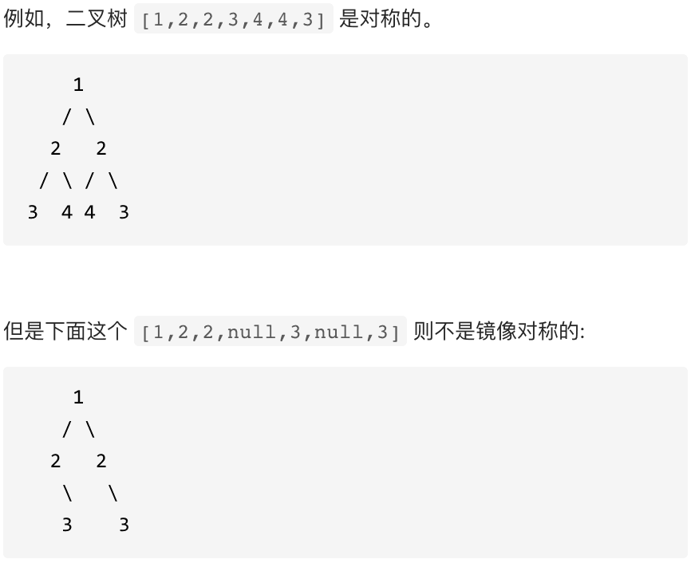
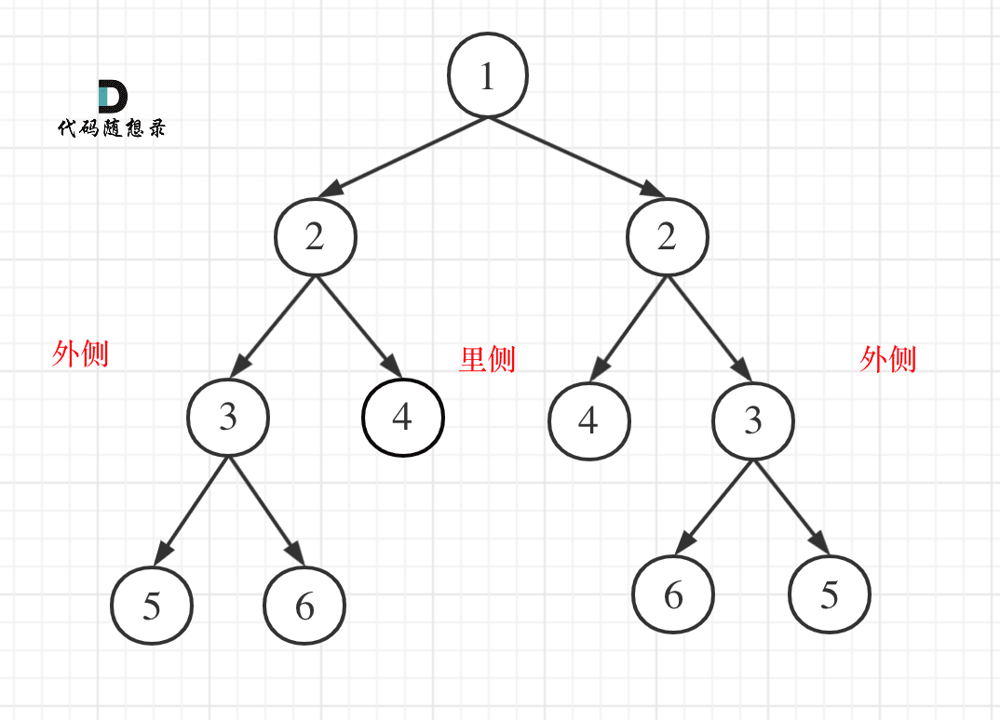
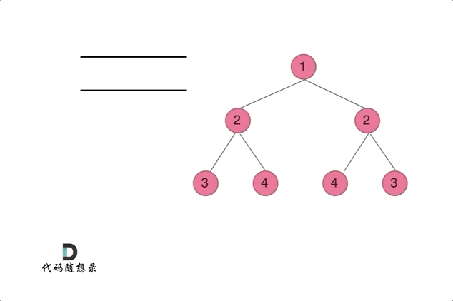

* [做專案（多個 C++、Java、Go、測試開發、前端專案）](https://www.programmercarl.com/other/kstar.html)
* [刷演算法（algorithm）（兩個月高強度學演算法）](https://www.programmercarl.com/xunlian/xunlianying.html)
* [準備面試必考題（40 天挑戰高頻面試題）](https://www.programmercarl.com/xunlian/bagu.html)


# 101. 對稱（symmetric）二元樹（binary tree）

[LeetCode 題目連結](https://leetcode.cn/problems/symmetric-tree/)

給定一個二元樹，檢查它是否是鏡像對稱的。



## 演算法公開課

**[《代碼隨想錄》演算法影片公開課](https://programmercarl.com/other/gongkaike.html)：[同時操作兩個二元樹 | LeetCode：101. 對稱二元樹](https://www.bilibili.com/video/BV1ue4y1Y7Mf)，相信結合影片再看本篇題解，更有助於大家對本題的理解**。

## 解題思路

**首先想清楚，判斷對稱二元樹要比較的是哪兩個節點（node），要比較的可不是左右節點！**

對於二元樹是否對稱，要比較的是根節點（root node）的左子樹（left subtree）與右子樹（right subtree）是不是相互翻轉的，理解這一點就知道了**其實我們要比較的是兩個樹（這兩個樹是根節點的左右子樹）**，所以在遞迴（recursion）遍歷（traversal）的過程中，也是要同時遍歷兩棵樹。

那麼如何比較呢？

比較的是兩個子樹（subtree）的內側和外側的元素（element）是否相等。如圖所示：



那麼遍歷的順序應該是什麼樣的呢？

本題遍歷只能是「後序遍歷（post-order traversal）」，因為我們要透過遞迴函數（recursive function）的轉回值（return value）來判斷兩個子樹的內側節點和外側節點是否相等。

**正是因為要遍歷兩棵樹而且要比較內側和外側節點，所以準確來說是一個樹的遍歷順序是左右中，一個樹的遍歷順序是右左中。**

但都可以理解算是後序遍歷，儘管已經不是嚴格上在一個樹上進行遍歷的後序遍歷了。

其實後序也可以理解為是一種回溯（backtracking），當然這是題外話，講回溯的時候會重點講的。

說到這大家可能感覺我有點囉嗦，哪有這麼多道理，上來就直接開寫就完事了。別急，我說的這些在下面的程式碼講解中都有體現。

那麼我們先來看看遞迴法的程式碼應該怎麼寫。

### 遞迴法

遞迴三部曲

1. 確定遞迴函數的參數（parameter）和轉回值

因為我們要比較的是根節點的兩個子樹是否是相互翻轉的，進而判斷這個樹是不是對稱樹，所以要比較的是兩個樹，參數自然也是左子樹節點和右子樹節點。

轉回值自然是 bool 類型。

程式碼如下：
```
bool compare(TreeNode* left, TreeNode* right)
```

2. 確定終止條件（termination condition）

要比較兩個節點數值相不相同，首先要把兩個節點為空的情況弄清楚！否則後面比較數值的時候就會操作空指標（null pointer）了。

節點為空的情況有：（**注意我們比較的其實不是左子節點（child node）和右子節點，所以如下我稱之為左節點右節點**）

* 左節點為空，右節點不為空，不對稱，return false
* 左不為空，右為空，不對稱 return  false
* 左右都為空，對稱，回傳 true

此時已經排除掉了節點為空的情況，那麼剩下的就是左右節點不為空：

* 左右都不為空，比較節點數值，不相同就 return false

此時左右節點不為空，且數值也不相同的情況我們也處理了。

程式碼如下：
```CPP
if (left == NULL && right != NULL) return false;
else if (left != NULL && right == NULL) return false;
else if (left == NULL && right == NULL) return true;
else if (left->val != right->val) return false; // 注意這裡我沒有使用 else
```

注意上面最後一種情況，我沒有使用 else，而是 else if，因為我們把以上情況都排除之後，剩下的就是 左右節點都不為空，且數值相同的情況。

3. 確定單層遞迴的邏輯

此時才進入單層遞迴的邏輯，單層遞迴的邏輯就是處理 左右節點都不為空，且數值相同的情況。


* 比較二元樹外側是否對稱：傳入的是左節點的左子節點，右節點的右子節點。
* 比較內側是否對稱，傳入左節點的右子節點，右節點的左子節點。
* 如果左右都對稱就回傳 true，有一側不對稱就回傳 false。

程式碼如下：

```CPP
bool outside = compare(left->left, right->right);   // 左子樹：左、 右子樹：右
bool inside = compare(left->right, right->left);    // 左子樹：右、 右子樹：左
bool isSame = outside && inside;                    // 左子樹：中、 右子樹：中（邏輯處理）
return isSame;
```

如上程式碼中，我們可以看出使用的遍歷方式，左子樹左右中，右子樹右左中，所以我把這個遍歷順序也稱之為「後序遍歷」（儘管不是嚴格的後序遍歷）。

最後遞迴的 C++ 整體程式碼如下：

```CPP
class Solution {
public:
    bool compare(TreeNode* left, TreeNode* right) {
        // 首先排除空節點的情況
        if (left == NULL && right != NULL) return false;
        else if (left != NULL && right == NULL) return false;
        else if (left == NULL && right == NULL) return true;
        // 排除了空節點，再排除數值不相同的情況
        else if (left->val != right->val) return false;

        // 此時就是：左右節點都不為空，且數值相同的情況
        // 此時才做遞迴，做下一層的判斷
        bool outside = compare(left->left, right->right);   // 左子樹：左、 右子樹：右
        bool inside = compare(left->right, right->left);    // 左子樹：右、 右子樹：左
        bool isSame = outside && inside;                    // 左子樹：中、 右子樹：中 （邏輯處理）
        return isSame;

    }
    bool isSymmetric(TreeNode* root) {
        if (root == NULL) return true;
        return compare(root->left, root->right);
    }
};
```

**我給出的程式碼並不簡潔，但是把每一步判斷的邏輯都清楚地描繪出來了。**

如果上來就看網上各種簡潔的程式碼，看起來真的很簡單，但是很多邏輯都掩蓋掉了，而題解可能也沒有把掩蓋掉的邏輯說清楚。

**盲目地照著抄，結果就是：發現這是一道「簡單題」，稀里糊塗地就過了，但是真正的每一步判斷邏輯未必想得清楚。**

當然我可以把如上程式碼整理如下：
```CPP
class Solution {
public:
    bool compare(TreeNode* left, TreeNode* right) {
        if (left == NULL && right != NULL) return false;
        else if (left != NULL && right == NULL) return false;
        else if (left == NULL && right == NULL) return true;
        else if (left->val != right->val) return false;
        else return compare(left->left, right->right) && compare(left->right, right->left);

    }
    bool isSymmetric(TreeNode* root) {
        if (root == NULL) return true;
        return compare(root->left, root->right);
    }
};
```

**這個程式碼就很簡潔了，但隱藏了很多邏輯，條理不清晰，而且遞迴三部曲，在這裡完全體現不出來。**

**所以建議大家做題的時候，一定要想清楚邏輯，每一步做什麼。把題目所有情況想到位，相應的程式碼寫出來之後，再去追求簡潔程式碼的效果。**

### 疊代（iteration）法

這道題目我們也可以使用疊代法，但要注意，這裡的疊代法可不是前中後序的疊代寫法，因為本題的本質是判斷兩個樹是否是相互翻轉的，其實已經不是所謂二元樹遍歷的前中後序的關係了。

這裡我們可以使用佇列（queue）來比較兩個樹（根節點的左右子樹）是否相互翻轉，（**注意這不是層次序走訪（level order traversal）**）

#### 使用佇列

透過佇列來判斷根節點的左子樹和右子樹的內側和外側是否相等，如動畫所示：




如下的條件判斷和遞迴的邏輯是一樣的。

程式碼如下：

```CPP
class Solution {
public:
    bool isSymmetric(TreeNode* root) {
        if (root == NULL) return true;
        queue<TreeNode*> que;
        que.push(root->left);   // 將左子樹頭節點加入佇列
        que.push(root->right);  // 將右子樹頭節點加入佇列
        
        while (!que.empty()) {  // 接下來就要判斷這兩個樹是否相互翻轉
            TreeNode* leftNode = que.front(); que.pop();
            TreeNode* rightNode = que.front(); que.pop();
            if (!leftNode && !rightNode) {  // 左節點為空、右節點為空，此時說明是對稱的
                continue;
            }

            // 左右一個節點不為空，或者都不為空但數值不相同，回傳 false
            if ((!leftNode || !rightNode || (leftNode->val != rightNode->val))) {
                return false;
            }
            que.push(leftNode->left);   // 加入左節點左子節點
            que.push(rightNode->right); // 加入右節點右子節點
            que.push(leftNode->right);  // 加入左節點右子節點
            que.push(rightNode->left);  // 加入右節點左子節點
        }
        return true;
    }
};
```

#### 使用堆疊（stack）

細心的話，其實可以發現，這個疊代法，其實是把左右兩個子樹要比較的元素順序放進一個容器（container），然後成對成對地取出來進行比較，那麼其實使用堆疊也是可以的。

只要把佇列原封不動地改成堆疊就可以了，我下面也給出了程式碼。

```CPP
class Solution {
public:
    bool isSymmetric(TreeNode* root) {
        if (root == NULL) return true;
        stack<TreeNode*> st; // 這裡改成了堆疊
        st.push(root->left);
        st.push(root->right);
        while (!st.empty()) {
            TreeNode* rightNode = st.top(); st.pop();
            TreeNode* leftNode = st.top(); st.pop();
            if (!leftNode && !rightNode) {
                continue;
            }
            if ((!leftNode || !rightNode || (leftNode->val != rightNode->val))) {
                return false;
            }
            st.push(leftNode->left);
            st.push(rightNode->right);
            st.push(leftNode->right);
            st.push(rightNode->left);
        }
        return true;
    }
};
```

## 總結

這次我們又深度剖析了一道二元樹的「簡單題」，大家會發現，真正地把題目搞清楚其實並不簡單，leetcode 上 accept 了和真正掌握了還是有距離的。

我們介紹了遞迴法和疊代法，遞迴依然透過遞迴三部曲來解決了這道題目，如果只看精簡的程式碼根本看不出來遞迴三部曲是如何解題的。

在疊代法中我們使用了佇列，需要注意的是這不是層次序走訪，而且僅僅透過一個容器來成對地存放我們要比較的元素，知道這一本質之後就發現，用佇列，用堆疊，甚至用陣列（array），都是可以的。

如果已經做過這道題目的同學，讀完文章可以再去看看這道題目，思考一下，會有不一樣的發現！

## 相關題目推薦

這兩道題目基本和本題是一樣的，只要稍加修改就可以 AC。

* [100. 相同的樹](https://leetcode.cn/problems/same-tree/)
* [572. 另一個樹的子樹](https://leetcode.cn/problems/subtree-of-another-tree/)

## 其他語言版本

### Java:

```Java
    /**
     * 遞迴法
     */
    public boolean isSymmetric1(TreeNode root) {
        return compare(root.left, root.right);
    }

    private boolean compare(TreeNode left, TreeNode right) {

        if (left == null && right != null) {
            return false;
        }
        if (left != null && right == null) {
            return false;
        }

        if (left == null && right == null) {
            return true;
        }
        if (left.val != right.val) {
            return false;
        }
        // 比較外側
        boolean compareOutside = compare(left.left, right.right);
        // 比較內側
        boolean compareInside = compare(left.right, right.left);
        return compareOutside && compareInside;
    }

    /**
     * 疊代法
     * 使用雙端佇列，相當於兩個堆疊
     */
    public boolean isSymmetric2(TreeNode root) {
        Deque<TreeNode> deque = new LinkedList<>();
        deque.offerFirst(root.left);
        deque.offerLast(root.right);
        while (!deque.isEmpty()) {
            TreeNode leftNode = deque.pollFirst();
            TreeNode rightNode = deque.pollLast();
            if (leftNode == null && rightNode == null) {
                continue;
            }
//            if (leftNode == null && rightNode != null) {
//                return false;
//            }
//            if (leftNode != null && rightNode == null) {
//                return false;
//            }
//            if (leftNode.val != rightNode.val) {
//                return false;
//            }
            // 以上三個判斷條件合併
            if (leftNode == null || rightNode == null || leftNode.val != rightNode.val) {
                return false;
            }
            deque.offerFirst(leftNode.left);
            deque.offerFirst(leftNode.right);
            deque.offerLast(rightNode.right);
            deque.offerLast(rightNode.left);
        }
        return true;
    }

    /**
     * 疊代法
     * 使用普通佇列
     */
    public boolean isSymmetric3(TreeNode root) {
        Queue<TreeNode> deque = new LinkedList<>();
        deque.offer(root.left);
        deque.offer(root.right);
        while (!deque.isEmpty()) {
            TreeNode leftNode = deque.poll();
            TreeNode rightNode = deque.poll();
            if (leftNode == null && rightNode == null) {
                continue;
            }
//            if (leftNode == null && rightNode != null) {
//                return false;
//            }
//            if (leftNode != null && rightNode == null) {
//                return false;
//            }
//            if (leftNode.val != rightNode.val) {
//                return false;
//            }
            // 以上三個判斷條件合併
            if (leftNode == null || rightNode == null || leftNode.val != rightNode.val) {
                return false;
            }
            // 這裡順序與使用 Deque 不同
            deque.offer(leftNode.left);
            deque.offer(rightNode.right);
            deque.offer(leftNode.right);
            deque.offer(rightNode.left);
        }
        return true;
    }

```

### Python:

遞迴法:
```python
class Solution:
    def isSymmetric(self, root: TreeNode) -> bool:
        if not root:
            return True
        return self.compare(root.left, root.right)
        
    def compare(self, left, right):
        #首先排除空節點的情況
        if left == None and right != None: return False
        elif left != None and right == None: return False
        elif left == None and right == None: return True
        #排除了空節點，再排除數值不相同的情況
        elif left.val != right.val: return False
        
        #此時就是：左右節點都不為空，且數值相同的情況
        #此時才做遞迴，做下一層的判斷
        outside = self.compare(left.left, right.right) #左子樹：左、 右子樹：右
        inside = self.compare(left.right, right.left) #左子樹：右、 右子樹：左
        isSame = outside and inside #左子樹：中、 右子樹：中 （邏輯處理）
        return isSame
```

疊代法：使用佇列
```python
import collections
class Solution:
    def isSymmetric(self, root: TreeNode) -> bool:
        if not root:
            return True
        queue = collections.deque()
        queue.append(root.left) #將左子樹頭節點加入佇列
        queue.append(root.right) #將右子樹頭節點加入佇列
        while queue: #接下來就要判斷這兩個樹是否相互翻轉
            leftNode = queue.popleft()
            rightNode = queue.popleft()
            if not leftNode and not rightNode: #左節點為空、右節點為空，此時說明是對稱的
                continue
            
            #左右一個節點不為空，或者都不為空但數值不相同，回傳 false
            if not leftNode or not rightNode or leftNode.val != rightNode.val:
                return False
            queue.append(leftNode.left) #加入左節點左子節點
            queue.append(rightNode.right) #加入右節點右子節點
            queue.append(leftNode.right) #加入左節點右子節點
            queue.append(rightNode.left) #加入右節點左子節點
        return True
```

疊代法：使用堆疊
```python
class Solution:
    def isSymmetric(self, root: TreeNode) -> bool:
        if not root:
            return True
        st = [] #這裡改成了堆疊
        st.append(root.left)
        st.append(root.right)
        while st:
            rightNode = st.pop()
            leftNode = st.pop()
            if not leftNode and not rightNode:
                continue
            if not leftNode or not rightNode or leftNode.val != rightNode.val:
                return False
            st.append(leftNode.left)
            st.append(rightNode.right)
            st.append(leftNode.right)
            st.append(rightNode.left)
        return True
```

層次序走訪
```python
class Solution:
    def isSymmetric(self, root: TreeNode) -> bool:
        if not root:
            return True
        
        queue = collections.deque([root.left, root.right])
        
        while queue:
            level_size = len(queue)
            
            if level_size % 2 != 0:
                return False
            
            level_vals = []
            for i in range(level_size):
                node = queue.popleft()
                if node:
                    level_vals.append(node.val)
                    queue.append(node.left)
                    queue.append(node.right)
                else:
                    level_vals.append(None)
                    
            if level_vals != level_vals[::-1]:
                return False
            
        return True
```

### Go:

```go
/**
 * Definition for a binary tree node.
 * type TreeNode struct {
 *     Val int
 *     Left *TreeNode
 *     Right *TreeNode
 * }
 */
// 遞迴
func defs(left *TreeNode, right *TreeNode) bool {
    if left == nil && right == nil {
        return true;
    };
    if left == nil || right == nil {
        return false;
    };
    if left.Val != right.Val {
        return false;
    }
    return defs(left.Left, right.Right) && defs(right.Left, left.Right);
}

func isSymmetric(root *TreeNode) bool {
    return defs(root.Left, root.Right);
}


// 疊代
func isSymmetric(root *TreeNode) bool {
    var queue []*TreeNode;
    if root != nil {
        queue = append(queue, root.Left, root.Right);
    }
    for len(queue) > 0 {
        left := queue[0];
        right := queue[1];
        queue = queue[2:];
        if left == nil && right == nil {
            continue;
        }
        if left == nil || right == nil || left.Val != right.Val {
            return false;
        };
        queue = append(queue, left.Left, right.Right, right.Left, left.Right);
    }
    return true;
}
```

### JavaScript:

遞迴判斷是否為對稱二元樹：
```javascript
var isSymmetric = function(root) {
    // 使用遞迴遍歷左右子樹 遞迴三部曲
    // 1. 確定遞迴的參數 root.left root.right 和轉回值 true false 
    const compareNode = function(left, right) {
        // 2. 確定終止條件 空的情況
        if(left === null && right !== null || left !== null && right === null) {
            return false;
        } else if(left === null && right === null) {
            return true;
        } else if(left.val !== right.val) {
            return false;
        }
        // 3. 確定單層遞迴邏輯
        let outSide = compareNode(left.left, right.right);
        let inSide = compareNode(left.right, right.left);
        return outSide && inSide;
    }
    if(root === null) {
        return true;
    }
    return compareNode(root.left, root.right);
};
```

佇列實作疊代判斷是否為對稱二元樹：
```javascript
var isSymmetric = function(root) {
  // 疊代方法判斷是否為對稱二元樹
  // 首先判斷 root 是否為空
  if(root === null) {
      return true;
  }
  let queue = [];
  queue.push(root.left);
  queue.push(root.right);
  while(queue.length) {
      let leftNode = queue.shift();    //左節點
      let rightNode = queue.shift();   //右節點
      if(leftNode === null && rightNode === null) {
          continue;
      }
      if(leftNode === null || rightNode === null || leftNode.val !== rightNode.val) {
          return false;
      }
      queue.push(leftNode.left);     //左節點左子節點入佇列
      queue.push(rightNode.right);   //右節點右子節點入佇列
      queue.push(leftNode.right);    //左節點右子節點入佇列
      queue.push(rightNode.left);    //右節點左子節點入佇列
  }
  
  return true;
};
```

堆疊實作疊代判斷是否為對稱二元樹：
```javascript
var isSymmetric = function(root) {
  // 疊代方法判斷是否為對稱二元樹
  // 首先判斷 root 是否為空
  if(root === null) {
      return true;
  }
  let stack = [];
  stack.push(root.left);
  stack.push(root.right);
  while(stack.length) {
      let rightNode = stack.pop();    //左節點
      let leftNode=stack.pop();       //右節點
      if(leftNode === null && rightNode === null) {
          continue;
      }
      if(leftNode === null || rightNode === null || leftNode.val !== rightNode.val) {
          return false;
      }
      stack.push(leftNode.left);      //左節點左子節點入佇列
      stack.push(rightNode.right);    //右節點右子節點入佇列
      stack.push(leftNode.right);     //左節點右子節點入佇列
      stack.push(rightNode.left);     //右節點左子節點入佇列
  }
  
  return true;
};
```

### TypeScript：

> 遞迴法

```typescript
function isSymmetric(root: TreeNode | null): boolean {
    function recur(node1: TreeNode | null, node2: TreeNode | null): boolean {
        if (node1 === null && node2 === null) return true;
        if (node1 === null || node2 === null) return false;
        if (node1.val !== node2.val) return false
        let isSym1: boolean = recur(node1.left, node2.right);
        let isSym2: boolean = recur(node1.right, node2.left);
        return isSym1 && isSym2
    }
    if (root === null) return true;
    return recur(root.left, root.right);
};
```

> 疊代法

```typescript
// 疊代法(佇列)
function isSymmetric(root: TreeNode | null): boolean {
    let helperQueue: (TreeNode | null)[] = [];
    let tempNode1: TreeNode | null,
        tempNode2: TreeNode | null;
    if (root !== null) {
        helperQueue.push(root.left);
        helperQueue.push(root.right);
    }
    while (helperQueue.length > 0) {
        tempNode1 = helperQueue.shift()!;
        tempNode2 = helperQueue.shift()!;
        if (tempNode1 === null && tempNode2 === null) continue;
        if (tempNode1 === null || tempNode2 === null) return false;
        if (tempNode1.val !== tempNode2.val) return false;
        helperQueue.push(tempNode1.left);
        helperQueue.push(tempNode2.right);
        helperQueue.push(tempNode1.right);
        helperQueue.push(tempNode2.left);
    }
    return true;
}

// 疊代法(堆疊)
function isSymmetric(root: TreeNode | null): boolean {
    let helperStack: (TreeNode | null)[] = [];
    let tempNode1: TreeNode | null,
        tempNode2: TreeNode | null;
    if (root !== null) {
        helperStack.push(root.left);
        helperStack.push(root.right);
    }
    while (helperStack.length > 0) {
        tempNode1 = helperStack.pop()!;
        tempNode2 = helperStack.pop()!;
        if (tempNode1 === null && tempNode2 === null) continue;
        if (tempNode1 === null || tempNode2 === null) return false;
        if (tempNode1.val !== tempNode2.val) return false;
        helperStack.push(tempNode1.left);
        helperStack.push(tempNode2.right);
        helperStack.push(tempNode1.right);
        helperStack.push(tempNode2.left);
    }
    return true;
};
```

### Swift:

> 遞迴
```swift
func isSymmetric(_ root: TreeNode?) -> Bool {
    return _isSymmetric(root?.left, right: root?.right)
}
func _isSymmetric(_ left: TreeNode?, right: TreeNode?) -> Bool {
    // 首先排除空節點情況
    if left == nil && right == nil {
        return true
    } else if left == nil && right != nil {
        return false
    } else if left != nil && right == nil {
        return false
    } else if left!.val != right!.val {
        // 進而排除數值不相等的情況
        return false
    }
    
    // left 和 right 都不為空，且數值也相等就遞迴
    let inSide = _isSymmetric(left!.right, right: right!.left)
    let outSide = _isSymmetric(left!.left, right: right!.right)
    return inSide && outSide
}
```

> 疊代 - 使用佇列
```swift
func isSymmetric2(_ root: TreeNode?) -> Bool {
    guard let root = root else {
        return true
    }
    var queue = [TreeNode?]()
    queue.append(root.left)
    queue.append(root.right)
    while !queue.isEmpty {
        let left = queue.removeFirst()
        let right = queue.removeFirst()
        if left == nil && right == nil {
            continue
        }
        if left == nil || right == nil || left?.val != right?.val {
            return false
        }
        queue.append(left!.left)
        queue.append(right!.right)
        queue.append(left!.right)
        queue.append(right!.left)
    }
    return true
}
```

> 疊代 - 使用堆疊
```swift
func isSymmetric3(_ root: TreeNode?) -> Bool {
    guard let root = root else {
        return true
    }
    var stack = [TreeNode?]()
    stack.append(root.left)
    stack.append(root.right)
    while !stack.isEmpty {
        let left = stack.removeLast()
        let right = stack.removeLast()
        
        if left == nil && right == nil {
            continue
        }
        if left == nil || right == nil || left?.val != right?.val {
            return false
        }
        stack.append(left!.left)
        stack.append(right!.right)
        stack.append(left!.right)
        stack.append(right!.left)
    }
    return true
}
```

### Scala:

> 遞迴：
```scala
object Solution { 
  def isSymmetric(root: TreeNode): Boolean = {
    if (root == null) return true // 如果等於空直接回傳 true
    
    def compare(left: TreeNode, right: TreeNode): Boolean = {
      if (left == null && right == null) true // 如果左右都為空，則為 true
      else if (left == null && right != null) false // 如果左空右不空，不對稱，回傳 false
      else if (left != null && right == null) false // 如果左不空右空，不對稱，回傳 false
      // 如果左右的值相等，並且往下遞迴
      else left.value == right.value && compare(left.left, right.right) && compare(left.right, right.left)
    }
    
    // 分別比較左子樹和右子樹
    compare(root.left, root.right)
  }
}
```
> 疊代 - 使用堆疊
```scala
object Solution {

  import scala.collection.mutable

  def isSymmetric(root: TreeNode): Boolean = {
    if (root == null) return true

    val cache = mutable.Stack[(TreeNode, TreeNode)]((root.left, root.right))
    
    while (cache.nonEmpty) {
      cache.pop() match {
        case (null, null) =>
        case (_, null) => return false
        case (null, _) => return false
        case (left, right) =>
          if (left.value != right.value) return false
          cache.push((left.left, right.right))
          cache.push((left.right, right.left))
      }
    }
    true
  }
}
```
> 疊代 - 使用佇列
```scala
object Solution {

  import scala.collection.mutable

  def isSymmetric(root: TreeNode): Boolean = {
    if (root == null) return true

    val cache = mutable.Queue[(TreeNode, TreeNode)]((root.left, root.right))
    
    while (cache.nonEmpty) {
      cache.dequeue() match {
        case (null, null) =>
        case (_, null) => return false
        case (null, _) => return false
        case (left, right) =>
          if (left.value != right.value) return false
          cache.enqueue((left.left, right.right))
          cache.enqueue((left.right, right.left))
      }
    }
    true
  }
}
```

### Rust:

遞迴：

```rust
impl Solution {
    pub fn is_symmetric(root: Option<Rc<RefCell<TreeNode>>>) -> bool {
        Self::recur(
            &root.as_ref().unwrap().borrow().left,
            &root.as_ref().unwrap().borrow().right,
        )
    }
    pub fn recur(
        left: &Option<Rc<RefCell<TreeNode>>>,
        right: &Option<Rc<RefCell<TreeNode>>>,
    ) -> bool {
        match (left, right) {
            (None, None) => true,
            (Some(n1), Some(n2)) => {
                return n1.borrow().val == n2.borrow().val
                    && Self::recur(&n1.borrow().left, &n2.borrow().right)
                    && Self::recur(&n1.borrow().right, &n2.borrow().left)
            }
            _ => false,
        }
    }
}
```

疊代：

```rust
use std::cell::RefCell;
use std::collections::VecDeque;
use std::rc::Rc;
impl Solution {
    pub fn is_symmetric(root: Option<Rc<RefCell<TreeNode>>>) -> bool {
        let mut queue = VecDeque::new();
        if let Some(node) = root {
            queue.push_back(node.borrow().left.clone());
            queue.push_back(node.borrow().right.clone());
        }
        while !queue.is_empty() {
            let (n1, n2) = (queue.pop_front().unwrap(), queue.pop_front().unwrap());
            match (n1.clone(), n2.clone()) {
                (None, None) => continue,
                (Some(n1), Some(n2)) => {
                    if n1.borrow().val != n2.borrow().val {
                        return false;
                    }
                }
                _ => return false,
            };
            queue.push_back(n1.as_ref().unwrap().borrow().left.clone());
            queue.push_back(n2.as_ref().unwrap().borrow().right.clone());
            queue.push_back(n1.unwrap().borrow().right.clone());
            queue.push_back(n2.unwrap().borrow().left.clone());
        }
        true
    }
}
```
### C#
```csharp
// 遞迴
public bool IsSymmetric(TreeNode root)
{
    if (root == null) return true;
    return Compare(root.left, root.right);
}
public bool Compare(TreeNode left, TreeNode right)
{
    if(left == null && right != null) return false;
    else if(left != null && right == null ) return false;
    else if(left == null && right == null) return true;
    else if(left.val != right.val) return false;

    var outside = Compare(left.left, right.right);
    var inside = Compare(left.right, right.left);

    return outside&&inside;
}
```
``` C#
// 疊代法
public bool IsSymmetric(TreeNode root)
{
    if (root == null) return true;
    var st = new Stack<TreeNode>();
    st.Push(root.left);
    st.Push(root.right);
    while (st.Count != 0)
    {
        var left = st.Pop();
        var right = st.Pop();
        if (left == null && right == null)
            continue;

        if ((left == null || right == null || (left.val != right.val)))
            return false;

        st.Push(left.left);
        st.Push(right.right);
        st.Push(left.right);
        st.Push(right.left);
    }
    return true;
}
```


