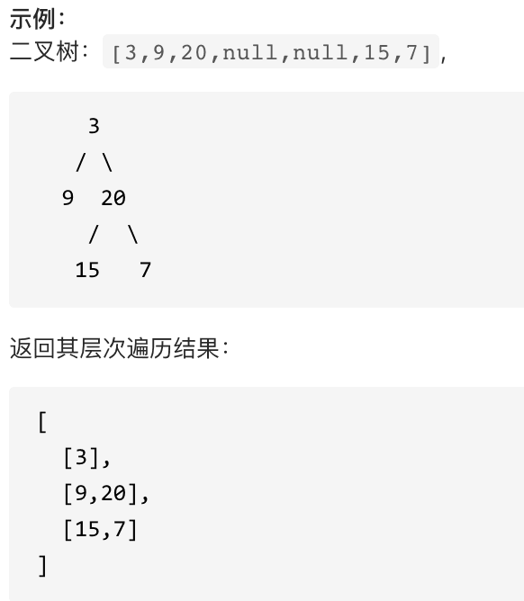
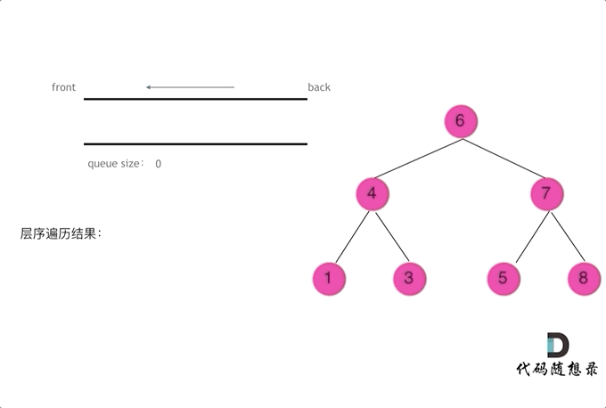
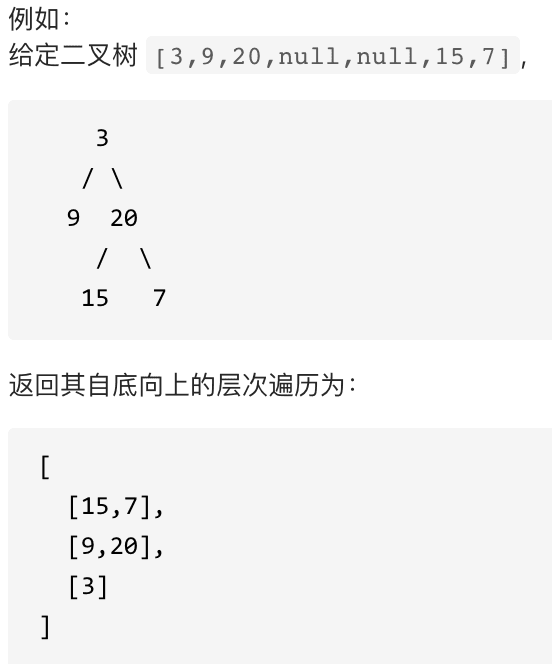
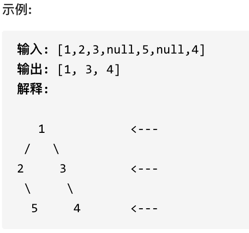
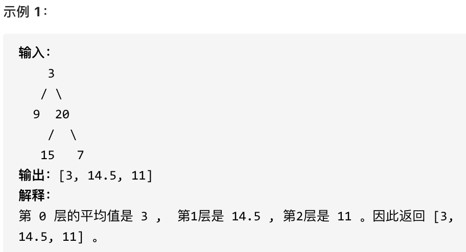
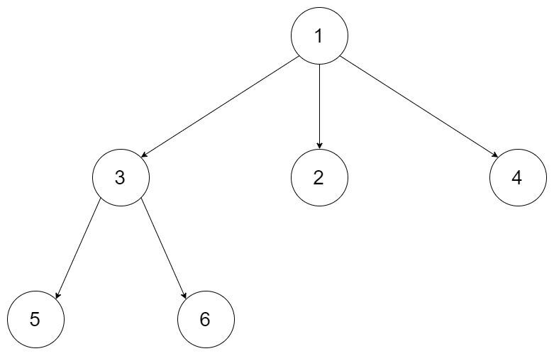
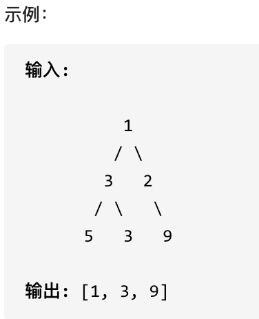
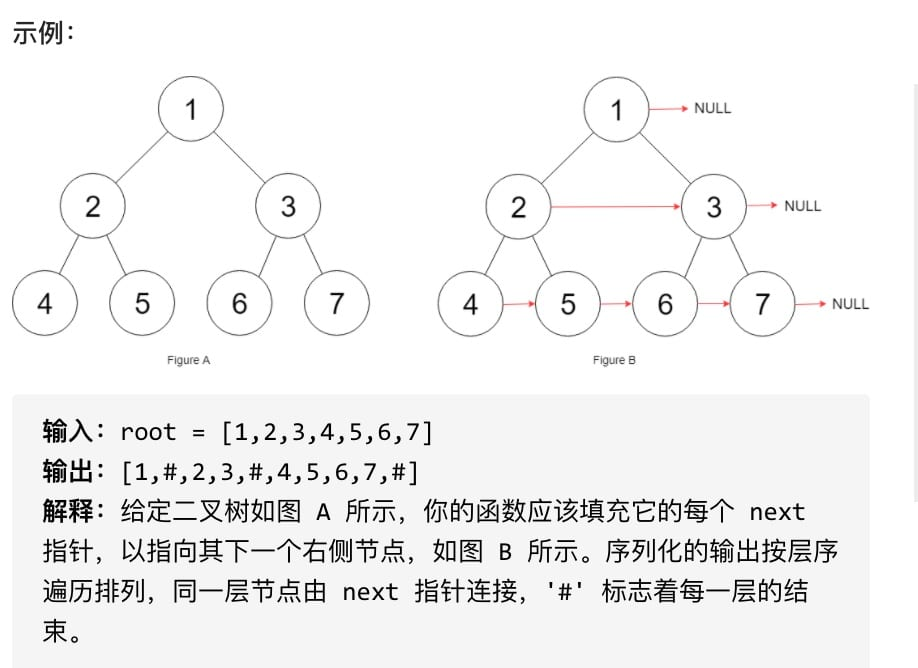
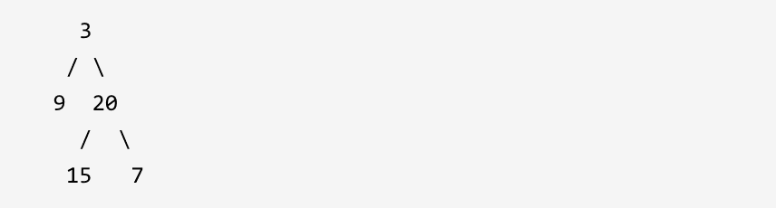
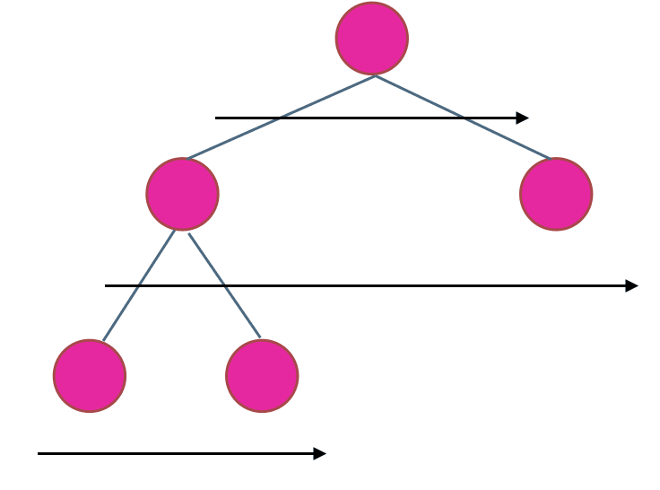

* [做專案（多個 C++、Java、Go、測試開發、前端專案）](https://www.programmercarl.com/other/kstar.html)
* [刷演算法（兩個月高強度學演算法）](https://www.programmercarl.com/xunlian/xunlianying.html)
* [背八股（40 天挑戰高頻面試題）](https://www.programmercarl.com/xunlian/bagu.html)


# 二元樹（binary tree）層次序走訪（level order traversal）登場！

## 演算法公開課

**[《程式碼隨想錄》演算法影片公開課](https://programmercarl.com/other/gongkaike.html)：[講透二元樹的層次序走訪 | 廣度優先搜尋（breadth-first search, BFS） | LeetCode：102. 二元樹的層次序走訪](https://www.bilibili.com/video/BV1GY4y1u7b2)，相信結合影片再看本篇題解，更有助於大家對本題的理解**。


學會二元樹的層次序走訪，可以一口氣打完以下十題：

* [102.二元樹的層次序走訪](https://leetcode.cn/problems/binary-tree-level-order-traversal/)
* [107.二元樹的層次序走訪 II](https://leetcode.cn/problems/binary-tree-level-order-traversal-ii/)
* [199.二元樹的右視圖](https://leetcode.cn/problems/binary-tree-right-side-view/)
* [637.二元樹的層平均值](https://leetcode.cn/problems/average-of-levels-in-binary-tree/)
* [429.N 元樹（n-ary tree）的層次序走訪](https://leetcode.cn/problems/n-ary-tree-level-order-traversal/)
* [515.在每個樹（tree）列中找最大值](https://leetcode.cn/problems/find-largest-value-in-each-tree-row/)
* [116.填充每個節點（node）的下一個右側節點指標（pointer）](https://leetcode.cn/problems/populating-next-right-pointers-in-each-node/)
* [117.填充每個節點的下一個右側節點指標 II](https://leetcode.cn/problems/populating-next-right-pointers-in-each-node-ii/)
* [104.二元樹的最大深度（depth）](https://leetcode.cn/problems/maximum-depth-of-binary-tree/)
* [111.二元樹的最小深度](https://leetcode.cn/problems/minimum-depth-of-binary-tree/)


## 102.二元樹的層次序走訪

[LeetCode 題目連結](https://leetcode.cn/problems/binary-tree-level-order-traversal/)

給你一個二元樹，請你回傳其按 層次序走訪 得到的節點值。（即逐層地，從左到右造訪所有節點）。



### 解題思路

我們之前講過了三篇關於二元樹的 深度優先遍歷（depth-first traversal） 的文章：

* [二元樹：前中後序遞迴（recursion）法](https://programmercarl.com/二叉树的递归遍历.html)
* [二元樹：前中後序疊代（iteration）法](https://programmercarl.com/二叉树的迭代遍历.html)
* [二元樹：前中後序疊代方式統一寫法](https://programmercarl.com/二叉树的统一迭代法.html)

接下來我們再來介紹二元樹的另一種遍歷（traversal）方式：層次序走訪。

層次序走訪一個二元樹，就是從左到右一層一層地去遍歷二元樹。這種遍歷的方式和我們之前講過的都不太一樣。

需要借用一個輔助資料結構即佇列（queue）來實作，**佇列先進先出（first in first out, FIFO），符合一層一層遍歷的邏輯，而用堆疊（stack）先進後出（first in last out, FILO）適合模擬（simulation） 深度優先遍歷 也就是遞迴的邏輯。**

**而這種層次序走訪方式就是圖論（graph theory）中的 廣度優先遍歷（breadth-first traversal），只不過我們應用在二元樹上。**

使用佇列實作二元樹 廣度優先遍歷，動畫如下：



這樣就實作了層次序從左到右遍歷二元樹。

程式碼如下：**這份程式碼也可以作為二元樹層次序走訪的模板（template），打十個就靠它了**。

C++ 程式碼如下：

```CPP
class Solution {
public:
    vector<vector<int>> levelOrder(TreeNode* root) {
        queue<TreeNode*> que;
        if (root != NULL) que.push(root);
        vector<vector<int>> result;
        while (!que.empty()) {
            int size = que.size();
            vector<int> vec;
            // 這裡一定要使用固定大小 size，不要使用 que.size()，因為 que.size 是不斷變化的
            for (int i = 0; i < size; i++) {
                TreeNode* node = que.front();
                que.pop();
                vec.push_back(node->val);
                if (node->left) que.push(node->left);
                if (node->right) que.push(node->right);
            }
            result.push_back(vec);
        }
        return result;
    }
};
```

```CPP
# 遞迴法
class Solution {
public:
    void order(TreeNode* cur, vector<vector<int>>& result, int depth)
    {
        if (cur == nullptr) return;
        if (result.size() == depth) result.push_back(vector<int>());
        result[depth].push_back(cur->val);
        order(cur->left, result, depth + 1);
        order(cur->right, result, depth + 1);
    }
    vector<vector<int>> levelOrder(TreeNode* root) {
        vector<vector<int>> result;
        int depth = 0;
        order(root, result, depth);
        return result;
    }
};
```

### 其他語言版本

#### Java:

```Java
// 102.二元樹的層次序走訪
class Solution {
    public List<List<Integer>> resList = new ArrayList<List<Integer>>();

    public List<List<Integer>> levelOrder(TreeNode root) {
        //checkFun01(root,0);
        checkFun02(root);

        return resList;
    }

    //BFS--遞迴方式
    public void checkFun01(TreeNode node, Integer deep) {
        if (node == null) return;
        deep++;

        if (resList.size() < deep) {
            //當層級增加時，list 的 Item 也增加，利用 list 的索引值進行層級界定
            List<Integer> item = new ArrayList<Integer>();
            resList.add(item);
        }
        resList.get(deep - 1).add(node.val);

        checkFun01(node.left, deep);
        checkFun01(node.right, deep);
    }

    //BFS--疊代方式--借助佇列
    public void checkFun02(TreeNode node) {
        if (node == null) return;
        Queue<TreeNode> que = new LinkedList<TreeNode>();
        que.offer(node);

        while (!que.isEmpty()) {
            List<Integer> itemList = new ArrayList<Integer>();
            int len = que.size();

            while (len > 0) {
                TreeNode tmpNode = que.poll();
                itemList.add(tmpNode.val);

                if (tmpNode.left != null) que.offer(tmpNode.left);
                if (tmpNode.right != null) que.offer(tmpNode.right);
                len--;
            }

            resList.add(itemList);
        }

    }
}
```

#### Python:


```python
# 利用長度法
# Definition for a binary tree node.
# class TreeNode:
#     def __init__(self, val=0, left=None, right=None):
#         self.val = val
#         self.left = left
#         self.right = right
class Solution:
    def levelOrder(self, root: Optional[TreeNode]) -> List[List[int]]:
        if not root:
            return []
        queue = collections.deque([root])
        result = []
        while queue:
            level = []
            for _ in range(len(queue)):
                cur = queue.popleft()
                level.append(cur.val)
                if cur.left:
                    queue.append(cur.left)
                if cur.right:
                    queue.append(cur.right)
            result.append(level)
        return result
```
```python
#遞迴法
# Definition for a binary tree node.
# class TreeNode:
#     def __init__(self, val=0, left=None, right=None):
#         self.val = val
#         self.left = left
#         self.right = right
class Solution:
    def levelOrder(self, root: Optional[TreeNode]) -> List[List[int]]:
        if not root:
            return []

        levels = []

        def traverse(node, level):
            if not node:
                return

            if len(levels) == level:
                levels.append([])

            levels[level].append(node.val)
            traverse(node.left, level + 1)
            traverse(node.right, level + 1)

        traverse(root, 0)
        return levels

```

#### Go:

```go
/**
102. 二元樹的遞迴遍歷
 */
func levelOrder(root *TreeNode) [][]int {
	arr := [][]int{}

	depth := 0

	var order func(root *TreeNode, depth int)

	order = func(root *TreeNode, depth int) {
		if root == nil {
			return
		}
		if len(arr) == depth {
			arr = append(arr, []int{})
		}
		arr[depth] = append(arr[depth], root.Val)

		order(root.Left, depth+1)
		order(root.Right, depth+1)
	}

	order(root, depth)

	return arr
}
```

```go
/**
102. 二元樹的層次序走訪 使用 container 套件
 */
func levelOrder(root *TreeNode) [][]int {
    res := [][]int{}
    if root == nil{//防止為空
        return res
    }
    queue := list.New()
    queue.PushBack(root)

    var tmpArr []int

    for queue.Len() > 0 {
        length := queue.Len()               //儲存當前層的長度，然後處理當前層（十分重要，防止新增下層元素影響判斷層中元素的個數）
        for i := 0; i < length; i++ {
            node := queue.Remove(queue.Front()).(*TreeNode)    //出佇列
            if node.Left != nil {
                queue.PushBack(node.Left)
            }
            if node.Right != nil {
                queue.PushBack(node.Right)
            }
            tmpArr = append(tmpArr, node.Val)    //將值加入本層切片中
        }
        res = append(res, tmpArr)          //放入結果集
        tmpArr = []int{}                  //清空層的資料
    }

    return res
}

/**
  102. 二元樹的層次序走訪 使用切片
*/
func levelOrder(root *TreeNode) [][]int {
     res := make([][]int, 0)
     if root == nil {
        return res
     }
     queue := make([]*TreeNode, 0)
     queue = append(queue, root)
     for len(queue) > 0 {
          size := len(queue)
          level := make([]int, 0)
          for i := 0; i < size; i++ {
               node := queue[0]
               queue = queue[1:]
               level = append(level, node.Val)
               if node.Left != nil {
				   queue = append(queue, node.Left)
               }
               if node.Right != nil {
				   queue = append(queue, node.Right)
               }
          }
          res = append(res, level)
     }
     return res
}

/**
102. 二元樹的層次序走訪：使用切片模擬佇列，易理解
 */
func levelOrder(root *TreeNode) (res [][]int) {
    if root == nil {
        return
    }

    curLevel := []*TreeNode{root}  // 存放當前層節點
    for len(curLevel) > 0 {
        nextLevel := []*TreeNode{}  // 準備透過當前層生成下一層
        vals := []int{}

        for _, node := range curLevel {
            vals = append(vals, node.Val) // 收集當前層的值
            // 收集下一層的節點
            if node.Left != nil {
                nextLevel = append(nextLevel, node.Left)
            }
            if node.Right != nil {
                nextLevel = append(nextLevel, node.Right)
            }
        }
        res = append(res, vals)
        curLevel = nextLevel // 將下一層變成當前層
    }

    return
}
```

#### JavaScript：

```javascript
var levelOrder = function(root) {
    //二元樹的層次序走訪
    let res = [], queue = [];
    queue.push(root);
    if(root === null) {
        return res;
    }
    while(queue.length !== 0) {
        // 記錄當前層級節點數
        let length = queue.length;
        //存放每一層的節點
        let curLevel = [];
        for(let i = 0;i < length; i++) {
            let node = queue.shift();
            curLevel.push(node.val);
            // 存放當前層下一層的節點
            node.left && queue.push(node.left);
            node.right && queue.push(node.right);
        }
        //把每一層的結果放到結果陣列
        res.push(curLevel);
    }
    return res;
};

```

#### TypeScript：

```typescript
function levelOrder(root: TreeNode | null): number[][] {
    let helperQueue: TreeNode[] = [];
    let res: number[][] = [];
    let tempArr: number[] = [];
    if (root !== null) helperQueue.push(root);
    let curNode: TreeNode;
    while (helperQueue.length > 0) {
        for (let i = 0, length = helperQueue.length; i < length; i++) {
            curNode = helperQueue.shift()!;
            tempArr.push(curNode.val);
            if (curNode.left !== null) {
                helperQueue.push(curNode.left);
            }
            if (curNode.right !== null) {
                helperQueue.push(curNode.right);
            }
        }
        res.push(tempArr);
        tempArr = [];
    }
    return res;
};
```

#### Swift：

```swift
func levelOrder(_ root: TreeNode?) -> [[Int]] {
    var result = [[Int]]()
    guard let root = root else { return result }
    // 表示一層
    var queue = [root]
    while !queue.isEmpty {
        let count = queue.count
        var subarray = [Int]()
        for _ in 0 ..< count {
            // 當前層
            let node = queue.removeFirst()
            subarray.append(node.val)
            // 下一層
            if let node = node.left { queue.append(node) }
            if let node = node.right { queue.append(node) }
        }
        result.append(subarray)
    }

    return result
}
```

#### Scala:

```scala
// 102.二元樹的層次序走訪
object Solution {
  import scala.collection.mutable
  def levelOrder(root: TreeNode): List[List[Int]] = {
    val res = mutable.ListBuffer[List[Int]]()
    if (root == null) return res.toList
    val queue = mutable.Queue[TreeNode]() // 宣告一個佇列
    queue.enqueue(root) // 把根節點加入 queue
    while (!queue.isEmpty) {
      val tmp = mutable.ListBuffer[Int]()
      val len = queue.size // 求出 len 的長度
      for (i <- 0 until len) { // 從 0 到當前佇列長度的所有節點都加入到結果集
        val curNode = queue.dequeue()
        tmp.append(curNode.value)
        if (curNode.left != null) queue.enqueue(curNode.left)
        if (curNode.right != null) queue.enqueue(curNode.right)
      }
      res.append(tmp.toList)
    }
    res.toList
  }
}
```

#### Rust:

```rust
use std::cell::RefCell;
use std::rc::Rc;
use std::collections::VecDeque;
impl Solution {
    pub fn level_order(root: Option<Rc<RefCell<TreeNode>>>) -> Vec<Vec<i32>> {
        let mut res = vec![];
        let mut queue = VecDeque::new();
        if root.is_some() {
            queue.push_back(root);
        }
        while !queue.is_empty() {
            let mut temp = vec![];
            for _ in 0..queue.len() {
                let node = queue.pop_front().unwrap().unwrap();
                temp.push(node.borrow().val);
                if node.borrow().left.is_some() {
                    queue.push_back(node.borrow().left.clone());
                }
                if node.borrow().right.is_some() {
                    queue.push_back(node.borrow().right.clone());
                }
            }
            res.push(temp);
        }
        res
    }
}
```
### C#
```csharp
public IList<IList<int>> LevelOrder(TreeNode root)
{
    var res = new List<IList<int>>();
    var que = new Queue<TreeNode>();
    if (root == null) return res;
    que.Enqueue(root);
    while (que.Count != 0)
    {
        var size = que.Count;
        var vec = new List<int>();
        for (int i = 0; i < size; i++)
        {
            var cur = que.Dequeue();
            vec.Add(cur.val);
            if (cur.left != null) que.Enqueue(cur.left);
            if (cur.right != null) que.Enqueue(cur.right);
        }
        res.Add(vec);


    }
    return res;
}
```


**此時我們就掌握了二元樹的層次序走訪了，那麼如下九道 LeetCode 上的題目，只需要修改模板的兩三行程式碼（不能再多了），便可打倒！**


## 107.二元樹的層次序走訪 II

[LeetCode 題目連結](https://leetcode.cn/problems/binary-tree-level-order-traversal-ii/)

給定一個二元樹，回傳其節點值由下而上（bottom-up）的層次序走訪。（即按從葉節點（leaf node）所在層到根節點（root node）所在的層，逐層從左向右遍歷）



### 解題思路

相對於 102.二元樹的層次序走訪，就是最後把 result 陣列（array）反轉一下就可以了。

C++ 程式碼：

```CPP
class Solution {
public:
    vector<vector<int>> levelOrderBottom(TreeNode* root) {
        queue<TreeNode*> que;
        if (root != NULL) que.push(root);
        vector<vector<int>> result;
        while (!que.empty()) {
            int size = que.size();
            vector<int> vec;
            for (int i = 0; i < size; i++) {
                TreeNode* node = que.front();
                que.pop();
                vec.push_back(node->val);
                if (node->left) que.push(node->left);
                if (node->right) que.push(node->right);
            }
            result.push_back(vec);
        }
        reverse(result.begin(), result.end()); // 在這裡反轉一下陣列即可
        return result;

    }
};
```

### 其他語言版本

#### Python：

```python
class Solution:
    """二元樹層次序走訪 II 疊代解法"""

# Definition for a binary tree node.
# class TreeNode:
#     def __init__(self, val=0, left=None, right=None):
#         self.val = val
#         self.left = left
#         self.right = right
class Solution:
    def levelOrderBottom(self, root: TreeNode) -> List[List[int]]:
        if not root:
            return []
        queue = collections.deque([root])
        result = []
        while queue:
            level = []
            for _ in range(len(queue)):
                cur = queue.popleft()
                level.append(cur.val)
                if cur.left:
                    queue.append(cur.left)
                if cur.right:
                    queue.append(cur.right)
            result.append(level)
        return result[::-1]
```

#### Java：

```java
// 107. 二元樹的層次序走訪 II
public class N0107 {

    /**
     * 解法：佇列，疊代。
     * 層次序走訪，再反轉陣列即可。
     */
    public List<List<Integer>> solution1(TreeNode root) {
        List<List<Integer>> list = new ArrayList<>();
        Deque<TreeNode> que = new LinkedList<>();

        if (root == null) {
            return list;
        }

        que.offerLast(root);
        while (!que.isEmpty()) {
            List<Integer> levelList = new ArrayList<>();

            int levelSize = que.size();
            for (int i = 0; i < levelSize; i++) {
                TreeNode peek = que.peekFirst();
                levelList.add(que.pollFirst().val);

                if (peek.left != null) {
                    que.offerLast(peek.left);
                }
                if (peek.right != null) {
                    que.offerLast(peek.right);
                }
            }
            list.add(levelList);
        }

        List<List<Integer>> result = new ArrayList<>();
        for (int i = list.size() - 1; i >= 0; i-- ) {
            result.add(list.get(i));
        }

        return result;
    }
}
```

```java
/**
 * 思路和模板相同, 對收集答案的方式做了最佳化, 最後不需要反轉
 */
class Solution {
    public List<List<Integer>> levelOrderBottom(TreeNode root) {
        // 利用鏈接串列可以進行 O(1) 頭部插入, 這樣最後答案不需要再反轉
        LinkedList<List<Integer>> ans = new LinkedList<>();

        Queue<TreeNode> q = new LinkedList<>();

        if (root != null) q.offer(root);

        while (!q.isEmpty()) {
            int size = q.size();

            List<Integer> temp = new ArrayList<>();

            for (int i = 0; i < size; i ++) {
                TreeNode node = q.poll();

                temp.add(node.val);

                if (node.left != null) q.offer(node.left);

                if (node.right != null) q.offer(node.right);
            }

            // 新遍歷到的層插到頭部, 這樣就滿足按照層次反序的要求
            ans.addFirst(temp);
        }

        return ans;
    }

```

#### Go:

```GO
/**
107. 二元樹的層次序走訪 II
 */
func levelOrderBottom(root *TreeNode) [][]int {
    queue := list.New()
    res := [][]int{}
    if root == nil{
        return res
    }
    queue.PushBack(root)

    for queue.Len() > 0 {
        length := queue.Len()
        tmp := []int{}
        for i := 0; i < length; i++ {
            node := queue.Remove(queue.Front()).(*TreeNode)
            if node.Left != nil {
                queue.PushBack(node.Left)
            }
            if node.Right != nil {
                queue.PushBack(node.Right)
            }
            tmp = append(tmp, node.Val)
        }
        res=append(res, tmp)
    }

    //反轉結果集
    for i:=0; i<len(res)/2; i++ {
        res[i], res[len(res)-i-1] = res[len(res)-i-1], res[i]
    }

    return res
}
```

```GO
// 使用切片作為佇列
func levelOrderBottom(root *TreeNode) [][]int {
    res := make([][]int, 0)
    if root == nil {
		return res
    }
    queue := make([]*TreeNode, 0)
    queue = append(queue, root)
    for len(queue) > 0 {
        size := len(queue)
        level := make([]int, 0)
        for i := 0; i < size; i++ {
            node := queue[0]
            queue = queue[1:]
            level = append(level, node.Val)
            if node.Left != nil {
                queue = append(queue, node.Left)
            }
            if node.Right != nil {
                queue = append(queue, node.Right)
            }
        }
        res = append(res, level)
    }
    l, r := 0, len(res)-1
    for l < r {
		res[l], res[r] = res[r], res[l]
		l++
		r--
    }
    return res
}
```

#### JavaScript:

```javascript
var levelOrderBottom = function (root) {
  let res = [],
    queue = [];
  queue.push(root);
  while (queue.length && root !== null) {
    // 存放當前層級節點陣列
    let curLevel = [];
    // 計算當前層級節點數量
    let length = queue.length;
    while (length--) {
      let node = queue.shift();
      // 把當前層節點存入 curLevel 陣列
      curLevel.push(node.val);
      // 把下一層級的左右節點存入 queue 佇列
      node.left && queue.push(node.left);
      node.right && queue.push(node.right);
    }
    // 從陣列前頭插入值，避免最後反轉陣列，減少運算時間
    res.unshift(curLevel);
  }
  return res;
};

```

#### TypeScript:

```typescript
function levelOrderBottom(root: TreeNode | null): number[][] {
    let helperQueue: TreeNode[] = [];
    let resArr: number[][] = [];
    let tempArr: number[] = [];
    let tempNode: TreeNode;
    if (root !== null) helperQueue.push(root);
    while (helperQueue.length > 0) {
        for (let i = 0, length = helperQueue.length; i < length; i++) {
            tempNode = helperQueue.shift()!;
            tempArr.push(tempNode.val);
            if (tempNode.left !== null) helperQueue.push(tempNode.left);
            if (tempNode.right !== null) helperQueue.push(tempNode.right);
        }
        resArr.push(tempArr);
        tempArr = [];
    }
    return resArr.reverse();
};
```

#### Swift：

```swift
func levelOrderBottom(_ root: TreeNode?) -> [[Int]] {
    // 表示一層
    var queue = [TreeNode]()
    if let node = root { queue.append(node) }
    var result = [[Int]]()
    while !queue.isEmpty {
        let count = queue.count
        var subarray = [Int]()
        for _ in 0 ..< count {
            // 當前層
            let node = queue.removeFirst()
            subarray.append(node.val)
            // 下一層
            if let node = node.left { queue.append(node) }
            if let node = node.right { queue.append(node)}
        }
        result.append(subarray)
    }

    return result.reversed()
}
```

#### Scala:

```scala
// 107.二元樹的層次序走訪 II
object Solution {
  import scala.collection.mutable
  def levelOrderBottom(root: TreeNode): List[List[Int]] = {
    val res = mutable.ListBuffer[List[Int]]()
    if (root == null) return res.toList
    val queue = mutable.Queue[TreeNode]()
    queue.enqueue(root)
    while (!queue.isEmpty) {
      val tmp = mutable.ListBuffer[Int]()
      val len = queue.size
      for (i <- 0 until len) {
        val curNode = queue.dequeue()
        tmp.append(curNode.value)
        if (curNode.left != null) queue.enqueue(curNode.left)
        if (curNode.right != null) queue.enqueue(curNode.right)
      }
      res.append(tmp.toList)
    }
    // 最後反轉一下
    res.reverse.toList
  }


```

#### Rust:

```rust
use std::cell::RefCell;
use std::collections::VecDeque;
use std::rc::Rc;
impl Solution {
    pub fn level_order_bottom(root: Option<Rc<RefCell<TreeNode>>>) -> Vec<Vec<i32>> {
        let mut res = vec![];
        let mut queue = VecDeque::new();
        if root.is_some() {
            queue.push_back(root);
        }
        while !queue.is_empty() {
            let mut temp = vec![];
            for _ in 0..queue.len() {
                let node = queue.pop_front().unwrap().unwrap();
                temp.push(node.borrow().val);
                if node.borrow().left.is_some() {
                    queue.push_back(node.borrow().left.clone());
                }
                if node.borrow().right.is_some() {
                    queue.push_back(node.borrow().right.clone());
                }
            }
            res.push(temp);
        }
        res.into_iter().rev().collect()
    }
}
```
### C#
```csharp
public IList<IList<int>> LevelOrderBottom(TreeNode root)
{
    var res = new List<IList<int>>();
    var que = new Queue<TreeNode>();
    if (root == null) return res;
    que.Enqueue(root);
    while (que.Count != 0)
    {
        var size = que.Count;
        var vec = new List<int>();
        for (int i = 0; i < size; i++)
        {
            var cur = que.Dequeue();
            vec.Add(cur.val);
            if (cur.left != null) que.Enqueue(cur.left);
            if (cur.right != null) que.Enqueue(cur.right);
        }
        res.Add(vec);
    }
    res.Reverse();
    return res;
}
```

## 199.二元樹的右視圖

[LeetCode 題目連結](https://leetcode.cn/problems/binary-tree-right-side-view/)

給定一棵二元樹，想像自己站在它的右側，按照從頂部到底部的順序，回傳從右側所能看到的節點值。



### 解題思路

層次序走訪的時候，判斷是否遍歷到單層的最後面的元素（element），如果是，就放進 result 陣列中，隨後回傳 result 就可以了。

C++ 程式碼：

```CPP
class Solution {
public:
    vector<int> rightSideView(TreeNode* root) {
        queue<TreeNode*> que;
        if (root != NULL) que.push(root);
        vector<int> result;
        while (!que.empty()) {
            int size = que.size();
            for (int i = 0; i < size; i++) {
                TreeNode* node = que.front();
                que.pop();
                if (i == (size - 1)) result.push_back(node->val); // 將每一層的最後元素放入 result 陣列中
                if (node->left) que.push(node->left);
                if (node->right) que.push(node->right);
            }
        }
        return result;
    }
};
```

### 其他語言版本

#### Python：

```python
# Definition for a binary tree node.
# class TreeNode:
#     def __init__(self, val=0, left=None, right=None):
#         self.val = val
#         self.left = left
#         self.right = right
class Solution:
    def rightSideView(self, root: TreeNode) -> List[int]:
        if not root:
            return []
        
        queue = collections.deque([root])
        right_view = []
        
        while queue:
            level_size = len(queue)
            
            for i in range(level_size):
                node = queue.popleft()
                
                if i == level_size - 1:
                    right_view.append(node.val)
                
                if node.left:
                    queue.append(node.left)
                if node.right:
                    queue.append(node.right)
        
        return right_view
```

#### Java:

```java
// 199.二元樹的右視圖
public class N0199 {
    /**
     * 解法：佇列，疊代。
     * 每次回傳每層的最後一個欄位即可。
     *
     * 小最佳化：每層右子節點先入佇列。程式碼略。
     */
    public List<Integer> rightSideView(TreeNode root) {
        List<Integer> list = new ArrayList<>();
        Deque<TreeNode> que = new LinkedList<>();

        if (root == null) {
            return list;
        }

        que.offerLast(root);
        while (!que.isEmpty()) {
            int levelSize = que.size();

            for (int i = 0; i < levelSize; i++) {
                TreeNode poll = que.pollFirst();

                if (poll.left != null) {
                    que.addLast(poll.left);
                }
                if (poll.right != null) {
                    que.addLast(poll.right);
                }

                if (i == levelSize - 1) {
                    list.add(poll.val);
                }
            }
        }

        return list;
    }
}
```

#### Go:

```GO
/**
199. 二元樹的右視圖
 */
func rightSideView(root *TreeNode) []int {
    if root == nil {
        return nil
    }
    res := make([]int, 0)
    queue := list.New()
    queue.PushBack(root)

    for queue.Len() > 0 {
        length := queue.Len()
        for i := 0; i < length; i++ {
            node := queue.Remove(queue.Front()).(*TreeNode)
            if node.Left != nil {
                queue.PushBack(node.Left)
            }
            if node.Right != nil {
                queue.PushBack(node.Right)
            }
            // 取每層的最後一個元素，加入到結果集中
            if i == length-1 {
                res = append(res, node.Val)
            }
        }
    }
    return res
}
```

```GO
// 使用切片作為佇列
func rightSideView(root *TreeNode) []int {
    res := make([]int, 0)
    if root == nil {
        return res
    }
    queue := make([]*TreeNode, 0)
    queue = append(queue, root)
    for len(queue) > 0 {
        size := len(queue)
        for i := 0; i < size; i++ {
            node := queue[0]
            queue = queue[1:]
            if node.Left != nil {
                queue = append(queue, node.Left)
            }
            if node.Right != nil {
                queue = append(queue, node.Right)
            }
            if i == size-1 {
                res = append(res, node.Val)
            }
        }
    }
    return res
}
```

#### JavaScript:

```javascript
var rightSideView = function(root) {
    //二元樹右視圖 只需要把每一層最後一個節點儲存到 res 陣列
    let res = [], queue = [];
    queue.push(root);

    while(queue.length && root!==null) {
        // 記錄當前層級節點個數
        let length = queue.length;
        while(length--) {
            let node = queue.shift();
            // length 長度為 0 的時候表示到了層級最後一個節點
            if(!length) {
                res.push(node.val);
            }
            node.left && queue.push(node.left);
            node.right && queue.push(node.right);
        }
    }

    return res;
};
```

#### TypeScript：

```typescript
function rightSideView(root: TreeNode | null): number[] {
    let helperQueue: TreeNode[] = [];
    let resArr: number[] = [];
    let tempNode: TreeNode;
    if (root !== null) helperQueue.push(root);
    while (helperQueue.length > 0) {
        for (let i = 0, length = helperQueue.length; i < length; i++) {
            tempNode = helperQueue.shift()!;
            if (i === length - 1) resArr.push(tempNode.val);
            if (tempNode.left !== null) helperQueue.push(tempNode.left);
            if (tempNode.right !== null) helperQueue.push(tempNode.right);
        }
    }
    return resArr;
};
```

#### Swift：

```swift
func rightSideView(_ root: TreeNode?) -> [Int] {
    // 表示一層
    var queue = [TreeNode]()
    if let node = root { queue.append(node) }
    var result = [Int]()
    while !queue.isEmpty {
        let count = queue.count
        for i in 0 ..< count {
            // 當前層
            let node = queue.removeFirst()
            if i == count - 1 { result.append(node.val) }

            // 下一層
            if let node = node.left { queue.append(node) }
            if let node = node.right { queue.append(node) }
        }
    }

    return result
}
```

#### Scala:

```scala
// 199.二元樹的右視圖
object Solution {
  import scala.collection.mutable
  def rightSideView(root: TreeNode): List[Int] = {
    val res = mutable.ListBuffer[Int]()
    if (root == null) return res.toList
    val queue = mutable.Queue[TreeNode]()
    queue.enqueue(root)
    while (!queue.isEmpty) {
      val len = queue.size
      var curNode: TreeNode = null
      for (i <- 0 until len) {
        curNode = queue.dequeue()
        if (curNode.left != null) queue.enqueue(curNode.left)
        if (curNode.right != null) queue.enqueue(curNode.right)
      }
      res.append(curNode.value)   // 把最後一個節點的值加入解集
    }
    res.toList  // 最後需要把 res 轉換為 List，return 關鍵字可以省略
  }
}
```

#### Rust:

```rust
use std::cell::RefCell;
use std::collections::VecDeque;
use std::rc::Rc;
impl Solution {
    pub fn right_side_view(root: Option<Rc<RefCell<TreeNode>>>) -> Vec<i32> {
        let mut res = vec![];
        let mut queue = VecDeque::new();
        if root.is_some() {
            queue.push_back(root);
        }
        while !queue.is_empty() {
            let len = queue.len();
            for i in 0..len {
                let node = queue.pop_front().unwrap().unwrap();
                if i == len - 1 {
                    res.push(node.borrow().val);
                }
                if node.borrow().left.is_some() {
                    queue.push_back(node.borrow().left.clone());
                }
                if node.borrow().right.is_some() {
                    queue.push_back(node.borrow().right.clone());
                }
            }
        }
        res
    }
}
```

#### C#:

```C# 199.二叉树的右视图
public class Solution
{
    public IList<int> RightSideView(TreeNode root)
    {
        var result = new List<int>();
        Queue<TreeNode> queue = new();

        if (root != null)
        {
            queue.Enqueue(root);
        }
        while (queue.Count > 0)
        {
            int count = queue.Count;
            int lastValue = count - 1;
            for (int i = 0; i < count; i++)
            {
                var currentNode = queue.Dequeue();
                if (i == lastValue)
                {
                    result.Add(currentNode.val);
                }

                // lastValue == i == count -1 : left 先於 right 進入 Queue
                if (currentNode.left != null) queue.Enqueue(currentNode.left);
                if (currentNode.right != null) queue.Enqueue(currentNode.right);

                //// lastValue == i == 0: right 先於 left 進入 Queue
                // if(currentNode.right !=null ) queue.Enqueue(currentNode.right);
                // if(currentNode.left !=null ) queue.Enqueue(currentNode.left);
            }
        }

        return result;
    }
}
```

## 637.二元樹的層平均值

[LeetCode 題目連結](https://leetcode.cn/problems/average-of-levels-in-binary-tree/)

給定一個非空二元樹，回傳一個由每層節點平均值組成的陣列。



### 解題思路

本題就是層次序走訪的時候把一層求個總和再取一個平均值。

C++ 程式碼:

```CPP
class Solution {
public:
    vector<double> averageOfLevels(TreeNode* root) {
        queue<TreeNode*> que;
        if (root != NULL) que.push(root);
        vector<double> result;
        while (!que.empty()) {
            int size = que.size();
            double sum = 0; // 統計每一層的和
            for (int i = 0; i < size; i++) {
                TreeNode* node = que.front();
                que.pop();
                sum += node->val;
                if (node->left) que.push(node->left);
                if (node->right) que.push(node->right);
            }
            result.push_back(sum / size); // 將每一層平均值放進結果集
        }
        return result;
    }
};

```

### 其他語言版本

#### Python：

```python
class Solution:
    """二元樹層平均值疊代解法"""

# Definition for a binary tree node.
# class TreeNode:
#     def __init__(self, val=0, left=None, right=None):
#         self.val = val
#         self.left = left
#         self.right = right
class Solution:
    def averageOfLevels(self, root: TreeNode) -> List[float]:
        if not root:
            return []

        queue = collections.deque([root])
        averages = []
        
        while queue:
            size = len(queue)
            level_sum = 0
            
            for i in range(size):
                node = queue.popleft()
                
                
                level_sum += node.val
                    
                if node.left:
                    queue.append(node.left)
                if node.right:
                    queue.append(node.right)
            
            averages.append(level_sum / size)
        
        return averages
```

#### Java:

```java
// 637. 二元樹的層平均值
public class N0637 {

    /**
     * 解法：佇列，疊代。
     * 每次回傳每層的最後一個欄位即可。
     */
    public List<Double> averageOfLevels(TreeNode root) {
        List<Double> list = new ArrayList<>();
        Deque<TreeNode> que = new LinkedList<>();

        if (root == null) {
            return list;
        }

        que.offerLast(root);
        while (!que.isEmpty()) {

            int levelSize = que.size();
            double levelSum = 0.0;
            for (int i = 0; i < levelSize; i++) {
                TreeNode poll = que.pollFirst();

                levelSum += poll.val;

                if (poll.left != null) {
                    que.addLast(poll.left);
                }
                if (poll.right != null) {
                    que.addLast(poll.right);
                }
            }
            list.add(levelSum / levelSize);
        }
        return list;
    }
}
```

#### Go:

```GO
/**
637. 二元樹的層平均值
 */
func averageOfLevels(root *TreeNode) []float64 {
    if root == nil {
        // 防止為空
        return nil
    }
    res := make([]float64, 0)
    queue := list.New()
    queue.PushBack(root)

    var sum int
    for queue.Len() > 0 {
        //儲存當前層的長度，然後處理當前層（十分重要，防止新增下層元素影響判斷層中元素的個數）
        length := queue.Len()
        for i := 0; i < length; i++ {
            node := queue.Remove(queue.Front()).(*TreeNode)
            if node.Left != nil {
                queue.PushBack(node.Left)
            }
            if node.Right != nil {
                queue.PushBack(node.Right)
            }
            // 當前層元素求和
            sum += node.Val
        }
        // 計算每層的平均值，將結果加入到對應結果中
        res = append(res, float64(sum)/float64(length))
        sum = 0 // 清空該層的資料
    }
    return res
}
```

```GO
// 使用切片作為佇列
func averageOfLevels(root *TreeNode) []float64 {
    res := make([]float64, 0)
    if root == nil {
        return res
    }
    queue := make([]*TreeNode, 0)
    queue = append(queue, root)
    for len(queue) > 0 {
        size := len(queue)
        sum := 0
        for i := 0; i < size; i++ {
            node := queue[0]
            queue = queue[1:]
            sum += node.Val
            if node.Left != nil {
                queue = append(queue, node.Left)
            }
            if node.Right != nil {
                queue = append(queue, node.Right)
            }
        }
        res = append(res, float64(sum)/float64(size))
    }
    return res
}
```

#### JavaScript：

```javascript
var averageOfLevels = function(root) {
  let res = [],
    queue = [];
  queue.push(root);
  while (queue.length) {
    // 每一層節點個數;
    let lengthLevel = queue.length,
      len = queue.length,
      //   sum 記錄每一層的和;
      sum = 0;
    while (lengthLevel--) {
      const node = queue.shift();
      sum += node.val;
      //   佇列存放下一層節點
      node.left && queue.push(node.left);
      node.right && queue.push(node.right);
    }
    // 求平均值
    res.push(sum / len);
  }
  return res;
};
```

#### TypeScript：

```typescript
function averageOfLevels(root: TreeNode | null): number[] {
    let helperQueue: TreeNode[] = [];
    let resArr: number[] = [];
    let total: number = 0;
    let tempNode: TreeNode;
    if (root !== null) helperQueue.push(root);
    while (helperQueue.length > 0) {
        let length = helperQueue.length;
        for (let i = 0; i < length; i++) {
            tempNode = helperQueue.shift()!;
            total += tempNode.val;
            if (tempNode.left) helperQueue.push(tempNode.left);
            if (tempNode.right) helperQueue.push(tempNode.right);
        }
        resArr.push(total / length);
        total = 0;
    }
    return resArr;
};
```

#### Swift：

```swift
func averageOfLevels(_ root: TreeNode?) -> [Double] {
    // 表示一層
    var queue = [TreeNode]()
    if let node = root { queue.append(node) }
    var result = [Double]()
    while !queue.isEmpty {
        let count = queue.count
        var sum = 0
        for _ in 0 ..< count {
            // 當前層
            let node = queue.removeFirst()
            sum += node.val

            // 下一層
            if let node = node.left { queue.append(node) }
            if let node = node.right { queue.append(node) }
        }
        result.append(Double(sum) / Double(count))
    }

    return result
}
```

#### Scala:

```scala
// 637.二元樹的層平均值
object Solution {
  import scala.collection.mutable
  def averageOfLevels(root: TreeNode): Array[Double] = {
    val res = mutable.ArrayBuffer[Double]()
    val queue = mutable.Queue[TreeNode]()
    queue.enqueue(root)
    while (!queue.isEmpty) {
      var sum = 0.0
      var len = queue.size
      for (i <- 0 until len) {
        var curNode = queue.dequeue()
        sum += curNode.value // 累加該層的值
        if (curNode.left != null) queue.enqueue(curNode.left)
        if (curNode.right != null) queue.enqueue(curNode.right)
      }
      res.append(sum / len) // 平均值即為 sum/len
    }
    res.toArray // 最後需要轉換為 Array，return 關鍵字可以省略
  }
}
```

#### Rust:

```rust
use std::cell::RefCell;
use std::collections::VecDeque;
use std::rc::Rc;
impl Solution {
    pub fn average_of_levels(root: Option<Rc<RefCell<TreeNode>>>) -> Vec<f64> {
        let mut res = vec![];
        let mut queue = VecDeque::new();
        if root.is_some() {
            queue.push_back(root);
        }
        while !queue.is_empty() {
            let len = queue.len();
            let mut sum = 0;
            for _ in 0..len {
                let node = queue.pop_front().unwrap().unwrap();
                sum += node.borrow().val;
                if node.borrow().left.is_some() {
                    queue.push_back(node.borrow().left.clone());
                }
                if node.borrow().right.is_some() {
                    queue.push_back(node.borrow().right.clone());
                }
            }
            res.push((sum as f64) / len as f64);
        }
        res
    }
}
```

#### C#:

```C# 二叉树的层平均值
public class Solution {
    public IList<double> AverageOfLevels(TreeNode root) {
        var result= new List<double>();
        Queue<TreeNode> queue = new();
        if(root !=null) queue.Enqueue(root);
        
        while (queue.Count > 0)
        {
            int count = queue.Count;
            double value=0;
            for (int i = 0; i < count; i++)
            {
                var curentNode=queue.Dequeue();
                value += curentNode.val;
                if (curentNode.left!=null) queue.Enqueue(curentNode.left);
                if (curentNode.right!=null) queue.Enqueue(curentNode.right);
            }
            result.Add(value/count);
        }

        return result;
    }
}

```

## 429.N 元樹的層次序走訪

[LeetCode 題目連結](https://leetcode.cn/problems/n-ary-tree-level-order-traversal/)

給定一個 N 元樹，回傳其節點值的層次序走訪。（即從左到右，逐層遍歷）。

例如，給定一個 3 元樹 :



回傳其層次序走訪:

[
     [1],
     [3,2,4],
     [5,6]
]

### 解題思路

這道題依舊是模板題，只不過一個節點有多個子節點（child node）了

C++ 程式碼:

```CPP
class Solution {
public:
    vector<vector<int>> levelOrder(Node* root) {
        queue<Node*> que;
        if (root != NULL) que.push(root);
        vector<vector<int>> result;
        while (!que.empty()) {
            int size = que.size();
            vector<int> vec;
            for (int i = 0; i < size; i++) {
                Node* node = que.front();
                que.pop();
                vec.push_back(node->val);
                for (int i = 0; i < node->children.size(); i++) { // 將節點子節點加入佇列
                    if (node->children[i]) que.push(node->children[i]);
                }
            }
            result.push_back(vec);
        }
        return result;

    }
};
```

### 其他語言版本

#### Python：

```python
"""
# Definition for a Node.
class Node:
    def __init__(self, val=None, children=None):
        self.val = val
        self.children = children
"""

class Solution:
    def levelOrder(self, root: 'Node') -> List[List[int]]:
        if not root:
            return []

        result = []
        queue = collections.deque([root])

        while queue:
            level_size = len(queue)
            level = []

            for _ in range(level_size):
                node = queue.popleft()
                level.append(node.val)

                for child in node.children:
                    queue.append(child)

            result.append(level)

        return result
```

```python
# LeetCode 429. N-ary Tree Level Order Traversal
# 遞迴法
class Solution:
    def levelOrder(self, root: 'Node') -> List[List[int]]:
        if not root: return []
        result=[]
        def traversal(root,depth):
            if len(result)==depth:result.append([])
            result[depth].append(root.val)
            if root.children:
                for i in range(len(root.children)):traversal(root.children[i],depth+1)

        traversal(root,0)
        return result
```

#### Java:

```java
// 429. N 元樹的層次序走訪
public class N0429 {
    /**
     * 解法1：佇列，疊代。
     */
    public List<List<Integer>> levelOrder(Node root) {
        List<List<Integer>> list = new ArrayList<>();
        Deque<Node> que = new LinkedList<>();

        if (root == null) {
            return list;
        }

        que.offerLast(root);
        while (!que.isEmpty()) {
            int levelSize = que.size();
            List<Integer> levelList = new ArrayList<>();

            for (int i = 0; i < levelSize; i++) {
                Node poll = que.pollFirst();

                levelList.add(poll.val);

                List<Node> children = poll.children;
                if (children == null || children.size() == 0) {
                    continue;
                }
                for (Node child : children) {
                    if (child != null) {
                        que.offerLast(child);
                    }
                }
            }
            list.add(levelList);
        }

        return list;
    }

    class Node {
        public int val;
        public List<Node> children;

        public Node() {}

        public Node(int _val) {
            val = _val;
        }

        public Node(int _val, List<Node> _children) {
            val = _val;
            children = _children;
        }
    }
}
```

#### Go:

```GO
/**
429. N 元樹的層次序走訪
 */

func levelOrder(root *Node) [][]int {
    queue := list.New()
    res := [][]int{}       //結果集
    if root == nil{
        return res
    }
    queue.PushBack(root)
    for queue.Len() > 0 {
        length := queue.Len()     //記錄當前層的數量
        var tmp []int
        for T := 0; T < length; T++ {        //該層的每個元素：一加入到該層的結果集中；二找到該元素的下層元素加入到佇列中，方便下次使用
            myNode := queue.Remove(queue.Front()).(*Node)
            tmp = append(tmp, myNode.Val)
            for i := 0; i < len(myNode.Children); i++ {
                queue.PushBack(myNode.Children[i])
            }
        }
        res = append(res, tmp)
    }

    return res
}
```

```GO
// 使用切片作為佇列
func levelOrder(root *Node) [][]int {
    res := make([][]int, 0)
    if root == nil {
        return res
    }
    queue := make([]*Node, 0)
    queue = append(queue, root)
    for len(queue) > 0 {
        size := len(queue)
        level := make([]int, 0)
        for i := 0; i < size; i++ {
            node := queue[0]
            queue = queue[1:]
            level = append(level, node.Val)
            if len(node.Children) > 0 {
                queue = append(queue, node.Children...)
            }
        }
        res = append(res, level)
    }
    return res
}
```

#### JavaScript：

```JavaScript
var levelOrder = function(root) {
    //每一層可能有 2 個以上,所以不再使用 node.left node.right
    let res = [], queue = [];
    queue.push(root);

    while(queue.length && root!==null) {
        //記錄每一層節點個數還是和二元樹一致
        let length = queue.length;
        //存放每層節點 也和二元樹一致
        let curLevel = [];
        while(length--) {
            let node = queue.shift();
            curLevel.push(node.val);

            //這裡不再是 ndoe.left node.right 而是迴圈 node.children
           for(let item of node.children){
               item && queue.push(item);
           }
        }
        res.push(curLevel);
    }

    return res;
};
```

#### TypeScript:

```typescript
function levelOrder(root: Node | null): number[][] {
    let helperQueue: Node[] = [];
    let resArr: number[][] = [];
    let tempArr: number[] = [];
    if (root !== null) helperQueue.push(root);
    let curNode: Node;
    while (helperQueue.length > 0) {
        for (let i = 0, length = helperQueue.length; i < length; i++) {
            curNode = helperQueue.shift()!;
            tempArr.push(curNode.val);
            helperQueue.push(...curNode.children);
        }
        resArr.push(tempArr);
        tempArr = [];
    }
    return resArr;
};
```

#### Swift：

```swift
func levelOrder(_ root: Node?) -> [[Int]] {
    // 表示一層
    var queue = [Node]()
    if let node = root { queue.append(node) }
    var result = [[Int]]()
    while !queue.isEmpty {
        let count = queue.count
        var subarray = [Int]()
        for _ in 0 ..< count {
            // 當前層
            let node = queue.removeFirst()
            subarray.append(node.val)
            // 下一層
            for node in node.children { queue.append(node) }
        }
        result.append(subarray)
    }

    return result
}
```

#### Scala:

```scala
// 429.N 元樹的層次序走訪
object Solution {
  import scala.collection.mutable
  def levelOrder(root: Node): List[List[Int]] = {
    val res = mutable.ListBuffer[List[Int]]()
    if (root == null) return res.toList
    val queue = mutable.Queue[Node]()
    queue.enqueue(root) // 根節點入佇列
    while (!queue.isEmpty) {
      val tmp = mutable.ListBuffer[Int]() // 儲存每層節點
      val len = queue.size
      for (i <- 0 until len) {
        val curNode = queue.dequeue()
        tmp.append(curNode.value) // 將該節點的值加入 tmp
        // 迴圈遍歷該節點的子節點，加入佇列
        for (child <- curNode.children) {
          queue.enqueue(child)
        }
      }
      res.append(tmp.toList) // 將該層的節點放到結果集
    }
    res.toList
  }
}
```

#### Rust:

```rust
pub struct Solution;
#[derive(Debug, PartialEq, Eq)]
pub struct Node {
    pub val: i32,
    pub children: Vec<Option<Rc<RefCell<Node>>>>,
}

impl Node {
    #[inline]
    pub fn new(val: i32) -> Node {
        Node {
            val,
            children: vec![],
        }
    }
}

use std::cell::RefCell;
use std::collections::VecDeque;
use std::rc::Rc;
impl Solution {
    pub fn level_order(root: Option<Rc<RefCell<Node>>>) -> Vec<Vec<i32>> {
        let mut res = vec![];
        let mut queue = VecDeque::new();
        if root.is_some() {
            queue.push_back(root);
        }
        while !queue.is_empty() {
            let mut temp = vec![];
            for _ in 0..queue.len() {
                let node = queue.pop_front().unwrap().unwrap();
                temp.push(node.borrow().val);
                if !node.borrow().children.is_empty() {
                    for n in node.borrow().children.clone() {
                        queue.push_back(n);
                    }
                }
            }
            res.push(temp)
        }
        res
    }
}
```

## 515.在每個樹列中找最大值

[LeetCode 題目連結](https://leetcode.cn/problems/find-largest-value-in-each-tree-row/)

您需要在二元樹的每一列中找到最大的值。



### 解題思路

層次序走訪，取每一層的最大值

C++ 程式碼：

```CPP
class Solution {
public:
    vector<int> largestValues(TreeNode* root) {
        queue<TreeNode*> que;
        if (root != NULL) que.push(root);
        vector<int> result;
        while (!que.empty()) {
            int size = que.size();
            int maxValue = INT_MIN; // 取每一層的最大值
            for (int i = 0; i < size; i++) {
                TreeNode* node = que.front();
                que.pop();
                maxValue = node->val > maxValue ? node->val : maxValue;
                if (node->left) que.push(node->left);
                if (node->right) que.push(node->right);
            }
            result.push_back(maxValue); // 把最大值放進陣列
        }
        return result;
    }
};
```

### 其他語言版本

#### Python：

```python
# Definition for a binary tree node.
# class TreeNode:
#     def __init__(self, val=0, left=None, right=None):
#         self.val = val
#         self.left = left
#         self.right = right
class Solution:
    def largestValues(self, root: TreeNode) -> List[int]:
        if not root:
            return []

        result = []
        queue = collections.deque([root])

        while queue:
            level_size = len(queue)
            max_val = float('-inf')

            for _ in range(level_size):
                node = queue.popleft()
                max_val = max(max_val, node.val)

                if node.left:
                    queue.append(node.left)

                if node.right:
                    queue.append(node.right)

            result.append(max_val)

        return result
```

#### Java：

```java
class Solution {
    public List<Integer> largestValues(TreeNode root) {
        if(root == null){
            return Collections.emptyList();
        }
        List<Integer> result = new ArrayList();
        Queue<TreeNode> queue = new LinkedList();
        queue.offer(root);
        while(!queue.isEmpty()){
            int max = Integer.MIN_VALUE;
            for(int i = queue.size(); i > 0; i--){
               TreeNode node = queue.poll();
               max = Math.max(max, node.val);
               if(node.left != null) queue.offer(node.left);
               if(node.right != null) queue.offer(node.right);
            }
            result.add(max);
        }
        return result;
    }
}
```

#### Go:

```GO
/**
515. 在每個樹列中找最大值
 */
func largestValues(root *TreeNode) []int {
    if root == nil {
        //防止為空
        return nil
    }
    queue := list.New()
    queue.PushBack(root)
    ans := make([]int, 0)
    temp := math.MinInt64
    // 層次序走訪
    for queue.Len() > 0 {
        //儲存當前層的長度，然後處理當前層（十分重要，防止新增下層元素影響判斷層中元素的個數）
        length := queue.Len()
        for i := 0; i < length; i++ {
            node := queue.Remove(queue.Front()).(*TreeNode)//出佇列
            // 比較當前層中的最大值和新遍歷的元素大小，取兩者中大值
            temp = max(temp, node.Val)
            if node.Left != nil {
                queue.PushBack(node.Left)
            }
            if node.Right != nil {
                queue.PushBack(node.Right)
            }
        }
        ans = append(ans, temp)
        temp = math.MinInt64
    }
    return ans
}

func max(x, y int) int {
    if x > y {
        return x
    }
    return y
}
```

```GO
// 使用切片作為佇列
func largestValues(root *TreeNode) []int {
    res := make([]int, 0)
    if root == nil {
        return res
    }
    queue := make([]*TreeNode, 0)
    queue = append(queue, root)
    for len(queue) > 0 {
        size := len(queue)
        maxValue := math.MinInt64
        for i := 0; i < size; i++ {
            node := queue[0]
            queue = queue[1:]
            if node.Val > maxValue {
                maxValue = node.Val
            }
            if node.Left != nil {
                queue = append(queue, node.Left)
            }
            if node.Right != nil {
                queue = append(queue, node.Right)
            }
        }
        res = append(res, maxValue)
    }
    return res
}
```

#### JavaScript：

```javascript
var largestValues = function (root) {
  let res = [],
    queue = [];
  queue.push(root);
  if (root === null) {
    return res;
  }
  while (queue.length) {
    let lengthLevel = queue.length,
      // 初始值設為負無窮大
      max = -Infinity;
    while (lengthLevel--) {
      const node = queue.shift();
      //   在當前層中找到最大值
      max = Math.max(max, node.val);
      // 找到下一層的節點
      node.left && queue.push(node.left);
      node.right && queue.push(node.right);
    }
    res.push(max);
  }
  return res;
};
```

#### TypeScript:

```typescript
function largestValues(root: TreeNode | null): number[] {
    let helperQueue: TreeNode[] = [];
    let resArr: number[] = [];
    let tempNode: TreeNode;
    let max: number = 0;
    if (root !== null) helperQueue.push(root);
    while (helperQueue.length > 0) {
        for (let i = 0, length = helperQueue.length; i < length; i++) {
            tempNode = helperQueue.shift()!;
            if (i === 0) {
                max = tempNode.val;
            } else {
                max = max > tempNode.val ? max : tempNode.val;
            }
            if (tempNode.left) helperQueue.push(tempNode.left);
            if (tempNode.right) helperQueue.push(tempNode.right);
        }
        resArr.push(max);
    }
    return resArr;
};
```

#### Swift：

```swift
func largestValues(_ root: TreeNode?) -> [Int] {
    // 表示一層
    var queue = [TreeNode]()
    if let node = root { queue.append(node) }
    var result = [Int]()
    while !queue.isEmpty {
        let count = queue.count
        var max = queue[0].val
        for _ in 0 ..< count {
            // 當前層
            let node = queue.removeFirst()
            if node.val > max { max = node.val }

            // 下一層
            if let node = node.left { queue.append(node) }
            if let node = node.right { queue.append(node) }
        }
        result.append(max)
    }

    return result
}
```

#### Scala:

```scala
// 515.在每個樹列中找最大值
object Solution {
  import scala.collection.mutable
  def largestValues(root: TreeNode): List[Int] = {
    val res = mutable.ListBuffer[Int]()
    if (root == null) return res.toList
    val queue = mutable.Queue[TreeNode]()
    queue.enqueue(root)
    while (!queue.isEmpty) {
      var max = Int.MinValue // 初始化 max 為系統最小值
      val len = queue.size
      for (i <- 0 until len) {
        val curNode = queue.dequeue()
        max = math.max(max, curNode.value) // 對比求解最大值
        if (curNode.left != null) queue.enqueue(curNode.left)
        if (curNode.right != null) queue.enqueue(curNode.right)
      }
      res.append(max) // 將最大值放入結果集
    }
    res.toList
  }
}
```

#### Rust:

```rust
use std::cell::RefCell;
use std::collections::VecDeque;
use std::rc::Rc;
impl Solution {
    pub fn largest_values(root: Option<Rc<RefCell<TreeNode>>>) -> Vec<i32> {
        let mut res = vec![];
        let mut queue = VecDeque::new();
        if root.is_some() {
            queue.push_back(root);
        }
        while !queue.is_empty() {
            let mut max = i32::MIN;
            for _ in 0..queue.len() {
                let node = queue.pop_front().unwrap().unwrap();
                max = max.max(node.borrow().val);
                if node.borrow().left.is_some() {
                    queue.push_back(node.borrow().left.clone());
                }
                if node.borrow().right.is_some() {
                    queue.push_back(node.borrow().right.clone());
                }
            }
            res.push(max);
        }
        res
    }
}
```

## 116.填充每個節點的下一個右側節點指標

[LeetCode 題目連結](https://leetcode.cn/problems/populating-next-right-pointers-in-each-node/)

給定一個完美二元樹（perfect binary tree），其所有葉節點都在同一層，每個父節點（father node）都有兩個子節點。二元樹定義如下：

```cpp
struct Node {
  int val;
  Node *left;
  Node *right;
  Node *next;
}
```


填充它的每個 next 指標，讓這個指標指向其下一個右側節點。如果找不到下一個右側節點，則將 next 指標設為 NULL。

初始狀態下，所有 next 指標都被設為 NULL。



### 解題思路

本題依然是層次序走訪，只不過在單層遍歷的時候記錄一下本層的頭部節點，然後在遍歷的時候讓前一個節點指向本節點就可以了

C++ 程式碼：

```CPP
class Solution {
public:
    Node* connect(Node* root) {
        queue<Node*> que;
        if (root != NULL) que.push(root);
        while (!que.empty()) {
            int size = que.size();
            // vector<int> vec;
            Node* nodePre;
            Node* node;
            for (int i = 0; i < size; i++) {
                if (i == 0) {
                    nodePre = que.front(); // 取出一層的頭節點
                    que.pop();
                    node = nodePre;
                } else {
                    node = que.front();
                    que.pop();
                    nodePre->next = node; // 本層前一個節點 next 指向本節點
                    nodePre = nodePre->next;
                }
                if (node->left) que.push(node->left);
                if (node->right) que.push(node->right);
            }
            nodePre->next = NULL; // 本層最後一個節點指向 NULL
        }
        return root;

    }
};
```

### 其他語言版本

#### Java：

```java
class Solution {
    public Node connect(Node root) {
	Queue<Node> tmpQueue = new LinkedList<Node>();
	if (root != null) tmpQueue.add(root);

	while (tmpQueue.size() != 0){
	    int size = tmpQueue.size();

            Node cur = tmpQueue.poll();
            if (cur.left != null) tmpQueue.add(cur.left);
            if (cur.right != null) tmpQueue.add(cur.right);

	    for (int index = 1; index < size; index++){
		Node next = tmpQueue.poll();
		if (next.left != null) tmpQueue.add(next.left);
		if (next.right != null) tmpQueue.add(next.right);

                cur.next = next;
                cur = next;
	    }
	}

        return root;
    }
}
```

#### Python：

```python
"""
# Definition for a Node.
class Node:
    def __init__(self, val: int = 0, left: 'Node' = None, right: 'Node' = None, next: 'Node' = None):
        self.val = val
        self.left = left
        self.right = right
        self.next = next
"""
class Solution:
    def connect(self, root: 'Node') -> 'Node':
        if not root:
            return root
        
        queue = collections.deque([root])
        
        while queue:
            level_size = len(queue)
            prev = None
            
            for i in range(level_size):
                node = queue.popleft()
                
                if prev:
                    prev.next = node
                
                prev = node
                
                if node.left:
                    queue.append(node.left)
                
                if node.right:
                    queue.append(node.right)
        
        return root
```

#### Go:

```GO
/**
116. 填充每個節點的下一個右側節點指標
117. 填充每個節點的下一個右側節點指標 II
 */

func connect(root *Node) *Node {
    if root == nil { //防止為空
        return root
    }
    queue := list.New()
    queue.PushBack(root)
    tmpArr := make([]*Node, 0)
    for queue.Len() > 0 {
        length := queue.Len() //儲存當前層的長度，然後處理當前層（十分重要，防止新增下層元素影響判斷層中元素的個數）
        for i := 0; i < length; i++ {
            node := queue.Remove(queue.Front()).(*Node) //出佇列
            if node.Left != nil {
                queue.PushBack(node.Left)
            }
            if node.Right != nil {
                queue.PushBack(node.Right)
            }
            tmpArr = append(tmpArr, node) //將值加入本層切片中
        }
        if len(tmpArr) > 1 {
            // 遍歷每層元素,指定 next
            for i := 0; i < len(tmpArr)-1; i++ {
                tmpArr[i].Next = tmpArr[i+1]
            }
        }
        tmpArr = []*Node{} //清空層的資料
    }
    return root
}

```

```GO
// 使用切片作為佇列
func connect(root *Node) *Node {
    if root == nil {
        return root
    }
    queue := make([]*Node, 0)
    queue = append(queue, root)
    for len(queue) > 0 {
        size := len(queue)
        for i := 0; i < size; i++ {
            node := queue[i]
            if i != size - 1 {
                queue[i].Next = queue[i+1]
            }
            if node.Left != nil {
                queue = append(queue, node.Left)
            }
            if node.Right != nil {
                queue = append(queue, node.Right)
            }
        }
        queue = queue[size:]
    }
    return root
}
```

#### JavaScript:

```javascript
/**
 * // Definition for a Node.
 * function Node(val, left, right, next) {
 *    this.val = val === undefined ? null : val;
 *    this.left = left === undefined ? null : left;
 *    this.right = right === undefined ? null : right;
 *    this.next = next === undefined ? null : next;
 * };
 */

/**
 * @param {Node} root
 * @return {Node}
 */
var connect = function(root) {
    if (root === null) return root;
    let queue = [root];
    while (queue.length) {
        let n = queue.length;
        for (let i = 0; i < n; i++) {
            let node = queue.shift();
            if (i < n-1) {
                node.next = queue[0];
            }
            node.left && queue.push(node.left);
            node.right && queue.push(node.right);
        }
    }
    return root;
};

```

#### TypeScript:

```typescript
function connect(root: Node | null): Node | null {
    let helperQueue: Node[] = [];
    let preNode: Node, curNode: Node;
    if (root !== null) helperQueue.push(root);
    while (helperQueue.length > 0) {
        for (let i = 0, length = helperQueue.length; i < length; i++) {
            if (i === 0) {
                preNode = helperQueue.shift()!;
            } else {
                curNode = helperQueue.shift()!;
                preNode.next = curNode;
                preNode = curNode;
            }
            if (preNode.left) helperQueue.push(preNode.left);
            if (preNode.right) helperQueue.push(preNode.right);
        }
        preNode.next = null;
    }
    return root;
};
```

#### Swift：

```swift
func connect(_ root: Node?) -> Node? {
    // 表示一層
    var queue = [Node]()
    if let node = root { queue.append(node) }
    while !queue.isEmpty {
        let count = queue.count
        var current, previous: Node!
        for i in 0 ..< count {
            // 當前層
            if i == 0 {
                previous = queue.removeFirst()
                current = previous
            } else {
                current = queue.removeFirst()
                previous.next = current
                previous = current
            }

            // 下一層
            if let node = current.left { queue.append(node) }
            if let node = current.right { queue.append(node) }
        }
        previous.next = nil
    }

    return root
}
```

#### Scala:

```scala
// 116.填充每個節點的下一個右側節點指標
object Solution {
  import scala.collection.mutable

  def connect(root: Node): Node = {
    if (root == null) return root
    val queue = mutable.Queue[Node]()
    queue.enqueue(root)
    while (!queue.isEmpty) {
      val len = queue.size
      val tmp = mutable.ListBuffer[Node]()
      for (i <- 0 until len) {
        val curNode = queue.dequeue()
        tmp.append(curNode)
        if (curNode.left != null) queue.enqueue(curNode.left)
        if (curNode.right != null) queue.enqueue(curNode.right)
      }
      // 處理 next 指標
      for (i <- 0 until tmp.size - 1) {
        tmp(i).next = tmp(i + 1)
      }
      tmp(tmp.size-1).next = null
    }
    root
  }
}
```

## 117.填充每個節點的下一個右側節點指標 II

[LeetCode 題目連結](https://leetcode.cn/problems/populating-next-right-pointers-in-each-node-ii/)

### 解題思路

這道題目說是二元樹，但 116 題目說是完全二元樹（complete binary tree），其實沒有任何差別，一樣的程式碼、一樣的邏輯、一樣的味道

C++ 程式碼：

```CPP
class Solution {
public:
    Node* connect(Node* root) {
        queue<Node*> que;
        if (root != NULL) que.push(root);
        while (!que.empty()) {
            int size = que.size();
            vector<int> vec;
            Node* nodePre;
            Node* node;
            for (int i = 0; i < size; i++) {
                if (i == 0) {
                    nodePre = que.front(); // 取出一層的頭節點
                    que.pop();
                    node = nodePre;
                } else {
                    node = que.front();
                    que.pop();
                    nodePre->next = node; // 本層前一個節點 next 指向本節點
                    nodePre = nodePre->next;
                }
                if (node->left) que.push(node->left);
                if (node->right) que.push(node->right);
            }
            nodePre->next = NULL; // 本層最後一個節點指向 NULL
        }
        return root;
    }
};
```

### 其他語言版本

#### Java：

```java
// 二元樹之層次序走訪
class Solution {
    public Node connect(Node root) {
        Queue<Node> queue = new LinkedList<>();
        if (root != null) {
            queue.add(root);
        }
        while (!queue.isEmpty()) {
            int size = queue.size();
            Node node = null;
            Node nodePre = null;

            for (int i = 0; i < size; i++) {
                if (i == 0) {
                    nodePre = queue.poll(); // 取出本層頭一個節點
                    node = nodePre;
                } else {
                    node = queue.poll();
                    nodePre.next = node; // 本層前一個節點 next 指向當前節點
                    nodePre = nodePre.next;
                }
                if (node.left != null) {
                    queue.add(node.left);
                }
                if (node.right != null) {
                    queue.add(node.right);
                }
            }
            nodePre.next = null; // 本層最後一個節點 next 指向 null
        }
        return root;
    }
}
```

#### Python：

```python
# 層次序走訪解法
"""
# Definition for a Node.
class Node:
    def __init__(self, val: int = 0, left: 'Node' = None, right: 'Node' = None, next: 'Node' = None):
        self.val = val
        self.left = left
        self.right = right
        self.next = next
"""

class Solution:
    def connect(self, root: 'Node') -> 'Node':
        if not root:
            return root
        
        queue = collections.deque([root])
        
        while queue:
            level_size = len(queue)
            prev = None
            
            for i in range(level_size):
                node = queue.popleft()
                
                if prev:
                    prev.next = node
                
                prev = node
                
                if node.left:
                    queue.append(node.left)
                
                if node.right:
                    queue.append(node.right)
        
        return root

```

#### Go:

```GO
/**
116. 填充每個節點的下一個右側節點指標
117. 填充每個節點的下一個右側節點指標 II
 */

func connect(root *Node) *Node {
    if root == nil { //防止為空
        return root
    }
    queue := list.New()
    queue.PushBack(root)
    tmpArr := make([]*Node, 0)
    for queue.Len() > 0 {
        length := queue.Len() //儲存當前層的長度，然後處理當前層（十分重要，防止新增下層元素影響判斷層中元素的個數）
        for i := 0; i < length; i++ {
            node := queue.Remove(queue.Front()).(*Node) //出佇列
            if node.Left != nil {
                queue.PushBack(node.Left)
            }
            if node.Right != nil {
                queue.PushBack(node.Right)
            }
            tmpArr = append(tmpArr, node) //將值加入本層切片中
        }
        if len(tmpArr) > 1 {
            // 遍歷每層元素,指定 next
            for i := 0; i < len(tmpArr)-1; i++ {
                tmpArr[i].Next = tmpArr[i+1]
            }
        }
        tmpArr = []*Node{} //清空層的資料
    }
    return root
}
```

```GO
// 使用切片作為佇列
func connect(root *Node) *Node {
    if root == nil {
        return root
    }
    queue := make([]*Node, 0)
    queue = append(queue, root)
    for len(queue) > 0 {
        size := len(queue)
        for i := 0; i < size; i++ {
            node := queue[i]
            if i != size - 1 {
                queue[i].Next = queue[i+1]
            }
            if node.Left != nil {
                queue = append(queue, node.Left)
            }
            if node.Right != nil {
                queue = append(queue, node.Right)
            }
        }
        queue = queue[size:]
    }
    return root
}
```

#### JavaScript:

```javascript
/**
 * // Definition for a Node.
 * function Node(val, left, right, next) {
 *    this.val = val === undefined ? null : val;
 *    this.left = left === undefined ? null : left;
 *    this.right = right === undefined ? null : right;
 *    this.next = next === undefined ? null : next;
 * };
 */

/**
 * @param {Node} root
 * @return {Node}
 */
var connect = function(root) {
    if (root === null) {
        return null;
    }
    let queue = [root];
    while (queue.length > 0) {
        let n = queue.length;
        for (let i=0; i<n; i++) {
            let node = queue.shift();
            if (i < n-1) node.next = queue[0];
            if (node.left != null) queue.push(node.left);
            if (node.right != null) queue.push(node.right);
        }
    }
    return root;
};
```

#### TypeScript:

```typescript
function connect(root: Node | null): Node | null {
    let helperQueue: Node[] = [];
    let preNode: Node, curNode: Node;
    if (root !== null) helperQueue.push(root);
    while (helperQueue.length > 0) {
        for (let i = 0, length = helperQueue.length; i < length; i++) {
            if (i === 0) {
                preNode = helperQueue.shift()!;
            } else {
                curNode = helperQueue.shift()!;
                preNode.next = curNode;
                preNode = curNode;
            }
            if (preNode.left) helperQueue.push(preNode.left);
            if (preNode.right) helperQueue.push(preNode.right);
        }
        preNode.next = null;
    }
    return root;
};
```

#### Swift：

```swift
func connect(_ root: Node?) -> Node? {
    // 表示一層
    var queue = [Node]()
    if let node = root { queue.append(node) }
    while !queue.isEmpty {
        let count = queue.count
        var current, previous: Node!
        for i in 0 ..< count {
            // 當前層
            if i == 0 {
                previous = queue.removeFirst()
                current = previous
            } else {
                current = queue.removeFirst()
                previous.next = current
                previous = current
            }

            // 下一層
            if let node = current.left { queue.append(node) }
            if let node = current.right { queue.append(node) }
        }
        previous.next = nil
    }

    return root
}
```

#### Scala:

```scala
// 117.填充每個節點的下一個右側節點指標 II
object Solution {
  import scala.collection.mutable

  def connect(root: Node): Node = {
    if (root == null) return root
    val queue = mutable.Queue[Node]()
    queue.enqueue(root)
    while (!queue.isEmpty) {
      val len = queue.size
      val tmp = mutable.ListBuffer[Node]()
      for (i <- 0 until len) {
        val curNode = queue.dequeue()
        tmp.append(curNode)
        if (curNode.left != null) queue.enqueue(curNode.left)
        if (curNode.right != null) queue.enqueue(curNode.right)
      }
      // 處理 next 指標
      for (i <- 0 until tmp.size - 1) {
        tmp(i).next = tmp(i + 1)
      }
      tmp(tmp.size-1).next = null
    }
    root
  }
}
```

## 104.二元樹的最大深度

[LeetCode 題目連結](https://leetcode.cn/problems/maximum-depth-of-binary-tree/)

給定一個二元樹，找出其最大深度。

二元樹的深度為根節點到最遠葉節點的最長路徑（path）上的節點數。

說明: 葉節點是指沒有子節點的節點。

範例：

給定二元樹 [3,9,20,null,null,15,7]，



回傳它的最大深度 3 。

### 解題思路

使用疊代法的話，使用層次序走訪是最為合適的，因為最大的深度就是二元樹的層數，和層次序走訪的方式極為吻合。

在二元樹中，一層一層地來遍歷二元樹，記錄一下遍歷的層數就是二元樹的深度，如圖所示：



所以這道題的疊代法就是一道模板題，可以使用二元樹層次序走訪的模板來解決的。

C++ 程式碼如下：

```CPP
class Solution {
public:
    int maxDepth(TreeNode* root) {
        if (root == NULL) return 0;
        int depth = 0;
        queue<TreeNode*> que;
        que.push(root);
        while(!que.empty()) {
            int size = que.size();
            depth++; // 記錄深度
            for (int i = 0; i < size; i++) {
                TreeNode* node = que.front();
                que.pop();
                if (node->left) que.push(node->left);
                if (node->right) que.push(node->right);
            }
        }
        return depth;
    }
};
```

### 其他語言版本

#### Java：

```Java
class Solution {
    public int maxDepth(TreeNode root) {
        if (root == null)   return 0;
        Queue<TreeNode> que = new LinkedList<>();
        que.offer(root);
        int depth = 0;
        while (!que.isEmpty())
        {
            int len = que.size();
            while (len > 0)
            {
                TreeNode node = que.poll();
                if (node.left != null)  que.offer(node.left);
                if (node.right != null) que.offer(node.right);
                len--;
            }
            depth++;
        }
        return depth;
    }
}
```

#### Python：

```python 3
# Definition for a binary tree node.
# class TreeNode:
#     def __init__(self, val=0, left=None, right=None):
#         self.val = val
#         self.left = left
#         self.right = right
class Solution:
    def maxDepth(self, root: TreeNode) -> int:
        if not root:
            return 0
        
        depth = 0
        queue = collections.deque([root])
        
        while queue:
            depth += 1
            for _ in range(len(queue)):
                node = queue.popleft()
                if node.left:
                    queue.append(node.left)
                if node.right:
                    queue.append(node.right)
        
        return depth

```

#### Go：

```go
/**
 * Definition for a binary tree node.
 * type TreeNode struct {
 *     Val int
 *     Left *TreeNode
 *     Right *TreeNode
 * }
 */
func maxDepth(root *TreeNode) int {
    ans := 0
    if root == nil {
        return 0
    }
    queue := list.New()
    queue.PushBack(root)
    for queue.Len() > 0 {
        length := queue.Len()
        for i := 0; i < length; i++ {
            node := queue.Remove(queue.Front()).(*TreeNode)
            if node.Left != nil {
                queue.PushBack(node.Left)
            }
            if node.Right != nil {
                queue.PushBack(node.Right)
            }
        }
        ans++//記錄深度，其他的是層次序走訪的模板
    }
    return ans
}
```

```go
// 使用切片作為佇列
func maxDepth(root *TreeNode) int {
    if root == nil {
        return 0
    }
    depth := 0
    queue := make([]*TreeNode, 0)
    queue = append(queue, root)
    for len(queue) > 0 {
        size := len(queue)
        for i := 0; i < size; i++ {
            node := queue[0]
            queue = queue[1:]
            if node.Left != nil {
                queue = append(queue, node.Left)
            }
            if node.Right != nil {
                queue = append(queue, node.Right)
            }
        }
        depth++
    }
    return depth
}
```

#### JavaScript：

```javascript
/**
 * Definition for a binary tree node.
 * function TreeNode(val, left, right) {
 *     this.val = (val===undefined ? 0 : val)
 *     this.left = (left===undefined ? null : left)
 *     this.right = (right===undefined ? null : right)
 * }
 */
/**
 * @param {TreeNode} root
 * @return {number}
 */
var maxDepth = function (root) {
  // 二元樹的 最大深度 是指從根節點到最遠葉節點的最長路徑上的節點數。
  let max = 0,
    queue = [root];
  if (root === null) {
    return max;
  }
  while (queue.length) {
    max++;
    let length = queue.length;
    while (length--) {
      let node = queue.shift();
      node.left && queue.push(node.left);
      node.right && queue.push(node.right);
    }
  }
  return max;
};
```

#### TypeScript:

```typescript
function maxDepth(root: TreeNode | null): number {
    let helperQueue: TreeNode[] = [];
    let resDepth: number = 0;
    let tempNode: TreeNode;
    if (root !== null) helperQueue.push(root);
    while (helperQueue.length > 0) {
        resDepth++;
        for (let i = 0, length = helperQueue.length; i < length; i++) {
            tempNode = helperQueue.shift()!;
            if (tempNode.left) helperQueue.push(tempNode.left);
            if (tempNode.right) helperQueue.push(tempNode.right);
        }
    }
    return resDepth;
};
```

#### Swift：

```swift
func maxDepth(_ root: TreeNode?) -> Int {
    guard root != nil else { return 0 }
    var depth = 0
    var queue = [TreeNode]()
    queue.append(root!)
    while !queue.isEmpty {
        let count = queue.count
        depth += 1
        for _ in 0 ..< count {
            // 當前層
            let node = queue.removeFirst()

            // 下一層
            if let node = node.left { queue.append(node) }
            if let node = node.right { queue.append(node) }
        }
    }

    return depth
}
```

#### Scala:

```scala
// 104.二元樹的最大深度
object Solution {
  import scala.collection.mutable
  def maxDepth(root: TreeNode): Int = {
    if (root == null) return 0
    val queue = mutable.Queue[TreeNode]()
    queue.enqueue(root)
    var depth = 0
    while (!queue.isEmpty) {
      val len = queue.length
      depth += 1
      for (i <- 0 until len) {
        val curNode = queue.dequeue()
        if (curNode.left != null) queue.enqueue(curNode.left)
        if (curNode.right != null) queue.enqueue(curNode.right)
      }
    }
    depth
  }
}
```

#### Rust:

```rust
use std::cell::RefCell;
use std::collections::VecDeque;
use std::rc::Rc;
impl Solution {
    pub fn max_depth(root: Option<Rc<RefCell<TreeNode>>>) -> i32 {
        let mut queue = VecDeque::new();
        let mut res = 0;
        if root.is_some() {
            queue.push_back(root);
        }
        while !queue.is_empty() {
            res += 1;
            for _ in 0..queue.len() {
                let node = queue.pop_front().unwrap().unwrap();
                if node.borrow().left.is_some() {
                    queue.push_back(node.borrow().left.clone());
                }
                if node.borrow().right.is_some() {
                    queue.push_back(node.borrow().right.clone());
                }
            }
        }
        res
    }
}
```

## 111.二元樹的最小深度

[LeetCode 題目連結](https://leetcode.cn/problems/minimum-depth-of-binary-tree/)

### 解題思路

相對於 104.二元樹的最大深度，本題也同樣可以使用層次序走訪的方式來解決，思路是一樣的。

**需要注意的是，只有當左右子節點都為空的時候，才說明遍歷到最低點了。如果其中一個子節點為空則不是最低點**

程式碼如下：（詳細註解）

```CPP
class Solution {
public:
    int minDepth(TreeNode* root) {
        if (root == NULL) return 0;
        int depth = 0;
        queue<TreeNode*> que;
        que.push(root);
        while(!que.empty()) {
            int size = que.size();
            depth++; // 記錄最小深度
            for (int i = 0; i < size; i++) {
                TreeNode* node = que.front();
                que.pop();
                if (node->left) que.push(node->left);
                if (node->right) que.push(node->right);
                if (!node->left && !node->right) { // 當左右子節點都為空的時候，說明是最低點的一層了，退出
                    return depth;
                }
            }
        }
        return depth;
    }
};
```

### 其他語言版本

#### Java：

```java
class Solution {
    public int minDepth(TreeNode root){
        if (root == null) {
            return 0;
        }
        Queue<TreeNode> queue = new LinkedList<>();
        queue.offer(root);
        int depth = 0;
        while (!queue.isEmpty()){
            int size = queue.size();
            depth++;
            TreeNode cur = null;
            for (int i = 0; i < size; i++) {
                cur = queue.poll();
                //如果當前節點的左右子節點都為空，直接回傳最小深度
                if (cur.left == null && cur.right == null){
                    return depth;
                }
                if (cur.left != null) queue.offer(cur.left);
                if (cur.right != null) queue.offer(cur.right);
            }
        }
        return depth;
    }
}
```

#### Python：

```python 3
# Definition for a binary tree node.
# class TreeNode:
#     def __init__(self, val=0, left=None, right=None):
#         self.val = val
#         self.left = left
#         self.right = right
class Solution:
    def minDepth(self, root: TreeNode) -> int:
        if not root:
            return 0
        depth = 0
        queue = collections.deque([root])
        
        while queue:
            depth += 1 
            for _ in range(len(queue)):
                node = queue.popleft()
                
                if not node.left and not node.right:
                    return depth
            
                if node.left:
                    queue.append(node.left)
                    
                if node.right:
                    queue.append(node.right)

        return depth
```

#### Go：

```go
/**
 * Definition for a binary tree node.
 * type TreeNode struct {
 *     Val int
 *     Left *TreeNode
 *     Right *TreeNode
 * }
 */
func minDepth(root *TreeNode) int {
    ans := 0
    if root == nil {
        return 0
    }
    queue := list.New()
    queue.PushBack(root)
    for queue.Len() > 0 {
        length := queue.Len()
        for i := 0; i < length; i++ {
            node := queue.Remove(queue.Front()).(*TreeNode)
            if node.Left == nil && node.Right == nil {      //當前節點沒有左右節點，則代表此層是最小層
                return ans+1                                //回傳當前層 ans 代表是上一層
            }
            if node.Left != nil {
                queue.PushBack(node.Left)
            }
            if node.Right != nil {
                queue.PushBack(node.Right)
            }
        }
        ans++//記錄層數
    }

    return ans
}
```

```go
// 使用切片作為佇列
func minDepth(root *TreeNode) int {
    if root == nil {
        return 0
    }
    depth := 0
    queue := make([]*TreeNode, 0)
    queue = append(queue, root)
    for len(queue) > 0 {
        size := len(queue)
        depth++
        for i := 0; i < size; i++ {
            node := queue[0]
            queue = queue[1:]
            if node.Left != nil {
                queue = append(queue, node.Left)
            }
            if node.Right != nil {
                queue = append(queue, node.Right)
            }
            if node.Left == nil && node.Right == nil {
                return depth
            }
        }
    }
    return depth
}
```

#### JavaScript：

```javascript
/**
 * Definition for a binary tree node.
 * function TreeNode(val, left, right) {
 *     this.val = (val===undefined ? 0 : val)
 *     this.left = (left===undefined ? null : left)
 *     this.right = (right===undefined ? null : right)
 * }
 */
/**
 * @param {TreeNode} root
 * @return {number}
 */
var minDepth = function(root) {
    if (root === null) return 0;
    let queue = [root];
    let depth = 0;
    while (queue.length) {
        let n = queue.length;
        depth++;
        for (let i=0; i<n; i++) {
            let node = queue.shift();
            // 如果左右節點都是 null(在遇見的第一個 leaf 節點上)，則該節點深度最小
            if (node.left === null && node.right === null) {
                return depth;
            }
            node.left && queue.push(node.left);;
            node.right && queue.push(node.right);
        }
    }
    return depth;
};
```

#### TypeScript:

```typescript
function minDepth(root: TreeNode | null): number {
    let helperQueue: TreeNode[] = [];
    let resMin: number = 0;
    let tempNode: TreeNode;
    if (root !== null) helperQueue.push(root);
    while (helperQueue.length > 0) {
        resMin++;
        for (let i = 0, length = helperQueue.length; i < length; i++) {
            tempNode = helperQueue.shift()!;
            if (tempNode.left === null && tempNode.right === null) return resMin;
            if (tempNode.left !== null) helperQueue.push(tempNode.left);
            if (tempNode.right !== null) helperQueue.push(tempNode.right);
        }
    }
    return resMin;
};
```

#### Swift：

```swift
func minDepth(_ root: TreeNode?) -> Int {
    guard root != nil else { return 0 }
    var depth = 0
    var queue = [root!]
    while !queue.isEmpty {
        let count = queue.count
        depth += 1
        for _ in 0 ..< count {
            // 當前層
            let node = queue.removeFirst()
            if node.left == nil, node.right == nil { // 遇到葉節點則回傳
                return depth
            }

            // 下一層
            if let node = node.left { queue.append(node) }
            if let node = node.right { queue.append(node) }
        }
    }
    return depth
}
```

#### Scala:

```scala
// 111.二元樹的最小深度
object Solution {
  import scala.collection.mutable
  def minDepth(root: TreeNode): Int = {
    if (root == null) return 0
    var depth = 0
    val queue = mutable.Queue[TreeNode]()
    queue.enqueue(root)
    while (!queue.isEmpty) {
      depth += 1
      val len = queue.size
      for (i <- 0 until len) {
        val curNode = queue.dequeue()
        if (curNode.left != null) queue.enqueue(curNode.left)
        if (curNode.right != null) queue.enqueue(curNode.right)
        if (curNode.left == null && curNode.right == null) return depth
      }
    }
    depth
  }
}
```

#### Rust:

```rust
use std::cell::RefCell;
use std::collections::VecDeque;
use std::rc::Rc;
impl Solution {
    pub fn min_depth(root: Option<Rc<RefCell<TreeNode>>>) -> i32 {
        let mut res = 0;
        let mut queue = VecDeque::new();
        if root.is_some() {
            queue.push_back(root);
        }
        while !queue.is_empty() {
            res += 1;
            for _ in 0..queue.len() {
                let node = queue.pop_front().unwrap().unwrap();
                if node.borrow().left.is_none() && node.borrow().right.is_none() {
                    return res;
                }
                if node.borrow().left.is_some() {
                    queue.push_back(node.borrow().left.clone());
                }
                if node.borrow().right.is_some() {
                    queue.push_back(node.borrow().right.clone());
                }
            }
        }
        res
    }
}
```

## 總結

二元樹的層次序走訪，**就是圖論中的廣度優先搜尋（breadth-first search, BFS）在二元樹中的應用**，需要借助佇列來實作（此時又發現佇列的一個應用了）。

來吧，一口氣打十個：

* [102.二元樹的層次序走訪](https://leetcode.cn/problems/binary-tree-level-order-traversal/)
* [107.二元樹的層次序走訪 II](https://leetcode.cn/problems/binary-tree-level-order-traversal-ii/)
* [199.二元樹的右視圖](https://leetcode.cn/problems/binary-tree-right-side-view/)
* [637.二元樹的層平均值](https://leetcode.cn/problems/binary-tree-right-side-view/)
* [429.N 元樹的層次序走訪](https://leetcode.cn/problems/n-ary-tree-level-order-traversal/)
* [515.在每個樹列中找最大值](https://leetcode.cn/problems/find-largest-value-in-each-tree-row/)
* [116.填充每個節點的下一個右側節點指標](https://leetcode.cn/problems/populating-next-right-pointers-in-each-node/)
* [117.填充每個節點的下一個右側節點指標 II](https://leetcode.cn/problems/populating-next-right-pointers-in-each-node-ii/)
* [104.二元樹的最大深度](https://leetcode.cn/problems/maximum-depth-of-binary-tree/)
* [111.二元樹的最小深度](https://leetcode.cn/problems/minimum-depth-of-binary-tree/)

**致敬葉師傅！**


