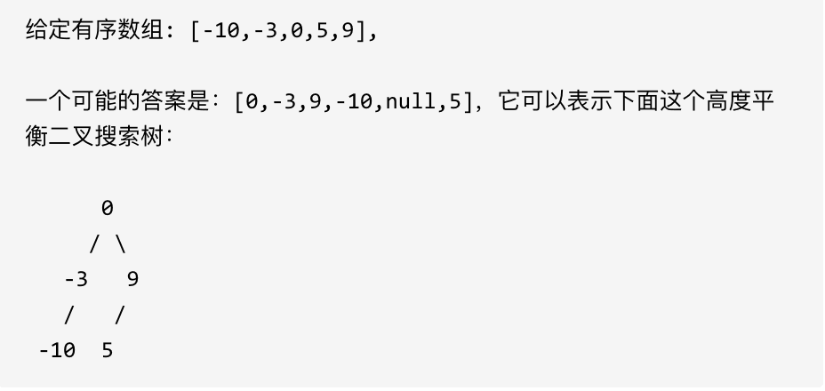
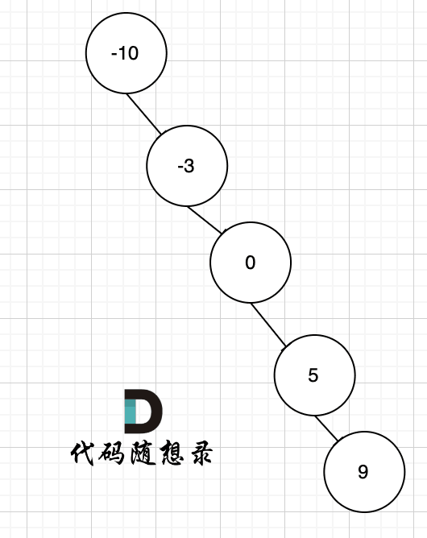
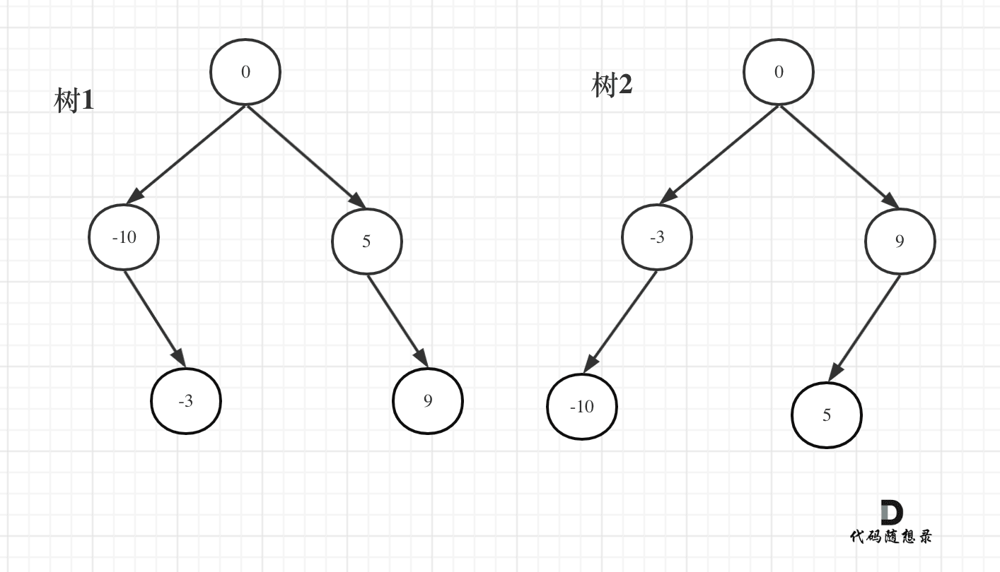

* [做專案（多個 C++、Java、Go、測試開發、前端專案）](https://www.programmercarl.com/other/kstar.html)
* [練習演算法（兩個月高強度學習演算法）](https://www.programmercarl.com/xunlian/xunlianying.html)
* [背誦面試必考題（40天挑戰高頻面試題）](https://www.programmercarl.com/xunlian/bagu.html)


> 構造二元搜尋樹（binary search tree, BST），一不小心就平衡了

# 108.將有序陣列（ordered array）轉換為二元搜尋樹

[LeetCode 題目連結](https://leetcode.cn/problems/convert-sorted-array-to-binary-search-tree/)

將一個按照升序（ascending order）排列的有序陣列，轉換為一棵高度平衡二元搜尋樹（height-balanced binary search tree）。

本題中，一個高度平衡二元樹（binary tree）是指一個二元樹每個節點（node） 的左右兩個子樹（subtree）的高度（height）差的絕對值（absolute value）不超過 1。

範例:




## 演算法公開課 

**[《程式碼隨想錄》演算法影片公開課](https://programmercarl.com/other/gongkaike.html)：[構造平衡二元搜尋樹！| LeetCode：108.將有序陣列轉換為二元搜尋樹](https://www.bilibili.com/video/BV1uR4y1X7qL?share_source=copy_web)，相信結合影片再看本篇題解，更有助於大家對本題的理解**。

## 解題思路

做這道題目之前大家可以了解一下這幾道：

* [106.從中序與後序遍歷序列構造二元樹](https://programmercarl.com/0106.从中序与后序遍历序列构造二叉树.html)
* [654.最大二元樹](https://programmercarl.com/0654.最大二叉树.html)中其實已經講過了，如何根據陣列（array）構造一棵二元樹。
* [701.二元搜尋樹中的插入操作](https://programmercarl.com/0701.二叉搜索树中的插入操作.html)
* [450.刪除二元搜尋樹中的節點](https://programmercarl.com/0450.删除二叉搜索树中的节点.html)


進入正題：

題目中說要轉換為一棵高度平衡二元搜尋樹。為什麼強調要平衡呢？ 

因為只要給我們一個有序陣列，如果不強調平衡，都可以以線性結構（linear structure）來構造二元搜尋樹。 

例如 有序陣列 [-10，-3，0，5，9] 就可以構造成這樣的二元搜尋樹，如圖。 



上圖中，是符合二元搜尋樹的特性吧，如果要這麼做的話，是不是本題意義就不大了，所以才強調是平衡二元搜尋樹（balanced binary tree）。

其實陣列構造二元樹，構成平衡樹是自然而然的事情，因為大家預設都是從陣列中間位置取值作為節點元素（element），一般不會隨機取。**所以想構成不平衡的二元樹是自找麻煩**。


在[二元樹：構造二元樹登場！](https://programmercarl.com/0106.从中序与后序遍历序列构造二叉树.html)和[二元樹：構造一棵最大的二元樹](https://programmercarl.com/0654.最大二叉树.html)中其實已經講過了，如何根據陣列構造一棵二元樹。

**本質就是尋找分割點，分割點作為目前節點，然後遞迴（recursion）左區間（interval）和右區間**。

本題其實要比[二元樹：構造二元樹登場！](https://programmercarl.com/0106.从中序与后序遍历序列构造二叉树.html) 和 [二元樹：構造一棵最大的二元樹](https://programmercarl.com/0654.最大二叉树.html)簡單一些，因為有序陣列構造二元搜尋樹，尋找分割點就比較容易了。

分割點就是陣列中間位置的節點。

那麼問題來了，如果陣列長度為偶數，中間節點有兩個，取哪一個？

取哪一個都可以，只不過構成了不同的平衡二元搜尋樹。

例如：輸入：[-10,-3,0,5,9]

如下兩棵樹（tree），都是這個陣列的平衡二元搜尋樹：



如果要分割的陣列長度為偶數的時候，中間元素為兩個，是取左邊元素就是樹 1，取右邊元素就是樹 2。

**這也是題目中強調答案不是唯一的原因。理解這一點，這道題目算是理解到位了**。

### 遞迴

遞迴三部曲：

* 確定遞迴函式（function）轉回值（return value）及其參數（parameter）

刪除二元樹節點，增加二元樹節點，都是用遞迴函式的轉回值來完成，這樣是比較方便的。

相信大家如果仔細看了[二元樹：搜尋樹中的插入操作](https://programmercarl.com/0701.二叉搜索树中的插入操作.html)和[二元樹：搜尋樹中的刪除操作](https://programmercarl.com/0450.删除二叉搜索树中的节点.html)，一定會對遞迴函式轉回值的作用深有感觸。

那麼本題要構造二元樹，依然用遞迴函式的轉回值來構造中節點的左右孩子。

再來看參數，首先是傳入陣列，然後就是左下標（subscript） left 和右下標 right，我們在[二元樹：構造二元樹登場！](https://programmercarl.com/0106.从中序与后序遍历序列构造二叉树.html)中提過，在構造二元樹的時候盡量不要重新定義左右區間陣列，而是用下標來操作原陣列。

所以程式碼如下：

```
// 左閉右閉區間[left, right]
TreeNode* traversal(vector<int>& nums, int left, int right)
```

這裡注意，**我這裡定義的是左閉右閉區間，在不斷分割的過程中，也會堅持左閉右閉的區間，這又涉及到我們講過的 loop invariant**。

在[二元樹：構造二元樹登場！](https://programmercarl.com/0106.从中序与后序遍历序列构造二叉树.html)，[35.搜尋插入位置](https://programmercarl.com/0035.搜索插入位置.html) 和[59.螺旋（spiral）矩陣（matrix）II](https://programmercarl.com/0059.螺旋矩阵II.html)都詳細講過 loop invariant。


* 確定遞迴終止條件

這裡定義的是左閉右閉的區間，所以當區間 left > right 的時候，就是空節點了。

程式碼如下：

```
if (left > right) return nullptr;
```

* 確定單層遞迴的邏輯

首先取陣列中間元素的位置，不難寫出`int mid = (left + right) / 2;`，**這麼寫其實有一個問題，就是數值溢位（overflow），例如 left 和 right 都是最大 int，這麼操作就溢位了，在[二分法](https://programmercarl.com/0035.搜索插入位置.html)中尤其需要注意！**

所以可以這麼寫：`int mid = left + ((right - left) / 2);`

但本題 LeetCode 的測試資料並不會溢位，所以怎麼寫都可以。但需要有這個意識！

取了中間位置，就開始以中間位置的元素構造節點，程式碼：`TreeNode* root = new TreeNode(nums[mid]);`。

接著劃分區間，root 的左孩子接住下一層左區間的構造節點，右孩子接住下一層右區間構造的節點。

最後回傳 root 節點，單層遞迴整體程式碼如下：

```
int mid = left + ((right - left) / 2);
TreeNode* root = new TreeNode(nums[mid]);
root->left = traversal(nums, left, mid - 1);
root->right = traversal(nums, mid + 1, right);
return root;
```

這裡`int mid = left + ((right - left) / 2);`的寫法相當於是如果陣列長度為偶數，中間位置有兩個元素，取靠左邊的。

* 遞迴整體程式碼如下：

```CPP
class Solution {
private:
    TreeNode* traversal(vector<int>& nums, int left, int right) {
        if (left > right) return nullptr;
        int mid = left + ((right - left) / 2);
        TreeNode* root = new TreeNode(nums[mid]);
        root->left = traversal(nums, left, mid - 1);
        root->right = traversal(nums, mid + 1, right);
        return root;
    }
public:
    TreeNode* sortedArrayToBST(vector<int>& nums) {
        TreeNode* root = traversal(nums, 0, nums.size() - 1);
        return root;
    }
};
```

**注意：在呼叫 traversal 的時候傳入的 left 和 right 為什麼是 0 和 nums.size() - 1，因為定義的區間為左閉右閉**。


### 疊代（iteration）法

疊代法可以透過三個佇列（queue）來模擬（simulation），一個佇列放遍歷（traversal）的節點，一個佇列放左區間下標，一個佇列放右區間下標。

模擬的就是不斷分割的過程，C++ 程式碼如下：（我已經詳細註解）

```CPP
class Solution {
public:
    TreeNode* sortedArrayToBST(vector<int>& nums) {
        if (nums.size() == 0) return nullptr;

        TreeNode* root = new TreeNode(0);   // 初始根節點
        queue<TreeNode*> nodeQue;           // 放遍歷的節點
        queue<int> leftQue;                 // 儲存左區間下標
        queue<int> rightQue;                // 儲存右區間下標
        nodeQue.push(root);                 // 根節點入佇列
        leftQue.push(0);                    // 0為左區間下標初始位置
        rightQue.push(nums.size() - 1);     // nums.size() - 1為右區間下標初始位置

        while (!nodeQue.empty()) {
            TreeNode* curNode = nodeQue.front();
            nodeQue.pop();
            int left = leftQue.front(); leftQue.pop();
            int right = rightQue.front(); rightQue.pop();
            int mid = left + ((right - left) / 2);

            curNode->val = nums[mid];       // 將 mid 對應的元素給中間節點

            if (left <= mid - 1) {          // 處理左區間
                curNode->left = new TreeNode(0);
                nodeQue.push(curNode->left);
                leftQue.push(left);
                rightQue.push(mid - 1);
            }

            if (right >= mid + 1) {         // 處理右區間
                curNode->right = new TreeNode(0);
                nodeQue.push(curNode->right);
                leftQue.push(mid + 1);
                rightQue.push(right);
            }
        }
        return root;
    }
};
```

## 總結

**在[二元樹：構造二元樹登場！](https://programmercarl.com/0106.从中序与后序遍历序列构造二叉树.html) 和 [二元樹：構造一棵最大的二元樹](https://programmercarl.com/0654.最大二叉树.html)之後，我們順理成章地應該構造一下二元搜尋樹了，一不小心還是一棵平衡二元搜尋樹**。

其實解題思路也是一樣的，不斷從中間分割，然後遞迴處理左區間、右區間，也可以說是分治法（divide and conquer）。

此時相信大家應該對透過遞迴函式的轉回值來增刪二元樹很熟悉了，這也是常規操作。

在定義區間的過程中我們又一次強調了 loop invariant 的重要性。

最後依然給出疊代的方法，其實就是模擬取中間元素，然後不斷分割去構造二元樹的過程。


## 其他語言版本


### Java 

遞迴: 左閉右開 [left,right)
```Java
class Solution {
    public TreeNode sortedArrayToBST(int[] nums) {
        return sortedArrayToBST(nums, 0, nums.length);
    }
    
    public TreeNode sortedArrayToBST(int[] nums, int left, int right) {
        if (left >= right) {
            return null;
        }
        if (right - left == 1) {
            return new TreeNode(nums[left]);
        }
        int mid = left + (right - left) / 2;
        TreeNode root = new TreeNode(nums[mid]);
        root.left = sortedArrayToBST(nums, left, mid);
        root.right = sortedArrayToBST(nums, mid + 1, right);
        return root;
    }
}

```

遞迴: 左閉右閉 [left,right]
```java
class Solution {
	public TreeNode sortedArrayToBST(int[] nums) {
		TreeNode root = traversal(nums, 0, nums.length - 1);
		return root;
	}

	// 左閉右閉區間[left, right]
	private TreeNode traversal(int[] nums, int left, int right) {
		if (left > right) return null;

		int mid = left + ((right - left) >> 1);
		TreeNode root = new TreeNode(nums[mid]);
		root.left = traversal(nums, left, mid - 1);
		root.right = traversal(nums, mid + 1, right);
		return root;
	}
}
```

疊代: 左閉右閉 [left,right]
```java
class Solution {
	public TreeNode sortedArrayToBST(int[] nums) {
		if (nums.length == 0) return null;

		//根節點初始化
		TreeNode root = new TreeNode(-1);
		Queue<TreeNode> nodeQueue = new LinkedList<>();
		Queue<Integer> leftQueue = new LinkedList<>();
		Queue<Integer> rightQueue = new LinkedList<>();

		// 根節點入佇列
		nodeQueue.offer(root);
		// 0為左區間下標初始位置
		leftQueue.offer(0);
		// nums.size() - 1為右區間下標初始位置
		rightQueue.offer(nums.length - 1);

		while (!nodeQueue.isEmpty()) {
			TreeNode currNode = nodeQueue.poll();
			int left = leftQueue.poll();
			int right = rightQueue.poll();
			int mid = left + ((right - left) >> 1);

			// 將 mid 對應的元素給中間節點
			currNode.val = nums[mid];

			// 處理左區間
			if (left <= mid - 1) {
				currNode.left = new TreeNode(-1);
				nodeQueue.offer(currNode.left);
				leftQueue.offer(left);
				rightQueue.offer(mid - 1);
			}

			// 處理右區間
			if (right >= mid + 1) {
				currNode.right = new TreeNode(-1);
				nodeQueue.offer(currNode.right);
				leftQueue.offer(mid + 1);
				rightQueue.offer(right);
			}
		}
		return root;
	}
}
```

### Python  
遞迴法
```python
class Solution:
    def traversal(self, nums: List[int], left: int, right: int) -> TreeNode:
        if left > right:
            return None
        
        mid = left + (right - left) // 2
        root = TreeNode(nums[mid])
        root.left = self.traversal(nums, left, mid - 1)
        root.right = self.traversal(nums, mid + 1, right)
        return root
    
    def sortedArrayToBST(self, nums: List[int]) -> TreeNode:
        root = self.traversal(nums, 0, len(nums) - 1)
        return root

```
遞迴 精簡(自身呼叫)
```python
class Solution:
    def sortedArrayToBST(self, nums: List[int]) -> Optional[TreeNode]:
        if not nums:
            return
        mid = len(nums) // 2
        root = TreeNode(nums[mid])
        root.left = self.sortedArrayToBST(nums[:mid])
        root.right = self.sortedArrayToBST(nums[mid + 1 :])
        return root
```

疊代法
```python
from collections import deque

class Solution:
    def sortedArrayToBST(self, nums: List[int]) -> TreeNode:
        if len(nums) == 0:
            return None
        
        root = TreeNode(0)  # 初始根節點
        nodeQue = deque()   # 放遍歷的節點
        leftQue = deque()   # 儲存左區間下標
        rightQue = deque()  # 儲存右區間下標
        
        nodeQue.append(root)               # 根節點入佇列
        leftQue.append(0)                  # 0為左區間下標初始位置
        rightQue.append(len(nums) - 1)     # len(nums) - 1為右區間下標初始位置

        while nodeQue:
            curNode = nodeQue.popleft()
            left = leftQue.popleft()
            right = rightQue.popleft()
            mid = left + (right - left) // 2

            curNode.val = nums[mid]  # 將 mid 對應的元素給中間節點

            if left <= mid - 1:  # 處理左區間
                curNode.left = TreeNode(0)
                nodeQue.append(curNode.left)
                leftQue.append(left)
                rightQue.append(mid - 1)

            if right >= mid + 1:  # 處理右區間
                curNode.right = TreeNode(0)
                nodeQue.append(curNode.right)
                leftQue.append(mid + 1)
                rightQue.append(right)

        return root

```

### Go 

遞迴（隱含回溯（backtracking））

```go
func sortedArrayToBST(nums []int) *TreeNode {
    if len(nums) == 0 {    //終止條件，最後陣列為空則可以回傳
        return nil
    }
    idx := len(nums)/2
    root := &TreeNode{Val: nums[idx]} 
     
    root.Left = sortedArrayToBST(nums[:idx])
    root.Right = sortedArrayToBST(nums[idx+1:])

    return root
}
```

### JavaScript 
遞迴

```javascript
var sortedArrayToBST = function (nums) {
    const buildTree = (Arr, left, right) => {
        if (left > right)
            return null;

        let mid = Math.floor(left + (right - left) / 2);

        let root = new TreeNode(Arr[mid]);
        root.left = buildTree(Arr, left, mid - 1);
        root.right = buildTree(Arr, mid + 1, right);
        return root;
    }
    return buildTree(nums, 0, nums.length - 1);
};
```
疊代
```JavaScript
var sortedArrayToBST = function(nums) {
    if(nums.length===0) {
        return null;
    }
    let root = new TreeNode(0);       //初始根節點
    let nodeQue = [root];             //放遍歷的節點,並初始化
    let leftQue = [0];                //放左區間的下標,初始化
    let rightQue = [nums.length-1];   // 放右區間的下標
    
    while(nodeQue.length) {
        let curNode = nodeQue.pop();
        let left = leftQue.pop();
        let right = rightQue.pop();
        let mid = left + Math.floor((right-left)/2);
        
        curNode.val = nums[mid];      //將下標為 mid 的元素給中間節點
        
//         處理左區間
        if(left <= mid-1) {
            curNode.left = new TreeNode(0);
            nodeQue.push(curNode.left);
            leftQue.push(left);
            rightQue.push(mid-1);
        }
        
//         處理右區間
        if(right >= mid+1) {
            curNode.right = new TreeNode(0);
            nodeQue.push(curNode.right);
            leftQue.push(mid+1);
            rightQue.push(right);
        }
    }
    return root;
};
```
### TypeScript

```typescript
function sortedArrayToBST(nums: number[]): TreeNode | null {
    function recur(nums: number[], left: number, right: number): TreeNode | null {
        if (left > right) return null;
        let mid: number = Math.floor((left + right) / 2);
        const root: TreeNode = new TreeNode(nums[mid]);
        root.left = recur(nums, left, mid - 1);
        root.right = recur(nums, mid + 1, right);
        return root;
    }
    return recur(nums, 0, nums.length - 1);
};
```

### C

遞迴
```c
struct TreeNode* traversal(int* nums, int left, int right) {
    if (left > right) 
        return NULL;
    int mid = left + ((right - left) / 2);
    struct TreeNode* root = (struct TreeNode*)malloc(sizeof(struct TreeNode));
    root->val = nums[mid];
    root->left = traversal(nums, left, mid - 1);
    root->right = traversal(nums, mid + 1, right);
    return root;
}

struct TreeNode* sortedArrayToBST(int* nums, int numsSize) {
    struct TreeNode* root = traversal(nums, 0, numsSize - 1);
    return root;
}
```

### Scala

遞迴:

```scala
object Solution {
  def sortedArrayToBST(nums: Array[Int]): TreeNode = {
    def buildTree(left: Int, right: Int): TreeNode = {
      if (left > right) return null // 當 left 大於 right 的時候，回傳空
      // 最中間的節點是目前節點
      var mid = left + (right - left) / 2
      var curNode = new TreeNode(nums(mid))
      curNode.left = buildTree(left, mid - 1)
      curNode.right = buildTree(mid + 1, right)
      curNode
    }
    buildTree(0, nums.size - 1)
  }
}
```

### Rust

遞迴：

```rust
impl Solution {
    pub fn sorted_array_to_bst(nums: Vec<i32>) -> Option<Rc<RefCell<TreeNode>>> {
        if nums.is_empty() {
            return None;
        }
        let index = nums.len() / 2;
        let mut root = TreeNode::new(nums[index]);

        root.left = Self::sorted_array_to_bst(nums[..index].to_vec());
        root.right = Self::sorted_array_to_bst(nums[index + 1..].to_vec());
        Some(Rc::new(RefCell::new(root)))
    }
}
```
### C#
```csharp
// 遞迴
public TreeNode SortedArrayToBST(int[] nums)
{
    return Traversal(nums, 0, nums.Length - 1);
}
public TreeNode Traversal(int[] nums, int left, int right)
{
    if (left > right) return null;
    int mid = left + (right - left) / 2;
    TreeNode node = new TreeNode(nums[mid]);
    node.left = Traversal(nums, left, mid - 1);
    node.right = Traversal(nums, mid + 1, right);
    return node;
}
```


