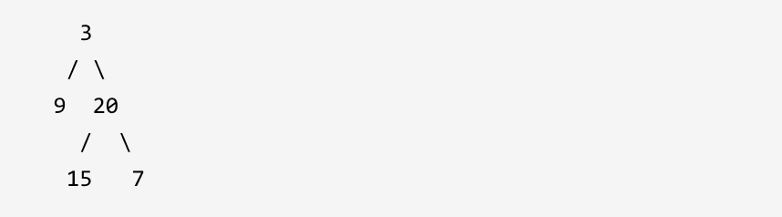
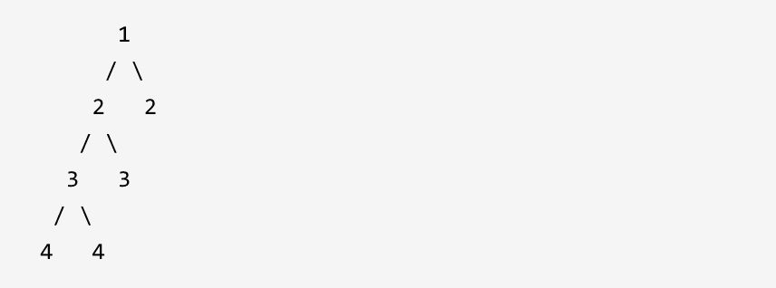
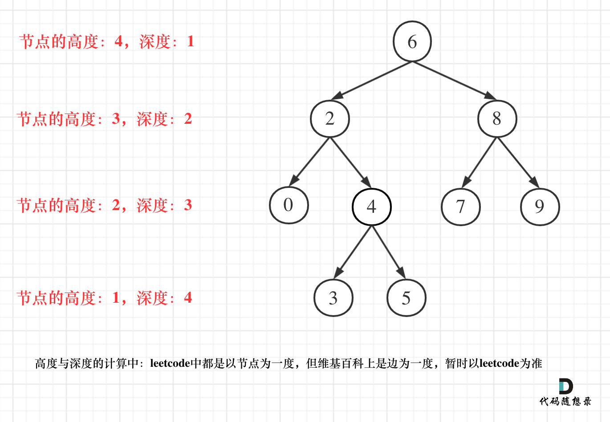

* [做專案（多個 C++、Java、Go、測試開發、前端專案）](https://www.programmercarl.com/other/kstar.html)
* [練習演算法（兩個月高強度學習演算法）](https://www.programmercarl.com/xunlian/xunlianying.html)
* [背誦面試必考題（40天挑戰高頻面試題）](https://www.programmercarl.com/xunlian/bagu.html)


> 求高度（height）還是求深度（depth），你搞懂了沒？

# 110.平衡二元樹（balanced binary tree）

[LeetCode 題目連結](https://leetcode.com/problems/balanced-binary-tree/)

給定一個二元樹（binary tree），判斷它是否是高度平衡（height-balanced）的二元樹。

本題中，一棵高度平衡二元樹定義為：一個二元樹每個節點（node）的左右兩個子樹（subtree）的高度差的絕對值（absolute value）不超過1。

範例 1:

給定二元樹 [3,9,20,null,null,15,7]



回傳 true 。

範例 2:

給定二元樹 [1,2,2,3,3,null,null,4,4]



回傳 false 。

## 演算法公開課

**[《程式碼隨想錄》演算法影片公開課](https://programmercarl.com/other/gongkaike.html)：[後序遍歷（post-order traversal）求高度，高度判斷是否平衡 | LeetCode：110.平衡二元樹](https://www.bilibili.com/video/BV1Ug411S7my)，相信結合影片再看本篇題解，更有助於大家對本題的理解**。

## 題外話

乍看之下這道題目和[104.二元樹的最大深度](./0104.二叉樹的最大深度.md)很像，其實有很大區別。

這裡強調一下概念：

* 二元樹節點的深度：指從根節點（root node）到該節點的最長簡單路徑（simple path）邊（edge）的條數。
* 二元樹節點的高度：指從該節點到葉節點（leaf node）的最長簡單路徑邊的條數。

但 LeetCode 中強調的深度和高度很明顯是按照節點來計算的，如圖：



關於根節點的深度究竟是 1 還是 0，不同的地方有不一樣的標準，LeetCode 的題目中都是以節點為一度，即根節點深度是 1。但維基百科上定義用邊為一度，即根節點的深度是 0，我們暫時以 LeetCode 為準（畢竟要在這上面練習題目）。

因為求深度可以從上到下去查，所以需要前序遍歷（preorder traversal）（中左右），而高度只能從下到上去查，所以只能後序遍歷（左右中）

有的同學一定疑惑，為什麼[104.二元樹的最大深度](./0104.二叉樹的最大深度.md)中求的是二元樹的最大深度，也用的是後序遍歷。

**那是因為程式碼的邏輯其實是求根節點的高度，而根節點的高度就是這棵樹（tree）的最大深度，所以才可以使用後序遍歷。**

在[104.二元樹的最大深度](./0104.二叉樹的最大深度.md)中，如果真正求取二元樹的最大深度，程式碼應該寫成如下：（前序遍歷）

```CPP
class Solution {
public:
    int result;
    void getDepth(TreeNode* node, int depth) {
        result = depth > result ? depth : result; // 中

        if (node->left == NULL && node->right == NULL) return ;

        if (node->left) { // 左
            depth++;    // 深度+1
            getDepth(node->left, depth);
            depth--;    // 回溯，深度-1
        }
        if (node->right) { // 右
            depth++;    // 深度+1
            getDepth(node->right, depth);
            depth--;    // 回溯，深度-1
        }
        return ;
    }
    int maxDepth(TreeNode* root) {
        result = 0;
        if (root == NULL) return result;
        getDepth(root, 1);
        return result;
    }
};
```

**可以看出使用了前序（中左右）的遍歷（traversal）順序，這才是真正求深度的邏輯！**

注意以上程式碼是為了把細節體現出來，簡化一下程式碼如下：

```CPP
class Solution {
public:
    int result;
    void getDepth(TreeNode* node, int depth) {
        result = depth > result ? depth : result; // 中
        if (node->left == NULL && node->right == NULL) return ;
        if (node->left) { // 左
            getDepth(node->left, depth + 1);
        }
        if (node->right) { // 右
            getDepth(node->right, depth + 1);
        }
        return ;
    }
    int maxDepth(TreeNode* root) {
        result = 0;
        if (root == 0) return result;
        getDepth(root, 1);
        return result;
    }
};
```

## 本題解題思路

### 遞迴（recursion）

此時大家應該明白了既然要求比較高度，必然是要後序遍歷。

遞迴三部曲分析：

1. 明確遞迴函數（function）的參數（parameter）和回傳值（return value）

參數：目前傳入節點。
回傳值：以目前傳入節點為根節點的樹的高度。

那麼如何標記左右子樹是否差值大於 1 呢？

如果目前傳入節點為根節點的二元樹已經不是平衡二元樹了，還回傳高度的話就沒有意義了。

所以如果已經不是平衡二元樹了，可以回傳 -1 來標記已經不符合平衡樹的規則了。

程式碼如下：


```CPP
// -1 表示已經不是平衡二元樹了，否則回傳值是以該節點為根節點樹的高度
int getHeight(TreeNode* node)
```

2. 明確終止條件

遞迴的過程中依然是遇到空節點就終止，回傳 0，表示目前節點為根節點的樹高度為 0

程式碼如下：

```CPP
if (node == NULL) {
    return 0;
}
```

3. 明確單層遞迴的邏輯

如何判斷以目前傳入節點為根節點的二元樹是否是平衡二元樹呢？當然是其左子樹高度和其右子樹高度的差值。

分別求出其左右子樹的高度，然後如果差值小於等於 1，則回傳目前二元樹的高度，否則回傳 -1，表示已經不是平衡二元樹了。

程式碼如下：

```CPP
int leftHeight = getHeight(node->left); // 左
if (leftHeight == -1) return -1;
int rightHeight = getHeight(node->right); // 右
if (rightHeight == -1) return -1;

int result;
if (abs(leftHeight - rightHeight) > 1) {  // 中
    result = -1;
} else {
    result = 1 + max(leftHeight, rightHeight); // 以目前節點為根節點的樹的最大高度
}

return result;
```

程式碼精簡之後如下：

```CPP
int leftHeight = getHeight(node->left);
if (leftHeight == -1) return -1;
int rightHeight = getHeight(node->right);
if (rightHeight == -1) return -1;
return abs(leftHeight - rightHeight) > 1 ? -1 : 1 + max(leftHeight, rightHeight);
```

此時遞迴的函數就已經寫出來了，這個遞迴的函數傳入節點指標（pointer），回傳以該節點為根節點的二元樹的高度，如果不是平衡二元樹，則回傳 -1。

getHeight 整體程式碼如下：

```CPP
int getHeight(TreeNode* node) {
    if (node == NULL) {
        return 0;
    }
    int leftHeight = getHeight(node->left);
    if (leftHeight == -1) return -1;
    int rightHeight = getHeight(node->right);
    if (rightHeight == -1) return -1;
    return abs(leftHeight - rightHeight) > 1 ? -1 : 1 + max(leftHeight, rightHeight);
}
```

最後本題整體遞迴程式碼如下：

```CPP
class Solution {
public:
    // 回傳以該節點為根節點的二元樹的高度，如果不是平衡二元樹了則回傳 -1
    int getHeight(TreeNode* node) {
        if (node == NULL) {
            return 0;
        }
        int leftHeight = getHeight(node->left);
        if (leftHeight == -1) return -1;
        int rightHeight = getHeight(node->right);
        if (rightHeight == -1) return -1;
        return abs(leftHeight - rightHeight) > 1 ? -1 : 1 + max(leftHeight, rightHeight);
    }
    bool isBalanced(TreeNode* root) {
        return getHeight(root) == -1 ? false : true;
    }
};
```

### 疊代（iteration）

在[104.二元樹的最大深度](./0104.二叉樹的最大深度.md)中我們可以使用層次序走訪（level order traversal）來求深度，但是就不能直接用層次序走訪來求高度了，這就體現出求高度和求深度的不同。

本題的疊代方式可以先定義一個函數，專門用來求高度。

這個函數透過堆疊（stack）模擬（simulation）的後序遍歷找每一個節點的高度（其實是透過求傳入節點為根節點的最大深度來求高度）

程式碼如下：

```CPP
// cur 節點的最大深度，就是 cur 的高度
int getDepth(TreeNode* cur) {
    stack<TreeNode*> st;
    if (cur != NULL) st.push(cur);
    int depth = 0; // 記錄深度
    int result = 0;
    while (!st.empty()) {
        TreeNode* node = st.top();
        if (node != NULL) {
            st.pop();
            st.push(node);                          // 中
            st.push(NULL);
            depth++;
            if (node->right) st.push(node->right);  // 右
            if (node->left) st.push(node->left);    // 左

        } else {
            st.pop();
            node = st.top();
            st.pop();
            depth--;
        }
        result = result > depth ? result : depth;
    }
    return result;
}
```

然後再用堆疊來模擬後序遍歷，遍歷每一個節點的時候，再去判斷左右孩子（child node）的高度是否符合，程式碼如下：

```CPP
bool isBalanced(TreeNode* root) {
    stack<TreeNode*> st;
    if (root == NULL) return true;
    st.push(root);
    while (!st.empty()) {
        TreeNode* node = st.top();                       // 中
        st.pop();
        if (abs(getDepth(node->left) - getDepth(node->right)) > 1) { // 判斷左右孩子高度是否符合
            return false;
        }
        if (node->right) st.push(node->right);           // 右（空節點不入堆疊）
        if (node->left) st.push(node->left);             // 左（空節點不入堆疊）
    }
    return true;
}
```

整體程式碼如下：

```CPP
class Solution {
private:
    int getDepth(TreeNode* cur) {
        stack<TreeNode*> st;
        if (cur != NULL) st.push(cur);
        int depth = 0; // 記錄深度
        int result = 0;
        while (!st.empty()) {
            TreeNode* node = st.top();
            if (node != NULL) {
                st.pop();
                st.push(node);                          // 中
                st.push(NULL);
                depth++;
                if (node->right) st.push(node->right);  // 右
                if (node->left) st.push(node->left);    // 左

            } else {
                st.pop();
                node = st.top();
                st.pop();
                depth--;
            }
            result = result > depth ? result : depth;
        }
        return result;
    }

public:
    bool isBalanced(TreeNode* root) {
        stack<TreeNode*> st;
        if (root == NULL) return true;
        st.push(root);
        while (!st.empty()) {
            TreeNode* node = st.top();                       // 中
            st.pop();
            if (abs(getDepth(node->left) - getDepth(node->right)) > 1) {
                return false;
            }
            if (node->right) st.push(node->right);           // 右（空節點不入堆疊）
            if (node->left) st.push(node->left);             // 左（空節點不入堆疊）
        }
        return true;
    }
};
```

當然此題用疊代法，其實效率很低，因為沒有很好地模擬回溯（backtracking）的過程，所以疊代法有很多重複的計算。

雖然理論上所有的遞迴都可以用疊代來實作，但是有的場景難度可能比較大。

**例如：都知道回溯法其實就是遞迴，但是很少人用疊代的方式去實作回溯演算法（backtracking algorithm）！**

因為對於回溯演算法已經是非常複雜的遞迴了，如果再用疊代的話，就是自己給自己找麻煩，效能也並不一定高。

## 總結

透過本題可以了解求二元樹深度和二元樹高度的差異，求深度適合用前序遍歷，而求高度適合用後序遍歷。

本題疊代法其實有點複雜，大家可以有一個想法，也不一定說非要寫出來。

但是遞迴方式是一定要掌握的！


## 其他語言版本

### Java:

```Java
class Solution {
   /**
     * 遞迴法
     */
    public boolean isBalanced(TreeNode root) {
        return getHeight(root) != -1;
    }

    private int getHeight(TreeNode root) {
        if (root == null) {
            return 0;
        }
        int leftHeight = getHeight(root.left);
        if (leftHeight == -1) {
            return -1;
        }
        int rightHeight = getHeight(root.right);
        if (rightHeight == -1) {
            return -1;
        }
        // 左右子樹高度差大於 1，return -1 表示已經不是平衡樹了
        if (Math.abs(leftHeight - rightHeight) > 1) {
            return -1;
        }
        return Math.max(leftHeight, rightHeight) + 1;
    }
}

class Solution {
   /**
     * 疊代法，效率較低，計算高度時會重複遍歷
     * 時間複雜度：O(n^2)
     */
    public boolean isBalanced(TreeNode root) {
        if (root == null) {
            return true;
        }
        Stack<TreeNode> stack = new Stack<>();
        TreeNode pre = null;
        while (root!= null || !stack.isEmpty()) {
            while (root != null) {
                stack.push(root);
                root = root.left;
            }
            TreeNode inNode = stack.peek();
            // 右節點為 null 或已經遍歷過
            if (inNode.right == null || inNode.right == pre) {
                // 比較左右子樹的高度差，輸出
                if (Math.abs(getHeight(inNode.left) - getHeight(inNode.right)) > 1) {
                    return false;
                }
                stack.pop();
                pre = inNode;
                root = null;// 目前節點下，沒有要遍歷的節點了
            } else {
                root = inNode.right;// 右節點還沒遍歷，遍歷右節點
            }
        }
        return true;
    }

    /**
     * 層次序走訪，求節點的高度
     */
    public int getHeight(TreeNode root) {
        if (root == null) {
            return 0;
        }
        Deque<TreeNode> deque = new LinkedList<>();
        deque.offer(root);
        int depth = 0;
        while (!deque.isEmpty()) {
            int size = deque.size();
            depth++;
            for (int i = 0; i < size; i++) {
                TreeNode poll = deque.poll();
                if (poll.left != null) {
                    deque.offer(poll.left);
                }
                if (poll.right != null) {
                    deque.offer(poll.right);
                }
            }
        }
        return depth;
    }
}

class Solution {
   /**
     * 最佳化疊代法，針對蠻力疊代法的 getHeight 方法做最佳化，利用 TreeNode.val 來儲存目前節點的高度，這樣就不會有重複遍歷
     * 取得高度演算法時間複雜度可以降到 O(1)，總的時間複雜度降為 O(n)。
     * 時間複雜度：O(n)
     */
    public boolean isBalanced(TreeNode root) {
        if (root == null) {
            return true;
        }
        Stack<TreeNode> stack = new Stack<>();
        TreeNode pre = null;
        while (root != null || !stack.isEmpty()) {
            while (root != null) {
                stack.push(root);
                root = root.left;
            }
            TreeNode inNode = stack.peek();
            // 右節點為 null 或已經遍歷過
            if (inNode.right == null || inNode.right == pre) {
                // 輸出
                if (Math.abs(getHeight(inNode.left) - getHeight(inNode.right)) > 1) {
                    return false;
                }
                stack.pop();
                pre = inNode;
                root = null;// 目前節點下，沒有要遍歷的節點了
            } else {
                root = inNode.right;// 右節點還沒遍歷，遍歷右節點
            }
        }
        return true;
    }

    /**
     * 求節點的高度
     */
    public int getHeight(TreeNode root) {
        if (root == null) {
            return 0;
        }
        int leftHeight = root.left != null ? root.left.val : 0;
        int rightHeight = root.right != null ? root.right.val : 0;
        int height = Math.max(leftHeight, rightHeight) + 1;
        root.val = height;// 用 TreeNode.val 來儲存目前節點的高度
        return height;
    }
}
```

### Python:

遞迴法：

```python
# Definition for a binary tree node.
# class TreeNode:
#     def __init__(self, val=0, left=None, right=None):
#         self.val = val
#         self.left = left
#         self.right = right
class Solution:
    def isBalanced(self, root: TreeNode) -> bool:
        if self.get_height(root) != -1:
            return True
        else:
            return False

    def get_height(self, root: TreeNode) -> int:
        # Base Case
        if not root:
            return 0
        # 左
        if (left_height := self.get_height(root.left)) == -1:
            return -1
        # 右
        if (right_height := self.get_height(root.right)) == -1:
            return -1
        # 中
        if abs(left_height - right_height) > 1:
            return -1
        else:
            return 1 + max(left_height, right_height)
```
遞迴法精簡版：

```python
class Solution:
    def isBalanced(self, root: Optional[TreeNode]) -> bool:
        return self.get_hight(root) != -1
    def get_hight(self, node):
        if not node:
            return 0
        left = self.get_hight(node.left)
        right = self.get_hight(node.right)
        if left == -1 or right == -1 or abs(left - right) > 1:
            return -1
        return max(left, right) + 1
```


疊代法：

```python
class Solution:
    def getDepth(self, cur):
        st = []
        if cur is not None:
            st.append(cur)
        depth = 0
        result = 0
        while st:
            node = st[-1]
            if node is not None:
                st.pop()
                st.append(node)                           # 中
                st.append(None)
                depth += 1
                if node.right:
                    st.append(node.right)                 # 右
                if node.left:
                    st.append(node.left)                   # 左

            else:               
                node = st.pop()
                st.pop()
                depth -= 1
            result = max(result, depth)
        return result

    def isBalanced(self, root):
        st = []
        if root is None:
            return True
        st.append(root)
        while st:
            node = st.pop()                                 # 中
            if abs(self.getDepth(node.left) - self.getDepth(node.right)) > 1:
                return False
            if node.right:
                st.append(node.right)                       # 右（空節點不入堆疊）
            if node.left:
                st.append(node.left)                         # 左（空節點不入堆疊）
        return True

```

疊代法精簡版：

```python
class Solution:
    def isBalanced(self, root: Optional[TreeNode]) -> bool:
        if not root:
            return True

        height_map = {}
        stack = [root]
        while stack:
            node = stack.pop()
            if node:
                stack.append(node)              # 中
                stack.append(None)
                # 採用陣列進行疊代，先將右節點加入，保證左節點能夠先出堆疊
                if node.right:                  # 右
                    stack.append(node.right)
                if node.left:                   # 左
                    stack.append(node.left)
            else:
                real_node = stack.pop()
                left, right = height_map.get(real_node.left, 0), height_map.get(real_node.right, 0)
                if abs(left - right) > 1:
                    return False
                height_map[real_node] = 1 + max(left, right)
        return True
```
### Go:

遞迴法

```Go
func isBalanced(root *TreeNode) bool {
    h := getHeight(root)
    if h == -1 {
        return false
    }
    return true
}
// 回傳以該節點為根節點的二元樹的高度，如果不是平衡二元樹了則回傳 -1
func getHeight(root *TreeNode) int {
    if root == nil {
        return 0
    }
    l, r := getHeight(root.Left), getHeight(root.Right)
    if l == -1 || r == -1 {
        return -1
    }
    if l - r > 1 || r - l > 1 {
        return -1
    }
    return max(l, r) + 1
}
func max(a, b int) int {
    if a > b {
        return a
    }
    return b
}
```

疊代法

```Go
func isBalanced(root *TreeNode) bool {
    st := make([]*TreeNode, 0)
    if root == nil {
        return true
    }
    st = append(st, root)
    for len(st) > 0 {
        node := st[len(st)-1]
        st = st[:len(st)-1]
        if math.Abs(float64(getDepth(node.Left)) - float64(getDepth(node.Right))) > 1 {
            return false
        }
        if node.Right != nil {
            st = append(st, node.Right)
        }
        if node.Left != nil {
            st = append(st, node.Left)
        }
    }
    return true
}

func getDepth(cur *TreeNode) int {
    st := make([]*TreeNode, 0)
    if cur != nil {
        st = append(st, cur)
    }
    depth := 0
    result := 0
    for len(st) > 0 {
        node := st[len(st)-1]
        if node != nil {
            st = st[:len(st)-1]
            st = append(st, node, nil)
            depth++
            if node.Right != nil {
                st = append(st, node.Right)
            }
            if node.Left != nil {
                st = append(st, node.Left)
            }
        } else {
            st = st[:len(st)-1]
            node = st[len(st)-1]
            st = st[:len(st)-1]
            depth--
        }
        if result < depth {
            result = depth
        }
    }
    return result
}
```

### JavaScript:

遞迴法：

```javascript
var isBalanced = function(root) {
    //還是用遞迴三部曲 + 後序遍歷 左右中 目前左子樹右子樹高度相差大於 1 就回傳 -1
    // 1. 確定遞迴函數參數以及回傳值
    const getDepth = function(node) {
        // 2. 確定遞迴函數終止條件
        if(node === null) return 0;
        // 3. 確定單層遞迴邏輯
        let leftDepth = getDepth(node.left); //左子樹高度
        // 當判定左子樹不為平衡二元樹時,即可直接回傳 -1
        if(leftDepth === -1) return -1;
        let rightDepth = getDepth(node.right); //右子樹高度
        // 當判定右子樹不為平衡二元樹時,即可直接回傳 -1
        if(rightDepth === -1) return -1;
        if(Math.abs(leftDepth - rightDepth) > 1) {
            return -1;
        } else {
            return 1 + Math.max(leftDepth, rightDepth);
        }
    }
    return !(getDepth(root) === -1);
};
```

疊代法：

```javascript
// 取得目前節點的高度
var getHeight = function (curNode) {
    let queue = [];
    if (curNode !== null) queue.push(curNode); // 推入目前元素
    let depth = 0, res = 0;
    while (queue.length) {
        let node = queue[queue.length - 1]; // 取出堆疊頂端
        if (node !== null) {
            queue.pop();
            queue.push(node);   // 中
            queue.push(null);
            depth++;
            node.right && queue.push(node.right);   // 右
            node.left && queue.push(node.left);     // 左
        } else {
            queue.pop();
            node = queue[queue.length - 1];
            queue.pop();
            depth--;
        }
        res = res > depth ? res : depth;
    }
    return res;
}
var isBalanced = function (root) {
    if (root === null) return true;
    let queue = [root];
    while (queue.length) {
        let node = queue[queue.length - 1]; // 取出堆疊頂端
        queue.pop();
        if (Math.abs(getHeight(node.left) - getHeight(node.right)) > 1) {
            return false;
        }
        node.right && queue.push(node.right);
        node.left && queue.push(node.left);
    }
    return true;
};
```

### TypeScript:

```typescript
// 遞迴法
function isBalanced(root: TreeNode | null): boolean {
    function getDepth(root: TreeNode | null): number {
        if (root === null) return 0;
        let leftDepth: number = getDepth(root.left);
        if (leftDepth === -1) return -1;
        let rightDepth: number = getDepth(root.right);
        if (rightDepth === -1) return -1;
        if (Math.abs(leftDepth - rightDepth) > 1) return -1;
        return 1 + Math.max(leftDepth, rightDepth);
    }
    return getDepth(root) !== -1;
};
```

### C:

遞迴法：

```c
int getDepth(struct TreeNode* node) {
    //如果節點不存在，回傳 0
    if(!node)
        return 0;
    //求出右子樹深度
    int rightDepth = getDepth(node->right);
    //求出左子樹深度
    int leftDepth = getDepth(node->left);
    //回傳左右子樹中的較大值+1
    return rightDepth > leftDepth ? rightDepth + 1 : leftDepth + 1;
}

bool isBalanced(struct TreeNode* root) {
    //遞迴結束條件為：傳入節點為 NULL，回傳 True
    if(!root)
        return 1;
    //求出左右子樹的深度
    int leftDepth = getDepth(root->left);
    int rightDepth = getDepth(root->right);
    int diff;
    //若左右子樹絕對值差距大於 1，回傳 False
    if((diff = leftDepth - rightDepth) > 1 || diff < -1)
        return 0;
    //檢查左右子樹是否為平衡二元樹
    return isBalanced(root->right) && isBalanced(root->left);
}
```

疊代法：

```c
//計算節點深度
int getDepth(struct TreeNode* node) {
    //配置堆疊空間
    struct TreeNode** stack = (struct TreeNode**)malloc(sizeof(struct TreeNode*) * 10000);
    int stackTop = 0;
    //若傳入節點存在，將其入堆疊。若不存在，函數直接回傳 0
    if(node)
        stack[stackTop++] = node;
    int result = 0;
    int depth = 0;

    //當堆疊中有元素時，進行疊代遍歷
    while(stackTop) {
        //取出堆疊頂端元素
        struct TreeNode* tempNode = stack[--stackTop];
        //若堆疊頂端元素非 NULL，則將深度+1
        if(tempNode) {
            depth++;
            //將堆疊頂端元素再次入堆疊，新增 NULL 表示此節點已被遍歷
            stack[stackTop++] = tempNode;
            stack[stackTop++] = NULL;
            //若堆疊頂端元素有左右孩子，則將孩子節點入堆疊
            if(tempNode->left)
                stack[stackTop++] = tempNode->left;
            if(tempNode->right)
                stack[stackTop++] = tempNode->right;
            //更新結果
            result = result > depth ? result : depth;
        }
        else {
            //若為 NULL，則代表目前節點已被遍歷，深度-1
            tempNode = stack[--stackTop];
            depth--;
        }
    }

    return result;
}

bool isBalanced(struct TreeNode* root){
    //配置堆疊空間
    struct TreeNode** stack = (struct TreeNode**)malloc(sizeof(struct TreeNode*) * 10000);
    int stackTop = 0;

    //若根節點不存在，回傳 True
    if(!root)
        return 1;

    //將根節點入堆疊
    stack[stackTop++] = root;
    //當堆疊中有元素時，進行遍歷
    while(stackTop) {
        //將堆疊頂端元素出堆疊
        struct TreeNode* node = stack[--stackTop];
        //計算左右子樹的深度
        int diff = getDepth(node->right) - getDepth(node->left);
        //若深度的絕對值大於 1，回傳 False
        if(diff > 1 || diff < -1)
            return 0;
        //如果堆疊頂端節點有左右節點，將左右節點入堆疊
        if(node->left)
            stack[stackTop++] = node->left;
        if(node->right)
            stack[stackTop++] = node->right;
    }
    //若二元樹遍歷結束後沒有回傳 False，則回傳 True
    return 1;
}
```

### Swift:

>遞迴

```swift
func isBalanced(_ root: TreeNode?) -> Bool {
    // -1 已經不是平衡二元樹
    return getHeight(root) == -1 ? false : true
}
func getHeight(_ root: TreeNode?) -> Int {
    guard let root = root else {
        return 0
    }
    let leftHeight = getHeight(root.left)
    if leftHeight == -1 {
        return -1
    }
    let rightHeight = getHeight(root.right)
    if rightHeight == -1 {
        return -1
    }
    if abs(leftHeight - rightHeight) > 1 {
        return -1
    } else {
        return 1 + max(leftHeight, rightHeight)
    }
}
```

### Rust:

遞迴

```rust
use std::cell::RefCell;
use std::rc::Rc;
impl Solution {
    pub fn is_balanced(root: Option<Rc<RefCell<TreeNode>>>) -> bool {
        Self::get_depth(root) != -1
    }
    pub fn get_depth(root: Option<Rc<RefCell<TreeNode>>>) -> i32 {
        if root.is_none() {
            return 0;
        }
        let right = Self::get_depth(root.as_ref().unwrap().borrow().left.clone());
        let left = Self::get_depth(root.unwrap().borrow().right.clone());
        if right == -1 {
            return -1;
        }
        if left == -1 {
            return -1;
        }
        if (right - left).abs() > 1 {
            return -1;
        }

        1 + right.max(left)
    }
}
```
### C#
```csharp
public bool IsBalanced(TreeNode root)
{
    return GetHeight(root) == -1 ? false : true;
}
public int GetHeight(TreeNode root)
{
    if (root == null) return 0;
    int left = GetHeight(root.left);
    if (left == -1) return -1;
    int right = GetHeight(root.right);
    if (right == -1) return -1;
    int res;
    if (Math.Abs(left - right) > 1)
    {
        res = -1;
    }
    else
    {
        res = 1 + Math.Max(left, right);
    }
    return res;
}
```


