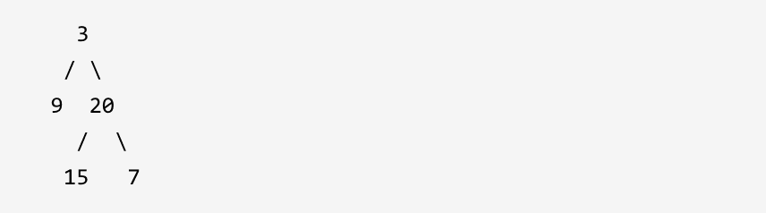
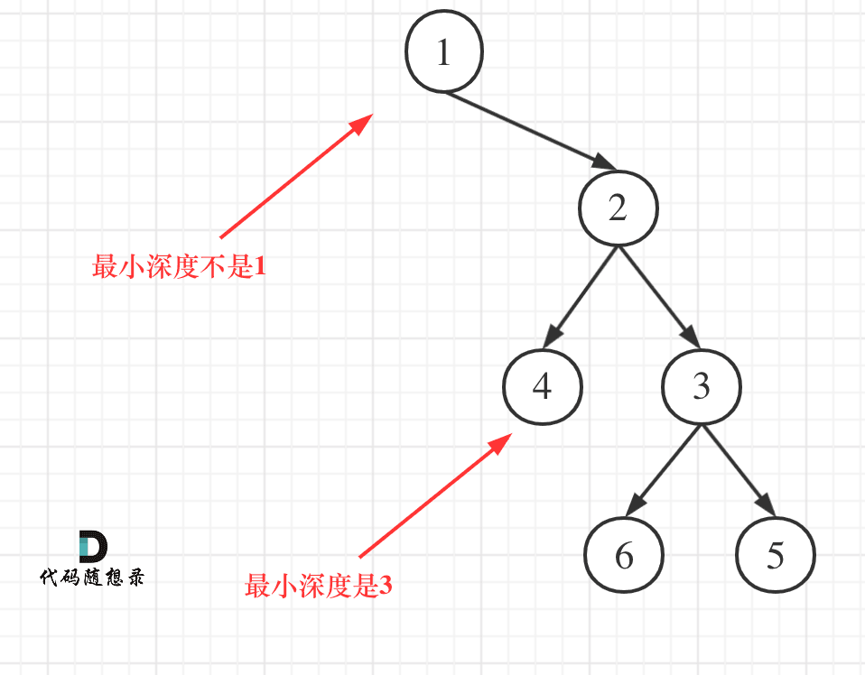

* [做專案（多個 C++、Java、Go、測試開發、前端專案）](https://www.programmercarl.com/other/kstar.html)
* [練習演算法（兩個月高強度學習演算法）](https://www.programmercarl.com/xunlian/xunlianying.html)
* [背誦面試必考題（40天挑戰高頻面試題）](https://www.programmercarl.com/xunlian/bagu.html)


> 和求最大深度（depth）一個固定做法？

# 111.二元樹（binary tree）的最小深度

[LeetCode 題目連結](https://leetcode.com/problems/minimum-depth-of-binary-tree/)

給定一個二元樹，找出其最小深度。

最小深度是從根節點（root node）到最近葉節點（leaf node）的最短路徑（shortest path）上的節點（node）數量。

說明: 葉節點是指沒有子節點（child node）的節點。

範例:

給定二元樹 [3,9,20,null,null,15,7],




回傳它的最小深度  2.

## 演算法公開課

**[《程式碼隨想錄》演算法影片公開課](https://programmercarl.com/other/gongkaike.html)：[看起來好像做過，一寫就錯！ | LeetCode：111.二元樹的最小深度](https://www.bilibili.com/video/BV1QD4y1B7e2)，相信結合影片再看本篇題解，更有助於大家對本題的理解**。

## 解題思路


看完了這篇[104.二元樹的最大深度](./0104.二叉樹的最大深度.md)，再來看看如何求最小深度。

直覺上好像和求最大深度差不多，其實還是差不少的。

本題依然是前序遍歷（preorder traversal）和後序遍歷（post-order traversal）都可以，前序求的是深度，後序求的是高度（height）。

* 二元樹節點的深度：指從根節點到該節點的最長簡單路徑（simple path）邊（edge）的條數或者節點數（取決於深度從 0 開始還是從 1 開始）
* 二元樹節點的高度：指從該節點到葉節點的最長簡單路徑邊的條數或者節點數（取決於高度從 0 開始還是從 1 開始）

那麼使用後序遍歷，其實求的是根節點到葉節點的最小距離，就是求高度的過程，不過這個最小距離也同樣是最小深度。

以下講解中遍歷（traversal）順序上依然採用後序遍歷（因為要比較遞迴（recursion）回傳之後的結果，本文我也給出前序遍歷的寫法）。

本題還有一個誤區，在處理節點的過程中，最大深度很容易理解，最小深度就不那麼好理解，如圖：



這就要重新審題了，題目中說的是：**最小深度是從根節點到最近葉節點的最短路徑上的節點數量。**注意是**葉節點**。

什麼是葉節點，左右孩子都為空的節點才是葉節點！

### 遞迴法

來來來，一起遞迴三部曲：

1. 確定遞迴函數（function）的參數（parameter）和回傳值（return value）

參數為要傳入的二元樹根節點，回傳的是 int 型別的深度。

程式碼如下：

```CPP
int getDepth(TreeNode* node)
```

2. 確定終止條件

終止條件也是遇到空節點回傳 0，表示目前節點的高度為 0。

程式碼如下：

```CPP
if (node == NULL) return 0;
```

3. 確定單層遞迴的邏輯

這塊和求最大深度可就不一樣了，一些同學可能會寫如下程式碼：
```CPP
int leftDepth = getDepth(node->left);
int rightDepth = getDepth(node->right);
int result = 1 + min(leftDepth, rightDepth);
return result;
```

這個程式碼就犯了此圖中的誤區：


如果這麼求的話，沒有左孩子的分支（branch）會算為最短深度。

所以，如果左子樹（subtree）為空，右子樹不為空，說明最小深度是 1 + 右子樹的深度。

反之，右子樹為空，左子樹不為空，最小深度是 1 + 左子樹的深度。最後如果左右子樹都不為空，回傳左右子樹深度最小值 + 1 。

程式碼如下：

```CPP
int leftDepth = getDepth(node->left);           // 左
int rightDepth = getDepth(node->right);         // 右
                                                // 中
// 當一個左子樹為空，右不為空，這時並不是最低點
if (node->left == NULL && node->right != NULL) { 
    return 1 + rightDepth;
}   
// 當一個右子樹為空，左不為空，這時並不是最低點
if (node->left != NULL && node->right == NULL) { 
    return 1 + leftDepth;
}
int result = 1 + min(leftDepth, rightDepth);
return result;
```

遍歷的順序為後序（左右中），可以看出：**求二元樹的最小深度和求二元樹的最大深度的差別主要在於處理左右孩子不為空的邏輯。**

整體遞迴程式碼如下：
```CPP
class Solution {
public:
    int getDepth(TreeNode* node) {
        if (node == NULL) return 0;
        int leftDepth = getDepth(node->left);           // 左
        int rightDepth = getDepth(node->right);         // 右
                                                        // 中
        // 當一個左子樹為空，右不為空，這時並不是最低點
        if (node->left == NULL && node->right != NULL) { 
            return 1 + rightDepth;
        }   
        // 當一個右子樹為空，左不為空，這時並不是最低點
        if (node->left != NULL && node->right == NULL) { 
            return 1 + leftDepth;
        }
        int result = 1 + min(leftDepth, rightDepth);
        return result;
    }

    int minDepth(TreeNode* root) {
        return getDepth(root);
    }
};
```

精簡之後程式碼如下：

```CPP
class Solution {
public:
    int minDepth(TreeNode* root) {
        if (root == NULL) return 0;
        if (root->left == NULL && root->right != NULL) {
            return 1 + minDepth(root->right);
        }
        if (root->left != NULL && root->right == NULL) {
            return 1 + minDepth(root->left);
        }
        return 1 + min(minDepth(root->left), minDepth(root->right));
    }
};
```

**精簡之後的程式碼根本看不出是哪種遍歷方式，所以依然還要強調一下：如果對二元樹的操作還不熟練，盡量不要直接照著精簡程式碼來學。**

前序遍歷的方式：

```CPP
class Solution {
private:
    int result;
    void getdepth(TreeNode* node, int depth) {
        // 函數遞迴終止條件
        if (node == nullptr) {
            return;
        }
        // 中，處理邏輯：判斷是不是葉節點
        if (node -> left == nullptr && node->right == nullptr) {
            result = min(result, depth);
        }
        if (node->left) { // 左
            getdepth(node->left, depth + 1);
        }
        if (node->right) { // 右
            getdepth(node->right, depth + 1);
        }
        return ;
    }

public:
    int minDepth(TreeNode* root) {
        if (root == nullptr) {
            return 0;
        }
        result = INT_MAX;
        getdepth(root, 1);
        return result;
    }
};
```

### 疊代（iteration）法

相對於[104.二元樹的最大深度](./0104.二叉樹的最大深度.md)，本題還可以使用層次序走訪（level order traversal）的方式來解決，想法是一樣的。

如果對層次序走訪還不清楚的話，可以看這篇：[二元樹：層次序走訪登場！](./0102.二元樹的層次序走訪.md)

**需要注意的是，只有當左右孩子都為空的時候，才說明遍歷到最低點了。如果其中一個孩子不為空則不是最低點**

程式碼如下：（詳細註解）

```CPP
class Solution {
public:

    int minDepth(TreeNode* root) {
        if (root == NULL) return 0;
        int depth = 0;
        queue<TreeNode*> que;
        que.push(root);
        while(!que.empty()) {
            int size = que.size();
            depth++; // 記錄最小深度
            for (int i = 0; i < size; i++) {
                TreeNode* node = que.front();
                que.pop();
                if (node->left) que.push(node->left);
                if (node->right) que.push(node->right);
                if (!node->left && !node->right) { // 當左右孩子都為空的時候，說明是最低點的一層了，離開
                    return depth;
                }
            }
        }
        return depth;
    }
};
```


## 其他語言版本


### Java:

```Java
class Solution {
    /**
     * 遞迴法，相比求 MaxDepth 要複雜點
     * 因為最小深度是從根節點到最近**葉節點**的最短路徑上的節點數量
     */
    public int minDepth(TreeNode root) {
        if (root == null) {
            return 0;
        }
        int leftDepth = minDepth(root.left);
        int rightDepth = minDepth(root.right);
        if (root.left == null) {
            return rightDepth + 1;
        }
        if (root.right == null) {
            return leftDepth + 1;
        }
        // 左右節點都不為 null
        return Math.min(leftDepth, rightDepth) + 1;
    }
}
```

```java
class Solution {
    /**
     * 遞迴法（想法來自二元樹最大深度的遞迴法）
     * 該題求最小深度，最小深度為根節點到葉節點的深度，所以在疊代到每個葉節點時更新最小值。
     */
    int depth = 0;
    // 定義最小深度，初始化最大值
    int minDepth = Integer.MAX_VALUE;
    public int minDepth(TreeNode root) {
        dep(root);
        return minDepth == Integer.MAX_VALUE ? 0 : minDepth;
    }
    void dep(TreeNode root){
        if(root == null) return ;
        // 遞迴開始，深度增加
        depth++;
        dep(root.left);
        dep(root.right);
        // 該位置表示遞迴到葉節點了，需要更新最小深度 minDepth
        if(root.left == null && root.right == null)
            minDepth = Math.min(minDepth , depth);
        // 遞迴結束，深度減小
        depth--;
    }
}
```

```Java
class Solution {
   /**
     * 疊代法，層次序走訪
     */
    public int minDepth(TreeNode root) {
        if (root == null) {
            return 0;
        }
        Deque<TreeNode> deque = new LinkedList<>();
        deque.offer(root);
        int depth = 0;
        while (!deque.isEmpty()) {
            int size = deque.size();
            depth++;
            for (int i = 0; i < size; i++) {
                TreeNode poll = deque.poll();
                if (poll.left == null && poll.right == null) {
                    // 是葉節點，直接回傳 depth，因為從上往下遍歷，所以該值就是最小值
                    return depth;
                }
                if (poll.left != null) {
                    deque.offer(poll.left);
                }
                if (poll.right != null) {
                    deque.offer(poll.right);
                }
            }
        }
        return depth;
    }
}
```

### Python :

遞迴法（版本一）

```python
class Solution:
    def getDepth(self, node):
        if node is None:
            return 0
        leftDepth = self.getDepth(node.left)  # 左
        rightDepth = self.getDepth(node.right)  # 右
        
        # 當一個左子樹為空，右不為空，這時並不是最低點
        if node.left is None and node.right is not None:
            return 1 + rightDepth
        
        # 當一個右子樹為空，左不為空，這時並不是最低點
        if node.left is not None and node.right is None:
            return 1 + leftDepth
        
        result = 1 + min(leftDepth, rightDepth)
        return result

    def minDepth(self, root):
        return self.getDepth(root)

```
遞迴法（版本二）

```python
class Solution:
    def minDepth(self, root):
        if root is None:
            return 0
        if root.left is None and root.right is not None:
            return 1 + self.minDepth(root.right)
        if root.left is not None and root.right is None:
            return 1 + self.minDepth(root.left)
        return 1 + min(self.minDepth(root.left), self.minDepth(root.right))


```
遞迴法（版本三）前序

```python
class Solution:
    def __init__(self):
        self.result = float('inf')

    def getDepth(self, node, depth):
        if node is None:
            return
        if node.left is None and node.right is None:
            self.result = min(self.result, depth)
        if node.left:
            self.getDepth(node.left, depth + 1)
        if node.right:
            self.getDepth(node.right, depth + 1)

    def minDepth(self, root):
        if root is None:
            return 0
        self.getDepth(root, 1)
        return self.result


```
疊代法

```python
# Definition for a binary tree node.
# class TreeNode:
#     def __init__(self, val=0, left=None, right=None):
#         self.val = val
#         self.left = left
#         self.right = right
class Solution:
    def minDepth(self, root: TreeNode) -> int:
        if not root:
            return 0
        depth = 0
        queue = collections.deque([root])
        
        while queue:
            depth += 1 
            for _ in range(len(queue)):
                node = queue.popleft()
                
                if not node.left and not node.right:
                    return depth
            
                if node.left:
                    queue.append(node.left)
                    
                if node.right:
                    queue.append(node.right)

        return depth
```

### Go:

```go
/**
 * Definition for a binary tree node.
 * type TreeNode struct {
 *     Val int
 *     Left *TreeNode
 *     Right *TreeNode
 * }
 */
func min(a, b int) int {
    if a < b {
        return a;
    }
    return b;
}
// 遞迴
func minDepth(root *TreeNode) int {
    if root == nil {
        return 0;
    }
    if root.Left == nil && root.Right != nil {
        return 1 + minDepth(root.Right);
    }
    if root.Right == nil && root.Left != nil {
        return 1 + minDepth(root.Left);
    }
    return min(minDepth(root.Left), minDepth(root.Right)) + 1;
}

// 疊代

func minDepth(root *TreeNode) int {
    dep := 0;
    queue := make([]*TreeNode, 0);
    if root != nil {
        queue = append(queue, root);
    }
    for l := len(queue); l > 0; {
        dep++;
        for ; l > 0; l-- {
            node := queue[0];
            if node.Left == nil && node.Right == nil {
                return dep;
            }
            if node.Left != nil {
                queue = append(queue, node.Left);
            }
            if node.Right != nil {
                queue = append(queue, node.Right);
            }
            queue = queue[1:];
        }
        l = len(queue);
    } 
    return dep;
}
```


### JavaScript:

遞迴法：

```javascript
/**
    * @param {TreeNode} root
    * @return {number}
    */
var minDepth1 = function(root) {
    if(!root) return 0;
    // 到葉節點 回傳 1
    if(!root.left && !root.right) return 1;
    // 只有右節點時 遞迴右節點
    if(!root.left) return 1 + minDepth(root.right);
    // 只有左節點時 遞迴左節點
    if(!root.right) return 1 + minDepth(root.left);
    return Math.min(minDepth(root.left), minDepth(root.right)) + 1;
};
```

疊代法：

```javascript
/**
* @param {TreeNode} root
* @return {number}
*/
var minDepth = function(root) {
    if(!root) return 0;
    const queue = [root];
    let dep = 0;
    while(true) {
        let size = queue.length;
        dep++;
        while(size--){
            const node = queue.shift();
            // 到第一個葉節點 回傳 目前深度 
            if(!node.left && !node.right) return dep;
            node.left && queue.push(node.left);
            node.right && queue.push(node.right);
        }
    }
};
```

### TypeScript:

> 遞迴法

```typescript
function minDepth(root: TreeNode | null): number {
    if (root === null) return 0;
    if (root.left !== null && root.right === null) {
        return 1 + minDepth(root.left);
    }
    if (root.left === null && root.right !== null) {
        return 1 + minDepth(root.right);
    }
    return 1 + Math.min(minDepth(root.left), minDepth(root.right));
}
```

> 疊代法

```typescript
function minDepth(root: TreeNode | null): number {
    let helperQueue: TreeNode[] = [];
    let resMin: number = 0;
    let tempNode: TreeNode;
    if (root !== null) helperQueue.push(root);
    while (helperQueue.length > 0) {
        resMin++;
        for (let i = 0, length = helperQueue.length; i < length; i++) {
            tempNode = helperQueue.shift()!;
            if (tempNode.left === null && tempNode.right === null) return resMin;
            if (tempNode.left !== null) helperQueue.push(tempNode.left);
            if (tempNode.right !== null) helperQueue.push(tempNode.right);
        }
    }
    return resMin;
};
```

### Swift:

> 遞迴
```Swift
func minDepth(_ root: TreeNode?) -> Int {
    guard let root = root else {
        return 0
    }
    if root.left == nil && root.right != nil {
        return 1 + minDepth(root.right)
    }
    if root.left != nil && root.right == nil {
        return 1 + minDepth(root.left)
    }
    return 1 + min(minDepth(root.left), minDepth(root.right))
}
```

> 疊代
```Swift
func minDepth(_ root: TreeNode?) -> Int {
    guard let root = root else {
        return 0
    }
    var res = 0
    var queue = [TreeNode]()
    queue.append(root)
    while !queue.isEmpty {
        res += 1
        for _ in 0 ..< queue.count {
            let node = queue.removeFirst()
            if node.left == nil && node.right == nil {
                return res
            }
            if let left = node.left {
                queue.append(left)
            }
            if let right = node.right {
                queue.append(right)
            }
        }
    }
    return res
}
```


### Scala:

遞迴法:
```scala
object Solution {
  def minDepth(root: TreeNode): Int = {
    if (root == null) return 0
    if (root.left == null && root.right != null) return 1 + minDepth(root.right)
    if (root.left != null && root.right == null) return 1 + minDepth(root.left)
    // 如果兩側都不為空，則取最小值，return 關鍵字可以省略
    1 + math.min(minDepth(root.left), minDepth(root.right))
  }
}
```

疊代法:
```scala
object Solution {
  import scala.collection.mutable
  def minDepth(root: TreeNode): Int = {
    if (root == null) return 0
    var depth = 0
    val queue = mutable.Queue[TreeNode]()
    queue.enqueue(root)
    while (!queue.isEmpty) {
      depth += 1
      val len = queue.size
      for (i <- 0 until len) {
        val curNode = queue.dequeue()
        if (curNode.left != null) queue.enqueue(curNode.left)
        if (curNode.right != null) queue.enqueue(curNode.right)
        if (curNode.left == null && curNode.right == null) return depth
      }
    }
    depth
  }
}
```

### Rust:

```rust
impl Solution {
    // 遞迴
    pub fn min_depth(root: Option<Rc<RefCell<TreeNode>>>) -> i32 {
        if let Some(node) = root {
            match (node.borrow().left.clone(), node.borrow().right.clone()) {
                (Some(n1), None) => 1 + Self::min_depth(Some(n1)),
                (None, Some(n2)) => 1 + Self::min_depth(Some(n2)),
                (Some(n1), Some(n2)) => {
                    1 + std::cmp::min(Self::min_depth(Some(n1)), Self::min_depth(Some(n2)))
                }
                _ => 1,
            }
        } else {
            0
        }
    }

    // 疊代
    // 需要 use std::collections::VecDeque;
    pub fn min_depth(root: Option<Rc<RefCell<TreeNode>>>) -> i32 {
        let mut res = 0;
        let mut queue = VecDeque::new();
        if root.is_some() {
            queue.push_back(root);
        }
        while !queue.is_empty() {
            res += 1;
            for _ in 0..queue.len() {
                let node = queue.pop_front().unwrap().unwrap();
                if node.borrow().left.is_none() && node.borrow().right.is_none() {
                    return res;
                }
                if node.borrow().left.is_some() {
                    queue.push_back(node.borrow().left.clone());
                }
                if node.borrow().right.is_some() {
                    queue.push_back(node.borrow().right.clone());
                }
            }
        }
        res
    }
}
```
### C#
```csharp
// 遞迴
public int MinDepth(TreeNode root)
{
    if (root == null) return 0;
    int left = MinDepth(root.left);
    int right = MinDepth(root.right);
    if (root.left == null && root.right != null)
        return 1+right;
    else if(root.left!=null && root.right == null)
        return 1+left;
        
    int res = 1 + Math.Min(left, right);
    return res;
}
```
```csharp
// 疊代
public int MinDepth(TreeNode root)
{
    if (root == null) return 0;
    int depth = 0;
    var que = new Queue<TreeNode>();
    que.Enqueue(root);
    while (que.Count > 0)
    {
        int size = que.Count;
        depth++;
        for (int i = 0; i < size; i++)
        {
            var node = que.Dequeue();
            if (node.left != null)
                que.Enqueue(node.left);
            if (node.right != null)
                que.Enqueue(node.right);
            if (node.left == null && node.right == null)
                return depth;
        }
    }
    return depth;
}     
```

