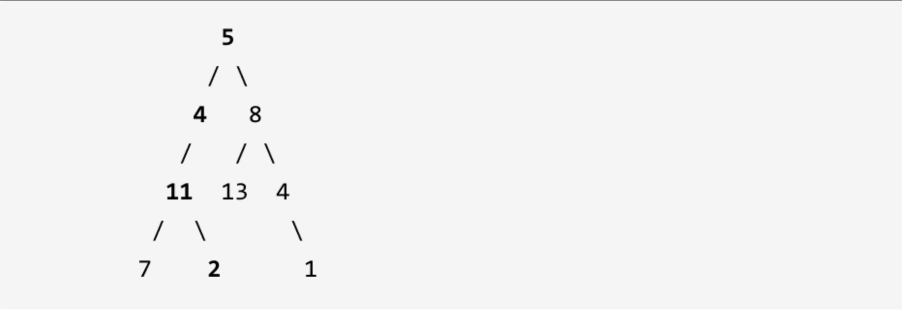
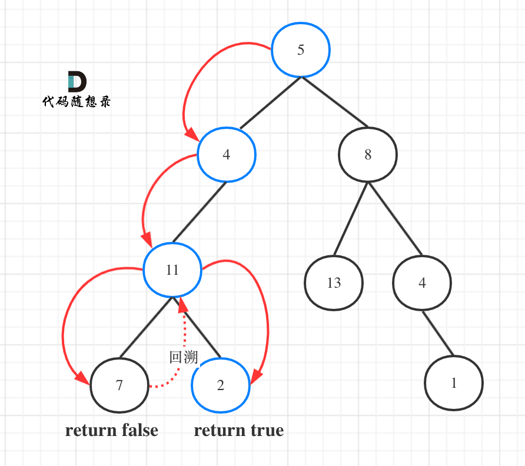
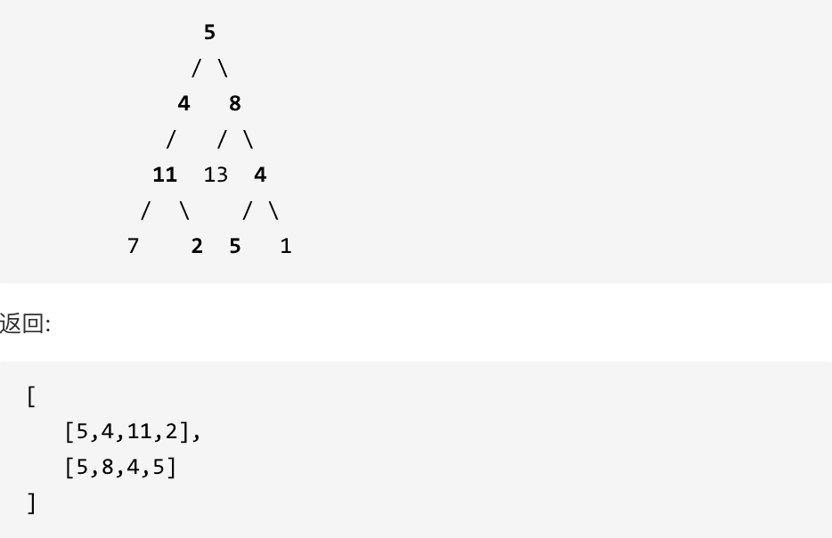
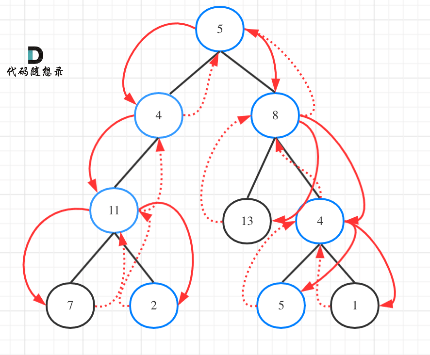

* [做專案（多個C++、Java、Go、測試開發、前端（front end）專案）](https://www.programmercarl.com/other/kstar.html)
* [刷演算法（兩個月高強度學演算法）](https://www.programmercarl.com/xunlian/xunlianying.html)
* [背八股（40天挑戰高頻面試題）](https://www.programmercarl.com/xunlian/bagu.html)


# 112. 路徑總和

[LeetCode 題目連結](https://leetcode.cn/problems/path-sum/)

給定一個二元樹（binary tree）和一個目標和，判斷該樹中是否存在根節點（root node）到葉節點（leaf node）的路徑（path），這條路徑上所有節點（node）值相加等於目標和。

說明: 葉節點是指沒有子節點（child node）的節點。

範例:
給定如下二元樹，以及目標和 sum = 22，



回傳 true, 因為存在目標和為 22 的根節點到葉節點的路徑 5->4->11->2。

## 演算法公開課

**[《程式碼隨想錄》演算法影片公開課](https://programmercarl.com/other/gongkaike.html)：[拿不準的遍歷（traversal）順序，搞不清的回溯（backtracking）過程，我太難了！ | LeetCode：112. 路徑總和](https://www.bilibili.com/video/BV19t4y1L7CR)，相信結合影片再看本篇題解，更有助於大家對本題的理解**。


## 解題思路

相信很多同學都會疑惑，遞迴（recursion）函數（function）什麼時候要有轉回值（return value），什麼時候沒有轉回值，特別是有時候遞迴函數的傳回類型（return type）為 bool 類型。

那麼接下來我透過詳細講解如下兩道題，來回答這個問題：

* [112.路徑總和](https://leetcode.cn/problems/path-sum/)
* [113.路徑總和ii](https://leetcode.cn/problems/path-sum-ii/)

這道題我們要遍歷從根節點到葉節點的路徑，看看總和是不是目標和。

### 遞迴

可以使用深度優先遍歷（depth-first traversal）的方式（本題前、中、後序都可以，無所謂，因為中節點也沒有處理邏輯）來遍歷二元樹

1. 確定遞迴函數的參數（parameter）和傳回類型

參數：需要二元樹的根節點，還需要一個計數器（counter），這個計數器用來計算二元樹的一條邊之和是否正好是目標和，計數器為 int 型別。

再來看轉回值，遞迴函數什麼時候需要轉回值？什麼時候不需要轉回值？這裡總結如下三點：

* 如果需要搜尋整棵二元樹且不用處理遞迴轉回值，遞迴函數就不要轉回值。（這種情況就是本文下半部分介紹的113.路徑總和ii）
* 如果需要搜尋整棵二元樹且需要處理遞迴轉回值，遞迴函數就需要轉回值。 （這種情況我們在[236. 二元樹的最低共用源始（lowest common ancestor）](https://programmercarl.com/0236.二叉树的最近公共祖先.html)中介紹）
* 如果要搜尋其中一條符合條件（condition）的路徑，那麼遞迴一定需要轉回值，因為遇到符合條件的路徑了就要及時回傳。（本題的情況）

而本題我們要找一條符合條件的路徑，所以遞迴函數需要轉回值，及時回傳，那麼傳回類型是什麼呢？

如圖所示：



圖中可以看出，遍歷的路線，並不要遍歷整棵樹（tree），所以遞迴函數需要轉回值，可以用 bool 類型表示。

所以程式碼如下：

```CPP
bool traversal(treenode* cur, int count)   // 注意函數的傳回類型
```


2. 確定終止條件

首先計數器如何統計這一條路徑的和呢？

不要去累加然後判斷是否等於目標和，那麼程式碼比較麻煩，可以用遞減，讓計數器 count 初始為目標和，然後每次減去遍歷路徑節點上的數值。

如果最後 count == 0，同時到了葉節點的話，說明找到了目標和。

如果遍歷到了葉節點，count 不為 0，就是沒找到。

遞迴終止條件程式碼如下：

```CPP
if (!cur->left && !cur->right && count == 0) return true; // 遇到葉節點，並且計數為0
if (!cur->left && !cur->right) return false; // 遇到葉節點而沒有找到合適的邊，直接回傳
```

3. 確定單層遞迴的邏輯

因為終止條件是判斷葉節點，所以遞迴的過程中就不要讓空節點（null node）進入遞迴了。

遞迴函數是有轉回值的，如果遞迴函數回傳 true，說明找到了合適的路徑，應該立刻回傳。

程式碼如下：

```cpp
if (cur->left) { // 左 （空節點不遍歷）
    // 遇到葉節點回傳true，則直接回傳true
    if (traversal(cur->left, count - cur->left->val)) return true; // 注意這裡有回溯的邏輯
}
if (cur->right) { // 右 （空節點不遍歷）
    // 遇到葉節點回傳true，則直接回傳true
    if (traversal(cur->right, count - cur->right->val)) return true; // 注意這裡有回溯的邏輯
}
return false;
```

以上程式碼中是包含著回溯的，沒有回溯，如何後撤重新找另一條路徑呢。

回溯隱藏在`traversal(cur->left, count - cur->left->val)`這裡， 因為把`count - cur->left->val` 直接作為參數傳進去，函數結束，count 的數值沒有改變。

為了把回溯的過程體現出來，可以改為如下程式碼：

```cpp
if (cur->left) { // 左
    count -= cur->left->val; // 遞迴，處理節點;
    if (traversal(cur->left, count)) return true;
    count += cur->left->val; // 回溯，撤銷處理結果
}
if (cur->right) { // 右
    count -= cur->right->val;
    if (traversal(cur->right, count)) return true;
    count += cur->right->val;
}
return false;
```


整體程式碼如下：

```cpp
class Solution {
private:
    bool traversal(TreeNode* cur, int count) {
        if (!cur->left && !cur->right && count == 0) return true; // 遇到葉節點，並且計數為0
        if (!cur->left && !cur->right) return false; // 遇到葉節點直接回傳

        if (cur->left) { // 左
            count -= cur->left->val; // 遞迴，處理節點;
            if (traversal(cur->left, count)) return true;
            count += cur->left->val; // 回溯，撤銷處理結果
        }
        if (cur->right) { // 右
            count -= cur->right->val; // 遞迴，處理節點;
            if (traversal(cur->right, count)) return true;
            count += cur->right->val; // 回溯，撤銷處理結果
        }
        return false;
    }

public:
    bool hasPathSum(TreeNode* root, int sum) {
        if (root == NULL) return false;
        return traversal(root, sum - root->val);
    }
};
```

以上程式碼精簡之後如下：

```cpp
class Solution {
public:
    bool hasPathSum(TreeNode* root, int sum) {
        if (!root) return false;
        if (!root->left && !root->right && sum == root->val) {
            return true;
        }
        return hasPathSum(root->left, sum - root->val) || hasPathSum(root->right, sum - root->val);
    }
};
```

**是不是發現精簡之後的程式碼，已經完全看不出分析的過程了，所以我們要把題目分析清楚之後，再追求程式碼精簡。** 這一點我已經強調很多次了！


### 疊代（iteration）

如果使用堆疊（stack）模擬（simulation）遞迴的話，那麼如何做回溯呢？

**此時堆疊裡一個元素（element）不僅要記錄該節點指標（pointer），還要記錄從頭節點（head node）到該節點的路徑數值總和。**

C++ 我們就用 pair 結構來存放這個堆疊裡的元素。

定義為：`pair<TreeNode*, int>` pair<節點指標，路徑數值>

這個為堆疊裡的一個元素。

如下程式碼是使用堆疊模擬的前序遍歷（preorder traversal），如下：（詳細註解）

```cpp
class solution {

public:
    bool haspathsum(TreeNode* root, int sum) {
        if (root == null) return false;
        // 此時堆疊裡要放的是pair<節點指標，路徑數值>
        stack<pair<TreeNode*, int>> st;
        st.push(pair<TreeNode*, int>(root, root->val));
        while (!st.empty()) {
            pair<TreeNode*, int> node = st.top();
            st.pop();
            // 如果該節點是葉節點了，同時該節點的路徑數值等於sum，那麼就回傳true
            if (!node.first->left && !node.first->right && sum == node.second) return true;

            // 右節點，壓進去一個節點的時候，將該節點的路徑數值也記錄下來
            if (node.first->right) {
                st.push(pair<TreeNode*, int>(node.first->right, node.second + node.first->right->val));
            }

            // 左節點，壓進去一個節點的時候，將該節點的路徑數值也記錄下來
            if (node.first->left) {
                st.push(pair<TreeNode*, int>(node.first->left, node.second + node.first->left->val));
            }
        }
        return false;
    }
};
```

如果大家完全理解了本題的遞迴方法之後，就可以順便把 LeetCode 上 113. 路徑總和 ii 做了。

## 相關題目推薦

### 113. 路徑總和ii

[LeetCode 題目連結](https://leetcode.cn/problems/path-sum-ii/)

給定一個二元樹和一個目標和，找到所有從根節點到葉節點路徑總和等於給定目標和的路徑。

說明: 葉節點是指沒有子節點的節點。

範例:
給定如下二元樹，以及目標和 sum = 22，




### 解題思路


113.路徑總和ii要遍歷整個樹，找到所有路徑，**所以遞迴函數不要轉回值！**

如圖：




為了盡可能地把細節體現出來，我寫出如下程式碼（**這份程式碼並不簡潔，但是邏輯非常清晰**）

```cpp
class solution {
private:
    vector<vector<int>> result;
    vector<int> path;
    // 遞迴函數不需要轉回值，因為我們要遍歷整個樹
    void traversal(TreeNode* cur, int count) {
        if (!cur->left && !cur->right && count == 0) { // 遇到了葉節點且找到了和為sum的路徑
            result.push_back(path);
            return;
        }

        if (!cur->left && !cur->right) return ; // 遇到葉節點而沒有找到合適的邊，直接回傳

        if (cur->left) { // 左 （空節點不遍歷）
            path.push_back(cur->left->val);
            count -= cur->left->val;
            traversal(cur->left, count);    // 遞迴
            count += cur->left->val;        // 回溯
            path.pop_back();                // 回溯
        }
        if (cur->right) { // 右 （空節點不遍歷）
            path.push_back(cur->right->val);
            count -= cur->right->val;
            traversal(cur->right, count);   // 遞迴
            count += cur->right->val;       // 回溯
            path.pop_back();                // 回溯
        }
        return ;
    }

public:
    vector<vector<int>> pathSum(TreeNode* root, int sum) {
        result.clear();
        path.clear();
        if (root == NULL) return result;
        path.push_back(root->val); // 把根節點放進路徑
        traversal(root, sum - root->val);
        return result;
    }
};
```

至於 113. 路徑總和 ii 的疊代法我並沒有寫，用疊代方式記錄所有路徑比較麻煩，也沒有必要，如果大家有興趣的話，可以再深入研究研究。

### 總結

本篇透過 LeetCode 上 112. 路徑總和 和 113. 路徑總和 ii 詳細地講解了 遞迴函數什麼時候需要轉回值，什麼時候不需要轉回值。

這兩道題目是掌握這一知識點非常好的題目，大家看完本篇文章再去做題，就會感受到搜尋整棵樹和搜尋某一路徑的差別。

對於 112. 路徑總和，我依然給出了遞迴法和疊代法，這種題目其實用疊代法會複雜一些，能掌握遞迴方式就夠了！


## 其他語言版本

### Java

0112.路徑總和

```java
class Solution {
   public boolean hasPathSum(TreeNode root, int targetSum) {
        if (root == null) {
            return false;
        }
        targetSum -= root.val;
        // 葉節點
        if (root.left == null && root.right == null) {
            return targetSum == 0;
        }
        if (root.left != null) {
            boolean left = hasPathSum(root.left, targetSum);
            if (left) {      // 已經找到，提前回傳
                return true;
            }
        }
        if (root.right != null) {
            boolean right = hasPathSum(root.right, targetSum);
            if (right) {     // 已經找到，提前回傳
                return true;
            }
        }
        return false;
    }
}

// lc112 簡潔方法
class Solution {
    public boolean hasPathSum(TreeNode root, int targetSum) {

        if (root == null) return false; // 為空退出

        // 葉節點判斷是否符合
        if (root.left == null && root.right == null) return root.val == targetSum;

        // 求兩側分支的路徑和
        return hasPathSum(root.left, targetSum - root.val) || hasPathSum(root.right, targetSum - root.val);
    }
}
```

疊代

```java
class Solution {
    public boolean hasPathSum(TreeNode root, int targetSum) {
        if(root == null) return false;
        Stack<TreeNode> stack1 = new Stack<>();
        Stack<Integer> stack2 = new Stack<>();
        stack1.push(root);
        stack2.push(root.val);
        while(!stack1.isEmpty()) {
            int size = stack1.size();

            for(int i = 0; i < size; i++) {
                TreeNode node = stack1.pop();
                int sum = stack2.pop();

                // 如果該節點是葉節點了，同時該節點的路徑數值等於sum，那麼就回傳true
                if(node.left == null && node.right == null && sum == targetSum) {
                    return true;
                }
                // 右節點，壓進去一個節點的時候，將該節點的路徑數值也記錄下來
                if(node.right != null){
                    stack1.push(node.right);
                    stack2.push(sum + node.right.val);
                }
                // 左節點，壓進去一個節點的時候，將該節點的路徑數值也記錄下來
                if(node.left != null) {
                    stack1.push(node.left);
                    stack2.push(sum + node.left.val);
                }
            }
        }
        return false;
    }
}
```
```Java
class Solution {    
	public boolean hasPathSum(TreeNode root, int targetSum) {
        Stack<TreeNode> treeNodeStack = new Stack<>();
        Stack<Integer> sumStack = new Stack<>();

        if(root == null)
            return false;
        treeNodeStack.add(root);
        sumStack.add(root.val);

        while(!treeNodeStack.isEmpty()){
            TreeNode curr = treeNodeStack.peek();
            int tempsum = sumStack.pop();
            if(curr != null){
                treeNodeStack.pop();
                treeNodeStack.add(curr);
                treeNodeStack.add(null);
                sumStack.add(tempsum);
                if(curr.right != null){
                    treeNodeStack.add(curr.right);
                    sumStack.add(tempsum + curr.right.val);
                }
                if(curr.left != null){
                    treeNodeStack.add(curr.left);
                    sumStack.add(tempsum + curr.left.val);
                }
            }else{
                treeNodeStack.pop();
                TreeNode temp = treeNodeStack.pop();
                if(temp.left == null && temp.right == null && tempsum == targetSum)
                    return true;
            }
        }
        return false;
    }
}
```

0113.路徑總和-ii

```java
class Solution {
    public List<List<Integer>> pathSum(TreeNode root, int targetSum) {
        List<List<Integer>> res = new ArrayList<>();
        if (root == null) return res; // 非空判斷

        List<Integer> path = new LinkedList<>();
        preOrderDfs(root, targetSum, res, path);
        return res;
    }

    public void preOrderDfs(TreeNode root, int targetSum, List<List<Integer>> res, List<Integer> path) {
        path.add(root.val);
        // 遇到了葉節點
        if (root.left == null && root.right == null) {
            // 找到了和為 targetsum 的路徑
            if (targetSum - root.val == 0) {
                res.add(new ArrayList<>(path));
            }
            return; // 如果和不為 targetsum，回傳
        }

        if (root.left != null) {
            preOrderDfs(root.left, targetSum - root.val, res, path);
            path.remove(path.size() - 1); // 回溯
        }
        if (root.right != null) {
            preOrderDfs(root.right, targetSum - root.val, res, path);
            path.remove(path.size() - 1); // 回溯
        }
    }
}
```

```java
// 解法2
class Solution {
    List<List<Integer>> result;
    LinkedList<Integer> path;
    public List<List<Integer>> pathSum (TreeNode root,int targetSum) {
        result = new LinkedList<>();
        path = new LinkedList<>();
        travesal(root, targetSum);
        return result;
    }
    private void travesal(TreeNode root,  int count) {
        if (root == null) return;
        path.offer(root.val);
        count -= root.val;
        if (root.left == null && root.right == null && count == 0) {
            result.add(new LinkedList<>(path));
        }
        travesal(root.left, count);
        travesal(root.right, count);
        path.removeLast(); // 回溯
    }
}
```
```java
// 解法3 DFS統一疊代法
class Solution {
    public List<List<Integer>> pathSum(TreeNode root, int targetSum) {
        List<List<Integer>> result = new ArrayList<>();
        Stack<TreeNode> nodeStack = new Stack<>();
        Stack<Integer> sumStack = new Stack<>();
        Stack<ArrayList<Integer>> pathStack = new Stack<>();
        if(root == null)
            return result;
        nodeStack.add(root);
        sumStack.add(root.val);
        pathStack.add(new ArrayList<>());

        while(!nodeStack.isEmpty()){
            TreeNode currNode = nodeStack.peek();
            int currSum = sumStack.pop();
            ArrayList<Integer> currPath = pathStack.pop();
            if(currNode != null){
                nodeStack.pop();
                nodeStack.add(currNode);
                nodeStack.add(null);
                sumStack.add(currSum);
                currPath.add(currNode.val);
                pathStack.add(new ArrayList(currPath));
                if(currNode.right != null){
                    nodeStack.add(currNode.right);
                    sumStack.add(currSum + currNode.right.val);
                    pathStack.add(new ArrayList(currPath));
                }
                if(currNode.left != null){
                    nodeStack.add(currNode.left);
                    sumStack.add(currSum + currNode.left.val);
                    pathStack.add(new ArrayList(currPath));
                }
            }else{
                nodeStack.pop();
                TreeNode temp = nodeStack.pop();
                if(temp.left == null && temp.right == null && currSum == targetSum)
                    result.add(new ArrayList(currPath));
            }
        }
        return result;
    }
}
```

### Python

0112.路徑總和

(版本一) 遞迴
```python
# Definition for a binary tree node.
# class TreeNode:
#     def __init__(self, val=0, left=None, right=None):
#         self.val = val
#         self.left = left
#         self.right = right
class Solution:
    def traversal(self, cur: TreeNode, count: int) -> bool:
        if not cur.left and not cur.right and count == 0: # 遇到葉節點，並且計數為0
            return True
        if not cur.left and not cur.right: # 遇到葉節點直接回傳
            return False
        
        if cur.left: # 左
            count -= cur.left.val
            if self.traversal(cur.left, count): # 遞迴，處理節點
                return True
            count += cur.left.val # 回溯，撤銷處理結果
            
        if cur.right: # 右
            count -= cur.right.val
            if self.traversal(cur.right, count): # 遞迴，處理節點
                return True
            count += cur.right.val # 回溯，撤銷處理結果
            
        return False
    
    def hasPathSum(self, root: Optional[TreeNode], targetSum: int) -> bool:
        if root is None:
            return False
        return self.traversal(root, targetSum - root.val)      
```

(版本二) 遞迴 + 精簡
```python
# Definition for a binary tree node.
# class TreeNode:
#     def __init__(self, val=0, left=None, right=None):
#         self.val = val
#         self.left = left
#         self.right = right
class Solution:
    def hasPathSum(self, root: Optional[TreeNode], targetSum: int) -> bool:
        if not root:
            return False
        if not root.left and not root.right and targetSum == root.val:
            return True
        return self.hasPathSum(root.left, targetSum - root.val) or self.hasPathSum(root.right, targetSum - root.val)
  
```
(版本三) 疊代
```python
# Definition for a binary tree node.
# class TreeNode:
#     def __init__(self, val=0, left=None, right=None):
#         self.val = val
#         self.left = left
#         self.right = right
class Solution:
    def hasPathSum(self, root: Optional[TreeNode], targetSum: int) -> bool:
        if not root:
            return False
        # 此時堆疊裡要放的是pair<節點指標，路徑數值>
        st = [(root, root.val)]
        while st:
            node, path_sum = st.pop()
            # 如果該節點是葉節點了，同時該節點的路徑數值等於sum，那麼就回傳true
            if not node.left and not node.right and path_sum == sum:
                return True
            # 右節點，壓進去一個節點的時候，將該節點的路徑數值也記錄下來
            if node.right:
                st.append((node.right, path_sum + node.right.val))
            # 左節點，壓進去一個節點的時候，將該節點的路徑數值也記錄下來
            if node.left:
                st.append((node.left, path_sum + node.left.val))
        return False


  
```


0113.路徑總和-ii

(版本一) 遞迴
```python
# Definition for a binary tree node.
# class TreeNode:
#     def __init__(self, val=0, left=None, right=None):
#         self.val = val
#         self.left = left
#         self.right = right
class Solution:
    def __init__(self):
        self.result = []
        self.path = []

    def traversal(self, cur, count):
        if not cur.left and not cur.right and count == 0: # 遇到了葉節點且找到了和為sum的路徑
            self.result.append(self.path[:])
            return

        if not cur.left and not cur.right: # 遇到葉節點而沒有找到合適的邊，直接回傳
            return

        if cur.left: # 左 （空節點不遍歷）
            self.path.append(cur.left.val)
            count -= cur.left.val
            self.traversal(cur.left, count) # 遞迴
            count += cur.left.val # 回溯
            self.path.pop() # 回溯

        if cur.right: #  右 （空節點不遍歷）
            self.path.append(cur.right.val) 
            count -= cur.right.val
            self.traversal(cur.right, count) # 遞迴
            count += cur.right.val # 回溯
            self.path.pop() # 回溯

        return

    def pathSum(self, root: Optional[TreeNode], targetSum: int) -> List[List[int]]:
        self.result.clear()
        self.path.clear()
        if not root:
            return self.result
        self.path.append(root.val) # 把根節點放進路徑
        self.traversal(root, targetSum - root.val)
        return self.result 
```

(版本二) 遞迴 + 精簡
```python
# Definition for a binary tree node.
# class TreeNode:
#     def __init__(self, val=0, left=None, right=None):
#         self.val = val
#         self.left = left
#         self.right = right
class Solution:
    def pathSum(self, root: Optional[TreeNode], targetSum: int) -> List[List[int]]:
        
        result = []
        self.traversal(root, targetSum, [], result)
        return result
    def traversal(self,node, count, path, result):
            if not node:
                return
            path.append(node.val)
            count -= node.val
            if not node.left and not node.right and count == 0:
                result.append(list(path))
            self.traversal(node.left, count, path, result)
            self.traversal(node.right, count, path, result)
            path.pop()
```
(版本三) 疊代
```python
# Definition for a binary tree node.
# class TreeNode:
#     def __init__(self, val=0, left=None, right=None):
#         self.val = val
#         self.left = left
#         self.right = right
class Solution:
    def pathSum(self, root: Optional[TreeNode], targetSum: int) -> List[List[int]]:
        if not root:
            return []
        stack = [(root, [root.val])]
        res = []
        while stack:
            node, path = stack.pop()
            if not node.left and not node.right and sum(path) == targetSum:
                res.append(path)
            if node.right:
                stack.append((node.right, path + [node.right.val]))
            if node.left:
                stack.append((node.left, path + [node.left.val]))
        return res


  
```
### Go

112. 路徑總和

```go
//遞迴法
/**
 * Definition for a binary tree node.
 * type TreeNode struct {
 *     Val int
 *     Left *TreeNode
 *     Right *TreeNode
 * }
 */
func hasPathSum(root *TreeNode, targetSum int) bool {
    if root == nil {
        return false
    }
    return traversal(root, targetSum - root.Val)
}

func traversal(cur *TreeNode, count int) bool {
    if cur.Left == nil && cur.Right == nil && count == 0 {
        return true
    }
    if cur.Left == nil && cur.Right == nil {
        return false
    }
    if cur.Left != nil {
        count -= cur.Left.Val
        if traversal(cur.Left, count) {
            return true
        }
        count += cur.Left.Val
    }
    if cur.Right != nil {
        count -= cur.Right.Val
        if traversal(cur.Right, count) {
            return true
        }
        count += cur.Right.Val
    }
    return false
}
```

```go
//遞迴法精簡
/**
 * Definition for a binary tree node.
 * type TreeNode struct {
 *     Val int
 *     Left *TreeNode
 *     Right *TreeNode
 * }
 */
func hasPathSum(root *TreeNode, targetSum int) bool {
    if root == nil {
        return false
    }

    targetSum -= root.Val // 將targetSum在遍歷每層的時候都減去本層節點的值
    if root.Left == nil && root.Right == nil && targetSum == 0 { // 如果剩餘的targetSum為0, 則正好就是符合的結果
        return true
    }
    return hasPathSum(root.Left, targetSum) || hasPathSum(root.Right, targetSum) // 否則遞迴找
}
```

113. 路徑總和 II

```go
/**
 * Definition for a binary tree node.
 * type TreeNode struct {
 *     Val int
 *     Left *TreeNode
 *     Right *TreeNode
 * }
 */
func pathSum(root *TreeNode, targetSum int) [][]int {
    result := make([][]int, 0)
    traverse(root, &result, new([]int), targetSum)
    return result
}

func traverse(node *TreeNode, result *[][]int, currPath *[]int, targetSum int) {
    if node == nil { // 這個判空也可以挪到遞迴遍歷左右子樹時去判斷
        return
    }

    targetSum -= node.Val // 將targetSum在遍歷每層的時候都減去本層節點的值
    *currPath = append(*currPath, node.Val) // 把當前節點放到路徑記錄裡

    if node.Left == nil && node.Right == nil && targetSum == 0 { // 如果剩餘的targetSum為0, 則正好就是符合的結果
        // 不能直接將currPath放到result裡面, 因為currPath是共享的, 每次遍歷子樹時都會被修改
        pathCopy := make([]int, len(*currPath))
        for i, element := range *currPath {
            pathCopy[i] = element
        }
        *result = append(*result, pathCopy) // 將複本放到結果集裡
    }

    traverse(node.Left, result, currPath, targetSum)
    traverse(node.Right, result, currPath, targetSum)
    *currPath = (*currPath)[:len(*currPath)-1] // 當前節點遍歷完成, 從路徑記錄裡刪除掉
}
```

### JavaScript

0112.路徑總和

**遞迴**

```javascript
/**
 * @param {treenode} root
 * @param {number} targetsum
 * @return {boolean}
 */
let haspathsum = function (root, targetsum) {
  // 遞迴法
  const traversal = (node, cnt) => {
    // 遇到葉節點，並且計數為0
    if (cnt === 0 && !node.left && !node.right) return true;
    // 遇到葉節點而沒有找到合適的邊(計數不為0)，直接回傳
    if (!node.left && !node.right) return false;

    //  左（空節點不遍歷）.遇到葉節點回傳true，則直接回傳true
    if (node.left && traversal(node.left, cnt - node.left.val)) return true;
    //  右（空節點不遍歷）
    if (node.right && traversal(node.right, cnt - node.right.val)) return true;
    return false;
  };
  if (!root) return false;
  return traversal(root, targetsum - root.val);

  // 精簡程式碼:
  // if (!root) return false;
  // if (!root.left && !root.right && targetsum === root.val) return true;
  // return haspathsum(root.left, targetsum - root.val) || haspathsum(root.right, targetsum - root.val);
};
```

**疊代**

```javascript
let hasPathSum = function(root, targetSum) {
    if(root === null) return false;
    let nodeArr = [root];
    let valArr = [0];
    while(nodeArr.length) {
        let curNode = nodeArr.shift();
        let curVal = valArr.shift();
        curVal += curNode.val;
        // 為葉節點，且和等於目標數，回傳true
        if (curNode.left === null && curNode.right === null && curVal === targetSum) {
            return true;
        }
        // 左節點，將當前的數值也對應記錄下來
        if (curNode.left) {
            nodeArr.push(curNode.left);
            valArr.push(curVal);
        }
        // 右節點，將當前的數值也對應記錄下來
        if (curNode.right) {
            nodeArr.push(curNode.right);
            valArr.push(curVal);
        }
    }
    return false;
};
```

0113.路徑總和-ii

**遞迴**

```javascript
let pathsum = function (root, targetsum) {
  // 遞迴法
  // 要遍歷整個樹找到所有路徑，所以遞迴函數不需要轉回值, 與112不同
  const res = [];
  const travelsal = (node, cnt, path) => {
    // 遇到了葉節點且找到了和為sum的路徑
    if (cnt === 0 && !node.left && !node.right) {
      res.push([...path]); // 不能寫res.push(path), 要深複製
      return;
    }
    if (!node.left && !node.right) return; // 遇到葉節點而沒有找到合適的邊，直接回傳
    // 左 （空節點不遍歷）
    if (node.left) {
      path.push(node.left.val);
      travelsal(node.left, cnt - node.left.val, path); // 遞迴
      path.pop(); // 回溯
    }
    // 右 （空節點不遍歷）
    if (node.right) {
      path.push(node.right.val);
      travelsal(node.right, cnt - node.right.val, path); // 遞迴
      path.pop(); // 回溯
    }
    return;
  };
  if (!root) return res;
  travelsal(root, targetsum - root.val, [root.val]); // 把根節點放進路徑
  return res;
};
```

**遞迴 精簡版**

```javascript
var pathsum = function(root, targetsum) {
    //遞迴方法
    let respath = [],curpath = [];
    // 1. 確定遞迴函數參數
    const traveltree = function(node,count) {
        curpath.push(node.val);
        count -= node.val;
        if(node.left === null && node.right === null && count === 0) {
            respath.push([...curpath]);
        }
        node.left && traveltree(node.left, count);
        node.right && traveltree(node.right, count);
        let cur = curpath.pop();
        count -= cur;
    }
    if(root === null) {
        return respath;
    }
    travelTree(root, targetSum);
    return resPath;
};
```

**疊代**

```javascript
let pathSum = function(root, targetSum) {
    if(root === null) return [];
    let nodeArr = [root];
    let resArr = []; // 記錄符合目標和的回傳路徑
    let tempArr = [[]]; // 對應路徑
    let countArr = [0]; //對應和
    while(nodeArr.length) {
        let curNode = nodeArr.shift();
        let curVal = countArr.shift();
        let curNodeArr = tempArr.shift();
        curVal += curNode.val;
        curNodeArr.push(curNode.val);
        // 為葉節點，且和等於目標數，將此次結果陣列push進回傳陣列中
        if (curNode.left === null && curNode.right === null && curVal === targetSum) {
            resArr.push(curNodeArr);
        }
        // 左節點，將當前的和及對應路徑也對應記錄下來
        if (curNode.left) {
            nodeArr.push(curNode.left);
            countArr.push(curVal);
            tempArr.push([...curNodeArr]);
        }
         // 右節點，將當前的和及對應路徑也對應記錄下來
        if (curNode.right) {
            nodeArr.push(curNode.right);
            countArr.push(curVal);
            tempArr.push([...curNodeArr]);
        }
    }
    return resArr;
};
```

### TypeScript

0112.路徑總和

**遞迴法：**

```typescript
function hasPathSum(root: TreeNode | null, targetSum: number): boolean {
    function recur(node: TreeNode, sum: number): boolean {
        console.log(sum);
        if (
            node.left === null &&
            node.right === null &&
            sum === 0
        ) return true;
        if (node.left !== null) {
            sum -= node.left.val;
            if (recur(node.left, sum) === true) return true;
            sum += node.left.val;
        }
        if (node.right !== null) {
            sum -= node.right.val;
            if (recur(node.right, sum) === true) return true;
            sum += node.right.val;
        }
        return false;
    }
    if (root === null) return false;
    return recur(root, targetSum - root.val);
};
```

**遞迴法（精簡版）：**

```typescript
function hasPathSum(root: TreeNode | null, targetSum: number): boolean {
    if (root === null) return false;
    targetSum -= root.val;
    if (
        root.left === null &&
        root.right === null &&
        targetSum === 0
    ) return true;
    return hasPathSum(root.left, targetSum) ||
        hasPathSum(root.right, targetSum);
};
```

**疊代法：**

```typescript
function hasPathSum(root: TreeNode | null, targetSum: number): boolean {
    type Pair = {
        node: TreeNode, // 當前節點
        sum: number // 根節點到當前節點的路徑數值總和
    }

    const helperStack: Pair[] = [];
    if (root !== null) helperStack.push({ node: root, sum: root.val });
    let tempPair: Pair;
    while (helperStack.length > 0) {
        tempPair = helperStack.pop()!;
        if (
            tempPair.node.left === null &&
            tempPair.node.right === null &&
            tempPair.sum === targetSum
        ) return true;
        if (tempPair.node.right !== null) {
            helperStack.push({
                node: tempPair.node.right,
                sum: tempPair.sum + tempPair.node.right.val
            });
        }
        if (tempPair.node.left !== null) {
            helperStack.push({
                node: tempPair.node.left,
                sum: tempPair.sum + tempPair.node.left.val
            });
        }
    }
    return false;
};
```

0112.路徑總和 ii

**遞迴法：**

```typescript
function pathSum(root: TreeNode | null, targetSum: number): number[][] {
    function recur(node: TreeNode, sumGap: number, routeArr: number[]): void {
        if (
            node.left === null &&
            node.right === null &&
            sumGap === 0
        ) resArr.push([...routeArr]);
        if (node.left !== null) {
            sumGap -= node.left.val;
            routeArr.push(node.left.val);
            recur(node.left, sumGap, routeArr);
            sumGap += node.left.val;
            routeArr.pop();
        }
        if (node.right !== null) {
            sumGap -= node.right.val;
            routeArr.push(node.right.val);
            recur(node.right, sumGap, routeArr);
            sumGap += node.right.val;
            routeArr.pop();
        }
    }
    const resArr: number[][] = [];
    if (root === null) return resArr;
    const routeArr: number[] = [];
    routeArr.push(root.val);
    recur(root, targetSum - root.val, routeArr);
    return resArr;
};
```

### Swift

0112.路徑總和

**遞迴**

```swift
func hasPathSum(_ root: TreeNode?, _ targetSum: Int) -> Bool {
    guard let root = root else {
        return false
    }

    return traversal(root, targetSum - root.val)
}

func traversal(_ cur: TreeNode?, _ count: Int) -> Bool {
    if cur?.left == nil && cur?.right == nil && count == 0 {
        return true
    }

    if cur?.left == nil && cur?.right == nil {
        return false
    }

    if let leftNode = cur?.left {
        if traversal(leftNode, count - leftNode.val) {
            return true
        }
    }

    if let rightNode = cur?.right {
        if traversal(rightNode, count - rightNode.val) {
            return true
        }
    }

    return false
}
```

**疊代**

```swift
func hasPathSum(_ root: TreeNode?, _ targetSum: Int) -> Bool {
    guard let root = root else {
        return false
    }

    var stack = Array<(TreeNode, Int)>()
    stack.append((root, root.val))

    while !stack.isEmpty {
        let node = stack.removeLast()

        if node.0.left == nil && node.0.right == nil && targetSum == node.1 {
            return true
        }

        if let rightNode = node.0.right {
            stack.append((rightNode, node.1 + rightNode.val))
        }

        if let leftNode = node.0.left {
            stack.append((leftNode, node.1 + leftNode.val))
        }
    }

    return false
}
```

0113.路徑總和 II

**遞迴**

```swift
var result = [[Int]]()
var path = [Int]()
func pathSum(_ root: TreeNode?, _ targetSum: Int) -> [[Int]] {
    result.removeAll()
    path.removeAll()
    guard let root = root else {
        return result
    }
    path.append(root.val)
    traversal(root, count: targetSum - root.val)
    return result

}

func traversal(_ cur: TreeNode?, count: Int) {
    var count = count
    // 遇到了葉節點且找到了和為targetSum的路徑
    if cur?.left == nil && cur?.right == nil && count == 0 {
        result.append(path)
        return
    }

    // 遇到葉節點而沒有找到合適的邊，直接回傳
    if cur?.left == nil && cur?.right == nil{
        return
    }

    if let leftNode = cur?.left {
        path.append(leftNode.val)
        count -= leftNode.val
        traversal(leftNode, count: count)// 遞迴
        count += leftNode.val// 回溯
        path.removeLast()// 回溯
    }

    if let rightNode = cur?.right {
        path.append(rightNode.val)
        count -= rightNode.val
        traversal(rightNode, count: count)// 遞迴
        count += rightNode.val// 回溯
        path.removeLast()// 回溯
    }
    return
}
```

### C

0112.路徑總和

遞迴法：

```c
bool hasPathSum(struct TreeNode* root, int targetSum){
    // 遞迴結束條件：若當前節點不存在，回傳false
    if(!root)
        return false;
    // 若當前節點為葉節點，且targetSum-root的值為0。（當前路徑上的節點值的和滿足條件）回傳true
    if(!root->right && !root->left && targetSum == root->val)
        return true;

    // 查看左子樹和右子樹的所有節點是否滿足條件
    return hasPathSum(root->right, targetSum - root->val) || hasPathSum(root->left, targetSum - root->val);
}
```

疊代法:

```c
// 儲存一個節點以及當前的和
struct Pair {
    struct TreeNode* node;
    int sum;
};

bool hasPathSum(struct TreeNode* root, int targetSum){
    struct Pair stack[1000];
    int stackTop = 0;

    // 若root存在，則將節點和值封裝成一個pair入堆疊
    if(root) {
        struct Pair newPair = {root, root->val};
        stack[stackTop++] = newPair;
    }

    // 當堆疊不為空時
    while(stackTop) {
        // 出堆疊頂端元素
        struct Pair topPair = stack[--stackTop];
        // 若堆疊頂端元素為葉節點，且和為targetSum時，回傳true
        if(!topPair.node->left && !topPair.node->right && topPair.sum == targetSum)
            return true;

        // 若當前堆疊頂端節點有左右孩子，計算和並入堆疊
        if(topPair.node->left) {
            struct Pair newPair = {topPair.node->left, topPair.sum + topPair.node->left->val};
            stack[stackTop++] = newPair;
        }
        if(topPair.node->right) {
            struct Pair newPair = {topPair.node->right, topPair.sum + topPair.node->right->val};
            stack[stackTop++] = newPair;
        }
    }
    return false;
}
```

0113.路徑總和 II

```c
int** ret;
int* path;
int* colSize;
int retTop;
int pathTop;

void traversal(const struct TreeNode* const node, int count) {
    // 若當前節點為葉節點
    if(!node->right && !node->left) {
        // 若當前path上的節點值總和等於targetSum。
        if(count == 0) {
            // 複製當前path
            int *curPath = (int*)malloc(sizeof(int) * pathTop);
            memcpy(curPath, path, sizeof(int) * pathTop);
            // 記錄當前path的長度為pathTop
            colSize[retTop] = pathTop;
            // 將當前path加入到ret陣列中
            ret[retTop++] = curPath;
        }
        return;
    }

    // 若節點有左/右孩子
    if(node->left) {
        // 將左孩子的值加入path中
        path[pathTop++] = node->left->val;
        traversal(node->left, count - node->left->val);
        // 回溯
        pathTop--;
    }
    if(node->right) {
        // 將右孩子的值加入path中
        path[pathTop++] = node->right->val;
        traversal(node->right, count - node->right->val);
        // 回溯
        --pathTop;
    }
}

int** pathSum(struct TreeNode* root, int targetSum, int* returnSize, int** returnColumnSizes){
    // 初始化陣列
    ret = (int**)malloc(sizeof(int*) * 1000);
    path = (int*)malloc(sizeof(int*) * 1000);
    colSize = (int*)malloc(sizeof(int) * 1000);
    retTop = pathTop = 0;
    *returnSize = 0;

    // 若根節點不存在，回傳空的ret
    if(!root)
        return ret;
    // 將根節點加入到path中
    path[pathTop++] = root->val;
    traversal(root, targetSum - root->val);

    // 設定回傳ret陣列大小，以及其中每個一維陣列元素的長度
    *returnSize = retTop;
    *returnColumnSizes = colSize;

    return ret;
}
```

### Scala

0112.路徑總和

**遞迴:**

```scala
object Solution {
  def hasPathSum(root: TreeNode, targetSum: Int): Boolean = {
    if(root == null) return false
    var res = false

    def traversal(curNode: TreeNode, sum: Int): Unit = {
      if (res) return // 如果直接標記為true了，就沒有往下遞迴的必要了
      if (curNode.left == null && curNode.right == null && sum == targetSum) {
        res = true
        return
      }
      // 往下遞迴
      if (curNode.left != null) traversal(curNode.left, sum + curNode.left.value)
      if (curNode.right != null) traversal(curNode.right, sum + curNode.right.value)
    }

    traversal(root, root.value)
    res // return關鍵字可以省略
  }
}
```

**疊代:**

```scala
object Solution {
  import scala.collection.mutable
  def hasPathSum(root: TreeNode, targetSum: Int): Boolean = {
    if (root == null) return false
    val stack = mutable.Stack[(TreeNode, Int)]()
    stack.push((root, root.value)) // 將根節點元素放入stack
    while (!stack.isEmpty) {
      val curNode = stack.pop() // 取出堆疊頂端元素
      // 如果遇到葉節點，看當前的值是否等於targetSum，等於則回傳true
      if (curNode._1.left == null && curNode._1.right == null && curNode._2 == targetSum) {
        return true
      }
      if (curNode._1.right != null) stack.push((curNode._1.right, curNode._2 + curNode._1.right.value))
      if (curNode._1.left != null) stack.push((curNode._1.left, curNode._2 + curNode._1.left.value))
    }
    false //如果沒有回傳true，即可回傳false，return關鍵字可以省略
  }
}
```

0113.路徑總和 II

**遞迴:**

```scala
object Solution {
  import scala.collection.mutable.ListBuffer
  def pathSum(root: TreeNode, targetSum: Int): List[List[Int]] = {
    val res = ListBuffer[List[Int]]()
    if (root == null) return res.toList
    val path = ListBuffer[Int]();

    def traversal(cur: TreeNode, count: Int): Unit = {
      if (cur.left == null && cur.right == null && count == 0) {
        res.append(path.toList)
        return
      }
      if (cur.left != null) {
        path.append(cur.left.value)
        traversal(cur.left, count - cur.left.value)
        path.remove(path.size - 1)
      }
      if (cur.right != null) {
        path.append(cur.right.value)
        traversal(cur.right, count - cur.right.value)
        path.remove(path.size - 1)
      }
    }

    path.append(root.value)
    traversal(root, targetSum - root.value)
    res.toList
  }
}
```

### Rust

0112.路徑總和

遞迴：

```rust
use std::rc::Rc;
use std::cell::RefCell;
impl Solution {
    pub fn has_path_sum(root: Option<Rc<RefCell<TreeNode>>>, target_sum: i32) -> bool {
        if root.is_none() {
            return false;
        }
        let node = root.unwrap();
        if node.borrow().left.is_none() && node.borrow().right.is_none() {
            return node.borrow().val == target_sum;
        }
        return Self::has_path_sum(node.borrow().left.clone(), target_sum - node.borrow().val)
            || Self::has_path_sum(node.borrow().right.clone(), target_sum - node.borrow().val);
    }
}
```

疊代：

```rust
use std::rc::Rc;
use std::cell::RefCell;
impl Solution {
    pub fn has_path_sum(root: Option<Rc<RefCell<TreeNode>>>, target_sum: i32) -> bool {
        let mut stack = vec![];
        if let Some(node) = root {
            stack.push((node.borrow().val, node.to_owned()));
        }
        while !stack.is_empty() {
            let (value, node) = stack.pop().unwrap();
            if node.borrow().left.is_none() && node.borrow().right.is_none() && value == target_sum
            {
                return true;
            }
            if node.borrow().left.is_some() {
                if let Some(r) = node.borrow().left.as_ref() {
                    stack.push((r.borrow().val + value, r.to_owned()));
                }
            }
            if node.borrow().right.is_some() {
                if let Some(r) = node.borrow().right.as_ref() {
                    stack.push((r.borrow().val + value, r.to_owned()));
                }
            }
        }
        false
    }
```

0113.路徑總和-ii

```rust
impl Solution {
    pub fn path_sum(root: Option<Rc<RefCell<TreeNode>>>, target_sum: i32) -> Vec<Vec<i32>> {
        let mut res = vec![];
        let mut route = vec![];
        if root.is_none() {
            return res;
        } else {
            route.push(root.as_ref().unwrap().borrow().val);
        }
        Self::recur(
            &root,
            target_sum - root.as_ref().unwrap().borrow().val,
            &mut res,
            &mut route,
        );
        res
    }

    pub fn recur(
        root: &Option<Rc<RefCell<TreeNode>>>,
        sum: i32,
        res: &mut Vec<Vec<i32>>,
        route: &mut Vec<i32>,
    ) {
        let node = root.as_ref().unwrap().borrow();
        if node.left.is_none() && node.right.is_none() && sum == 0 {
            res.push(route.to_vec());
            return;
        }
        if node.left.is_some() {
            let left = node.left.as_ref().unwrap();
            route.push(left.borrow().val);
            Self::recur(&node.left, sum - left.borrow().val, res, route);
            route.pop();
        }
        if node.right.is_some() {
            let right = node.right.as_ref().unwrap();
            route.push(right.borrow().val);
            Self::recur(&node.right, sum - right.borrow().val, res, route);
            route.pop();
        }
    }
}

```
### C#
```csharp
// 0112.路徑總和
// 遞迴 
public bool HasPathSum(TreeNode root, int targetSum)
{
    if (root == null) return false;
    if (root.left == null && root.right == null && targetSum == root.val) return true;
    return HasPathSum(root.left, targetSum - root.val) || HasPathSum(root.right, targetSum - root.val);
}
```
0113.路徑總和：
```csharp
/*
 * @lc app=leetcode id=113 lang=csharp
 * 0113.路徑總和 II
 * [113] Path Sum II
 * 遞迴法
 */
public class Solution {
    private List<List<int>> result = new List<List<int>>();
    private List<int> path = new List<int>();

    // Main function to find paths with the given sum
    public IList<IList<int>> PathSum(TreeNode root, int targetSum) {
        result.Clear();
        path.Clear();
        if (root == null) return result.Select(list => list as IList<int>).ToList();
        path.Add(root.val); // Add the root node to the path
        traversal(root, targetSum - root.val); // Start the traversal
        return result.Select(list => list as IList<int>).ToList();
    }

    // Recursive function to traverse the tree and find paths
    private void traversal(TreeNode node, int count) {
        // If a leaf node is reached and the target sum is achieved
        if (node.left == null && node.right == null && count == 0) {
            result.Add(new List<int>(path)); // Add a copy of the path to the result
            return;
        }

        // If a leaf node is reached and the target sum is not achieved, or if it's not a leaf node
        if (node.left == null && node.right == null) return;

        // Traverse the left subtree
        if (node.left != null) {
            path.Add(node.left.val);
            count -= node.left.val;
            traversal(node.left, count);    // Recursive call
            count += node.left.val;        // Backtrack
            path.RemoveAt(path.Count - 1); // Backtrack
        }

        // Traverse the right subtree
        if (node.right != null) {
            path.Add(node.right.val);
            count -= node.right.val;
            traversal(node.right, count);   // Recursive call
            count += node.right.val;       // Backtrack
            path.RemoveAt(path.Count - 1); // Backtrack
        }
    }
}

// @lc code=end

```


