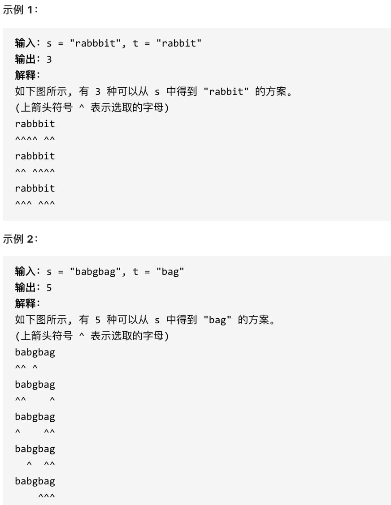
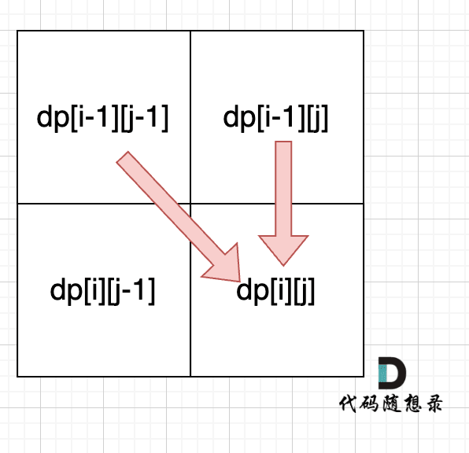
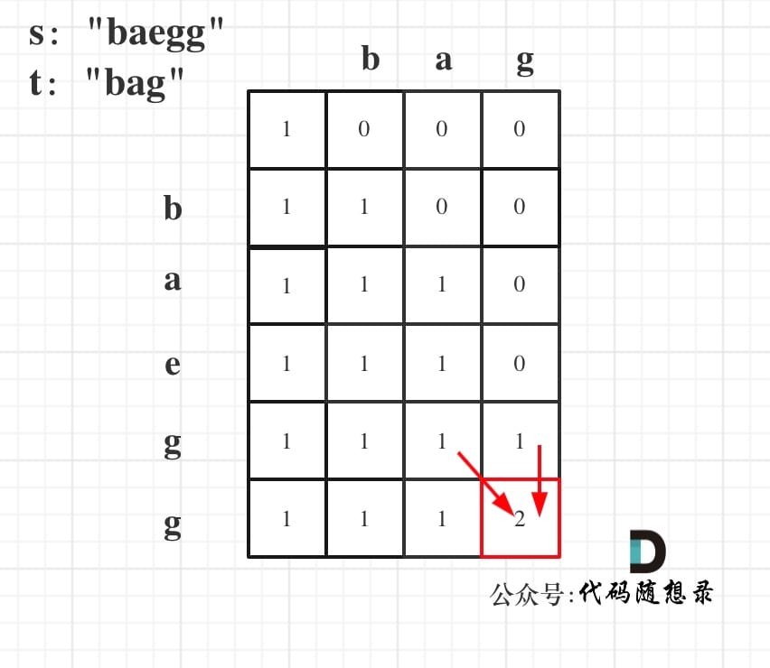

* [做專案（多個C++、Java、Go、測試開發、前端（front end）專案）](https://www.programmercarl.com/other/kstar.html)
* [刷演算法（兩個月高強度學演算法）](https://www.programmercarl.com/xunlian/xunlianying.html)
* [背八股（40天挑戰高頻面試題）](https://www.programmercarl.com/xunlian/bagu.html)

# 115.不同的次序列

[LeetCode 題目連結](https://leetcode.com/problems/distinct-subsequences/)

給定一個字串（string） s 和一個字串 t ，計算在 s 的次序列（subsequence）中 t 出現的個數。

字串的一個 次序列 是指，透過刪除一些（也可以不刪除）字元（character）且不干擾剩餘字元相對位置所組成的新字串。（例如，"ACE" 是 "ABCDE" 的一個次序列，而 "AEC" 不是）

題目資料保證答案符合 32 位元（bit）帶正負號整數（signed integer）範圍。



提示：

* 0 <= s.length, t.length <= 1000
* s 和 t 由英文字母組成

## 演算法公開課

**[《程式碼隨想錄》演算法影片公開課](https://programmercarl.com/other/gongkaike.html)：[動態規劃（dynamic programming, DP）之次序列，為了 edit distance 做鋪墊 | LeetCode：115.不同的次序列](https://www.bilibili.com/video/BV1fG4y1m75Q/)，相信結合影片再看本篇題解，更有助於大家對本題的理解**。

## 解題思路

這道題目如果不是次序列，而是要求連續序列（sequence）的，那就可以考慮用 KMP。

這道題目相對於 72. edit distance，簡單了不少，因為本題相當於只有刪除操作，不用考慮替換增加之類的。

但相對於剛講過的[動態規劃：392.判斷次序列](./0392.判斷次序列.md)就有難度了，這道題目 two pointers 可就做不了了，來看看動規五部曲分析如下：

1. 確定 dp 陣列（array）（dp table）以及下標（subscript）的含義

dp[i][j]：以 i-1 為結尾的 s 次序列中出現以 j-1 為結尾的 t 的個數為 dp[i][j]。

為什麼 i-1，j-1 這麼定義我在 [718. 最長重複子陣列（subarray）](./0718.最長重複子陣列.md) 中做了詳細的講解。

2. 確定遞迴公式（recurrence formula）

這一類問題，基本是要分析兩種情況

* s[i - 1] 與 t[j - 1] 相等
* s[i - 1] 與 t[j - 1] 不相等

當 s[i - 1] 與 t[j - 1] 相等時，dp[i][j] 可以由兩部分組成。

一部分是用 s[i - 1] 來匹配，那麼個數為 dp[i - 1][j - 1]。即不需要考慮當前 s 子字串（substring）和 t 子字串的最後一位字母，所以只需要 dp[i-1][j-1]。

一部分是不用 s[i - 1] 來匹配，個數為 dp[i - 1][j]。

**這裡可能有錄友不明白了，為什麼還要考慮 不用 s[i - 1] 來匹配，都相同了必定要匹配啊**。

例如： s：bagg 和 t：bag ，s[3] 和 t[2] 是相同的，但是字串 s 也可以不用 s[3] 來匹配，即用 s[0]s[1]s[2] 組成的 bag。

當然也可以用 s[3] 來匹配，即：s[0]s[1]s[3] 組成的 bag。

所以當 s[i - 1] 與 t[j - 1] 相等時，dp[i][j] = dp[i - 1][j - 1] + dp[i - 1][j];

當 s[i - 1] 與 t[j - 1] 不相等時，dp[i][j] 只有一部分組成，不用 s[i - 1] 來匹配（就是模擬（simulation）在 s 中刪除這個元素（element）），即：dp[i - 1][j]

所以遞迴公式為：dp[i][j] = dp[i - 1][j];

這裡可能有錄友還疑惑，為什麼只考慮「不用 s[i - 1] 來匹配」這種情況，不考慮「不用 t[j - 1] 來匹配」的情況呢。 

這裡大家要明確，我們求的是 s 中有多少個 t，而不是求 t 中有多少個 s，所以只考慮 s 中刪除元素的情況，即 不用 s[i - 1] 來匹配 的情況。

3. dp 陣列如何初始化

從遞迴公式 dp[i][j] = dp[i - 1][j - 1] + dp[i - 1][j]; 和 dp[i][j] = dp[i - 1][j]; 中可以看出 dp[i][j] 是從上方和左上方推導而來，如圖：，那麼 dp[i][0] 和 dp[0][j] 是一定要初始化的。



每次當初始化的時候，都要回顧一下 dp[i][j] 的定義，不要憑感覺初始化。

dp[i][0] 表示什麼呢？

dp[i][0] 表示：以 i-1 為結尾的 s 可以隨便刪除元素，出現空字串（empty string）的個數。

那麼 dp[i][0] 一定都是 1，因為也就是把以 i-1 為結尾的 s，刪除所有元素，出現空字串的個數就是 1。

再來看 dp[0][j]，dp[0][j]：空字串 s 可以隨便刪除元素，出現以 j-1 為結尾的字串 t 的個數。

那麼 dp[0][j] 一定都是 0，s 無論如何也變不成 t。

最後就要看一個特殊位置了，即：dp[0][0] 應該是多少。

dp[0][0] 應該是 1，空字串 s，可以刪除 0 個元素，變成空字串 t。

初始化分析完畢，程式碼如下：

```CPP
vector<vector<long long>> dp(s.size() + 1, vector<long long>(t.size() + 1));
for (int i = 0; i <= s.size(); i++) dp[i][0] = 1;
for (int j = 1; j <= t.size(); j++) dp[0][j] = 0; // 其實這行程式碼可以和dp陣列初始化的時候放在一起，但我為了凸顯初始化的邏輯，所以還是加上了。

```

4. 確定遍歷（traversal）順序

從遞迴公式 dp[i][j] = dp[i - 1][j - 1] + dp[i - 1][j]; 和 dp[i][j] = dp[i - 1][j]; 中可以看出 dp[i][j] 都是根據左上方和正上方推出來的。


所以遍歷的時候一定是從上到下，從左到右，這樣保證 dp[i][j] 可以根據之前計算出來的數值進行計算。

程式碼如下：

```CPP
for (int i = 1; i <= s.size(); i++) {
    for (int j = 1; j <= t.size(); j++) {
        if (s[i - 1] == t[j - 1]) {
            dp[i][j] = dp[i - 1][j - 1] + dp[i - 1][j];
        } else {
            dp[i][j] = dp[i - 1][j];
        }
    }
}
```

5. 舉例推導 dp 陣列

以 s："baegg"，t："bag" 為例，推導 dp 陣列狀態如下：



如果寫出來的程式碼怎麼改都通過不了，不妨把 dp 陣列印出來，看一看，是不是這樣的。


動規五部曲分析完畢，程式碼如下：

```CPP
class Solution {
public:
    int numDistinct(string s, string t) {
        vector<vector<uint64_t>> dp(s.size() + 1, vector<uint64_t>(t.size() + 1));
        for (int i = 0; i < s.size(); i++) dp[i][0] = 1;
        for (int j = 1; j < t.size(); j++) dp[0][j] = 0;
        for (int i = 1; i <= s.size(); i++) {
            for (int j = 1; j <= t.size(); j++) {
                if (s[i - 1] == t[j - 1]) {
                    dp[i][j] = dp[i - 1][j - 1] + dp[i - 1][j];
                } else {
                    dp[i][j] = dp[i - 1][j];
                }
            }
        }
        return dp[s.size()][t.size()];
    }
};
```

* 時間複雜度（time complexity）: O(n * m)
* 空間複雜度（space complexity）: O(n * m)


## 其他語言版本

### Java：

```java
class Solution {
    public int numDistinct(String s, String t) {
        int[][] dp = new int[s.length() + 1][t.length() + 1];
        for (int i = 0; i < s.length() + 1; i++) {
            dp[i][0] = 1;
        }
        
        for (int i = 1; i < s.length() + 1; i++) {
            for (int j = 1; j < t.length() + 1; j++) {
                if (s.charAt(i - 1) == t.charAt(j - 1)) {
                    dp[i][j] = dp[i - 1][j - 1] + dp[i - 1][j];
                }else{
                    dp[i][j] = dp[i - 1][j];
                }
            }
        }
        
        return dp[s.length()][t.length()];
    }
}
```

### Python：

```python
class Solution:
    def numDistinct(self, s: str, t: str) -> int:
        dp = [[0] * (len(t)+1) for _ in range(len(s)+1)]
        for i in range(len(s)):
            dp[i][0] = 1
        for j in range(1, len(t)):
            dp[0][j] = 0
        for i in range(1, len(s)+1):
            for j in range(1, len(t)+1):
                if s[i-1] == t[j-1]:
                    dp[i][j] = dp[i-1][j-1] + dp[i-1][j]
                else:
                    dp[i][j] = dp[i-1][j]
        return dp[-1][-1]
```

### Python3:

```python
class SolutionDP2:
    """
    既然dp[i]只用到dp[i - 1]的狀態，
    我們可以透過快取dp[i - 1]的狀態來對dp進行壓縮，
    減少空間複雜度。
    （原理等同於滾動陣列）
    """
    
    def numDistinct(self, s: str, t: str) -> int:
        n1, n2 = len(s), len(t)
        if n1 < n2:
            return 0

        dp = [0 for _ in range(n2 + 1)]
        dp[0] = 1

        for i in range(1, n1 + 1):
            # 必須深複製
            # 不然prev[i]和dp[i]是同一個位址的參考
            prev = dp.copy()
            # 修剪，保證s的長度大於等於t
            # 因為對於任意i，i > n1, dp[i] = 0
            # 沒必要更新狀態。 
            end = i if i < n2 else n2
            for j in range(1, end + 1):
                if s[i - 1] == t[j - 1]:
                    dp[j] = prev[j - 1] + prev[j]
                else:
                    dp[j] = prev[j]
        return dp[-1]
```

### Go：

```go
func numDistinct(s string, t string) int {
    dp:= make([][]int,len(s)+1)
    for i:=0;i<len(dp);i++{
        dp[i] = make([]int,len(t)+1)
    }
    // 初始化
    for i:=0;i<len(dp);i++{
        dp[i][0] = 1
    }
    // dp[0][j] 為 0，預設值，因此不需要初始化
    for i:=1;i<len(dp);i++{
        for j:=1;j<len(dp[i]);j++{
            if s[i-1] == t[j-1]{
                dp[i][j] = dp[i-1][j-1] + dp[i-1][j]
            }else{
                dp[i][j] = dp[i-1][j]
            }
        }
    }
    return dp[len(dp)-1][len(dp[0])-1]
}
```

### JavaScript:

```javascript
const numDistinct = (s, t) => {
    let dp = Array.from(Array(s.length + 1), () => Array(t.length +1).fill(0));

    for(let i = 0; i <=s.length; i++) {
        dp[i][0] = 1;
    }
    
    for(let i = 1; i <= s.length; i++) {
        for(let j = 1; j<= t.length; j++) {
            if(s[i-1] === t[j-1]) {
                dp[i][j] = dp[i-1][j-1] + dp[i-1][j];
            } else {
                dp[i][j] = dp[i-1][j]
            }
        }
    }

    return dp[s.length][t.length];
};
```

### TypeScript：

```typescript
function numDistinct(s: string, t: string): number {
    /**
        dp[i][j]: s前i個字元，t前j個字元，s次序列中t出現的個數
        dp[0][0]=1, 表示s前0個字元為''，t前0個字元為''
     */
    const sLen: number = s.length,
        tLen: number = t.length;
    const dp: number[][] = new Array(sLen + 1).fill(0)
        .map(_ => new Array(tLen + 1).fill(0));
    for (let m = 0; m < sLen; m++) {
        dp[m][0] = 1;
    }
    for (let i = 1; i <= sLen; i++) {
        for (let j = 1; j <= tLen; j++) {
            if (s[i - 1] === t[j - 1]) {
                dp[i][j] = dp[i - 1][j - 1] + dp[i - 1][j];
            } else {
                dp[i][j] = dp[i - 1][j];
            }
        }
    }
    return dp[sLen][tLen];
};
```

### Rust:

```rust
impl Solution {
    pub fn num_distinct(s: String, t: String) -> i32 {
        if s.len() < t.len() {
            return 0;
        }
        let mut dp = vec![vec![0; s.len() + 1]; t.len() + 1];
        // i = 0, t 為空字串，s 作為次序列的個數為 1（刪除 s 所有元素）
        dp[0] = vec![1; s.len() + 1];
        for (i, char_t) in t.chars().enumerate() {
            for (j, char_s) in s.chars().enumerate() {
                if char_t == char_s {
                    // t 的前 i 個字元在 s 的前 j 個字元中作為次序列的個數
                    dp[i + 1][j + 1] = dp[i][j] + dp[i + 1][j];
                    continue;
                }
                dp[i + 1][j + 1] = dp[i + 1][j];
            }
        }
        dp[t.len()][s.len()]
    }
}
```

> 滾動陣列（rolling array）

```rust
impl Solution {
    pub fn num_distinct(s: String, t: String) -> i32 {
        if s.len() < t.len() {
            return 0;
        }
        let (s, t) = (s.into_bytes(), t.into_bytes());
        // 對於 t 為空字串，s 作為次序列的個數為 1（刪除 s 所有元素）
        let mut dp = vec![1; s.len() + 1];
        for char_t in t {
            // dp[i - 1][j - 1]，dp[j + 1] 更新之前的值
            let mut pre = dp[0];
            // 當開始遍歷 t，s 的前 0 個字元無法包含任意次序列
            dp[0] = 0;
            for (j, &char_s) in s.iter().enumerate() {
                let temp = dp[j + 1];
                if char_t == char_s {
                    dp[j + 1] = pre + dp[j];
                } else {
                    dp[j + 1] = dp[j];
                }
                pre = temp;
            }
        }
        dp[s.len()]
    }
}
```


