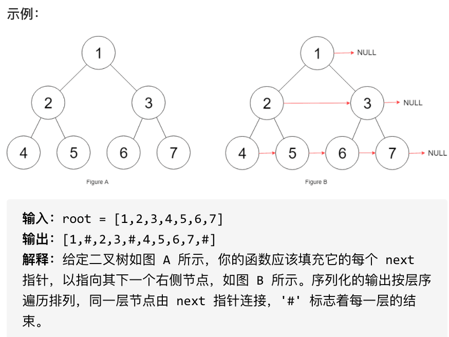
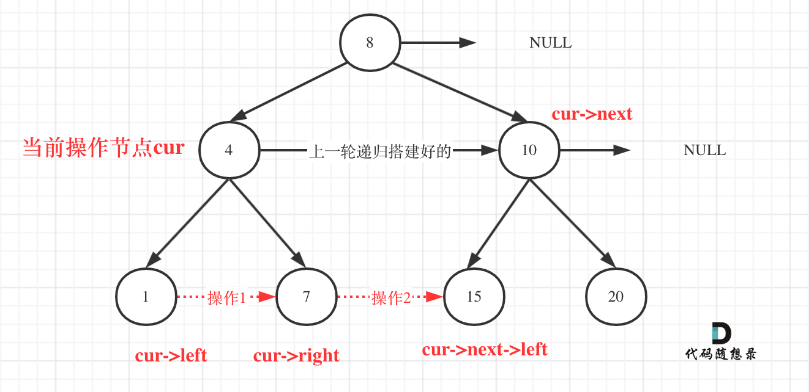

* [做專案（多個C++、Java、Go、測試開發、前端（front end）專案）](https://www.programmercarl.com/other/kstar.html)
* [刷演算法（兩個月高強度學演算法）](https://www.programmercarl.com/xunlian/xunlianying.html)
* [背八股（40天挑戰高頻面試題）](https://www.programmercarl.com/xunlian/bagu.html)


# 116. 填充每個節點的下一個右側節點指標

[LeetCode 題目連結](https://leetcode.cn/problems/populating-next-right-pointers-in-each-node/)

給定一個 完美二元樹（perfect binary tree） ，其所有葉節點（leaf node）都在同一層，每個父節點（father node）都有兩個子節點（child node）。二元樹（binary tree）定義如下：

```
struct Node {
  int val;
  Node *left;
  Node *right;
  Node *next;
}
```

填充它的每個 next 指標（pointer），讓這個指標指向其下一個右側節點（node）。如果找不到下一個右側節點，則將 next 指標設為 NULL。

初始狀態下，所有 next 指標都被設為 NULL。

進階：
* 你只能使用常數（constant）級額外空間。
* 使用遞迴（recursion）解題也符合要求，本題中遞迴程式佔用的堆疊空間（stack space）不算作額外的空間複雜度（space complexity）。



## 解題思路

注意題目提示內容：
* 你只能使用常數級額外空間。
* 使用遞迴解題也符合要求，本題中遞迴程式佔用的堆疊空間不算作額外的空間複雜度。

基本上就是要求使用遞迴了，疊代（iteration）的方式一定會用到堆疊（stack）或者佇列（queue）。

### 遞迴

一想用遞迴怎麼做呢，雖然層次序走訪（level order traversal）是最直觀的，但是遞迴的方式確實不好想。

如圖，假如當前操作的節點是 cur：

 </img></div>

最關鍵的點是可以透過上一層遞迴 搭出來的線，進行本次搭線。

圖中 cur 節點為元素（element） 4，那麼搭線的邏輯程式碼：（**注意註解中操作 1 和操作 2 和圖中的對應關係**）

```CPP
if (cur->left) cur->left->next = cur->right; // 操作1
if (cur->right) {
    if (cur->next) cur->right->next = cur->next->left; // 操作2
    else cur->right->next = NULL;
}
```

理解到這裡，使用前序遍歷（preorder traversal），那麼不難寫出如下程式碼：


```CPP
class Solution {
private:
    void traversal(Node* cur) {
        if (cur == NULL) return;
                                // 中
        if (cur->left) cur->left->next = cur->right; // 操作1
        if (cur->right) {
            if (cur->next) cur->right->next = cur->next->left; // 操作2
            else cur->right->next = NULL;
        }
        traversal(cur->left);   // 左
        traversal(cur->right);  // 右
    }
public:
    Node* connect(Node* root) {
        traversal(root);
        return root;
    }
};
```

### 疊代（層次序走訪）

本題使用層次序走訪是最為直觀的，如果對層次序走訪不了解，看這篇：[二元樹：層次序走訪登場！](https://programmercarl.com/0102.二叉树的层序遍历.html)。

遍歷（traversal）每一行的時候，如果不是最後一個 Node，則指向下一個 Node；如果是最後一個 Node，則指向 nullptr。

程式碼如下：

```CPP
class Solution {
public:
    Node* connect(Node* root) {
        queue<Node*> que;
        if (root != nullptr) que.push(root);
        while (!que.empty()) {
            int size = que.size();
            for (int i = 0; i < size; ++i) {
                Node* node = que.front();
                que.pop();
                if (i != size - 1) {
                    node->next = que.front(); //如果不是最後一個Node 則指向下一個Node
                } else node->next = nullptr;  //如果是最後一個Node 則指向nullptr
                if (node->left != nullptr) que.push(node->left);
                if (node->right != nullptr) que.push(node->right);
            }
        }
        return root;
    }
};
```

## 其他語言版本

### Java

```java
// 遞迴法
class Solution {
    public void traversal(Node cur) {
        if (cur == null) return;
        if (cur.left != null) cur.left.next = cur.right; // 操作1
        if (cur.right != null) {
            if(cur.next != null) cur.right.next = cur.next.left; //操作2
            else cur.right.next = null;
        }
        traversal(cur.left);  // 左
        traversal(cur.right); //右
    }
    public Node connect(Node root) {
        traversal(root);
        return root;
    }
}
```
```java
// 疊代法
class Solution {
    public Node connect(Node root) {
        if (root == null) return root;
        Queue<Node> que = new LinkedList<Node>();
        que.offer(root);
        Node nodePre = null;
        Node node = null;
        while (!que.isEmpty()) {
            int size = que.size();
            for (int i=0; i<size; i++) { // 開始每一層的遍歷
                if (i == 0) {
                    nodePre = que.peek(); // 記錄一層的頭節點
                    que.poll();
                    node = nodePre;
                } else {
                    node = que.peek();
                    que.poll();
                    nodePre.next = node; // 本層前一個節點next指向本節點
                    nodePre = nodePre.next; 
                }
                if (node.left != null) que.offer(node.left);
                if (node.right != null) que.offer(node.right);
            }
            nodePre.next = null; // 本層最後一個節點指向null
        }
        return root;
    }
}
```

```Java
// 疊代法
class Solution {
    public Node connect(Node root) {
        if (root == null) {
            return root;
        }
        
        Queue<Node> queue = new LinkedList<>();

        queue.add(root);

        while (!queue.isEmpty()) {
            int size = queue.size();

            // 每層的第一個節點
            Node cur = queue.poll();
            if (cur.left != null) {
                queue.add(cur.left);
            }
            if (cur.right != null) {
                queue.add(cur.right);
            }

            // 因為已經移除了每層的第一個節點，所以將 0 改為 1
            while (size-- > 1) {
                Node next = queue.poll();

                if (next.left != null) {
                    queue.add(next.left);
                }
                if (next.right != null) {
                    queue.add(next.right);
                }

                // 當前節點指向同層的下一個節點
                cur.next = next;
                // 更新當前節點
                cur = next;
            }

            // 每層的最後一個節點不指向 null 在 LeetCode 也能過
            cur.next = null;
        }

        return root;
    }
}
```

### Python

```python
# 遞迴法
class Solution:
    def connect(self, root: 'Node') -> 'Node':
        def traversal(cur: 'Node') -> 'Node':
            if not cur: return []
            if cur.left: cur.left.next = cur.right # 操作1
            if cur.right:
                if cur.next:
                    cur.right.next = cur.next.left # 操作2
                else:
                    cur.right.next = None
            traversal(cur.left) # 左
            traversal(cur.right) # 右
        traversal(root)
        return root
```
```python
# 疊代法
class Solution:
    def connect(self, root: 'Node') -> 'Node':
        if not root: return 
        res = []
        queue = [root]
        while queue:
            size = len(queue)
            for i in range(size): # 開始每一層的遍歷
                if i==0: 
                    nodePre = queue.pop(0) # 記錄一層的頭節點
                    node = nodePre
                else:
                    node = queue.pop(0)
                    nodePre.next = node # 本層前一個節點next指向本節點
                    nodePre = nodePre.next
                if node.left: queue.append(node.left)
                if node.right: queue.append(node.right)
            nodePre.next = None # 本層最後一個節點指向None
        return root
```
### Go
```go
// 疊代法
func connect(root *Node) *Node {
    if root == nil {
        return root
    }
    stack := make([]*Node, 0)
    stack = append(stack, root)
    for len(stack) > 0 {
        n := len(stack) // 記錄當前層節點個數
        for i := 0; i < n; i++ {
            node := stack[0] // 依序彈出節點
            stack = stack[1:]
            if i == n - 1 { // 如果是這層最右的節點，next指向nil
                node.Next = nil 
            } else {
                node.Next = stack[0] // 如果不是最右的節點，next指向右邊的節點
            }
            if node.Left != nil { // 如果存在左子節點，放入堆疊中
                stack = append(stack, node.Left)
            }
            if node.Right != nil { // 如果存在右子節點，放入堆疊中
                stack = append(stack, node.Right)
            }
        }
    }
    return root
}
```
```go
// 常數級額外空間，使用next
func connect(root *Node) *Node {
    if root == nil {
        return root
    }
    for cur := root; cur.Left != nil; cur = cur.Left { // 遍歷每層最左邊的節點
        for node := cur; node != nil; node = node.Next { // 當前層從左到右遍歷
            node.Left.Next = node.Right // 左子節點next指向右子節點
            if node.Next != nil { //如果node next有值，右子節點指向next節點的左子節點
                node.Right.Next = node.Next.Left
            }
            
        }
    }   
    return root
}
```

### JavaScript

```js
const connect = root => {
    if (!root) return root;
    // 根節點入佇列
    const Q = [root];
    while (Q.length) {
        const len = Q.length;
        // 遍歷這一層的所有節點
        for (let i = 0; i < len; i++) {
            // 佇列頭出佇列
            const node = Q.shift();
            // 連接
            if (i < len - 1) {
                // 新的佇列頭是node的右邊元素
                node.next = Q[0];
            }
            // 佇列頭左節點有值，放入佇列
            node.left && Q.push(node.left);
            // 佇列頭右節點有值，放入佇列
            node.right && Q.push(node.right);
        }
    }
    return root;
};
```

### TypeScript

（註：名稱空間（name space）‘Node’與 TypeScript 中內建（built in）類型衝突，這裡改成了‘NodePro’）

> 遞迴法：

```typescript
class NodePro {
    val: number
    left: NodePro | null
    right: NodePro | null
    next: NodePro | null
    constructor(val?: number, left?: NodePro, right?: NodePro, next?: NodePro) {
        this.val = (val === undefined ? 0 : val)
        this.left = (left === undefined ? null : left)
        this.right = (right === undefined ? null : right)
        this.next = (next === undefined ? null : next)
    }
}

function connect(root: NodePro | null): NodePro | null {
    if (root === null) return null;
    root.next = null;
    recur(root);
    return root;
};
function recur(node: NodePro): void {
    if (node.left === null || node.right === null) return;
    node.left.next = node.right;
    node.right.next = node.next && node.next.left;
    recur(node.left);
    recur(node.right);
}
```

> 疊代法：

```typescript
class NodePro {
    val: number
    left: NodePro | null
    right: NodePro | null
    next: NodePro | null
    constructor(val?: number, left?: NodePro, right?: NodePro, next?: NodePro) {
        this.val = (val === undefined ? 0 : val)
        this.left = (left === undefined ? null : left)
        this.right = (right === undefined ? null : right)
        this.next = (next === undefined ? null : next)
    }
}

function connect(root: NodePro | null): NodePro | null {
    if (root === null) return null;
    const queue: NodePro[] = [];
    queue.push(root);
    while (queue.length > 0) {
        for (let i = 0, length = queue.length; i < length; i++) {
            const curNode: NodePro = queue.shift()!;
            if (i === length - 1) {
                curNode.next = null;
            } else {
                curNode.next = queue[0];
            }
            if (curNode.left !== null) queue.push(curNode.left);
            if (curNode.right !== null) queue.push(curNode.right);
        }
    }
    return root;
};
```

```csharp
//遞迴
public class Solution {
    public Node Connect(Node root) {
        if (root == null) {
            return null;
        }
        
        ConnectNodes(root.left, root.right);
        
        return root;
    }

    private void ConnectNodes(Node node1, Node node2) {
        if (node1 == null || node2 == null) {
            return;
        }

        // 將左子節點的 next 指向右子節點
        node1.next = node2;

        // 遞迴連接當前節點的左右子節點
        ConnectNodes(node1.left, node1.right);
        ConnectNodes(node2.left, node2.right);

        // 連接跨越父節點的兩個子樹
        ConnectNodes(node1.right, node2.left);
    }
}


// 疊代
public class Solution
{
    public Node Connect(Node root)
    {
        Queue<Node> que = new Queue<Node>();

        if (root != null)
        {
            que.Enqueue(root);
        }

        while (que.Count > 0)
        {

            var queSize = que.Count;
            for (int i = 0; i < queSize; i++)
            {
                var cur = que.Dequeue();

                // 當這個節點不是這一層的最後的節點
                if (i != queSize - 1)
                {
                    // 當前節點指向下一個節點
                    cur.next = que.Peek();
                }
                // 否則指向空
                else
                {
                    cur.next = null;
                }

                if (cur.left != null)
                {
                    que.Enqueue(cur.left);
                }
                if (cur.right != null)
                {
                    que.Enqueue(cur.right);
                }
            }
        }

        return root;
    }
}
```


