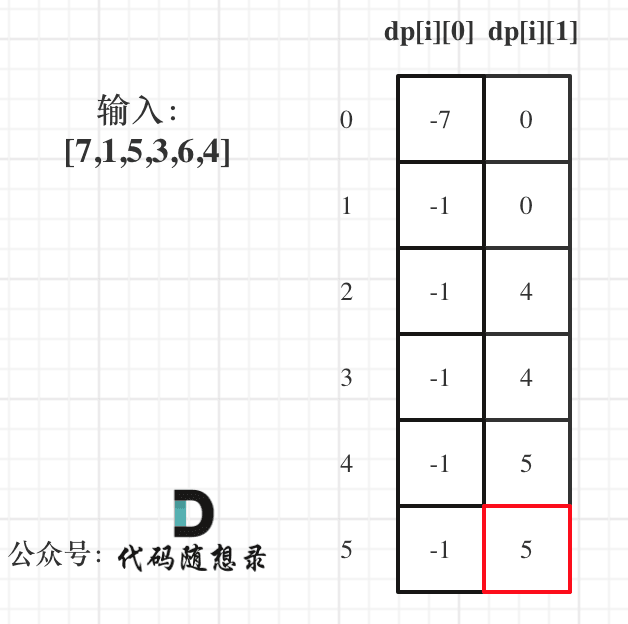

* [做專案（多個C++、Java、Go、測試開發、前端（front end）專案）](https://www.programmercarl.com/other/kstar.html)
* [刷演算法（兩個月高強度學演算法）](https://www.programmercarl.com/xunlian/xunlianying.html)
* [背八股（40天挑戰高頻面試題）](https://www.programmercarl.com/xunlian/bagu.html)

# 121. 買賣股票的最佳時機

[LeetCode 題目連結](https://leetcode.com/problems/best-time-to-buy-and-sell-stock/)

給定一個陣列（array） prices ，它的第 i 個元素（element） prices[i] 表示一支給定股票第 i 天的價格。

你只能選擇 某一天 買入這支股票，並選擇在 未來的某一個不同的日子 賣出該股票。設計一個演算法來計算你所能獲取的最大利潤。

回傳你可以從這筆交易中獲取的最大利潤。如果你不能獲取任何利潤，回傳 0 。

* 範例 1：   
* 輸入：[7,1,5,3,6,4]   
* 輸出：5    
解釋：在第 2 天（股票價格 = 1）的時候買入，在第 5 天（股票價格 = 6）的時候賣出，最大利潤 = 6-1 = 5 。注意利潤不能是 7-1 = 6, 因為賣出價格需要大於買入價格；同時，你不能在買入前賣出股票。

* 範例 2：   
* 輸入：prices = [7,6,4,3,1]  
* 輸出：0    
解釋：在這種情況下, 沒有交易完成, 所以最大利潤為 0。

## 演算法公開課

**[《程式碼隨想錄》演算法影片公開課](https://programmercarl.com/other/gongkaike.html)：[動態規劃（dynamic programming, DP）之 LeetCode：121.買賣股票的最佳時機1](https://www.bilibili.com/video/BV1Xe4y1u77q)，相信結合影片再看本篇題解，更有助於大家對本題的理解**。

## 解題思路

### 蠻力（brute force）

這道題目最直觀的想法，就是蠻力，找最佳間距了。

```CPP
class Solution {
public:
    int maxProfit(vector<int>& prices) {
        int result = 0;
        for (int i = 0; i < prices.size(); i++) {
            for (int j = i + 1; j < prices.size(); j++){
                result = max(result, prices[j] - prices[i]);
            }
        }
        return result;
    }
};
```

* 時間複雜度（time complexity）：O(n^2)
* 空間複雜度（space complexity）：O(1)

當然該方法逾時了。

### 貪心法（greedy）

因為股票就買賣一次，那麼貪心的想法很自然就是取最左最小值，取最右最大值，那麼得到的差值就是最大利潤。

C++ 程式碼如下：

```CPP
class Solution {
public:
    int maxProfit(vector<int>& prices) {
        int low = INT_MAX;
        int result = 0;
        for (int i = 0; i < prices.size(); i++) {
            low = min(low, prices[i]);  // 取最左最小價格
            result = max(result, prices[i] - low); // 直接取最大區間利潤
        }
        return result;
    }
};
```

* 時間複雜度：O(n)
* 空間複雜度：O(1)

### 動態規劃

動規五部曲分析如下：

1. 確定 dp 陣列（dp table）以及下標（subscript）的含義

dp[i][0] 表示第 i 天持有股票所得最多現金 ，**這裡可能有同學疑惑，本題中只能買賣一次，持有股票之後哪還有現金呢？**

其實一開始現金是 0，那麼假如第 i 天買入股票現金就是 -prices[i]，這是一個負數。

dp[i][1] 表示第 i 天不持有股票所得最多現金

**注意這裡說的是「持有」，「持有」不代表就是當天「買入」！也有可能是昨天就買入了，今天保持持有的狀態**

很多同學把「持有」和「買入」沒區分清楚。

在下面遞迴公式（recurrence formula）分析中，我會進一步講解。

2. 確定遞迴公式

如果第 i 天持有股票即 dp[i][0]，那麼可以由兩個狀態推出來
* 第 i-1 天就持有股票，那麼就保持現狀，所得現金就是昨天持有股票的所得現金 即：dp[i - 1][0]
* 第 i 天買入股票，所得現金就是買入今天的股票後所得現金即：-prices[i]

那麼 dp[i][0] 應該選所得現金最大的，所以 dp[i][0] = max(dp[i - 1][0], -prices[i]);

如果第 i 天不持有股票即 dp[i][1]，也可以由兩個狀態推出來
* 第 i-1 天就不持有股票，那麼就保持現狀，所得現金就是昨天不持有股票的所得現金 即：dp[i - 1][1]
* 第 i 天賣出股票，所得現金就是按照今天股票價格賣出後所得現金即：prices[i] + dp[i - 1][0]

同樣 dp[i][1] 取最大的，dp[i][1] = max(dp[i - 1][1], prices[i] + dp[i - 1][0]);

這樣遞迴公式我們就分析完了

3. dp 陣列如何初始化

由遞迴公式 dp[i][0] = max(dp[i - 1][0], -prices[i]); 和 dp[i][1] = max(dp[i - 1][1], prices[i] + dp[i - 1][0]); 可以看出

其基礎都是要從 dp[0][0] 和 dp[0][1] 推導出來。

那麼 dp[0][0] 表示第 0 天持有股票，此時的持有股票就一定是買入股票了，因為不可能有前一天推出來，所以 dp[0][0] -= prices[0];

dp[0][1] 表示第 0 天不持有股票，不持有股票那麼現金就是 0，所以 dp[0][1] = 0;

4. 確定遍歷（traversal）順序

從遞迴公式可以看出 dp[i] 都是由 dp[i - 1] 推導出來的，那麼一定是從前向後遍歷。

5. 舉例推導 dp 陣列

以範例 1，輸入：[7,1,5,3,6,4] 為例，dp 陣列狀態如下：





dp[5][1] 就是最終結果。

為什麼不是 dp[5][0] 呢？

**因為本題中不持有股票狀態所得金錢一定比持有股票狀態得到的多！**

以上分析完畢，C++ 程式碼如下：

```CPP
// 版本一
class Solution {
public:
    int maxProfit(vector<int>& prices) {
        int len = prices.size();
        if (len == 0) return 0;
        vector<vector<int>> dp(len, vector<int>(2));
        dp[0][0] -= prices[0];
        dp[0][1] = 0;
        for (int i = 1; i < len; i++) {
            dp[i][0] = max(dp[i - 1][0], -prices[i]);
            dp[i][1] = max(dp[i - 1][1], prices[i] + dp[i - 1][0]);
        }
        return dp[len - 1][1];
    }
};
```

* 時間複雜度：O(n)
* 空間複雜度：O(n)

從遞迴公式可以看出，dp[i] 只是依賴於 dp[i - 1] 的狀態。

```
dp[i][0] = max(dp[i - 1][0], -prices[i]);
dp[i][1] = max(dp[i - 1][1], prices[i] + dp[i - 1][0]);
```

那麼我們只需要記錄 當前天的 dp 狀態和前一天的 dp 狀態就可以了，可以使用滾動陣列（rolling array）來節省空間，程式碼如下：

```CPP
// 版本二
class Solution {
public:
    int maxProfit(vector<int>& prices) {
        int len = prices.size();
        vector<vector<int>> dp(2, vector<int>(2)); // 注意這裡只開闢了一個2 * 2大小的二維陣列
        dp[0][0] -= prices[0];
        dp[0][1] = 0;
        for (int i = 1; i < len; i++) {
            dp[i % 2][0] = max(dp[(i - 1) % 2][0], -prices[i]);
            dp[i % 2][1] = max(dp[(i - 1) % 2][1], prices[i] + dp[(i - 1) % 2][0]);
        }
        return dp[(len - 1) % 2][1];
    }
};
```

* 時間複雜度：O(n)
* 空間複雜度：O(1)

這裡能寫出版本一就可以了，版本二雖然原理都一樣，但是想直接寫出版本二還是有點麻煩，容易自己給自己找 bug。

所以建議是先寫出版本一，然後在版本一的基礎上最佳化成版本二，而不是直接就寫出版本二。

## 其他語言版本

### Java:

> 貪心法：

```java
class Solution {
    public int maxProfit(int[] prices) {
        // 找到一個最小的買入點
        int low = Integer.MAX_VALUE;
        // res不斷更新，直到陣列迴圈完畢
        int res = 0;
        for(int i = 0; i < prices.length; i++){
            low = Math.min(prices[i], low);
            res = Math.max(prices[i] - low, res);
        }
        return res;
    }
}
```
> 動態規劃（dynamic programming, DP）：版本一

```java
// 解法1
class Solution {
    public int maxProfit(int[] prices) {
        if (prices == null || prices.length == 0) return 0;
        int length = prices.length;
        // dp[i][0]代表第i天持有股票的最大收益
        // dp[i][1]代表第i天不持有股票的最大收益
        int[][] dp = new int[length][2];
        int result = 0;
        dp[0][0] = -prices[0];
        dp[0][1] = 0;
        for (int i = 1; i < length; i++) {
            dp[i][0] = Math.max(dp[i - 1][0], -prices[i]);
            dp[i][1] = Math.max(dp[i - 1][0] + prices[i], dp[i - 1][1]);
        }
        return dp[length - 1][1];
    }
}
```
> DP：版本二(使用二維（2D）陣列（和卡哥解題思路一致），下面還有使用一維滾動陣列的更最佳化版本)

```Java
class Solution {
    public int maxProfit(int[] prices) {
        int len = prices.length;
        int dp[][] = new int[2][2];
        
        dp[0][0] = - prices[0];
        dp[0][1] = 0;

        for (int i = 1; i < len; i++){
            dp[i % 2][0] = Math.max(dp[(i - 1) % 2][0], - prices[i]);
            dp[i % 2][1] = Math.max(dp[(i - 1) % 2][1], prices[i] + dp[(i - 1) % 2][0]);
        }
        return dp[(len - 1) % 2][1];
    }
}
```

> DP：版本二(使用一維陣列（one dimensional array）)

``` java
class Solution {
  public int maxProfit(int[] prices) {
    int[] dp = new int[2];
    // 記錄一次交易，一次交易有買入賣出兩種狀態
    // 0代表持有，1代表賣出
    dp[0] = -prices[0];
    dp[1] = 0;
    // 可以參考費波那契問題的最佳化方式
    // 我們從 i=1 開始遍歷陣列，一共有 prices.length 天，
    // 所以是 i<=prices.length
    for (int i = 1; i <= prices.length; i++) {
      // 前一天持有；或當天買入
      dp[0] = Math.max(dp[0], -prices[i - 1]);
      // 如果 dp[0] 被更新，那麼 dp[1] 肯定會被更新為正數的 dp[1]
      // 而不是 dp[0]+prices[i-1]==0 的0，
      // 所以這裡使用會改變的dp[0]也是可以的
      // 當然 dp[1] 初始值為 0 ，被更新成 0 也沒影響
      // 前一天賣出；或當天賣出, 當天要賣出，得前一天持有才行
      dp[1] = Math.max(dp[1], dp[0] + prices[i - 1]);
    }
    return dp[1];
  }
}
```

### Python:

> 貪心法：
```python
class Solution:
    def maxProfit(self, prices: List[int]) -> int:
        low = float("inf")
        result = 0
        for i in range(len(prices)):
            low = min(low, prices[i]) #取最左最小價格
            result = max(result, prices[i] - low) #直接取最大區間利潤
        return result
```

> DP：版本一
```python
class Solution:
    def maxProfit(self, prices: List[int]) -> int:
        length = len(prices)
        if length == 0:
            return 0
        dp = [[0] * 2 for _ in range(length)]
        dp[0][0] = -prices[0]
        dp[0][1] = 0
        for i in range(1, length):
            dp[i][0] = max(dp[i-1][0], -prices[i])
            dp[i][1] = max(dp[i-1][1], prices[i] + dp[i-1][0])
        return dp[-1][1]
```

> DP：版本二
```python
class Solution:
    def maxProfit(self, prices: List[int]) -> int:
        length = len(prices)
        dp = [[0] * 2 for _ in range(2)] #注意這裡只開闢了一個2 * 2大小的二維陣列
        dp[0][0] = -prices[0]
        dp[0][1] = 0
        for i in range(1, length):
            dp[i % 2][0] = max(dp[(i-1) % 2][0], -prices[i])
            dp[i % 2][1] = max(dp[(i-1) % 2][1], prices[i] + dp[(i-1) % 2][0])
        return dp[(length-1) % 2][1]
```

> DP：版本三
```python
class Solution:
    def maxProfit(self, prices: List[int]) -> int:
        length = len(prices)
        dp0, dp1 = -prices[0], 0 #注意這裡只維護兩個常數，因為dp0的更新不受dp1的影響
        for i in range(1, length):
            dp1 = max(dp1, dp0 + prices[i])
            dp0 = max(dp0, -prices[i])
        return dp1
```

### Go:

> 貪心法：
```Go
func maxProfit(prices []int) int {
    min := prices[0]
    res := 0
    for i := 1; i < len(prices); i++ {
        if prices[i] - min > res {
            res = prices[i]-min
        }
        if min > prices[i] {
            min = prices[i]
        }
    }
    return res
}
```

> DP：版本一
```Go
func maxProfit(prices []int) int {
	length := len(prices)
	if length == 0{return 0}
	dp := make([][]int,length)
	for i := 0; i < length; i++ {
		dp[i] = make([]int, 2)
	}
	dp[0][0] = -prices[0]
	dp[0][1] = 0
	for i := 1; i < length; i++ {
		dp[i][0] = max(dp[i-1][0], -prices[i])
		dp[i][1] = max(dp[i-1][1], dp[i-1][0] + prices[i])
	}
	return dp[length-1][1]
}

func max(a, b int) int {
    if a > b {
        return a 
    }
    return b 
}
```

> DP：版本二
```Go
func maxProfit(prices []int) int {
    dp := [2][2]int{}
    dp[0][0] = -prices[0]   
    dp[0][1] = 0
    for i := 1; i < len(prices); i++ {
        dp[i%2][0] = max(dp[(i-1)%2][0], -prices[i])
        dp[i%2][1] = max(dp[(i-1)%2][1], dp[(i-1)%2][0]+prices[i])
    }

    return dp[(len(prices)-1)%2][1]
}

func max(a, b int) int {
    if a > b{
        return a 
    }

    return b
}
```

### JavaScript:

> DP

```javascript
const maxProfit = prices => {
    const len = prices.length;
    // 建立dp陣列
    const dp = new Array(len).fill([0, 0]);
    // dp陣列初始化
    dp[0] = [-prices[0], 0];
    for (let i = 1; i < len; i++) {
        // 更新dp[i]
        dp[i] = [
            Math.max(dp[i - 1][0], -prices[i]),
            Math.max(dp[i - 1][1], prices[i] + dp[i - 1][0]),
        ];
    }
    return dp[len - 1][1];
};
```

> 貪心法

```javascript
var maxProfit = function(prices) {
    let lowerPrice = prices[0];// 重點是維護這個最小值（貪心的思想） 
    let profit = 0;
    for(let i = 0; i < prices.length; i++){
        lowerPrice = Math.min(lowerPrice, prices[i]);// 貪心地選擇左面的最小價格
        profit = Math.max(profit, prices[i] - lowerPrice);// 遍歷一趟就可以獲得最大利潤
    }
    return profit;
};
```

### TypeScript：

> 貪心法

```typescript
function maxProfit(prices: number[]): number {
    if (prices.length === 0) return 0;
    let buy: number = prices[0];
    let profitMax: number = 0;
    for (let i = 1, length = prices.length; i < length; i++) {
        profitMax = Math.max(profitMax, prices[i] - buy);
        buy = Math.min(prices[i], buy);
    }
    return profitMax;
};
```

> DP：版本一

```typescript
function maxProfit(prices: number[]): number {
    /**
        dp[i][0]: 第i天持有股票的最大現金
        dp[i][1]: 第i天不持有股票的最大現金
     */
    const length = prices.length;
    if (length === 0) return 0;
    const dp: number[][] = [];
    dp[0] = [-prices[0], 0];
    for (let i = 1; i < length; i++) {
        dp[i] = [];
        dp[i][0] = Math.max(dp[i - 1][0], -prices[i]);
        dp[i][1] = Math.max(dp[i - 1][0] + prices[i], dp[i - 1][1]);
    }
    return dp[length - 1][1];
};
```

> DP：版本二

```typescript
// dp[i][0] 表示第i天持有股票所得最多現金
// dp[i][1] 表示第i天不持有股票所得最多現金
function maxProfit(prices: number[]): number {
    const dp:number[][] = Array(2).fill(0).map(item => Array(2));
    dp[0][0] = -prices[0];
    dp[0][1] = 0;
    
    for (let i = 1; i < prices.length; i++) {
        dp[i % 2][0] = Math.max(dp[(i - 1) % 2][0], -prices[i]);
        dp[i % 2][1] = Math.max(dp[(i - 1) % 2][1], dp[(i - 1) % 2][0] + prices[i]);
    }

    // 回傳不持有股票的最大現金
    return dp[(prices.length-1) % 2][1];
};
```

### C#：

> 貪心法

```csharp
public class Solution
{
    public int MaxProfit(int[] prices)
    {
        int min = Int32.MaxValue;
        int res = 0;
        for (int i = 0; i < prices.Length; i++)
        {
            min = Math.Min(prices[i], min);
            res = Math.Max(prices[i] - min, res);
        }
        return res;
    }
}
```

> DP

```csharp
public class Solution
{
	public int MaxProfit(int[] prices)
    {
        int[] dp = new int[2];
        int size = prices.Length;
        (dp[0], dp[1]) = (-prices[0], 0);
        for (int i = 0; i < size; i++)
        {
            dp[0] = Math.Max(dp[0], -prices[i]);
            dp[1] = Math.Max(dp[1], dp[0]+prices[i]);
        }
        return dp[1];
    }
}
```

### C：

> 貪心

```c
#define max(a, b) ((a) > (b) ? (a) : (b))
#define min(a, b) ((a) > (b) ? (b) : (a))

int maxProfit(int* prices, int pricesSize) {
    int low = INT_MIN;
    int result = 0;
    for(int i = 0; i < pricesSize; i++){
        low = min(low, prices[i]);
        result = max(result, prices[i] - low);
    }
    return result;
}
```

> DP

```c
#define max(a, b) ((a) > (b) ? (a) : (b))

int maxProfit(int* prices, int pricesSize){
    if(pricesSize == 0){
        return 0;
    }
    // dp初始化
    int ** dp = malloc(sizeof (int *) * pricesSize);
    for(int i = 0; i < pricesSize; i++){
        dp[i] = malloc(sizeof (int ) * 2);
    }
    // 下標0表示持有股票的情況下的最大現金，下標1表示不持有股票的情況下獲得的最大現金
    dp[0][0] = -prices[0];
    dp[0][1] = 0;
    for(int i = 1; i < pricesSize; i++){
        dp[i][0] = max(dp[i - 1][0], - prices[i]);
        dp[i][1] = max(dp[i - 1][1], dp[i - 1][0] + prices[i]);
    }
    return dp[pricesSize - 1][1];
}
```


### Rust:

> 貪心

```rust
impl Solution {
    pub fn max_profit(prices: Vec<i32>) -> i32 {
        let (mut low, mut res) = (i32::MAX, 0);
        for p in prices {
            low = p.min(low);
            res = res.max(p - low);
        }
        res
    }
}
```

> DP

```rust
impl Solution {
    pub fn max_profit(prices: Vec<i32>) -> i32 {
        let mut dp = vec![-prices[0], 0];
        for p in prices {
            dp[0] = dp[0].max(-p);
            dp[1] = dp[1].max(dp[0] + p);
        }
        dp[1]
    }
}
```


