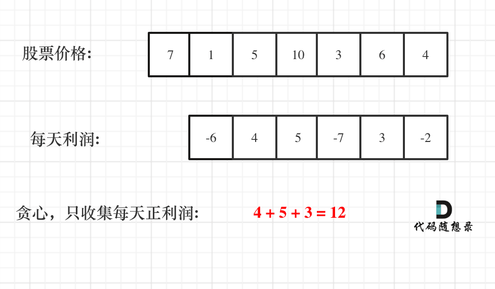

* [做專案（多個C++、Java、Go、測試開發、前端（front end）專案）](https://www.programmercarl.com/other/kstar.html)
* [刷演算法（兩個月高強度學演算法）](https://www.programmercarl.com/xunlian/xunlianying.html)
* [背八股（40天挑戰高頻面試題）](https://www.programmercarl.com/xunlian/bagu.html)

# 122.買賣股票的最佳時機 II

[LeetCode 題目連結](https://leetcode.cn/problems/best-time-to-buy-and-sell-stock-ii/)

給定一個陣列（array），它的第  i 個元素（element）是一支給定股票第 i 天的價格。

設計一個演算法來計算你所能獲取的最大利潤。你可以盡可能地完成更多的交易（多次買賣一支股票）。

注意：你不能同時參與多筆交易（你必須在再次購買前出售掉之前的股票）。

範例 1:

- 輸入: [7,1,5,3,6,4]
- 輸出: 7
- 解釋: 在第 2 天（股票價格 = 1）的時候買入，在第 3 天（股票價格 = 5）的時候賣出, 這筆交易所能獲得利潤 = 5-1 = 4。隨後，在第 4 天（股票價格 = 3）的時候買入，在第 5 天（股票價格 = 6）的時候賣出, 這筆交易所能獲得利潤 = 6-3 = 3 。

範例 2:

- 輸入: [1,2,3,4,5]
- 輸出: 4
- 解釋: 在第 1 天（股票價格 = 1）的時候買入，在第 5 天 （股票價格 = 5）的時候賣出, 這筆交易所能獲得利潤 = 5-1 = 4 。注意你不能在第 1 天和第 2 天接連購買股票，之後再將它們賣出。因為這樣屬於同時參與了多筆交易，你必須在再次購買前出售掉之前的股票。

範例  3:

- 輸入: [7,6,4,3,1]
- 輸出: 0
- 解釋: 在這種情況下, 沒有交易完成, 所以最大利潤為 0。

提示：

- 1 <= prices.length <= 3 \* 10 ^ 4
- 0 <= prices[i] <= 10 ^ 4

## 演算法公開課

**[《程式碼隨想錄》演算法影片公開課](https://programmercarl.com/other/gongkaike.html)：[貪心演算法（greedy algorithm）也能解決股票問題！LeetCode：122.買賣股票最佳時機 II](https://www.bilibili.com/video/BV1ev4y1C7na)，相信結合影片再看本篇題解，更有助於大家對本題的理解**。

## 解題思路

本題首先要清楚兩點：

- 只有一張股票！
- 當前只有買股票或者賣股票的操作

想獲得利潤至少要兩天為一個交易單元。

### 貪心演算法

這道題目可能我們只會想，選一個低的買入，再選個高的賣，再選一個低的買入.....反覆循環。

**如果想到其實最終利潤是可以分解的，那麼本題就很容易了！**

如何分解呢？

假如第 0 天買入，第 3 天賣出，那麼利潤為：prices[3] - prices[0]。

相當於 (prices[3] - prices[2]) + (prices[2] - prices[1]) + (prices[1] - prices[0])。

**此時就是把利潤分解為每天為單位的維度，而不是從 0 天到第 3 天整體去考慮！**

那麼根據 prices 可以得到每天的利潤序列（sequence）：(prices[i] - prices[i - 1]).....(prices[1] - prices[0])。

如圖：



一些同學陷入：第一天怎麼就沒有利潤呢，第一天到底算不算的困惑中。

第一天當然沒有利潤，至少要第二天才會有利潤，所以利潤的序列比股票序列少一天！

從圖中可以發現，其實我們只需要收集每天的正利潤就可以，**收集正利潤的區間（interval），就是股票買賣的區間，而我們只需要關注最終利潤，不需要記錄區間**。

那麼只收集正利潤就是貪心所貪的地方！

**區域最佳（local optimum）：收集每天的正利潤，總體最佳（global optimum）：求得最大利潤**。

區域最佳可以推出總體最佳，找不出反例，試一試貪心！

對應 C++ 程式碼如下：

```CPP
class Solution {
public:
    int maxProfit(vector<int>& prices) {
        int result = 0;
        for (int i = 1; i < prices.size(); i++) {
            result += max(prices[i] - prices[i - 1], 0);
        }
        return result;
    }
};
```

- 時間複雜性（time complexity）：O(n)
- 空間複雜度（space complexity）：O(1)

### 動態規劃（dynamic programming, DP）

動態規劃將在下一個系列詳細講解，本題解先給出我的 C++ 程式碼（帶詳細註解），想先學習的話，可以看本篇：[122.買賣股票的最佳時機II（動態規劃）](https://programmercarl.com/0122.%E4%B9%B0%E5%8D%96%E8%82%A1%E7%A5%A8%E7%9A%84%E6%9C%80%E4%BD%B3%E6%97%B6%E6%9C%BAII%EF%BC%88%E5%8A%A8%E6%80%81%E8%A7%84%E5%88%92%EF%BC%89.html#%E6%80%9D%E8%B7%AF)

```CPP
class Solution {
public:
    int maxProfit(vector<int>& prices) {
        // dp[i][1]第i天持有的最多現金
        // dp[i][0]第i天持有股票後的最多現金
        int n = prices.size();
        vector<vector<int>> dp(n, vector<int>(2, 0));
        dp[0][0] -= prices[0]; // 持股票
        for (int i = 1; i < n; i++) {
            // 第i天持股票所剩最多現金 = max(第i-1天持股票所剩現金, 第i-1天持現金-買第i天的股票)
            dp[i][0] = max(dp[i - 1][0], dp[i - 1][1] - prices[i]);
            // 第i天持有最多現金 = max(第i-1天持有的最多現金，第i-1天持有股票的最多現金+第i天賣出股票)
            dp[i][1] = max(dp[i - 1][1], dp[i - 1][0] + prices[i]);
        }
        return max(dp[n - 1][0], dp[n - 1][1]);
    }
};
```

- 時間複雜性：$O(n)$
- 空間複雜度：$O(n)$

## 總結

股票問題其實是一個系列的，屬於動態規劃的範疇，因為目前在講解貪心系列，所以股票問題會在之後的動態規劃系列中詳細講解。

**可以看出有時候，貪心往往比動態規劃更巧妙，更好用，所以別小看了貪心演算法**。

**本題中理解利潤拆分是關鍵點！** 不要整塊地去看，而是把整體利潤拆為每天的利潤。

一旦想到這裡了，很自然就會想到貪心了，即：只收集每天的正利潤，最後穩穩的就是最大利潤了。

## 其他語言版本

### Java:

貪心:

```java
// 貪心想法
class Solution {
    public int maxProfit(int[] prices) {
        int result = 0;
        for (int i = 1; i < prices.length; i++) {
            result += Math.max(prices[i] - prices[i - 1], 0);
        }
        return result;
    }
}
```

動態規劃:

```java
class Solution { // 動態規劃
    public int maxProfit(int[] prices) {
        // [天數][是否持有股票]
        int[][] dp = new int[prices.length][2];

        // base case
        dp[0][0] = 0;
        dp[0][1] = -prices[0];

        for (int i = 1; i < prices.length; i++) {
            // dp公式
            dp[i][0] = Math.max(dp[i - 1][0], dp[i - 1][1] + prices[i]);
            dp[i][1] = Math.max(dp[i - 1][1], dp[i - 1][0] - prices[i]);
        }

        return dp[prices.length - 1][0];
    }
}
```

### Python:

貪心:

```python
class Solution:
    def maxProfit(self, prices: List[int]) -> int:
        result = 0
        for i in range(1, len(prices)):
            result += max(prices[i] - prices[i - 1], 0)
        return result
```

動態規劃:

```python
class Solution:
    def maxProfit(self, prices: List[int]) -> int:
        length = len(prices)
        dp = [[0] * 2 for _ in range(length)]
        dp[0][0] = -prices[0]
        dp[0][1] = 0
        for i in range(1, length):
            dp[i][0] = max(dp[i-1][0], dp[i-1][1] - prices[i]) #注意這裡是和121. 買賣股票的最佳時機唯一不同的地方
            dp[i][1] = max(dp[i-1][1], dp[i-1][0] + prices[i])
        return dp[-1][1]
```

### Go:

貪心演算法

```go
func maxProfit(prices []int) int {
    var sum int
    for i := 1; i < len(prices); i++ {
        // 累加每次大於0的交易
        if prices[i] - prices[i-1] > 0 {
            sum += prices[i] - prices[i-1]
        }
    }
    return sum
}
```

動態規劃

```go
func maxProfit(prices []int) int {
    dp := make([][]int, len(prices))
    for i := 0; i < len(dp); i++ {
        dp[i] = make([]int, 2)
    }
    // dp[i][0]表示在狀態i不持有股票的現金，dp[i][1]為持有股票的現金
    dp[0][0], dp[0][1] = 0, -prices[0]
    for i := 1; i < len(prices); i++ {
        dp[i][0] = max(dp[i-1][0], dp[i-1][1] + prices[i])
        dp[i][1] = max(dp[i-1][0] - prices[i], dp[i-1][1])
    }
    return dp[len(prices)-1][0]

}
func max(a, b int) int {
    if a > b {
        return a
    }
    return b
}
```

### JavaScript:

貪心

```Javascript
var maxProfit = function(prices) {
    let result = 0
    for(let i = 1; i < prices.length; i++) {
        result += Math.max(prices[i] - prices[i - 1], 0)
    }
    return result
};
```

動態規劃

```javascript
const maxProfit = (prices) => {
  let dp = Array.from(Array(prices.length), () => Array(2).fill(0));
  // dp[i][0] 表示第i天持有股票所得現金。
  // dp[i][1] 表示第i天不持有股票所得最多現金
  dp[0][0] = 0 - prices[0];
  dp[0][1] = 0;
  for (let i = 1; i < prices.length; i++) {
    // 如果第i天持有股票即dp[i][0]， 那麼可以由兩個狀態推出來
    // 第i-1天就持有股票，那麼就保持現狀，所得現金就是昨天持有股票的所得現金 即：dp[i - 1][0]
    // 第i天買入股票，所得現金就是昨天不持有股票的所得現金減去 今天的股票價格 即：dp[i - 1][1] - prices[i]
    dp[i][0] = Math.max(dp[i - 1][0], dp[i - 1][1] - prices[i]);

    // 再來看看如果第i天不持有股票即dp[i][1]的情況， 依然可以由兩個狀態推出來
    // 第i-1天就不持有股票，那麼就保持現狀，所得現金就是昨天不持有股票的所得現金 即：dp[i - 1][1]
    // 第i天賣出股票，所得現金就是按照今天股票價格賣出後所得現金即：prices[i] + dp[i - 1][0]
    dp[i][1] = Math.max(dp[i - 1][1], dp[i - 1][0] + prices[i]);
  }

  return dp[prices.length - 1][1];
};
```

### TypeScript：

貪心
```typescript
function maxProfit(prices: number[]): number {
  let resProfit: number = 0;
  for (let i = 1, length = prices.length; i < length; i++) {
    resProfit += Math.max(prices[i] - prices[i - 1], 0);
  }
  return resProfit;
}
```

動態規劃
```typescript
function maxProfit(prices: number[]): number {
  const dp = Array(prices.length)
    .fill(0)
    .map(() => Array(2).fill(0))
  dp[0][0] = -prices[0]
  for (let i = 1; i < prices.length; i++) {
    dp[i][0] = Math.max(dp[i - 1][0], dp[i - 1][1] - prices[i])
    dp[i][1] = Math.max(dp[i - 1][1], dp[i - 1][0] + prices[i])
  }
  return dp[prices.length - 1][1]
}
```

### Rust：

貪心：

```Rust
impl Solution {
    pub fn max_profit(prices: Vec<i32>) -> i32 {
        let mut result = 0;
        for i in 1..prices.len() {
            result += (prices[i] - prices[i - 1]).max(0);
        }
        result
    }
}
```

動態規劃：

```Rust
impl Solution {
    pub fn max_profit(prices: Vec<i32>) -> i32 {
        let mut dp = vec![vec![0; 2]; prices.len()];
        dp[0][0] = -prices[0];
        for i in 1..prices.len() {
            dp[i][0] = dp[i - 1][0].max(dp[i - 1][1] - prices[i]);
            dp[i][1] = dp[i - 1][1].max(dp[i - 1][0] + prices[i]);
        }
        dp[prices.len() - 1][1]
    }
}
```

### C:

貪心：

```c
int maxProfit(int* prices, int pricesSize){
    int result = 0;
    int i;
    //從第二個元素開始遍歷陣列，與之前的元素進行比較
    for(i = 1; i < pricesSize; ++i) {
        //若該元素比前面元素大，則說明有利潤。代表買入
        if(prices[i] > prices[i-1])
            result+= prices[i]-prices[i-1];
    }
    return result;
}
```

動態規劃：

```c
#define max(a, b) (((a) > (b)) ? (a) : (b))

int maxProfit(int* prices, int pricesSize){
    int dp[pricesSize][2];
    dp[0][0] = 0 - prices[0];
    dp[0][1] = 0;

    int i;
    for(i = 1; i < pricesSize; ++i) {
        // dp[i][0]為i-1天持股的錢數/在第i天用i-1天的錢買入的最大值。
        // 若i-1天持股，且第i天買入股票比i-1天持股時更虧，說明應在i-1天時持股
        dp[i][0] = max(dp[i-1][0], dp[i-1][1] - prices[i]);
        //dp[i][1]為i-1天不持股錢數/在第i天賣出所持股票dp[i-1][0] + prices[i]的最大值
        dp[i][1] = max(dp[i-1][1], dp[i-1][0] + prices[i]);
    }
    // 回傳在最後一天不持股時的錢數（將股票賣出後錢最大化）
    return dp[pricesSize - 1][1];
}
```

### Scala：

貪心:

```scala
object Solution {
  def maxProfit(prices: Array[Int]): Int = {
    var result = 0
    for (i <- 1 until prices.length) {
      if (prices(i) > prices(i - 1)) {
        result += prices(i) - prices(i - 1)
      }
    }
    result
  }
}
```
### C#
```csharp
public class Solution
{
    public int MaxProfit(int[] prices)
    {
        int res = 0;
        for (int i = 0; i < prices.Length - 1; i++)
        {
            res += Math.Max(0, prices[i + 1] - prices[i]);
        }
        return res;
    }
}
```


