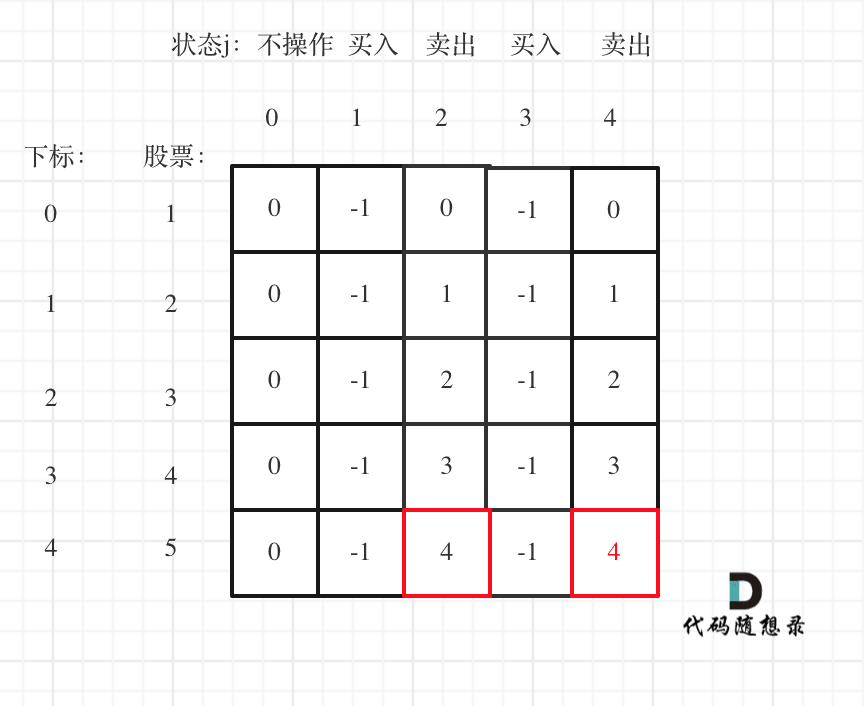

* [做專案（多個C++、Java、Go、測試開發、前端專案）](https://www.programmercarl.com/other/kstar.html)
* [刷演算法（兩個月高強度學演算法）](https://www.programmercarl.com/xunlian/xunlianying.html)
* [背誦面試必考題（八股文）（40天挑戰高頻面試題）](https://www.programmercarl.com/xunlian/bagu.html)

# 123.買賣股票的最佳時機III

[LeetCode 題目連結](https://leetcode.com/problems/best-time-to-buy-and-sell-stock-iii/)


給定一個陣列（array），它的第 i 個元素（element）是一支給定的股票在第 i 天的價格。

設計一個演算法來計算你所能獲取的最大利潤。你最多可以完成 兩筆 交易。

注意：你不能同時參與多筆交易（你必須在再次購買前出售掉之前的股票）。

* 範例 1:
* 輸入：prices = [3,3,5,0,0,3,1,4]
* 輸出：6
解釋：在第 4 天（股票價格 = 0）的時候買入，在第 6 天（股票價格 = 3）的時候賣出，這筆交易所能獲得利潤 = 3-0 = 3 。隨後，在第 7 天（股票價格 = 1）的時候買入，在第 8 天 （股票價格 = 4）的時候賣出，這筆交易所能獲得利潤 = 4-1 = 3。

* 範例 2:
* 輸入：prices = [1,2,3,4,5]
* 輸出：4
解釋：在第 1 天（股票價格 = 1）的時候買入，在第 5 天 （股票價格 = 5）的時候賣出, 這筆交易所能獲得利潤 = 5-1 = 4。注意你不能在第 1 天和第 2 天接連購買股票，之後再將它們賣出。因為這樣屬於同時參與了多筆交易，你必須在再次購買前出售掉之前的股票。

* 範例 3:
* 輸入：prices = [7,6,4,3,1]
* 輸出：0
解釋：在這個情況下, 沒有交易完成, 所以最大利潤為0。

* 範例 4：
* 輸入：prices = [1]
輸出：0

提示：

* 1 <= prices.length <= 10^5
* 0 <= prices[i] <= 10^5

## 演算法公開課

**[《程式碼隨想錄》演算法影片公開課](https://programmercarl.com/other/gongkaike.html)：[動態規劃（dynamic programming, DP），股票至多買賣兩次，怎麼求？ | LeetCode：123.買賣股票最佳時機III](https://www.bilibili.com/video/BV1WG411K7AR)，相信結合影片再看本篇題解，更有助於大家對本題的理解**。


## 解題思路


這道題目相對 [121.買賣股票的最佳時機](./0121.買賣股票的最佳時機.md) 和 [122.買賣股票的最佳時機II](./0122.買賣股票的最佳時機II.md) 難了不少。

關鍵在於至多買賣兩次，這意味著可以買賣一次，可以買賣兩次，也可以不買賣。

接下來我用動態規劃（dynamic programming, DP）五部曲詳細分析一下：

1. 確定dp陣列以及下標（subscript）的含義

一天一共就有五個狀態，

0. 沒有操作  （其實我們也可以不設定這個狀態）
1. 第一次持有股票
2. 第一次不持有股票 
3. 第二次持有股票
4. 第二次不持有股票

dp[i][j]中 i表示第i天，j為 [0 - 4] 五個狀態，dp[i][j]表示第i天狀態j所剩最大現金。

需要注意：dp[i][1]，**表示的是第i天，買入股票的狀態，並不是說一定要第i天買入股票，這是很多同學容易陷入的誤區**。

例如 dp[i][1] ，並不是說 第i天一定買入股票，有可能 第 i-1天 就買入了，那麼 dp[i][1] 延續買入股票的這個狀態。

2. 確定遞迴公式（recurrence formula）


達到dp[i][1]狀態，有兩個具體操作：

* 操作一：第i天買入股票了，那麼dp[i][1] = dp[i-1][0] - prices[i]
* 操作二：第i天沒有操作，而是沿用前一天買入的狀態，即：dp[i][1] = dp[i - 1][1]

那麼dp[i][1]究竟選 dp[i-1][0] - prices[i]，還是dp[i - 1][1]呢？

一定是選最大的，所以 dp[i][1] = max(dp[i-1][0] - prices[i], dp[i - 1][1]);

同理dp[i][2]也有兩個操作：

* 操作一：第i天賣出股票了，那麼dp[i][2] = dp[i - 1][1] + prices[i]
* 操作二：第i天沒有操作，沿用前一天賣出股票的狀態，即：dp[i][2] = dp[i - 1][2]

所以dp[i][2] = max(dp[i - 1][1] + prices[i], dp[i - 1][2])

同理可推出剩下狀態部分：

dp[i][3] = max(dp[i - 1][3], dp[i - 1][2] - prices[i]);

dp[i][4] = max(dp[i - 1][4], dp[i - 1][3] + prices[i]);


3. dp陣列如何初始化

第0天沒有操作，這個最容易想到，就是0，即：dp[0][0] = 0;

第0天做第一次買入的操作，dp[0][1] = -prices[0];

第0天做第一次賣出的操作，這個初始值應該是多少呢？

此時還沒有買入，怎麼就賣出呢？ 其實大家可以理解為當天買入，當天賣出，所以dp[0][2] = 0;

第0天第二次買入操作，初始值應該是多少呢？應該不少同學疑惑，第一次還沒買入呢，怎麼初始化第二次買入呢？

第二次買入依賴於第一次賣出的狀態，其實相當於第0天第一次買入了，第一次賣出了，然後再買入一次（第二次買入），那麼現在手頭上沒有現金，只要買入，現金就做相應的減少。

所以第二次買入操作，初始化為：dp[0][3] = -prices[0];

同理第二次賣出初始化dp[0][4] = 0;

4. 確定遍歷（traversal）順序

從遞迴公式其實已經可以看出，一定是從前向後遍歷，因為dp[i]，依靠dp[i - 1]的數值。

5. 舉例推導dp陣列

以輸入[1,2,3,4,5]為例




大家可以看到紅色框為最後兩次賣出的狀態。

現在最大的時候一定是賣出的狀態，而兩次賣出的狀態現金最大一定是最後一次賣出。如果想不明白的讀者（錄友）也可以這麼理解：如果第一次賣出已經是最大值了，那麼我們可以在當天立刻買入再立刻賣出。所以dp[4][4]已經包含了dp[4][2]的情況。也就是說第二次賣出手裡所剩的錢一定是最多的。

所以最終最大利潤是dp[4][4]

以上五步都分析完了，不難寫出如下程式碼：

```CPP
// 版本一
class Solution {
public:
    int maxProfit(vector<int>& prices) {
        if (prices.size() == 0) return 0;
        vector<vector<int>> dp(prices.size(), vector<int>(5, 0));
        dp[0][1] = -prices[0];
        dp[0][3] = -prices[0];
        for (int i = 1; i < prices.size(); i++) {
            dp[i][0] = dp[i - 1][0];
            dp[i][1] = max(dp[i - 1][1], dp[i - 1][0] - prices[i]);
            dp[i][2] = max(dp[i - 1][2], dp[i - 1][1] + prices[i]);
            dp[i][3] = max(dp[i - 1][3], dp[i - 1][2] - prices[i]);
            dp[i][4] = max(dp[i - 1][4], dp[i - 1][3] + prices[i]);
        }
        return dp[prices.size() - 1][4];
    }
};
```

* 時間複雜度（time complexity）：O(n)
* 空間複雜度（space complexity）：O(n × 5)

當然，大家可以看到LeetCode官方題解裡的一種最佳化空間寫法，我這裡給出對應的C++版本：

```CPP
// 版本二
class Solution {
public:
    int maxProfit(vector<int>& prices) {
        if (prices.size() == 0) return 0;
        vector<int> dp(5, 0);
        dp[1] = -prices[0];
        dp[3] = -prices[0];
        for (int i = 1; i < prices.size(); i++) {
            dp[1] = max(dp[1], dp[0] - prices[i]);
            dp[2] = max(dp[2], dp[1] + prices[i]);
            dp[3] = max(dp[3], dp[2] - prices[i]);
            dp[4] = max(dp[4], dp[3] + prices[i]);
        }
        return dp[4];
    }
};
```

* 時間複雜度：O(n)
* 空間複雜度：O(1)

大家會發現dp[2]利用的是當天的dp[1]。 但結果也是對的。

我來簡單解釋一下：

dp[1] = max(dp[1], dp[0] - prices[i]); 如果dp[1]取dp[1]，即保持買入股票的狀態，那麼 dp[2] = max(dp[2], dp[1] + prices[i]);中dp[1] + prices[i] 就是今天賣出。

如果dp[1]取dp[0] - prices[i]，今天買入股票，那麼dp[2] = max(dp[2], dp[1] + prices[i]);中的dp[1] + prices[i]相當於是今天再賣出股票，一買一賣收益為0，對所得現金沒有影響。相當於今天買入股票又賣出股票，等於沒有操作，保持昨天賣出股票的狀態了。

**這種寫法看上去簡單，其實想法很繞，不建議大家這麼寫，這麼思考，很容易把自己繞進去！**

對於本題，把版本一的寫法研究明白，足以！

## 延伸 

其實我們可以不設定，‘0. 沒有操作’ 這個狀態，因為沒有操作，手上的現金自然就是0， 正如我們在  [121.買賣股票的最佳時機](./0121.買賣股票的最佳時機.md) 和 [122.買賣股票的最佳時機II](./0122.買賣股票的最佳時機II.md) 也沒有設定這一狀態是一樣的。

程式碼如下：

``` CPP 
// 版本三 
class Solution {
public:
    int maxProfit(vector<int>& prices) {
        if (prices.size() == 0) return 0;
        vector<vector<int>> dp(prices.size(), vector<int>(5, 0));
        dp[0][1] = -prices[0];
        dp[0][3] = -prices[0];
        for (int i = 1; i < prices.size(); i++) {
            dp[i][1] = max(dp[i - 1][1], 0 - prices[i]);
            dp[i][2] = max(dp[i - 1][2], dp[i - 1][1] + prices[i]);
            dp[i][3] = max(dp[i - 1][3], dp[i - 1][2] - prices[i]);
            dp[i][4] = max(dp[i - 1][4], dp[i - 1][3] + prices[i]);
        }
        return dp[prices.size() - 1][4];
    }
};
```

## 其他語言版本

### Java:

```java
// 版本一
class Solution {
    public int maxProfit(int[] prices) {
        int len = prices.length;
        // 邊界判斷, 題目中 length >= 1, 所以可省去
        if (prices.length == 0) return 0;

        /*
         * 定義 5 種狀態:
         * 0: 沒有操作, 1: 第一次買入, 2: 第一次賣出, 3: 第二次買入, 4: 第二次賣出
         */
        int[][] dp = new int[len][5];
        dp[0][1] = -prices[0];
        // 初始化第二次買入的狀態是確保 最後結果是最多兩次買賣的最大利潤
        dp[0][3] = -prices[0];

        for (int i = 1; i < len; i++) {
            dp[i][1] = Math.max(dp[i - 1][1], -prices[i]);
            dp[i][2] = Math.max(dp[i - 1][2], dp[i - 1][1] + prices[i]);
            dp[i][3] = Math.max(dp[i - 1][3], dp[i - 1][2] - prices[i]);
            dp[i][4] = Math.max(dp[i - 1][4], dp[i - 1][3] + prices[i]);
        }

        return dp[len - 1][4];
    }
}

// 版本二: 空間最佳化
class Solution {
    public int maxProfit(int[] prices) {
        int[] dp = new int[4]; 
        // 儲存兩次交易的狀態就行了
        // dp[0]代表第一次交易的買入
        dp[0] = -prices[0];
        // dp[1]代表第一次交易的賣出
        dp[1] = 0;
        // dp[2]代表第二次交易的買入
        dp[2] = -prices[0];
        // dp[3]代表第二次交易的賣出
        dp[3] = 0;
        for(int i = 1; i <= prices.length; i++){
            // 要麼保持不變，要麼沒有就買，有了就賣
            dp[0] = Math.max(dp[0], -prices[i-1]);
            dp[1] = Math.max(dp[1], dp[0]+prices[i-1]);
            // 這已經是第二次交易了，所以得加上前一次交易賣出去的收穫
            dp[2] = Math.max(dp[2], dp[1]-prices[i-1]);
            dp[3] = Math.max(dp[3], dp[2]+ prices[i-1]);
        }
        return dp[3];
    }
}
```

### Python:

> 版本一：
```python
class Solution:
    def maxProfit(self, prices: List[int]) -> int:
        if len(prices) == 0:
            return 0
        dp = [[0] * 5 for _ in range(len(prices))]
        dp[0][1] = -prices[0]
        dp[0][3] = -prices[0]
        for i in range(1, len(prices)):
            dp[i][0] = dp[i-1][0]
            dp[i][1] = max(dp[i-1][1], dp[i-1][0] - prices[i])
            dp[i][2] = max(dp[i-1][2], dp[i-1][1] + prices[i])
            dp[i][3] = max(dp[i-1][3], dp[i-1][2] - prices[i])
            dp[i][4] = max(dp[i-1][4], dp[i-1][3] + prices[i])
        return dp[-1][4]
```

> 版本二：
```python
class Solution:
    def maxProfit(self, prices: List[int]) -> int:
        if len(prices) == 0:
            return 0
        dp = [0] * 5 
        dp[1] = -prices[0]
        dp[3] = -prices[0]
        for i in range(1, len(prices)):
            dp[1] = max(dp[1], dp[0] - prices[i])
            dp[2] = max(dp[2], dp[1] + prices[i])
            dp[3] = max(dp[3], dp[2] - prices[i])
            dp[4] = max(dp[4], dp[3] + prices[i])
        return dp[4]
```

### Go:

> 版本一

```go
func maxProfit(prices []int) int {
    dp := make([][]int, len(prices))
    for i := 0; i < len(prices); i++ {
        dp[i] = make([]int, 5)
    }
    dp[0][0] = 0
    dp[0][1] = -prices[0]
    dp[0][2] = 0
    dp[0][3] = -prices[0]
    dp[0][4] = 0
    for i := 1; i < len(prices); i++ {
        dp[i][0] = dp[i-1][0]
        dp[i][1] = max(dp[i-1][1], dp[i-1][0] - prices[i])
        dp[i][2] = max(dp[i-1][2], dp[i-1][1] + prices[i])
        dp[i][3] = max(dp[i-1][3], dp[i-1][2] - prices[i])
        dp[i][4] = max(dp[i-1][4], dp[i-1][3] + prices[i])
    }
    return dp[len(prices)-1][4]
}
func max(a, b int) int {
    if a > b {
        return a
    }
    return b
}
```

> 版本二

```go
func maxProfit(prices []int) int {
    if len(prices) == 0 {
        return 0
    }
    dp := make([]int, 5)
    dp[1] = -prices[0]
    dp[3] = -prices[0]
    for i := 1; i < len(prices); i++ {
        dp[1] = max(dp[1], dp[0] - prices[i])
        dp[2] = max(dp[2], dp[1] + prices[i])
        dp[3] = max(dp[3], dp[2] - prices[i])
        dp[4] = max(dp[4], dp[3] + prices[i])
    }
    return dp[4]
}

func max(x, y int) int {
    if x > y {
        return x
    }
    return y
}
```

> 版本三

```go
func maxProfit(prices []int) int {
    if len(prices) == 0 {
        return 0
    }
    dp := make([][5]int, len(prices))
    dp[0][1] = -prices[0]
    dp[0][3] = -prices[0]
    for i := 1; i < len(prices); i++ {
        dp[i][1] = max(dp[i-1][1], 0 - prices[i])
        dp[i][2] = max(dp[i-1][2], dp[i-1][1] + prices[i])
        dp[i][3] = max(dp[i-1][3], dp[i-1][2] - prices[i])
        dp[i][4] = max(dp[i-1][4], dp[i-1][3] + prices[i])
    }
    return dp[len(prices)-1][4]
}

func max(x, y int) int {
    if x > y {
        return x
    }
    return y
}
```

> 版本四：一維（one dimension） dp 易懂版本 

```go
func maxProfit(prices []int) int {
    dp := make([]int, 4)
    dp[0] = -prices[0]
    dp[2] = -prices[0]

    for _, price := range prices[1:] {
        dc := slices.Clone(dp) // 這句話是關鍵，把前一天的 dp 狀態保存下來，防止被覆蓋掉，後面只用它，不用 dp，邏輯簡單易懂
        dp[0] = max(dc[0], -price)
        dp[1] = max(dc[1], dc[0] + price)
        dp[2] = max(dc[2], dc[1] - price)
        dp[3] = max(dc[3], dc[2] + price)
    }

    return dp[3]
}
```

### JavaScript:

> 版本一：

```javascript
const maxProfit = prices => {
    const len = prices.length;
    const dp = new Array(len).fill(0).map(x => new Array(5).fill(0));
    dp[0][1] = -prices[0];
    dp[0][3] = -prices[0];
    for (let i = 1; i < len; i++) {
        dp[i][0] = dp[i - 1][0];
        dp[i][1] = Math.max(dp[i - 1][1], dp[i - 1][0] - prices[i]);
        dp[i][2] = Math.max(dp[i - 1][2], dp[i - 1][1] + prices[i]);
        dp[i][3] = Math.max(dp[i - 1][3], dp[i - 1][2] - prices[i]);
        dp[i][4] = Math.max(dp[i - 1][4], dp[i - 1][3] + prices[i]);
    }
    return dp[len - 1][4];
};
```

> 版本二：

```javascript
const maxProfit = prices => {
    const len = prices.length;
    const dp = new Array(5).fill(0);
    dp[1] = -prices[0];
    dp[3] = -prices[0];
    for (let i = 1; i < len; i++) {
        dp[1] = Math.max(dp[1], dp[0] - prices[i]);
        dp[2] = Math.max(dp[2], dp[1] + prices[i]);
        dp[3] = Math.max(dp[3], dp[2] - prices[i]);
        dp[4] = Math.max(dp[4], dp[3] + prices[i]);
    }
    return dp[4];
};
```

### TypeScript：

> 版本一

```typescript
function maxProfit(prices: number[]): number {
    /**
        dp[i][0]: 無操作; 
        dp[i][1]: 第一次買入；
        dp[i][2]: 第一次賣出；
        dp[i][3]: 第二次買入；
        dp[i][4]: 第二次賣出；
     */
    const length: number = prices.length;
    if (length === 0) return 0;
    const dp: number[][] = new Array(length).fill(0)
        .map(_ => new Array(5).fill(0));
    dp[0][1] = -prices[0];
    dp[0][3] = -prices[0];
    for (let i = 1; i < length; i++) {
        dp[i][0] = dp[i - 1][0];
        dp[i][1] = Math.max(dp[i - 1][1], -prices[i]);
        dp[i][2] = Math.max(dp[i - 1][2], dp[i - 1][1] + prices[i]);
        dp[i][3] = Math.max(dp[i - 1][3], dp[i - 1][2] - prices[i]);
        dp[i][4] = Math.max(dp[i - 1][4], dp[i - 1][3] + prices[i]);
    }
    return Math.max(dp[length - 1][2], dp[length - 1][4]);
};
```

### C:

```c
#define max(a, b) ((a) > (b) ? (a) : (b))
#define min(a, b) ((a) > (b) ? (b) : (a))

int maxProfit(int* prices, int pricesSize) {
    int buy1 = prices[0], buy2 = prices[0];
    int profit1 = 0, profit2 = 0;
    for (int i = 0; i < pricesSize; ++i) {
        // 尋找最低點買入
        buy1 = min(buy1, prices[i]);
        // 找到第一次交易的最大盈利,並不斷維護這一最大值
        profit1 = max(profit1, prices[i] - buy1);

        // 尋找第二次交易的最低投資點，並且考慮前一次交易的成本
        // 目前價格 - 第一次操作的盈利=新的投入成本（
        // 為了讓盈利最大，要尋找最小的成本）
        buy2 = min(buy2, prices[i] - profit1);
        // 第二次賣出後的盈利：目前價格減去成本，不斷維護這一最大的總利潤
        profit2 = max(profit2, prices[i] - buy2);
    }
    return profit2;
}
```


### Rust：

> 版本一

```rust
impl Solution {
    pub fn max_profit(prices: Vec<i32>) -> i32 {
        /*
         * 定義 5 種狀態:
         * 0: 沒有操作, 1: 第一次買入, 2: 第一次賣出, 3: 第二次買入, 4: 第二次賣出
         */
        let mut dp = vec![vec![0; 5]; prices.len()];
        dp[0][1] = -prices[0];
        dp[0][3] = -prices[0];

        for (i, &p) in prices.iter().enumerate().skip(1) {
            // 不操作
            // dp[i][0] = dp[i - 1][0];
            dp[i][1] = dp[i - 1][1].max(-p);
            dp[i][2] = dp[i - 1][2].max(dp[i - 1][1] + p);
            dp[i][3] = dp[i - 1][3].max(dp[i - 1][2] - p);
            dp[i][4] = dp[i - 1][4].max(dp[i - 1][3] + p);
        }

        dp[prices.len() - 1][4]
    }
}
```

> 版本二（繞）

```rust
impl Solution {
    pub fn max_profit(prices: Vec<i32>) -> i32 {
        let (mut one_buy, mut one_sale, mut two_buy, mut two_sale) = (-prices[0], 0, -prices[0], 0);

        for p in prices {
            one_buy = one_buy.max(-p);
            one_sale = one_sale.max(p + one_buy);
            two_buy = two_buy.max(one_sale - p);
            two_sale = two_sale.max(two_buy + p);
        }
        two_sale
    }    
}
```


