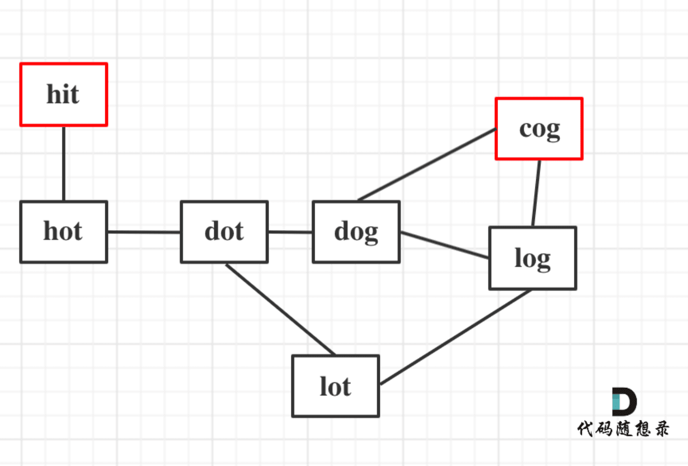

* [做專案（多個C++、Java、Go、測試開發、前端專案）](https://www.programmercarl.com/other/kstar.html)
* [刷演算法（algorithm）（兩個月高強度學演算法）](https://www.programmercarl.com/xunlian/xunlianying.html)
* [背誦面試必考題（八股文）（40天挑戰高頻面試題）](https://www.programmercarl.com/xunlian/bagu.html)


# 127. 單字接龍

[LeetCode 題目連結](https://leetcode.cn/problems/word-ladder/)

字典（dictionary） wordList 中從單字 beginWord 和 endWord 的 轉換序列（sequence） 是一個按下述規格形成的序列：
* 序列中第一個單字是 beginWord 。
* 序列中最後一個單字是 endWord 。
* 每次轉換只能改變一個字母。
* 轉換過程中的中間單字必須是字典 wordList 中的單字。
* 給你兩個單字 beginWord 和 endWord 和一個字典 wordList ，找到從 beginWord 到 endWord 的 最短轉換序列 中的 單字數目 。如果不存在這樣的轉換序列，回傳 0。


範例 1：

* 輸入：beginWord = "hit", endWord = "cog", wordList = ["hot","dot","dog","lot","log","cog"]
* 輸出：5
* 解釋：一個最短轉換序列是 "hit" -> "hot" -> "dot" -> "dog" -> "cog", 回傳它的長度 5。

範例 2：
* 輸入：beginWord = "hit", endWord = "cog", wordList = ["hot","dot","dog","lot","log"]
* 輸出：0
* 解釋：endWord "cog" 不在字典中，所以無法進行轉換。


## 解題思路

以範例1為例，從這個圖（graph）中可以看出 hit 到 cog的路線，不止一條，有三條，一條是最短的長度為5，兩條長度為6。



本題只需要求出最短路徑（shortest path）的長度就可以了，不用找出路徑。

所以這道題要解決兩個問題：

* 圖中的線是如何連在一起的
* 起點和終點的最短路徑長度

首先題目中並沒有給出點與點之間的連線，而是要我們自己去連，條件是字元（character）只能差一個，所以判斷點與點之間的關係，要自己判斷是不是差一個字元，如果差一個字元，那就是有連接。

然後就是求起點和終點的最短路徑長度，**這裡無向圖（undirected graph）求最短路，廣度優先搜尋（breadth-first search, BFS）最為合適，廣搜只要搜到了終點，那麼一定是最短的路徑**。因為廣搜就是以起點中心向四周擴散的搜尋。

**本題如果用深度優先搜尋（depth-first search, DFS），會比較麻煩，要在到達終點的不同路徑中選擇一條最短路**。 而廣搜只要到達終點，一定是最短路。

另外需要有一個注意點：

* 本題是一個無向圖，需要用旗標（flag），標記著節點（node）是否走過，否則就會無限迴路（infinite loop）！
* 本題給出集合（set）是陣列（array）型的，可以轉成set結構，查詢更快一些

C++程式碼如下：（詳細註解）

```CPP
class Solution {
public:
    int ladderLength(string beginWord, string endWord, vector<string>& wordList) {
        // 將vector轉成unordered_set，提高查詢速度
        unordered_set<string> wordSet(wordList.begin(), wordList.end());
        // 如果endWord沒有在wordSet出現，直接回傳0
        if (wordSet.find(endWord) == wordSet.end()) return 0;
        // 記錄word是否訪問過
        unordered_map<string, int> visitMap; // <word, 查詢到這個word路徑長度>
        // 初始化佇列
        queue<string> que;
        que.push(beginWord);
        // 初始化visitMap
        visitMap.insert(pair<string, int>(beginWord, 1));

        while(!que.empty()) {
            string word = que.front();
            que.pop();
            int path = visitMap[word]; // 這個word的路徑長度
            for (int i = 0; i < word.size(); i++) {
                string newWord = word; // 用一個新單字替換word，因為每次置換一個字母
                for (int j = 0 ; j < 26; j++) {
                    newWord[i] = j + 'a';
                    if (newWord == endWord) return path + 1; // 找到了end，回傳path+1
                    // wordSet出現了newWord，並且newWord沒有被訪問過
                    if (wordSet.find(newWord) != wordSet.end()
                            && visitMap.find(newWord) == visitMap.end()) {
                        // 加入訪問資訊
                        visitMap.insert(pair<string, int>(newWord, path + 1));
                        que.push(newWord);
                    }
                }
            }
        }
        return 0;
    }
};
```

當然本題也可以用雙向（bidirectional）BFS，就是從頭尾兩端進行搜尋，大家感興趣，可以自己去實作，這裡就不再做詳細講解了。 

## 其他語言版本

### Java 

```java 
public int ladderLength(String beginWord, String endWord, List<String> wordList) {
    HashSet<String> wordSet = new HashSet<>(wordList); //轉換為hash set 加快速度
    if (wordSet.size() == 0 || !wordSet.contains(endWord)) {  //特殊情況判斷
        return 0;
    }
    Queue<String> queue = new LinkedList<>(); //bfs 佇列
    queue.offer(beginWord);
    Map<String, Integer> map = new HashMap<>(); //記錄單字對應路徑長度
    map.put(beginWord, 1);

    while (!queue.isEmpty()) {
        String word = queue.poll(); //取出佇列首單字
        int path  = map.get(word); //取得到該單字的路徑長度
        for (int i = 0; i < word.length(); i++) { //遍歷單字的每個字元
            char[] chars = word.toCharArray(); //將單字轉換為char array，方便替換
            for (char k = 'a'; k <= 'z'; k++) { //從'a' 到 'z' 遍歷替換
                chars[i] = k; //替換第i個字元
                String newWord = String.valueOf(chars); //得到新的字串
                if (newWord.equals(endWord)) {  //如果新的字串值與endWord一致，回傳目前長度+1
                    return path + 1;
                }
                if (wordSet.contains(newWord) && !map.containsKey(newWord)) { //如果新單字在set中，但是沒有訪問過
                    map.put(newWord, path + 1); //記錄單字對應的路徑長度
                    queue.offer(newWord);//加入佇列尾
                }
            }
        }
    }
    return 0; //未找到
}
```

```java
// Java 雙向BFS
class Solution {
    // 判斷單字之間是否只差了一個字母
    public boolean isValid(String currentWord, String chooseWord) {
        int count = 0;
        for (int i = 0; i < currentWord.length(); i++)
            if (currentWord.charAt(i) != chooseWord.charAt(i)) ++count;
        return count == 1;
    }

    public int ladderLength(String beginWord, String endWord, List<String> wordList) {
        if (!wordList.contains(endWord)) return 0;      // 如果 endWord 不在 wordList 中，那麼無法成功轉換，回傳 0

        // ansLeft 記錄從 beginWord 開始 BFS 時能組成的單字數目
        // ansRight 記錄從 endWord 開始 BFS 時能組成的單字數目
        int ansLeft = 0, ansRight = 0;
        
        // queueLeft 表示從 beginWord 開始 BFS 時使用的佇列
        // queueRight 表示從 endWord 開始 BFS 時使用的佇列
        Queue<String> queueLeft = new ArrayDeque<>(), queueRight = new ArrayDeque<>();
        queueLeft.add(beginWord);
        queueRight.add(endWord);

        // 從 beginWord 開始 BFS 時把遍歷到的節點存入 hashSetLeft 中
        // 從 endWord 開始 BFS 時把遍歷到的節點存入 hashSetRight 中
        Set<String> hashSetLeft = new HashSet<>(), hashSetRight = new HashSet<>();
        hashSetLeft.add(beginWord);
        hashSetRight.add(endWord);

        // 只要有一個佇列為空，說明 beginWord 無法轉換到 endWord
        while (!queueLeft.isEmpty() && !queueRight.isEmpty()) {
            ++ansLeft;
            int size = queueLeft.size();
            for (int i = 0; i < size; i++) {
                String currentWord = queueLeft.poll();
                // 只要 hashSetRight 中存在 currentWord，說明從 currentWord 可以轉換到 endWord
                if (hashSetRight.contains(currentWord)) return ansRight + ansLeft;
                for (String chooseWord : wordList) {
                    if (hashSetLeft.contains(chooseWord) || !isValid(currentWord, chooseWord)) continue;
                    hashSetLeft.add(chooseWord);
                    queueLeft.add(chooseWord);
                }
            }
            ++ansRight;
            size = queueRight.size();
            for (int i = 0; i < size; i++) {
                String currentWord = queueRight.poll();
                // 只要 hashSetLeft 中存在 currentWord，說明從 currentWord 可以轉換到 beginWord
                if (hashSetLeft.contains(currentWord)) return ansLeft + ansRight;
                for (String chooseWord : wordList) {
                    if (hashSetRight.contains(chooseWord) || !isValid(currentWord, chooseWord)) continue;
                    hashSetRight.add(chooseWord);
                    queueRight.add(chooseWord);
                }
            }
        }
        return 0;
    }
}
```

### Python 

```python
class Solution:
    def ladderLength(self, beginWord: str, endWord: str, wordList: List[str]) -> int:
        wordSet = set(wordList)
        if len(wordSet)== 0 or endWord not in wordSet:
            return 0
        mapping = {beginWord:1}
        queue = deque([beginWord]) 
        while queue:
            word = queue.popleft()
            path = mapping[word]
            for i in range(len(word)):
                word_list = list(word)
                for j in range(26):
                    word_list[i] = chr(ord('a')+j)
                    newWord = "".join(word_list)
                    if newWord == endWord:
                        return path+1
                    if newWord in wordSet and newWord not in mapping:
                        mapping[newWord] = path+1
                        queue.append(newWord)                      
        return 0
```
### Go 
```go
func ladderLength(beginWord string, endWord string, wordList []string) int {
	wordMap, que, depth := getWordMap(wordList, beginWord), []string{beginWord}, 0
	for len(que) > 0 {
		depth++
		qLen := len(que) // 單字的長度
		for i := 0; i < qLen; i++ {
			word := que[0]
			que = que[1:] // 首位單字出佇列
			candidates := getCandidates(word)
			for _, candidate := range candidates {
				if _, exist := wordMap[candidate]; exist { // 用產生的結果集去查詢
					if candidate == endWord {
						return depth + 1
					}
					delete(wordMap, candidate) // 刪除集合中的用過的結果
					que = append(que, candidate) 
				}
			}
		}
	}
	return 0
}


// 取得單字Map為後續的查詢增加速度
func getWordMap(wordList []string, beginWord string) map[string]int {
	wordMap := make(map[string]int)
	for i, word := range wordList {
		if _, exist := wordMap[word]; !exist {
			if word != beginWord {
				wordMap[word] = i
			}
		}
	}
	return wordMap
}

// 用26個英文字母分別替換掉各個位置的字母，產生一個結果集
func getCandidates(word string) []string {
	var res []string
	for i := 0; i < 26; i++ {
		for j := 0; j < len(word); j++ {
			if word[j] != byte(int('a')+i) {
				res = append(res, word[:j]+string(int('a')+i)+word[j+1:])
			}
		}
	}
	return res
}
```

### JavaScript
```javascript
var ladderLength = function(beginWord, endWord, wordList) {
    // 將wordList轉成Set，提高查詢速度
    const wordSet = new Set(wordList);
    // Set元素個數為0 或者 endWord沒有在wordSet出現，直接回傳0
    if (wordSet.size === 0 || !wordSet.has(endWord)) return 0;
    // 記錄word是否訪問過
    const visitMap = new Map();// <word, 查詢到這個word路徑長度>
    // 初始化佇列
    const queue = [];
    queue.push(beginWord);
    // 初始化visitMap
    visitMap.set(beginWord, 1);
    
    while(queue.length !== 0){
        let word = queue.shift(); // 刪除佇列首元素,將它的值存放在word
        let path = visitMap.get(word); // 這個word的路徑長度
        for(let i = 0; i < word.length; i++){ // 遍歷單字的每個字元
            for (let c = 97; c <= 122; c++) { // 對應26個字母ASCII值 從'a' 到 'z' 遍歷替換
                // 拼接字串得到新的字串
                let newWord = word.slice(0, i) + String.fromCharCode(c) + word.slice(i + 1);
                if(newWord === endWord) return path + 1; // 找到了end，回傳path+1
                // wordSet出現了newWord，並且newWord沒有被訪問過
                if(wordSet.has(newWord) && !visitMap.has(newWord)) {
                    // 加入訪問資訊
                    visitMap.set(newWord, path + 1);
                    queue.push(newWord);
                }
            }
        }
    }
    return 0;
};
```

### TypeScript
```typescript
function ladderLength(
  beginWord: string,
  endWord: string,
  wordList: string[]
): number {
  const words = new Set(wordList);
  if (!words.has(endWord)) return 0;
  if (beginWord.length === 1) return 2;
  let current = new Set([beginWord]);
  let rightcurrent = new Set([endWord]);
  words.delete(endWord);
  let step = 1;
  while (current.size) {
    if (current.size > rightcurrent.size) {
      [current, rightcurrent] = [rightcurrent, current];
    }
    const temp: Set<string> = new Set();
    for (const word of current) {
      for (const right of rightcurrent) {
        if (diffonechar(word, right)) {
          return step + 1;
        }
      }
      for (const other of words) {
        if (diffonechar(other, word)) {
          temp.add(other);

          words.delete(other);
        }
      }
    }
    if (temp.size === 0) return 0;
    current = temp;
    step = step + 1;
  }
  return 0;
}

function diffonechar(word1: string, word2: string): boolean {
  let changes = 0;
  for (let i = 0; i < word1.length; i++) {
    if (word1[i] != word2[i]) changes += 1;
  }
  return changes === 1;
}
```


