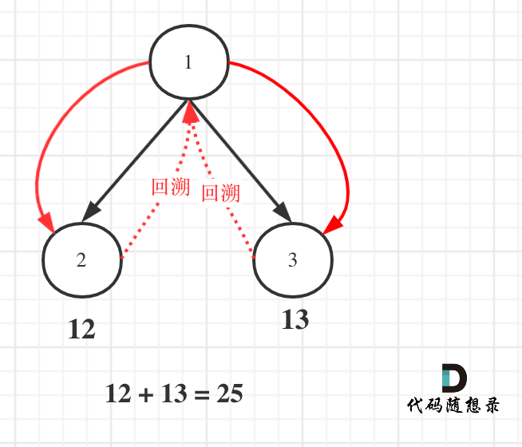

* [做專案（多個C++、Java、Go、測試開發、前端專案）](https://www.programmercarl.com/other/kstar.html)
* [刷演算法（兩個月高強度學演算法）](https://www.programmercarl.com/xunlian/xunlianying.html)
* [背誦面試必考題（八股文）（40天挑戰高頻面試題）](https://www.programmercarl.com/xunlian/bagu.html)


# 129. 求根節點（root node）到葉節點（leaf node）數字之和

[LeetCode 題目連結](https://leetcode.cn/problems/sum-root-to-leaf-numbers/)

## 解題思路

本題和[113.路徑總和II](https://programmercarl.com/0112.路径总和.html#_113-路径总和ii)是類似的想法，做完這道題，可以順便把[113.路徑總和II](https://programmercarl.com/0112.路径总和.html#_113-路径总和ii) 和 [112.路徑總和](https://programmercarl.com/0112.路径总和.html#_112-路径总和) 做了。

結合112.路徑總和 和 113.路徑總和II，我講了[二元樹（binary tree）：遞迴（recursion）函式（function）究竟什麼時候需要轉回值（return value），什麼時候不要轉回值？](https://programmercarl.com/0112.路径总和.html)，如果大家對二元樹遞迴函式什麼時候需要轉回值很迷茫，可以看一下。

接下來再看本題，就簡單多了，本題其實需要使用回溯（backtracking），但一些同學可能都不知道自己用了回溯，在[二元樹：以為使用了遞迴，其實還隱藏著回溯](https://programmercarl.com/二叉树中递归带着回溯.html)中，我詳細講解了二元樹的遞迴中，如何使用回溯。

接下來我們來看題：

首先解題思路很明確，就是要遍歷（traversal）整個樹（tree）把根節點到葉節點組成的數字相加。

那麼先按遞迴三部曲來分析：

### 遞迴三部曲

如果對遞迴三部曲不了解的話，可以看這裡：[二元樹：前中後遞迴詳解](https://programmercarl.com/二叉树的递归遍历.html)

* 確定遞迴函式轉回值及其參數（parameter）

這裡我們要遍歷整個二元樹，且不需要轉回值做邏輯處理，所以轉回值為void，在[二元樹：遞迴函式究竟什麼時候需要轉回值，什麼時候不要轉回值？](https://programmercarl.com/0112.路径总和.html)中，詳細講解了轉回值問題。

參數只需要把根節點傳入，此時還需要定義兩個總體變數（global variable），一個是result，記錄最終結果，一個是vector<int> path。

**為什麼用vector型別（就是陣列（array））呢？ 因為用vector方便我們做回溯！** 

所以程式碼如下：

```
int result;
vector<int> path;
void traversal(TreeNode* cur) 
```

* 確定終止條件（condition） 

遞迴什麼時候終止呢？ 

當然是遇到葉節點，此時要收集結果了，同時回傳本層遞迴，因為單條路徑的結果使用vector，我們需要一個函式vectorToInt把vector轉成int。

終止條件程式碼如下：

```
if (!cur->left && !cur->right) { // 遇到了葉節點
    result += vectorToInt(path);
    return;
}
```

這裡vectorToInt函式就是把陣列轉成int，程式碼如下：

```CPP
int vectorToInt(const vector<int>& vec) {
    int sum = 0;
    for (int i = 0; i < vec.size(); i++) {
        sum = sum * 10 + vec[i];
    }
    return sum;
}
```


* 確定遞迴單層邏輯

本題其實採用前中後序都無所謂， 因為也沒有中間節點（node）的處理邏輯。

這裡主要是當左節點不為空，path收集路徑，並遞迴左子節點（child node），右節點同理。

**但別忘了回溯**。

如圖：


 </img></div>

程式碼如下：

```CPP
                 // 中
if (cur->left) { // 左 （空節點不遍歷）
    path.push_back(cur->left->val);
    traversal(cur->left);    // 遞迴
    path.pop_back();         // 回溯
}
if (cur->right) { // 右 （空節點不遍歷）
    path.push_back(cur->right->val);
    traversal(cur->right);   // 遞迴
    path.pop_back();         // 回溯
}
```

這裡要注意回溯和遞迴要永遠在一起，一個遞迴，對應一個回溯，是一對一的關係，有的同學寫成如下程式碼：

```CPP
if (cur->left) { // 左 （空節點不遍歷）
    path.push_back(cur->left->val);
    traversal(cur->left);    // 遞迴
}
if (cur->right) { // 右 （空節點不遍歷）
    path.push_back(cur->right->val);
    traversal(cur->right);   // 遞迴
}
path.pop_back();         // 回溯
```
**把回溯放在大括號外面了，世界上最遙遠的距離，是你在大括號裡，而我在大括號外！** 這就不對了。

整體C++程式碼

關鍵邏輯分析完了，整體C++程式碼如下：

```CPP
class Solution {
private:
    int result;
    vector<int> path;
    // 把vector轉換為int
    int vectorToInt(const vector<int>& vec) {
        int sum = 0;
        for (int i = 0; i < vec.size(); i++) {
            sum = sum * 10 + vec[i];
        }
        return sum;
    }
    void traversal(TreeNode* cur) {
        if (!cur->left && !cur->right) { // 遇到了葉節點
            result += vectorToInt(path);
            return;
        }

        if (cur->left) { // 左 （空節點不遍歷）
            path.push_back(cur->left->val);     // 處理節點
            traversal(cur->left);               // 遞迴
            path.pop_back();                    // 回溯，撤銷
        }
        if (cur->right) { // 右 （空節點不遍歷）
            path.push_back(cur->right->val);    // 處理節點
            traversal(cur->right);              // 遞迴
            path.pop_back();                    // 回溯，撤銷
        }
        return ;
    }
public:
    int sumNumbers(TreeNode* root) {
        path.clear();
        if (root == nullptr) return 0;
        path.push_back(root->val);
        traversal(root);
        return result;
    }
};
```

## 總結

過於簡潔的程式碼，很容易讓初學者忽視了本題中回溯的精髓，甚至作者本身都沒有想清楚自己用了回溯。

**我這裡提供的程式碼把整個回溯過程充分體現出來，希望可以幫助大家看得明明白白！** 


## 其他語言版本

### Java： 

```java
class Solution {
    List<Integer> path = new ArrayList<>();
    int res = 0;
    public int sumNumbers(TreeNode root) {
        // 如果節點為0，那麼就回傳0
        if (root == null) return 0;
        // 首先將根節點放到集合中
        path.add(root.val);
        // 開始遞迴
        recur(root);
        return res;
    }

    public void recur(TreeNode root){
        if (root.left == null && root.right == null) {
            // 當是葉節點的時候，開始處理
            res += listToInt(path);
            return;
        }

        if (root.left != null){
            // 注意有回溯
            path.add(root.left.val);
            recur(root.left);
            path.remove(path.size() - 1);
        }
        if (root.right != null){
            // 注意有回溯
            path.add(root.right.val);
            recur(root.right);
            path.remove(path.size() - 1);
        }
        return;
    }
    public int listToInt(List<Integer> path){
        int sum = 0;
        for (Integer num:path){
            // sum * 10 表示進位
            sum = sum * 10 + num;
        }
        return sum;
    }
}
```

### Python：

```python
class Solution:
    def sumNumbers(self, root: TreeNode) -> int:
        res = 0
        path = []
        def backtrace(root):
            nonlocal res
            if not root: return # 節點空則回傳
            path.append(root.val)
            if not root.left and not root.right: # 遇到了葉節點
                res += get_sum(path)
            if root.left: # 左子樹不空
                backtrace(root.left)
            if root.right: # 右子樹不空
                backtrace(root.right)
            path.pop()

        def get_sum(arr):
            s = 0
            for i in range(len(arr)):
                s = s * 10 + arr[i]
            return s

        backtrace(root)
        return res
```
### Go：

```go
func sumNumbers(root *TreeNode) int {
    sum := 0
    dfs(root, root.Val, &sum)
    return sum
}

func dfs(root *TreeNode, tmpSum int, sum *int) {
    if root.Left == nil && root.Right == nil {
        *sum += tmpSum
    } else {
        if root.Left != nil {
            dfs(root.Left, tmpSum*10 + root.Left.Val, sum)
        }
        if root.Right != nil {
            dfs(root.Right, tmpSum*10 + root.Right.Val, sum)
        }
    }
}
```


### JavaScript：

```javascript
var sumNumbers = function(root) {
    const listToInt = path => {
        let sum = 0;
        for(let num of path){
            // sum * 10 表示進位
            sum = sum * 10 + num;
        }
        return sum;
    }
    const recur = root =>{
        if (root.left == null && root.right == null) {
            // 當是葉節點的時候，開始處理
            res += listToInt(path);
            return;
        }

        if (root.left != null){
            // 注意有回溯
            path.push(root.left.val);
            recur(root.left);
            path.pop();
        }
        if (root.right != null){
            // 注意有回溯
            path.push(root.right.val);
            recur(root.right);
            path.pop();
        }
        return;
    };
    const path = new Array();
    let res = 0;
    // 如果節點為0，那麼就回傳0
    if (root == null) return 0;
    // 首先將根節點放到集合中
    path.push(root.val);
    // 開始遞迴
    recur(root);
    return res;
};
```

### TypeScript：

```typescript
function sumNumbers(root: TreeNode | null): number {
    if (root === null) return 0;
    // 記錄最終結果
    let resTotal: number = 0;
    // 記錄路徑中遇到的節點值
    const route: number[] = [];
    // 遞迴初始值
    route.push(root.val);
    recur(root, route);
    return resTotal;
    function recur(node: TreeNode, route: number[]): void {
        if (node.left === null && node.right === null) {
            resTotal += listToSum(route);
            return;
        }
        if (node.left !== null) {
            route.push(node.left.val);
            recur(node.left, route);
            route.pop();
        };
        if (node.right !== null) {
            route.push(node.right.val);
            recur(node.right, route);
            route.pop();
        };
    }
    function listToSum(nums: number[]): number {
        // 陣列求和
        return Number(nums.join(''));
    }
};
```

### C:

```c
//sum記錄總和
int sum;
void traverse(struct TreeNode *node, int val) {
    //更新val為根節點到目前節點的和
    val = val * 10 + node->val;
    //若目前節點為葉節點，記錄val
    if(!node->left && !node->right) {
        sum+=val;
        return;
    }
    //若有左/右節點，遍歷左/右節點
    if(node->left) 
        traverse(node->left, val);
    if(node->right)
        traverse(node->right, val);
}

int sumNumbers(struct TreeNode* root){
    sum = 0;
    
    traverse(root, 0);

    return sum;
}
```


