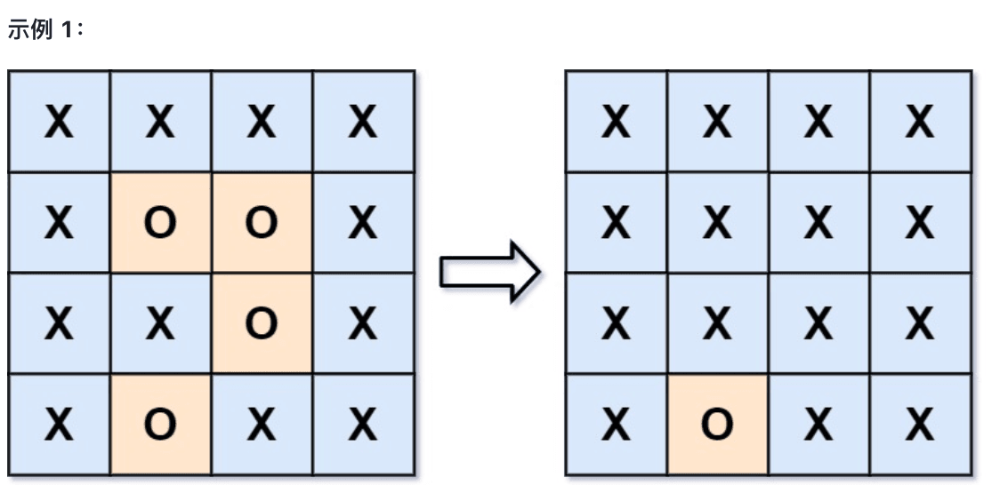
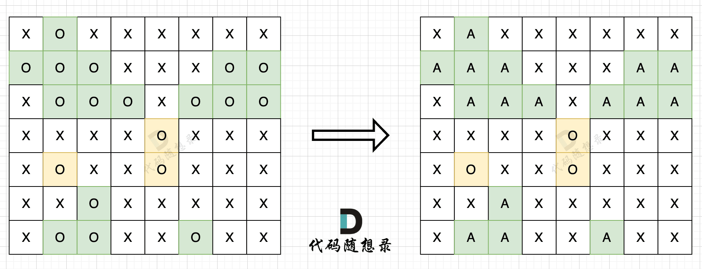
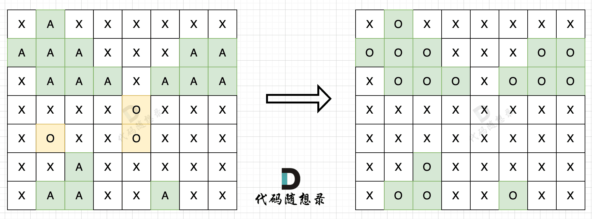

* [做專案（多個C++、Java、Go、測試開發、前端專案）](https://www.programmercarl.com/other/kstar.html)
* [刷演算法（兩個月高強度學演算法）](https://www.programmercarl.com/xunlian/xunlianying.html)
* [背誦面試必考題（八股文）（40天挑戰高頻面試題）](https://www.programmercarl.com/xunlian/bagu.html)

# 130. 被圍繞的區域 

[題目連結](https://leetcode.com/problems/surrounded-regions/)

給你一個 m x n 的矩陣（matrix） board ，由若干字元（character） 'X' 和 'O' 構成，找到所有被 'X' 圍繞的區域，並將這些區域裡所有的 'O' 用 'X' 填充。 

 

* 輸入：board = [["X","X","X","X"],["X","O","O","X"],["X","X","O","X"],["X","O","X","X"]]
* 輸出：[["X","X","X","X"],["X","X","X","X"],["X","X","X","X"],["X","O","X","X"]]
* 解釋：被圍繞的區間（interval）不會存在於邊界（boundary）上，換句話說，任何邊界上的 'O' 都不會被填充為 'X'。 任何不在邊界上，或不與邊界上的 'O' 相連的 'O' 最終都會被填充為 'X'。如果兩個元素（element）在水平或垂直方向相鄰，則稱它們是「相連」的。

## 解題思路

這道題目和1020. 飛地的數量正好反過來了，[1020. 飛地的數量](./1020.飛地的數量.md)是求 地圖中間的空格數，而本題是要把地圖中間的'O'都改成'X'。 

那麼兩題在解題思路上也是差不多的。

依然是從地圖周邊出發，將周邊空格相鄰的'O'都做上標記，然後再遍歷（traversal）一遍地圖，遇到 'O' 且沒做過標記的，那麼都是地圖中間的'O'，全部改成'X'就行。

有的讀者（錄友）可能想，我再定義一個 visited 二維（2D）陣列（array），單獨標記周邊的'O'，然後遍歷地圖的時候同時對 陣列board 和 陣列visited 進行判斷，是否將'O'改成'X'。

這樣做其實就有點麻煩了，不用額外定義空間了，標記周邊的'O'，可以直接改board的數值為其他特殊值。 

步驟一：深度優先搜尋（depth-first search, DFS）或者廣度優先搜尋（breadth-first search, BFS）將地圖周邊的'O'全部改成'A'，如圖所示： 

 

步驟二：再遍歷地圖，將'O'全部改成'X'（地圖中間的'O'改成了'X'），將'A'改回'O'（保留的地圖周邊的'O'），如圖所示： 



整體C++程式碼如下，以下使用dfs實作，其實遍歷方式dfs，bfs都是可以的。 

```CPP 
class Solution {
private:
    int dir[4][2] = {-1, 0, 0, -1, 1, 0, 0, 1}; // 保存四個方向
    void dfs(vector<vector<char>>& board, int x, int y) {
        board[x][y] = 'A';
        for (int i = 0; i < 4; i++) { // 向四個方向遍歷
            int nextx = x + dir[i][0];
            int nexty = y + dir[i][1];
            // 超過邊界
            if (nextx < 0 || nextx >= board.size() || nexty < 0 || nexty >= board[0].size()) continue;
            // 不符合條件，不繼續遍歷
            if (board[nextx][nexty] == 'X' || board[nextx][nexty] == 'A') continue;
            dfs (board, nextx, nexty);
        }
        return;
    }

public:
    void solve(vector<vector<char>>& board) {
        int n = board.size(), m = board[0].size(); 
        // 步驟一：
        // 從左側邊，和右側邊 向中間遍歷
        for (int i = 0; i < n; i++) {
            if (board[i][0] == 'O') dfs(board, i, 0);
            if (board[i][m - 1] == 'O') dfs(board, i, m - 1);
        }

        // 從上邊和下邊 向中間遍歷
        for (int j = 0; j < m; j++) {
            if (board[0][j] == 'O') dfs(board, 0, j);
            if (board[n - 1][j] == 'O') dfs(board, n - 1, j);
        }
        // 步驟二：
        for (int i = 0; i < n; i++) {
            for (int j = 0; j < m; j++) {
                if (board[i][j] == 'O') board[i][j] = 'X';
                if (board[i][j] == 'A') board[i][j] = 'O';
            }
        }
    }
};
```

## 其他語言版本 

### Java

```Java
// 廣度優先遍歷
// 使用 visited 陣列進行標記
class Solution {
    private static final int[][] position = {{-1, 0}, {0, 1}, {1, 0}, {0, -1}};  // 四個方向

    public void solve(char[][] board) {
        // rowSize：列的長度，colSize：行的長度
        int rowSize = board.length, colSize = board[0].length; 
        boolean[][] visited = new boolean[rowSize][colSize];
        Queue<int[]> queue = new ArrayDeque<>();
        // 從左側邊，和右側邊遍歷
        for (int row = 0; row < rowSize; row++) {
            if (board[row][0] == 'O') {
                visited[row][0] = true;
                queue.add(new int[]{row, 0});
            }
            if (board[row][colSize - 1] == 'O') {
                visited[row][colSize - 1] = true;
                queue.add(new int[]{row, colSize - 1});
            }
        }
        // 從上邊和下邊遍歷，在對左側邊和右側邊遍歷時我們已經遍歷了矩陣的四個角
        // 所以在遍歷上邊和下邊時可以不用遍歷四個角
        for (int col = 1; col < colSize - 1; col++) {
            if (board[0][col] == 'O') {
                visited[0][col] = true;
                queue.add(new int[]{0, col});
            }
            if (board[rowSize - 1][col] == 'O') {
                visited[rowSize - 1][col] = true;
                queue.add(new int[]{rowSize - 1, col});
            }
        }
        // 廣度優先遍歷，把沒有被 'X' 包圍的 'O' 進行標記
        while (!queue.isEmpty()) {
            int[] current = queue.poll();
            for (int[] pos: position) {
                int row = current[0] + pos[0], col = current[1] + pos[1];
                // 如果範圍越界、位置已被訪問過、該位置的值不是 'O'，就直接跳過
                if (row < 0 || row >= rowSize || col < 0 || col >= colSize) continue;
                if (visited[row][col] || board[row][col] != 'O') continue;
                visited[row][col] = true;
                queue.add(new int[]{row, col});
            }
        }
        // 遍歷陣列，把沒有被標記的 'O' 修改成 'X'
        for (int row = 0; row < rowSize; row++) {
            for (int col = 0; col < colSize; col++) {
                if (board[row][col] == 'O' && !visited[row][col]) board[row][col] = 'X';
            }
        }
    }
}
```
```Java
// 廣度優先遍歷
// 直接修改 board 的值為其他特殊值
class Solution {
    private static final int[][] position = {{-1, 0}, {0, 1}, {1, 0}, {0, -1}};  // 四個方向

    public void solve(char[][] board) {
        // rowSize：列的長度，colSize：行的長度
        int rowSize = board.length, colSize = board[0].length;
        Queue<int[]> queue = new ArrayDeque<>();
        // 從左側邊，和右側邊遍歷
        for (int row = 0; row < rowSize; row++) {
            if (board[row][0] == 'O')
                queue.add(new int[]{row, 0});
            if (board[row][colSize - 1] == 'O')
                queue.add(new int[]{row, colSize - 1});
        }
        // 從上邊和下邊遍歷，在對左側邊和右側邊遍歷時我們已經遍歷了矩陣的四個角
        // 所以在遍歷上邊和下邊時可以不用遍歷四個角
        for (int col = 1; col < colSize - 1; col++) {
            if (board[0][col] == 'O')
                queue.add(new int[]{0, col});
            if (board[rowSize - 1][col] == 'O')
                queue.add(new int[]{rowSize - 1, col});
        }
        // 廣度優先遍歷，把沒有被 'X' 包圍的 'O' 修改成特殊值
        while (!queue.isEmpty()) {
            int[] current = queue.poll();
            board[current[0]][current[1]] = 'A';
            for (int[] pos: position) {
                int row = current[0] + pos[0], col = current[1] + pos[1];
                // 如果範圍越界、該位置的值不是 'O'，就直接跳過
                if (row < 0 || row >= rowSize || col < 0 || col >= colSize) continue;
                if (board[row][col] != 'O') continue;
                queue.add(new int[]{row, col});
            }
        }
        // 遍歷陣列，把 'O' 修改成 'X'，特殊值修改成 'O'
        for (int row = 0; row < rowSize; row++) {
            for (int col = 0; col < colSize; col++) {
                if (board[row][col] == 'A') board[row][col] = 'O';
                else if (board[row][col] == 'O') board[row][col] = 'X'; 
            }
        }
    }
}
```
```Java
//BFS（使用helper function）
class Solution {
    int[][] dir ={{0, 1}, {1, 0}, {0, -1}, {-1, 0}};
    public void solve(char[][] board) {
        for(int i = 0; i < board.length; i++){
            if(board[i][0] == 'O') bfs(board, i, 0);
            if(board[i][board[0].length - 1] == 'O') bfs(board, i, board[0].length - 1);
        }

        for(int j = 1 ; j < board[0].length - 1; j++){
            if(board[0][j] == 'O') bfs(board, 0, j);
            if(board[board.length - 1][j] == 'O') bfs(board, board.length - 1, j);
        }

        for(int i = 0; i < board.length; i++){
            for(int j = 0; j < board[0].length; j++){
                if(board[i][j] == 'O') board[i][j] = 'X';
                if(board[i][j] == 'A') board[i][j] = 'O';
            }
        }
    }
    private void bfs(char[][] board, int x, int y){
        Queue<Integer> que = new LinkedList<>();
        board[x][y] = 'A';
        que.offer(x);
        que.offer(y);
        
        while(!que.isEmpty()){
            int currX = que.poll();
            int currY = que.poll();

            for(int i = 0; i < 4; i++){
                int nextX = currX + dir[i][0];
                int nextY = currY + dir[i][1];

            if(nextX < 0 || nextY < 0 || nextX >= board.length || nextY >= board[0].length)
                continue;
            if(board[nextX][nextY] == 'X'|| board[nextX][nextY] == 'A')
                continue;
            bfs(board, nextX, nextY);
            }
        }
    }
}

```

```Java
// 深度優先遍歷
// 使用 visited 陣列進行標記
class Solution {
    private static final int[][] position = {{-1, 0}, {0, 1}, {1, 0}, {0, -1}};  // 四個方向

    public void dfs(char[][] board, int row, int col, boolean[][] visited) {
        for (int[] pos: position) {
            int nextRow = row + pos[0], nextCol = col + pos[1];
            // 位置越界
            if (nextRow < 0 || nextRow >= board.length || nextCol < 0 || nextCol >= board[0].length)
                continue;
            // 位置已被訪問過、新位置值不是 'O'
            if (visited[nextRow][nextCol] || board[nextRow][nextCol] != 'O') continue;
            visited[nextRow][nextCol] = true;
            dfs(board, nextRow, nextCol, visited);
        }
    }

    public void solve(char[][] board) {
        int rowSize = board.length, colSize = board[0].length;
        boolean[][] visited = new boolean[rowSize][colSize];
        // 從左側邊、右側邊遍歷
        for (int row = 0; row < rowSize; row++) {
            if (board[row][0] == 'O' && !visited[row][0]) {
                visited[row][0] = true;
                dfs(board, row, 0, visited);
            }
            if (board[row][colSize - 1] == 'O' && !visited[row][colSize - 1]) {
                visited[row][colSize - 1] = true;
                dfs(board, row, colSize - 1, visited);
            }
        }
        // 從上邊和下邊遍歷，在對左側邊和右側邊遍歷時我們已經遍歷了矩陣的四個角
        // 所以在遍歷上邊和下邊時可以不用遍歷四個角
        for (int col = 1; col < colSize - 1; col++) {
            if (board[0][col] == 'O' && !visited[0][col]) {
                visited[0][col] = true;
                dfs(board, 0, col, visited);
            }
            if (board[rowSize - 1][col] == 'O' && !visited[rowSize - 1][col]) {
                visited[rowSize - 1][col] = true;
                dfs(board, rowSize - 1, col, visited);
            }
        }
        // 遍歷陣列，把沒有被標記的 'O' 修改成 'X'
        for (int row = 0; row < rowSize; row++) {
            for (int col = 0; col < colSize; col++) {
                if (board[row][col] == 'O' && !visited[row][col]) board[row][col] = 'X';
            }
        }
    }
}
```
```Java
// 深度優先遍歷
// // 直接修改 board 的值為其他特殊值
class Solution {
    private static final int[][] position = {{-1, 0}, {0, 1}, {1, 0}, {0, -1}};  // 四個方向

    public void dfs(char[][] board, int row, int col) {
        for (int[] pos: position) {
            int nextRow = row + pos[0], nextCol = col + pos[1];
            // 位置越界
            if (nextRow < 0 || nextRow >= board.length || nextCol < 0 || nextCol >= board[0].length)
                continue;
            // 新位置值不是 'O'
            if (board[nextRow][nextCol] != 'O') continue;
            board[nextRow][nextCol] = 'A';      // 修改為特殊值
            dfs(board, nextRow, nextCol);
        }
    }

    public void solve(char[][] board) {
        int rowSize = board.length, colSize = board[0].length;
        // 從左側邊、右側邊遍歷
        for (int row = 0; row < rowSize; row++) {
            if (board[row][0] == 'O') {
                board[row][0] = 'A';
                dfs(board, row, 0);
            }
            if (board[row][colSize - 1] == 'O') {
                board[row][colSize - 1] = 'A';
                dfs(board, row, colSize - 1);
            }
        }
        // 從上邊和下邊遍歷，在對左側邊和右側邊遍歷時我們已經遍歷了矩陣的四個角
        // 所以在遍歷上邊和下邊時可以不用遍歷四個角
        for (int col = 1; col < colSize - 1; col++) {
            if (board[0][col] == 'O') {
                board[0][col] = 'A';
                dfs(board, 0, col);
            }
            if (board[rowSize - 1][col] == 'O') {
                board[rowSize - 1][col] = 'A';
                dfs(board, rowSize - 1, col);
            }
        }
        // 遍歷陣列，把 'O' 修改成 'X'，特殊值修改成 'O'
        for (int row = 0; row < rowSize; row++) {
            for (int col = 0; col < colSize; col++) {
                if (board[row][col] == 'O') board[row][col] = 'X';
                else if (board[row][col] == 'A') board[row][col] = 'O';
            }
        }
    }
}
```
```java
//DFS(有終止條件)
class Solution {
    int[][] dir ={{0, 1}, {1, 0}, {0, -1}, {-1, 0}};
    public void solve(char[][] board) {

        for(int i = 0; i < board.length; i++){
            if(board[i][0] == 'O') dfs(board, i, 0);
            if(board[i][board[0].length - 1] == 'O') dfs(board, i, board[0].length - 1);
        }

        for(int j = 1 ; j < board[0].length - 1; j++){
            if(board[0][j] == 'O') dfs(board, 0, j);
            if(board[board.length - 1][j] == 'O') dfs(board, board.length - 1, j);
        }

        for(int i = 0; i < board.length; i++){
            for(int j = 0; j < board[0].length; j++){
                if(board[i][j] == 'O') board[i][j] = 'X';
                if(board[i][j] == 'A') board[i][j] = 'O';
            }
        }        
    }

    private void dfs(char[][] board, int x, int y){
        if(board[x][y] == 'X'|| board[x][y] == 'A')
            return;
        board[x][y] = 'A';
        for(int i = 0; i < 4; i++){
            int nextX = x + dir[i][0];
            int nextY = y + dir[i][1];
            
            if(nextX < 0 || nextY < 0 || nextX >= board.length || nextY >= board[0].length)
                continue;
            // if(board[nextX][nextY] == 'X'|| board[nextX][nextY] == 'A')
            //     continue;
            dfs(board, nextX, nextY);
        }
    }
}
```
### Python3

```Python
// 深度優先遍歷
class Solution:
    dir_list = [(0, 1), (0, -1), (1, 0), (-1, 0)]
    def solve(self, board: List[List[str]]) -> None:
        """
        Do not return anything, modify board in-place instead.
        """
        row_size = len(board)
        column_size = len(board[0])
        visited = [[False] * column_size for _ in range(row_size)]
        # 從邊緣開始，將邊緣相連的O改成A。然後遍歷所有，將A改成O，O改成X
        # 第一列和最後一列
        for i in range(column_size):
            if board[0][i] == "O" and not visited[0][i]:
                self.dfs(board, 0, i, visited)
            if board[row_size-1][i] == "O" and not visited[row_size-1][i]:
                self.dfs(board, row_size-1, i, visited)

        # 第一行和最後一行
        for i in range(1, row_size-1):
            if board[i][0] == "O" and not visited[i][0]:
                self.dfs(board, i, 0, visited)
            if board[i][column_size-1] == "O" and not visited[i][column_size-1]:
                self.dfs(board, i, column_size-1, visited)
        
        for i in range(row_size):
            for j in range(column_size):
                if board[i][j] == "A":
                    board[i][j] = "O"
                elif board[i][j] == "O":
                    board[i][j] = "X"

    
    def dfs(self, board, x, y, visited):
        if visited[x][y] or board[x][y] == "X":
            return
        visited[x][y] = True
        board[x][y] = "A"
        for i in range(4):
            new_x = x + self.dir_list[i][0]
            new_y = y + self.dir_list[i][1]
            if new_x >= len(board) or new_y >= len(board[0]) or new_x < 0 or new_y < 0:
                continue
            self.dfs(board, new_x, new_y, visited)

```

### JavaScript
```JavaScript
/**
 * @description 深度優先搜尋
 * @param {character[][]} board
 * @return {void} Do not return anything, modify board in-place instead.
 */
function solve(board) {
  const dir = [[-1, 0], [1, 0], [0, -1], [0, 1]];
  const [rowSize, colSize] = [board.length, board[0].length];

  function dfs(board, x, y) {
    board[x][y] = 'A';
    for (let i = 0; i < 4; i++) {
      const nextX = dir[i][0] + x;
      const nextY = dir[i][1] + y;
      if (nextX < 0 || nextX >= rowSize || nextY < 0 || nextY >= colSize) {
        continue;
      }
      if (board[nextX][nextY] === 'O') {
        dfs(board, nextX, nextY);
      }
    }
  }

  for (let i = 0; i < rowSize; i++) {
    if (board[i][0] === 'O') {
      dfs(board, i, 0);
    }
    if (board[i][colSize - 1] === 'O') {
      dfs(board, i, colSize - 1);
    }
  }

  for (let i = 1; i < colSize - 1; i++) {
    if (board[0][i] === 'O') {
      dfs(board, 0, i);
    }
    if (board[rowSize - 1][i] === 'O') {
      dfs(board, rowSize - 1, i);
    }
  }

  for (let i = 0; i < rowSize; i++) {
    for (let k = 0; k < colSize; k++) {
      if (board[i][k] === 'A') {
        board[i][k] = 'O';
      } else if (board[i][k] === 'O') {
        board[i][k] = 'X';
      }
    }
  }
}

/**
 * @description 廣度優先搜尋
 * @param {character[][]} board
 * @return {void} Do not return anything, modify board in-place instead.
 */
function solve(board) {
  const dir = [[-1, 0], [1, 0], [0, -1], [0, 1]];
  const [rowSize, colSize] = [board.length, board[0].length];

  function bfs(board, x, y) {
    board[x][y] = 'A';
    const stack = [y, x];

    while (stack.length !== 0) {
      const top = [stack.pop(), stack.pop()];
      for (let i = 0; i < 4; i++) {
        const nextX = dir[i][0] + top[0];
        const nextY = dir[i][1] + top[1];

        if (nextX < 0 || nextX >= rowSize || nextY < 0 || nextY >= colSize) {
          continue;
        }

        if (board[nextX][nextY] === 'O') {
          board[nextX][nextY] = 'A';
          stack.push(nextY, nextX);
        }
      }
    }

    for (let i = 0; i < 4; i++) {
      const nextX = dir[i][0] + x;
      const nextY = dir[i][1] + y;
      if (nextX < 0 || nextX >= rowSize || nextY < 0 || nextY >= colSize) {
        continue;
      }
      if (board[nextX][nextY] === 'O') {
        dfs(board, nextX, nextY);
      }
    }
  }

  for (let i = 0; i < rowSize; i++) {
    if (board[i][0] === 'O') {
      bfs(board, i, 0);
    }
    if (board[i][colSize - 1] === 'O') {
      bfs(board, i, colSize - 1);
    }
  }

  for (let i = 1; i < colSize - 1; i++) {
    if (board[0][i] === 'O') {
      bfs(board, 0, i);
    }
    if (board[rowSize - 1][i] === 'O') {
      bfs(board, rowSize - 1, i);
    }
  }

  for (let i = 0; i < rowSize; i++) {
    for (let k = 0; k < colSize; k++) {
      if (board[i][k] === 'A') {
        board[i][k] = 'O';
      } else if (board[i][k] === 'O') {
        board[i][k] = 'X';
      }
    }
  }
}
```

### Go

dfs:

```go
var DIRECTIONS = [4][2]int{{-1, 0}, {0, -1}, {1, 0}, {0, 1}}

func solve(board [][]byte) {
	rows, cols := len(board), len(board[0])
	// 行
	for i := 0; i < rows; i++ {
		if board[i][0] == 'O' {
			dfs(board, i, 0)
		}
		if board[i][cols-1] == 'O' {
			dfs(board, i, cols-1)
		}
	}
	// 列
	for j := 0; j < cols; j++ {
		if board[0][j] == 'O' {
			dfs(board, 0, j)
		}
		if board[rows-1][j] == 'O' {
			dfs(board, rows-1, j)
		}
	}

	for _, r := range board {
		for j, c := range r {
			if c == 'A' {
				r[j] = 'O'
				continue
			}
			if c == 'O' {
				r[j] = 'X'
			}
		}
	}
}

func dfs(board [][]byte, i, j int) {
	board[i][j] = 'A'
	for _, d := range DIRECTIONS {
		x, y := i+d[0], j+d[1]
		if x < 0 || x >= len(board) || y < 0 || y >= len(board[0]) {
			continue
		}
		if board[x][y] == 'O' {
			dfs(board, x, y)
		}
	}
}
```

bfs:

```go
var DIRECTIONS = [4][2]int{{-1, 0}, {0, -1}, {1, 0}, {0, 1}}

func solve(board [][]byte) {
	rows, cols := len(board), len(board[0])
	// 行
	for i := 0; i < rows; i++ {
		if board[i][0] == 'O' {
			bfs(board, i, 0)
		}
		if board[i][cols-1] == 'O' {
			bfs(board, i, cols-1)
		}
	}
	// 列
	for j := 0; j < cols; j++ {
		if board[0][j] == 'O' {
			bfs(board, 0, j)
		}
		if board[rows-1][j] == 'O' {
			bfs(board, rows-1, j)
		}
	}

	for _, r := range board {
		for j, c := range r {
			if c == 'A' {
				r[j] = 'O'
                         	continue
			}
			if c == 'O' {
				r[j] = 'X'
			}
		}
	}
}

func bfs(board [][]byte, i, j int) {
	queue := [][]int{{i, j}}
	board[i][j] = 'A'
	for len(queue) > 0 {
		cur := queue[0]
		queue = queue[1:]
		for _, d := range DIRECTIONS {
			x, y := cur[0]+d[0], cur[1]+d[1]
			if x < 0 || x >= len(board) || y < 0 || y >= len(board[0]) {
				continue
			}
			if board[x][y] == 'O' {
				board[x][y] = 'A'
				queue = append(queue, []int{x, y})
			}
		}
	}
}
```

### Rust

bfs:

```rust
impl Solution {
    const DIRECTIONS: [(isize, isize); 4] = [(0, 1), (0, -1), (1, 0), (-1, 0)];
    pub fn solve(board: &mut Vec<Vec<char>>) {
        let (rows, cols) = (board.len(), board[0].len());
        // 行
        for i in 0..rows {
            if board[i][0] == 'O' {
                Self::dfs(board, i, 0);
            }
            if board[i][cols - 1] == 'O' {
                Self::dfs(board, i, cols - 1);
            }
        }
        //列
        for j in 0..cols {
            if board[0][j] == 'O' {
                Self::dfs(board, 0, j);
            }
            if board[rows - 1][j] == 'O' {
                Self::dfs(board, rows - 1, j);
            }
        }

        for v in board.iter_mut() {
            for c in v.iter_mut() {
                if *c == 'A' {
                    *c = 'O';
                    continue;
                }
                if *c == 'O' {
                    *c = 'X';
                }
            }
        }
    }

    pub fn dfs(board: &mut [Vec<char>], i: usize, j: usize) {
        board[i][j] = 'A';
        for (d1, d2) in Self::DIRECTIONS {
            let (x, y) = (i as isize + d1, j as isize + d2);
            if x < 0 || x >= board.len() as isize || y < 0 || y >= board[0].len() as isize {
                continue;
            }
            let (x, y) = (x as usize, y as usize);
            if board[x][y] == 'O' {
                Self::dfs(board, x, y);
            }
        }
    }
}
```

bfs:

```rust
use std::collections::VecDeque;
impl Solution {
    const DIRECTIONS: [(isize, isize); 4] = [(0, 1), (0, -1), (1, 0), (-1, 0)];
    pub fn solve(board: &mut Vec<Vec<char>>) {
        let (rows, cols) = (board.len(), board[0].len());
        // 行
        for i in 0..rows {
            if board[i][0] == 'O' {
                Self::bfs(board, i, 0);
            }
            if board[i][cols - 1] == 'O' {
                Self::bfs(board, i, cols - 1);
            }
        }
        //列
        for j in 0..cols {
            if board[0][j] == 'O' {
                Self::bfs(board, 0, j);
            }
            if board[rows - 1][j] == 'O' {
                Self::bfs(board, rows - 1, j);
            }
        }

        for v in board.iter_mut() {
            for c in v.iter_mut() {
                if *c == 'A' {
                    *c = 'O';
                    continue;
                }
                if *c == 'O' {
                    *c = 'X';
                }
            }
        }
    }

    pub fn bfs(board: &mut [Vec<char>], i: usize, j: usize) {
        let mut queue = VecDeque::from([(i, j)]);
        board[i][j] = 'A';
        while let Some((i, j)) = queue.pop_front() {
            for (d1, d2) in Self::DIRECTIONS {
                let (x, y) = (i as isize + d1, j as isize + d2);
                if x < 0 || x >= board.len() as isize || y < 0 || y >= board[0].len() as isize {
                    continue;
                }
                let (x, y) = (x as usize, y as usize);
                if board[x][y] == 'O' {
                    board[x][y] = 'A';
                    queue.push_back((x, y));
                }
            }
        }
    }
}
```


