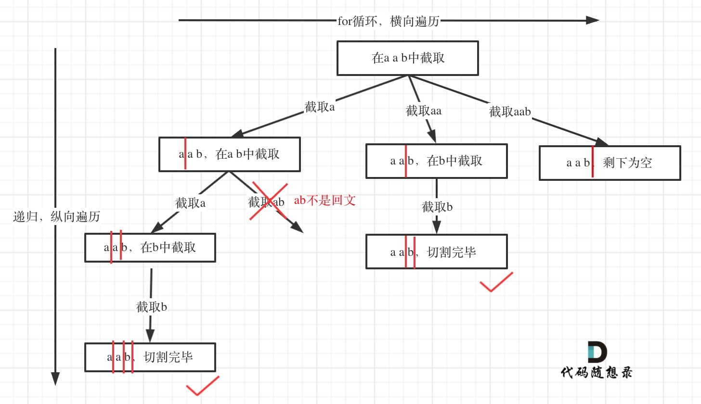

* [做專案（多個 C++、Java、Go、測試開發、前端（front end）專案）](https://www.programmercarl.com/other/kstar.html)
* [刷演算法（兩個月高強度學演算法）](https://www.programmercarl.com/xunlian/xunlianying.html)
* [背面試必考題（八股文）（40 天挑戰高頻面試題）](https://www.programmercarl.com/xunlian/bagu.html)


> 切割問題其實是一種組合（combination）問題！

# 131.分割回文（palindrome）串

[LeetCode 題目連結](https://leetcode.com/problems/palindrome-partitioning/)

給定一個字串（string） s，將 s 分割成一些子字串（substring），使每個子字串都是回文串。

回傳 s 所有可能的分割方案。

範例:
輸入: "aab"
輸出:
[
  ["aa","b"],
  ["a","a","b"]
]

## 演算法公開課

**[《程式碼隨想錄》演算法影片公開課](https://programmercarl.com/other/gongkaike.html)：[131.分割回文串](https://www.bilibili.com/video/BV1c54y1e7k6)，相信結合影片再看本篇題解，更有助於大家對本題的理解**。


## 解題思路

本題這涉及到兩個關鍵問題：

1. 切割問題，有不同的切割方式
2. 判斷回文

相信這裡不同的切割方式可以搞懵很多同學了。

這種題目，想用 for 迴圈（for-loop）蠻力（brute force）解法，可能都不那麼容易寫出來，所以要換一種蠻力的方式，就是回溯（backtracking）。

一些同學可能想不清楚 回溯究竟是如何切割字串呢？

我們來分析一下切割，**其實切割問題類似組合問題**。

例如對於字串 abcdef：

* 組合問題：選取一個 a 之後，在 bcdef 中再去選取第二個，選取 b 之後在 cdef 中再選取第三個.....。
* 切割問題：切割一個 a 之後，在 bcdef 中再去切割第二段，切割 b 之後在 cdef 中再切割第三段.....。

感受出來了嗎？

所以切割問題，也可以抽象為一棵樹狀結構（tree structure），如圖：



遞迴（recursion）用來縱向遍歷（traversal），for 迴圈用來橫向遍歷，切割線（就是圖中的紅線）切割到字串的結尾位置，說明找到了一個切割方法。

此時可以發現，切割問題的回溯搜尋的過程和組合問題的回溯搜尋的過程是差不多的。

### 回溯三部曲

* 遞迴函數（recursive function）參數（parameter）

全域變數（global variable）陣列（array） path 存放切割後回文的子字串，二維（2D）陣列 result 存放結果集。 （這兩個參數可以放到函數（function）參數裡）

本題遞迴函數參數還需要 startIndex，因為切割過的地方，不能重複切割，和組合問題也是保持一致的。

在[回溯演算法（backtracking algorithm）：求組合總和（二）](./0039.組合總和.md)中我們深入探討了組合問題什麼時候需要 startIndex，什麼時候不需要 startIndex。

程式碼如下：

```CPP
vector<vector<string>> result;
vector<string> path; // 放已經回文的子字串
void backtracking (const string& s, int startIndex) {
```

* 遞迴函數終止條件（termination condition）


從樹狀結構的圖中可以看出：切割線切到了字串最後面，說明找到了一種切割方法，此時就是本層遞迴的終止條件。

**那麼在程式碼裡什麼是切割線呢？**

在處理組合問題的時候，遞迴參數需要傳入 startIndex，表示下一輪遞迴遍歷的起始位置，這個 startIndex 就是切割線。

所以終止條件程式碼如下：

```CPP
void backtracking (const string& s, int startIndex) {
    // 如果起始位置已經大於s的大小，說明已經找到了一組分割方案了
    if (startIndex >= s.size()) {
        result.push_back(path);
        return;
    }
}
```

* 單層搜尋的邏輯

**來看看在遞迴迴圈（loop）中如何截取子字串呢？**

在`for (int i = startIndex; i < s.size(); i++)`迴圈中，我們定義了起始位置 startIndex，那麼 [startIndex, i] 就是要截取的子字串。

首先判斷這個子字串是不是回文，如果是回文，就加入在`vector<string> path`中，path 用來記錄切割過的回文子字串。

程式碼如下：

```CPP
for (int i = startIndex; i < s.size(); i++) {
    if (isPalindrome(s, startIndex, i)) { // 是回文子字串
        // 取得[startIndex,i]在s中的子字串
        string str = s.substr(startIndex, i - startIndex + 1);
        path.push_back(str);
    } else {                // 如果不是則直接跳過
        continue;
    }
    backtracking(s, i + 1); // 尋找i+1為起始位置的子字串
    path.pop_back();        // 回溯過程，彈出本次已經新增的子字串
}
```

**注意切割過的位置，不能重複切割，所以，backtracking(s, i + 1); 傳入下一層的起始位置為 i + 1**。

### 判斷回文子字串

最後我們看一下回文子字串要如何判斷了，判斷一個字串是否是回文。

可以使用雙指標（two pointers），一個指標（pointer）從前向後，一個指標從後向前，如果前後指標所指向的元素（element）是相等的，就是回文字串了。

那麼判斷回文的 C++ 程式碼如下：

```CPP
 bool isPalindrome(const string& s, int start, int end) {
     for (int i = start, j = end; i < j; i++, j--) {
         if (s[i] != s[j]) {
             return false;
         }
     }
     return true;
 }
```

如果大家對雙指標已經生疏了，傳送門：[two pointers：總結篇！](./雙指標總結.md)

此時關鍵程式碼已經講解完畢，整體程式碼如下（詳細加上註解了）

根據 Carl 給出的回溯演算法模板（template）：

```CPP
void backtracking(參數) {
    if (終止條件) {
        存放結果;
        return;
    }

    for (選擇：本層集合中元素（樹中節點孩子的數量就是集合的大小）) {
        處理節點;
        backtracking(路徑，選擇列表); // 遞迴
        回溯，撤銷處理結果
    }
}

```

不難寫出如下程式碼：

```CPP
class Solution {
private:
    vector<vector<string>> result;
    vector<string> path; // 放已經回文的子字串
    void backtracking (const string& s, int startIndex) {
        // 如果起始位置已經大於s的大小，說明已經找到了一組分割方案了
        if (startIndex >= s.size()) {
            result.push_back(path);
            return;
        }
        for (int i = startIndex; i < s.size(); i++) {
            if (isPalindrome(s, startIndex, i)) {   // 是回文子字串
                // 取得[startIndex,i]在s中的子字串
                string str = s.substr(startIndex, i - startIndex + 1);
                path.push_back(str);
            } else {                                // 不是回文，跳過
                continue;
            }
            backtracking(s, i + 1); // 尋找i+1為起始位置的子字串
            path.pop_back(); // 回溯過程，彈出本次已經新增的子字串
        }
    }
    bool isPalindrome(const string& s, int start, int end) {
        for (int i = start, j = end; i < j; i++, j--) {
            if (s[i] != s[j]) {
                return false;
            }
        }
        return true;
    }
public:
    vector<vector<string>> partition(string s) {
        result.clear();
        path.clear();
        backtracking(s, 0);
        return result;
    }
};
```
* 時間複雜度（time complexity）: O(n * 2^n)
* 空間複雜度（space complexity）: O(n^2)

## 最佳化

上面的程式碼還存在一定的最佳化空間，在於如何更有效率地計算一個子字串是否是回文字串。上述程式碼```isPalindrome```函數運用雙指標的方法來判定對於一個字串```s```，給定起始下標（subscript）和終止下標，截取出的子字串是否是回文字串。但是其中有一定的重複計算存在：

例如給定字串```"abcde"```，在已知```"bcd"```不是回文字串時，不再需要進行雙指標操作```"abcde"```而可以直接判定它一定不是回文字串。

具體來說，給定一個字串`s`，長度為```n```，它成為回文字串的必要及充分條件（necessary and sufficient condition）是```s[0] == s[n-1]```且```s[1:n-1]```是回文字串。

大家如果熟悉動態規劃（dynamic programming, DP）這種演算法的話，我們可以有效率地事先一次性計算出，針對一個字串```s```，它的任何子字串是否是回文字串，然後在我們的回溯函數中直接查詢即可，省去了雙指標移動判定這一步驟。

具體參考程式碼如下：

```CPP
class Solution {
private:
    vector<vector<string>> result;
    vector<string> path; // 放已經回文的子字串
    vector<vector<bool>> isPalindrome; // 放事先計算好的是否回文子字串的結果
    void backtracking (const string& s, int startIndex) {
        // 如果起始位置已經大於s的大小，說明已經找到了一組分割方案了
        if (startIndex >= s.size()) {
            result.push_back(path);
            return;
        }
        for (int i = startIndex; i < s.size(); i++) {
            if (isPalindrome[startIndex][i]) {   // 是回文子字串
                // 取得[startIndex,i]在s中的子字串
                string str = s.substr(startIndex, i - startIndex + 1);
                path.push_back(str);
            } else {                                // 不是回文，跳過
                continue;
            }
            backtracking(s, i + 1); // 尋找i+1為起始位置的子字串
            path.pop_back(); // 回溯過程，彈出本次已經新增的子字串
        }
    }
    void computePalindrome(const string& s) {
        // isPalindrome[i][j] 代表 s[i:j](雙邊包含)是否是回文字串 
        isPalindrome.resize(s.size(), vector<bool>(s.size(), false)); // 根據字串s, 更新布林矩陣的大小
        for (int i = s.size() - 1; i >= 0; i--) { 
            // 需要倒序計算, 保證在i列時, i+1列已經計算好了
            for (int j = i; j < s.size(); j++) {
                if (j == i) {isPalindrome[i][j] = true;}
                else if (j - i == 1) {isPalindrome[i][j] = (s[i] == s[j]);}
                else {isPalindrome[i][j] = (s[i] == s[j] && isPalindrome[i+1][j-1]);}
            }
        }
    }
public:
    vector<vector<string>> partition(string s) {
        result.clear();
        path.clear();
        computePalindrome(s);
        backtracking(s, 0);
        return result;
    }
};

```

## 總結

這道題目在 LeetCode 上是中等，但可以說是 hard 的題目了，但是程式碼其實就是按照模板的樣子來的。

那麼難究竟難在什麼地方呢？

**我列出如下幾個難點：**

* 切割問題可以抽象為組合問題
* 如何模擬（simulation）那些切割線
* 切割問題中遞迴如何終止
* 在遞迴迴圈中如何截取子字串
* 如何判斷回文

**我們平時在做難題的時候，總結出來難究竟難在哪裡也是一種需要鍛鍊的能力**。

一些同學可能遇到題目比較難，但是不知道題目難在哪裡，反正就是很難。其實這樣還是思維不夠清晰，這種總結的能力需要多接觸多鍛鍊。

**本題我相信很多同學主要卡在了第一個難點上：就是不知道如何切割，甚至知道要用回溯法，也不知道如何用。也就是沒有體會到按照求組合問題的解法模式就可以解決切割**。

如果意識到這一點，算是重大突破了。接下來就可以對著模板依樣畫葫蘆。

**但接下來如何模擬切割線，如何終止，如何截取子字串，其實都不好想，最後判斷回文算是最簡單的了**。

關於模擬切割線，其實就是 index 是上一層已經確定了的分割線，i 是這一層試圖尋找的新分割線

除了這些難點，**本題還有細節，例如：切割過的地方不能重複切割所以遞迴函數需要傳入 i + 1**。

所以本題應該是一道 hard 題目了。

**可能練習過這道題目的錄友都沒感受到自己原來克服了這麼多難點，就把這道題目 AC 了**，這應該叫做無招勝有招，人碼合一。


## 其他語言版本


### Java 
```Java
class Solution {
    //保持前幾題一貫的格式， initialization
    List<List<String>> res = new ArrayList<>();
    List<String> cur = new ArrayList<>();
    public List<List<String>> partition(String s) {
        backtracking(s, 0, new StringBuilder());
        return res;
    }
    private void backtracking(String s, int start, StringBuilder sb){
        //因為是起始位置一個一個加的，所以結束時start一定等於s.length,因為進入backtracking時一定末尾也是回文，所以cur是滿足條件的
        if (start == s.length()){
            //注意建立一個新的copy
            res.add(new ArrayList<>(cur));
            return;
        }
        //像前兩題一樣從前往後搜尋，如果發現回文，進入backtracking,起始位置後移一位，迴圈結束照例移除cur的末位
        for (int i = start; i < s.length(); i++){
            sb.append(s.charAt(i));
            if (check(sb)){
                cur.add(sb.toString());
                backtracking(s, i + 1, new StringBuilder());
                cur.remove(cur.size() -1 );
            }
        }
    }

    //helper method, 檢查是否是回文
    private boolean check(StringBuilder sb){
        for (int i = 0; i < sb.length()/ 2; i++){
            if (sb.charAt(i) != sb.charAt(sb.length() - 1 - i)){return false;}
        }
        return true;
    }
}
```

### Java
回溯+DP最佳化回文串判斷
```Java
class Solution {
    List<List<String>> result;
    LinkedList<String> path;
    boolean[][] dp;

    public List<List<String>> partition(String s) {
        result = new ArrayList<>();
        char[] str = s.toCharArray();
        path = new LinkedList<>();
        dp = new boolean[str.length + 1][str.length + 1];
        isPalindrome(str);
        backtracking(s, 0);
        return result;
    }

    public void backtracking(String str, int startIndex) {
        if (startIndex >= str.length()) {
            //如果起始位置大於s的大小，說明找到了一組分割方案
            result.add(new ArrayList<>(path));
        } else {
            for (int i = startIndex; i < str.length(); ++i) {
                if (dp[startIndex][i]) {
                    //是回文子字串，進入下一步遞迴
                    //先將目前子字串保存入path
                    path.addLast(str.substring(startIndex, i + 1));
                    //起始位置後移，保證不重複
                    backtracking(str, i + 1);
                    path.pollLast();
                } else {
                    //不是回文子字串，跳過
                    continue;
                }
            }
        }
    }

    //透過動態規劃判斷是否是回文串,參考動態規劃篇 52 回文子串
    public void isPalindrome(char[] str) {
        for (int i = 0; i <= str.length; ++i) {
            dp[i][i] = true;
        }
        for (int i = 1; i < str.length; ++i) {
            for (int j = i; j >= 0; --j) {
                if (str[j] == str[i]) {
                    if (i - j <= 1) {
                        dp[j][i] = true;
                    } else if (dp[j + 1][i - 1]) {
                        dp[j][i] = true;
                    }
                }
            }
        }
    }
}
```

### Python 
回溯 基本版
```python
class Solution:

    def partition(self, s: str) -> List[List[str]]:
        '''
        遞迴用於縱向遍歷
        for迴圈用於橫向遍歷
        當切割線疊代至字串末尾，說明找到一種方法
        類似組合問題，為了不重複切割同一位置，需要start_index來標記下一輪遞迴的起始位置(切割線)
        '''
        result = []
        self.backtracking(s, 0, [], result)
        return result

    def backtracking(self, s, start_index, path, result ):
        # Base Case
        if start_index == len(s):
            result.append(path[:])
            return
        
        # 單層遞迴邏輯
        for i in range(start_index, len(s)):
            # 此次比其他組合題目多了一步判斷：
            # 判斷被截取的這一段子字串([start_index, i])是否為回文串
            if self.is_palindrome(s, start_index, i):
                path.append(s[start_index:i+1])
                self.backtracking(s, i+1, path, result)   # 遞迴縱向遍歷：從下一處進行切割，判斷其餘是否仍為回文串
                path.pop()             # 回溯


    def is_palindrome(self, s: str, start: int, end: int) -> bool:
        i: int = start        
        j: int = end
        while i < j:
            if s[i] != s[j]:
                return False
            i += 1
            j -= 1
        return True 
```
回溯+最佳化判定回文函數
```python
class Solution:

    def partition(self, s: str) -> List[List[str]]:
        result = []
        self.backtracking(s, 0, [], result)
        return result

    def backtracking(self, s, start_index, path, result ):
        # Base Case
        if start_index == len(s):
            result.append(path[:])
            return
        
        # 單層遞迴邏輯
        for i in range(start_index, len(s)):
            # 若反序和正序相同，意味著這是回文串
            if s[start_index: i + 1] == s[start_index: i + 1][::-1]:
                path.append(s[start_index:i+1])
                self.backtracking(s, i+1, path, result)   # 遞迴縱向遍歷：從下一處進行切割，判斷其餘是否仍為回文串
                path.pop()             # 回溯
  
```
回溯+高效率判斷回文子字串
```python
class Solution:
    def partition(self, s: str) -> List[List[str]]:
        result = []
        isPalindrome = [[False] * len(s) for _ in range(len(s))]  # 初始化isPalindrome矩陣
        self.computePalindrome(s, isPalindrome)
        self.backtracking(s, 0, [], result, isPalindrome)
        return result

    def backtracking(self, s, startIndex, path, result, isPalindrome):
        if startIndex >= len(s):
            result.append(path[:])
            return

        for i in range(startIndex, len(s)):
            if isPalindrome[startIndex][i]:   # 是回文子字串
                substring = s[startIndex:i + 1]
                path.append(substring)
                self.backtracking(s, i + 1, path, result, isPalindrome)  # 尋找i+1為起始位置的子字串
                path.pop()           # 回溯過程，彈出本次已經新增的子字串

    def computePalindrome(self, s, isPalindrome):
        for i in range(len(s) - 1, -1, -1):  # 需要倒序計算，保證在i列時，i+1列已經計算好了
            for j in range(i, len(s)):
                if j == i:
                    isPalindrome[i][j] = True
                elif j - i == 1:
                    isPalindrome[i][j] = (s[i] == s[j])
                else:
                    isPalindrome[i][j] = (s[i] == s[j] and isPalindrome[i+1][j-1])
```
回溯+使用 all 函數判斷回文子字串
```python
class Solution:
    def partition(self, s: str) -> List[List[str]]:
        result = []
        self.partition_helper(s, 0, [], result)
        return result

    def partition_helper(self, s, start_index, path, result):
        if start_index == len(s):
            result.append(path[:])
            return

        for i in range(start_index + 1, len(s) + 1):
            sub = s[start_index:i]
            if self.isPalindrome(sub):
                path.append(sub)
                self.partition_helper(s, i, path, result)
                path.pop()

    def isPalindrome(self, s):
        return all(s[i] == s[len(s) - 1 - i] for i in range(len(s) // 2))

```
### Go 
回溯 基本版
```go
var (
    path []string  // 放已經回文的子字串
    res  [][]string
)
func partition(s string) [][]string {
    path, res = make([]string, 0), make([][]string, 0)
    dfs(s, 0)
    return res
}

func dfs(s string, start int) {
    if start == len(s) { // 如果起始位置等於s的大小，說明已經找到了一組分割方案了
        tmp := make([]string, len(path))
        copy(tmp, path)
        res = append(res, tmp)
        return 
    }
    for i := start; i < len(s); i++ {
        str := s[start : i+1]
        if isPalindrome(str) {   // 是回文子字串
            path = append(path, str)
            dfs(s, i+1)         // 尋找i+1為起始位置的子字串
            path = path[:len(path)-1]  // 回溯過程，彈出本次已經新增的子字串
        }
    }
}

func isPalindrome(s string) bool {
    for i, j := 0, len(s)-1; i < j; i, j = i+1, j-1 {
        if s[i] != s[j] {
            return false
        }
    }
    return true
}
```

回溯+DP最佳化回文串判斷
```go
var (
    result [][]string
    path []string // 放已經回文的子字串
    isPalindrome [][]bool // 放事先計算好的是否回文子字串的結果
)

func partition(s string) [][]string {
    result = make([][]string, 0)
    path = make([]string, 0)
    computePalindrome(s)
    backtracing(s, 0)
    return result
}

func backtracing(s string, startIndex int) {
    // 如果起始位置已經大於s的大小，說明已經找到了一組分割方案了
    if startIndex >= len(s) {
        tmp := make([]string, len(path))
        copy(tmp, path)
        result = append(result, tmp)
        return
    }
    for i := startIndex; i < len(s); i++ {
        if isPalindrome[startIndex][i] { // 是回文子字串
            // 取得[startIndex,i]在s中的子字串
            path = append(path, s[startIndex:i+1])
        } else { // 不是回文，跳過
            continue
        }
        backtracing(s, i + 1) // 尋找i+1為起始位置的子字串
        path = path[:len(path)-1] // 回溯過程，彈出本次已經新增的子字串
    }
}

func computePalindrome(s string) {
    // isPalindrome[i][j] 代表 s[i:j](雙邊包含)是否是回文字串 
    isPalindrome = make([][]bool, len(s))
    for i := 0; i < len(isPalindrome); i++ {
        isPalindrome[i] = make([]bool, len(s))
    }
    for i := len(s)-1; i >= 0; i-- {
        // 需要倒序計算, 保證在i列時, i+1列已經計算好了
        for j := i; j < len(s); j++ {
            if j == i {
                isPalindrome[i][j] = true
            } else if j - i == 1 {
                isPalindrome[i][j] = s[i] == s[j]
            } else {
                isPalindrome[i][j] = s[i] == s[j] && isPalindrome[i+1][j-1]
            }
        }
    }
}
```

### JavaScript 

```js
/**
 * @param {string} s
 * @return {string[][]}
 */
const isPalindrome = (s, l, r) => {
    for (let i = l, j = r; i < j; i++, j--) {
        if(s[i] !== s[j]) return false;
    }
    return true;
}

var partition = function(s) {
    const res = [], path = [], len = s.length;
    backtracking(0);
    return res;
    function backtracking(startIndex) {
        if(startIndex >= len) {
            res.push(Array.from(path));
            return;
        }
        for(let i = startIndex; i < len; i++) {
            if(!isPalindrome(s, startIndex, i)) continue;
            path.push(s.slice(startIndex, i + 1));
            backtracking(i + 1);
            path.pop();
        }
    }
};
```

### TypeScript

```typescript
function partition(s: string): string[][] {
    const res: string[][] = []
    const path: string[] = []
    const isHuiwen = (
        str: string, 
        startIndex: number, 
        endIndex: number
        ): boolean => {
        for (; startIndex < endIndex; startIndex++, endIndex--) {
            if (str[startIndex] !== str[endIndex]) {
                return false
            }
        }
        return true
    }
    const rec = (str: string, index: number): void => {
        if (index >= str.length) {
            res.push([...path])
            return
        }
        for (let i = index; i < str.length; i++) {
            if (!isHuiwen(str, index, i)) {
               continue
            }
            path.push(str.substring(index, i + 1))
            rec(str, i + 1)
            path.pop()
        }
    }
    rec(s, 0)
    return res
};
```

### C

```c
char** path;
int pathTop;
char*** ans;
int ansTop = 0;
int* ansSize;

//將path中的字串全部複製到ans中
void copy() {
    //建立一個臨時tempPath保存path中的字串
    char** tempPath = (char**)malloc(sizeof(char*) * pathTop);
    int i;
    for(i = 0; i < pathTop; i++) {
        tempPath[i] = path[i];
    }
    //保存tempPath
    ans[ansTop] = tempPath;
    //將目前path的長度（pathTop）保存在ansSize中
    ansSize[ansTop++] = pathTop;
}

//判斷字串是否為回文字串
bool isPalindrome(char* str, int startIndex, int endIndex) {
    //two pointers：當endIndex（右指標）的值比startIndex（左指標）大時進行遍歷
    while(endIndex >= startIndex) {
        //若左指標和右指標指向元素不一樣，回傳False
        if(str[endIndex--] != str[startIndex++])
            return 0;
    }
    return 1;
}

//切割從startIndex到endIndex子字串
char* cutString(char* str, int startIndex, int endIndex) {
    //配置字串的空間
    char* tempString = (char*)malloc(sizeof(char) * (endIndex - startIndex + 2));
    int i;
    int index = 0;
    //複製子字串
    for(i = startIndex; i <= endIndex; i++)
        tempString[index++] = str[i];
    //用'\0'作為字串結尾
    tempString[index] = '\0';
    return tempString;
}

void backTracking(char* str, int strLen,  int startIndex) {
    if(startIndex >= strLen) {
        //將path複製到ans中
        copy();
        return ;
    }

    int i;
    for(i = startIndex; i < strLen; i++) {
        //若從subString到i的子字串是回文字串，將其放入path中
        if(isPalindrome(str, startIndex, i)) {
            path[pathTop++] = cutString(str, startIndex, i);
        }
        //若從startIndex到i的子字串不為回文字串，跳過這一層 
        else {
            continue;
        }
        //遞迴判斷下一層
        backTracking(str, strLen, i + 1);
        //回溯，將path中最後一位元素彈出
        pathTop--;
    }
}

char*** partition(char* s, int* returnSize, int** returnColumnSizes){
    int strLen = strlen(s);
    //因為path中的字串最多為strLen個（即單個字元的回文字串），所以配置strLen個char*空間
    path = (char**)malloc(sizeof(char*) * strLen);
    //存放path中的陣列結果
    ans = (char***)malloc(sizeof(char**) * 40000);
    //存放ans陣列中每一個char**陣列的長度
    ansSize = (int*)malloc(sizeof(int) * 40000);
    ansTop = pathTop = 0;

    //回溯函數
    backTracking(s, strLen, 0);

    //將ansTop設定為ans陣列的長度
    *returnSize = ansTop;
    //設定ans陣列中每一個陣列的長度
    *returnColumnSizes = (int*)malloc(sizeof(int) * ansTop);
    int i;
    for(i = 0; i < ansTop; ++i) {
        (*returnColumnSizes)[i] = ansSize[i];
    }
    return ans;
}
```

### Swift

```swift
func partition(_ s: String) -> [[String]] {
    // 把字串轉為字元陣列以便透過索引存取和取子字串
    let s = Array(s)
    // 使用 two pointers 判斷子字串是否回文
    func isPalindrome(start: Int, end: Int) -> Bool {
        var start = start, end = end
        while start < end {
            if s[start] != s[end] { return false }
            start += 1
            end -= 1
        }
        return true
    }

    var result = [[String]]()
    var path = [String]() // 切割方案
    func backtracking(startIndex: Int) {
        // 終止條件，收集結果
        guard startIndex < s.count else {
            result.append(path)
            return
        }

        for i in startIndex ..< s.count {
            // 回文則收集，否則跳過
            guard isPalindrome(start: startIndex, end: i) else { continue }
            let substring = String(s[startIndex ... i])
            path.append(substring) // 處理
            backtracking(startIndex: i + 1) // 尋找下一個起始位置的子字串
            if !path.isEmpty { path.removeLast() } // 回溯
        }
    }
    backtracking(startIndex: 0)
    return result
}
```

### Rust

**回溯+函數判斷回文串**
```Rust
impl Solution {
    pub fn partition(s: String) -> Vec<Vec<String>> {
        let mut ret = vec![];
        let mut path = vec![];
        let sub_str: Vec<char> = s.chars().collect();
        
        Self::backtracing(&sub_str, 0, &mut ret, &mut path);
        
        ret
    }
    
    fn backtracing(sub_str: &Vec<char>, start: usize, ret: &mut Vec<Vec<String>>, path: &mut Vec<String>) {
        //如果起始位置大於s的大小，說明找到了一組分割方案
        if start >= sub_str.len() {
            ret.push(path.clone());
            return;
        }
        
        for i in start..sub_str.len() {
            if !Self::is_palindrome(sub_str, start, i) {
                continue;
            }
            //如果是回文子字串，則記錄
            let s: String = sub_str[start..i+1].into_iter().collect();
            path.push(s);
            
            //起始位置後移，保證不重複
            Self::backtracing(sub_str, i+1, ret, path); 
            path.pop();
        }
        
    }
    
    fn is_palindrome(s: &Vec<char>, start: usize, end: usize) -> bool {
        let (mut start, mut end) = (start, end);
        
        while start < end {
            if s[start] != s[end] {
                return false;
            }
            
            start += 1;
            end -= 1;
        }

        true
    }
}
```
**回溯+DP預處理（preprocessing）判斷回文串**
```Rust
impl Solution {
    pub fn backtracking(is_palindrome: &Vec<Vec<bool>>, result: &mut Vec<Vec<String>>, path: &mut Vec<String>, s: &Vec<char>, start_index: usize) {
        let len = s.len();
        if start_index >= len {
            result.push(path.to_vec());
            return;
        }
        for i in start_index..len {
            if is_palindrome[start_index][i] { path.push(s[start_index..=i].iter().collect::<String>()); } else { continue; }
            Self::backtracking(is_palindrome, result, path, s, i + 1);
            path.pop();
        }
    }

    pub fn partition(s: String) -> Vec<Vec<String>> {
        let mut result: Vec<Vec<String>> = Vec::new();
        let mut path: Vec<String> = Vec::new();
        let s = s.chars().collect::<Vec<char>>();
        let len: usize = s.len();
	// 使用動態規劃預先建表
	// 若且唯若其為空串(i>j)，或其長度為1(i=j)，或者首尾字元相同且(s[i+1..j−1])時為回文串
        let mut is_palindrome = vec![vec![true; len]; len];
        for i in (0..len).rev() {
            for j in (i + 1)..len {
                is_palindrome[i][j] = s[i] == s[j] && is_palindrome[i + 1][j - 1];
            }
        }
        Self::backtracking(&is_palindrome, &mut result, &mut path, &s, 0);
        result
    }
}
```


### Scala

```scala
object Solution {

  import scala.collection.mutable

  def partition(s: String): List[List[String]] = {
    var result = mutable.ListBuffer[List[String]]()
    var path = mutable.ListBuffer[String]()

    // 判斷字串是否回文
    def isPalindrome(start: Int, end: Int): Boolean = {
      var (left, right) = (start, end)
      while (left < right) {
        if (s(left) != s(right)) return false
        left += 1
        right -= 1
      }
      true
    }

    // 回溯演算法
    def backtracking(startIndex: Int): Unit = {
      if (startIndex >= s.size) {
        result.append(path.toList)
        return
      }
      // 新增迴圈守衛，如果目前分割是回文子字串則進入回溯
      for (i <- startIndex until s.size if isPalindrome(startIndex, i)) {
        path.append(s.substring(startIndex, i + 1))
        backtracking(i + 1)
        path = path.take(path.size - 1)
      }
    }

    backtracking(0)
    result.toList
  }
}
```
### CSharp
```csharp
public class Solution
{
    public IList<IList<string>> res = new List<IList<string>>();
    public IList<string> path = new List<string>();
    public IList<IList<string>> Partition(string s)
    {
        BackTracking(s, 0);
        return res;
    }
    public void BackTracking(string s, int start)
    {
        if (start >= s.Length)
        {
            res.Add(new List<string>(path));
            return;
        }

        for (int i = start; i < s.Length; i++)
        {
            if (IsPalindrome(s, start, i))
            {
                path.Add(s.Substring(start, i - start + 1));
            }
            else
            {
                continue;
            }
            BackTracking(s, i + 1);
            path.RemoveAt(path.Count - 1);
        }
    }
    public bool IsPalindrome(string s, int start, int end)
    {
        for (int i = start, j = end; i < j; i++, j--)
        {
            if (s[i] != s[j])
                return false;
        }
        return true;
    }
}
```


