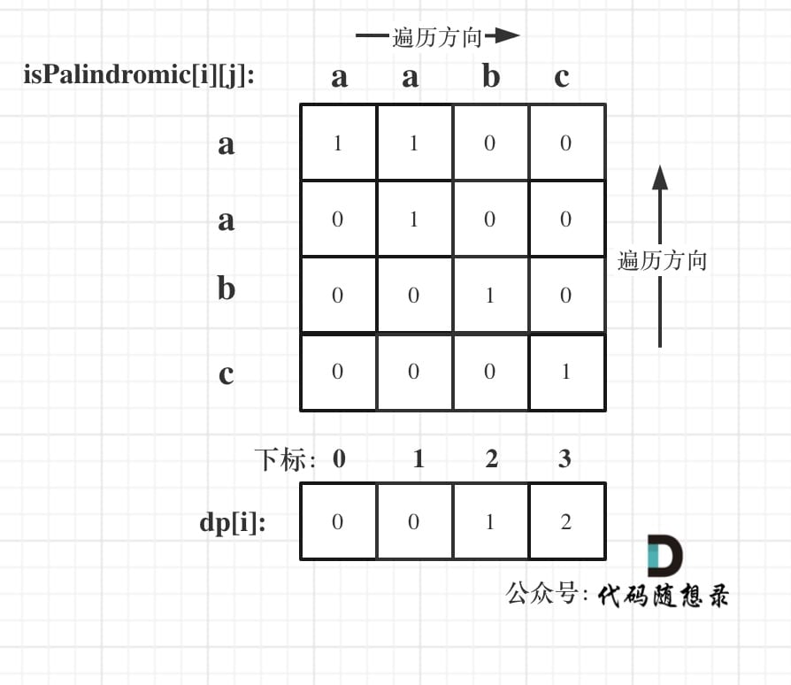

* [做專案（多個 C++、Java、Go、測試開發、前端（front end）專案）](https://www.programmercarl.com/other/kstar.html)
* [刷演算法（兩個月高強度學演算法）](https://www.programmercarl.com/xunlian/xunlianying.html)
* [背面試必考題（八股文）（40 天挑戰高頻面試題）](https://www.programmercarl.com/xunlian/bagu.html)


# 132. 分割回文（palindrome）串 II

[LeetCode 題目連結](https://leetcode.cn/problems/palindrome-partitioning-ii/)

給你一個字串（string） s，請你將 s 分割成一些子字串（substring），使每個子字串都是回文。

回傳符合要求的 最少分割次數 。

範例 1：

輸入：s = "aab"
輸出：1
解釋：只需一次分割就可將 s 分割成 ["aa","b"] 這樣兩個回文子字串。

範例 2：
輸入：s = "a"
輸出：0

範例 3：
輸入：s = "ab"
輸出：1


提示：

* 1 <= s.length <= 2000
* s 僅由小寫英文字母組成

## 解題思路

我們在講解回溯（backtracking）系列的時候，講過了這道題目[回溯演算法（backtracking algorithm）：131.分割回文串](https://programmercarl.com/0131.分割回文串.html)。

本題呢其實也可以使用回溯法，只不過會逾時！（透過備忘（memoization）回溯，也可以通過，感興趣的同學可以自行研究一下）

我們來講一講如何使用動態規劃（dynamic programming, DP），來解決這道題目。

關於回文子字串，這兩道題目大家是一定要掌握的。

* [動態規劃：647. 回文子串](https://programmercarl.com/0647.回文子串.html)
* 5.最長回文子串 和 647.回文子串基本一樣的

這兩道題目是回文子字串的基礎題目，本題也要用到相關的知識點。

動態規劃五部曲分析如下：

1. 確定 dp 陣列（array）（dp table）以及下標（subscript）的含義

dp[i]：範圍是 [0, i] 的回文子字串，最少分割次數是 dp[i]。

2. 確定遞推公式

來看一下由什麼可以推出 dp[i]。

如果要對長度為 [0, i] 的子字串進行分割，分割點為 j。

那麼如果分割後，區間（interval）[j + 1, i] 是回文子字串，那麼 dp[i] 就等於 dp[j] + 1。

這裡可能有同學就不明白了，為什麼只看 [j + 1, i] 區間，不看 [0, j] 區間是不是回文子字串呢？

那麼再回顧一下 dp[i] 的定義： 範圍是 [0, i] 的回文子字串，最少分割次數是 dp[i]。

[0, j] 區間的最小切割數量，我們已經知道了就是 dp[j]。

此時就找到了遞推關係，當切割點 j 在 [0, i] 之間的時候，dp[i] = dp[j] + 1;

本題是要找到最少分割次數，所以遍歷（traversal） j 的時候要取最小的 dp[i]。

**所以最後遞推公式為：dp[i] = min(dp[i], dp[j] + 1);**

注意這裡不是要 dp[j] + 1 和 dp[i] 去比較，而是要在遍歷 j 的過程中取最小的 dp[i]！

可以由 dp[j] + 1 推出，當 [j + 1, i] 為回文子字串

3. dp 陣列如何初始化（initialization）

首先來看一下 dp[0] 應該是多少。

dp[i]： 範圍是 [0, i] 的回文子字串，最少分割次數是 dp[i]。

那麼 dp[0] 一定是 0，長度為 1 的字串最小分割次數就是 0。這是比較直觀的。

再看一下非零下標的 dp[i] 應該初始化為多少？

在遞推公式 dp[i] = min(dp[i], dp[j] + 1) 中我們可以看出每次要取最小的 dp[i]。

那麼非零下標的 dp[i] 就應該初始化為一個最大數，這樣遞推公式在計算結果的時候才不會被初始值覆蓋！

如果非零下標的 dp[i] 初始化為 0，那麼在遞推公式中，所有數值將都是零。

非零下標的 dp[i] 初始化為一個最大數。

程式碼如下：

```CPP
vector<int> dp(s.size(), INT_MAX);
dp[0] = 0;
```

其實也可以這樣初始化，根據 dp[i] 的定義，dp[i] 的最大值其實就是 i，也就是把每個字元（character）分割出來。

所以初始化程式碼也可以為：
```CPP
vector<int> dp(s.size());
for (int i = 0; i < s.size(); i++) dp[i] = i;
```

4. 確定遍歷順序

根據遞推公式：dp[i] = min(dp[i], dp[j] + 1);

j 是在 [0，i] 之間，所以遍歷 i 的 for 迴圈（for-loop）一定在外層，這裡遍歷 j 的 for 迴圈在內層才能透過計算過的 dp[j] 數值推導出 dp[i]。

程式碼如下：

```CPP
for (int i = 1; i < s.size(); i++) {
    if (isPalindromic[0][i]) { // 判斷是不是回文子字串
        dp[i] = 0;
        continue;
    }
    for (int j = 0; j < i; j++) {
        if (isPalindromic[j + 1][i]) {
            dp[i] = min(dp[i], dp[j] + 1);
        }
    }
}
```

大家會發現程式碼裡有一個 isPalindromic 函式（function），這是一個二維（2D）陣列 isPalindromic[i][j]，記錄 [i, j] 是不是回文子字串。

那麼這個 isPalindromic[i][j] 的程式碼是怎麼寫的呢？

其實就是這兩道題目的程式碼：


* [647. 回文子串](https://programmercarl.com/0647.回文子串.html)
* 5.最長回文子串

所以先用一個二維陣列來保存整個字串的回文情況。

程式碼如下：

```CPP
vector<vector<bool>> isPalindromic(s.size(), vector<bool>(s.size(), false));
for (int i = s.size() - 1; i >= 0; i--) {
    for (int j = i; j < s.size(); j++) {
        if (s[i] == s[j] && (j - i <= 1 || isPalindromic[i + 1][j - 1])) {
            isPalindromic[i][j] = true;
        }
    }
}
```

5. 舉例推導 dp 陣列

以輸入："aabc" 為例：



以上分析完畢，程式碼如下：

```CPP
class Solution {
public:
    int minCut(string s) {
        vector<vector<bool>> isPalindromic(s.size(), vector<bool>(s.size(), false));
        for (int i = s.size() - 1; i >= 0; i--) {
            for (int j = i; j < s.size(); j++) {
                if (s[i] == s[j] && (j - i <= 1 || isPalindromic[i + 1][j - 1])) {
                    isPalindromic[i][j] = true;
                }
            }
        }
        // 初始化
        vector<int> dp(s.size(), 0);
        for (int i = 0; i < s.size(); i++) dp[i] = i;

        for (int i = 1; i < s.size(); i++) {
            if (isPalindromic[0][i]) {
                dp[i] = 0;
                continue;
            }
            for (int j = 0; j < i; j++) {
                if (isPalindromic[j + 1][i]) {
                    dp[i] = min(dp[i], dp[j] + 1);
                }
            }
        }
        return dp[s.size() - 1];

    }
};
```


## 其他語言版本

### Java

```java
class Solution {

    public int minCut(String s) {
        if(null == s || "".equals(s)){
            return 0;
        }
        int len = s.length();
        // 1.
        // 記錄子字串[i..j]是否是回文串
        boolean[][] isPalindromic = new boolean[len][len];
        // 從下到上，從左到右
        for(int i = len - 1; i >= 0; i--){
            for(int j = i; j < len; j++){
                if(s.charAt(i) == s.charAt(j)){
                    if(j - i <= 1){
                        isPalindromic[i][j] = true;
                    } else{
                        isPalindromic[i][j] = isPalindromic[i + 1][j - 1];
                    }
                } else{
                    isPalindromic[i][j] = false;
                }
            }
        }

        // 2.
        // dp[i] 表示[0..i]的最小分割次數
        int[] dp = new int[len];
        for(int i = 0; i < len; i++){
            //初始考慮最壞的情況。 1個字元分割0次， len個字元分割 len - 1次
            dp[i] = i;
        }

        for(int i = 1; i < len; i++){
            if(isPalindromic[0][i]){
                // s[0..i]是回文了，那 dp[i] = 0, 一次也不用分割
                dp[i] = 0;
                continue;
            }
            for(int j = 0; j < i; j++){
                // 按文中的想法，不清楚就拿 "ababa" 為例，先寫出 isPalindromic 陣列，再進行求解
                if(isPalindromic[j + 1][i]){
                    dp[i] = Math.min(dp[i], dp[j] + 1);
                }
            }
        }
        return dp[len - 1];
    }
}
```

### Python

```python
class Solution:
    def minCut(self, s: str) -> int:

        isPalindromic=[[False]*len(s) for _ in range(len(s))]

        for i in range(len(s)-1,-1,-1):
            for j in range(i,len(s)):
                if s[i]!=s[j]:
                    isPalindromic[i][j] = False
                elif  j-i<=1 or isPalindromic[i+1][j-1]:
                    isPalindromic[i][j] = True

        # print(isPalindromic)
        dp=[sys.maxsize]*len(s)
        dp[0]=0

        for i in range(1,len(s)):
            if isPalindromic[0][i]:
                dp[i]=0
                continue
            for j in range(0,i):
                if isPalindromic[j+1][i]==True:
                    dp[i]=min(dp[i], dp[j]+1)
        return dp[-1]
```

### Go

```go
func minCut(s string) int {
    isValid := make([][]bool, len(s))
    for i := 0; i < len(isValid); i++ {
        isValid[i] = make([]bool, len(s))
        isValid[i][i] = true
    }
    for i := len(s) - 1; i >= 0; i-- {
        for j := i + 1; j < len(s); j++ {
            if s[i] == s[j] && (isValid[i + 1][j - 1] || j - i == 1) {
                isValid[i][j] = true
            }
        }
    }

    dp := make([]int, len(s))
    for i := 0; i < len(s); i++ {
        dp[i] = math.MaxInt
    }
    for i := 0; i < len(s); i++ {
        if isValid[0][i] {
            dp[i] = 0
            continue
        }
        for j := 0; j < i; j++ {
            if isValid[j + 1][i] {
                dp[i] = min(dp[i], dp[j] + 1)
            }
        }
    }
    return dp[len(s) - 1]
}

func min(i, j int) int {
    if i < j {
        return i
    } else {
        return j
    }
}
```

### JavaScript

```js
var minCut = function(s) {
    const len = s.length;
    // 二維陣列isPalindromic來保存整個字串的回文情況
    const isPalindromic = new Array(len).fill(false).map(() => new Array(len).fill(false));
    for(let i = len - 1; i >= 0; i--){
        for(let j = i; j < len; j++){
            if(s[i] === s[j] && (j - i <= 1 || isPalindromic[i + 1][j - 1])){
                isPalindromic[i][j] = true;
            }
        }
    }
    // dp[i]：範圍是[0, i]的回文子字串，最少分割次數是dp[i]
    const dp = new Array(len).fill(0);
    for(let i = 0; i < len; i++) dp[i] = i; // 初始化 dp[i]的最大值其實就是i，也就是把每個字元分割出來
    for(let i = 1; i < len; i++){
        if(isPalindromic[0][i]){ // 判斷是不是回文子字串
            dp[i] = 0;
            continue;
        }
        /* 
        如果要對長度為[0, i]的子字串進行分割，分割點為j。
        那麼如果分割後，區間[j + 1, i]是回文子字串，那麼dp[i] 就等於 dp[j] + 1。
        這裡可能有同學就不明白了，為什麼只看[j + 1, i]區間，不看[0, j]區間是不是回文子字串呢？
        那麼再回顧一下dp[i]的定義： 範圍是[0, i]的回文子字串，最少分割次數是dp[i]。
        [0, j]區間的最小切割數量，我們已經知道了就是dp[j]。
        此時就找到了遞推關係，當切割點j在[0, i] 之間的時候，dp[i] = dp[j] + 1;
        本題是要找到最少分割次數，所以遍歷j的時候要取最小的dp[i]。dp[i] = Math.min(dp[i], dp[j] + 1);
         */
        for(let j = 0; j < i; j++){
            if(isPalindromic[j + 1][i]){
                dp[i] = Math.min(dp[i], dp[j] + 1);
            }
        }
    }
    return dp[len - 1];
};
```


