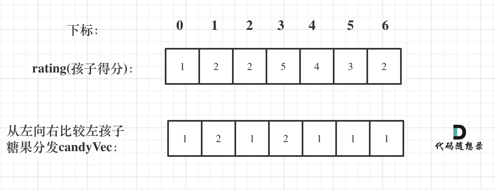
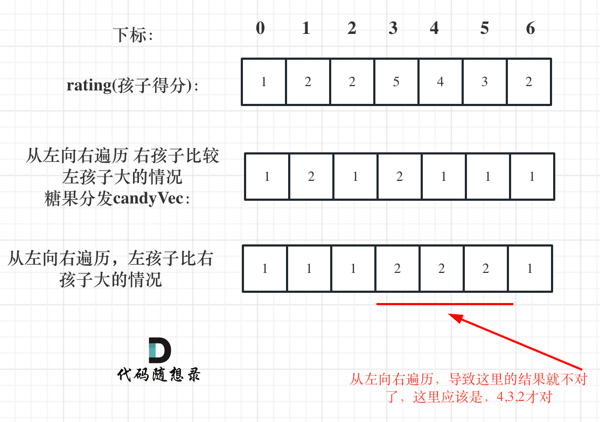
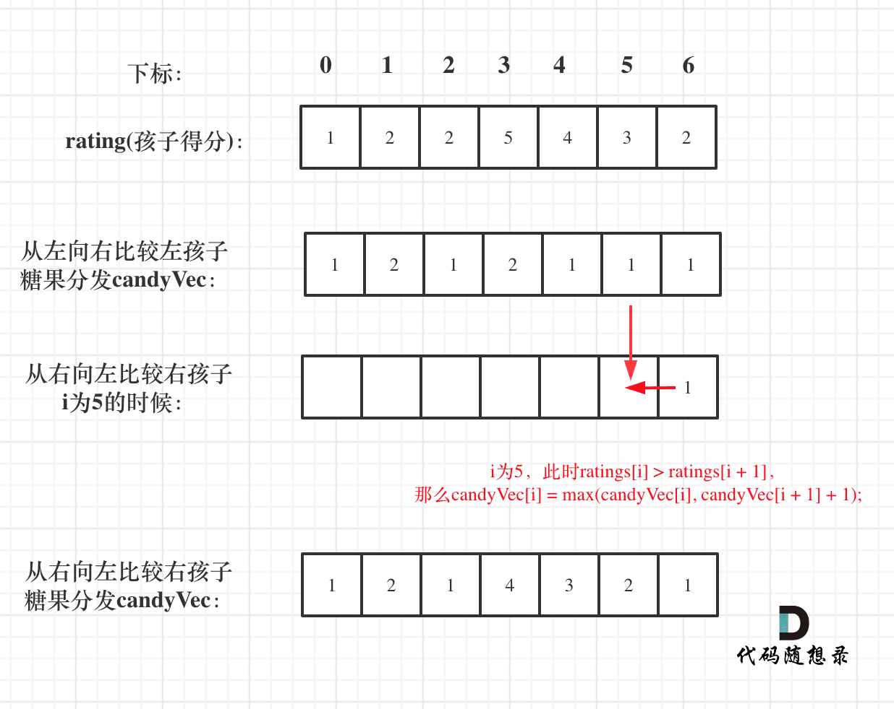

* [做專案（多個 C++、Java、Go、測試開發、前端（front end）專案）](https://www.programmercarl.com/other/kstar.html)
* [刷演算法（algorithm）（兩個月高強度學演算法）](https://www.programmercarl.com/xunlian/xunlianying.html)
* [背面試必考題（八股文）（40 天挑戰高頻面試題）](https://www.programmercarl.com/xunlian/bagu.html)


# 135. 分發糖果

[LeetCode 題目連結](https://leetcode.cn/problems/candy/)

老師想給孩子們分發糖果，有 N 個孩子站成了一條直線，老師會根據每個孩子的表現，預先給他們評分。

你需要按照以下要求，幫助老師給這些孩子分發糖果：

* 每個孩子至少分配到 1 個糖果。
* 相鄰的孩子中，評分高的孩子必須獲得更多的糖果。

那麼這樣下來，老師至少需要準備多少顆糖果呢？

範例 1:
* 輸入: [1,0,2]
* 輸出: 5
* 解釋: 你可以分別給這三個孩子分發 2、1、2 顆糖果。

範例 2:
* 輸入: [1,2,2]
* 輸出: 4
* 解釋: 你可以分別給這三個孩子分發 1、2、1 顆糖果。第三個孩子只得到 1 顆糖果，這已滿足上述兩個條件（condition）。

## 演算法公開課

**[《程式碼隨想錄》演算法影片公開課](https://programmercarl.com/other/gongkaike.html)：[貪心演算法（greedy algorithm），兩者兼顧很容易顧此失彼！LeetCode：135.分發糖果](https://www.bilibili.com/video/BV1ev4y1r7wN)，相信結合影片再看本篇題解，更有助於大家對本題的理解**。


## 解題思路

這道題目一定是要確定一邊之後，再確定另一邊，例如比較每一個孩子的左邊，然後再比較右邊，**如果兩邊一起考慮一定會顧此失彼**。


先確定右邊評分大於左邊的情況（也就是從前向後遍歷（traversal））

此時局部最佳：只要右邊評分比左邊大，右邊的孩子就多一個糖果，總體最佳（global optimum）：相鄰的孩子中，評分高的右孩子獲得比左邊孩子更多的糖果

局部最佳可以推出總體最佳。

如果 ratings[i] > ratings[i - 1] 那麼 [i] 的糖一定要比 [i - 1] 的糖多一個，所以貪心（greedy）：candyVec[i] = candyVec[i - 1] + 1

程式碼如下：

```CPP
// 從前向後
for (int i = 1; i < ratings.size(); i++) {
    if (ratings[i] > ratings[i - 1]) candyVec[i] = candyVec[i - 1] + 1;
}
```

如圖：




再確定左孩子大於右孩子的情況（從後向前遍歷）

遍歷順序這裡有同學可能會有疑問，為什麼不能從前向後遍歷呢？

因為 rating[5] 與 rating[4] 的比較要利用上 rating[5] 與 rating[6] 的比較結果，所以要從後向前遍歷。

如果從前向後遍歷，rating[5] 與 rating[4] 的比較就不能用上 rating[5] 與 rating[6] 的比較結果了。如圖：



**所以確定左孩子大於右孩子的情況一定要從後向前遍歷！**


如果 ratings[i] > ratings[i + 1]，此時 candyVec[i]（第 i 個小孩的糖果數量）就有兩個選擇了，一個是 candyVec[i + 1] + 1（從右邊這個加 1 得到的糖果數量），一個是 candyVec[i]（之前比較右孩子大於左孩子得到的糖果數量）。

那麼又要貪心了，局部最佳：取 candyVec[i + 1] + 1 和 candyVec[i] 最大的糖果數量，保證第 i 個小孩的糖果數量既大於左邊的也大於右邊的。總體最佳：相鄰的孩子中，評分高的孩子獲得更多的糖果。

局部最佳可以推出總體最佳。

所以就取 candyVec[i + 1] + 1 和 candyVec[i] 最大的糖果數量，**candyVec[i] 只有取最大的才能既保持對左邊 candyVec[i - 1] 的糖果多，也比右邊 candyVec[i + 1] 的糖果多**。

如圖：




所以該過程程式碼如下：

```CPP
// 從後向前
for (int i = ratings.size() - 2; i >= 0; i--) {
    if (ratings[i] > ratings[i + 1] ) {
        candyVec[i] = max(candyVec[i], candyVec[i + 1] + 1);
    }
}
```

整體程式碼如下：
```CPP
class Solution {
public:
    int candy(vector<int>& ratings) {
        vector<int> candyVec(ratings.size(), 1);
        // 從前向後
        for (int i = 1; i < ratings.size(); i++) {
            if (ratings[i] > ratings[i - 1]) candyVec[i] = candyVec[i - 1] + 1;
        }
        // 從後向前
        for (int i = ratings.size() - 2; i >= 0; i--) {
            if (ratings[i] > ratings[i + 1] ) {
                candyVec[i] = max(candyVec[i], candyVec[i + 1] + 1);
            }
        }
        // 統計結果
        int result = 0;
        for (int i = 0; i < candyVec.size(); i++) result += candyVec[i];
        return result;
    }
};
```

* 時間複雜性（time complexity）: O(n)
* 空間複雜度（space complexity）: O(n)


## 總結

這在 LeetCode 上是一道困難的題目，其難點就在於貪心策略（greedy strategy），如果在考慮局部的時候想兩邊兼顧，就會顧此失彼。

那麼本題我採用了兩次貪心的策略：

* 一次是從左到右遍歷，只比較右邊孩子評分比左邊大的情況。
* 一次是從右到左遍歷，只比較左邊孩子評分比右邊大的情況。

這樣從局部最佳推出了總體最佳，即：相鄰的孩子中，評分高的孩子獲得更多的糖果。


## 其他語言版本


### Java
```java
class Solution {
    /**
         分兩個階段
         1、起點下標1 從左往右，只要 右邊 比 左邊 大，右邊的糖果=左邊 + 1
         2、起點下標 ratings.length - 2 從右往左， 只要左邊 比 右邊 大，此時 左邊的糖果應該 取本身的糖果數（符合比它左邊大） 和 右邊糖果數 + 1 二者的最大值，這樣才符合 它比它左邊的大，也比它右邊大
    */
    public int candy(int[] ratings) {
        int len = ratings.length;
        int[] candyVec = new int[len];
        candyVec[0] = 1;
        for (int i = 1; i < len; i++) {
            candyVec[i] = (ratings[i] > ratings[i - 1]) ? candyVec[i - 1] + 1 : 1;
        }

        for (int i = len - 2; i >= 0; i--) {
            if (ratings[i] > ratings[i + 1]) {
                candyVec[i] = Math.max(candyVec[i], candyVec[i + 1] + 1);
            }
        }

        int ans = 0;
        for (int num : candyVec) {
            ans += num;
        }
        return ans;
    }
}
```

### Python
```python
class Solution:
    def candy(self, ratings: List[int]) -> int:
        n = len(ratings)
        candies = [1] * n
        
        # Forward pass: handle cases where right rating is higher than left
        for i in range(1, n):
            if ratings[i] > ratings[i - 1]:
                candies[i] = candies[i - 1] + 1
        
        # Backward pass: handle cases where left rating is higher than right
        for i in range(n - 2, -1, -1):
            if ratings[i] > ratings[i + 1]:
                candies[i] = max(candies[i], candies[i + 1] + 1)
        
        return sum(candies)

```

### Go
```go
func candy(ratings []int) int {
    /**先確定一邊，再確定另外一邊
        1.先從左到右，當右邊的大於左邊的就加1
        2.再從右到左，當左邊的大於右邊的就再加1
    **/
    need := make([]int, len(ratings))
    sum := 0
    // 初始化(每個人至少一個糖果)
     for i := 0; i < len(ratings); i++ {
         need[i] = 1
     }
     // 1.先從左到右，當右邊的大於左邊的就加1
    for i := 0; i < len(ratings) - 1; i++ {
        if ratings[i] < ratings[i+1] {
            need[i+1] = need[i] + 1
        }
    }
    // 2.再從右到左，當左邊的大於右邊的就右邊加1，但要花費糖果最少，所以需要做下判斷
    for i := len(ratings)-1; i > 0; i-- {
        if ratings[i-1] > ratings[i] {
            need[i-1] = findMax(need[i-1], need[i]+1)
        }
    }
    //計算總共糖果
    for i := 0; i < len(ratings); i++ {
        sum += need[i]
    }
    return sum
}
func findMax(num1 int, num2 int) int {
    if num1 > num2 {
        return num1
    }
    return num2
}
```

### JavaScript
```Javascript
var candy = function(ratings) {
    let candys = new Array(ratings.length).fill(1)

    for(let i = 1; i < ratings.length; i++) {
        if(ratings[i] > ratings[i - 1]) {
            candys[i] = candys[i - 1] + 1
        }
    }

    for(let i = ratings.length - 2; i >= 0; i--) {
        if(ratings[i] > ratings[i + 1]) {
            candys[i] = Math.max(candys[i], candys[i + 1] + 1)
        }
    }

    let count = candys.reduce((a, b) => {
        return a + b
    })

    return count
};
```


### Rust
```rust
pub fn candy(ratings: Vec<i32>) -> i32 {
    let mut candies = vec![1i32; ratings.len()];
    for i in 1..ratings.len() {
        if ratings[i - 1] < ratings[i] {
            candies[i] = candies[i - 1] + 1;
        }
    }

    for i in (0..ratings.len()-1).rev() {
        if ratings[i] > ratings[i + 1] {
            candies[i] = candies[i].max(candies[i + 1] + 1);
        }
    }
    candies.iter().sum()
}
```

### C
```c
#define max(a, b) (((a) > (b)) ? (a) : (b))

int *initCandyArr(int size) {
    int *candyArr = (int*)malloc(sizeof(int) * size);

    int i;
    for(i = 0; i < size; ++i)
        candyArr[i] = 1;

    return candyArr;
}

int candy(int* ratings, int ratingsSize){
    // 初始化陣列，每個小孩開始至少有一顆糖
    int *candyArr = initCandyArr(ratingsSize);

    int i;
    // 先判斷右邊是否比左邊評分高。若是，右邊孩子的糖果為左邊孩子+1（candyArr[i] = candyArr[i - 1] + 1)
    for(i = 1; i < ratingsSize; ++i) {
        if(ratings[i] > ratings[i - 1])
            candyArr[i] = candyArr[i - 1] + 1;
    }

    // 再判斷左邊評分是否比右邊高。
    // 若是，左邊孩子糖果為右邊孩子糖果+1/自己所持糖果最大值。（若糖果已經比右孩子+1多，則不需要更多糖果）
    // 舉例：ratings為[1, 2, 3, 1]。此時評分為3的孩子在判斷右邊比左邊大後為3，雖然它比最末尾的1(ratings[3])大，但是candyArr[3]為1。所以不必更新candyArr[2]
    for(i = ratingsSize - 2; i >= 0; --i) {
        if(ratings[i] > ratings[i + 1])
            candyArr[i] = max(candyArr[i], candyArr[i + 1] + 1);
    }

    // 求出糖果之和
    int result = 0;
    for(i = 0; i < ratingsSize; ++i) {
        result += candyArr[i];
    }
    return result;
}
```

### TypeScript

```typescript
function candy(ratings: number[]): number {
    const candies: number[] = [];
    candies[0] = 1;
    // 保證右邊高分孩子一定比左邊低分孩子發更多的糖果
    for (let i = 1, length = ratings.length; i < length; i++) {
        if (ratings[i] > ratings[i - 1]) {
            candies[i] = candies[i - 1] + 1;
        } else {
            candies[i] = 1;
        }
    }
    // 保證左邊高分孩子一定比右邊低分孩子發更多的糖果
    for (let i = ratings.length - 2; i >= 0; i--) {
        if (ratings[i] > ratings[i + 1]) {
            candies[i] = Math.max(candies[i], candies[i + 1] + 1);
        }
    }
    return candies.reduce((pre, cur) => pre + cur);
};
```

### Scala

```scala
object Solution {
  def candy(ratings: Array[Int]): Int = {
    var candyVec = new Array[Int](ratings.length)
    for (i <- candyVec.indices) candyVec(i) = 1
    // 從前向後
    for (i <- 1 until candyVec.length) {
      if (ratings(i) > ratings(i - 1)) {
        candyVec(i) = candyVec(i - 1) + 1
      }
    }

    // 從後向前
    for (i <- (candyVec.length - 2) to 0 by -1) {
      if (ratings(i) > ratings(i + 1)) {
        candyVec(i) = math.max(candyVec(i), candyVec(i + 1) + 1)
      }
    }

    candyVec.sum  // 求和
  }
}
```
### C#
```csharp
public class Solution
{
    public int Candy(int[] ratings)
    {
        int[] candies = new int[ratings.Length];
        for (int i = 0; i < candies.Length; i++)
        {
            candies[i] = 1;
        }
        for (int i = 1; i < ratings.Length; i++)
        {
            if (ratings[i] > ratings[i - 1])
            {
                candies[i] = candies[i - 1] + 1;
            }
        }
        for (int i = ratings.Length - 2; i >= 0; i--)
        {
            if (ratings[i] > ratings[i + 1])
            {
                candies[i] = Math.Max(candies[i], candies[i + 1] + 1);
            }
        }
        return candies.Sum();
    }
}
```


