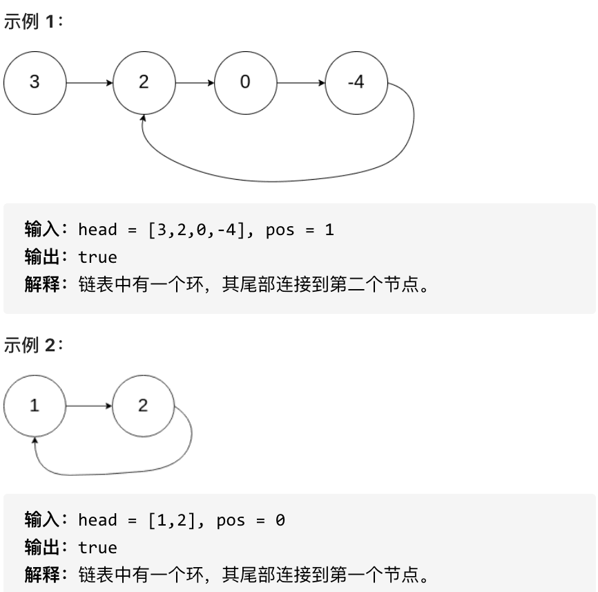
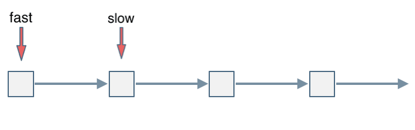
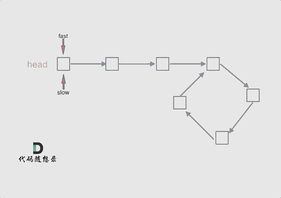

* [做專案（多個 C++、Java、Go、測試開發、前端（front end）專案）](https://www.programmercarl.com/other/kstar.html)
* [刷演算法（algorithm）（兩個月高強度學演算法）](https://www.programmercarl.com/xunlian/xunlianying.html)
* [背八股文（40 天挑戰高頻面試題）](https://www.programmercarl.com/xunlian/bagu.html)


# 141. 循環鏈接串列（circular linked list）

[LeetCode 題目連結](https://leetcode.cn/problems/linked-list-cycle/submissions/)

給定一個鏈接串列（linked list），判斷鏈接串列中是否有環。

如果鏈接串列中有某個節點（node），可以透過連續追蹤 next 指標（pointer）再次到達，則鏈接串列中存在環。為了表示給定鏈接串列中的環，我們使用整數（integer） pos 來表示鏈接串列尾連接到鏈接串列中的位置（索引（index）從 0 開始）。如果 pos 是 -1，則在該鏈接串列中沒有環。注意：pos 不作為參數（parameter）進行傳遞，僅僅是為了標識鏈接串列的實際情況。

如果鏈接串列中存在環，則回傳 true。否則，回傳 false。



## 解題思路

可以使用 fast and slow pointers 法，分別定義 fast 和 slow 指標，從頭節點（head node）出發，fast 指標每次移動兩個節點，slow 指標每次移動一個節點，如果 fast 和 slow 指標在途中相遇，說明這個鏈接串列有環。

為什麼 fast 走兩個節點，slow 走一個節點，有環的話，一定會在環內相遇呢，而不是永遠錯開呢？

首先第一點：**fast 指標一定先進入環中，如果 fast 指標和 slow 指標相遇的話，一定是在環中相遇，這是毋庸置疑的。**

那麼來看一下，**為什麼 fast 指標和 slow 指標一定會相遇呢？**

可以畫一個環，然後讓 fast 指標在任意一個節點開始追趕 slow 指標。

會發現最終都是這種情況，如下圖：

 </img></div>

fast 和 slow 各自再走一步，fast 和 slow 就相遇了

這是因為 fast 是走兩步，slow 是走一步，**其實相對於 slow 來說，fast 是一個節點一個節點地靠近 slow 的**，所以 fast 一定可以和 slow 重合。

動畫如下：





C++ 程式碼如下

```CPP
class Solution {
public:
    bool hasCycle(ListNode *head) {
        ListNode* fast = head;
        ListNode* slow = head;
        while(fast != NULL && fast->next != NULL) {
            slow = slow->next;
            fast = fast->next->next;
            // fast and slow pointers 相遇，說明有環
            if (slow == fast) return true;
        }
        return false;
    }
};
```

## 延伸

做完這道題目，可以再做做 [142. 循環鏈接串列 II](https://programmercarl.com/0142.%E7%8E%AF%E5%BD%A2%E9%93%BE%E8%A1%A8II.html)，不僅僅要找環，還要找環的入口。


## 其他語言版本

### Java:

```java
public class Solution {
    public boolean hasCycle(ListNode head) {
		ListNode fast = head;
		ListNode slow = head;
		// 空鏈接串列、單節點鏈接串列一定不會有環
		while (fast != null && fast.next != null) {
			fast = fast.next.next; // 快指標，一次移動兩步
			slow = slow.next;      // 慢指標，一次移動一步
			if (fast == slow) {   // fast and slow pointers 相遇，表示有環
				return true;
			}
		}
		return false; // 正常走到鏈接串列末尾，表示沒有環
    }
}
```

### Python:

```python
class Solution:
    def hasCycle(self, head: ListNode) -> bool:
        if not head: return False
        slow, fast = head, head
        while fast and fast.next:
            slow = slow.next
            fast = fast.next.next
            if fast == slow:
                return True
        return False
```

### Go:

```go
func hasCycle(head *ListNode) bool {
    if head==nil{
        return false
    } // 空鏈接串列一定不會有環
    fast:=head
    slow:=head // fast and slow pointers
    for fast.Next!=nil&&fast.Next.Next!=nil{
        fast=fast.Next.Next
        slow=slow.Next
        if fast==slow{
            return true  // fast and slow pointers 相遇則有環
        }
    }
    return false
}
```

### JavaScript:

```js
var hasCycle = function(head) {
    let fast = head;
    let slow = head;
    // 空鏈接串列、單節點鏈接串列一定不會有環
    while(fast != null && fast.next != null){
        fast = fast.next.next; // 快指標，一次移動兩步
        slow = slow.next; // 慢指標，一次移動一步
        if(fast === slow) return true; // fast and slow pointers 相遇，表示有環
    }
    return false; // 正常走到鏈接串列末尾，表示沒有環
};
```

### TypeScript:

```typescript
function hasCycle(head: ListNode | null): boolean {
    let slowNode: ListNode | null = head,
        fastNode: ListNode | null = head;
    while (fastNode !== null && fastNode.next !== null) {
        slowNode = slowNode!.next;
        fastNode = fastNode.next.next;
        if (slowNode === fastNode) return true;
    }
    return false;
};
```


